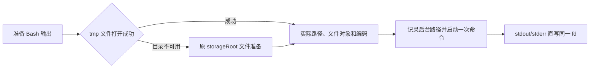

# Bash Tool

## 当前执行合同（2026-09-07）

本次直写重构按根目录 `docs/bash-background-parity.md` 执行：POSIX append/no-follow、Windows w，
stdout/stderr 共用一次 open 的 fd；5 GiB / 5 秒软阈值；根 exit 结算，不等待 pipe EOF。
前台大输出保留完整文件，默认读头部 30,000 bytes（最大 150,000）并返回完整文件路径，不再有
64 MiB artifact 截断。前台小输出和超限文件沿用 best-effort 清理，后台保留文件。
进度尾读 4 KiB，提取 5/100 行预览、字节数和估算总行数，通过 `outputPreview` 进入事件、
V4 工具行。Desktop 只展示预览正文，不显示行数/字节数；TUI 不改，运行态 TaskOutput 仍读头、终态读尾。
2026-09-08：部分输出/保留文件的普通终态 Bash 增加严格 `bash_output` display，携带有界头部正文、真实截断标志和可选 canonical 文件路径；Desktop 显示部分输出提示和文件入口，不解析模型 envelope。

## 定位

`Bash` 执行 shell 命令并返回输出。虽然叫 Bash，但它承担的是通用 shell execution tool 的角色。
provider-visible output 以本文“模型 result 映射规则”为基线。

## 输入契约

`Bash` 输入是严格对象：

| 字段 | 类型 | 必填 | 说明 |
| --- | --- | --- | --- |
| `command` | `string` | 是 | 要执行的命令 |
| `timeout` | `number` | 否 | 前台等待预算，毫秒，受最大值限制；任务提交到后台后该预算立即失效 |
| `description` | `string` | 否 | 人类可读的主动语态说明，用于 UI 和权限说明 |
| `run_in_background` | `boolean` | 否 | 是否转为后台任务。启动结果返回任务 ID 和输出文件路径；完成后向模型注入短通知 |
| `dangerouslyDisableSandbox` | `boolean` | 否 | 请求绕过 sandbox，受策略控制 |

`timeout`、`run_in_background` 和 `dangerouslyDisableSandbox` 在 provider-facing JSON Schema
中仍分别是 `number` / `boolean`，但 runtime validation 兼容常见 semantic 输出，例如
`"30000"`、`"true"`、`"false"`、`"1"`、`"0"`。

`argv`、`cwd` 和 `env` 不属于 Bash tool 的模型可见输入。模型只负责拼 shell command；工作目录
来自 session cwd，环境变量使用执行 adapter 的默认继承策略，并在其上固定设置会话上下文变量：
`CLAUDE_CODE_SESSION_ID`、`CLAUDE_SESSION_ID`、`ZCODE_SESSION_ID` 为当前会话 ID，
`CLAUDE_PROJECT_DIR`、`ZCODE_PROJECT_DIR` 为会话工作区根目录（会话创建时的工作目录，不随 `cd`
变化）。这组变量与 hooks 的插件环境一致，自定义命令 `!` 块转交给 Bash 后、以及插件脚本在
自身进程里读取时都依赖它们。`ExecutionPort` 可以继续保留
`argv/cwd/env` 给 hooks、内部 runner 或后续非模型调用使用，但不得通过 Bash tool schema 暴露给模型。

`_simulatedSedEdit` 一类内部字段不进入模型 schema。ZCode 如支持内部扩展字段，必须与模型可见 schema 分离，防止绕过权限或 sandbox。

## 输出契约

输出：

| 字段 | 类型 | 说明 |
| --- | --- | --- |
| `stdout` | `string` | Bash command 的 stdout/stderr 按 Node `data` 回调顺序合并后的输出 |
| `stderr` | `string` | execution framework 错误、timeout/cancel 信息或 shell reset 提示 |
| `rawOutputPath` | `string?` | 大 MCP 输出原始路径 |
| `interrupted` | `boolean` | 是否被中断 |
| `isImage` | `boolean?` | stdout 是否是图片数据 |
| `backgroundTaskId` | `string?` | 后台任务 ID |
| `backgroundedByUser` | `boolean?` | 是否用户手动后台化 |
| `assistantAutoBackgrounded` | `boolean?` | 是否被 assistant mode 自动后台化 |
| `dangerouslyDisableSandbox` | `boolean?` | 是否请求绕过 sandbox |
| `returnCodeInterpretation` | `string?` | 特殊返回码解释 |
| `noOutputExpected` | `boolean?` | 成功时是否预期无输出 |
| `structuredContent` | `any[]?` | 结构化内容块 |
| `persistedOutputPath` | `string?` | 大输出落盘路径 |
| `persistedOutputSize` | `number?` | 大输出原始大小 |
| `ghRateLimitHint` | `string?` | 未失败的前台 `gh` 结果的原始 stdout 命中 rate limit 时，追加给模型的 system-reminder |

模型可见结果需要处理：

- `Bash` 必须实现专用 `formatModelContent`，模型可见 tool result 默认是 stdout/stderr 拼接后的普通文本，而不是 `BashOutput` JSON 字符串。
- Bash 在 spawn 前异步打开 canonical output，stdout/stderr 共用同一 fd；spawn 后父进程关闭 fd。
  不经过 Node collector，不给用户命令拼接重定向。宿主 POSIX 使用 append/no-follow/0600，
  Windows 使用 "w"（Git Bash 与 CMD 相同）；前后台切换不重开文件。
- open 失败按 spawn_error 结算；子进程写入失败由其退出结果反映。终态空 stdout、非零退出且
  非 137 时，对 output 目录执行 statfs，保留既有空间/inode 输出丢失诊断。
  persistOutput="always" 保留零字节文件身份；其他小输出读回后尽力删除冗余文件。
- Windows 的 append-only 句柄曾触发 MSYS 兼容性问题；改用 Windows "w" 打开方式
  验证通过后，普通 Bash 统一采用直接文件输出。通用 argv/Hook 继续使用 pipe/collector。
- 成功路径需要在模型可见 stdout 前剥离 `<claude-code-hint ... />` 行；hint stripping 先于 image / stale read / gh rate-limit 等后续处理。
- 图片输出转 image content block；如果无法识别为受支持图片块，回退为文本。resize/compress 是模型预算优化，不是唯一的图片判定依据；当 data URI 的 magic bytes 已确认是受支持图片，且 resize 只是通用处理失败时，可以继续按 image block 暴露给 provider，避免把合法图片降级成原始 data URI 文本。若 resize 明确失败在 `too_large`、`invalid_request`、`unsupported`、`empty` 等预算/请求语义上，必须回退文本，不能绕过 provider 图片预算。
- 中断、timeout 或用户取消时，在 stderr 段后追加 `<error>Command was aborted before completion</error>`，让模型能稳定识别未完成状态。
- provider-neutral mapper 本身只根据 `interrupted` 写入 `is_error`；ZCode 生产链路不为非零退出抛异常，所以需要在 provider-visible projection 层把普通失败结果标成 error，并输出 `Exit code N` + stdout/stderr 文本。`grep` 无匹配、`diff` 有差异、`test` 条件为 false 这类语义型非零退出仍不是 provider error。
- 失败结果不走 `<persisted-output>`：正文是 `Exit code N`、内联 stdout（前 30000 字节）、stderr 按行拼接后 trim，不带后台、stale read、gh rate limit 提示。总长超过 `10000 + 1024` 字符时保留前 5000 和后 5000 字符，中间换成 `\n\n... [K characters truncated] ...\n\n`（K 是删去的字符数）。这段正文已按字符限长，Bash 用 `isModelContentBounded` 声明它；通用 serializer 不再按 `resultBudget` 的 30000 字节落盘或截断。stdout 只采集前 30000 字节，所以模型看到的是这 30000 字节内的头尾；超出部分（包括真正的结尾）看不到，也不给文件路径。多字节文本（例如中文）的头尾正文可以超过 30000 字节，也原样内联。成功结果照旧按 30000 字节预算落盘。
- `staleReadFileStateHint` 是面向模型的稳定提示，需要作为文本段追加，不能因为不再 JSON 化结果而丢失。
- 成功结果的大输出写入 tool-results / execution artifact（失败结果不落盘，见上一条），只给 `<persisted-output>` 风格的预览、完整路径和原始大小，不把完整 JSON 或大 stdout 回灌模型上下文。无论持久化来自 execution adapter 的 output artifact，还是来自通用 serializer 的 `resultBudget` artifact，Bash 都必须走同一套 Bash 专用 provider-visible projection。
- 后台任务返回任务 ID 和输出路径，模型可见文案应说明任务仍在后台运行以及输出写入位置。
- 后台任务启动返回必须包含可立即 `Read` 的 canonical output path；即使命令尚未写出任何
  字节，adapter 也要在 spawn 前创建该文件。新 Bash 执行不再生成第二个 stderr 日志文件；
  历史 split-path 字段只用于兼容读取，不能同时暴露给 provider。
- 后台任务完成、失败、timeout、cancel 或 output-limit 停止后，runtime 需要把一条短 `<task-notification>` 注入下一次模型请求的消息历史。通知只包含 `task-id`、可选 `tool-use-id`、状态、摘要和输出文件路径，不包含完整 stdout/stderr；模型需要读取日志时继续调用 `Read`。
- 结构化 `status`、`exitCode`、`stdoutBytes`、artifact path 等字段保留在结构化 output、事件、UI、ZCode app-server 和 debug 中；不应成为模型可见结果的主要形态。
- App 工具卡（V4 投影与 legacy 快照路径相同）：后台命令的 failed 通知覆盖启动 ACK，并写成标准 tool error。Execute 卡片显示通知摘要 `Background command "<description 或 command>" failed with exit code <N>`（没有退出码时省略 `with exit code <N>`），不再显示命令输出或启动 ACK；输出仍在输出文件中。

### 模型 result 映射规则

以下规则是模型可见 result 的映射依据，ZCode 测试需要覆盖以下 case：

- `structuredContent` 非空时直接作为 tool result content 返回，优先级高于 `isImage`、stdout、stderr、后台文案和提示字段。
- `isImage=true` 时只在 stdout 是可识别的 `data:image/*;base64,...` 且图片类型受支持时返回 image content block；否则回退普通文本路径。图片 resize 是 best-effort 优化：如果 resize 失败但共享 magic bytes 检测确认 data URI 和媒体类型一致，并且错误不是明确的预算/请求失败，仍保留原 data URI 并返回 image content block。
- 普通文本 stdout 先执行 `replace(/^(\s*\n)+/, "")` 去掉前导空行，再执行 `trimEnd()` 去掉尾部空白；stderr 使用 `trim()`。
- `persistedOutputPath` 只在非后台文本结果中生成 `<persisted-output>` 文案。预览取规范化 stdout 的前 2000 字符，尽量在前半段之后的最后一个换行处截断；大小文案使用 1024 进制、无空格的 `bytes` / `KB` / `MB` / `GB`，例如 `2KB`。serializer 因 `resultBudget` 额外写入 artifact 时，也要调用 Bash 专用 persisted projection，而不是通用 tool output 文案；但如果超预算内容来自 `structuredContent`，不能在 projection 中重新透传完整 structured blocks，应保留 artifact preview。
- `interrupted=true` 时 stderr 段后追加 `<error>Command was aborted before completion</error>`，并由 mapper 标记为 error。普通失败命令同样是 provider-visible error result；ZCode 在 projection 层生成该结果，而不是依赖 mapper 的 `exitCode` 判断。
- `backgroundTaskId` 生成三种文案：普通后台、用户手动后台化、assistant-mode 自动后台化。普通后台文案必须包含“仍在运行 / 完成会通知 / 用 Read 查看输出文件”；assistant-mode 自动后台化文案必须包含 15s blocking budget 和建议长任务使用 subagent 或 `run_in_background`。
- 前台命令到达超时预算后转后台时（结构化字段 `timedOutAfterMs`，即实际生效的超时毫秒数，可为小数），普通后台文案的第一句改为 `Command did not complete within its <N>s timeout and was moved to the background (ID: <id>).`，N 是四舍五入的秒数（至少 1）；其后的输出路径、完成通知和 Read 提示不变。旧版本读到 `timedOutAfterMs` 时 strict 的 `BashOutputSchema` 解析失败，工具卡退回 JSON 文本显示，不报错（session-persistence.md「旧版本读取新数据」）。
- 未失败结果中，`staleReadFileStateHint` 和 `ghRateLimitHint` 都作为独立文本段追加到最后，不能因为 Bash result 不再 JSON 化而丢失；`ghRateLimitHint` 只在前台结果中根据原始 stdout 计算。失败结果的 provider-visible error 文本不追加这两段。
- 后台 result 即使带有 `persistedOutputPath`，模型可见内容也只使用后台说明文案，不生成 `<persisted-output>`。
- `bash_progress` / tool JSX update、用户手动后台化入口和 `_simulatedSedEdit` 属于 runtime / UI / internal surface；provider-visible conformance suite 只覆盖最终 tool result 内容，端到端事件能力应放在独立 runtime suite。

## 行为语义

核心流程：

1. 校验输入 schema。
2. 动态判断是否只读。只有通过 readonly command validation 的命令才并发安全。
3. 解析命令用于权限匹配。复杂、不可解析或可疑命令默认进入 ask。
4. 根据 sandbox 配置、排除规则和 `dangerouslyDisableSandbox` 决定是否 sandbox。
5. 将 session cwd 规范化为绝对路径并作为命令工作目录；Bash tool 输入不接受自定义 `cwd`。
   命令结束后，捕获到的 cwd 在 workspace 内时，按 workspace root 的写法加相对路径写回 session cwd；离开 workspace 时写回 workspace root 原样。同一目录的不同写法（symlink、`/private` 别名、盘符大小写）写回后与 root 写法相同，环境公告不会把它当成目录变化。
6. 调用统一 shell adapter，以 shell mode 执行 `command`。
7. 默认前台等待预算按配置，允许输入覆盖但不能超过最大值；后台提交后必须清除该预算。
8. 超过进度阈值后开始进度流。
9. 支持 `run_in_background`，并记录 background task。
10. 支持用户或 assistant 自动把长任务转后台。
11. 命令完成后解释特殊返回码，追踪 git 操作和 code indexing 使用。
12. 处理 stdout/stderr、sandbox violation 注释、image 输出、大输出落盘。
13. 返回结构化输出。

## Prompt 约束

Bash prompt 对模型有几类强约束：

- 主智能体不直接获得 `Glob/Grep`；仓库文件名或内容搜索优先委托 `Agent(subagent_type=Explore)`。
- `Glob/Grep` 只在 Explore child runtime 内可用；不要在主 Bash prompt 中要求模型调用不存在的搜索 tool。
- 读文件优先用 `Read`，不要通过 `cat/head/tail/base64/file` 读取文件或图片。
- 编辑文件优先用 `Edit`，不要用 `sed/awk/perl -pi` 做文件修改。
- 写文件优先用 `Write`，不要用 shell heredoc、`echo >` 或重定向创建文件。
- 对用户说明直接回复文本，不要用 `echo/printf` 代替自然语言回答。
- Bash 主要用于运行测试、构建、包管理器、git/gh、系统命令、脚本和没有专用 tool 覆盖的 shell 操作。
- 多个独立命令可并行发多个 Bash tool call。
- 有依赖关系的命令才用 `&&`。
- 避免不必要 sleep，长任务用 background 或 Monitor。
- git destructive 操作必须有用户明确指令。
- 不跳过 hooks 或 signing，除非用户明确要求。
- sandbox 模式下临时文件用 `$TMPDIR`，不直接写 `/tmp`。

ZCode prompt 可以更短，但这些约束应变成 tool policy 和 tests，而不只依赖提示。

provider-visible 描述包括 "Command output is displayed to you, not reliably to the user."、
`timeout` 一行与参数描述里的 "max 600000 for a foreground command"（后台提交会清除前台 deadline，上限只约束前台），
以及 `description` 参数里的 "Say what the command does in plain words…" 一段。Git 段不要求在
commit/PR 末尾附加署名行：ZCode 不下发署名行。

## 权限模型

`Bash` 是动态权限工具：

- `isReadOnly(input)` 通过命令解析和 readonly validation 判断。
- `isConcurrencySafe(input)` 等于只读判断。
- command permission 支持 exact、prefix、wildcard。
- compound command 必须拆分子命令，任一子命令匹配 hook 或 deny 规则都要触发。
- 无法安全解析、过于复杂、包含危险语义时 fail closed 到 ask。
- deny 规则不能被复杂命令降级成 ask。
- sandbox 是独立边界，不等同于 WebFetch 的预授权域名。
- `dangerouslyDisableSandbox` 只能在策略允许且用户批准时生效。

ZCode 应把 shell permission 拆成三个层次：

- `ShellParserPort`：跨平台解析 shell command 和提取审计/权限所需的 argv 视图。
- `ShellPermissionPolicy`：规则匹配、危险语义、readonly 判断。
- `ExecutionPort`：真正执行命令、处理 timeout、cancel、stream、sandbox。

### read-only Bash allowlist

运行时明确选择 `cmd` 或 `legacy-shell` 时，Bash AST 不能证明实际命令只读：例如
`type # & python script.py` 在 Bash AST 中只剩 `type`，CMD 却仍执行后面的 Python。
这两种 shell 不授予只读免审批，也不使用 Bash AST 推导 prefix/wildcard allow；建议授权只保存
完整命令。Build/Edit 默认请求审批，Plan 拒绝（完整命令 allow 也不能越过 Plan）。完整命令和
工具级明确授权、yolo/guarded、已有 deny/ask 匹配保留。此最小修复不增加 CMD 解析能力，
CMD 子命令 deny 匹配仍有原有语法边界；POSIX/Git Bash 及未传 selection 的旧内部调用不变。
`ToolCallStarted` 的副作用能力必须携带同一 shell 上下文计算，避免将经审批的 CMD 再标成只读。

`Bash` 只有在 AST 可安全解析、每条 simple command 的参数、赋值和重定向均通过
readonly policy，且没有 command substitution 等不支持的动态结构时，才会把运行时 capability 降级为
`readOnly=true`、`sideEffectScope="none"`、`riskLevel="low"`、`needsApproval=false`。
plan mode 因此只会自动放行这类 Bash；其他 Bash 仍按 plan mode 的非只读工具硬拒绝。
命令级参数、wrapper、管道和命令链的具体规则见
[AST 权限语义](../../../bash-tool-ast-permission-semantics.md)。文件查看优先使用 `Read`。

`sed` 只开放两个完整脚本子集：`-n` 配合 `p`、`Np`、`N,Mp` 的打印（可带文件），以及
不带文件参数的 `s/pattern/replacement/flags` 标准输入替换。数字地址为正整数，打印指令
可用分号连接；替换只允许 `/` 分隔符、有限转义和 `g/p/i/I/m/M/单个1–9` 标志。
选项必须在脚本前，只支持 quiet、扩展正则、POSIX 和零分隔选项；替换不接受 quiet/零分隔选项。
`-e`/`-f`/`-i`、未知选项、脚本后的 option 形参数、控制字符、额外指令和执行/写入标志均不授予只读资格。
复用 AST argv 检查全部参数和完整脚本；管道、命令链和已支持 wrapper 使用同一策略。
旧 `mode=plan` 与独立 `planEnabled=true` 均沿用非只读拒绝；项目 allow 不能绕过 Plan。
超出子集的 sed 在普通 Build 默认转为审批；Plan 关闭后的其他模式及显式授权沿用原规则。
`cat`、`grep` 等命令的现有安全参数继续有效。权限服务、执行端和展示层不增加 sed 特判。

## 跨平台要求

ZCode 不能只实现 POSIX Bash：

- Windows 需要 cmd adapter；Bash tool 可以 best-effort 使用已安装且可检测到的 Git Bash，但不应要求用户安装 Git Bash。
- Bash tool 始终把模型提供的 `command` 作为 shell command 交给执行 adapter；内部 hooks/runner 如需无 shell 执行，直接使用 `ExecutionPort` 的 argv mode，不通过 Bash tool。
- 工作目录变化、环境变量、路径转义、`.cmd`/`.exe` 查找、信号和 TTY 都要能力检测。
- sandbox、权限和输出截断接口必须与具体 shell 解耦。

Windows 执行 adapter 的最低兼容规则：

- ZCode 在 Windows 上不得要求用户安装 Git Bash、MSYS2、Cygwin 或 WSL 才能运行内置 Bash tool。
- `ExecutionPort` 的内部 `argv` mode 在 Windows 上必须解析 `PATHEXT`，支持 `pnpm` / `npm` / `npx` 这类只在 PATH 上暴露为 `.cmd` 的 shim。
- Windows `PATH` 按 `;` 拆分，去掉条目首尾的双引号（例如 `"C:\Program Files\Git\cmd"`），跳过空条目；Git Bash 检测与自动 git 用同一个拆分函数。引号里含 `;` 的条目仍在 `;` 处拆开（Node 按裸名启动时把它当作一个目录），这种写法不支持。
- 解析到 `.exe` / `.com` 等原生可执行文件时继续使用 `spawn(file, args, { shell: false })`。
- 解析到 `.cmd` / `.bat` 时不得直接 spawn；必须显式通过 `ComSpec` 或 `cmd.exe` 执行，并保留 timeout、cancel、stdout/stderr、trace 和 output budget 行为。参数必须按 `cmd.exe` 规则转义，覆盖空格、双引号、管道、重定向、括号、`&`、`^` 和 `%` 等特殊字符。
- `shell` mode 在 Windows 上默认使用环境里的 `ComSpec` / `COMSPEC`，缺失时退回 `cmd.exe`；在非 Windows 上保持 Node 默认 shell。
- Windows `Bash` tool 可在 `command.shellProfile === "posix-bash"` 的内部执行路径上 best-effort 使用已安装且可检测到的 Git Bash。Git Bash 仍是可选能力：如果无法解析，`Bash` 必须回退到现有 `ComSpec` / `cmd.exe` 路径。
- Windows `Bash` tool 可接受 ZCode runtime settings 注入的内部 shell override。有效的用户配置 override 优先级高于自动 Git Bash 检测。
- ZCode 不新增 Git Bash 路径环境变量，也不设 Windows startup gate。缺失 Git Bash 是 fallback 条件，不是启动失败。
- Generic `ExecutionPort` shell mode 在 Windows 上继续使用 `ComSpec` / `cmd.exe`；Git Bash 自动检测和 shell override 只适用于 Bash tool 创建的 `command.shellProfile === "posix-bash"`。
- `ExecutionPort` 的内部 `env.set` 和 `env.unset` 在 Windows 上都必须按大小写无关规则处理，避免同时传入 `PATH` / `Path` 等重复 key。
- 仓库开发脚本不得依赖 `rm -rf` 等 POSIX-only 命令；需要删除构建目录时使用 Node 脚本或跨平台 package。

## ExecutionPort v1 契约

### Bash 输出路径准备

产品装配入口向 adapter 注入可选 `bashOutputTempDir`，先在系统临时目录的私有
`zcode-bash-<随机标识>/<session>/<tool>-stdout.log` 创建并打开具名文件。
目录不可用时复用原 `outputRootDir`，包括自定义 storageRoot；未注入该选项的 adapter 保持原行为。
具体降级错误集合和保留规则见根目录 `docs/tmpdir-storage-paths-spec.md`。



实际路径在准备后确定，再传入执行链路；移交后台不再次打开文件。准备期间取消或关闭须释放
本次文件，不能启动子进程。初始化快照和启动脚本仍使用原根目录；不改搜索外壳与 watchdog。
临时输出不随 adapter 关闭归档或批量删除，接受系统清理；App 存储占用暂不统计 tmp。

`Bash` 不直接调用 `child_process`。所有子进程副作用必须收敛到 `ExecutionPort`，由 adapter 负责平台差异、进程生命周期和输出预算。

输入语义：

| 字段 | 说明 |
| --- | --- |
| `command.mode = "shell"` | Bash tool 使用的执行模式。模型提供的 `command` 作为 shell command 执行 |
| `command.mode = "argv"` | ExecutionPort 的内部执行模式。hooks、配置 runner 或后续非模型调用可用，不暴露给 Bash tool schema |
| `cwd` | Bash tool 必须传入 session cwd 解析出的绝对路径；不得从 tool input 接收 cwd，也不允许 adapter 隐式回退宿主进程当前目录 |
| `env` | Bash tool 不从模型输入接收 env overlay。handler 固定设置会话 ID 与会话工作区根目录变量（见上文），其余继承默认策略。ExecutionPort 仍保留该字段给内部调用，adapter 负责 Windows 环境变量大小写差异 |
| `timeoutMs` | 普通 `run()` 的单次执行超时；Bash background lifecycle 会把它解释为前台等待预算，并在后台提交时清除 |
| `signal` | 取消信号。取消必须进入结构化 `cancelled` 状态并触发进程树清理 |
| `sandbox` | sandbox 策略请求。第一版可以是 no-op，但字段必须贯穿 trace 和审计 |
| `outputLimit` | generic execution 仍按 stdout/stderr 双流预算；Bash 使用单一合并输出预算，运行期每 5 秒检查严格大于 `5GiB` 的软阈值，正常前台保留完整文件。超出 inline 预算后只返回前缀并标记 `truncated` |
| `onEvent` | 流式事件回调，Bash 覆盖 `started`、`progress`、`completed`、`failed`，不产生逐 chunk 事件；通用执行保留 `stdout`/`stderr` |
| `close()` | 可选 adapter 生命周期方法。宿主 app/session 正常关闭时调用；必须尽力取消并清理该 adapter 仍持有的前台/后台 shell 进程树 |

后台与大输出策略：

| 场景      | 行为                                                                                                                                                    |
| --------- | ------------------------------------------------------------------------------------------------------------------------------------------------------- |
| 前台 Bash | 默认等待预算 `120000ms`，默认最大值 `600000ms`；eligible 命令到达预算后提交为后台任务，首 token 为 `sleep` 的命令则返回结构化 `timed_out`；tool executor 的外层 timeout 只保留清理宽限期 |
| 后台 Bash | `run_in_background=true` 在进程启动成功后立即提交后台；无论是否显式传入 `timeout`，提交动作都必须清除前台 deadline 并解绑 parent turn abort，不能把前台预算误当后台任务寿命 |
| 大输出    | Bash 默认 inline limit 为 `30000` bytes，`BASH_MAX_OUTPUT_LENGTH` 按十进制 `parseInt` 解析，非法或非正数回退 `30000`，最大 `150000`；普通前台 retained file 保留完整原始输出，返回读取时观测大小 |
| 后台事件  | 后台任务启动、状态更新和完成必须转成 session event。TUI/GUI 只消费 session event，不直接读取 adapter 内部状态                                           |
| 模型通知  | 后台任务完成类事件只注入短通知和日志路径；      原始日志留在输出文件中，模型需要时通过 `Read` 获取                                                   |
| compact   | 后台任务原始日志不进入模型消息正文，避免 compact 把长日志写入对话上下文；compact 只保留短通知、事件投影视图和 artifact 引用                             |
| resume    | 第一阶段只恢复事件与消息中已持久化的后台任务信息；如果进程属于上一 CLI 进程的内存任务且无法重新连接，必须在产品语义上视为 lost/orphaned，不假装仍可控制 |
| shutdown  | 宿主 app/session 关闭时，必须先调用 `ExecutionPort.close()`。adapter 需要尽力停止自己拉起且仍可追踪的前台/后台进程树，再释放内部状态；只有无法重新连接的旧进程才允许落成 `lost/orphaned` |

UI / ZCode app-server 后台任务面板契约：

- core 必须把 `BackgroundTaskStarted`、`BackgroundTaskUpdated`、`BackgroundTaskCompleted` 作为后台 Bash 的唯一 UI 通知入口。payload 至少包含 `taskId`、`terminalId`、`status`、`cancellable`、`pid`、`stdoutBytes`、`stderrBytes`、`stdoutTail`、`stderrTail`、`outputPath`、`outputBytes` 和 `outputTruncated`。
- TUI、GUI、ZCode protocol client 不读取 `ExecutionPort` 内部 map；它们只维护 session event 投影，并把 running 且 `cancellable=true` 的任务展示为可停止的后台 terminal。
- kill/cancel 是显式用户动作，不是 permission approval；点击 kill 后 UI 调用 session 层 `cancelBackgroundTask(taskId)`，core 再调用 `ExecutionPort.cancelBackgroundTask`，并发出 `cancelRequestedAt` 更新和最终 completed/cancelled/lost 事件。
- ZCode app-server 兼容层把后台任务映射成标准 `tool_call` / `tool_call_update`，同时在 `_meta["zcode.dev/backgroundTask"]` 内暴露 `taskId`、`terminalId`、`cancellable` 和扩展方法 `zcode.dev/backgroundTask/cancel`。不理解扩展的 ZCode protocol client 仍能展示长任务状态，理解扩展的 client 可以实现后台任务 panel 和 kill 按钮。
- TUI 兼容层保留 `backgroundTerminals` screen state 和 `cancelBackgroundTask(taskId)` 回调接口；具体快捷键、弹窗或 side panel 可以独立演进，不改变 core event 契约。
- prompt/stall 通知属于后台任务状态更新，默认不需要用户确认。只有需要用户选择时才进入自然语言确认流程，不要求用户输入 shell 命令。

### Bash timeout / background lifecycle

Bash 使用专用 lifecycle capability，不改变通用 `ExecutionPort.start()`。默认值由 bootstrap
从运行环境解析并注入 runtime：

- `BASH_DEFAULT_TIMEOUT_MS` 按十进制 `parseInt` 解析；结果为正数时生效，否则使用
  `120000`。
- `BASH_MAX_TIMEOUT_MS` 按十进制 `parseInt` 解析；结果为正数时使用
  `max(configuredMax, default)`，缺失或非法时使用 `max(600000, default)`。
- 单次调用的有效前台预算为
  `Math.min(input.timeout || defaultTimeoutMs, maxTimeoutMs)`。

```text
spawning
  |-- abort / spawn failure --> terminal (no task id)
  |-- explicit -------------> COMMIT_BACKGROUND
  |-- eligible foreground --> running -- complete --> foreground result
  |                                  \-- deadline --> COMMIT_BACKGROUND
  \-- first-token sleep ----> running -- deadline --> timed_out / kill

COMMIT_BACKGROUND
  state CAS -> clear deadline -> detach parent abort -> register adapter task
  -> root shell exit => completed（停止轮询，不等待后代）
  -> task stop | adapter close | persisted-limit event | periodic observer

subagent_child owner constraints
  -> default 3600000ms max runtime | owner subagent cancellation
```

`RuntimeTaskRegistry` 继续只负责 task 投影、stop 路由和通知；进程 deadline、abort 与
background commit 由 execution adapter 内的 Bash lifecycle 持有。commit 后的“脱离”仅指
脱离当前 foreground deadline 和 parent turn，进程仍归当前 adapter/session 所有。对于
`subagent_child`，还要遵守 owner 生命周期：background Bash 默认最长运行
`3600000ms`（可由内部 subagent runtime 配置覆盖），owner subagent 被取消时清理其仍在运行
的 background Bash；owner 正常完成本身不终止已提交任务。

关闭语义补充：

- `Bash` tool 不直接持有子进程句柄；关闭责任仍收敛在 `ExecutionPort`。
- `ZCodeApp.close()`、ZCode app-server `closeSession`、TUI 切换 session、CLI `--prompt` 结束后的 app cleanup，都是 `ExecutionPort.close()` 的合法调用点。
- CLI 进程收到 shutdown 信号时也必须走同一条 cleanup 链路：
  - `SIGINT` 和 `SIGTERM` 在所有平台注册。
  - POSIX 平台额外注册 `SIGHUP`，覆盖终端关闭或父 shell 退出场景。
  - signal handler 必须先取消当前 prompt/turn，再调用当前 app 的 `close()`，最后按信号语义退出进程。
  - cleanup 必须是幂等的，避免 signal handler 和正常 `finally` 双重关闭同一个 `ExecutionPort`。
- `ExecutionPort.close()` 需要同时覆盖：
  - 正在执行的前台命令。
  - 已 background 化且仍由当前 CLI 进程持有控制权的任务。
  - output limit / timeout / user cancel 之外的“宿主正在退出”场景。
- adapter 应优先走结构化 cancel/terminate 路径，再 fallback 到平台相关的进程树 kill；不能只丢弃内部引用，留下 detached shell 继续运行。
- Bugfix 记录：POSIX 上 `ExecutionPort` 使用 detached spawn / 独立进程组是为了能通过负 PID 终止整棵命令进程树；如果 CLI 在没有 signal cleanup 的路径中退出，OS 不会自动杀掉该进程组，`npm dev`、Vite、Node server 等长跑子进程会继续存活。因此 `detached` 必须和全局 shutdown cleanup 成对出现。

### 子进程诊断日志

系统侧记录（任务管理器、Windows 资源耗尽事件 2004 等）只认 pid。为了把占用内存或 CPU 的
进程对回具体的工具调用，Bash 在 CLI 日志里按 info 级写两条结构化记录：

| event                              | 写入时机                       | 字段                                                                        |
| ---------------------------------- | ------------------------------ | --------------------------------------------------------------------------- |
| `tool.bash.process.started`        | 子进程 spawn 后（前台和后台）  | `toolCallId`、`pid`、`runInBackground`                                      |
| `tool.bash.process.exited`         | 前台命令结束                   | `toolCallId`、`pid`、`exitCode`、`signal`、`durationMs`、`executionStatus`、`timedOut`、`cancelled` |
| `background_task.tracking.terminal` | 已转后台的命令结束（既有日志） | 在既有字段上补 `toolCallId`、`pid`、`exitCode`、`signal`、`durationMs`      |

pid 是 adapter spawn 的根进程：POSIX 上是 `-c` 启动的 shell（也是进程组 id）；Windows 上是
Git Bash 的 `bash.exe` 或 `cmd.exe` 外壳，命令本身是它的子孙进程，需要按进程树对应。
日志不写命令文本，命令仍只在 trace/transcript 中。

显式后台（`run_in_background: true`）时，adapter 在 `started` 事件里就提交后台，之后
不再把事件转发给 handler，所以这条启动日志由 handler 在拿到 `backgrounded` 结果后用
`task.pid` 补写；`auto_on_timeout` 在前台阶段已收到 `started`，同一次调用只写一条。

## 分阶段目标

ZCode 的 Bash v2 按本项目的 `ExecutionPort`、session event、permission service 和 adapter 边界重写。禁止让 `BashTool` 直接持有子进程、文件描述符、terminal 状态或权限规则实现。

第一阶段先补长任务和大输出的运行时能力：

- progress：等待约 2 秒后每 1 秒读取末尾最多 4 KiB，计算最近 5 行、100 行预览和总行数。
  全文件落入尾读时直接计数，否则按原始字节比例估算并保持估计值不下降。
  同一 Node 进程/内部周期共用进度 interval；约 2 秒后订阅，下一 tick 尾读，最后一个订阅退出即释放。
  慢读取不叠加且不阻塞其他任务；终态/后台移交拒绝迟到结果。大小 watchdog 仍逐任务管理。
  ExecutionEvent -> ToolCallProgress -> V4 ToolCallRow.outputPreview  -> Execute renderer；
  桌面 continuous 与手机 replayable 复用现有各自通道；后台移交或终态清除预览。
- direct file output：子进程直接写同一 canonical 文件；无 collector、WriteStream 或 data listener。
  通用 argv/Hook 仍为双 pipe。Windows 按宿主使用 "w"，POSIX append/no-follow，路径只打开一次。
- lifecycle：root exit 立即有界读取并结算；不等待 pipe EOF 或后代，不在正常退出时杀后代。
  Stop/abort/硬超时/超限在任务存活时复用平台杀树；终态后停止 watchdog，不重新接管后代。
- output limit：前后台均每 5 秒检查严格 size > 5 GiB，终止进程树并返回 cancelled、137、
  output_limit 和 `Command killed: output file exceeded 5GB`。没有写盘硬截断或退出时补判。
- foreground retention：最终 stdout 默认头读 30000 bytes（配置最高 150000）。普通大输出保留
  完整文件，模型拿到有界头部摘要、完整路径和观测大小；不再执行 64 MiB 截断。
  小输出和前台超限文件尽力清理；后台保留文件。Bash 忽略 maxArtifactBytes。
- stream artifact identity：只生成 canonical output path，兼容 stdoutPersistedOutputPath；
  不暴露第二个 stderr path。
- background notifications：后台任务启动、pid 更新、完成、失败、timeout、cancel、output limit 都必须转成 session event，TUI 不读取 adapter 内部状态。Bash 后台任务完成后还必须进入 pending notification 队列，在下一次模型请求前注入 `<task-notification>`，让模型知道可以用 `Read` 打开输出文件。
- background panel：core 为 UI 留出后台 terminal 投影和 cancel 接口；ZCode app-server 用标准 tool_call + zcode meta 承载，TUI 用 screen state + callback 承载。
- prompt stall detection：后台任务输出在一段时间内不增长，且 tail 像交互式 prompt 时，需要发出 blocked/stalled 通知，提示模型改用非交互参数或管道输入。

第二阶段补 shell policy 能力：

- readonly analysis：`isReadOnly` 和 `isConcurrencySafe` 必须由命令分析结果动态决定，不再固定为 false。
- command parser：compound command 必须拆子命令；不可解析、包含 command substitution、危险重定向或过多 subcommand 时 fail closed 到 ask/deny。
- prefix permission：支持 exact、prefix、wildcard rule，并禁止为裸 shell、sudo、env、xargs、解释器 eval 类命令生成宽泛 allow rule。
- sandbox decision：sandbox 是否启用、是否被绕过、为什么绕过，都要记录在 trace 和 tool result 中；adapter 不支持时必须暴露 unsupported/no-op 状态。
- command semantics：git、sed、jq、find、rg 等常见命令需要专门规则，避免把高风险操作伪装成只读命令。

第三阶段补 interactive terminal：

- process session：长任务返回可继续交互的 process id，支持后续 write stdin、poll output、terminate。
- PTY support：支持 TTY、窗口 resize、stdin close，并保留非交互 fallback。
- durable resume：后台任务状态要能持久化；无法重新连接的旧进程必须显示为 lost/orphaned。
- token-aware truncation：模型侧结果采用 head+tail 或中间省略策略，记录原始 bytes/tokens 和 omitted bytes。
- cross-platform decode：Windows codepage、UTF-8 边界和二进制/图片输出需要统一解码与内容类型判断。

输出语义：

| 字段 | 说明 |
| --- | --- |
| `status` | `completed`、`failed`、`timed_out`、`cancelled` 或 `spawn_error` |
| `exitCode` / `signal` | 子进程真实退出状态。非零退出码不抛异常，由调用方按 tool 语义解释 |
| `stdout` / `stderr` | 每路输出包含 `text`、`bytes`、`truncated` 和可选 artifact 引用 |
| `durationMs` | 从 spawn 请求到进程完成或被清理完成的耗时 |
| `error` | 仅用于启动失败、sandbox 失败、不可恢复 I/O 异常等结构化错误 |

第一阶段落地范围：

- contracts 定义 `ExecutionPort` 运行时契约。
- adapters 提供 Node.js `spawn` 实现，覆盖 shell mode、内部 argv mode、cwd/env overlay、streaming、timeout、cancel、输出截断和非零退出码。
- app/session lifecycle 需要显式调用 `ExecutionPort.close()`，把 CLI/TUI/ZCode app-server 正常关闭纳入 shell 清理链路。
- core `Bash` handler 只依赖 `ExecutionPort`，不再直接导入 `child_process`。
- background task 第一版由 `ExecutionPort.start/getBackgroundTask/cancelBackgroundTask` 提供内存状态；sandbox profile 和大输出 artifact store 保留接口字段，后续接入 `ShellExecutionService` / `TaskOutputStore`。
- TUI 第一版显示当前 running background terminal 数量，维护可取消状态和 tail preview，并在后台任务完成时通过 session event 自动更新。
- ZCode app-server 第一版把后台任务转成可展示的 tool call，并通过 `zcode.dev/backgroundTask/cancel` 支持客户端手动停止。

## 校验与错误

关键失败路径：

- 命令不可解析。
- 命令过于复杂，无法静态分析。
- 命令包含 command injection 风险。
- readonly 判断失败，需要进一步权限。
- Windows UNC path 或可疑路径。
- compound `cd` 加 `git` 等高风险组合。
- sandbox 违规。
- timeout。
- 用户中断。
- 子进程启动失败。
- 非零退出码且语义判断为错误。
- 输出过大，需要落盘。

这些错误应通过 `ShellExecutionError`、`ShellPermissionError`、`ShellTimeoutError`、`ShellInterruptedError` 等结构化类型上抛。

## ZCode 设计结论

文件 mutation 必须优先使用专用工具：

- 读取文件使用 `Read`，不要用 `cat`、`head`、`tail`、base64 或脚本绕过模型可见内容契约。
- 修改既有文件优先使用 `Edit` 或 `ApplyPatch`，不要在 `Bash` 中写 Python、Node、sed、awk、perl、PowerShell 或 shell redirection 脚本来替换文件内容。
- 创建或完整重写文件使用 `Write`；只有用户明确要求批处理脚本，或格式化/生成类命令天然由项目工具完成时，才允许通过 `Bash` 产生文件变更。
- 当 `Edit` 因 `old_string` 匹配失败时，模型应重新读取相关范围、扩大上下文、使用 `ApplyPatch`，或向用户报告歧义；不应自行写脚本试探性替换。

`Bash` 不应该直接落在业务逻辑里。第一版建议拆为：

- `BashTool`：schema、prompt、permission 入口、result serialization。
- `ShellExecutionService`：生命周期、progress、timeout、cancel、background task。
- `ExecutionPort`：跨平台进程执行 adapter。
- `SandboxPort`：sandbox 决策和执行包装。
- `CommandAnalysisService`：只读判断、危险命令识别、permission matcher。
- `TaskOutputStore`：大输出、后台输出和 artifact 引用。

最低测试集：

- 只读命令自动 allow 或低权限执行。
- 写入命令触发 ask。
- deny rule 对 compound command 生效。
- timeout 和 cancel。
- 大输出落盘。
- background task 可恢复和可通知。
- sandbox override 需要权限。
- Windows 路径和 shell adapter 的单元测试。
