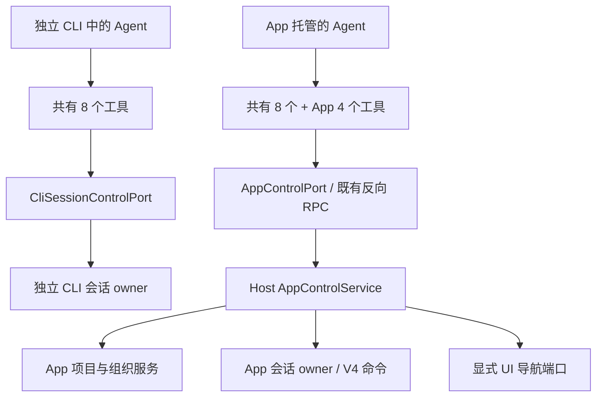
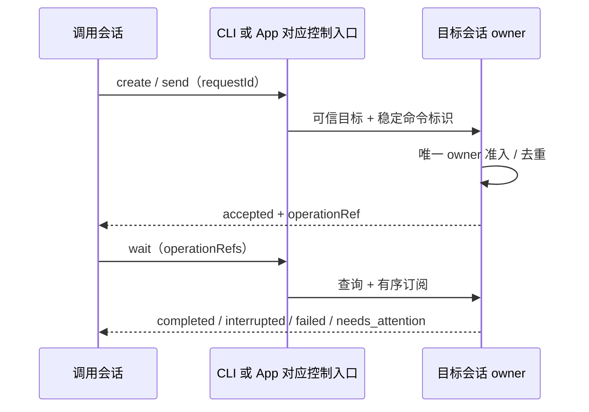
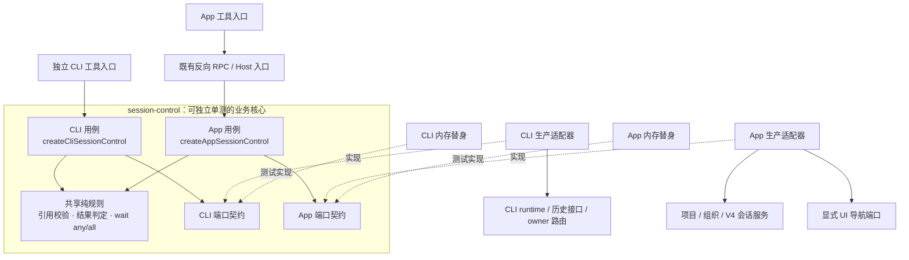
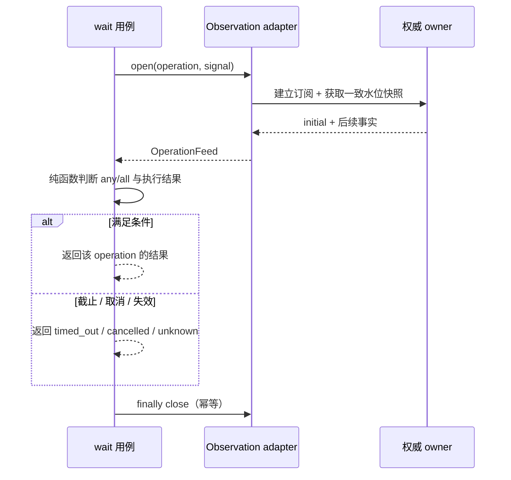

# ZCode 会话工具设计：独立 CLI 与 App

状态：2026-10-23 版本已实施，验证范围见[覆盖矩阵 SCT 节](../testing/conversation-session-e2e-coverage-matrix.md)。源码基线：`staging@a06fccd0db`。第 0 节为 2026-11-02 修订，验证范围同样见覆盖矩阵。

用户已批准按本设计实施：独立 CLI 和 App 两种运行位置、独立核心包、端口注入和独立单测；对外 MCP 不在本期范围。以下合同对应本期实现，具体运行证据和未验证范围已登记到覆盖矩阵，不把实现完成等同于发布。后台 CLI 先采用本文的发起 runtime 托管及退出收口策略；跨进程目标无法确认 owner 时拒绝写入，禁止静默另起同一历史。

## 0. 统一工具名与会话 ID 参数（2026-11-02 修订）

用户批准：模型只看到一套工具名，App 是独立 CLI 的父集。旧的 `cli_*` / `app_*` 前缀删除，不保留别名。下文第 1–8 节描述的端口、owner 与 guard 不变，已改用新工具名。

```text
共有 8 个（两种运行位置都注册，名字和意图相同）
  ListSessions  ReadSession  CreateSession  ForkSession
  SendToSession  WaitSessions  InterruptSession  RenameSession
App 独有 4 个（只在 App 托管的 Agent 注册）
  ListProjects  OpenSession  SetSessionArchived  SetSessionPinned

独立 CLI 中的 Agent ─▶ 共有 8 个 ─▶ CliSessionControl（本机 CLI 会话库 + 本进程 owner）
App 托管的 Agent    ─▶ 共有 8 个 + App 4 个 ─▶ AppSessionControl（Host 反向 RPC）
```

- 运行位置仍由可信启动装配决定，模型不能切换。同一个工具名在两处由不同实现完成，结果结构相同。
- 输入 schema 按运行位置注册：共有工具的通用参数一致；只有 App 有意义的参数只出现在 App 版 schema，例如 `CreateSession.project`、`ListSessions.project/workspace/archived`。独立 CLI 版 `CreateSession` 使用 `cwd`。模型只看到当前运行位置注册的那一份 schema。
- 工具声明（描述、权限名、预算、超时）只维护一份，按名字共用；权限规则名从 `session_control.<cli|app>.<method>` 改为 `session_control.<method>`。

### 0.1 会话 ID 参数

所有指向已有会话的参数，在原完整引用之外新增只填会话 ID 的写法，两者必须且只能提供一个：

| 位置                                                                       | 原写法                               | 新增写法                           |
| -------------------------------------------------------------------------- | ------------------------------------ | ---------------------------------- |
| read / fork / send / interrupt / rename / open / set_archived / set_pinned | `session: SessionRef`                | `sessionId: string`                |
| WaitSessions 的每个 operation                                              | `{ session: SessionRef, commandId }` | `{ sessionId: string, commandId }` |

- 解析在可信一侧完成，结果与传完整引用等价，之后沿原有授权、owner 与 guard 执行，不新增权限路径。
- App：在调用者绑定的 Host 中按唯一索引 `(host_id, task_id)` 查找，只查本 Host 的产品会话；未找到返回 `forbidden`，与原完整引用在本 Host 不存在时一致。其他来源的会话仍不能操作，不按 ID 跨来源搜索。
- 独立 CLI：按 ID 在本机 CLI 会话库查找，补全 workspace；写操作仍要求本进程托管该根会话（见 0.2）。
- 两种写法都提供、都缺失或 ID 不合法时返回 `invalid_input`；完整引用与 ID 同时出现视为输入错误，不做一致性推断。
- list / read 结果继续返回完整引用及 workspace、项目和来源，方便展示和后续调用；模型后续可只用其中的 `sessionId`。
- `#sess_*` / `#session_*` 引用提醒改为指向 `ReadSession` 的 `sessionId` 写法（随 ReadSessionContext 删除一起修改）。

### 0.2 独立 CLI：读取不要求 owner

读和写使用不同边界：读只需本机用户可访问 CLI 会话库，写仍需唯一 owner。

| 工具           | 修订后                                                                                                                      |
| -------------- | --------------------------------------------------------------------------------------------------------------------------- |
| `ListSessions` | 读本机 CLI 会话库；默认只列根会话（`parent_id is null`），可选 `workspace` 收窄到一个目录，标题子串过滤，按最近更新排序分页 |
| `ReadSession`  | 任意会话 ID 均可读，包括子会话和历史会话；不恢复、不启动 runtime、不认领                                                    |
| 其他写工具     | 不变：只对本进程 manager 托管且已验证来源的根会话生效，未知 owner 明确拒绝                                                  |

- list / read 只读持久层，摘要状态来自持久事实；本进程托管的根额外带实时状态和 executionId，其他会话的 status 为 `unknown`，availableActions 只含 `readSession`。
- 读取正文：从最早消息起按时间分页，只返回 active 分支，并按产品对话界面同一判据（`getConversationMessageProjectionPolicy`）只保留真实用户输入、可见回复和时间线事件。运行时提醒、环境信息和中断标记虽以 user 消息落库，也不返回。
- 不新增索引表或缓存；CLI 会话库由 CLI 自己持有，App 与独立 CLI 默认共用同一个库时，独立 CLI 也能读到 App 会话的正文，这符合“读可以任意读”。

### 0.3 不变部分

- 两种运行位置的端口、owner、反向 RPC、Host 授权、fence、去重和 wait 观察链路不变。
- 子代理、workflow 子会话和辅助会话仍不注册这些工具。
- 重试与长轮次 wait 两个缺陷修复见 0.6、0.7；ReadSessionContext 删除见 0.8。

### 0.4 读取过滤的缺陷修复（随本修订一起实施）

现象：App 的 `ReadSession` 把运行时提醒、环境信息和中断标记当作 `role=user` 返回；桌面 E2E 中一页正文因此超过 32 KiB 被转成文件引用。原因：Host 读正文走 CLI 的 `session/messages` forward 分页，该路径只做 active 分支投影，没有可见性过滤；staging 起这类隐藏提醒都会落库。

修复：过滤放在 CLI 唯一 owner 的 forward 分页里，先过滤再分页，保证 `limit` 与 cursor 都只落在可见消息上；默认与 backward 读取保持原行为，不影响其他消费者。forward 的 cursor 必须命中可见消息，找不到（例如两页之间发生 rewind）时返回错误，不从头重读出重复页。独立 CLI 的读取用同一判据（`active-transcript` 模块）。

### 0.5 独立 TUI：后台会话的审批转到当前 TUI

现象：独立 TUI 里 `CreateSession` / `ForkSession` 建的后台根，工具一旦需要审批就被立即拒绝，用户看不到询问。主会话中不经用户提交启动的回合有同一缺陷：空闲时到达的后台任务通知由 Core 自己排空队列开回合（`runtime-command-queue.ts` 的 `enqueueRuntimeCommand`），不经过 `submitPrompt`，询问同样落到空回调。这一点只有代码路径证据，SCT08 运行时用例只覆盖后台根。

原因有两个：

1. 装配后台根时没有传交互端口，Core 退回拒绝 broker。
2. TUI 的审批回调只在单次 `submitPrompt` / `sendInput` 调用内有效，调用结束就恢复为空。发起者这一轮结束后，后台会话才可能开始问，此时没有回调。

修复后的链路：

```text
用户提交 ─▶ 会话 A（发起者，可以是 yolo）
              │ CreateSession / ForkSession
              ▼
          会话 B（后台根，固定 build；A 的 yolo 不传给 B）
              │ 工具需要审批
              ▼
          启动方传入的同一个 permissionBroker
              │
              ├─ 独立 TUI ─▶ TUI 挂载期登记的审批入口 ─▶ 审批队列（FIFO，只显示队首）
              │                                             │ 面板上方：来自后台会话 <sessionId>
              │                                             ▼
              │                                         用户选择 ─▶ 只回答 B 的这一次请求
              │
              └─ headless（-p）─▶ 立即拒绝 ─▶ B 的工具收到拒绝结果
```

时序（A 的这一轮可以早已结束）：

```text
用户        TUI 审批入口        会话 A              会话 B              WaitSessions（可选）
 │ 提交 ──────────────────────▶ 回合开始
 │                               │ CreateSession ──▶ 创建并接纳首条输入
 │                               │ 回合结束            │
 │                                                     │ Write 需要审批
 │                               PermissionRequested ──┼─────────────────▶ needs_attention
 │             ◀─ requestPermission(sessionId=B) ──────┤
 │ ◀ 面板 ─────┤                                       │ 等待（不占用 A）
 │ 选择 ──────▶│ ── 结果 ─────────────────────────────▶│ 工具执行或收到拒绝
 │                                                     │ 回合继续
```

规则：

- 审批入口只有一个 owner：TUI 挂载时登记，卸载时注销，不再按单次提交切换。未登记期间（启动中、已卸载）仍然 fail closed 拒绝。
- 只有用户能回答。A 没有批准入口，`WaitSessions` 只报告 `needs_attention`；用户批准后 B 继续运行，A 可以再次等待。
- 来源标注只比较 `request.sessionId` 与当前主会话：不同就在面板上方显示后台会话 ID，相同就不显示。主会话的子代理和 workflow actor 的请求 ID 已改写为主会话，不显示；B 的子代理显示 B。不新增协议字段或持久状态。
- 所有来源共用一个 FIFO 队列。面板默认选中 Deny，用户正在输入时弹出，误按 Enter 只会拒绝；草稿保留。
- B 被中断、用户切换主会话（`/new`、`/resume`、fork）或进程退出时，owner 关闭 B，broker 的 signal 中止，请求自动从队列移除。
- “Always allow in this project” 写入 B 所属项目的规则。`CreateSession` 校验 cwd 等于 A 的 workspace，所以这就是当前项目，语义与主会话的审批相同。
- headless 的后台根使用同一个 headless broker：除 CreateWorkflow / AmendWorkflow 门禁旁路外全部拒绝，与主会话一致。
- 验证：真实伪终端 TUI 用例与 headless 进程用例见覆盖矩阵 SCT08。

### 0.6 App：创建重试复用首次回执的目录

现象：App `CreateSession` 用同一 `requestId` 重试，两次之间项目主目录变了。2026-11-03 本机 E2E（SCT06 红探针）实测：重试返回的 sessionId 不变，`workspacePath` 却变成新主目录；Host 为新主目录另起了一个 agent 进程，命令发到了错误的 owner。之后用这个引用的调用都会找错 owner。本机所有 CLI 进程共用一个会话库并按 commandId 去重，所以这次没有建出第二个 CLI 会话；Host 是否在新主目录下留下孤立的预留行未在运行时核实。

原因：commandId 由调用者与 `requestId` 派生，两次相同。Host 的创建回执按 `(workspace_key, client_id, command_id)` 存。重试时 App 控制重新解析项目当前主目录，用新目录拼目标并查回执，查不到就按新目录重新预留。

```text
第 1 次 create(R)  commandId=C ─▶ 主目录 W1 ─▶ 回执 (W1, client, C) → sess_A
                    ── 用户把项目主目录改成 W2 ──
第 2 次 create(R)  commandId=C ─▶ 主目录 W2 ─▶ 回执 (W2, client, C) 缺失 → 按 W2 预留、发往 W2 owner
                                              返回 { sessionId: sess_A, workspacePath: W2 }   ← 缺陷
修复后：先按 (client, C) 查回执 ─▶ 命中 sess_A ─▶ 目录取 sess_A 的任务行（W1）─▶ 发回 W1 owner 去重
```

规则：

- 回执是重试的唯一事实源。创建前先按 `(client_id, command_id)` 只读查回执，不带 workspace。命中时目标目录取回执对应任务行的 cwd、identity 和项目，不再解析项目当前主目录。会话 cwd 创建后不变（会话管理不变量 I2）。
- 命中的任务已不属于本次请求的项目时返回 `conflict`，不在新项目下另建会话。
- 同一 `(client_id, command_id)` 在多个 workspace 下都有回执（修复前已产生的重复）时返回 `conflict`，不猜测哪一个是首次。
- 没有回执时沿原路径：解析主目录、由 Host 预留时分配并记回执。
- CLI 的请求摘要不含 Host 派发时补入的执行上下文（`additionalDirectories`、动态工作流与闲时工具开关）。修复前只改目录查找时，E2E 实测重试回到了原 owner，但 Host 按新 roots 补入的附加目录从 `[]` 变成 `[新 root]`，同一请求被判成 `proto.commandConflict`。`sessionId`、`workspaceId` 和首条输入仍在摘要内，改动它们仍报冲突。已创建会话的附加目录不因重试改变，roots 变化在下次 resume 生效（会话管理不变量 I16）。
- 不改表结构。按 `(client_id, command_id)` 查询走全表扫描，表行数等于历史创建次数，单次查询开销可忽略；需要时再加索引迁移。

### 0.7 App：长轮次的 wait 结果

现象：目标会话一轮里的行数超过快照尾窗（60 行）后开始 wait：

- 回合已结束时返回 `unknown`，应为 `completed` / `interrupted` / `failed`。
- 回合在等审批时返回 `running`，应为 `needs_attention`。

原因：Host 只在订阅首帧的尾窗里按 `sourceCommandId` 找 `turnHeader`，审批也要用该行的 `turnId` 匹配锚点行。header 滚出尾窗后两者都找不到。观察期间 header 的 `row.upserted` 增量照常到达，所以只有观察开始时的基线受影响。

修复：由 CLI owner 在 `commands/query` 回包里给出该命令对应回合的当前状态。owner 的投影保留全量行，不受尾窗限制。

```text
Host observeAppOperation                         CLI owner（v4-gateway.queryCommands）
  subscribe（首帧尾窗 60 行）
  commands/query [{sessionId, commandId}] ───▶ inbox.query → ACK
                                              全量投影中 sourceCommandId 匹配的第一个 turnHeader
                                          ◀── { key, result, turn?: { turnId, state } }
  takeCurrent() 取基线
  header = 尾窗中的行 ?? 回包 turn            （尾窗行可能更新，优先）
  审批匹配用 header.turnId
  后续增量：header 的 row.upserted 进入窗口 ─▶ 沿原判定
```

规则：

- `turn` 是可选字段，只在 session bucket（`sessionId` 非 null）且 owner 投影中有该命令的 header 时出现。global bucket 不带。
- 回合状态单调：基线和增量里的 header 都比回包新或相同，所以尾窗行优先，没有则用回包。
- 远端与本地都受“两端同版本”兼容门约束，不另做能力协商；缺少该字段时保持原判定。
- 验证：覆盖矩阵 SCT06 的长轮次 E2E（一轮 70 个工具调用，结束后 `timeoutMs=0` 的 wait 和等审批时的有界 wait）。

### 0.8 删除 ReadSessionContext，话题资源改用 ReadTopicResource（2026-11-03 修订）

`ReadSessionContext` 有三种用途，分别改由下面的入口承担：

| 原用途                                                     | 现在的入口                                                                                 |
| ---------------------------------------------------------- | ------------------------------------------------------------------------------------------ |
| `relevant` / `handoff`：读另一个会话的历史，可用小模型提炼 | `ReadSession`（`sessionId` 写法，见 0.1、0.2），由模型自己阅读                             |
| `topic` 原文：读当前会话里存的飞书话题原文                 | 话题增量已作为 `text/plain` 附件随用户消息给模型；旧 `topicContext` 原文的兼容读取一并删除 |
| `topic` + `attachment`：下载话题里的文件或图片             | 新工具 `ReadTopicResource`                                                                 |

`#sess_*` 引用的运行时提醒改为指向 `ReadSession` 的 `sessionId` 写法，不再提 ReadSessionContext。

`ReadTopicResource`：

- 输入 `{ inputId?, messageId, index? }`，与历史附件里的资源索引（A1、A2…）一致；`index` 缺省为 0。
- 输出托管文件路径和 `fileName`、`mime`、`bytes`，模型再用 Read 等工具读文件。
- 注册条件：运行时注入了 `topicResourcePort`（App 托管的会话）才注册，延迟曝光。CLI 注册工具时不知道会话是否为机器人会话，机器人身份只在每条输入的可信意图里；所以非机器人会话也能看到它，调用时因没有已接纳的话题授权而报错，不读取其他来源。曝光范围与原 ReadSessionContext 相同。
- 会下载文件到本地，不声明 `readOnly`；`sideEffectScope` 为 `session`。授权沿用原逻辑：只认当前会话最近一条带 `botGroupSource` 的真实用户输入；传 `inputId` 时资源必须在该快照的资源索引里；Host 端口再按授权 ID 校验。
- workflow actor 仍禁用它（与原 ReadSessionContext 一致）。

删除范围：CLI 工具定义、handler、`session-context` 模块中只服务于该工具的部分、`read_session_context_*` 模型调用遥测、相关 CLI 测试，以及只验证该工具的 E2E（O07 超时边界、工具交叉矩阵中的该项）。App 里旧会话已有的 ReadSessionContext 工具调用继续用原只读渲染器显示，工具身份表保留该名字。

### 0.9 App：读冷会话的正文（2026-11-03 修订）

现象：App 的 `ReadSession` 读一个未恢复的历史会话，`view=summary` 成功，`view=messages` 失败并返回 `App control failed`。模型随后简化引用重试，又得到 `Target is outside the trusted scope`。

运行时证据（2026-11-03 本机，目标 `session_04bafa59…`，两个会话同项目、数据完好）：

| 调用            | 输入                            | 结果                                  |
| --------------- | ------------------------------- | ------------------------------------- |
| `view=summary`  | 完整引用                        | 成功                                  |
| `view=messages` | 同一完整引用                    | `App control failed`                  |
| `view=messages` | 模型自己去掉 `project` 后的引用 | `Target is outside the trusted scope` |

第三行是模型传错引用后的正常拒绝，不是缺陷。缺陷是第二行。

原因：两条视图对“目标是否活着”的要求不同。

```text
view=summary  ─▶ Host 任务行 + readAppLiveSummary（existing-only，拿不到就降级为 unknown）
                 不需要目标在 CLI 侧有 record ─▶ 成功

view=messages ─▶ Host 转发 CLI 的 session/messages
                 第一行 requireSession(sessionId)
                 冷会话没有 record ─▶ sessionUnavailable
                 不是 SessionControlError ─▶ 统一包装成 App control failed  ← 缺陷
```

0.2 已规定独立 CLI 的读取不要求 owner、不恢复 runtime，但 App 侧没有同步这条规则。被删除的 ReadSessionContext 直接读会话库，所以原先能读任意历史会话；本修订把该能力补回 App 侧。E2E 过去只读刚创建的活跃会话，没有覆盖冷会话，因此没有暴露。

修复：

- `session/messages` 的 `direction=forward`（只服务会话控制的 `ReadSession`）在 record 缺失时从会话库读，不恢复 runtime、不认领 owner、不标已读、不改 CLI 事实。会话不存在或已软删除时返回 `sessionUnavailable`。
- 冷读的 active 分支只按 `session.revert` 投影：没有活跃 runtime 就没有内存 rewind 事件，与独立 CLI 的冷读口径一致（`cli-session-control` 的 `readVisibleMessages`）。可见性过滤仍用 `active-transcript` 的同一判据。
- 冷读不回填历史图片的 data URL，保留 `zcode-artifact://` 引用。`ReadSession` 两侧都只取 text part，回填只会放大结果（0.4 已记录一页超过 32 KiB 被转成文件引用的现场）。
- `direction=backward`（桌面分页历史）保持原行为，仍要求活跃 record，不扩大其他消费者的读取面。
- 可观测性与错误面分开处理。原先真实原因只进 `logger.debug`，生产构建不落盘，调用方和排查者都看不到；但协议响应会进模型上下文，不能直接透传底层异常文本（可能含本地路径、远端地址或 provider 内部细节，且文案不稳定、无法分类）。因此：
  - 反向 RPC 的响应只回稳定文案与错误码：`SessionControlError` 用它自己的 code 与文案，其余一律 `unavailable` + `App control failed`。
  - 可预期的失败由端口显式表达成 `SessionControlError`。读正文时 owner 的 `sessionUnavailable` 与 runtime 不可用映射为 `unavailable` + "Session transcript is not available to read"，模型据此知道该换别的做法。
  - 原始异常按 `warn` 进结构化日志，保留 trace 关联，不进协议响应。
- 验证：覆盖矩阵 SCT02 的冷会话读取 E2E（预置一个从未打开的会话，`view=messages` 读到正文，且读取后该会话仍无活跃 runtime、未标已读）。

### 0.10 引导模型用 `sessionId`，并让越权拒绝可自我纠正（2026-11-03 修订）

现象：模型只知道一个裸会话 ID 时，仍然构造 `session` 完整引用而不用 `sessionId`，猜错字段后被授权拒绝，只得到 `Target is outside the trusted scope`，随后继续改引用重试，越改越错。

运行时证据（2026-11-03 15:26，本机）：同一个调用会话连续三次 `ReadSession` 失败，日志记录的输入字段分别是 `{view, limit, session}`、`{session, view, limit}`、`{session, view}` —— 三次都传完整引用，一次都没用 `sessionId`。

两条原因，分别处理：

1. **没有被有效引导**。0.1 让两者二选一，但 schema 里都是可选字段，模型看到 `session` 就倾向自己拼一个对象。`#sess` 引用提醒只在用户输入里出现 `#sess_` 时注入，直接给 ID 或从别处取 ID 时不触发。
2. **拒绝之后无法自我纠正**。`Target is outside the trusted scope` 只说明结果，没有说明下一步该怎么做。

规则：

- 工具指令与字段说明明确：`session` 只能原样回传工具返回过的引用，不得自行构造或拼凑；只有会话 ID 时必须用 `sessionId`。
- 目标被拒绝（`forbidden`）且调用方传的是 `session` 时，错误消息追加一句固定引导：改用 `sessionId` 并只传 ID。该句是通用建议，不含路径、来源或任何内部细节，满足 0.9 对错误面的约束；错误码不变。
- 引导只看调用方传了哪个字段，不看目标是否存在，因此不泄露"该 ID 是否存在于其他范围"。
- 验证：核心包用例覆盖"传 `session` 被拒时带引导、传 `sessionId` 被拒时不带引导"，以及工具层指令文案。

### 0.11 工具只暴露 `sessionId`，完整引用退回内部契约（2026-11-03 修订）

0.10 用文案引导模型优先 `sessionId`，实测不够。模型把 `session` 与 `sessionId` 都当成必填，于是用占位值补齐引用：

```json
{
  "session": { "kind": "app", "sessionId": "dummy", "sourceServerId": "dummy",
               "workspacePath": "dummy", "project": { "projectId": "dummy", ... } },
  "sessionId": "session_18f18883641b08761914d1f73bebeb5f",
  "view": "messages", "cursor": "last", "limit": 20
}
```

得到两条校验错误：`session.workspacePath` 不是绝对路径，以及“Provide exactly one of session or sessionId”。它随后把 `workspacePath` 改成真实路径，仍然两个都传，于是只剩第二条。整轮 7 次 `ReadSession` 全部失败。

根因不是文案不清楚，而是**让模型看到了一个它无法正确构造的嵌套对象**。模型真正需要的只有两种做法：不知道 ID 时用 `ListSessions` 的标题模糊匹配，知道 ID 时直接给 ID。完整引用的存在让它多了一个必须猜对 5 到 6 个字段的选项。

规则：

- 工具层暴露的输入 schema 只有 `sessionId`（必填），不含 `session`。`strictObject` 让多传的 `session` 直接被拒，不静默忽略。
- 完整引用退回内部契约：端口与用例层仍接受 `session`，`list/read` 的**返回值**继续携带完整引用用于展示与跨层路由。模型不需要回传它。
- `WaitSessions` 的每个 operation 同样只收 `{ sessionId, commandId }`。
- 本次是隐藏而非删除：`withSessionTarget` 仍产出二选一的端口 schema，另外产出工具层用的 `sessionId` 版本，两者共用同一组字段定义，不维护两份。
- 代价：裸 ID 不携带来源信息。当前实现只在本 Host 或本机会话库内按 ID 解析，ID 为 UUID，同一范围内不冲突；将来接入多来源时需要补一个显式来源参数，而不是把完整引用重新暴露给模型。
- `sessionId` 校验两种历史格式，都必须接受：当前的 `sess_<UUID v4>`，以及 3.16 Host 持久化的 `session_<32hex>` / `session_<UUID>`（本机库实测分别为 6006 与 139 条）。读取按原身份精确查找，不改写前缀去查另一个会话，与 [会话上下文规格](../session-context-tool.md) 的 Session identity compatibility 一致。
- 校验格式不只是挡错值：此前 `sessionId` 无格式约束，模型传入 `"dummy"` 这类占位值也能通过 schema，一路走到授权才被拒，错误只说越权，看不出是 ID 本身不对。字段说明同时给出两种格式示例，并要求 ID 来自工具结果或用户，不得自行编造。
- 验证：核心包用例覆盖“只传 `sessionId` 通过”“多传 `session` 被拒”“缺 `sessionId` 被拒”、两种合法格式与占位值/裸 UUID/空后缀/路径穿越的拒绝，以及 wait 的 operation 同款；工具层 JSON Schema 不含 `session` 属性。

### 0.12 工具名统一改为 PascalCase（2026-11-03 修订）

12 个工具原先用 snake_case（`read_session`、`send_to_session` …）。界面上它们的卡片各不相同，而且相互矛盾：

| 原工具名                          | UI 实际渲染                                  | 原因                                                             |
| --------------------------------- | -------------------------------------------- | ---------------------------------------------------------------- |
| `read_session`                    | 读文件卡                                     | 命中 `^(?:read\|view\|open\|cat\|head\|tail\|read_file)(?:_\|$)` |
| `open_session`                    | 读文件卡                                     | 同上                                                             |
| `list_sessions` / `list_projects` | 搜索卡                                       | 命中 `^(?:search\|…\|list\|ls\|dir\|tree)(?:_\|$)`               |
| `create_session`                  | 文件写入卡                                   | 命中 `(?:^\|_)(?:edit\|…\|create\|save\|…)(?:_\|$)`              |
| 其余 8 个                         | 兜底卡，名字首字母被大写成 `Send_to_session` | 未命中任何规则                                                   |

根因在 `packages/ui/src/lib/toolIdentity.ts` 的 `resolveLegacyKindFamily`：它为历史会话的 `kind` 字段保留了一组按**下划线边界**匹配的前缀启发式。新工具名不在 `ZCODE_KNOWN_TOOL_NAMES` 里，identity 解析走到这一层，`read_` / `list_` / `create_` / `open_` 被当成文件和搜索动作。兜底卡的首字母大写则来自 `renderers/fallback.tsx`。

规则：

- 12 个工具名统一 PascalCase：`ListSessions`、`ReadSession`、`CreateSession`、`ForkSession`、`SendToSession`、`WaitSessions`、`InterruptSession`、`RenameSession`，以及 App 独有的 `ListProjects`、`OpenSession`、`SetSessionArchived`、`SetSessionPinned`。
- 这同时是结构性修复，不只是观感统一：PascalCase 名字没有下划线，上述启发式的 `(?:_|$)` 边界永远不成立，新增同族工具不会再被误判。仓库其余内置工具（`Read`、`WebFetch`、`CreateWorkflow` …）本来就是 PascalCase，本次是向既有约定对齐。
- 不保留 snake_case 别名。模型只看到一套名字；旧会话里已持久化的 snake_case 调用按原名显示，不回写历史。
- 权限规则名 `session_control.<method>` 不变。它与工具名是两套标识，改它会第二次作废用户已保存的审批。
- 工具声明、输入 schema、权限、结果预算、超时与 V4 投影都不变；名称变化只影响新请求的 tools 段，缓存失效一次。
- 验证：CLI core 用例断言 12 个名字与 `^[A-Z][A-Za-z0-9]*$` 形态；桌面 E2E 回放夹具与断言同步改名后真实跑通。App 业务单测已退役，UI 侧不新增用例——`resolveLegacyKindFamily` 的每条规则都以 `(?:_|$)` 收尾，无下划线的名字结构上不可能命中。

### 0.13 跨会话发送的来源只带 `sessionId`，标题由运行侧解析（2026-11-04 修订）

`SendToSession` 会在目标会话的气泡下方留一条「来自会话 X」。X 原先是**发送那一刻**发起方的标题快照：
`execution.ts` 读 `caller.title` 写进 `source`，随 canonical input 持久化，此后不再更新。

现场（本机 2026-11-04）：发起方 `sess_6def0094` 现在叫「查找天气会话并询问香港天气」，但气泡下面显示的是它的首条提示词原文。原因是会话标题分三档 `titleSource: default | generated | custom`，`default` 档的「标题」就是首条提示词；发送发生在发起方第一轮进行中，此时生成标题还没出来（目标方 11:24:59 回完，发起方标题 11:25:06 才落定）。快照因此永远停在 `default` 档那一份。

```text
发起方第一轮进行中（titleSource=default，标题=首条提示词原文）
   │
   ├─ SendToSession ──> source: { sessionId, title: <default 档标题> } ──> 持久化
   │
   └─ 第一轮结束，生成标题落定（titleSource=generated）
          快照不回写，气泡永远显示提示词原文
```

规则：

- `source` 只携带 `sessionId`。`title` 保留为**可选**字段，只用于读取改动前已持久化的数据，新数据不再写入。不是删除：已落库的行必须继续能显示。
- 标题由运行侧按 `sessionId` 解析，解析不到时依次回落到持久化的旧 `title`、再到 `sessionId`。这样既拿到当前标题，又保留来源会话不可达（已删除、跨项目未加载）时的可读性。
- 来源提示可点击跳转到该会话。跳转所需的 `workspacePath` 与标题同源——都来自渲染侧已加载的任务缓存；解析不到就不可点击，不猜路径、不跨 Host 探测。
- **为什么不把快照改成「发送时的历史事实」保留下来**：`default` 档的标题是提示词原文，不是人给这个会话起的名字，作为历史事实没有价值，反而让用户以为是 bug。真正的历史事实是 `sessionId`。
- **行只发意图，导航仍由既有 owner 执行**。会话行到 App 顶层隔着 `SessionPane` / `WorkbenchPane` / `V4ChatPane` 等多层，逐层传回调会把一个展示组件绑死在壳层结构上。改为复用导航事件模块发一条请求，由 `useWorkspaceTaskNavigation`（`handleSelectTask` 的唯一持有者）订阅并执行——与 App 控制工具的 `OpenSession` 走同一条「外部请求 → 既有导航 owner」的形状。唯一 owner 不变，不新增第二条导航路径。

未来修改约束：

- 不要再把会放大的派生展示字段（标题、状态、未读数）写进持久化的 `source`。持久化只放身份，展示在运行侧解析。
- 解析不到来源会话时必须保持可读且不可点击，不得退化成空白或假跳转。

### 0.14 参数闭环：模型不发明任何标识符（2026-11-04 修订）

0.11 把完整引用从工具面拿掉，只留 `sessionId`，理由是「模型无法正确构造一个它没见过的嵌套对象」。
这条原则当时只在 `sessionId` 上执行了。把 20 个参数逐个对回执溯源之后，发现同一类问题还有 5 处。

判据只有一条：**模型要填的每个值，要么来自工具回执，要么来自用户，要么是它自己的决定（正文、标题、
查询词、视图、分页）。不存在第四种。** 凡是要模型"编一个"的参数都是设计缺陷，不是文案问题。

#### 溯源结果

| 参数                                                                      | 能否精确获得                                                              | 处置                            |
| ------------------------------------------------------------------------- | ------------------------------------------------------------------------- | ------------------------------- |
| `sessionId`                                                               | ✅ `ListSessions` 等的 `session.sessionId`                                | 保持（0.11 已加描述）           |
| `project`                                                                 | ✅ `ListProjects` 的 `projects[].project` 可原样回放                      | 补描述说明要回放                |
| `cursor`                                                                  | ✅ 上一页的 `nextCursor`                                                  | 补描述                          |
| `commandId`                                                               | ✅ create/send 的 `operation.commandId`                                   | 补描述，并对齐回执形状          |
| `atMessage`                                                               | ⚠️ 来源是 `ReadSession(view=messages)` 的 `messages[].id`，**名字对不上** | 补描述指明来源字段              |
| `expectedExecutionId`                                                     | ⚠️ 来源是 `executionId`，名字对不上，**且源字段可选**（idle 时缺席）      | 补描述，并说明缺席即无可中断    |
| `prompt`、`title`、`query`、`view`、`mode`、`limit`、`archived`、`pinned` | ✅ 模型自己决定                                                           | 不变                            |
| `requestId`                                                               | ❌ 按定义要模型发明                                                       | **退出工具面**，见下            |
| `model`                                                                   | ❌ 会话工具组没有任何工具返回模型列表                                     | **`ListModels` 纳入会话工具组** |
| `cwd`（CLI `CreateSession`）                                              | ❌ 唯一合法值是绑定 workspace，工具自己已知                               | **删除**                        |
| `workspace`（`ListSessions` 过滤器）                                      | ❌ 要先 `ListSessions` 才能拿到，而它正是用来过滤 `ListSessions` 的       | **删除**                        |
| `host`（`ListProjects`）                                                  | ❌ 没有工具返回来源列表；不传=搜全部已连接来源，即正确行为                | **删除**                        |
| `uiTarget`（`OpenSession`）                                               | ❌ 是 Electron 窗口 id（`window:<id>`）；不传=发起方所在窗口，即正确行为  | **删除**                        |

删除的四个全是**可选参数或唯一值参数，删掉不损失任何能力**——默认行为就是正确行为。留着只会诱导
模型编一个值然后失败。`uiTarget` 的真实用途是 Host 按绑定窗口路由，那属于可信上下文，本来就不该
让模型参与；`host` 将来若真需要定向，正确做法是让 `ListProjects` 的回执按来源分组。

#### `requestId`：工具生成，重试回放

幂等保护的价值只在**重试**时体现，代价却压在每一次调用上：正常路径模型必须凭空造一个 id，而编 id
恰好是它做不好的事——重复用同一个会撞 `conflict`，重试时换新的会重复建会话、重复发消息。

```text
改动前                                   改动后
──────────────────────────────────      ──────────────────────────────────
CreateSession(requestId: <模型编>)      CreateSession(project, prompt)
                                           │  工具层用本次 toolCallId 作请求身份
                                           ▼
                                        回执带 requestId
                                           │
重试：记得用同一个（只靠指令约束）      重试：CreateSession(..., retryOf: <回执里那个>)
```

- 工具面不再有 `requestId`，新增可选 `retryOf`。正常路径零字段，不可能填错。
- 请求身份由工具层注入 `retryOf ?? toolCallId`。`toolCallId` 每次调用唯一，所以首次调用天然得到稳定
  身份；重试是新的 toolCall，拿不到同一个身份，这正是 `retryOf` 存在的理由。
- 回执必须**始终**返回 `requestId`，包括 `unknown` 终态——那恰恰是最需要对账的时刻。拿不到回执时（执行中超时或取消）身份随错误文本送回，见 0.15——此处原写「用 `ListSessions` 对账」，复审证明那条路要模型从状态推断结果，且取消文案仍在叫它用一个已拿不到的身份。
- 端口与用例层的 `requestId` 不变，仍是必填：它是幂等键，只是不再由模型提供。

#### 其余三处

- **回执形状对齐**：`operation` 原先是 `{ session: <完整引用>, commandId }`，而 `WaitSessions` 收
  `{ sessionId, commandId }`。模型最自然的动作是原样回传 `operation`，必然被 `strictObject` 拒。
  回执增加 `sessionId`，使原样回放成立。这是 0.11 只改输入面、没同步输出面留下的缺口。
- **`io: "input"`**：`z.toJSONSchema` 默认按 output 投影，`.default()` 的字段在输出类型上必有值，于是
  `archived`、`timeoutMs` 带着 `default` 却进了 `required`，与「可以省略」的工具说明直接矛盾。
  工具输入面改用 `{ io: "input" }`。
- **`ListModels` 纳入会话工具组**：它原先只在动态工作流灰度门内注册，灰度关闭时 `model` 没有任何
  发现入口。会话控制装配时一并注册，使 `model` 的候选集可查。

#### 未来修改约束

- 新增参数前先问：这个值模型从哪个回执拿？答不上来就不要加到工具面。
- 不要用「补一句描述」替代「补一条发现链」。描述只能说明来源，不能凭空创造来源。
- 任何需要调用方稳定身份的机制，都应由工具层从执行上下文注入，并在回执里返回，而不是要求模型发明。

### 0.15 回执送不回来时，重试身份仍要送到模型手里（2026-11-05 修订）

0.14 把 `requestId` 从工具面拿掉，改由工具层注入 `retryOf ?? toolCallId`、在回执里返回。这条链路只在
**有回执**时成立。复审发现一个回归：调用在 handler 返回之前就失败时，模型拿不到回执，也就拿不到
重试身份。

```text
改之前                                     改之后（0.14）
模型: CreateSession(requestId:"X")         模型: CreateSession(project, prompt)
      │                                          │  requestId = 隐藏的 toolCallId
      ├─ 已提交给 owner ─┐                        ├─ 已提交给 owner ─┐
   60s 超时 ✗            │ owner 已受理        60s 超时 ✗            │ owner 已受理
模型看到: timed out      │                  模型看到: timed out（没有 requestId）
重试: requestId:"X"      │                  重试: 新调用 → 新 toolCallId
      └→ 同一 commandId → 返回原回执 ✓            └→ 新 commandId → 再建一个会话 ✗
```

改之前模型自己编的 id 就写在它自己的 tool_use 输入里，失败后可以复用；改之后这条路断了。逐条核对
失败方式：

| 失败方式                                | 模型看到的                                   | 改动前是否有身份         |
| --------------------------------------- | -------------------------------------------- | ------------------------ |
| 端口内异常（提交之后）                  | 端口已转成带 `requestId` 的 `unknown` 回执   | ✅ 不受影响              |
| `SessionControlError`（越权、参数错等） | 错误文本                                     | 不需要：都发生在提交之前 |
| **执行中超时**                          | `Tool execution timed out after 60000ms`     | ❌                       |
| **执行中取消**                          | 原文案叫模型「用原始身份对账」，而它已拿不到 | ❌                       |

最可能触发的是冷 Host 上的 `CreateSession`（要拉起 agent 进程），后果也最重：多出一整个会话。

规则：

- 工具可以声明 `describeUnsettledCall(input, toolCallId)`，返回追加给模型的对账说明。执行器在
  **执行中超时、执行中取消**这两种错误上调用它，把说明追加到同一条错误文本里。只有接受 `retryOf`
  的写工具声明它，说明里给出 `requestId=<id>` 并要求用它作 `retryOf`，不要另起一个新请求。
- 只作用于这两种错误，因为只有它们会在「请求可能已被受理」之后打断 handler。权限阶段的取消发生在
  handler 之前，请求还没提交，不需要身份。
- 追加时生成同类型的新错误，复制原错误的 type、context、cause、stack，**不修改原对象**（handler
  抛出的错误可能被共享），也不再套一层 cause——那会让错误详情里出现两段重复的超时文本。
- 取消文案不再说「用原始身份对账」；身份由上面的说明给出。

不选的做法：

- **只靠对账**（超时后先 ListSessions / ReadSession 再决定）：不碰执行器，但要模型从状态推断结果；
  `SendToSession` 得去历史里找自己那条 prompt。比直接给出身份弱，而身份本来就在工具层手里。
- **用内容哈希生成 `requestId`**：会把「故意连发两次 continue」这种合法操作误判成重复，静默吞掉第二次。

#### `ListModels`：有消费者才注册，且不计入冷恢复判据

0.14 把 `ListModels` 移出 `DYNAMIC_WORKFLOW_TOOL_NAMES`，修好了冷恢复的误判，却让它在**没有任何
消费者**的会话里也注册（灰度关闭、又没绑定会话控制，例如子代理），描述还叫模型去填两个不存在的工具。
原作者把它放进灰度名单，防的正是这种情况。

那份名单原本同时服务两个用途，两者对 `ListModels` 的正确答案不同，所以要拆开：

| 用途           | `ListModels` 的正确行为                                                                 |
| -------------- | --------------------------------------------------------------------------------------- |
| 注册门         | 有消费者才注册：灰度开启（`CreateWorkflow` 在）**或**会话控制在场（`CreateSession` 在） |
| 冷恢复激活判据 | 不计入：只为挑模型调过一次，不说明会话用过工作流                                        |

`ListModels` 继续留在名单之外（冷恢复判据保持正确），注册门里另加「无消费者则跳过」一个条件。
会话控制在场时它仍然不受灰度开关控制。

#### 未来修改约束

- 任何需要调用方稳定身份的写工具，都要同时覆盖「有回执」和「回执送不回来」两条路径。只在回执里
  返回身份，等于在最需要对账的时刻把身份藏起来。
- 新增「名单」类常量前，先列出它的每一个消费者；消费者对同一个成员的答案不同时，就不该共用一份名单。

## 1. 两种运行位置的对象与边界

| 维度       | 独立 CLI 工具                                          | App 工具                                            |
| ---------- | ------------------------------------------------------ | --------------------------------------------------- |
| 使用位置   | 独立 TUI / headless CLI 中的 Agent                     | App 托管的 Agent，包括通过 App 使用远程工作区       |
| 操作对象   | 当前机器、用户及授权 workspace 范围内的独立 CLI 根会话 | App 的产品会话，即侧栏 task 及关联 CLI session      |
| 入口       | `CliSessionControlPort`                                | `AppControlPort → Host AppControlService`           |
| 事实 owner | 对应 CLI session runtime 和会话持久层                  | CLI 管会话事实；Host 管项目、归档、置顶、未读、分组 |
| 环境依赖   | 不需要启动 App                                         | 需要所属 App Host；导航还需目标 UI                  |
| 默认范围   | 读：本机 CLI 会话库；写：已托管根，不跨终端认领        | 列表发现覆盖可访问来源；同 Host 操作不按项目隔离    |
| 注册的工具 | 共有 8 个                                              | 共有 8 个 + App 独有 4 个                           |

两种运行位置注册同一套工具名，保留两种目标引用和权限边界；底层可复用消息读取、命令准入、结果结构及校验等已存在原语。不强行把独立 CLI 接到 App Host，也不维护两份会话状态。

工具集合由可信启动/装配上下文决定，模型不能传 `mode=app|cli` 切换。App 中运行的 Agent 虽然也是 CLI 进程，仍由 App 实现完成并额外注册 App 独有工具；独立 CLI 只注册共有工具。缺少目标能力时明确拒绝，不自动回落到另一种实现。



## 2. 独立 CLI：8 个工具

以下是**模型可见**的参数（规格 0.11、0.14）：指向已有会话只给 `sessionId`，完整引用退回内部契约；身份、权限、工具调用关联与请求身份都由运行时注入，不交给模型填写。写操作的 `retryOf` 只在重试时回放回执里的 `requestId`。

| 工具               | 核心参数                                                       | 行为                                                                                     |
| ------------------ | -------------------------------------------------------------- | ---------------------------------------------------------------------------------------- |
| `ListSessions`     | `query?`, `cursor?`, `limit?`                                  | 读本机 CLI 会话库的根会话：标题、目录、最近活动、运行可达性及 availableActions（见 0.2） |
| `ReadSession`      | `sessionId`, `view`（summary / messages）, `cursor?`, `limit?` | 读取任意会话的状态或分页历史，不切换当前 TUI，也不触发执行                               |
| `CreateSession`    | `prompt`, `model?`, `retryOf?`                                 | 创建独立根会话并后台执行首条输入，返回 sessionRef 和 operationRef                        |
| `ForkSession`      | `sessionId`, `atMessage`, `retryOf?`                           | 从可分叉的稳定历史点创建另一根会话，返回新引用；不自动发送输入                           |
| `SendToSession`    | `sessionId`, `prompt`, `retryOf?`                              | 向当前 manager 托管的会话提交输入，忙时进入原 Core FIFO；未登记 owner 明确拒绝           |
| `WaitSessions`     | `operations`, `mode`（any / all）, `timeoutMs?`                | 等待 create/send 返回的对应执行结束或需要处理；0 表示立即查询                            |
| `InterruptSession` | `sessionId`, `expectedExecutionId`, `retryOf?`                 | 停止所观察到的执行，保留会话历史                                                         |
| `RenameSession`    | `sessionId`, `title`, `retryOf?`                               | 经会话 owner 的 metadata 接口改名                                                        |

`CreateSession` 创建的会话与子 Agent 不同：具有独立根会话身份和可继续的历史，不进入父会话的 subagent registry。`Agent/SendMessage/Task*` 等既有子 Agent 工具保持原用途。

CLI 本期不包含项目、侧栏、归档、置顶、未读、分享或打开 App 窗口。TUI 的切换/恢复导航也不纳入本批模型工具，避免当前工具执行中替换其自身交互会话。

当前实现只管理本进程 manager 创建的根会话，以及启动时确认是新建独立主根的会话。恢复的历史或复用既有 ID 标为 `unverified-history`，不自动认领为可写目标；任意其他终端、跨进程发现/发送和全局历史管理尚未实现。上述限制只约束写操作；list/read 读本机 CLI 会话库（见 0.2），availableActions 不为未知 owner 宣称可写。不能用 mailbox、直接写库或重复启动同一历史冒充控制成功。

后台根由发起 CLI 的 manager 托管。退出先关闭准入、中断后台执行、等待保存，然后关闭 owned roots；借用主根和 shared store 由原启动方释放。当前不承诺退出后持续执行或跨重启回放请求。每个 manager 默认最多 128 roots、4096 请求回执，达到容量拒绝新请求并保留已有回执，不淘汰仍需幂等对账的输入。普通稳定 build 历史可 fork；带会话级批准记录、未知权限字段或不安全历史配置的 fork 在复制前拒绝。

## 3. App：12 个工具

App 工具操作侧栏中的产品会话。当前普通产品 task 使用同一个 `taskId=sessionId`，但产品列表不包含所有草稿、子 Agent 和辅助 session。指向已有会话只给 `sessionId`（见 0.11）。

| 工具                 | 核心参数                                                                | 行为                                             |
| -------------------- | ----------------------------------------------------------------------- | ------------------------------------------------ |
| `ListProjects`       | `query?`                                                                | 列出可访问项目及所属设备，不启动 Agent           |
| `ListSessions`       | `project?`, `archived`（exclude / include / only）, `query?`, `cursor?` | 列出产品会话及状态、归属和 availableActions      |
| `ReadSession`        | `sessionId`, `view`（summary / messages）, `cursor?`, `limit?`          | 后台读取状态或消息，不导航、不标已读             |
| `CreateSession`      | `project`, `prompt`, `model?`, `retryOf?`                               | 在项目中创建产品会话并提交首条输入，默认不抢焦点 |
| `ForkSession`        | `sessionId`, `atMessage`, `retryOf?`                                    | 从稳定消息点分叉，创建产品会话；不自动打开或发送 |
| `SendToSession`      | `sessionId`, `prompt`, `retryOf?`                                       | 给已有会话提交后续输入，不切换当前会话           |
| `WaitSessions`       | `operations`, `mode`（any / all）, `timeoutMs?`                         | 等待对应执行结束或需要处理；0 表示立即查询       |
| `InterruptSession`   | `sessionId`, `expectedExecutionId`, `retryOf?`                          | 停止指定执行，不归档、不删除                     |
| `RenameSession`      | `sessionId`, `title`, `retryOf?`                                        | 修改会话标题                                     |
| `OpenSession`        | `sessionId`                                                             | 在可信上下文绑定的 UI 中打开会话                 |
| `SetSessionArchived` | `sessionId`, `archived`, `retryOf?`                                     | 归档或恢复；不停止执行                           |
| `SetSessionPinned`   | `sessionId`, `pinned`, `retryOf?`                                       | 置顶或取消置顶                                   |

两种运行位置共有 8 个工具，App 另有项目列表、打开、归档和置顶 4 个。同名工具的目标不能互换：独立 CLI 作用于绑定 workspace 内的独立根会话（不收 `cwd`，唯一合法目录就是绑定 workspace），App 作用于 project/source 下的产品会话。

本批不增加 `get_app_capabilities` 和 `get_operation` 两个模型工具。能力过滤由启动装配负责，目标的 availableActions 随列表/读取返回；操作查询由 `WaitSessions(timeoutMs=0)` 暴露。availableActions 表示可请求的意图，实时 guard 仍可拒绝不适用的状态。App 正文与控制操作绑定所属 Host，保留已有工具权限和目标 guard；列表可发现其他已连接来源，见 3.1 节。

App 导航只打开已进入当前目录投影的任务；目标尚未出现或被归档过滤时返回 `project.task-not-found`。只读执行摘要不启动 runtime，缺少可验证的 foregroundExecutionId 时不宣告 interrupt。观察缓冲超限、历史关联不足或 owner 换代返回 unknown，不用旧 idle 推断成功。

后续候选：App 已读/未读、分组、移项目、分享；自动化、目标、用量、面板；工作树与环境迁移。它们不计入上述 12 个，也不在本轮展开。

### 3.1 跨项目只读发现修正（2026-10-23）

用户反馈：无项目归属的全局会话搜索“小说”时只列出自身，侧栏其他项目中实际存在“2000字小说创作”。真实反向 RPC 显示四次 query 均为空、空 query 仅当前根、listProjects 为空；原因是发现操作错误复用了正文和写操作的 caller 项目/workspace 授权，目标在标题匹配前被排除。

修正合同：

- App 的 `ListProjects` 与 `ListSessions` 使用 Host 注入的独立只读发现范围。默认查询当前 App 已连接且可访问来源中的项目和产品会话元信息，包含未归类会话；不再把 caller 的项目或临时工作区作为默认查询条件。
- 显式 `project` 仍可缩小到指定项目；显式 `workspace` 仍只列该来源、workspaceKey 内未归类会话，两者互斥。来源和项目来自当前连接及已有项目入口，不能因模型传参建立连接、枚举未添加的远端项目或扩大权限。
- query 仍为标题大小写归一后的子串匹配，不搜索正文，不把英文关键词翻译成中文，不加入 SQL 拼接或第二份搜索索引。归档过滤、分页和 source/workspace/session 身份保持明确。
- 项目和会话列表返回 `searchScope: { scopes, unavailableSources }`。`scopes` 为实际成功读取的 host/project/workspace 范围；`unavailableSources` 的每项为 `{ sourceServerId, reason }`，reason 使用安全稳定码，不携带连接配置或原始异常。空列表只能解释为这些范围内无匹配；部分来源失败不得伪装成全 App 没有会话。所有来源读取完成后，由目录 owner 的一次自洽快照作最终目录授权判定；只能收窄最初绑定的范围，随后同步检查连接代际并构造结果，不在各来源复验之间继续等待。快照中已移除的入口或最终连接校验已失效的结果不纳入；目录快照后的目录变化留待下次调用，不承诺跨来源原子快照。取消或 caller 连接换代仍拒绝。
- 项目是组织和筛选条件，不是同一 Host 内的权限边界。App 根会话的 `allowedScopes` 使用所属 Host；读取、显式打开以及其他会话操作不再要求 caller 与目标同项目/workspace。继续验证真实目标身份、来源、连接代际及原有工具审批、CLI 执行 guard。跨来源发现仍不代表已具备跨来源操作路由，不在本次新增路由机制。
- 归档默认 `exclude` 保持。工具先查询未归档；未找到目标后才显式用 `only` 查归档，用户明确要求归档时可直接查询。Host 不隐式重查，也不覆盖模型明确传入的过滤值。
- 本机窗口 Host 可聚合自身与已连接远端的已添加项目；远端 Agent 的反向 RPC 在所属 Server Host 执行，该环境只声明所属 Host 的发现范围，不假称能枚举桌面其他来源。旧远端不支持项目快照或入口尚无稳定 projectId 时，明确报告 unsupported，不隐式迁移入口或启动连接。
- Project/Task owner 仍持有唯一项目和组织事实，CLI 仍持有正文和执行事实。查询只走已有项目服务，不启动 Agent、不写库、不标已读、不导航、不建立缓存或执行队列。桌面与手机收到原会话工具结果；不新增导航事件。

```text
Host 当前连接与项目入口 → 只读发现范围 → 项目快照 → 标题过滤 → 列表 + searchScope
Host 来源与真实目标 → 原有工具权限 / owner guard → 正文读取 / 执行 / 组织 / 显式导航
```

回归 SCT07 覆盖无项目根跨项目发现中文标题、显式项目过滤、来源部分不可用、同路径身份隔离，以及同 Host 跨项目读取、显式打开和原执行 guard；读取时双端焦点保持，显式打开仅导航目标界面。运行证据登记在覆盖矩阵。

## 4. 同名意图的差异

| 意图   | CLI                                                 | App                                                                           |
| ------ | --------------------------------------------------- | ----------------------------------------------------------------------------- |
| create | 指定真实 cwd，配置来自独立 CLI 设置；创建后台根会话 | 指定项目，由 Host prepare/reserve 固定 cwd 和归属；配置来自目标项目及会话设置 |
| list   | 当前 manager 中可验证来源的根会话                   | Host 产品行集合及 CLI 活动投影，包含组织态                                    |
| send   | 路由到已登记的独立 owner；未知 owner 拒绝           | 通过所属 Host 的现有 V4 service 与 owner/lease 路由                           |
| fork   | CLI 历史及 fork 点配置，由 CLI 管新历史             | 同时满足产品归属与稳定 fork 规则                                              |
| read   | CLI 会话持久接口或现有 runtime 查询                 | 元信息优先 Host 索引，正文走 CLI 只读查询                                     |
| 权限   | 本地用户、workspace 与独立 runtime 授权             | App 调用上下文、项目/设备范围与目标会话权限                                   |

不能因本机路径相同就判定两种运行位置的会话可互相控制。来源和当前执行 owner 都需要可信证据；无法确认时只返回可证明的状态及不可用原因。恢复历史之前必须保证未被另一个 owner 执行，不把“暂时连不上”解释为“可另起进程恢复”。

## 5. 共同语义

### 5.1 创建、分叉与发送

首期 create 要求首条 `prompt`，收窄为空草稿之外的明确使用场景。App 沿已有 `createSession(firstInput)` 组合路径，组织归属预留、CLI 创建和模型执行仍不是跨层事务。创建成功与首发接纳分别报告；部分失败或结果未知不允许再次生成新会话。

`fork` 要求明确的稳定消息边界，不复制运行中的 queue、工具句柄或权限批准。CLI 和 App 控制 fork 在 owner 提交前拒绝带会话批准记录、未知权限字段、非 build 或 Plan 的历史边界；普通 UI fork 保持既有配置继承行为。不能把拒绝称为“复制后清除 grants”。运行时不支持某个边界则返回不可用；不以复制数据库文件实现分叉。工作区 checkpoint 与文件回退保持现有 owner 语义，不能自动更改正在共享的工作区。

send 忙时默认排队，由目标 owner 原子准入。guide、抢占、隐式切模型不在本批参数里。发送保留目标会话的模型/模式和工具权限，不继承调用者的 bypass 权限。

### 5.2 操作引用与等待

create/send 返回各自作用域的 sessionRef、operationRef、接纳状态和实际 delivery；重复请求返回同一结果。fork/rename/archive/pin 返回该操作的结果，不强行把所有写操作建模为模型执行。



- `accepted` 只表示接纳；排队不能报告为执行完成。
- wait 绑定 create/send 对应输入，不能用目标曾经 idle 或任意一次 terminal 代替。只看当前状态使用 read。
- `timeoutMs=0` 查询当前结果；有界等待超时返回 `timed_out + 已知状态`。取消等待只释放订阅，不停止目标。
- 权限请求、用户问题等返回 needs_attention 和合法查看入口，不提供代替用户批准的工具。
- 禁止等待当前根调用会话自己的未来终态；跨会话互等也必须有界。
- App `commands/query` 返回 ACK；create 的命令在 global bucket，必须用 ACK 的 child sessionId 精确关联。Host 在查询后消费最新快照水位。CLI 在 durable input 接纳后、TurnStarted 前把对应 command 发布到既有 `pendingCommands`，启动、拒绝、取消后移除；该字段是原 owner 的派生事实，不是执行队列。后续由 `turnHeader.sourceCommandId/state/endedAt`、queue 和 activeWork 精确关联。header 已滚出快照尾窗时，用 `commands/query` 回包里 owner 给出的 `turn`（见 0.7）。只有历史 ACK 且无当前事实时返回 unknown，不猜测成功。
- 独立 CLI 的 operation 关联能力必须核对其实际 runtime 合同，不能假定所有独立入口已使用 App V4 gateway。

### 5.3 身份、幂等与并发

目标引用带受校验的作用域，不能只用标题或路径。只传会话 ID 时由可信一侧在本 Host 或本机 CLI 会话库中解析为完整引用（见 0.1），模型自报的 workspace 或来源不参与授权。App 地址使用稳定 source/workspace/task；remoteSessionId 仅用于当前连接。CLI 引用识别授权工作区、会话及其独立 owner 路由，具体发现协议留给 CLI 实施设计。

调用者身份、root session、turn/toolCall、连接代际和权限来自可信上下文，模型不能自报。requestId 在调用者命名空间内保持稳定，重试不换命令身份。CLI manager 在本生命周期保留请求摘要及回执；App 执行命令在原 CommandInbox 的 in-flight/live/settled 条目保存摘要，同 key 改正文或执行策略返回 `proto.commandConflict`。摘要不包含 issuedAt、重读 CAS 水位或轮换鉴权材料，不另建 ledger。

冲突检查受原 owner 保留范围约束：App 冷回源只有 ACK 时沿用原 replay 语义，不能声称已核验完整内容；rename/archive/pin 是期望值操作，当前沿原 owner 的 set 行为，不提供跨重启 requestId 内容冲突保证。调用方不得用同一 requestId 表达新意图。App 继续复用 V4 revision/logEpoch；CLI 不建立第二份 accepted queue。

停止绑定实际 execution ID。App 的 CLI foregroundExecutionId 与 Host lease runId 是不同身份，不相互代用。owner 因 `guard.stopTargetChanged` 返回 noop 时，工具必须报告 rejected，不能把身份不匹配的未执行操作报为 applied。超时表示结果未知，不表示未执行；重启后的丢弃/unknown 事实由 owner 返回，不自动重发。

## 6. 两种实现入口

### 6.1 独立 CLI

`独立 CLI 的工具 handler → CliSessionControlPort → 独立 CLI runtime / 持久查询 / owner 路由`。

工具声明和执行适配归 CLI 工程。CLI 控制服务不依赖 `packages/ui`、Electron 或 App tasks-index；只读取已验证根的持久接口，写入经唯一 runtime owner。`createCliSessionControlRuntime` 托管本进程根：首次输入走 App 初始化，后续输入复用 Core command FIFO。`sendInput(queueDelivery=queue)` 的 V4 deferred 队列在独立 CLI 没有消费者，不能拿它替代 Core FIFO。跨进程发现和任意历史恢复继续不开放。

`SendMessage` 当前操作 registry 内的 local_agent；磁盘 mailbox 在 hook 时机读取参考内容。两者均不提供完整的独立根会话控制合同。

### 6.2 App

`App 的工具 handler → AppControlPort → requestClient → Host handler → AppControlService → 既有 service / V4 command`。

复用现有 AutomationPort 与 BrowserControlPort 的反向 RPC 机制，新增窄方法和严格输入/输出 schema。AppControlService 放 `packages/services`，Main 保持窗口/native、进程与转发职责。

现有反向 response 可绕过串行请求队列，普通回环 request 不一定可以。工具先返回 admission，completion 独立订阅；冷恢复/初始化路径需实测排除等待环，不能简单把所有 V4 command 加到并发白名单。

App adapter 已复用项目、列表、标题、归档和置顶服务，并完成无 UI 的完整模型选型校验、导航端口及 operation 观察。模型/options 复用 provider 契约校验；新根固定普通 build 模式，不从调用方 Composer 或 bypass 继承。Provider readiness 最终 gate 继续由 Host 管理。App 工具只在受信 Host 宣告 `appControlEnabled` 时注册，旧 Host 缺省关闭。

App read 元信息不启动 runtime；正文可按需启动只读 CLI，并允许 existing-only 策略。messages 无 cursor 时从最早消息开始，后续以 afterMessageId 按时间顺序读取下一页；limit 是本页条数，不是最近历史窗口，不能因底层默认读取尾部而漏掉开头。只返回界面可见的消息，过滤规则见 0.4。旧 `getTaskSnapshot` 会 resume，不能作为无副作用查询入口。App open 必须交给现有导航 owner，Controller 中的 open/resume 校验本身不等于界面已经打开。

普通侧栏选择与 `OpenSession` 共用当前 UI 的既有导航历史：`A → B → back A → forward B`，手机仍停留在原会话。目标存在性沿原任务 owner 判定，不能因旧列表缓存 miss 删除历史；确认真实不存在的目标不恢复，仅剔除本次查询的那一条历史项（精确 workspaceKey + taskId），不批量删除其他位置；查询失败或断连保留原历史及游标。查询期间的新选择使旧请求失效，迟到的真实结果不能覆盖新选择。导航和历史仍归原 owner，不新增状态或恢复路径。

桌面 continuous 与手机 replayable 继续保持独立连接、订阅及恢复路径，指向同一 owner 和输入队列。后台工具调用不改变该边界，不制造实际查看或已读事实。

跨会话 send 的来源由可信 Host 从调用者会话注入现有输入来源契约，随 canonical input 持久化并投影。接收方气泡沿用既有来源提示位置显示“来自会话 …”；桌面、手机及恢复读取同一来源事实，不把工具发送显示为用户亲自输入，不解析消息正文猜测发送者。展示标题不参与 App-control 请求身份，避免调用者改名后同 requestId 的重试冲突；来源会话 ID 和消息正文仍参与冲突检查。

## 7. 解耦架构与独立测试设计

本节把功能拆分落实为代码依赖边界。推荐新增一个轻量的 `@zcode/session-control` 包，包内保留 CLI、App 两个独立应用用例模块；真实环境适配器放回 CLI 与 services。这个包是可测试的业务核心，不是新增运行进程，也不接管会话存储。

### 7.1 运行调用与源码依赖

下图实线表示运行调用，虚线表示实现核心声明的端口。运行时会从核心调用端口；源码依赖始终从外部适配器指向核心契约，核心不 import 适配器。



源码依赖规则：

```text
工具入口 / RPC / 生产适配器 / 启动装配
                    ↓
       CLI 用例       App 用例       ← 彼此不依赖
            ↘       ↙
             共享纯规则
                 ↓
        契约、schema、端口类型
```

- 核心仅依赖小型 schema 基础库和语言标准能力，不依赖 Electron、React、Zustand、文件系统、数据库、网络、CLI runtime 或 services 聚合入口。
- 核心不调用 `Date.now`、随机 ID、`process.env` 或真实定时器；时间截止、身份与 requestId 从调用边界或端口取得。wait 的 deadline 只限制调用时长，不推断业务状态。
- CLI/App 的用例分别聚合本领域规则，不以 `if (mode === ...)` 共享一个大 manager；只抽已证实一致的纯函数及无状态等待逻辑。
- 生产 adapter 只做已有契约映射、IO、身份/代际校验和错误转换；产品规则留在用例或原权威 owner，不在工具 handler 再写一份。
- 依赖注入使用普通函数工厂和 TypeScript interface，不引入 DI 框架、服务定位器、全局 singleton、通用事件总线或泛化 Repository。

### 7.2 包与模块布局

实现采用以下布局。按职责集中代码，文件按真实变化原因拆分；不为每个工具各建一层 class。

```text
packages/session-control/
  package.json                    独立 test/typecheck 命令及受限 exports
  vitest.config.ts                Node 测试环境，无根应用 setup
  src/
    contract/                     DTO、严格 schema、错误和端口
      common.ts
      cli.ts                      CLI 引用、8 个应用操作及 CLI ports
      app.ts                      App 引用、12 个应用操作及 App ports
      observation.ts              operation 观察协议
    domain/                       同步纯规则，不做 IO
      operation-outcome.ts
      reference-scope.ts
    application/
      common/                     通用等待编排，只依赖 observation/deadline
      cli/                        create / fork / send / read 等 CLI 用例
      app/                        App 用例及项目/组织/导航编排
    testing/                      内存端口、手动 deadline、可控事件源
  test/
    control.test.ts               CLI/App 用例和授权
    wait.test.ts                  快照、订阅、取消与时序
    review-regressions.test.ts    输出范围、终态、零超时和泛型回归
    isolation.test.ts             独立配置不加载根应用 setup

apps/zcode-cli/packages/core/src/tool/session-control/       共用工具声明和 handler
apps/zcode-cli/packages/bootstrap/src/cli-session-control/   独立 CLI owner adapter
apps/zcode-cli/packages/bootstrap/src/session-control/       App 反向 RPC client
packages/services/src/app-control/                          App 后端与 Host 装配
packages/shared/src/app-control/                            专用反向 RPC schema
packages/desktop/src/app-control-navigation/                 Host/Main/renderer 分进程入口
packages/ui/src/project-sidebar/useAppControlNavigation.ts  原导航 owner 的注入适配
```

包公开入口为 `/contracts`、`/cli`、`/app`，以及仅测试使用的 `/testing`。`/cli` 与 `/app` 各导出工厂和对应公共 API，不通过根 barrel 连带加载另一个入口。`/testing` 不得被生产代码引用。

公开契约按 query、execution、organization、navigation 划分小接口；工厂可将其装配成面向调用方的 facade。保留最多 8/12 个应用动作，不把内部 ports、审计或维护方法全堆到 facade。模型工具名与应用方法名分离：工具文案或名称变更无需更改业务用例。

新增源码前登记受控模块及 `contract < domain < app < adapters` 层级。目录名 `application/` 对应架构的 app 层，CLI 与 App 产品用例都在这一层，不能把名称相同误认为层级不同。模块需提供 `module.ts`、`contract.ts`、`contract.example.ts`、`CONTRACT.md`；不再统一要求 `contract.test.ts`，CLI 与独立核心保留各自测试规则。入口 re-export 可以极薄，不复制 schema。

初期只需一个新 workspace 包；架构上一个核心 managed module，加 CLI/App 两端 adapter 的受控边界，不把每个层或工具拆成包。核心 `requires: []`，适配器声明核心及实际 owner 模块依赖；UI 导航模块按仓库 UI 规则登记。两端 application 虽在同一层，仍须额外禁止互相导入，层级检查本身不能证明这一点。

根 `pnpm-workspace.yaml` 已覆盖 `packages/*` 和 CLI 子包，直接消费包声明 `@zcode/session-control: workspace:*`。安装沿根 workspace，不能假设 CLI 子目录独立安装会发现根包。优先沿 `@zcode/model-option-map` 的源码 exports 先例，单测直接测源码；消费者实际 bundle/typecheck 必须验证。若改用 dist exports，需要显式补构建次序，不能让独立单测依赖完整桌面构建。

### 7.3 端口按变化原因划分

| 端口职责                  | 应用核心需要的语义                                          | 生产实现与隔离收益                                                          |
| ------------------------- | ----------------------------------------------------------- | --------------------------------------------------------------------------- |
| Access / TargetResolution | 将当前身份和作用域解析为可操作目标，拒绝越权或来源不符      | CLI 用 workspace/owner；App 用 project/source/attachment；逻辑互不 import   |
| SessionQuery              | 分页列表、元信息、历史读取                                  | 可换已有查询实现，不让核心知道 SQL、快照存储或 V4 row 格式                  |
| SessionExecution          | create、fork、admitInput、interrupt、rename，各为类型化方法 | 唯一 owner 负责准入、去重、运行状态和 stop 的最终 guard                     |
| OperationObservation      | 操作快照、同一水位后的有序变化、断连失效及释放              | CLI/App 各自把权威事实映射成窄结果，不把整个 runtime event union 暴露给核心 |
| AppProject / Organization | 项目查询/创建准备、archive、pin                             | 仅 App 用例依赖；CLI 不携带可选 project 字段                                |
| UiNavigation              | 在指定 UI 打开已校验的 App 会话                             | 独立可选端口，缺席只影响 open，不影响后台会话功能                           |
| Deadline                  | 建立可取消的截止等待                                        | 生产用定时设施，单测手动触发；不承担执行完成判定                            |

这些是职责分组，不要求每行对应一个包或一个 class。接口只包含当前工具需要的方法。创建项目/目录等多步操作的语义仍在用例中明确；adapter 可以调用已有原子服务，不能偷偷补另一套补偿队列。

推荐的装配形态（类型名为示意）：

```ts
// 生产与测试调用同一个工厂，差别只在依赖实现。
const control = createAppSessionControl({
  access,
  sessions,
  execution,
  observations,
  projects,
  organization,
  navigation,
  deadlines,
});

await control.sendToSession(trustedContext, {
  session,
  prompt,
  requestId,
});
```

`trustedContext` 不来自工具 JSON。跨 RPC 时宿主从实际连接重建它。App 上下文的调用方分两类：模型工具是会话类（带根会话，self_wait 按它检查）；扩展等可信的非会话客户端是客户端类（没有根会话，由 Host 的 `bindClient` 构造，见[扩展进程设计 §17.2](../plugins/extension-host.md#172-调用方会话类与客户端类)）。`CliSessionRef` 与 `AppSessionRef` 使用不同静态类型及 wire 判别字段，入口严格解析；单靠 TypeScript brand 不能阻止伪造或越权。

Access 返回当前 scope 与连接代际，结果不作为可持久复用的许可证。App 的权限事实归 Host，执行事实归 CLI：Host 在派发前从同一权威项目快照检查调用者与目标归属，并校验当前连接；此次通过构成该命令的授权决定。随后 CLI 在原准入点处理幂等、队列、revision 和 execution guard，不接管项目权限数据库。CLI 独立模式则由已持有 roots 的 manager 校验来源和 owner 代际。

项目移动或权限变化在这次 Host 授权之后发生时，不追溯撤回已经派发的命令；后续调用必须重新绑定并校验。该边界不承诺项目库与 CLI 执行具有分布式原子事务。若未来要求“项目变化必须撤销已经派发但尚未执行的输入”，需要新增显式撤销协议，不能把普通预检称为原子 fence。取消或 owner 换代也不能把已接纳命令伪装成“从未执行”。不通过读 busy 再写或锁住整个控制服务实现状态同步。

create 端口结果保留 `creation=created|rejected|unknown` 与 `firstInput=accepted|rejected|unknown`，不要合成一个 boolean。稳定 request→session 关系留在创建/预留 owner，输入去重留在 runtime；新核心不保存这份持久映射。查询与重试沿同一 identity 对账，多步骤失败不自动再创建。

### 7.4 在途状态与事件契约

新核心只拥有一次调用的取消状态、wait 结果集合和已消费水位；这些都可丢弃重建。它不拥有第二份 session registry、accepted queue、幂等 ledger 或持久完成状态。

观察端口不暴露两个互不协调的 `read()` 和 `subscribe()`。合同如下（实际类型保留 CLI/App 引用泛型）：

```ts
interface OperationFeed {
  // baseline 与 updates 之间保证没有不可见的事件窗口。
  initial: OperationSnapshot;
  updates: AsyncIterable<OperationUpdate>;
  close(): Promise<void>;
}

interface OperationObservationPort {
  open(
    context: TrustedContext,
    operation: OperationRef,
    signal: AbortSignal,
  ): Promise<OperationFeed>;
}
```

`OperationSnapshot` 至少含完整 operation 引用、owner epoch、revision 与事实状态；update 是带同等关联的后续事实或显式 invalidated。字段在边界 schema 中完整定义，不能依赖全局 store。

adapter 利用原 owner 的订阅/快照机制兑现 `initial + ordered updates`。不具备原子原语时，先挂订阅并缓冲，再读带水位快照，只交付同 epoch 且更高水位的变化；缓冲越界或 epoch 变化时显式失效并按原恢复合同重开，不能丢事件后报告 idle。核心只做当前 wait 的收敛，不代替桌面/手机的 projection reducer。



多目标 wait 完成、取消或任一 open 失败时，都释放已经建立的 feed；慢 open 在取消后返回，也必须立即关闭。deadline 不能通过 abort 自动停止目标任务；mutation 一旦可能被 owner 接纳，取消后的结果按 receipt/unknown 对账，不自动重试。

### 7.5 单测直接运行核心

2026-10-26 起，App 业务单测按[测试规格](../testing/unit-test-quality.md)退役，包含 desktop、services、UI 和 shared 中的 App 专用测试及仅供它们使用的 helper。`packages/session-control` 同时服务独立 CLI，保留已批准的核心独立测试与测试端口；CLI 测试、App E2E、浏览器验收和工程检查继续保留。App 生产适配器不恢复独立业务单测，退役断言也不自动视为已有 E2E 覆盖。

独立核心单测使用同一工厂，注入可编程的内存端口，覆盖实际业务逻辑。测试代码不 mock Electron、不启动 CLI、不连接数据库或 provider，不依赖用户 home、真实设置或模型凭证。

| 测试层           | 验证什么                                                        | 依赖                                                 |
| ---------------- | --------------------------------------------------------------- | ---------------------------------------------------- |
| domain 单测      | 结果分类、any/all、引用作用域、自等待拒绝                       | 普通对象和纯函数                                     |
| CLI 用例单测     | cwd/权限校验、目标路由请求、准入回执、未知 owner 拒绝恢复       | CLI 内存端口                                         |
| App 用例单测     | 项目准备/归属调用、读取无导航、归档不 stop、UI 不可用           | App 内存端口                                         |
| wait 单测        | 接纳不等于完成、旧 idle、不丢更新、any/all、timeout、取消与释放 | 手动 deadline、可控异步事件源                        |
| CLI 工具边界测试 | schema、可信 context 绑定、正确调用对应 facade、错误/预算映射   | CLI 工程中的小型 facade 替身                         |
| CLI adapter 测试 | 是否兑现端口语义、真实 owner guard、RPC/存储/订阅行为           | CLI 工程的真实 adapter 与最小运行夹具                |
| App 验收         | 生产适配器、打开指定 UI、桌面/手机投递、未读与导航副作用        | 既有 E2E、浏览器或可重复运行时场景；交互必须维护 E2E |

内存实现不再造整个 session runtime，只实现被测端口的最小行为并记录事实。不要复制 owner 的去重/FIFO 算法后测试其副本：核心单测只断言稳定 command identity 被正确传递、无控制层重试和重复 queue；真正的单 owner、去重、FIFO 由 CLI owner 测试及适用的 App 验收验证。

核心内存端口和保留的 CLI adapter 夹具遵守同一端口合同；App 生产适配器通过既有验收场景验证，不重建已退役的 Host 单测夹具。特别核对先订阅后快照的更新交错、断连/换代、已经取消后才返回 feed，以及错误是否被吞成成功；缺少验收证据的分支如实保留缺口。独立测试用 deferred promise/手动事件推进顺序，不用真实 sleep。

独立 CLI 跨进程 owner 路由尚未实现。核心单测只证明用例对端口的使用正确；本轮真实 App/Core/SQLite 测试另外证明本进程托管根的 FIFO 与退出持久化。另一个终端可达及跨进程并发恢复仍需双进程 owner 协议和集成证据，当前不宣称支持。

独立核心已提供以下可执行命令：

```bash
pnpm --filter @zcode/session-control test
pnpm --filter @zcode/session-control typecheck
```

包内 `test` 固定执行自身 `vitest run --config vitest.config.ts`，收集 `test/**/*.test.ts` 和 `src/**/contract.test.ts`，不读取根应用 setup，也不启动构建链。包内 Node 测试证明无 UI/进程依赖；导入约束防止 Node 环境悄悄容许 `fs/process` 进入核心。

根 Vitest 只注册 engineering 与 CUA，不注册 App unit 项目或 `session-control`；根工程 affected 不承担核心包测试选择。核心通过上述包内命令独立运行，根 typecheck 保留对该包的显式检查。CLI 聚合测试有自身 Turbo/build 依赖，不假定自动覆盖根包；核心与受影响 CLI 测试分别执行，App 侧沿既有验收入口验证。包内单测不替代工程检查、CLI 测试或 App E2E。

### 7.6 架构门禁与完成标准

实施时登记核心 contract/domain/CLI application/App application 的受控边界，以及两端 adapter 模块。CI 检查以下依赖规则：

- 核心禁止 import services、CLI core/bootstrap、Electron、React、Node IO；新增第三方依赖须有具体用途。
- CLI 用例和 App 用例不得互相 import，domain 只依赖 contract；adapter 仅通过公开契约调用既有模块。
- UI 只依赖导航契约和自身既有导航入口，不导入用例实现或服务器 adapter。
- tool handler 只解析/映射/调用，不直接访问会话存储或新增全局状态。
- package exports、TypeScript 项目及 architecture policy 都限制深层导入；必要的禁止导入规则补到 lint/架构检查，不能只靠目录命名。

达到“可独立单测”的最低验收是：只安装依赖即可运行该包用例测试；没有 Electron、真实 CLI、数据库、用户配置和网络前置；可以构造所有关键竞态。生产 adapter 的证据分别来自保留的 CLI 测试与 App 验收；整个功能完成还需适用的集成及 E2E，不能用核心单测替代。

## 8. 授权与工具声明

读权限、创建/发送、停止、组织管理和 UI 导航按目标范围分别校验。创建及向其他会话提交任务需要明确用户意图或有效委托，已授权范围内不重复确认。执行发起者不能替目标批准后续工具请求。

工具是否注册不代替调用时校验；同样，工具权限检查不代替目标 owner 验证。需要用户处理但缺交互通道时明确返回 needs_attention/approval_required，不自行批准。独立 TUI 的后台根有交互通道，见 0.5。

当前 `sideEffectScope=session` 是 protocol-only，可能让 workflow 把调用当成纯结果。跨会话只读建议 `readOnly=true, scope=none`；派发执行与控制写首期保守用 system，并验证缓存失效。不能因对象叫 session 就错误使用该标签。

## 9. 分期与验收候选

本轮已按 CLI 8 个、App 12 个入口实施。接线顺序与验证边界如下：

1. CLI：先 list/read/rename，核对历史范围与 owner；再完成后台根会话托管及 create/send/wait/interrupt；fork 最后验证稳定边界。
2. App：先 ListProjects/list/read，复用产品列表；再 create/send/wait/interrupt；最后接 rename/open/archive/pin/fork。
3. 两种实现都只复用已证实一致的原语和结构；不要求统一成一个巨大的 session manager。

用户已批准本设计实施。8/12 个工具按本合同接线，后台 CLI 采用发起 runtime 托管、退出收口；目标不满足现有 owner/fork guard 时明确拒绝，不扩大原能力。以下局部案例映射到正式 catalog 的 SCT01–SCT06；语义 accepted，验证状态在 coverage matrix 独立记录。MCP 继续排除。

| 草案候选            | 设置 → 动作 → 断言                                                                       |
| ------------------- | ---------------------------------------------------------------------------------------- |
| SC-D01 工具集合     | 独立 CLI 与 App 启动 → 枚举工具 → 分别只注册对应集合，模型不能切 mode                    |
| SC-D02 引用隔离     | 两种来源及同路径不同 owner → 交叉传引用 → 明确拒绝，无回落/重复 runtime                  |
| SC-D03 CLI 活跃路由 | 一个独立会话正在另一 runtime 执行 → send → 仅原 owner 接纳；无法确认 owner 时不另起恢复  |
| SC-D04 CLI 退出     | 后台根会话运行 → 发起端退出 → 按最终生命周期裁决收口并留证据；当前候选为显式中断及持久化 |
| AC-D01 冷读与离线   | 冷态、离线、同路径不同 Source → list/read → 精确隔离，无模型执行/导航/已读变化           |
| AC-D02 创建重试     | 固定 requestId 丢 ACK → 重试 → 唯一会话与归属，首发结果独立报告                          |
| AC-D03 跨会话发送   | 两会话运行 → send/重试 → 唯一 admission、FIFO，权限不继承                                |
| AC-D04 等待竞态     | 完成发生于订阅/快照之间 → wait → 不丢事实，不把旧 idle 当完成，超时不 stop               |
| AC-D05 停止及重启   | 切换 execution 或重启 → query/interrupt → 不停止新执行，不自动重放 unknown 输入          |
| AC-D06 显式导航     | 多窗口及手机共存 → read/send/open → 仅 open 改指定 UI；实际查看沿原未读规则              |
| AC-D07 授权与代际   | 不同 scope、失效连接、在途撤销 → 操作 → owner 前拒绝或正确标识已接纳结果，不复活旧状态   |

这些是局部候选 ID，不是已通过测试。App 既有语义可参考 TSL19/20/23–26/29–32、A01/A11/A12、PD01–PD12、VPR02–VPR05、B01/B02/B08/B14/B16、J01–J05、PV4-01/02/03/06/07/07R/09/25、RES01–RES06；不据此声称新工具已有覆盖。实施前将接受场景落入正式 spec/catalog/matrix，再测试后编码；CLI 按自身工程验证，App 涉及交互时覆盖桌面及手机 E2E。

## 10. 证据与影响边界

已检查并接入 App task/service、项目与 Controller、V4 命令、CLI 工具注册及反向 RPC。独立 CLI 新增本进程 root manager，真实 App/Core/SQLite 的创建、发送、FIFO、分叉、停止和关闭已测试；跨进程 owner 路由未实现。本仓库无 codegraph index，未做图深度计算。

关键源码（行号对应基线）：

- 独立 CLI 启动/恢复：`apps/zcode-cli/packages/cli/src/run.ts:601`；`apps/zcode-cli/packages/cli/src/prompt-command.ts:243`。
- 子 Agent 消息范围：`apps/zcode-cli/packages/core/src/subagent/runner.ts:907`；mailbox：`apps/zcode-cli/packages/core/src/hooks/session-mailbox.ts:16`。
- 产品 task/session 同 ID：`packages/shared/src/zcode-task-types-core.ts:276`；主任务过滤：`packages/services/src/zcode-agent/zcodeTaskIndexSyncer.ts:1677`。
- 创建稳定身份：`packages/services/src/zcode-agent/zcodeAgentService.ts:3868`；firstInput：`packages/shared/src/zcode-protocol-v4/command.ts:54`。
- Controller：`packages/services/src/window-controller/windowController.ts:62`；实际导航：`packages/ui/src/project-sidebar/useProjectTaskNavigation.ts:15`。
- 完整 Submission 校验：`packages/ui/src/v4/composer/composerSubmissionConfig.ts:13`；发送：`packages/services/src/zcode-agent/zcodeAgentService.ts:6249`。
- ACK 与 turn 完成：`packages/shared/src/zcode-protocol-v4/command.ts:435`；`packages/shared/src/zcode-protocol-v4/rows.ts:68`。
- 反向 RPC 先例：`apps/zcode-cli/packages/bootstrap/src/zcode-protocol/automation-port.ts:35`；`packages/services/src/zcode-agent/zcodeAgentService.ts:2964`。
- response 与请求队列：`apps/zcode-cli/packages/bootstrap/src/zcode-protocol/transport.ts:218`；`apps/zcode-cli/packages/bootstrap/src/zcode-protocol/transport.ts:293`。
- 副作用分类：`apps/zcode-cli/packages/contracts/src/tools/contract.ts:40`。

主要影响是新工具注册/授权和提交入口。状态 owner、CommandInbox、持久事实、项目组织和 UI 导航保留既有归属；CLI 跨进程 owner 是需单独证明的新能力。两种实现的 capability/port 及其 owner 调用边已通过受控模块登记和依赖门禁约束。原规格中的 Group 本地限制已被最新分组合同覆盖，旧 snapshot 名称也不能证明无 resume 副作用。

独立包与测试接线证据：

- workspace 范围：`pnpm-workspace.yaml:1`；CLI 内部 workspace：`apps/zcode-cli/pnpm-workspace.yaml:1`。
- 中立包先例：`packages/model-option-map/package.json:1`；CLI 消费声明：`apps/zcode-cli/packages/adapters/package.json:110`。
- 核心独立入口：`packages/session-control/package.json`、`packages/session-control/vitest.config.ts`；根工程/CUA 接线：`vitest.config.ts`、`scripts/engineering-test-files.json`。
- 根 typecheck 显式清单：`package.json:60`；CLI 聚合 runner：`apps/zcode-cli/package.json:30`、`apps/zcode-cli/turbo.json:49`。
- Agent 构建顺序：`scripts/build-desktop-agent-cli.mjs:31`，workspace 安装边界处理：`scripts/build-desktop-agent-cli.mjs:160`。

上述模块已创建并接入 workspace；独立核心、CLI 工具/adapter 测试和依赖隔离门禁已有运行证据。App 业务单测的历史结果不代表退役后的现行覆盖；保留的 App SCT02/03 macOS 桌面与 390px Web E2E 有通过记录。真实 SSH/WSL/Docker、Windows/Linux 和跨终端控制不在已验证范围。最终运行结果与待验证项统一登记在 [覆盖矩阵 SCT 节](../testing/conversation-session-e2e-coverage-matrix.md)，不重复生成总结文档。

参考：

- [Runtime 边界](../agents/runtime-boundaries.md)
- [会话协议声明](../conversation-protocol-declaration.md)
- [实时同步与队列](../web-remote-control/task-realtime-sync.md)
- [远端稳定身份](r3-source-server-remote-architecture.md)
- [项目服务契约](../../packages/services/src/project/CONTRACT.md)
- [实际查看与未读](../task-list-refresh-semantics.md)
- [项目草稿与提交](../ui/project-task-draft-lifecycle.md)
- [会话 case 目录](../conversation-session-case-catalog.md)
- [覆盖矩阵](../testing/conversation-session-e2e-coverage-matrix.md)
