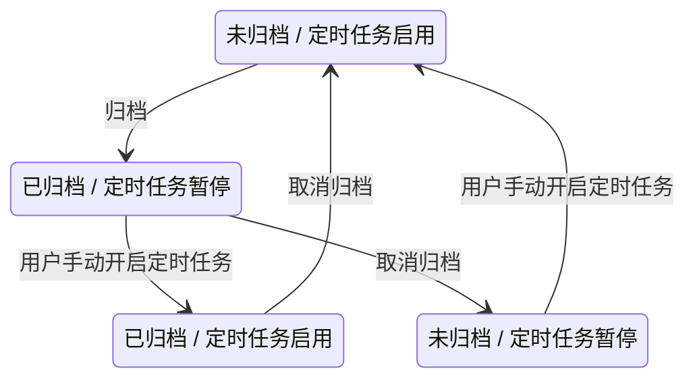
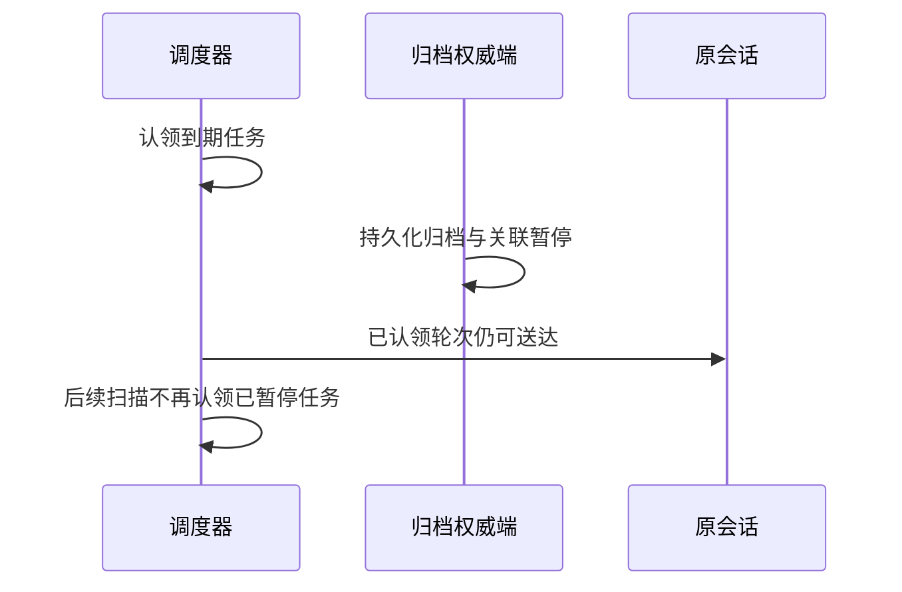

# 定时任务编辑状态展示

## 目标

定时任务进入编辑页后，`Settings` tab 需要在表单顶部展示当前任务状态，方便用户在修改标题、计划和指令前确认任务是否仍在运行。

月度间隔和年度月/日选择器 E2E 使用本地 Personal Provider，不依赖账号权益。
这两条用例不得播种假 OAuth 身份，避免真实控制面拒绝假 Token 后用登录过期弹窗遮挡
表单。测试仍通过真实 WebDriver 点击控件，不绕过弹窗或放宽可点击断言。

## 创建页默认标题的语言同步

新建定时任务且未携带模板草稿时，Task title 使用当前界面的本地化默认标题。用户在创建页
切换中英文后，仍保持该自动默认值的输入框必须立即切换成目标语言，避免页面其它文案已经
切换而标题仍停留在旧语言。

- 只同步由创建页自动填入的默认标题；用户手动修改过的标题、More ideas 模板传入的标题与
  已保存任务的标题都是用户数据，切换语言时不得覆盖。
- 同步默认标题不是用户编辑：不能标记表单 dirty、不能触发未保存返回确认，也不能重置
  prompt、调度、项目、模型或推理档位。
- 该行为由 `AutomationEditView` 共享给桌面端和普通 Web；不触及 scheduler、任务持久化或
  手机 `/remote` 的 replayable 链路。

## 分钟间隔的锚点语义

用户表达“每 N 分钟”时，产品语义是从任务创建或最近一次修改计划的时刻开始计时，不能按
标准 cron 的墙钟分钟刻度提前触发。`*/N * * * *` 仍作为兼容展示表达式保存，但调度必须同时
保存 `unit = minute`、`interval = N` 和 `anchorAt`，并以 `scheduleRule` 为权威计算时间。

```text
11:46 create "every 10 minutes"
  -> anchorAt = 11:46
  -> first run = 11:56
  -> next runs = 12:06, 12:16, ...

not:
11:46 create -> cron wall-clock tick 11:50
```

- 新建任务时，`anchorAt` 取服务层实际接收创建请求的时间。
- 将计划修改为“每 N 分钟”时，`anchorAt` 重置为本次修改时间，首次运行在 N 分钟后。
- scheduler 延迟轮询或派发时，后续运行仍按同一 `anchorAt` 推进，不能按实际派发时间累计漂移。
- 其它固定时刻的日、周、月、年规则继续使用本地日历时间，不改变其墙钟语义。

## 自定义月度间隔的兼容 cron

“每 N 个月”由 `scheduleRule = { unit: monthly, interval: N, ... }` 表达，`scheduleRule` 是计算
下次运行时间的权威事实。五段 cron 的月份字段只能使用 `1-12`，不能把任意 N 直接写成
`*/N`；例如“每 29 个月”写成 `*/29` 会在 `AutomationService.create` 的 cron 校验阶段失败。

```text
UI: every 29 months on day 1 / 15 / 16 at 09:00
      |
      +-- cronExpr ----------> 0 9 1,15,16 * *   (合法的每月候选表达式)
      |
      +-- scheduleRule ------> unit=monthly, interval=29, monthDays=[1,15,16]
                                      |
                                      v
                           authoritative next-run calculation
```

- 自定义月度规则的兼容 cron 固定使用 `month = *`，只保留分钟、小时、月内日期或首个星期几；
  不在 cron 中编码月度 interval。
- 创建和更新仍必须同时保存 `scheduleRule`，scheduler 继续以 `scheduleRule` 计算真实触发时间，
  不能按兼容 cron 的每月候选频率派发。
- 管理页卡片和编辑页摘要必须优先按 `scheduleRule` 展示；只有旧记录缺少 `scheduleRule` 时才回退
  解析 `cronExpr`。因此“每 30 个月”不能因兼容 cron 的 `month = *` 被显示成“每月”。
- 该规则支持 UI 允许的完整 interval 范围，不因 `N > 12` 生成非法 cron；桌面端和普通 Web
  共用同一 builder，手机 `/remote` 不新增独立调度逻辑。
- `scheduleRule` 属于领域事实，`AutomationService` 在 create / update 写库前必须校验正整数
  `interval`、小时分钟范围及单位必需日期字段；月度规则最多允许间隔 1200 个月。非法规则必须整体
  拒绝，不能依赖计算函数静默取整、填默认值或返回 `null`，否则会持久化一个永远没有
  `nextRunAt` 的活动任务。合法的 1200 个月边界仍必须能计算下一轮，而不是被搜索上限提前截断。

## 会话来源任务的调度回显

编辑器必须按任务来源决定是否接管调度规则，不能按 cron 当前是否恰好能被 UI builder 解析来决定。
存在非空 `targetTaskId` 的任务视为会话来源：即使规则是 `*/10 * * * *` 这类可解析的分钟间隔，
编辑页也只展示“自定义”只读行，不展示频率控件、调度图标、下次运行时间，也不打开自定义重复弹窗。

```text
open existing automation
          |
          v
targetTaskId is non-empty? ---- no ----> UI schedule builder
          |
         yes
          v
read-only "Custom" schedule
          |
          +-- edit another field --> preserve cron + scheduleRule unchanged
          |
          +-- remove schedule -----> empty schedule
                                          |
                                          v
                                 UI schedule builder
```

- 会话来源判定只使用 `targetTaskId`，不依赖 cron 可视化能力或 `scheduleRule` 内容。
- 未删除只读调度时，保存标题、指令、模型等其它字段必须原样保留已有 `cronExpr` 和
  `scheduleRule`；仅打开后返回也必须保持 clean。
- 用户删除“自定义”行后，才切换到标准 UI 调度流程，并可用 UI 支持的规则重新设置。
- UI 来源的任务不受影响；相同的分钟 cron 仍按已有 builder 回显和编辑。
- 该规则只影响桌面端与普通 Web 的编辑表单，不改变 scheduler、桌面 continuous 消息流或手机
  `/remote` 的 replayable 恢复边界。

## 状态来源

编辑页只展示只读状态，不在表单内改变生命周期。状态判定复用列表页语义：

```text
automation.lifecycleStatus / enabled
        |
        v
+-----------------------------+
| failed / completed terminal |
+-----------------------------+
        | no
        v
+-----------------------------+
| paused or enabled = false   |
+-----------------------------+
        | no
        v
+-----------------------------+
| active                      |
+-----------------------------+
```

- `failed`、`completed` 优先于 `enabled`，因为它们是终态。
- `paused` 包含 `lifecycleStatus = paused` 或 `enabled = false`。
- 其余情况显示 `active`。

## UI 约束

- 新建/编辑页在面包屑下、Settings/History tabs 上方显示完整标题区：编辑态主标题固定使用
  “编辑定时任务”，新建态使用“新建定时任务”；具体任务名称只显示在面包屑，避免重复。
  主标题样式为 `text-ui-xl font-semibold`。主标题下显示动态
  副标题：新建态说明配置执行时间、指令和运行方式，编辑态说明调整相同内容；副标题使用
  `text-ui-base` 与次要文字色。固定文案必须国际化。
- 仅编辑已有定时任务时展示；新建任务没有持久化状态，不展示该行。
- 使用语义 token 表达状态点和文字：active 用 success，paused 用 warning，failed 用 destructive，completed 用弱文本。
- 状态行采用紧凑表单字段布局，兼容桌面端和手机 Web 窄屏换行。
- 状态文案走 i18n，不写死英文或中文。

## 未保存返回确认

编辑页返回列表前需要检查表单是否有未保存改动。弹框只保护会被保存的字段，避免仅打开页面或切换 History tab 时误报。

```text
User clicks breadcrumb back
        |
        v
+-------------------+
| form dirty?        |
+---------+---------+
          |
    no    | yes
    v     v
  back  Unsaved Changes dialog
          |
          +--> X / overlay / Esc: close dialog, stay on edit page
          |
          +--> Discard: abandon local form changes and back
          |
          +--> Save: submit same payload as header Save
                    |
                    v
              save success? ---- no ---> keep dialog/page for retry
                    |
                   yes
                    v
                  back
```

Dirty 比较范围：

- 标题、指令、cron 表达式、结束时间。
- 非会话内创建任务的 `scheduleRule`。
- 模型、模式、思考强度。
- 只有用户实际操作过的字段才参与 dirty 比较。模型元数据、思考强度和 cron builder
  在页面初始化后的异步归一化属于系统回填，不能让“仅打开后返回”触发未保存弹框。
- 编辑已有任务的首帧必须直接使用持久化 cron、`scheduleRule` 与 `endAt` 初始化调度表单，不能先渲染
  默认计划再通过 effect 回填。调度控件挂载/注册产生的回调不属于用户修改；尤其会话内创建的自定义
  计划仅打开后返回时必须保持 clean。
- 用户把已操作字段改回初始值后，该字段恢复为 clean。

```text
persisted automation ----> form initialization ----> runtime normalization
         |                                               |
         +-------------- initial baseline ---------------+
                                                         |
user interaction ----> touched fields -------------------+
                              |
                              v
                 compare touched fields only
                              |
                      equal / different
                       clean / dirty
```

## 顶部操作显示边界

编辑页顶部操作按当前 tab 收敛：

```text
AutomationEditView
        |
        +-- Settings tab: Run now + Save + More actions
        |
        +-- History tab: More actions only
```

`History` tab 只查看运行记录，不承载表单编辑动作，因此不展示 `Run now` 和 `Save`，避免用户误以为历史列表也会被保存或立即执行。

## 运行历史跳转

运行历史的“跳到会话”是显式 session deep link，必须同时恢复目标 workspace 和目标 session，不能只把
Automations 主视图关闭。Automations 是跨项目列表，历史任务所属的本地 workspace 可能已不在当前窗口
tab 中，因此导航入口需要先确保本地 workspace tab 存在，再设置该 workspace 的 active task。

```text
run history click(sessionId + workspacePath + workspaceIdentity?)
        |
        +-- existing matching tab --> activate tab
        |
        +-- missing local tab ------> add and activate local tab
        |
        +-- missing remote identity attachment --> reject, keep Automations visible
        |
        v
set target activeTaskId --> switch main view to chat
```

- 身份匹配使用 `workspaceKey = workspaceIdentity?.trim() || workspacePath`；不得只按 path 命中远程 tab。
- 本地 workspace 不传 `workspaceIdentity` 时允许按 `workspacePath` 补开 tab；这是 UI 导航恢复，不创建
  新 Agent runtime，也不改变 session 所属 workspace。
- 远程 workspace 若没有当前窗口已存在的 shared-host attachment，必须 fail-closed，禁止仅凭 path 或
  identity 新建伪远程 tab。
- 只有目标 workspace/session 选择已被导航层接受后，才从 Automations 切回聊天主视图；失败时保留原页。
- 本改动只影响桌面/普通 Web 的 continuous UI 导航；手机 `/remote` 不暴露 Automations，不改变
  `web-remote-replayable` 的 snapshot、queue 或重连边界。

## 保存并立即运行

编辑态 `Settings` tab 的 `Run now` 使用当前表单作为唯一运行配置。点击后必须先提交与 `Save`
相同的 payload，保存成功后再对同一 `automationId` 执行立即运行；不得绕过表单直接运行进入页面时的
旧 automation 快照。保存失败或表单无效时不触发运行，页面保持在编辑态以便修正。

```text
Run now click
  -> validate current form
  -> save current title / prompt / model / mode / schedule
       | failure -> stay on edit page, do not run
       v success
  -> runAutomationNow(existing automationId)
  -> stay on edit page
```

保存与立即运行的组合动作保持 single-flight；快速重复点击不得重复提交保存或创建多个 manual run。

manual run 的执行身份必须从派发贯穿到终态，不能复用建会话时生成的 session trace：

```text
manual runId
  -> sendPrompt.traceId / inputId
  -> services activePromptInputIds
  -> terminal outcome.inputId
  -> settle run outcome + release manual claim
  -> dispose terminal subscription / claim heartbeat
```

未绑定任务的 `createTask.traceId` 只表示建会话，不参与本次执行认领。派发异常必须按同一个
`taskId + runId` subscription key 清理监听与 heartbeat；终态只接受 `inputId === runId` 的事件，避免
旧执行轮误收口当前 manual claim。

## 运行次数口径

定时任务 Card 的“运行次数”只展示累计已派发次数，不展示 `当前次数 / 最大次数`。`maxRuns` 仍用于
有限次调度的生命周期判断，但不作为 Card 统计分母，避免把手动运行误解成有限计划的额度消耗。

```text
定时触发
  -> schedule run 首次派发成功
  -> runCount + 1
  -> 推进 nextRunAt / maxRuns / lifecycle

立即运行
  -> manual run 首次派发成功
  -> runCount + 1
  -> 保持 nextRunAt / maxRuns / lifecycle / manual claim
  -> turn 真实终态后释放 manual claim
```

- `runCount` 统计 schedule 与 manual 两类 run 首次成功接受派发的总次数；派发失败、misfire skipped
  不计数。
- 有限计划必须使用独立的 schedule 派发计数判断 `maxRuns`；禁止用展示用的 `runCount` 推进
  生命周期。历史数据库升级时以升级前的 `runCount` 初始化 schedule 计数，升级后的 manual run
  只更新累计展示计数。
- 同一个 manual `runId` 的重复或迟到成功回报必须幂等，不得重复增加 `runCount`。
- manual run 只影响累计展示与 `lastRunAt`，不消耗有限任务的 `maxRuns`，也不推进 cron、启停状态或
  生命周期；manual single-flight claim 仍由真实 turn 终态收口。
- Card 在桌面端与 Web 端统一使用 `automations.runCount` 文案；中英文均只插入累计 `count`。

## 派发配置回写

定时任务触发时，任务当前保存的模型、Think 和模式必须先回写绑定会话，再发送 prompt。
模型先通过 V4 `switchModelConfig` 原子更新 runtime 和 conversation projection，再在目标模型上
显式收敛 Think，最后通过 `switchCollaborationMode` 收敛权限模式。禁止先走 legacy
`session/setModel`，否则 runtime 已切换时补写可能返回 noop，导致会话工具栏仍显示旧模型。

```text
automation dispatch
  -> V4 switchModelConfig(model + think + runtimeModel)
  -> V4 state.updated.config
  -> V4 switchModelConfig(target think)
  -> V4 switchCollaborationMode(permission mode)
  -> send prompt
```

- 只保证本次触发使用任务当前保存配置，不迁移或修复历史任务数据。
- 桌面 `desktop-continuous` 继续消费 conversation projection；手机端仍保持
  `web-remote-replayable` 的 command/snapshot 恢复边界。
- 普通会话手动切模型的入口和既有 `setModel` 兼容路径不变。

编辑定时任务切换模型时，Think 必须按目标模型的能力重新收敛，不能沿用源模型的保存值。
目标模型元数据加载完成前暂不允许保存；加载失败必须进入不可提交的失败态并提供重试，不能把
失败解释为“不支持 Think”。支持 Think 时保存校验后的目标档位，不支持 Think 时必须在 update
中显式发送 `thoughtLevel: null` 清空旧值。不能省略该字段，因为 update 的
`undefined` 语义是“不修改”，会让旧模型的 `max` 等档位残留并在下次派发时触发
`Unsupported reasoning effort`。

已保存模型不在当前下发候选中时，编辑器的模型触发器继续显示该历史模型名；打开菜单后只展示
当前下发候选，不把历史模型补回菜单。该规则仅改变展示，不改变现有候选来源、表单校验、保存、
派发或 runtime 模型解析语义。

定时任务编辑器的 Think 能力展示必须与会话 composer 使用同一份 provider model metadata。
目标模型 metadata 已明确声明 reasoning levels 时，该档位集合是展示与保存校验的权威来源；
旧 workspace runtime catalog 只能在 metadata 缺失时作为兼容回退。runtime preview 尚未返回、
没有投影出 `thought_level`，或返回的非空旧档位集合与 metadata 不一致时，都必须继续使用
metadata 档位，不能让旧投影覆盖会话框已经采用的新模型能力。只有 provider metadata 与成功
preview 都没有档位时，才隐藏 Think 控件并按无 Think 模型保存。

```text
select target model
  -> provider model metadata (same source as conversation composer)
     -> Think options available -> render target levels immediately
     -> no Think option         -> keep control hidden while preview resolves
  -> load target runtime preview
     -> pending                 -> disable save
     -> options match metadata  -> validate/persist metadata thoughtLevel
     -> stale options conflict  -> retain metadata levels for composer parity
     -> no runtime option + metadata options
                                -> retain metadata levels for composer parity
     -> metadata unavailable    -> fall back to runtime thought levels
     -> no option from either   -> persist thoughtLevel: null
     -> failed                  -> disable save and expose retry
  -> next dispatch uses target model without stale Think
```

## CronCreate 本轮归属边界

定时任务会话禁止递归创建定时任务。现行权限判据只使用 Host admission 在本轮显式传入的
`automationId`；兼容入口若仍保留 `automation-*` run id，则只把该 run id 当作本轮 automation
事实兜底。`sendText` 不再查询 task metadata，也不根据会话历史保存的 `cronAutomationId` 猜测本轮
归属。旧版“归属查询失败时给普通 prompt 注入 `CronCreate` denylist”的 fail-closed 策略已经废弃。

```text
Host admission
      |
      +-- automationId / automation run id present
      |       -> automation turn
      |       -> deny CronCreate + CronUpdate + CronDelete
      |       -> keep CronList + CronPauseSelf (current automationId only)
      |
      +-- no current-turn automation fact
              -> explicit user turn
              -> hide CronPauseSelf
              -> do not query task metadata
              -> do not inherit historical cronAutomationId permissions

Cron mutation tool execution
      -> executor marks current automation turn + passes loop automationId
      -> CronCreate / CronUpdate / CronDelete handler: reject
      -> CronList handler: allow
      -> CronPauseSelf handler: pause context.automationId only; reject when absent
      -> otherwise CronCreate additionally checks bound session
             -> automation/checkTaskBinding(targetTaskId)
                    -> workspace-scoped EXISTS query
                    -> bound: reject
                    -> unbound: automation/create
                    -> -32601 Method not found
                           -> compatibility fallback: automation/list
                           -> filter targetTaskId in current session
                           -> bound: reject
                           -> unbound: automation/create
                    -> other query failure: reject create only
```

- 三种写工具有两层独立 guard：provider 请求先隐藏 `CronCreate` / `CronUpdate` / `CronDelete`；即使
  旧入口或异常 provider 绕过可见性过滤，tool executor 仍把本轮 automation 事实传给 handler，三个
  handler 都必须在调用 `AutomationPort` 前拒绝。`CronList` 是只读查询，automation turn 仍可调用。
  `CronPauseSelf` 只能暂停本轮所属任务，规则见
  [automation 执行轮自暂停 CronPauseSelf](#automation-执行轮自暂停-cronpauseself)。
- 普通 turn 的 `CronCreate` 另由 `AutomationPort` 通过专用的
  `automation/checkTaskBinding` 校验当前 session 是否已绑定任务。Host 只在当前 workspaceKey 内执行
  `target_task_id` 存在性查询，不读取或序列化完整 automation 列表；因此历史任务的标题、模型、权限
  模式等展示字段损坏不能再拖垮新版 Host 的归属判断。
- 新 CLI/bootstrap 连接旧 Host 时，旧 Host 对 `automation/checkTaskBinding` 会明确返回 JSON-RPC
  `-32601 Method not found`。该错误只表示能力不存在，必须回退到旧 Host 已支持的 `automation/list`，并
  仅按当前 `targetTaskId` 判断绑定关系；回退列表查询失败仍按未知处理并拒绝创建。除 `-32601` 外的
  数据库、传输、超时和协议校验错误继续 fail-closed，且不得发送 `automation/create`，避免把真实故障
  误判为“未绑定”。这与 V4 `sendText` 不查询 task metadata 是不同边界，不能再混写为同一次
  “归属查询”。
- automation 仓储读取历史 `mode` 时必须只接受当前支持的权限枚举；空白或未知值按未设置处理，避免
  单条旧数据让 `automation/list` 的整批协议校验失败。创建/更新写入仍由严格类型和协议 schema 拒绝
  非法值，不能继续制造新的脏数据。
- `automationId` 为空表示本轮是普通用户会话。即使绑定会话的 task metadata 保存了
  `cronAutomationId`，也不能把后续用户 turn 永久降级为只读。
- admission 必须把 automation 事实随本轮命令传到底层，不能用异步 metadata 查询补猜；因此没有
  “查询失败后继续 prompt 但隐藏 CronCreate”这一中间态。
- 桌面 `desktop-continuous` 与手机 `web-remote-replayable` 都复用本轮 admission 事实；本次收敛不改变
  shared-host attachment、command queue 或 snapshot 恢复语义。

## Bash 内部任务库执行边界

`tasks-index.sqlite` 是 Host 领域服务的内部存储，不是 Bash API。模型不应通过 Bash 直接读写该库，
automation 定义读写统一经过 `CronList` / `CronUpdate` / `CronDelete` 和 `AutomationService`。

本版本完整撤销 automation 内部库在通用 Bash 执行链上的专用保护：既不增加 OS sandbox、capability
probe、`bwrap` / Seatbelt 包装或受保护资源协议字段，也不根据命令字符串识别和拒绝数据库访问。
shell 的变量、cwd、脚本、符号链接和跨平台展开语义无法由关键词或正则可靠还原，保留启发式检查只会
制造已经建立安全边界的错误认知。

```text
Bash request
    -> preserve the existing generic Bash execution path
    -> ExecutionPort

AutomationService / Repo ---------------------------> internal database allowed
```

- `AutomationService` 是受支持的任务定义修改 API，但这不等于 Bash 对数据库文件具备权限隔离；本版本
  不承诺阻止 Bash 访问 `tasks-index.sqlite`，也不能把命令字符串检查描述成文件访问安全边界。
- `ExecutionSandboxPolicy` 只保留 Bash 原有的通用 sandbox 配置，不携带 automation 专用资源信息；
  `dangerouslyDisableSandbox` 的语义也不得被 automation 功能改写。
- 若未来需要对 `~/.zcode` 建立强安全边界，应先形成独立的跨平台执行隔离设计，明确桌面、Web 远控、
  macOS、Windows、Linux、容器和 remote workspace 的兼容性，再由产品级能力统一接入，不能从
  automation 功能局部注入到所有 Bash 请求。

## CronCreate prompt 的递归创建约束

`CronCreate` 的工具描述和 prompt 字段描述必须要求模型直接填写每次触发时要完成的业务工作，
不得在 prompt 中要求再次创建、配置定时任务或调用 `CronCreate`。该约束属于模型工具 contract，
不在 contracts 或 handler 中用关键词、正则表达式猜测自然语言意图。

```text
CronCreate description
      |
      v
model writes direct final-work prompt
      |
      v
AutomationPort.create

scheduled / manual automation turn
      |
      v
tool denylist: CronCreate + CronUpdate + CronDelete
kept tools   : CronList + CronPauseSelf
```

- 工具 `description`、`modelInstructions` 和 prompt 字段 description 使用一致语义，明确禁止二阶调度。
- 用户给出停止条件时（例如“发布成功后就不用再检查”），`CronCreate` 的 `modelInstructions` 要求模型
  把停止条件写进 prompt，并写明“条件满足时调用 `CronPauseSelf`”。执行轮据此自行暂停，不需要
  `CronUpdate` / `CronDelete`。
- 不维护中英文关键词表，不因 prompt 出现 `CronCreate` 或“定时任务”等名词做运行时拒绝，避免误判
  诊断、文档和结果汇总任务。
- 真正阻止 automation 执行轮修改任务定义的硬边界仍是 turn-scoped mutation tool denylist；
  不能把模型描述当作权限边界。`CronPauseSelf` 只能暂停本轮所属任务，不能修改定义。
- 该约束不新增 desktop main、relay 或 Host 业务状态；桌面端继续使用 `desktop-continuous`，
  手机 `/remote` 继续使用 shared-host attachment 与 `web-remote-replayable` 恢复链路。

## 会话内 CronUpdate

普通用户会话允许通过 `CronList` 获取当前 workspace 的任务 ID，再使用 `CronUpdate` 修改同一条
定时任务定义。更新必须复用既有 `AutomationService.update` 与 automation 记录，禁止通过
`CronDelete + CronCreate` 模拟编辑。

```text
conversation CronUpdate
  -> strict patch schema（id + 同步后的 title + 可选定义字段）
  -> AutomationPort.update
  -> automation/update protocol（workspace 由 Host 注入）
  -> AutomationService.update
  -> same automationId / targetTaskId / run history
  -> 本轮完成后展示同款定时任务结果卡片（按 automationId 打开详情）
```

- 可更新字段仅限 `title`、`cron`、`prompt`、`recurring`、`maxRuns`。
- 会话内每次 `CronUpdate` 都必须提交同步后的非空 `title`。标题必须描述更新完成后的任务语义，
  调度发生变化时同步更新自然语言时间短语（例如 `每5分钟` 改为 `每6分钟` 时，标题不能继续
  保留 `每5分钟`）；prompt 语义发生变化时也必须同步调整标题。该约束在 Agent contract 层
  机械校验，不能只依赖模型自行决定是否传入 `title`。
- `recurring: true` 表示切换为无限循环，此时领域层必须保证 `maxRuns` 为空：调用方省略
  `maxRuns` 时，`AutomationService.update` 自动将其归一化为 `null` 并原子清除已有有限次数上限；
  显式提交数值 `maxRuns` 属于矛盾组合，必须在写库前拒绝。
- `maxRuns: null` 仍只允许与 `recurring: true` 同时提交。`recurring: false` 或未明确提交
  `recurring` 时携带 `maxRuns: null` 必须在写库前拒绝，不能把缺失上限回退成一次性任务并
  误判 completed。
- 输入必须包含 `id` 与同步后的 `title`；缺少标题的 patch 在 Agent contract 层拒绝。
- 任务必须属于当前 workspace；Host 使用
  `workspaceKey = workspaceIdentity?.trim() || workspacePath` 校验归属，找不到时返回错误。
- 更新不改变 `automationId`、`targetTaskId`、workspace、session、model/provider/mode/Think、
  `runCount` 或运行历史，也不负责暂停/恢复。执行轮内的自暂停由 `CronPauseSelf` 负责。
- cron、有限次数和生命周期重算继续由 `AutomationService.update` 负责；Agent 不复制领域逻辑。
- 只切换 `recurring=true` 时只清理旧 `maxRuns`；若没有提交 `cron` / `scheduleRule`，必须保留既有
  `scheduleRule`（包括大于 12 个月的权威间隔），不能退化为候选日历 cron。
- `CronUpdate` 是 workspace 写操作，需要与 `CronCreate` 相同级别的用户批准和审计。
- `CronUpdate` 成功后与 `CronCreate` 共用会话轮尾结果卡片，展示更新后的标题和调度摘要，点击后按
  原 `automationId` 打开任务详情；失败、取消或本轮仍在运行时不展示卡片。同轮对同一任务的多次
  Create/Update 只展示最后状态，后续成功 Delete 会移除该卡片。

```text
CronUpdate recurrence patch
          |
          +-- recurring=true + maxRuns omitted --> normalize maxRuns=null --> clear old limit
          |
          +-- recurring=true + maxRuns=null ----> clear old limit
          |
          +-- recurring=true + maxRuns=N -------> reject before repo.update
          |
          +-- maxRuns=null without true --------> reject before repo.update
```

- 卡片已经是更新结果的权威 UI 摘要；模型成功调用 `CronUpdate` 后只做简短文字确认，不得再用
  `text` fenced code block 或伪文件卡片重复输出标题、时间、内容和状态。
- automation 自己触发的执行轮不得管理任务定义；该轮必须隐藏
  `CronCreate`、`CronUpdate`、`CronDelete`，只保留只读 `CronList` 与只作用于本轮 automation 的
  `CronPauseSelf`，避免任务自改、自删或递归创建。
  隔离范围必须以本轮携带的 `automationId` 或 automation run id 为准，不能因为 task metadata
  持久保存了 `cronAutomationId` 就把整个绑定会话永久降级为只读。
- 用户在同一绑定会话中主动发起的新一轮属于普通用户轮，必须重新暴露 `CronUpdate` /
  `CronDelete`，并隐藏 `CronPauseSelf`，允许通过领域服务修改任务；`cronAutomationId` 只用于归属和
  展示，不能兼任工具权限。
- automation 定义的受支持修改路径是 `CronList` / `CronUpdate` / `CronDelete` 和
  `AutomationService`，由领域服务确保 cron、`scheduleRule`、`nextRunAt`、retry 与生命周期原子重算。
  Bash 直改 `~/.zcode/v2/tasks-index.sqlite` 属于不受支持的行为，但本版本不在 Bash handler 中用命令
  文本匹配声称能够机械阻止它。

```text
same bound session
      |
      +-- scheduled/manual dispatch turn
      |     automationId/runId present
      |       -> hide CronCreate/CronUpdate/CronDelete
      |       -> keep CronList + CronPauseSelf
      |
      +-- later explicit user turn
            no automationId/runId
              -> expose CronUpdate/CronDelete
              -> hide CronPauseSelf
              -> update through AutomationService
              -> supported path does not write tasks-index.sqlite from Bash
```

- 该工具只增加会话中的写入能力，不改变 desktop `desktop-continuous` 与手机
  `web-remote-replayable` 的消息流、snapshot、queue 或 owner 语义。

## 会话归档时暂停绑定任务

状态：已实现归档联动。具体运行覆盖与未验证项见 [AAP 验收记录](testing/conversation-session-e2e-coverage-matrix.md#归档暂停定时任务aap2026-11-10)。

归档会话时，原 Source 在同一 SQLite 事务内更新归档标记并暂停关联定时任务。用户之后可以主动开启任务，继续在原会话执行。

### 关联范围与状态变更

- 关联以原 Source、完整 `workspaceKey` 和 `targetTaskId` 为准。`workspaceKey = workspaceIdentity?.trim() || workspacePath`；不能只按任务 ID、目录、项目分组或会话展示用的单个 `cronAutomationId` 匹配。
- 暂停该会话绑定的全部 `lifecycleStatus = active` 且 `enabled = true` 的定时任务，写为 `enabled = false`、`lifecycleStatus = paused`。已暂停、已完成、失败和已删除的任务不改变状态。
- 暂停本身保留计划、`nextRunAt`、运行计数、会话绑定和运行历史。不删除定时任务，也不影响未绑定该会话的独立任务或其他工作区的同名、同 ID 任务。
- 手动单条、批量、后台自动归档和现有工具、远控入口使用同一规则。保持各入口现有的归档准入、候选筛选和失败语义；后台自动归档不因存在绑定任务而排除会话。
- 只有会话从未归档变为已归档时触发暂停。重复归档请求、列表读取、应用重启和后台再次扫描已归档会话，不得再次暂停用户主动开启的任务。只处理功能生效后的归档，不扫描或迁移历史已归档会话。



取消归档不改变任何关联定时任务的启停状态。用户在自动化管理中手动开启任务后，即使原会话仍已归档，也允许继续调度；会话保持归档，不自动回到主页。取消归档后再次归档，会再次暂停当时符合条件的绑定任务。

### 提交与在途执行边界

归档联动由写入归档事实的权威端完成，不由 UI 先归档再逐个暂停。单个会话的归档标记与关联暂停须原子提交，全部持久化后才算成功；失败不留下「已归档但关联任务未暂停」的半完成状态。批量操作仍逐项返回结果，不扩大到其他 Source 或工作区。调度的启停依据继续是定时任务自身状态，不新增「已归档即禁止执行」的长期门禁，也不新增轮询补偿或暂停原因状态。

暂停只阻止后续认领，不撤回已认领、已进入会话队列或正在执行的轮次。每个已认领轮次仍可按原路径执行，不因归档额外复制或重发；这不承诺归档后立即停止所有执行。



在途轮次的派发回写继续记录实际计数和时间，但不得把已暂停任务重新启用。若该轮耗尽有限次数或到达结束条件，仍按既有规则收口为 `completed`，见[与 scheduler 回写的竞态](#与-scheduler-回写的竞态)。

### 验收清单

以下场景的实际覆盖以 AAP 验收记录为准。竞态使用显式调用顺序控制认领、归档提交和派发，不依赖固定等待时间。

| 场景                                                         | 预期结果                                                                                      |
| ------------------------------------------------------------ | --------------------------------------------------------------------------------------------- |
| 单条会话绑定多条启用任务，同时存在暂停、完成、失败和独立任务 | 归档后，全部匹配的启用任务变为暂停；配置、绑定和历史保留，非目标任务不变                      |
| 取消归档、手动开启、再次归档                                 | 取消归档保持暂停；手动开启后可调度；再次归档重新暂停                                          |
| 会话已归档时手动开启任务，再重复归档请求、扫描或重启         | 会话仍已归档，任务保持用户开启状态，不重复施加暂停                                            |
| 功能生效前已归档的会话仍有启用任务                           | 启动、刷新和自动扫描不追溯暂停；取消归档后再次归档才按新规则处理                              |
| 手动、批量、工具及后台自动归档                               | 都在新归档成功时暂停匹配任务；保持现有运行中归档限制、候选范围和逐项结果                      |
| 本地与在线远端存在相同任务 ID、相同目录或不同工作区身份      | 仅原 Source 内完整身份匹配的绑定任务变化；远控继续走既有 attachment，离线不改写本机同 ID 任务 |
| 先归档提交、后调度认领                                       | 未被认领的暂停任务不再触发                                                                    |
| 先认领、后归档，再派发；以及输入已排队或正在执行             | 已认领轮次可完成，后续不再认领；回写不重新启用任务，有限任务耗尽后可转为完成                  |
| 归档或关联暂停持久化失败、批量部分失败                       | 单个会话的归档与暂停一同回滚；不误改非目标任务，批量结果准确反映各项成功或失败                |

已有暂停、自暂停和运行中禁止归档的覆盖不能代替上述联动验收。联动验收扩展现有归档 E2E，保留桌面与手机各自的 continuous/replayable 边界，不新增 App 业务单测。

本次不改变会话删除规则，也不新增执行通知、蓝点或自动化管理界面。归档入口及路由约束见[归档管理](superpowers/specs/2026-09-11-archive-management.md)。

## automation 执行轮自暂停 CronPauseSelf

用户创建定时任务时常给出停止条件，例如“发布成功后就不用再检查”。automation 执行轮看不到
`CronUpdate` / `CronDelete`，因此提供只作用于本轮所属任务的暂停工具 `CronPauseSelf`：执行轮判断
停止条件已满足时调用它，任务停止按计划派发；任务定义与运行历史保留，用户可在列表页恢复。

```text
CronPauseSelf
  input  : {}            strict；模型不能传 id，也不能指定其它任务
  target : ToolExecutionContext.automationId
             <- core RegularTurnLoopState.automationId
             <- Host admission（显式 automationId；busy queue 提升时由 run id 前缀还原）
  output : { paused, id, message }
  policy : automation.pause / riskLevel low / 无需审批 / sideEffectScope workspace / deferred
```

- Host 先使用显式 `automationId`；载荷没有该字段时，只能从 canonical automation run `inputId`
  的首段恢复。Host 必须把解析后的 `activeAutomationId` 传给 Core。busy queue 只保存该 canonical
  `inputId` 为 `sourceCommandId`，提升后重新经过同一个解析函数；pending event/projection 不新增第二套
  automation 身份状态。普通用户轮不得根据历史 metadata 恢复该身份。
- 目标身份只有一个来源：本轮 loop state 的 `automationId`。executor 把它传入 handler context；
  handler 读不到时返回 PermissionDenied，不调用 `AutomationPort`。不从 task metadata、会话历史的
  `cronAutomationId`、queryId 前缀或 denylist 兜底信号推断目标。
- 工具只暂停，不删除，也不修改定义。暂停无需审批：它只影响本轮所属任务，用户可在列表页恢复。

### 可见性

| 本轮类型                                        | loop `automationId`    | `CronPauseSelf`          | `CronCreate/Update/Delete` |
| ----------------------------------------------- | ---------------------- | ------------------------ | -------------------------- |
| 定时触发 run                                    | 有                     | 暴露                     | 隐藏                       |
| 立即运行 manual run                             | 有                     | 暴露                     | 隐藏                       |
| 绑定会话中的普通用户轮                          | 无                     | 隐藏                     | 暴露                       |
| 只有 queryId 前缀或 denylist 兜底信号的轮       | 无                     | 隐藏                     | 隐藏                       |
| automation 输入 guide 合并进正在运行的用户 loop | 无（沿用 active loop） | 隐藏                     | 隐藏                       |
| subagent                                        | 无                     | 隐藏                     | 按原规则                   |
| remote workspace                                | —                      | 隐藏（session denylist） | 隐藏                       |

- 可见性只是第一层；handler 的 `automationId` 校验是硬边界。
- `CronPauseSelf` 不加入 automation mutation tool 名单（core、bootstrap、Host 三处）。该名单在执行轮
  整体隐藏，core 还用“名单全部在 denylist 中”作为 automation 轮的兜底判据；加入后执行轮看不到暂停
  工具，旧 Host 下发的三项 denylist 也无法再触发兜底。
- remote workspace 的 Cron 工具统一由 session denylist 隐藏，`CronPauseSelf` 同样加入该名单。

### 条件暂停

```text
automation/pause { automationId }        workspace 由 Host 按 session 注入
  -> AutomationService.pause(automationId, scope)
  -> UPDATE automations
       SET enabled = 0, lifecycle_status = 'paused'
       WHERE automation_id = ? AND workspace_key = ?
         AND lifecycle_status = 'active' AND enabled = 1
  -> changes > 0 ? { paused: true } : { paused: false }
```

- 只有 active 且 enabled 的任务会被暂停。已暂停、completed、failed、已删除或不属于当前 workspace
  的任务返回 `paused: false`，不改任何字段，不能把终态改成 paused。
- 暂停保留 `nextRunAt`、`runCount`、schedule 派发计数、`targetTaskId` 与运行历史，与列表页暂停一致；
  恢复沿用列表页的 `setEnabled(true)`。列表页 `setEnabled` 保持原语义，不改为条件写。
- 暂停不取消正在执行的本轮。工具返回后，模型简短说明暂停原因。

### 与 scheduler 回写的竞态

scheduler 在独立 utilityProcess 中用自己的数据库连接回写派发结果；Host 的暂停写入走另一条连接。
本轮在 admission 时就开始执行，所以 `CronPauseSelf`（或用户在列表页点暂停）可能先于 scheduler 的
`markDispatched` 落库：

```text
scheduler (conn A)          Host (conn B)                    agent turn
claimDue: running=1
dispatch request ---------> CronRun -> sendPrompt ---------> admission, turn starts
                            <- admission resolved
<-- CronRunResult
markRunDispatch                                              model calls CronPauseSelf
repo.get / compute next     automation/pause <--------------
                            enabled=0, paused
markDispatched
  旧：无条件写 active + enabled=1   => 任务被复活
  新：同一条 UPDATE 内按当前行决定   => 保持 paused
```

`markDispatched` 的启停字段在同一条 UPDATE 内读取当前行，不依赖之前 `getRow` 的快照：

```text
lifecycle_status = 'completed'      if this dispatch reached maxRuns / endAt
                 = keep current     if enabled = 0
                 = 'active'         otherwise
enabled          = 0 if completed, otherwise keep current
next_run_at      = NULL if completed, otherwise the computed next run
```

- completed 优先于 paused：本次派发已用完有限次数或越过结束时间时，任务仍收口为 completed。
- 已暂停的任务仍记录本次派发：`runCount`、schedule 派发计数、`lastRunAt`、`nextRunAt` 照常推进，
  `running` 照常释放。
- manual run 的回写不改启停字段，不需要调整。

### 兼容与展示

- 新 CLI 连接旧 Host 时，`automation/pause` 返回 JSON-RPC `-32601`；工具按普通错误返回模型，不回退到
  其它写接口。
- 暂停不推送列表变化：列表页在挂载和手动刷新时读取最新状态，与 `CronUpdate` / `CronDelete` 一致。
  会话中只展示通用工具行，不新增结果卡片。
- 已知限制：scheduler 在 admission 后释放 `running`。执行轮耗时超过调度间隔时，下一次 run 可能已经
  进入同一会话的队列；之后的暂停不撤回这条已排队输入，它仍会执行一次。列表页暂停有同样的限制。
- 不新增 desktop main、relay 或 Host 业务状态；桌面 `desktop-continuous` 与手机
  `web-remote-replayable` 的消息流、snapshot、queue 和 owner 语义不变。

## 一次性日历任务错过目标分钟

五段 cron 不包含年份。一次性任务使用固定 `minute hour day-of-month month *` 表达式时，
如果创建过程刚好跨过目标分钟，cron 的下一次会自然滚到下一年。该情况不能被展示或调度成
按年循环任务。

会话内创建“5 分钟后”等相对时间任务时，模型必须把相对分钟数写入 `CronCreate.delayMinutes`，
不能自行猜测当前时刻或换算绝对 cron。Host 的 `AutomationService` 以收到请求时的 `Date.now()`
为锚点生成一次性的分钟间隔 `scheduleRule`，因此 `nextRunAt` 精确等于接收时刻加相对分钟数；
同时生成固定日历 cron 作为兼容展示字段，但调度以 `scheduleRule` 为准。绝对日历计划则传
`delayMinutes=null` 并使用 `cron`。

```text
“3 分钟后提醒”
        |
        v
CronCreate { delayMinutes: 3 }
        |
        v
protocol relativeDelayMinutes=3
        |
        v
AutomationService: Date.now + 3min -> one-shot minute scheduleRule
        |
        v
persist cronExpr / nextRunAt
```

```text
recurring=false calendar cron
              |
              v
      compute previous / next
              |
      +-------------------+------------------------+----------------+
      | age < 60 seconds  | age 60s..5min         | otherwise
      | next rolled year  | next rolled year      |
      v                   v                        v
  due immediately     reject before write      keep next run
      |                   |
      v                   v
 dispatch once        retry with delayMinutes
 -> completed         or a confirmed future cron
```

- 只对有限次任务生效；`recurring=true` 的年度计划保持原语义。
- 小于 60 秒的窗口只覆盖权限确认或工具调用刚好跨分钟的情况；超过该窗口不能再把错误的过去时间
  当成立即任务执行。
- 服务层在原 5 分钟错过识别窗口内拒绝陈旧目标且不写库，相对请求应改用 `delayMinutes`；窗口外无法仅凭
  无年份 cron 区分“陈旧时间”和“用户明确指定下一年”，因此保持 croner 的正常未来时间语义。
- 正常安排在未来的一次性任务、`scheduleRule` 和循环任务不受该保护影响。
- 派发、运行锁和结果回写仍由 scheduler / host 原链路完成，不新增第二套 timer。
