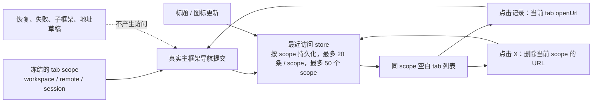

# 浏览器会话最近访问

## 范围与归属

Desktop 内置 Browser 与 Browser Use 共用当前会话的最近访问列表。每条记录只有 `url`、`title`、`faviconUrl`、`lastVisitedAt`。列表由 renderer store 持有，并按 scope 存入当前 Desktop 窗口 origin 的 `localStorage`；关闭 tab、切换会话或卸载面板不清空，完整应用重启后仍保留最近访问记录，但不恢复 Browser 标签页。记录不进入任务快照或手机 replay。普通 Web 与手机不新增内置 Browser 能力。

每个 tab 使用创建时冻结的 `workspaceKey`（优先 `workspaceIdentity?.trim() || workspacePath`）、`remoteSessionId` 和 `sessionId` 作为桶身份。Human Browser 用 `ownerTaskId`，Browser Use 用 tab 自身 `sessionId`；不能在导航完成时读取当前 active session。没有可用 workspace 或 session 身份的 tab 不记录或显示最近访问。不同 session、不同远程连接、不同 workspace 的列表互不可见；同一会话内用户和 Agent 的页面共用一份。

## 访问事实

只在 `<webview>` 的主框架 `did-navigate` 和 `did-navigate-in-page` 已提交导航事件中采集最终 URL。只接受 `http:`、`https:` 和 `file:`；不接纳 `about:blank`、内部 bootstrap、`data:`、子框架、地址栏草稿、导航意图、未提交的下载与失败请求。状态同步 `onUrlChange` 与 `loadURL` 回执不是访问事件。guest 被预算恢复或异常退出后自动恢复的初次页面提交不是新访问，不改变排序；恢复抑制必须绑定明确的恢复目标 URL，并由首个可记录的主框架提交消费：目标相同才跳过；若恢复 A 重定向提交 B，记录 B 且清除旧目标，后续页面链接、历史或 Agent 再访问 A 必须正常更新排序与时间。恢复目标失败、取消或主动导航开始时，后续不同 URL 的用户/Agent 提交仍须记录。没有可用 workspace 或 session 身份（包括 renderer 内的保留编码 `unscoped`）时，不创建也不读取最近访问桶。

同一桶按完整 URL（含路径、查询和片段）去重，每次新的访问提交将记录置顶并刷新 `lastVisitedAt`，最多保留 20 条。最多持久化 50 个 scope；新增 scope 超限时按 scope 最新访问时间淘汰最旧桶。记录按现有完整 scope key 存在 `localStorage` 独立 key 中；读取时校验 scope、URL、时间和元数据。favicon 在本次运行的展示状态中保留页面原值；持久化副本只接受不超过 2 KiB 的 HTTP(S) favicon URL，其他值写为 `null`。因此 data/file/超长 favicon 可在当前运行显示，重启后不恢复。损坏的单个桶不影响其他 scope，存储不可用时不阻断 Browser。任务或会话永久删除成功时，清理该 workspace/session 的所有 remote scope 历史；归档不删除历史。成功清除全部浏览器数据后删除所有历史，清除缓存则保留。Browser Use 冷恢复保留 main shell 的 `restoreUrl`，只作为自动恢复提交的识别目标，不由 renderer 再次导航；同次运行已观察的 URL 优先于冷恢复快照。页面标题、favicon 迟到时只补充当前桶内对应 URL 的元数据，不改变时间或顺序；内存字段不变时不更新 store，持久化后的规范化记录不变时不重复写 `localStorage`。缺少标题时展示 URL。关闭页面仍保留条目。记录的 URL 作为普通网址提交给当前空白 tab 已有的 `openUrl()`；不复用最近关闭 tab 的状态。

每条记录行末提供独立的 X 删除按钮。删除以当前 tab 冻结的 scope 和完整 URL 为准，立即更新现有 store 与持久化副本；不触发导航、不关闭页面、不改动其他条目的顺序或时间，也不删除其他 scope 的相同 URL。删除最后一条时移除该 scope 的存储 key，并显示既有空白提示。迟到的标题或图标不能恢复已删记录；后续真实导航再次访问该 URL 时仍正常记录。



## 空白页布局示意

```text
┌──────────────────────────────────────────────────────────────────┐
│ ←  →  ⟳   [网址输入框                                  ]  ⋯     │
├──────────────────────────────────────────────────────────────────┤
│                                                                  │
│                 ┌────────────────────────────┐                   │
│                 │          最近访问          │                   │
│                 │────────────────────────────│                   │
│                 │ 🌐 页面标题       今天 14:32│                   │
│                 │    https://example.com/... │                   │
│                 │ 🌐 另一个页面     昨天 09:18│                   │
│                 │    file:///path/to/page... │                   │
│                 └────────────────────────────┘                   │
│                                                                  │
└──────────────────────────────────────────────────────────────────┘
```

有记录时，“最近访问”标题与记录列表作为一个紧凑内容块，在 Browser 可视区水平居中，内容块中心位于可视区高度的约 40%；内容宽度受限，超出可视高度时内容块内部滚动，标题居中，记录行内左对齐。网站图标、标题、完整网址和本地化访问时间清晰可读；列表可滚动，列表项可用鼠标及键盘激活，窄面板中网址截断但完整地址可读。无记录继续沿用当前 Globe 图标与输入网址提示。输入但未回车时列表继续显示；加载中、导航错误和 guest 崩溃继续沿用各自既有状态。保持 `<webview>` 的父层级和延迟创建语义稳定。遵守深浅主题与中英文文本伸缩。

## 验收场景

| ID     | 操作                                                                     | 断言                                                                                                                                                |
| ------ | ------------------------------------------------------------------------ | --------------------------------------------------------------------------------------------------------------------------------------------------- |
| BRV-01 | A 导航页面后打开空白 tab，切换到 B 并打开空白 tab                        | A 显示记录，B 不显示；同一 workspace 的两个 session 不串                                                                                            |
| BRV-02 | A 切到 B 后 A 的后台 guest 完成导航                                      | 记录仍归 A，不抢 B 的界面                                                                                                                           |
| BRV-03 | 同 URL 再访问、标题和图标迟到                                            | URL 只保留一条并置顶；元数据更新不改变访问时间或顺序；最多 20 条                                                                                    |
| BRV-04 | 关闭已访问 tab，新开空白 tab 点击记录                                    | 列表仍在；当前 tab 延迟创建唯一 guest 并导航到该 URL                                                                                                |
| BRV-05 | 地址草稿、`about:blank`、失败/下载导航、子框架提交                       | 不生成无效访问记录；原空白提示与错误/加载态不回归                                                                                                   |
| BRV-06 | 成功恢复既有页面；恢复 A 重定向提交 B 后，页面链接再次访问 A             | 直接恢复 A 不置顶；重定向 B 记录并结束旧抑制，后续真实 A 置顶；失败恢复与 Agent 导航仍待独立验收                                                    |
| BRV-07 | 窄面板、浅色/深色、键盘 Tab/Enter、中文/英文                             | 图标、标题、网址、访问时间可读；焦点与列表滚动正常                                                                                                  |
| BRV-08 | 同 session 的 human tab 与 Agent Browser Use tab；相同路径的不同远程身份 | 前者共用列表，后者严格隔离；手机和 Web 不增加 Browser 状态                                                                                          |
| BRV-09 | 访问页面后完整重启 App，再打开同一 scope 的空白 tab                      | 最近访问仍存在；Browser tabs 与 guest 不恢复                                                                                                        |
| BRV-10 | 依次清除缓存、清除全部浏览器数据                                         | 清缓存保留最近访问；成功清除全部后最近访问消失                                                                                                      |
| BRV-11 | 归档有最近访问的 session，再永久删除                                     | 归档后历史保留；永久删除成功后对应 workspace/session 的历史 key 删除，其他 session 保留                                                             |
| BRV-12 | 超过 scope 上限，或页面返回大 data/non-HTTP(S) favicon；重复相同元数据   | scope 总数不超过 50 且淘汰最旧桶；favicon 不超 2 KiB HTTP(S)；重复元数据不触发存储写入                                                              |
| BRV-13 | 标题完成后，页面才发出 data favicon；再次发出相同 favicon，随后完整重启  | 本次运行列表显示页面图标，持久化 favicon 为 `null` 且不重复写入；重启后不恢复该图标；file/超长 HTTP(S) favicon 同样只保留在内存                     |
| BRV-14 | 点击单条 X，切换含相同 URL 的会话，完整重启，再用键盘删除最后一条        | 删除不创建 guest 或导航；其他记录顺序不变，其他会话不变；重启后已删项不恢复；最后一条删除后显示空白提示且移除 scope key；X 有本地化提示和可访问名称 |

Desktop E2E 候选先放入 `manual-review/pending`，未人工复核和转正前不得计作正式回归覆盖。
