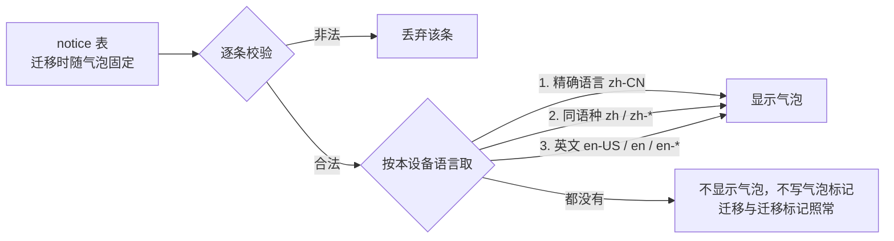

# 服务端驱动的草稿模型迁移

更新日期：2026-11-19

## 背景

运营在 `client/configs` 下发一条迁移规则。官方 Provider 下的新建草稿和新建默认值（Recent）
在下次打开时切到目标模型；规则带文案时，在模型按钮上弹一次气泡。每个草稿作用域各切一次；
每台设备每个规则版本只弹一次气泡。

## 规则

```jsonc
// /api/v1/client/configs → data.configs.draftModelMigration
{
  "revision": 3,
  "targetModelId": "model-b",
  "sourceModelIds": ["model-a"],
  "notice": { "zh-CN": "已为你切换到 model-b", "en-US": "Switched to model-b" },
}
```

| 字段             | 约束                      | 语义                                   |
| ---------------- | ------------------------- | -------------------------------------- |
| `revision`       | 正整数                    | 每次改规则必须递增；客户端只执行更大值 |
| `targetModelId`  | 非空字符串                | 按完整字符串精确匹配 Registry modelId  |
| `sourceModelIds` | 可选；非空字符串数组      | 只迁移这些模型；不配时迁移所有非目标   |
| `notice`         | 可选；语言 → 气泡文案的表 | 气泡文案的唯一来源；见下文“气泡文案”   |

- `revision`、`targetModelId`、`sourceModelIds` 任一非法时整条规则按 `null` 处理，不影响其他公开字段。
- `notice` 逐条校验，非法条目只丢掉自己；整张表非法或没有合法条目时视为未配置，迁移照常。
- 删除规则只停止新的迁移，不回滚已迁移的选择；`revision` 变小不触发。
- 规则经 Host `ClientConfigService` 读取，刷新间隔见 [客户端配置服务](../client-config-service.md)。

### 运营约束

`client/configs` 不登录也能读，抓包同样可见：规则里的目标模型和文案一经下发即公开。规则与文案
只能在目标模型公开发布之后下发。客户端在目标模型不在可用列表时跳过（见“判定”），只为应对规则
先于 Registry 生效的短暂窗口，不能用来提前铺设规则。客户端代码、本地文案、测试与文档不出现
具体的待发布型号；示例一律使用中性名。

## 作用域与来源

草稿作用域 `S = [clientNamespace, hostId, projectId]`，与 [新建草稿生命周期](../ui/project-task-draft-lifecycle.md)
一致：同目录的两个项目、桌面与手机、不同远端主机都是不同作用域。只有 Root 新建草稿参与；
已有会话的后续草稿、编辑态、分享导入和模板等显式交接不参与。

每次打开 Root 草稿只有一个来源：

| 来源        | 条件                              | 迁移时改写             |
| ----------- | --------------------------------- | ---------------------- |
| `rootDraft` | 打开时恢复了有文字的新建草稿      | 文字草稿的模型         |
| `recent`    | 无文字草稿，模型由 Recent 初始化  | 草稿模型 + Recent 模型 |
| 无          | Host 推荐值、导航交接、已有选择等 | 不迁移                 |

## 判定

```text
打开 Root 草稿（本次挂载 I，作用域 S，来源 src，初始选择 base）
  ├─ 读取一次 clientConfigService.getSnapshot()        失败 → 规则未知
  └─ 等待 ModelSelectionView ready（已对应当前选择）
        ▼ 两者都就绪后判定一次（每次挂载最多一次）
  skip    规则未知或无规则 · 当前选择已不是 base · 有效选择为空
          · 有效 Provider 没有目标模型 · 草稿已交给首发      → 不写标记，下次打开再判定
  settle  标记[S][src] ≥ revision · 非官方 Provider · 已是目标模型
          · 配了 sourceModelIds 且当前模型不在其中           → 写标记，不切换
  migrate 草稿按菜单选模型同一路径改为新选择；src=recent 时 CAS 改写 Recent
          写标记[S][src]；规则带 notice 且气泡标记 < revision 时挂起气泡
```

- 判定只看 View 对当前选择解析出的 `effectiveSelection`。账号套餐会按当前连接重映射，
  不能只看存储的 providerId。当前选择失效（模型下架、套餐连接不可用）时不迁移，保持
  既有“留空等用户重选”行为。
- 官方 Provider：有效 Provider 满足任一条件：
  - `config.access.type === "zhipu-account"`（Start / 个人 / 团队套餐）；
  - `templateId` 属于 `OFFICIAL_PROVIDER_TEMPLATE_IDS`（`zai-api`、`zai-standard-api`、
    `bigmodel-api`、`bigmodel-standard-api`）。其他模板和完全自定义 Provider 不算。
- 新选择：`{ 原 providerId, targetModelId, 档位 }`。目标模型支持原档位则保留，否则与菜单
  主动选模型相同取 `completeNewModelSelection` 的档位。保留原 providerId，账号套餐重映射继续生效。
- 目标模型不在有效 Provider 的可用列表时不写标记，之后列表中出现该模型时，下次打开会迁移；
  若气泡已弹过，这次迁移不再提示。

## 存储（客户端 localStorage，每台设备一份）

| Key                                                 | 值                              | 写入时机              |
| --------------------------------------------------- | ------------------------------- | --------------------- |
| `zcode-draft-model-migration:v1:<composerScopeKey>` | `{ rootDraft?: n, recent?: n }` | settle / migrate      |
| `zcode-draft-model-migration-notice:v1`             | `{ revision: n }`               | 气泡真正显示时        |
| `zcode-composer-recent:v2:<composerScopeKey>`       | 仅替换 `modelSelection`         | migrate 且 src=recent |

- 标记按来源分开，文字草稿迁移不会让 Recent 漏迁。
- Recent 改写是 [Recent 只在接纳时写入](../ui/project-task-draft-lifecycle.md#默认配置) 的唯一例外：
  只有存储值仍等于判定时的 base 才写，保留 `mode`、`order`、`modeOrder`；迟到的发送回执按原
  order 规则覆盖，真实发送优先。

## 气泡

- 复用模型选择器 `ModelConfigSelect` 的引导气泡（`guide` 属性），内容为服务端文案和关闭按钮。
- 显示条件：草稿未首发、模型按钮处于普通状态、菜单未打开、当前不是设置页、本设备语言能取到
  文案。条件不满足时待显示状态按草稿作用域保留，不写气泡标记；同一作用域重新打开（如重启后立即
  点“新建”）时继续显示，切到其他作用域时不显示。
- 显示过的气泡在离开该草稿（首发进入会话、切到其他作用域）后结束，再回来不再弹出；同一作用域
  重开（如点“新建”）和去设置页再回来都不算离开，未关闭时继续显示。
- 关闭：点关闭按钮、打开模型菜单、在气泡和按钮之外按下指针。
- 桌面与手机共用组件；按设备各弹一次。两个窗口同时迁移时极少数情况下可能各弹一次。

### 气泡文案

客户端没有默认文案。迁移成功时连同规则的 `notice` 表一起挂起，显示时按本设备当前界面语言取文案：



- 语言键：`zh-CN`、`en-US`、`ja-JP` 这类语言标签，大小写不敏感；其他键丢弃。同一级有多条命中时，
  先取与语种完全相同的键（如 `zh`），否则按服务端下发顺序取第一条。
- 文案：字符串，去掉首尾空白后非空，最多 256 个字符（按 Unicode 码点计），不得含换行符
  （`\n`、`\r`、`\u2028`、`\u2029`）。纯文本原样显示：不做占位符替换，不支持链接和按钮。
- 文案随气泡在迁移时固定，之后的配置刷新不改变已挂起的气泡。
- 布局：气泡在按钮上方，优先让右边缘与模型按钮右边缘对齐（向输入区内侧展开）；按钮左侧放不下时
  （如手机）由碰撞处理向右平移。气泡与视口保持 8px 间距，宽度不超过 `min(28rem, 可用宽度)`，
  不越过输入框左右边缘；长文案自动换行，关闭按钮停在第一行右侧。

## 竞态与边界

| 场景                               | 结果                                                            |
| ---------------------------------- | --------------------------------------------------------------- |
| 判定前用户手动改了模型             | 当前选择不是 base，skip                                         |
| 判定前用户已输入文字               | 照常迁移；正文不变，草稿随新模型保存                            |
| 判定前已开始首发（发送中或已接纳） | 见下文“首发与判定的先后”，skip                                  |
| 预热 session 仍用旧模型            | 与菜单选模型相同；模型随 sendText 原子提交，不另发 CAS          |
| 规则读取慢或失败                   | 有旧快照时最多等 3 秒；冷启动失败为规则未知，skip               |
| 桌面 continuous / 手机 replayable  | 不改变投递与恢复边界；手机读取经 attachment 放行的 ClientConfig |

### 首发与判定的先后

规则读取最长要等 3 秒（有旧快照）或 15 秒（冷启动）。用户可能在判定前就点了发送：提交已按源模型
冻结，草稿却还在等待接纳后才交接到新会话。若此时规则到达并迁移，首条消息用源模型，交接到新会话的
草稿却是目标模型，后续消息被静默换模型；Recent 随后又被发送回执写回源模型，而标记已写，该作用域
在本版本下再也不会迁移。

```text
打开 → 读规则（挂起中）→ 点发送：提交冻结源模型 → claim 交出草稿 ─┬─ 接纳 → 交接到新会话
                                                               └─ 失败 → 恢复正文
                                    规则到达 ↗ 此后本次打开不再判定
```

因此草稿交给发送事务（claim）时，本次打开的迁移来源随之清除：之后不迁移、不写标记、不弹气泡。
新会话保持发送时的模型；Recent 由发送回执写为源模型，下次新建草稿再按规则判定。首发失败恢复正文时
本次打开也不再判定，同样留到下次打开。提交冻结与 claim 在同一个事件任务内完成，中间只隔一个已完成
Promise 的 await；判定 effect 也以最新状态为准，迟到的 effect 不会改写已交出的草稿。

## 实现入口

- 规则与文案解析：`packages/shared/src/clientConfig.ts`；官方模板：`packages/shared/src/model-provider-types.ts`
- 判定、标记与文案语言选择：`packages/ui/src/v4/composer/draftModelMigration.ts`
- 接线：`packages/ui/src/v4/composer/useDraftConfigControl.ts`、`newTaskDraft.ts`、`lib/composerRecent.ts`
- 气泡：`packages/ui/src/ModelConfigSelect.tsx`、`ControlHintTooltip.tsx`、`v4/composer/V4ComposerToolbar.tsx`、`v4/SessionPane.tsx`

## 验收用例

E2E 的界面语言属于用例前置条件，不能依赖运行机器的系统语言。DMM-01、DMM-09 在写入
源模型 Recent 并触发迁移之前，通过 `pinE2ELocale("zh-CN")` 固定并等待桌面应用语言生效。
DMM-10 在重启前固定桌面 renderer 的中文偏好，并在进程退出后写入中文语言设置，
避免保留的 renderer 偏好在重启后覆盖设置。手机连接后确认应用的 `html.lang` 为 `zh-CN`，
再构造 Recent；仅设置浏览器 context 的 locale 不能替代应用语言，因为远控优先读取桌面设置。
规则仍仅提供对应场景要求的文案，不为测试通过补充兜底；英文、同语种与无匹配文案场景
继续按下表验证。

| ID     | 前置 → 操作                                                                    | 断言                                                                                                              |
| ------ | ------------------------------------------------------------------------------ | ----------------------------------------------------------------------------------------------------------------- |
| DMM-01 | 项目 Recent 为官方模板 Provider + 源模型，规则 r1（带 `zh-CN` 文案）→ 新建草稿 | 按钮为目标模型；气泡显示服务端文案原文；Recent 改写且 mode 不变；首发用目标模型；不关气泡发送后回同项目新建不再弹 |
| DMM-02 | 接 01 → 其他项目 / 任务分区新建                                                | 都切换，不再弹气泡                                                                                                |
| DMM-03 | 完全自定义 Provider，同名模型                                                  | 不切换，标记为 settle                                                                                             |
| DMM-04 | 文字草稿使用源模型 → 打开                                                      | 模型切换，正文不变                                                                                                |
| DMM-05 | 迁移后改回源模型并发送 → 再新建                                                | 保持源模型                                                                                                        |
| DMM-06 | 刷新间隔 60 秒，规则升为 r2（文案只有 `zh`），等待超过 60 秒 → 新建            | 再次切换；中文界面按同语种显示 `zh` 文案                                                                          |
| DMM-07 | 读取成功一次后接口 503 或挂起                                                  | 3 秒内用旧规则完成判定，界面可用                                                                                  |
| DMM-08 | 删除规则或 revision 变小                                                       | 不触发，已迁移不回滚                                                                                              |
| DMM-09 | 账号套餐 + 连接重映射                                                          | 按有效 Provider 判定并迁移                                                                                        |
| DMM-10 | 手机远控新建草稿（较长中文文案）                                               | 手机作用域独立迁移，手机气泡弹一次；文案换行，气泡在输入框内且距屏幕边 ≥ 8px                                      |
| DMM-11 | 规则挂起时重启，恢复文字草稿后立即发送，再放行规则                             | 首发与新会话保持源模型；不写标记；下次新建再迁移并弹气泡                                                          |
| DMM-12 | 规则只带当前语言、同语种和英文都没有的文案（如只有 `ja-JP`）                   | 照常迁移并写迁移标记；不弹气泡，不写气泡标记                                                                      |
| DMM-13 | 中文界面；`zh-CN` 含换行、某语言超过 256 字符，`en-US` 为长英文                | 非法条目被丢弃，回退显示英文；长文案换行，气泡右边缘与按钮对齐、不超出输入框、距视口 ≥ 8px                        |
