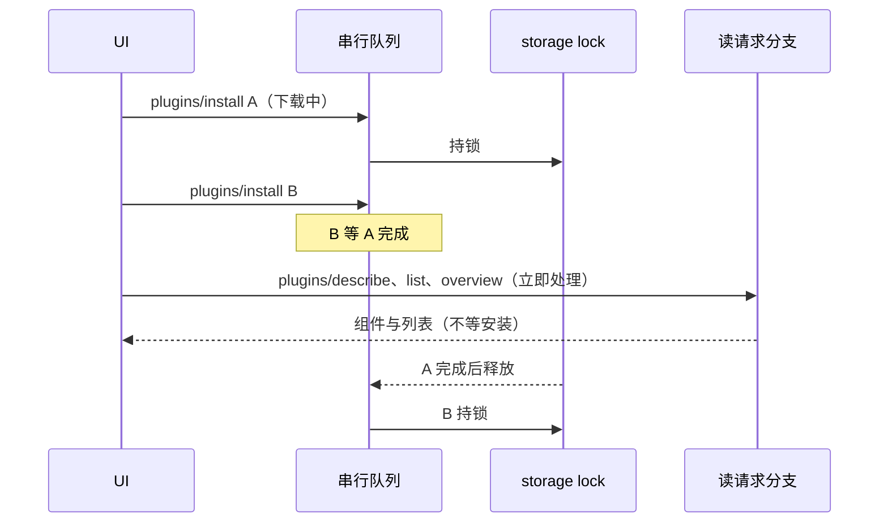

# Claude Code Marketplace 插件兼容实现规格

## 目标

ZCode 需要最大努力兼容 Claude Code Marketplace 插件，但不能把 Claude 的
高权限运行时语义直接带入当前 ZCode runtime。第一阶段先实现 marketplace
生命周期、安装态、启用态、兼容诊断和低风险资源投影；缺少安全模型或运行基础
的能力必须可识别、可展示、可诊断，但不能静默运行。

## 分阶段范围

### V1a：安装闭环

- 支持 marketplace `add/list/update/remove`。
- 支持 plugin `install/uninstall/update`。
- 默认注册 Claude 官方 marketplace source：`claude-plugins-official` 指向
  `anthropics/claude-plugins-official`。默认市场只提供 catalog 来源，不自动安装、
  不自动启用任何 Claude 插件。
- 新增 `installed_plugins.json` 保存安装态；继续用现有 `plugins.enabledPlugins`
  保存启用态。
- discovery 读取 installed cache roots，并保留已有 `plugins.dirs` inline 插件。
- 兼容 Claude Marketplace 默认结构：优先读取 `.claude-plugin/marketplace.json`，
  同时保留根目录 `marketplace.json` 作为 ZCode/旧数据 fallback。
- 输出 compatibility diagnostics，包含 unsupported / diagnostic-only 能力；disabled
  插件也必须能在管理页展示这些诊断，不能只在 enabled 后才发现。

### V1b：低风险运行投影

- 运行 `skills`、commands root、`mcpServers` 和 non-sensitive `userConfig`
  defaults。已启用插件的 `hooks` 都注入 runtime，包括第三方 marketplace 插件；
  V1 原定第三方只诊断，2026-07-01 起放开，逐插件信任尚未实现（见「安全边界」）。
- 支持 Claude/ZCode 模板变量别名。
- MCP server key 使用插件命名空间，避免多个插件声明同名 server 时覆盖。
- sensitive `userConfig` 只能进入 MCP env / credential / runtime secret path，
  不能进入模型可见 command、skill 或 markdown 内容。

### V1c：增强兼容

- 支持 dependency resolver：安装时解析 closure、缺失依赖和 cycle。
- 默认阻止跨 marketplace dependency，只有显式 allowlist 才放行。
- 支持 Claude commands object mapping 和 inline `content`，生成文件必须位于
  plugin cache/data root 内。
- UI 增加 configure userConfig 入口。

### V2

- Plugin agents 完整运行。
- LSP、outputStyles、channels、MCPB/DXT、enterprise policy、seed marketplace、
  GCS mirror、auto-update daemon。

## 领域模型

`marketplace` 和 `source` 是两条不同的轴，不能混用：

- `marketplace` 表示插件身份所属的市场，例如 `zcode-plugins-official`、
  `claude-plugins-official`、`inline` 或自定义 marketplace id。
- `source` 表示当前本地加载位置/来源，例如 `official`、`inline`、`cache`。

因此 V1 不把 `"marketplace"` 加入 `PluginSource`。如果后续需要区分
“用户从 marketplace 安装的 cache 产物”，应新增语义清晰的值，例如
`"installed"` 或 `"managed-cache"`，而不是复用 marketplace 概念。

插件 id 仍为：

```text
<plugin-name>@<marketplace>
```

本地 inline 插件使用 marketplace `inline`。Claude Marketplace 插件使用其
marketplace id，例如 `claude-plugins-official`。

## 存储布局

```text
~/.zcode/cli/plugins/
  known_marketplaces.json
  installed_plugins.json
  marketplaces/
    {marketplace}/marketplace.json
  cache/
    {marketplace}/{plugin}/{version}/
      .zcode-plugin/plugin.json
      .claude-plugin/plugin.json
      .mcp.json
      skills/
      commands/
  data/
    {pluginId}/
```

`cache` 是可替换安装产物，`data` 是插件持久数据。卸载插件时默认移除安装
产物，不删除 `data`；只有显式 purge 才删除 `data`。

ZCode 自己的 `zcode-plugins-official` 是唯一官方市场：随安装包 seed 的内置目录分片与
官方 CDN source 下发的目录分片按插件名合并为同一个 marketplace manifest，冲突时
CDN 市场条目优先。Claude 官方 `claude-plugins-official` 只内置 marketplace source，
第一次展示、安装或校验时按需刷新 catalog；刷新失败必须返回诊断并保留插件管理页可用，
不能因为网络不可达阻断已安装插件管理。

### Claude 官方市场弱依赖

`claude-plugins-official` 是可选 catalog 来源，不得成为插件管理或其他市场操作的硬依赖：

- 每次 Claude 市场 catalog 刷新使用独立的 30 秒总超时，并通过 `AbortSignal` 终止底层
  HTTP/Archive 请求；超时后立即返回 `plugin_archive_fetch_failed`（或对应来源诊断）。
- 全量刷新仍按已知市场逐个执行，但 Claude 超时/失败只记录
  `lastRefreshFailure` 并保留最后一次成功快照；其他市场继续刷新，不能因 Claude 失败
  提前中止。
- 设置页首次加载、市场详情、校验等会懒加载 Claude catalog 的路径同样受 30 秒预算保护；
  已有本地 manifest 时继续离线读取，不为概览读取强制联网。
- 所有 marketplace catalog、Claude 图标和 GitHub Archive 的 HTTP 请求必须经过统一的
  Web HTTP egress adapter，遵守 `ZCODE_HTTP_PROXY` / `ZCODE_NO_PROXY`，并在 Agent 封存
  用户 shell 后回退使用捕获的系统代理；禁止这些路径直接调用未配置代理的原生 `fetch`。
- 该预算只约束 Claude **marketplace catalog**。用户实际安装的第三方插件源仍按其自身
  source 类型执行，不把 catalog 超时误当作插件安装超时。

状态链路：

```text
Claude catalog request
  ├─ 30s 内完成 ──> 更新 manifest / lastUpdated
  └─ 超时或失败 ──> abort 底层请求 -> 保留旧快照 + lastRefreshFailure
                                      └─> 其他 marketplace 继续
```

注册 marketplace 时，源仓库/目录的 canonical manifest 位置是
`.claude-plugin/marketplace.json`；ZCode 本地缓存可继续把规范化后的 manifest
写入 `marketplaces/{marketplace}/marketplace.json`，但读取外部源时不能只认根目录
`marketplace.json`。

## Marketplace Source 兼容

V1 必须识别 Claude Marketplace source schema，并按支持级别处理：

| source | V1 行为 |
| --- | --- |
| `url` | 支持直接读取 marketplace JSON；保留 headers 但 V1 不发送敏感 header |
| `github` | 支持 repo/ref/path；公开 GitHub HTTPS 优先下载 Archive，无系统 Git 也可用；默认 path 为 `.claude-plugin/marketplace.json` |
| `git` | 支持 url/ref/path；可规范化的公开 GitHub HTTPS 优先下载 Archive，其他来源用系统 Git；读取 `.claude-plugin/marketplace.json` 或 path |
| `file` | 支持指向 marketplace JSON 文件 |
| `directory` | 支持目录内 `.claude-plugin/marketplace.json` 和根 `marketplace.json` fallback |
| `settings` | 可解析并规范化为 synthetic marketplace |
| `npm` | 识别并返回 unsupported diagnostic；不执行 install |
| `hostPattern` / `pathPattern` | 仅 enterprise policy 场景使用；V1 识别为 unsupported diagnostic |

默认 marketplace seed 只在 `known_marketplaces.json` 缺少同名市场时写入。若用户已有
同名 marketplace 记录，必须保留用户记录，不能覆盖 source、`addedAt` 或
`lastUpdated`。移除默认 marketplace 后，下次读取 marketplace 列表会再次恢复；永久隐藏
默认市场不属于 V1。

Plugin entry `source` 的 V1 支持范围：

| plugin source | V1 行为 |
| --- | --- |
| `"./relative"` | 支持，从 marketplace root 解析 |
| `{source:"directory"}` | 支持本地目录 |
| `{source:"github"}` / `{source:"git"}` / `{source:"url"}` | 支持 ref/sha；`commit` 作为 `sha` fallback；公开 GitHub HTTPS 优先按 `sha/commit > ref > HEAD` 下载 Archive，无系统 Git也可安装；当 entry 带 `path` 时只安装子目录。其他 URL 保持 legacy Git 语义 |
| `{source:"url", type:"git"}` | 显式 Git 来源；公开 GitHub HTTPS 仍可由 Archive 物化，私有/SSH/非 GitHub 用系统 Git |
| `{source:"url", type:"zip"}` | 支持 CDN zip 下载、`sha256` 校验、安全解压，再按现有 cache 目录安装；远端 CDN 必须 HTTPS，本地 fixture 可用 loopback HTTP |
| `{source:"git-subdir"}` | 支持 ref/sha；`commit` 作为 `sha` fallback；公开 GitHub HTTPS 通过 Archive 安装指定子目录，其他来源用系统 Git |
| `{source:"npm"}` / `{source:"pip"}` | 识别并返回 unsupported diagnostic；不执行 package manager |

## Manifest 兼容矩阵

| 字段 | V1 行为 |
| --- | --- |
| `name` / `version` / `description` / `author` / `license` | 读取并展示 |
| `skills` | V1b 运行 |
| `commands` | V1b 支持目录；V1c 支持 object mapping / inline content |
| `hooks` | 解析、诊断并运行；已启用插件（含第三方 marketplace）都运行，尚无逐插件信任 |
| `mcpServers` | V1b 运行；server key 强制命名空间 |
| `userConfig` | V1b 支持 defaults 和 required；sensitive 未接 credential 前禁止明文 configure |
| `dependencies` | V1c install-time resolver；load-time 不再报 unsupported |
| `agents` | 已启用插件的 agents 注册为子 agent profile；`permissionMode` 只能收紧（见「安全边界」） |
| `lspServers` / `outputStyles` / `channels` / `settings` | diagnostic-only |
| `npm` / `pip` / `hostPattern` / `pathPattern` source | V1 识别但 unsupported diagnostic |

Manifest 解析必须保留这些字段的原始信息或显式声明为 `unknown`，否则无法对
diagnostic-only 能力做可见诊断。

## 协议接口

新增方法必须在 `packages/shared/src/zcode-protocol/index.ts` 提供 Zod runtime
schema，并在 desktop / web / mobile 复用同一协议边界。

- `plugins/overview`
- `plugins/marketplace/list`
- `plugins/marketplace/add`
- `plugins/marketplace/remove`
- `plugins/marketplace/update`
- `plugins/install`
- `plugins/uninstall`
- `plugins/update`
- `plugins/configure`
- `plugins/validate`

`plugins/describe` 是插件详情页的只读组件枚举接口，用于返回单个插件的
skills、commands、agents、hooks、MCP servers 名称与可选描述。它不启动 MCP、不执行
hooks，也不解析运行时变量。已安装插件必须优先读本地 cache/安装目录；未安装候选才可
按需解析 marketplace source。

调度约束：插件读请求 `plugins/describe`、`plugins/list`、`plugins/overview` 不进入 Agent
连接的串行请求队列，也不等待此前排队请求开始，收到后立即处理，所以详情页和新建右侧标签页的
推荐区不会排在长时间安装、更新之后。describe 只在 marketplace manifest 缺失、需要拉取并写入时
进入 plugin storage lock。list/overview 是同步 handler，执行中不让出事件循环；内置插件 seed
只在内容变化时写盘，并有跨进程 seed 锁，因此不会与安装跨 await 的读改写交错。install、update、
setEnabled、configure 等写操作仍保持串行：setEnabled、configure 不持存储锁，靠串行队列与安装的
配置写入错开。



Bugfix 约束：`plugins/describe` 的 MCP 与 hook 枚举口径必须对齐真实 plugin loader，
不能只读取 `plugin.json` 内联字段。MCP server 名称需要来自插件根目录 `.mcp.json` 与
`manifest.mcpServers` 的合并结果；Hook 事件名需要来自 `hooks/hooks.json` 与
`manifest.hooks` 的合并结果。否则使用约定文件声明能力的 Claude Marketplace 插件（例如
`airtable` 通过 `.mcp.json` 声明 MCP）会在市场详情里漏显示组件，而已安装详情由于
`plugins/list` 使用 loader metadata 又能显示，造成两侧组件数量不一致。

`plugins/list` 和 `plugins/overview` 返回的已发现插件必须包含可序列化的
`hookDetails` 明细。每条明细按单个 hook 执行项展开，至少包含：

- `event`：Claude/ZCode Hook 事件名，例如 `PreToolUse`、`PostToolUse`、`Stop`。
- `matcher`：可选 matcher 字符串；未声明时表示该事件下的默认 matcher。
- `type`：`command` 或 `process`。
- `command` / `args`：执行命令及参数。
- `timeoutMs` / `timeout`、`async`、`shell`、`statusMessage`：原始 hook 配置中
  ZCode 已识别的运行参数。
- `sourcePath`：明细来自 `.claude-plugin/plugin.json`、`.zcode-plugin/plugin.json`
  还是 `hooks/hooks.json`。
- `runnable`：当前 runtime 是否会把该 hook 注入执行。目前所有插件都为 `true`，
  包括第三方 marketplace；逐插件信任实现后在 `canRunPluginHooks` 收回。

Hook 明细展示不能改变安全边界：解析和展示可以发生在插件未启用时，但未受信 Hook 不能
因为详情页可见而被注入 runtime。

`plugins/validate` 是只读 dry-run：不写入安装态、不启用插件、不启动 MCP、不
执行 hooks/commands。它不能只返回静态兼容矩阵，否则 UI 会错误地宣称插件兼容。

validate 的扫描深度按目标类型区分：

- marketplace source validate 扫描 marketplace manifest、entry shape、dependency
  closure 和随 marketplace 仓库一起存在的本地 plugin root。对官方 Claude
  Marketplace 这类聚合目录，entry 可能指向数百个外部 git 仓库；source validate
  不逐个 clone 这些远端插件，而是返回 `plugin_validation_deferred` 诊断，提示
  install 或单插件 validate 时会按需拉取和深扫。
- marketplace entry / installed plugin validate 必须深扫目标插件 root，返回
  manifest、path、compatibility、userConfig、MCP namespace/variable diagnostics。

这个分层保证 UI 的“添加市场前探针”不会因为官方 marketplace 的 236 个外部 source
而卡死，同时安装闭环仍然在真正使用某个插件前做完整兼容诊断。

## 安全边界

- 已启用插件的 agents 会加载为子 agent profile，工具仍经过 tool allowlist 与 permission broker。
  frontmatter `permissionMode` 只能收紧子会话权限，官方与第三方插件同一规则，见
  [项目配置信任边界](./security/deep-link-project-trust-boundary.md)。
- sensitive `userConfig` 不允许替换进模型可见文本。
- sensitive `userConfig` 未接入 credential store 前不允许通过 `plugins/configure`
  明文写入普通 config。
- 已启用插件（含第三方 marketplace）的 hooks 当前都会注入 runtime，尚无逐插件 trust；
  判断收口在 adapters 插件加载的 `canRunPluginHooks`。
- dependency resolver 默认阻止跨 marketplace dependency。
- inline command 生成路径必须通过 `resolveInside` 约束在 cache/data root 内。
- Web/mobile remote 只通过 shared-host/agent protocol 读写插件状态，不在 relay
  或 main process 下沉 ZCode session/task/plugin runtime 状态。
- 公开 GitHub 来源的无 Git物化、系统 Git fallback 与原子 cache 激活遵循
  [公开 GitHub 插件源无 Git安装规格](./plugin-github-archive-source.md)。已安装插件的 discovery
  只读本地 cache，Marketplace 刷新失败不得影响既有插件运行。

## 验收

- 单元测试覆盖 marketplace storage、installed state 迁移、manifest 兼容矩阵、
  MCP namespace、sensitive userConfig、dependency diagnostics。
- 协议 schema 覆盖 success/failure parse。
- UI 覆盖 marketplace / installed / diagnostics 基础管理。
- 运行 `pnpm typecheck` 和 `pnpm lint`。
- 本地 dev 启动后用 CDP 验证插件管理页无 console error，基础交互可用。
- 选取 Claude Marketplace 当前 top 插件做安装/诊断/低风险资源加载兼容测试；
  高风险能力必须显示 diagnostic-only，而不是静默失败或执行。

## 官方 Claude Marketplace 验证记录

2026-06-24 选取 `claude-plugins-official` 中 5 个真实插件做临时 storage
安装与 runtime projection 验证：

| 插件 | 覆盖能力 | 验证结论 |
| --- | --- | --- |
| `commit-commands` | commands | 发现 `/commit`、`/commit-push-pr`、`/clean_gone` |
| `claude-md-management` | commands、skills | 发现 `/revise-claude-md` 和 1 个 skill |
| `hookify` | commands、skills、hooks | 发现 `/hookify`、`/configure`、`/help`、`/list`，注入 `PreToolUse` / `PostToolUse` / `Stop` / `UserPromptSubmit` hooks；`pretooluse.py` 以真实 JSON stdin 执行成功 |
| `context7` | MCP stdio | runtime 投影 `plugin:context7:context7`；MCP SDK 连接后 `listTools` 返回 `query-docs`、`resolve-library-id` |
| `playwright` | MCP stdio | runtime 投影 `plugin:playwright:playwright`；MCP SDK 连接后 `listTools` 返回 23 个 browser tools |

验证过程中发现并修复：

- Claude 官方命令文件名可包含 `_`，例如 `clean_gone.md`。Custom command
  name pattern 已兼容 `_`。
- 官方/第三方 marketplace entry 可能使用 `commit` 表示 git pin。Installer
  将 `commit` 作为 `sha` fallback，但仍优先使用官方 schema 的 `sha`。
- `claude-plugins-official` 安装产物中的 hooks 需要可运行；第三方 marketplace
  hooks 当前同样运行（见「安全边界」）。
