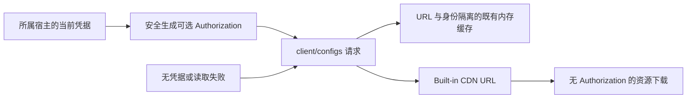

# 独立客户端配置服务（首期：插件排序）

## 范围

用户确认新增独立 ClientConfigService，但先不迁移旧链路。首期仅把本 MR 新增的插件排序
读取从 CodingPlanSubscriptionService 移出；套餐、安全校验、强更、闲时、帮助、Built-in、
Desktop Main 灰度与独立 CLI 的原有读取职责保持原样；可选登录请求头遵循下述统一约定。
Nacos 的 pluginStoreOrder 格式不变，无需调整已发布配置。

## 职责与接口

- `packages/shared/src/clientConfig.ts`：公开配置响应 schema 与裁剪后的 ClientConfigSnapshot。
- `packages/services/src/client-config/clientConfig.ts`：IClientConfigService 契约与服务频道。
- `packages/services/src/client-config/clientConfigService.ts`：请求、校验、缓存、刷新和并发合并。
- `getSnapshot({ forceRefresh? })` 返回校验后的公开字段；当前包含 pluginStoreOrder、zsrcUrl 和 uiPluginRecommendations。
  不返回整个远端响应，不把账户或 provider 数据暴露到 Renderer。
- 服务成功但缺失/撤销 pluginStoreOrder 时返回 null；格式损坏的单个模式继续按原排序契约降级。
  envelope/HTTP/网络失败拒绝本次读取，保留服务已有快照；业务端决定默认展示。

```mermaid
flowchart LR
  D[桌面插件商店] --> P[client-config RPC]
  M[手机 shared-host attachment] --> P
  R[远程 workspace 服务视图] --> P
  P --> C[窗口 Local Host 的 ClientConfigService]
  C --> A[注入的 ApiClient 和窗口网络策略]
  A --> E[/client/configs]
  O[原有套餐等消费者] --> L[原有读取链路，保持不变]
```

## 状态和时序

- 每个 window-scoped Local Host 创建一份；远程 workspace 集合显式注入并注册同一实例，
  不创建远程排序配置 owner。手机经现有 attachment 使用该实例，不另建请求或 Host。
- 普通 Web/server Host 从 createLocalServices 获取自己的实例。Web 未连接 Host 的首页
  返回空公开快照，不直接发网络请求。
- 配置仍允许匿名读取，credentials=omit；已登录时携带当前 ZCode JWT 的 Bearer Authorization。
  凭据由宿主经只读回调注入，不在配置服务中创建凭据仓储。
  缓存 key 为实际请求 URL（规范 endpoint、app_version、platform）与本次可选身份；请求上下文由 Host
  装配注入。不同上下文不共用快照/在飞请求，迟到结果只写回所属 key。
- 有效快照 TTL 为 1 小时；同上下文的在飞请求合并。强制刷新绕过有效快照但不清空它。
  强刷进行中，普通读取仍能立即使用有效旧快照；刷新成功才原子替换。
- 每次读取配置前删除已过期且没有在飞请求的缓存项，释放旧身份的缓存 key 和快照。
  在飞项保持到请求完成，避免清理导致同身份重复请求；未过期项仍按原 TTL 复用。
- HTTP 请求及正文读取使用请求总预算 15 秒的 AbortSignal；失败不缓存错误，不永久锁住在飞状态。
- 返回快照的副本，避免同进程消费者修改缓存。UI 不再增加请求 TTL；原有 hook generation
  继续隔离卸载/重叠刷新/不同服务的迟到结果。
- 不触及 task/session/owner/queue/stream；desktop-continuous 和 web-remote-replayable
  的恢复语义保持原样。公共排序配置不按 workspacePath 或 workspaceIdentity 分桶。

## 影响面

改动层级：option-source / persistence（内存缓存 owner）/ delivery（新增普通服务频道）。
must-inspect：Local Host 装配、IServiceAccessor、RemoteServiceAccess、远程 workspace 服务集合、
Web home-only、usePluginStoreOrder。should-inspect：服务失败/切换后列表顺序、刷新与模式切换。
invariant-only：全部旧 client/configs 读取链路、插件生命周期、Main/relay 和会话恢复。
共享组件是 PluginStoreListView；UI 仍从 hook 读取，分类排序及分类迁移规则不变。
现有 product capability map 的 ClientConfig 专属节点缺失，暂按平台公共配置能力记录为图谱待补项；
本次功能语义图补充真实代码种子与唯一 owner。

## 验收

| ID     | 设置 / 动作 / 断言                                                                                   |
| ------ | ---------------------------------------------------------------------------------------------------- |
| CCF-01 | 并行读取同一 URL 和身份 → 只发一次 HTTP；登录、换号、退出后的读取不复用其他身份快照                  |
| CCF-02 | 有有效快照 → 强刷中普通读返回旧值；强刷失败旧值仍可读，成功撤销返回 null                             |
| CCF-03 | 切换 endpoint/version/platform，旧请求迟到 → 各自快照隔离，无交叉覆盖                                |
| CCF-04 | 错误 envelope/HTTP/正文挂起 → 拒绝且能重试，超时取消整个请求                                         |
| CCF-05 | RPC getSnapshot → 严格类型的公开字段，未知字段不透传，调用者不能修改缓存                             |
| CCF-06 | 多远程 workspace / server remote 服务集合 → 注册同一注入实例                                         |
| CCF-07 | 真实 dev / 浏览器 → Code、Work、刷新、空分类和旧 guides 归并保持；日志使用 client-config.getSnapshot |
| CCF-08 | 相对 MR 目标分支核对三个订阅源文件 → 本 MR 对其改动归零，旧链路测试通过                              |
| CCF-09 | 可控时钟下依次读取不同身份 → 下次读取清理过期项；在飞项保留且同身份去重，未过期快照仍可复用          |

浏览器 E2E 继续使用既有 manual-review/pending 用例，注入新服务契约；不擅自晋级正式用例。

## 本次验证记录

- 新服务、旧订阅链路、远程服务装配、RPC 代理、共享 schema 和 hook 回归共 97 项通过。
- 两组浏览器 E2E 通过（1200px 英文浅色、390px 中文深色），覆盖原排序交互和分类边界。
- 真实 dev 重启后，Host 日志确认商店读取为 `client-config.getSnapshot`，
  不再出现 `coding-plan-subscription.getPluginStoreOrder`。真实头像菜单切换 Code / Work，
  分类及分类内前列项与测试 Nacos 一致，切换新增配置 RPC 数为 0。
- typecheck、lint、architecture 检查通过；lint 的 43 条既有警告保留。
- 三个订阅源文件与分支原始基线逐字一致，本次变更不会修改目标分支已有的后续订阅逻辑。
- 真实手机 shared-host/SSH/WSL/Docker 尚未实机联调，服务装配层的同实例复用已有单测。

## UI 推荐字段

`uiPluginRecommendations` 返回经过校验的 `{ pluginId, surfaceId }[]`；缺失或格式无效时返回空数组，
不影响其它公开字段。推荐入口复用本服务，不增加请求缓存或轮询。配置和曝光规则见
[插件市场规格](plugins/plugin-market-interactions-scope.md#side-pane-服务端推荐配置)。

## client/configs 可选登录请求头（2026-11-03）

所有 `/api/v1/client/configs` 消费者遵循相同请求规则：有当前 ZCode JWT 则发送
`Authorization: Bearer <jwt>`，没有则省略。复用 `toBearerAuthorization` 的字符校验；
凭据读取失败、空值、非法字符均按匿名读取处理，不记录 token 或原始凭据异常，不改变登录态。
该规则不扩展到 client/scenes、agent/configs 或其他业务 API。

覆盖 Host ClientConfigService、套餐配置、Built-in 配置、Desktop 帮助、启动强更、
Desktop Context/Renderer Action 灰度共用 fetcher，以及 Web 帮助；独立 CLI Built-in
读取使用自己的凭据仓储。Main/Host 不互相调用登录流程，Web 使用既有浏览器 OAuth 仓储。



- 每次实际读取前重新解析身份；帮助、通用配置、套餐配置的缓存与在飞请求按身份隔离，
  旧请求只能完成自己的缓存，不可清除或覆盖新身份的在飞请求。
- 保留原 TTL、刷新触发时机、公开字段裁剪和桌面/手机服务归属。不增加登录触发的轮询，
  不修改已经冻结的 Host 功能开关或 Built-in Registry 的发布规则。
- Built-in 第一跳仅 client/configs 携带可选 JWT；第二跳 CDN 不继承该头，仍拒绝重定向。
- Main 的原生 net.request 显式设置 Cache-Control: no-cache，避免服务器允许公开 HTTP 缓存时，
  Chromium 在登录后直接复用匿名响应。Web 可选鉴权只读会话，不触发残缺/过期凭据清理。
- 验收：匿名、登录 A、登录 B、退出、凭据异常与非法字符；同身份去重、身份切换和迟到响应；
  实际 Node/Electron/Chromium 请求头及独立 CLI 第一跳/第二跳隔离。不能只断言构造参数。
- 缓存清理回归：可控时钟与本地 HTTP 请求验证 6 项通过，覆盖过期身份释放、有效缓存复用、
  首次请求在飞去重、过期快照强刷在飞去重、失败项释放，以及多次身份切换后的缓存数量。
  修复前复现其中 3 项失败；修复后 6 项全部通过。清理在下次读取时执行，不增加定时器。
