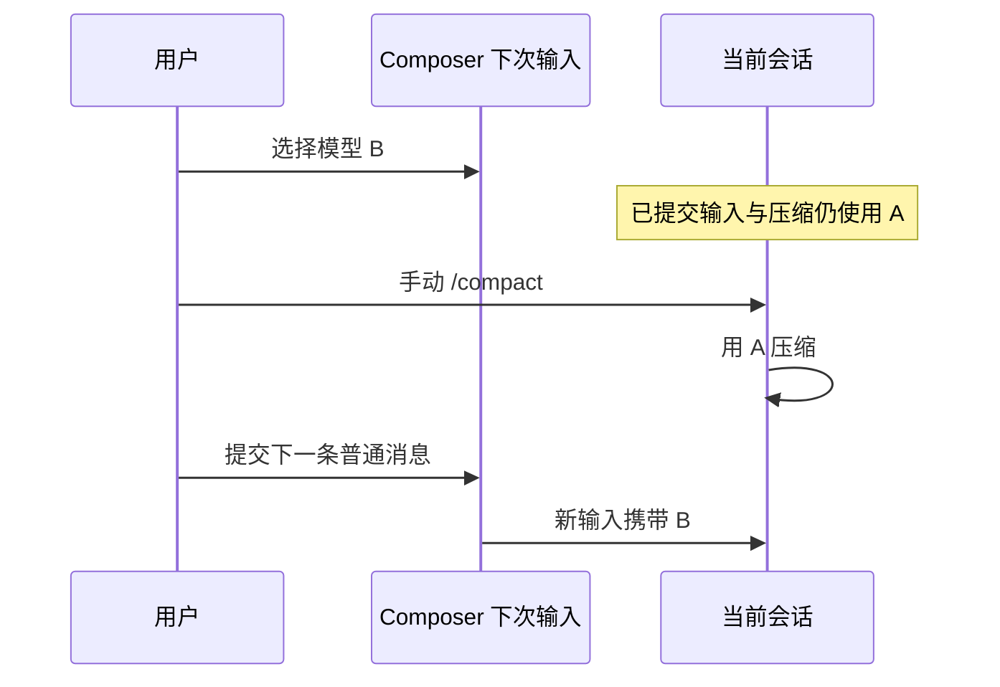

# Conversation Session Case Catalog

## 会话 ID 兼容（SID，2026-10-28 accepted）

规格：[Session identity compatibility](session-context-tool.md#session-identity-compatibility)。

| ID    | 前置与动作                                                             | 必须断言                                                                                                                                                                                                          |
| ----- | ---------------------------------------------------------------------- | ----------------------------------------------------------------------------------------------------------------------------------------------------------------------------------------------------------------- |
| SID01 | 桌面新建并发送                                                         | ID 为 `sess_<UUID v4>`，Host/CLI/消息同 ID                                                                                                                                                                        |
| SID02 | 隔离库含两种 `session_` 历史，完整重启后打开并继续发送，再次重启       | 原 ID、旧历史和新增消息保留，无改名前缀生成的任务副本                                                                                                                                                             |
| SID03 | 引用两种旧 ID 并执行 ReadSessionContext                                | UI 保留 session 类型，runtime 有引用提示，工具按原 ID 读取并返回历史                                                                                                                                              |
| SID04 | 手机打开两种旧 ID，引用发送后刷新                                      | 原 ID 与新增消息保留，引用保持 session 类型                                                                                                                                                                       |
| SID05 | 旧客户端不带 sessionId，重复、并发、完整 Host/CLI 重启和预留后崩溃重放 | 同命令只预留一个 UUID；CLI 输入不重复执行；已有 session\_ 精确沿用；已接纳未执行的 firstInput 重启后点击横幅重发使用新 commandId、新 UUID，只执行一次；workspace rekey 保留映射，冲突整笔回滚；隔离和删除保护成立 |

候选位于 `conversation-session/manual-review/pending/conversation-session-id-compatibility.test.ts`；
CLI 定向回归覆盖工具 schema/精确查询、混合引用去重和邮箱隔离。手机交互验证单独登记。

## Web 远控大 RPC 容量（MRL，2026-10-27 accepted）

规格：[合法大消息的重放容量](web-remote-control/web-remote-control-architecture.md#合法大消息的重放容量2026-10-27)。
候选：`packages/web/test/e2e/manual-review/pending/remote-large-rpc.mjs`。

| ID    | 前置与动作                                                                                                       | 必须断言                                                                                                                                       |
| ----- | ---------------------------------------------------------------------------------------------------------------- | ---------------------------------------------------------------------------------------------------------------------------------------------- |
| MRL01 | 真实 Web 首页通过 RPC 读取含合成 8 MiB 数据的项目响应                                                            | 收到完整响应的 ACK，项目可见；宽窄屏均仅一个 bridge、一次文档导航，无 transport fault；窄屏 home 仅挂载一次；浅色中文与深色英文                |
| MRL02 | 真实 adapter 下行 6/8/16 MiB、上行 8 MiB，在途余量、ACK 丢失重放、暂时不可发送、foreign identity、缓存耗尽与超时 | 原始字节完整且恰好交付一次；物理外壳不超过 1 MiB；ACK 释放并恢复低水位；显式更低预算及 32 MiB 硬上限有效；16 MiB + 1 byte 被拒且不发送半条消息 |

合成大字段只用于确定 RPC 字节量，不代表用户现场的数据来源；账号、relay 和业务返回受控。
真实 Web、Channel RPC 和 acknowledged adapter 参与验收；不据此声明实体手机、生产 relay、
原生 Electron 或 SSH/WSL/Docker 网络覆盖。候选保持 pending，运行证据见覆盖矩阵。

## Web 远控提交与 RPC 生命周期（MRS，2026-10-27 accepted）

规格：[Bridge 服务与在途 RPC 终结](web-remote-control/web-remote-control-architecture.md#bridge-服务与在途-rpc-终结2026-10-27)。
候选：`packages/web/test/e2e/manual-review/pending/remote-submit-lifecycle.mjs`。

| ID    | 前置与动作                                                              | 必须断言                                                                                        |
| ----- | ----------------------------------------------------------------------- | ----------------------------------------------------------------------------------------------- |
| MRS01 | Web 本地/远端 workspace 打开真实反馈表单并提交合成内容                  | 控制端 feedback 被调用，Source feedback 不被调用，无 1000ms Unknown channel；不访问真实反馈 API |
| MRS02 | Web 已有会话发送普通文字                                                | 控制端 gen-ui.listState 收到原 scope，随后才提交命令；无通道超时；sandbox/状态写入仍被拒绝      |
| MRS03 | 发送前 RPC 被受控挂起，终结旧 bridge 并恢复同一任务，再释放旧响应       | 草稿恢复且可重发；旧请求明确失败，迟到回包不提交旧正文；不自动发送、不出现跨任务内容            |
| MRS04 | 同 bridge 正常回复、重复终结、Initialize 前终结，及桌面 continuous 对照 | 正常请求仍成功；旧 client 的当前/后续请求拒绝且终结幂等；桌面完整服务面保持                     |

覆盖宽/窄 Web、深浅主题及中英文。浏览器边界使用真实页面、RPC、relay adapter 和 Host 装配，
仅外部账号/relay 与业务端返回受控；不代表实体手机、真实 SSH/WSL/Docker 或生产网络验收。

MRS05（accepted / pending）：本机原生 Electron 经 SSH 连接新建 Linux Docker 容器，手机 Web
复用该 Host/Source。读取 feedback 设备快照必须属于桌面平台，Gen UI listState 正常返回；
在普通发送的 listState 请求帧发出前扣住该帧，再对同 bridge 注入失效通知。恢复后正文保留，
释放旧帧也不产生该输入的模型请求；随后继续既有运行中断网恢复、双端 FIFO 和 Source 重连。
扩展候选 `conversation-session-r3-mobile.test.ts`；同时定向回归 SSH P0、R3 ACK loss 和手机权限恢复。
模型及账号/relay 上游可用既有回放，SSH、Source/Agent、Host 和 Web 页面必须真实运行。

MRS06（accepted / pending）：同一手机 SSH 链路提交普通消息后扣住旧 bridge 下行 RPC，
确认远端已经产生模型请求，再编辑下一条草稿并重建 bridge。恢复后原消息和模型请求各一次，
后续草稿保留且未发送；迟到旧回包不清除新草稿。与 MRS05 共用上述候选及既有回放 fixture。

事务隔离回归 `FX13` 已接受：fork 回滚只撤销自身写入；并发创建的会话、消息与已有会话更新在
进程重启后保持可读。范围与证据见 [fork 交叉矩阵](testing/conversation-session-fork-cross-product-matrix.md)。

## Composer 输入响应性（CTP，2026-10-20 accepted）

对应反馈 `ZCT-2112490732581797888`。输入显示由 Lexical DOM 即时负责；普通字符、退格与 IME composition 中间态不得逐字符提交 `SessionPane` 草稿 owner 或同步读写 localStorage。350ms 静默窗口和显式生命周期边界只提交当前 scope 的最新快照一次；task/workspace 切换、窗口隐藏/卸载、模型切换与发送结算不得丢正文或串 scope。

| ID    | 前置状态与动作                                                                | 必须断言                                                                                                                                             | 自动化状态                                                 |
| ----- | ----------------------------------------------------------------------------- | ---------------------------------------------------------------------------------------------------------------------------------------------------- | ---------------------------------------------------------- |
| CTP01 | 短/长草稿连续字符、退格、IME composition；静默前切 task、改模型或卸载         | burst 内父级草稿与存储写入为 0；候选期只更新发送布尔状态；scope-bound cleanup 写回旧 scope；普通回调校验 scope+incarnation，A₁→B→A₂ 后不得覆盖新编辑 | UI focused unit，merge-blocking                            |
| CTP02 | Windows 桌面空闲 Composer；短草稿与 12–16KiB 草稿分别真实按键输入、退格三批次 | 输入阶段 96 个字符和退格阶段分别精确匹配；p95 key-to-paint 中位数 ≤100ms、单批 ≤150ms；无 ≥200ms Long Task；保存 frame/long-task/CPU profile         | `manual-review/pending`，需 Windows 人工基线后决定是否转正 |

CLI/session 诊断不含 Renderer 输入、React commit 或 paint，不能作为 CTP02 的性能结论。CDP 合成 composition 只能验证 Chromium/Lexical 事件链，不能冒充 Microsoft Pinyin/TSF 真机覆盖；原生输入法仍单列人工验证限制。

## 手机远控终端恢复（MRO04，2026-10-22）

手机输入法补充（2026-10-23，accepted / pending）：MRO04 用 `keydown(229)` 与稍后到达的
`input(insertText)` 输入真实探针命令，验证完整参数、执行结果及桌面终端不受影响。
TMI01～TMI10 在真实 TerminalSession 组件覆盖手机重复字母、空格、emoji、组合输入、删除和
底部 / 侧栏保活，并做 Windows/Linux 浏览器平台对照。合成键盘事件不冒充实体手机或原生输入法验证。
规格见 [终端输入契约](ui/terminal-sessions.md#手机软键盘输入2026-10-23)。

回车补充（2026-10-23，accepted / pending）：TMI11/TMI12 覆盖底部和侧栏终端的
`keydown(229) → insertLineBreak` 单次提交、keypress 去重与普通 Enter 对照。
MRO04 使用同一路径提交手机探针命令，验证真实 PTY 执行结果。

CR-01 补充（accepted，已本地验证，仍为 pending）：刷新后旧 shell 退出；失联超过既有 3 秒宽限后旧 shell 退出，重连使用新 owner/PTY；关闭浏览器后回收手机 PTY。短断线与同页 bridge 换代保留，桌面终端保持可用。

MRO04（accepted / pending）：固定回放建立已有会话，桌面打开终端并执行标记命令；已配对的 390px 手机 Web
通过现有 shared-host 打开同一项目的终端，输入命令并收到真实 PTY 输出；关闭手机终端标签
后重新打开仍可执行；同项目新建草稿并返回原会话后，原终端标签、shell PID 与历史保留，
输入和输出恢复到新 bridge，关闭仍回收原 PTY；桌面底部与侧栏的独立终端保留并继续执行。
输出判定等待标记和目录的完整快照。
本地桌面及本地手机终端使用 Node 探针，明确的 Linux SSH 终端使用 POSIX 探针；
选择依据是终端目标，不是测试宿主平台，Windows 宿主的本地 PowerShell 必须可执行。
侧栏迟到关闭回归（accepted / pending）：固定回放建立原任务，主进程关闭回执受控延迟时，经过真实登录入口重挂 App 并返回原任务，
新增终端 B，再释放旧回执并再次重挂，B 的标签和历史仍保留；旧关闭继续释放指定资源。
原有浏览器标签壳同步问题不纳入本次断言。
对应候选：`packages/desktop/test/e2e/conversation-session/manual-review/pending/conversation-session-side-pane-late-close.test.ts`。
仅外部账号与 relay 使用 loopback fixture，
模型只用固定回放建立会话，不评价生成质量。Host RPC 补充输入、输出、resize、dispose、其他频道拒绝和桌面对照。
候选：`packages/desktop/test/e2e/conversation-session/manual-review/pending/conversation-session-web-remote-terminal.test.ts`。
规格见 [远控架构](web-remote-control/web-remote-control-architecture.md#启动调用边界与-office-xss-关系)。

## Gen UI 输入上下文分离（GUC，2026-10-20）

GUC01–GUC08 的设置、动作、断言与证据层见 [Gen UI 输入上下文规格](specs/gen-ui-model-context.md#用例与剪枝)。
已确认目标：App 不把状态拼进正文，CLI 复用 system reminder，所有可见出口消费干净正文。
输入快照沿用 canonical intent；retry/历史编辑复用，队列撤回重发重新采集。重启丢弃未执行队列的既有语义不变。
旧格式以字段缺失为兼容判据；新格式空数组保留用户字面标签。带状态输入经过 Host/CLI 两跳能力检查。
CLI 定向回归与桌面/手机 E2E 候选的运行证据见 coverage matrix；pending 候选不表示 formal 准入。
不扩展手机 sandbox、新任务首发或 goal，不修改已发布的静态分享；具体剪枝与测试交接见规格。

## 消息正文链接菜单（MLC，2026-10-20）

规格见 [消息正文链接右键菜单](ui/message-link-context-menu.md)。

| ID    | 前置状态                                       | 用户/系统事件                                   | 规则命中               | 期望结果                                                                                                                    | Review   |
| ----- | ---------------------------------------------- | ----------------------------------------------- | ---------------------- | --------------------------------------------------------------------------------------------------------------------------- | -------- |
| MLC01 | 消息正文包含带查询参数与片段的 HTTP/HTTPS 链接 | 右键后分别复制、在 ZCode 中打开、在浏览器中打开 | messageLinkContextMenu | 两个打开动作相邻且图标不同，复制前有分隔线；复制完整 URL 且不导航；两个打开入口保持各自目标；中英文、深浅主题及窄屏菜单完整 | accepted |

## 移动端事件推送（MP）

MP01–MP12 的前置、动作、断言与证据见[移动端事件推送规格](web-remote-control/mobile-event-push.md#62-验收用例)。产品语义 accepted。HTTP 资格不建立 WS，远控开关独立；未配置设备接口时向全部设备发送。覆盖通知资格、控制权限隔离、五类实时事件、断网不补发、跨账号/工作区/Pod 和签名发送；不改变桌面本地通知与任务执行状态机。

## 项目与任务草稿生命周期（2026-10-16）

PD13–PD16（2026-10-30，accepted / pending）：远端草稿在 projectId 就绪后才预热和首发；覆盖保留作用域的完整冷启动、只删除导航作用域后的冷启动与 Enter 拦截、显式项目新建后的真实首发、手机 shared-host 恢复及本地未归类首发。候选 `packages/desktop/test/e2e/conversation-session/manual-review/pending/conversation-session-remote-draft-prewarm.test.ts`；covered（候选未转正）：`packages/desktop/.e2e-artifacts/local-docker-20261030074146-15e10a` 完整通过，含真实 Provider 请求和 Host 项目归属断言。macOS Electron → SSH Linux arm64；手机为 Chrome 390px 触摸视口与真实 relay/Host，缺归属为受控 store 前置；不是实体手机或 Windows/Linux 桌面证据。缺失作用域不归因于升级。

PD01–PD12 的前置、动作、断言与证据要求见 [统一生命周期规格](ui/project-task-draft-lifecycle.md)。产品语义 accepted；自动化保持 manual-review/pending，运行证据见 coverage matrix 与规格的验证记录，不代表已转正或发布。覆盖项目/任务新建、同目录项目隔离、接纳后默认配置、目录复用、迟到回执、手机独立恢复及旧数据认领。

PD12 集成边界：新建项目交接正文与内存附件（同目录也交接），关闭分组草稿只撤销分组意图，刷新后仍保留正文。复用 PCD01–03 与 GRP02/03/11 验证；手机长按先检查目标可交互，再发送实际触摸事件。

## 图片预览操作（PIA，2026-10-14）

用户确认：添加到聊天使用文件引用，仅加入当前输入框，不自动发送；本轮覆盖空草稿、已有草稿与工作区隔离。下载保留原始图片格式。

| ID    | 前置状态                                                | 事件                 | 断言                                                                                                      | Review   |
| ----- | ------------------------------------------------------- | -------------------- | --------------------------------------------------------------------------------------------------------- | -------- |
| PIA01 | 右侧 PNG/SVG/APNG/BMP/ICO 图片加载完成，含非 UTF-8 SVG  | 下载图片、取消另存为 | 保存的文件字节与来源一致、扩展名正确；取消不报错；复制仍输出 PNG                                          | accepted |
| PIA02 | 当前 workspace 的空草稿或已有文本/附件草稿              | 添加到聊天           | 追加文件 mention 并聚焦当前 Composer；原文本与附件保留；不发送、不创建任务、不上传                        | accepted |
| PIA03 | 同名图片位于工作区内外；预览与 Composer 可分属远程 Host | 尝试添加引用         | 工作区外图片保留绝对路径；远程身份不匹配时禁用；同 scope 保留 workspaceIdentity；本地跨工作区使用绝对路径 | accepted |
| PIA04 | 390px 窄屏、深浅主题、中英文                            | 展开图片操作         | 添加/复制/下载均可达，无横向溢出                                                                          | accepted |

剪枝：用户确认本轮不扩展发送、排队、fork、rewind；复用既有 mention 插入与 workspace 归属，不新增 runtime 状态。桌面本地为 E2E 代表；identity 隔离用 focused unit 验证，手机菜单用浏览器触屏视口验证，不冒充真实远端或真机测试。

## 附件冷恢复一致性（AR01）

- accepted：CLI 与 Desktop 首发路径引用附件，热态续聊与进程重启后续聊中，原用户消息的正文顺序、三行附件说明一致；不重新读取原文件。
- Desktop continuous：真实文件选择、发送、继续、重启、选择原任务、再次发送；比较最终 provider request 的首轮 user content。
- mobile replayable：输入进入同一 Agent，历史组装由 Core/SQLite roundtrip 覆盖；本次不改变客户端交互或 replay 订阅，不扩展手机整机 E2E。
- PDF、混合媒体、附件-only、文本、MCS 和旧 metadata 由 22 项 CLI 附件专项回归覆盖。
- 本次修复覆盖普通首发与普通队列输入的历史组装；steer 组装改动已回退，附件 guide 不在该专项覆盖范围内。
- pending spec：`packages/desktop/test/e2e/conversation-session/conversation-session-attachment-resume.test.ts`；验证状态见 coverage matrix。

## Composer 当前项目快捷编辑（2026-10-13 accepted）

VP14/VP13 扩展：头部 Plus 打开当前项目编辑器；取消不改名，保存改名同步到侧栏和 composer，
当前 projectId/cwd/任务与草稿保留。桌面/手机覆盖深浅主题显示与编辑，并检查 Git 分支右侧布局。组件验证同 cwd 项目、
跨 Host 同 ID、无项目/离线/旧版只读的能力边界，以及聊天切换后旧编辑器失效。

## Composer 创建项目（2026-10-13 accepted）

VP14/VP13 扩展：菜单“创建项目”复用侧栏表单；关闭菜单后显示表单，取消不写入，保存刷新
侧栏与候选但不切换聊天/草稿。桌面覆盖多目录和信任确认，手机覆盖取消、零 root 保存与
重新选中当前项目。已有远程会话默认设备及独立设备返回不串入普通创建由组件测试覆盖。

## 多 workspace 项目图标（2026-10-13 accepted）

VP14/VP13 扩展：多 root 的侧栏收起/展开分别显示 Folders/FoldersOpen，composer 当前项和
菜单候选显示 Folders；0/1 root 与远程连接图标保持原语义。组件覆盖 roots 数量变化，
桌面及手机深浅主题覆盖真实项目、折叠与选择路径，继续使用现有 pending 用例。

## Session 拖入项目反馈（2026-10-13，VP15 accepted）

VP15 扩展：原生 session 拖入项目时覆盖标题和任务列表的蓝色描边/浅色底，内部移动不闪烁，
离开/取消/drop 清除、确认前清除，跨项目双向移动保持 cwd/正文。桌面原生拖拽深浅主题取证；手机 Web
验证容器显示及原有拖拽入口关闭边界，不新增触屏手势。复用 pending `conversation-session-virtual-project-mentions.test.ts`
及 `conversation-session-virtual-project-mobile.test.ts`，规则见虚拟项目设计 D2；仍待人工转正。
桌面与手机各 1/1 通过，运行证据和 Escape 的验收边界见[覆盖矩阵](testing/conversation-session-e2e-coverage-matrix.md#session-拖入项目反馈2026-10-13vp15-accepted)。

## 恢复分组筛选（GRP，2026-10-13 accepted）

当前契约与 GRP01–GRP10 的设置、动作、断言见[分组视图](ui/task-grouped-view.md#恢复验收)。
GRP11（accepted）：按删除前源码恢复分组 UI/交互，覆盖 Hash 入口、颜色圆标、名称输入与颜色菜单并存、右键操作、空态新建、草稿行、整行拖动与取消、组折叠/数量/吸顶；沿用真实 Host 和当前单节点命令。
GRP06/CR-01（accepted）：首发 accepted 后挂起组织登记，取消原 pane 并产生新的项目目录事实；共享目录仍刷新、原首发 UI 等待结束。释放登记后原任务按原 placement 入组一次，不重新导航或创建 session。分组重读挂起与确认前取消另由真实 hook 故障注入覆盖。
新增 `conversation-session/manual-review/pending/conversation-session-task-groups.test.ts`：
旧 grouped 偏好升级、新选择重载优先、三视图菜单、组名/颜色/取消组、组内首发、
置顶/归档恢复、手柄拖拽和千行虚拟列表/吸顶/折叠；使用真实 Host/CLI 和固定回复回放。
手机 GRP09 扩展已有 `conversation-session-virtual-project-mobile.test.ts`，经过实际手机 Web、
配对 bridge 与 Host，断言桌面创建 → 手机改名/取消 → 桌面读回同一结构；账号/relay 使用 fixture。
数据库保留、幂等归组、迟到 placement、失效来源/锚点、隐藏成员和远程 identity 由定向单测覆盖。
真实 SSH/WSL/Docker 分组交互、断网后的创建 ACK 恢复和长时持续活动压力不从这些用例推断。
仍为 manual-review/pending，不自动进入正式回归集。

> **2026-10-12 review 回归：** OP10 额外检查默认标题请求与父轮使用同一闲时票据和模型；默认与换票回执丢失变体已在 Linux Electron/真实 Host/CLI 通过（`desktop-e2e-20261012-105708-319`、`desktop-e2e-20261012-105924-792`）；标题 3102、主轮先结束、读库早退和流关闭失败/不结束由 Core 定向测试覆盖。仍为 manual-review/pending，不扩展手机 replayable 或重启恢复。

> **闲时后台修订：** 设计、Core/协议证据及 OP10 三种桌面变体结果见 [实施计划](./off-peak-task/background-lifecycle-plan.md#最终验证记录2026-10-08)。用例仍为 manual-review/pending；手机整机交互未验证，不改变本矩阵原有准入与交付范围。

> **2026-10-09 review 回归：** OP10 增加 `ZCODE_E2E_OFFPEAK_HANDOFF_FAULT=1` 变体，在真实 Host/CLI stdio 边界让已安装新票的首个确认失败，延后完成通知直到相同交接收到确认；断言自动重试同一 execution/renewal/ticket、卡片最终完成且原始 prompt/Bash 只执行一次。连续确认失败、旧回执与新续票交错、接管/完成后未安装候选票释放由 service focused tests 覆盖；旧执行迟到 cancel 不影响新用户轮由 Core 运行时测试覆盖。只覆盖 desktop continuous，不新增手机 replayable 或重启恢复语义；本变体在容器 Electron/真实 Host/CLI 下 1/1 通过（`desktop-e2e-20261009-082511-005`），仍为 manual-review/pending。
> 2026-10-11 远程验收采用 [当前项目整合合同](superpowers/specs/2026-10-10-session-manage-upstream-integration.md)。
> 业务基线 `d31e735905cf744e75a0a93548a80acabe871ae5` 的完整队列与逐项复验见
> [远程测试服务器结果](testing/r3-remote-server-harness.md)。下方早期 PASS 仅对应各自历史批次；本轮不自动转正。

## 远程视觉与无障碍（RDUX-A11Y，accepted）

RDUX-HIDE-DEVICE（accepted / pending）：默认关闭；远程设备设置中开启后，所有桌面项目行隐藏设备名（包括同名、置顶、离线和待处理），图标、状态、未读及完整身份详情保留。关闭恢复，重载与重建 store 保留偏好，两个桌面窗口同步且不回播；手机/Web 项目行及聊天项目菜单不隐藏。UT 验证公开 store 与项目行/设置 UI；浏览器候选 `packages/ui/test/browser/manual-review/pending/project-device-visibility.test.mjs` 验证真实组件交互、多窗口、重载与中英文/深浅/窄屏；桌面候选 `packages/desktop/test/e2e/conversation-session/manual-review/pending/conversation-session-project-device-visibility.test.ts` 验证设置入口与重载持久化。未涉及 SSH 拨号、会话协议或数据迁移，不为这些组合重复连接用例。

2026-10-24 验证：受影响单测 534 个规格、5667 条用例通过；浏览器候选 9/9 通过，包含中英文 × 深浅主题 × 390/1200px 布局、同名/置顶/离线/待更新项目、多窗口广播、刷新恢复、详情与手机隔离；截图在 `packages/desktop/.e2e-artifacts/project-device-visibility/`。macOS Desktop 候选 1/1 通过，run `desktop-e2e-20261024002055372-p97632-c28804c7ff42dc30`，验证真实设置入口、开关与刷新持久化；没有模型请求。pending 回放需指定 `E2E_PROVIDER_HTTP_MODE=replay E2E_PROVIDER_REPLAY_FIXTURE_PATH=packages/desktop/test/e2e/fixtures/upstream/common.json`。未实跑原生 Windows/Linux 或实体手机；候选保持 pending，不据此声明 SSH 连接覆盖。

RDUX-HIDE-DEVICE-SSH（accepted / pending）：在本机新建的隔离 SSH 容器上使用真实 Electron、Host、远端 Server/CLI 和受控模型回放，以两个独立远端账号（两个 Source）创建两个远程项目与任务；项目同名并置顶后切换隐藏偏好，断言项目身份、任务历史、设备设置与完整详情保留。隐藏时通过项目菜单切换、选任务和续发，主动断开、容器停止/启动后重连原目录，并完整重启 Electron 后验证偏好及历史；关闭偏好恢复行内设备名。候选 `packages/desktop/test/e2e/conversation-session/manual-review/pending/conversation-session-project-device-visibility-ssh.test.ts`。既有 `conversation-session-ssh-remote-connection-p0.test.ts` 回归错误密码/正确密码连接，`conversation-session-remote-sidebar-menus.test.ts` 回归默认设备名、在线/离线详情、项目菜单、搜索与重连。本轮只新增验证，不改变产品行为；旧的受控浏览器证据不替代真实 SSH 证据。

2026-10-24 真实 SSH 补验：macOS Desktop → 新建 Ubuntu 22.04 arm64 容器，源码基线 `208ff0d2711`（业务源码指纹 `6d2b521ff612`）。`local-docker-20261024002749-4228be` 的既有连接 P0、项目菜单用例 2/2 通过；`local-docker-20261024004332-e851c0` 的 RDUX-HIDE-DEVICE-SSH 1/1 全流程通过，真实双窗口、两个独立账号/Source 的同名项目、置顶、设备详情、草稿项目搜索、任务首发/续发及历史隔离、主动断开/重连、完整 Electron 冷重启和容器停启后恢复均有断言。模型响应为 case-local 回放；连接、远端 Server/CLI、项目和会话存储均走真实链路。工件位于 `packages/desktop/.e2e-artifacts/<run-id>/`，综合用例保存 `device-ssh-evidence.json` 和 8 张截图；两个完成批次的容器均已自动删除。

观察与边界：同一 Source 的同名项目按既有规则自动编号；综合用例使用两个远端账号验证真正的跨 Source 同名。测试准备曾误用按目录 basename 校验项目名的 helper，已改为按 workspace identity 操作实际项目行，未改变产品命名或导航逻辑。`local-docker-20261024003926-6473b4` 还观察到一次开关启用前的首发输入框残留：任务已有回复且 idle，但正文未清空，严格断言失败；相同准备条件的后续运行未重现，根因未确认、产品未修复，保留失败截图与 runtime-logs。此次通过不等于已消除该偶发问题。原生 Windows/Linux、实体手机及跨机网络不在本机容器验证范围，候选继续保持 pending。

RDUX-BASELINE（accepted / pending）：侧栏项目行与聊天框项目列表的项目名/设备名保持字号层级并按文字基线对齐，图标垂直居中，长名称单行省略。浏览器候选 `packages/ui/test/browser/manual-review/pending/project-device-baseline.test.mjs` 挂载真实组件，覆盖 390/1200px、深浅主题、中英文和 14/16px 字号。受控项目目录只提供已连接设备事实，不覆盖真实 SSH 连接或正式 Desktop E2E。

| Case             | 设置、动作及断言                                                                                                                                                                                                                                                                                                                                                | 自动化                                                                                                                                                                                                                                                      |
| ---------------- | --------------------------------------------------------------------------------------------------------------------------------------------------------------------------------------------------------------------------------------------------------------------------------------------------------------------------------------------------------------- | ----------------------------------------------------------------------------------------------------------------------------------------------------------------------------------------------------------------------------------------------------------- |
| RDUX-A11Y        | 真实 SSH；键盘操作设置表单、密码显隐、下载选择、安装和首次说明；连接完成留在设备管理，再从项目入口选设备/目录、保存项目，继续侧栏菜单/编辑、拖拽设备标签和设置卡；键盘焦点可达，外观沿用组件样式而不强制 outline，状态/标签可读；浅深 × 中英 × 1400/900px、侧栏 264px 截图                                                                                      | `conversation-session/manual-review/pending/conversation-session-remote-accessibility.test.ts`；Linux 真实 SSH 批次 `r3-server-20261014155202497-829e79`：1/1 PASS（134.1 秒），48 张矩阵截图 + 1 张拖拽截图；pending，无模型请求，未验证原生 macOS/Windows |
| RDUX-WALKTHROUGH | 真实 SSH 走查（截图供视觉复核；段落、状态等待或录屏失败影响最终结果）：项目表单、设置分类添加、Docker/SSH 表单、首装确认与实时进度、设置完成定位、项目菜单/编辑、设备设置、重复添加在线目标复用、设置卡/日志/菜单/编辑/移除确认/断开、断线占位与重连、不可达/认证失败/取消/后台失败、未完成连接、停容器掉线恢复、拖拽；每态浅深各一张 + 全程录屏 + `index.json` | `conversation-session/manual-review/pending/conversation-session-remote-ui-walkthrough.test.ts`；需要专属 `zcode-r3-server-*` 容器（`ZCODE_E2E_SSH_CONTAINER`）才会执行停/起容器段；无模型请求                                                              |

## 侧栏与设备菜单（RDUX-SIDEBAR，accepted）

| Case                     | Setup / Action                                                                                                                                                                                                                                                     | Assertions                                                                                                                                                                                                                                                                             | 自动化                                                                                                                                                                                                                                                                                               |
| ------------------------ | ------------------------------------------------------------------------------------------------------------------------------------------------------------------------------------------------------------------------------------------------------------------ | -------------------------------------------------------------------------------------------------------------------------------------------------------------------------------------------------------------------------------------------------------------------------------------- | ---------------------------------------------------------------------------------------------------------------------------------------------------------------------------------------------------------------------------------------------------------------------------------------------------- |
| RDUX-SIDEBAR             | 真实 SSH 后稍后选目录；从项目入口选择已连接设备并保存项目；项目菜单编辑/断开/重连、设置页设备管理                                                                                                                                                                  | 复用 Source；项目目录不可修改；设备名、菜单、焦点与深浅/中英/窄宽布局可用；原目录重连                                                                                                                                                                                                  | `conversation-session/manual-review/pending/conversation-session-remote-sidebar-menus.test.ts`；当前结果见远程服务器报告，保持 pending                                                                                                                                                               |
| RDUX-SIDEBAR-PENDING     | 真实 SSH 项目已连接；重打包本轮 release 使远端 SHA 不一致；设置页断开后再点“连接”，设备停在 `needs-upgrade`；回到项目行悬停详情，点底部入口                                                                                                                        | 项目行设备名后显示“需要更新”（warning 色），不显示“离线”；详情状态为“需要更新”，不出现“需要处理”；Host 投影带出 `upgradeTarget: server`；底部只有一个「更新远端」入口；点击后详情关闭，设置页进入“远程设备”并定位该设备卡，卡上有更新操作；不自动更新远端                              | `conversation-session/manual-review/pending/conversation-session-remote-sidebar-pending.test.ts`；2026-10-14 本机 Docker SSH 实跑通过（撤回 Host 投影修复时在 `upgradeTarget` 断言失败），保持 pending                                                                                               |
| RDUX-SIDEBAR-READ-FAILED | 真实 SSH 连接两个项目并在线删除其中一个，再关闭保留项目的 tab；在远端把 `~/.zcode/cli/db/db.sqlite` 换成非 SQLite 文件，并断开远端 dev 的 SSH 会话让设备自动恢复（身份登记按物理连接缓存，换连接后侧栏重读才会重新登记），聚焦窗口触发侧栏重读；再恢复原文件并重读 | 设备保持 online，保留项目行显示“连接失败”（修复前一直“连接中”）；详情给出失败分类；点击“复制错误”后系统剪贴板包含本次数据库错误，本地项目仍可见；已删项目不以缓存行复现（VPR07）；恢复后状态文字消失、回到在线；故障注入要求原库存在，重复恢复或注入前失败的清理必须保留原库及 WAL/SHM | `conversation-session/manual-review/pending/conversation-session-remote-project-read-failed.test.ts`；2026-10-20 本机 Docker SSH（linux/arm64）实跑通过；撤回两处 UI 修复对照失败（行内一直“连接中”，已删项目以缓存行复现），待人工复核；新增系统剪贴板、本地项目与合并后的 VPR07 已删项目断言待实测 |

2026-09-29 实跑：`desktop-e2e-20260928191550395-p40953-3f34da887a24cf8d`，应用截图 16 张（中英 × 深浅 × 1400/900px × 在线/离线），逐张断言详情左边界位于项目整行右侧；设置卡聚焦和原目录重连均通过。另有五态真实组件与起始 HEAD 的行组件并排截图 8 张：`packages/desktop/.e2e-artifacts/rdux12-visual`。已登记服务器执行队列，本轮没有运行 Linux 全量队列。

五态图标/短文案、400ms 悬停、点击/键盘关闭、设备同名区分和操作分发由组件测试覆盖。截图仅声明桌面视觉证据；手机沿用现有 replayable 回归，不改远控恢复链路。新例不自动转正。

## 设置防护、连接编辑与机器标注（RDUX-05，accepted）

验收沿用 [Issue 05](issues/remote-connection-ux/05-settings-safeguards-edit-and-scope.md)：真实 SSH 设置页验证独立名称保存、确认默认取消与回车、受影响项目、断开提示、侧栏定位、最近在线与插件/MCP/技能/钩子/子智能体作用域。共享组件测试补充 pending/失败回滚、Docker 与手机展示参数；不更改任务 continuous/replayable 链。 本地设置用例覆盖七个分区、深浅主题和宽窄窗口的提示移除；真实 SSH 场景保留作用域菜单与写入隔离断言。 2026-10-12 本地提示移除用例在初始化阶段因 Host 退出、`transport_closed` 阻塞，尚未获得页面视觉证据；SSH 回归缺少连接环境配置。

| Case    | 状态                                                                                             | 自动化                                                                                               | 范围                                                                                                                                                                                                                                           |
| ------- | ------------------------------------------------------------------------------------------------ | ---------------------------------------------------------------------------------------------------- | ---------------------------------------------------------------------------------------------------------------------------------------------------------------------------------------------------------------------------------------------- |
| RDUX-05 | pending；当前定位失败见 [问题 16](issues/remote-e2e-stability/16-settings-show-project-focus.md) | `conversation-session/manual-review/pending/conversation-session-remote-settings-safeguards.test.ts` | 设置防护、编辑、设备定位、作用域菜单设备名（分区与表单不显示“正在编辑”提示）；`rdux05-settings-final` 新用例通过，`rdux05-scopes-final` 既有作用域用例通过；中英文/深浅主题/1400px 与 480px 桌面截图，手机模式与 Docker 为组件回归；无模型请求 |

## 统一连接展示（RDUX-STATE，accepted）

真实 SSH 连接并打开项目后，用户在远程设备设置页主动断开；设置卡和侧栏项目都显示中性色“未连接”，不存在失败标记。项目恢复中的单一图标与可见尝试进度由组件回归覆盖；模型覆盖安装、身份、凭据、本机/远端升级门禁。桌面 continuous 与手机 replayable 沿用现有恢复测试。

| Case       | 状态                         | Spec                                                                                                 | 断言                                                                                                       |
| ---------- | ---------------------------- | ---------------------------------------------------------------------------------------------------- | ---------------------------------------------------------------------------------------------------------- |
| RDUX-STATE | pending，实跑通过/待人工复核 | `conversation-session/manual-review/pending/conversation-session-remote-presentation-states.test.ts` | 主动断开后的中性色与文案；中英文、深浅主题 1400/900px 桌面截图（非手机）；`rdux03-verified-final` 实跑通过 |

## 连接日志与错误契约（RDUX-LOG，accepted）

Issue 02：真实 SSH 未占用端口 5 秒内出现“无法连接到主机”；反馈预填只含脱敏的可见连接日志，不默认附带全量诊断。首装/失败/重试完整链路的所有用户日志均不含配置、绝对路径、凭据或设备标识，安装确认记录为 info。

验证：`packages/desktop/test/e2e/conversation-session/conversation-session-remote-connection-log-contract.test.ts`（pending，未人工转正）；已有 `conversation-session-ssh-remote-connection-p0.test.ts` 增强日志断言。2026-09-27 与 SSH-P0-CONN-01/02 一起实跑 2/2 通过；1400/480px 深浅主题已核对，手机 replayable 未实跑。

## 远端安装进度（RDUX-16，accepted）

独立 SSH 目标已运行同版本旧 archive，当前 Desktop 手动连接触发自动更新。上传后实时显示解压、校验和重启，校验阶段无上传百分比，更新期间副题不显示旧失败；从向导开始连接到更新结束，全局不出现重复的“立即更新”Toast；最终进入目录选择。对应 [连接 UX spec](architecture/remote-device-connection-ux-spec.md#安装与更新进度)。无模型请求；desktop continuous / mobile replayable 的会话恢复不在此 case 范围。

## HF01–HF03：冷打开历史先显示（accepted，E2E pending）

- HF01：持久会话 + 可控 resume hook 屏障；打开后历史与草稿可见，初始化期间不显示提示条，发送/执行不可用，释放屏障后原草稿可发。证据：V4 协议时序 + Desktop E2E。
- HF02：初始化失败；历史/草稿/滚动保留，输入框上方重试；重复点击及双连接只启动一次新尝试。证据：gateway/resume 单测 + UI E2E。
- HF03：分页、快速切换、warm/live child、compact 修复、远端 identity、continuous/replayable 与旧能力组合。复用现有 cold-resume/transport 回归，补足初始化窗口断言。
- 剪枝：附件/工作流详情及 App 提前加载不在本轮；不新增全局缓存、队列或初始化 phase。
- pending spec：`packages/desktop/test/e2e/conversation-session/conversation-session-history-first.test.ts`。HF01/HF02 已在 macOS 本分支构建产物上通过（2/2），仍待人工审核，未晋升 formal/Docker gate。完整验证与限制见冷恢复 spec §8。

SHR22 补充验收：用户／项目自定义 profile 只支持 agents 根目录直接文件。服务与独立 CLI 测试覆盖初始化、热更新、重扫和插件递归发现不变；现有双 Host Desktop 用例加入深层用户文件，核对初始化及后续父轮实际 provider 请求不包含该定义，不新增 fixture 或 CI 准入。

## ToolSearch TS10–TS12 转正范围（2026-09-24）

用户已确认 Local、Settings、Feedback、Recording 四个 spec（共 28 项）进入正式目录。
沿用已验收的测试语义与 case-local fixture；本轮只迁移路径、同步测试清单及验证证据，
不改变生产实现，也不自动加入 Docker preset。验收结果见 coverage matrix 同名章节。

## ToolSearch 新增行为 E2E 补齐（2026-09-24，accepted / macOS 已验证）

仅扩展测试、fixture/harness 与覆盖文档，不修改生产代码或新增测试专用生产入口。
正式用例位于 `conversation-session-toolsearch-feedback.test.ts` 和
`conversation-session-toolsearch-recording.test.ts`；已按用户确认转正，未加入 Docker。

| ID              | Setup / action                                                                                         | 必须断言                                                                                                                                              |
| --------------- | ------------------------------------------------------------------------------------------------------ | ----------------------------------------------------------------------------------------------------------------------------------------------------- |
| TS12-RESULT     | Native/Local，真实流式 CLI 并行搜索成功、多引用、无匹配和非法输入；冷恢复禁用已发现工具                | Native 成功提示逐结果一次且在整批结果外；Local 指引仅在结果内；失败/空结果/失效引用不提示；配对完整；Off 沿用 TS02/TS10 回归                          |
| TS12-VALIDATION | 尚未搜索时调用 TodoWrite，错误后搜索、再次错误并纠正                                                   | 首次错误带 canonical select、完整 schema、对应调用方式；发现后错误不重复指引；最终真实 TodoWrite 成功                                                 |
| TS12-REMINDER   | MCS 开关、Native/Local，正常公告后退出并 resume；旧包装公告作为 SQLite 历史 fixture                    | 最终 wire 的角色、包装和公告正文符合模式；恢复不累积；来源 metadata 保留且不泄漏到 wire                                                               |
| TS12-MCP        | 两个真实 stdio server 暴露相同原始/规范化短名，以及 canonical/alias 冲突和禁用工具                     | 原始/规范化查询返回当前作用域全部匹配；canonical/alias 优先；不越权、不执行被搜索工具                                                                 |
| TS12-RECORD     | Runtime/HTTP/SQLite，Native/Local × streaming on/off，三次 Continue；Continue 内 Auto/Reactive compact | HTTP 请求与 ModelRequest 记录一致：Native 有外部成功提示，Local 仅有结果内指引；记录只移除 query-local Continue；canonical 不保存提示；落盘可审查轨迹 |

CLI prompt 固定使用流式请求，RESULT/VALIDATION 不重复伪造 non-streaming 入口；
RECORD 通过 Runtime 公开配置覆盖 streaming on/off，并断言实际 HTTP 的 stream 字段。
新增 22 项通过（10 项 CLI 进程 E2E、12 项 Runtime/HTTP 集成），既有回归 20 项通过。
额外归档隔离进程真实 model-io，以 prompt-trajectory 转换并核对相邻请求连续性及 call/result 配对；
先执行严格比较，逐项解释 Continue、compact、权限变化及冷恢复产生的分段，不用合成日志代替。
运行证据与未完成平台记录在 coverage matrix。测试不依赖外部产品文件，不把受控响应或
客户端轨迹断言表述为真实模型效果、服务端缓存命中或双产品逐字轨迹对齐。

## ToolSearch 结果提示补齐（2026-09-24，macOS 已验证）

既有 TS10-LOCAL 和 TS02-CLI 增加最终 wire 断言：Native 成功结果外包含单条
`Tool loaded.`，多引用不重复、冷恢复不累积、Off 不包含提示；Local tools 保持固定。
2026-09-29 调整：Local 仅保留结果内加载和调用指引，移除结果外提示。
真实 SQLite 与 Runtime 单测覆盖公告 attachment/MCS 恢复、Continue/compact、错误指引
和 MCP 短名；本轮不包含 schema 快照或 unavailable 定义保留。未新增正式用例或 Docker 准入。

验证：相关单测 615 项通过，包含真实 SQLite/fork/rewind、媒体归属、流式断流、产品投影、
桌面 continuous/手机 replayable 单测。macOS WDIO 的 TS02/TS10/TS11/动态目录共 18 项通过：
`packages/desktop/.e2e-artifacts/desktop-e2e-20260924-101847-008/summary.md`；
Desktop 默认 Off/冷恢复另 1 项通过：`packages/desktop/.e2e-artifacts/desktop-e2e-20260924-101549-046/summary.md`。
CLI/根目录类型检查、E2E 类型检查、root/core lint 和架构检查通过；lint 保留既有警告。
CLI 顶层脚本缺少 turbo 可执行文件，类型检查改用各包脚本；lint 验证修改所在 core 包。
修改的代码与 ToolSearch spec 格式通过；全仓 fmt:check 仍被既有文档/嵌套工作树 HTML 语法阻断，
未顺带格式化无关文件。两份 E2E fixture check 通过并保留既有 matcher 警告。
本轮使用受控 provider；未验证真实模型重复搜索频率/缓存 usage、Windows/Linux 或手机真机 relay。

## ToolSearch 设置模式（TS11，accepted）

用户已确认新建/冷恢复读取最新设置、已有 Runtime 保持原值，复用启动偏好链路。
TS11-SETTINGS 同时验证默认关闭，以及设置行底部的实验性和原生模式缓存/用量说明。

| Case          | 设置与动作                                              | 必须断言                                                                                                                                                  |
| ------------- | ------------------------------------------------------- | --------------------------------------------------------------------------------------------------------------------------------------------------------- |
| TS11-SETTINGS | UI 默认 Off；选择 Auto/Local/Off 并保存；新建和重启恢复 | 磁盘与 UI 一致；Off 全量；Auto Coding Plan 原生搜索，普通 provider Local；显式 Local 包装执行成功；改变设置不改变热会话，冷恢复读取新值并保留真实引用配对 |
| TS11-INHERIT  | 改设置后 fork 或生成子 Agent；本地/远程 Host 响应       | fork/子 Agent 继承父策略；新根 Runtime 取新值；手机复用 Host，不新增同步状态（单测/协议证据）                                                             |

用例 `conversation-session-toolsearch-settings.test.ts` 已按用户确认转正。
本轮不扩展为 Windows/Linux/手机实机或真实模型质量验证；普通 CLI 参数与已有模式 E2E 回归。

## Local ToolSearch 验收（2026-09-23，accepted / macOS 已验证）

TS10-LOCAL/TS10-TUI 检查 Local 入口名称 `LocalToolSearch`、最终 description 的包装调用指引与单条 TodoWrite 示例；模式切换同时检查历史调用名称随当前请求投影，Native 保持 `ToolSearch`，
覆盖 auto 选择 Local 和冷恢复；示例内容按当前工具参数契约编写，不改变原有用例流程。

默认 off，Coding Plan 也发送完整目录；显式 auto 才自动选择 Native/Local。
旧 --enable-toolsearch 移除，既有显式 Native CLI/TUI/Runtime 用例迁移到 --toolsearch-mode native。
旧 Desktop 自动启用场景不再代表本版默认行为；当前 UI 未新增模式设置。

| ID             | 设置与操作                                                                                                       | 必须断言                                                                                         | 层级                          |
| -------------- | ---------------------------------------------------------------------------------------------------------------- | ------------------------------------------------------------------------------------------------ | ----------------------------- |
| TS10-LOCAL     | 普通 Anthropic/OpenAI CLI，显式 local/auto，搜索两个工具后包装调用；错误参数后纠错；resume 再切 off/native/local | tools 稳定；连续引用一个 functions；无原生字段；目标执行成功；原 callID 配对；冷恢复包装不丢     | 正式 CLI process / HTTP       |
| TS10-TUI       | 真实 PTY 使用 local，搜索后经包装入口纠错并完成                                                                  | TUI 可提交、结果完成；tools 不增长，原结果展开定义                                               | 正式 PTY / HTTP               |
| TS10-STATE     | Runtime streaming on/off，真实 SQLite 重开与 fork，Local/Native/Off 往返，compact 后继续                         | 目标 part + modelCallWrapper 标记；Hook/handler 各一次；无 schema 快照；compact 不凭名称重塞定义 | 单测 / Runtime                |
| TS10-IDENTITY  | 包装准入后统一目标身份，流式定稿、冷恢复和 continuous/replayable                                                 | Todo、microcompact、ExitPlanMode、CUA 与普通调用一致；无重复 input；最终 wire 恢复包装           | Runtime / 产品投影 / 正式 E2E |
| TS10-ADMISSION | deferred/常驻/alwaysLoad/原生/控制/作用域外；直接和包装执行对照                                                  | 同一执行链；拒绝无目标副作用；普通调用不增加发现门槛                                             | 单测                          |

本次边界归一化回归：Core/Adapter/Bootstrap 去重后 43 文件、678 项通过；真实 SQLite 覆盖原始参数隔离、fork/rewind、中断和终态重存，协议覆盖 continuous/replayable 的目标身份。
Local CLI/PTY E2E 5/5，报告 `packages/desktop/.e2e-artifacts/desktop-e2e-20260923083224384-p82053-9fe19005d39623fa/summary.md`。
新增 completed 断言曾发现旧 good fixture 的 activeForm 非法，已改为当前 priority 参数并补工具结果成功断言；原先仅断言存在 result 的通过记录不代表成功执行。
Desktop 默认 Off/冷恢复通过，报告 `packages/desktop/.e2e-artifacts/desktop-e2e-20260923082900087-p78208-c6f3fa5bd67ce86b/summary.md`（该批 Local 的失败已由上述复跑收口）。
`conversation-session-toolsearch-local.test.ts` 已按用户确认转正，fixture/manifest 检查通过。
Windows/Linux、手机真机 relay、Desktop Local 包装审批 UI 本次未运行；手机只验证协议投影。全量检查限制详见 ToolSearch spec。

以下历史验收记录仅代表当时版本；不能用旧默认自动开启或旧 flag 的通过证据替代本版验收。

## ToolSearch 请求与恢复边界（TS01–TS09）

方案来源：`apps/zcode-cli/docs/design/v2/tool/19-tool-search.md`；语义已 accepted；本次及此前 8 个 ToolSearch spec 已经人工确认并转入正式目录。

| ID   | Setup / Action                                   | 断言与自动化入口                                                                                                         |
| ---- | ------------------------------------------------ | ------------------------------------------------------------------------------------------------------------------------ |
| TS01 | Coding Plan Anthropic 首发，搜索后执行 TodoWrite | 首请求延迟 schema 隐藏；真实引用后 schema 加载；工具卡完成。正式 `conversation-session-toolsearch.test.ts`               |
| TS02 | 非 Coding Plan / force / 不支持协议              | 默认/force、resume/continue、工具不可用、作用域、发送前报错；正式 `conversation-session-toolsearch-cli.test.ts`          |
| TS03 | 搜索完切 provider，关闭后再开启                  | 双向切换；只改请求投影，保留配对；正式 `conversation-session-toolsearch-lifecycle.test.ts`                               |
| TS04 | completed / compact 后退出，重建 runtime         | 首请求恢复、开启/关闭期间 compact 后重启、摘要失败/取消；正式 `toolsearch`、`toolsearch-lifecycle`、`toolsearch-compact` |
| TS05 | Rewind / fork / 错误或旧记录                     | fork/edit 隔离、旧/坏 metadata；正式 `toolsearch-lifecycle`、`toolsearch-recovery`；块保序继续由 SQLite 单测覆盖         |
| TS06 | MCP alwaysLoad / searchHint / 权限与子 Agent     | 真实 MCP hint/alwaysLoad、CLI 禁用作用域、child 独立发现；正式 `conversation-session-toolsearch-scope.test.ts`           |
| TS07 | 流式并发搜索、取消                               | 并发搜索配对、参数流中断后冷恢复无发现；正式 `toolsearch-scope`、`toolsearch-recovery`                                   |
| TS08 | Desktop continuous / 手机 replayable             | 复用已有 completed tool part 与协议投影，无新增同步状态；Desktop 正式用例 + 既有远控回归，未运行不记为通过               |
| TS09 | Continue 及期间 Auto / Reactive compact          | 三次续写与下一输入/冷恢复不累积公告；正式 `toolsearch-lifecycle`、`toolsearch-compact`                                   |

不纳入本版：普通调用补发现、伪造 search call/result、异步 MCP 等待、OpenAI 原生搜索、auto:N。无需另增数据库表或 migration。

## ToolSearch 增补 E2E（2026-09-18）

既有 TS01–TS08 语义保持 accepted；本次经用户确认完成 8 个 spec 的正式准入，29 项回归通过，证据见 coverage matrix。

| 子场景        | 产品入口与断言                                                                                                                                | 自动化层级                                    |
| ------------- | --------------------------------------------------------------------------------------------------------------------------------------------- | --------------------------------------------- |
| TS02-CLI      | 真实 CLI 子进程，普通 Anthropic 默认关闭、flag 强开、resume/continue 恢复默认策略、target 与 verifier 作用域、OpenAI force 在 HTTP 请求前失败 | CLI process E2E                               |
| TS02-TUI      | PTY 输入强开搜索 → 退出 → resume 不带 flag 降级 → continue 再强开；逐轮完成标记与 HTTP 原生引用/schema                                        | TUI process E2E                               |
| TS09-CATALOG  | Continue 中增加目录，下一正常输入/工具批次才公告；尾部连续 compact 补列、resident/deferred/absent 转换                                        | Runtime / HTTP 集成，streaming on/off 共 8 项 |
| TS03-SWITCH   | 同一 Desktop session 切 Coding Plan → 普通 Anthropic → Coding Plan；关闭时无 beta/defer/reference/公告，配对不丢，切回立即恢复已发现 schema   | Desktop + provider wire                       |
| TS04-COLD     | 重启后的**第一条**请求即包含已发现 schema 与真实引用，不靠重搜补齐                                                                            | Desktop + SQLite 冷恢复                       |
| TS04-COMPACT  | /compact 成功后下一请求有目录与已发现 schema；再次重启仍从检查点恢复；关闭期间 compact 不丢发现事实；摘要失败/取消不提交候选基线              | Desktop + provider wire                       |
| TS05-BRANCH   | 搜索之前的稳定轮 fork 不继承未来发现；编辑首轮清除旧分支发现；父分支恢复仍有其真实引用                                                        | Desktop + provider wire                       |
| TS06-MCP      | 真实 stdio MCP 的 alwaysLoad 与 searchHint；搜索后执行 deferred 工具；子 Agent 搜索只读取其自身目录和历史；MCP 冷启停用/恢复及新 schema       | Desktop / CLI process E2E                     |
| TS07-STREAM   | 并发真实搜索结果成对落盘；中断未完成搜索后恢复不能加载未发现工具                                                                              | Desktop / CLI process E2E                     |
| TS09-CONTINUE | 3 次 max_tokens 续写和下一正常输入，每个请求只有一份目录公告；冷恢复不把 Continue 提示写进历史                                                | Desktop + provider wire                       |

```text
真实用户入口 → Host / CLI → Runtime → Anthropic HTTP 捕获
                              ↓
                        SQLite 持久化
                              ↓
新进程 / compact / fork → 下一条实际 HTTP 请求断言
```

受控 provider 只提供模型响应（synthetic）；工具执行、会话/分支、配置解析、持久化与请求投影均走产品链路。辅助标题请求和 compact 摘要请求独立识别，不能计入主请求断言。纯函数排列组合继续由已有单测承担。

TS08 的手机 shared-host / replayable UI 需要独立远控连接环境；不能把窄屏 Desktop、单测或 SSH workspace 当作手机 E2E。运行结果逐项记录，未运行不记为通过。

2026-09-18 后续补测 accepted：真实 PTY 的 TUI force/resume/continue/默认策略恢复，以及 Windows 原生进程验证。动态目录、增量尾部连续 compact、alwaysLoad 转换若使用 Runtime 注册接口驱动，单列为 Runtime/Adapter HTTP 集成验证；不宣称产品具有 MCP 热更新入口。复杂场景使用本地受控 provider 即可，完整验收合同见覆盖矩阵“后续补测合同”。

用例路径简称均指 `packages/desktop/test/e2e/conversation-session/conversation-session-<简称>.test.ts`。本轮只扩展 E2E 与 fixture，不修改产品 Runtime、数据库、协议或客户端交付边界。

剩余功能验证边界：手机 shared-host/replayable UI 尚缺测试登录与配对环境。TUI force/resume/continue 已有真实 PTY 用例；动态目录、增量尾部连续 compact、运行中 deferred/alwaysLoad 转换已有独立 Runtime/HTTP 集成场景，streaming on/off 均覆盖，不宣称为 MCP 热更新产品 E2E。Windows 参数流中断验证进程终止后的冷恢复，不把 child.kill("SIGINT") 等同于 Windows 控制台的优雅取消。Windows Electron GUI、Linux 及手机实机均未运行。

模型响应保存在各 spec 的静态 case-local provider fixture；`helpers/toolsearch-provider.ts` 与各 spec 只选择请求阶段，Desktop 代理及 CLI loopback server 实际读取对应响应。manifest 的 requests 与 fixture metadata 逐项一致。8 个 spec 已转入正式目录；未加入 Docker preset。

2026-09-18：实施 SHR22 目录监听修复；直接监听已有配置路径，缺失时切换已有父目录。补目录生命周期、稳定补扫及取消/I/O 测试，复用跨 Host Desktop 验证首次创建和重建。Windows 空目录移动使用随 scope 释放的原生父目录结构订阅；父目录检查不推迟已排队文件批次。六组 pending Desktop 最终 11/11 通过；macOS / Windows / 大小写敏感卷相关单测通过。既有红灯证据及平台跳过项保留，详见 `docs/subagent-runtime-refresh.md`。

2026-09-18：接受 SHR22 路径大小写边界复现；扩展现有 cross-host pending E2E，以 Settings 保存和双 Host 下一轮 provider 请求验收，真实 watcher 单测覆盖用户/项目增删改名及目录生命周期。仅补测试，不修改生产实现；验证结果单独记录，不能把复现失败标为通过。详见 `docs/subagent-runtime-refresh.md`。

2026-09-18：SHR01-SHR21 迁移到原生 watcher、Host 共享解析及逐文件读取。删除广播专属分支；文件读取失败改内置回退，文件事件恢复；RPC 故障仍终止父轮。六组继续 pending，保留 provider/轨迹/缓存断言。完整映射见 `docs/subagent-runtime-refresh.md`；以下旧日期记录为历史证据，不代表迁移已验证。

2026-09-17：SHR14/SHR16/SHR21 增补本地 session 初始化读取 Host 的一次配置 RPC，与每父轮读取分开计数；Bootstrap 覆盖初始配置来源、等待与失败，其他存储及独立 CLI/远程来源不变。复用原用例与 fixture。

2026-09-16：SHR12/SHR20/SHR21 改为配置读取失败结束父轮且零 provider 请求；输入先展示并持久化，失败/取消后仍保留，恢复请求包含该输入且不重复；删除 CLI 失败继续执行分支，Host 重载/旧快照策略不变。

2026-09-15：SHR21 生效边界调整为首次初始化等待、后台重载期间返回完整旧快照、成功发布后后续父轮使用新快照；不改变加载失败策略。跨 Host 用例在文件屏障释放前验收旧配置父子请求，释放后验收新配置及迟到结果隔离。

2026-09-15：接受 SHR18-SHR21：补齐双 Host 双向/两端下一轮、操作/state、故障和时序分支；动作、断言及证据层见 `docs/subagent-runtime-refresh.md` 的 Host 分支覆盖补充。仅修改测试与覆盖文档，不降低既有断言。

2026-09-15 补测结果：原五组 9/9；新增跨 Host 分支与冷启动均完成，保留 1 个关闭中配置 RPC 导致多发模型请求的失败断言。逐分支映射及验证产物见 `docs/subagent-runtime-refresh.md` 末节；未修改生产代码。
2026-09-15：接受 SHR16（跨窗口 Host 失效通知）与 SHR17（无关 workspace 读取故障不阻断保存），实现并通过六组 Desktop 10/10 验证（仍为 manual-review/pending）；合同见 `docs/subagent-runtime-refresh.md`。复用现有用例与 helper，保留 SHR01-SHR15 覆盖，不增加生产测试钩子。

2026-09-15：接受 SHR01-SHR15：父上下文刷新、失败 child 保留历史恢复、动态增删改名/启停、
完整及单字段配置更新、running/terminal 区分、同轮快照、读取失败/retry/Guide/Stop、
多个实际 CLI/session 和父子完整轨迹。动作及断言统一见
[subagent runtime spec](subagent-runtime-refresh.md)，测试整理不得削减这些边界。
用例保留 manual-review/pending；缺历史只报错，不扩展首次初始化恢复能力；测试不得增加生产适配。

2026-09-14：扩展已有 I21/SA subagent prompt assembly 的验收：父请求 description 无目录、
首发 agent_listing_delta 走通用 attachment 投影（MCS 合法时 system，关闭时 user reminder）、工具后不重复、child 无 Agent 不注入、UI 无伪用户消息。
保留四类 profile 的 non-MCS 父子请求，MCS 仅增加 general-purpose 代表场景；剪枝另三类 profile 的 MCS 重复，正文、wrapper、顺序和工具配对仍有明确断言。
compact/fork/rewind 与可替换 definitions 的组合通过 Core focused tests 验证，详见
`docs/subagent-listing-attachment.md`；验证结果以本次实际运行记录为准。
测试收窄后，正式 Electron `desktop-e2e-20260914124036720-p33068-abdaaec9eb6005b6` 2/2 首次通过；共 10 次父请求和 5 次 child 请求逐项验证，详见 spec 最新记录。

**数据库启动门禁（2026-09-14，新全局方案待 GUI 验收）**

旧 DBSTART 方案与记录保留在 Todo 144；当前以 [全局启动 spec](./desktop/database-migration-startup-gate-plan.md) 和 Todo 145 为准，Host 初始化已纳入本次。
[实施复审](./desktop/database-startup-implementation-review.md) 记录新测试与限制。真实旧库/锁/刷新、Host 锁和 CANTOPEN 手动重试用例已进入 `manual-review/pending`；Electron 在用例前崩溃，不计入正式 covered 数量。

2026-09-10 Todo104 补查：I13 增强已接受的自定义 Provider 名称展示合同。使用真实配置启动后，alternate 模型触发器的完整 title 在首发前后都应为 `providerName/modelId`，currentValue 与实际请求仍使用原 Provider/Model 身份；名称不能在 Registry 快照投影时丢失，不依赖 Settings 旁路补值。不扩展新的账号/远端行为。

## 后台 Bash 输出详情（BGV01–BGV06，accepted）

BGV04 子会话用例补充：后台 Bash 跨过子会话正常完成、publisher 释放与重新订阅冷恢复；
重新激活保留的输出标签页仍查询原任务，退出前两次新输出可见，终态保留；查询不新增模型请求或修改归属，不新增冷恢复后的历史后台任务目录。

2026-09-10 BDO07 补充前台展示合同：运行/终态输出最多显示 5 行、短输出自适应、每次有界进度更新吸底；仅用户
上滚后冻结，滚回底部恢复，不展示恢复按钮。前台输出区域只展示正文，不附加截断提示和完整文件入口；文件保留及后台详情不变。
验收记录真实文件与 DOM 时序，保留收起不渲染、无新增模型查询。
BDO07、BGV03 增补共享上下渐隐：无溢出无 mask，到顶/到底仅另一端渐隐，中间双端渐隐；更新后吸底/暂停不变。
BGV01/02 验证状态条位于正文上方、运行状态靠左且完整文件链接在运行及终态均靠右；BGV03 验证圆形下箭头独立悬浮于正文底部中央，图标按钮不受 mask 影响，点击沿用原有恢复跟随。
BGV01/02 验证完整文件链接与 Running 同色；BGV03 增补手动滚到底部恢复跟随并隐藏箭头、再次上滚仍可暂停，终态阅读及按钮恢复保持有效。
BGV01/02 超过 8 KiB 后验证旧头淘汰且无额外截断提示，顶部仅保留状态与完整文件链接，中英文一致。
2026-09-11 回退复杂滚动来源判断及对应断言；窗口尺寸变化误恢复、上滚输入与输出更新同帧的竞争仍待修复和验证，不计入 BDO07/BGV03 的通过范围。

用户已确认右侧标签页、8 KiB 最新尾窗、暂停跟随及终态保留。场景、边界和断言见
[后台 Bash 输出详情](background-bash-output-details.md#验收)。不增加历史列表或模型调用。

目标：把会话区已确认的理想产品语义展开成第一批自然语言 case，供产品、QA、开发 review。这里不以当前代码实现为准；如果实现与 case 冲突，先标记为 bug 候选，再决定是否改产品协议或改实现。

本文件只覆盖会话主路径的产品状态组合。网络错误、SSE 中断、磁盘满、app/agent 关闭恢复等外部环境故障单独维护在环境故障 catalog，避免主路径统计和故障注入统计互相污染。

协议来源：[conversation-protocol-declaration.md](./conversation-protocol-declaration.md)

MVP 验证矩阵：[conversation-session-validation-matrix.md](./conversation-session-validation-matrix.md)

会话区 UI test id 合同：[conversation-session-ui-testid-contract.md](./conversation-session-ui-testid-contract.md)

外部环境故障 catalog：[conversation-session-environment-fault-catalog.md](./testing/conversation-session-environment-fault-catalog.md)

## R3A. 合并后远程实际测试专项

2026-09-07 三轮 grilling 确认的整条 R3/Provider/后续修复测试范围见 [专项方案](testing/r3-remote-automation-plan.md)，独立 setup/action/assertion、accepted/pruned/undefined 与旧 case 映射见 [R3A 用例矩阵](testing/r3-remote-automation-case-matrix.md)。R3A 是稳定的需求 case ID，不等于已存在同名 E2E spec；初始登记为 NOT_RUN，2026-09-08 [首批实跑](./archive/remote-r3/r3-remote-automation-live-run-2026-09-08.md)补入首连/首发代表，完整组合仍以专项矩阵为准。保留既有 SSH/R3R/RCONV 等 ID，通过专项矩阵关联而不重复命名同一旧 case。

## 枚举边界

## CUA-SUBAGENT. 子 Agent Computer Use 边界

| ID              | setup                                                                    | action                     | assertion                                                                              | evidence                         |
| --------------- | ------------------------------------------------------------------------ | -------------------------- | -------------------------------------------------------------------------------------- | -------------------------------- |
| CUA-SUBAGENT-01 | 主 Agent 连接已通过 authority 校验的官方 CUA，且存在一个非官方 MCP/Skill | 创建 wildcard 子 Agent     | child provider-visible MCP/Skill surface 不含官方 CUA，非官方能力仍可见                | core unit + manual-review/replay |
| CUA-SUBAGENT-02 | custom child profile 显式声明官方 CUA server/tool/selector/Skill         | 启动子 Agent               | 首次模型请求前返回 `SUBAGENT_COMPUTER_USE_UNAVAILABLE`，不静默裁剪配置                 | core unit                        |
| CUA-SUBAGENT-03 | child 持有 parent borrowed MCP port                                      | 直接调用 CUA producer tool | producer 返回 `Computer Use is not available in subagent`，Broker/handler 调用次数为 0 | zcode-cua unit                   |
| CUA-SUBAGENT-04 | 主 Agent 使用官方 CUA，child 完成后继续运行                              | 再次调用 CUA               | 主 Agent CUA surface 和调用结果不受 child 过滤影响                                     | core integration                 |

上述 case 不与 desktop continuous / web-remote-replayable 做笛卡尔积；远控恢复语义沿用既有
shared-host case，CUA 只在 CLI child runtime 与 producer execution boundary 验证。

## CUA-ERROR. Computer Use 普通错误投影

| ID           | setup                                                                   | action                                      | assertion                                                                                                                         | evidence                             |
| ------------ | ----------------------------------------------------------------------- | ------------------------------------------- | --------------------------------------------------------------------------------------------------------------------------------- | ------------------------------------ |
| CUA-ERROR-01 | official CUA 返回明确的 Accessibility / Screen Recording 原始错误       | 投影失败 ToolCallRow 并继续下一轮 assistant | 只显示一个普通失败 ToolCallRow；不生成 `CUA_PERMISSION_REQUIRED`，不自动弹确认框或打开系统设置；模型仍可调用只读 `request_access` | producer stdio + UI unit + replay    |
| CUA-ERROR-02 | official CUA 返回 foreground policy / UIPI / Linux input 等普通失败     | 投影失败 ToolCallRow                        | 原始恢复信息保留；consumer 不把错误改写为 macOS 权限缺失                                                                          | producer stdio + UI unit             |
| CUA-ERROR-03 | action 失败携带 `action_sent=true` / `possibly_sent`                    | 模型进入下一轮                              | delivery evidence 保留；无自动 replay；fixture-owned oracle 证明 native dispatch 最多一次                                         | producer fault MCP E2E + Kimi K3     |
| CUA-ERROR-04 | CUA-ERROR-01/02 完成后 cold restore，或手机 replayable 恢复相同 session | 恢复 transcript                             | desktop continuous 与 replayable 只恢复普通失败事实，不补造权限副作用、不重复 ToolCallRow；mobile 不安装/启动 Helper              | Electron replay + mobile replay unit |

剪枝：权限种类、全部普通错误码与全部 CUA tool 不做 UI 笛卡尔积；producer stdio 负责错误族和
30-tool transport 边界，consumer 以一个明确 TCC 文案和一个非 TCC 文案代表“普通失败无副作用”。
平台差异由 producer/live lane 证明，conversation 只证明投影与恢复。

## CUA-ACCESS. `request_access` 实时权限引导

| ID            | setup                                                                                                           | action                                           | assertion                                                                                                                                                       | evidence                                       |
| ------------- | --------------------------------------------------------------------------------------------------------------- | ------------------------------------------------ | --------------------------------------------------------------------------------------------------------------------------------------------------------------- | ---------------------------------------------- |
| CUA-ACCESS-01 | 本地 macOS desktop continuous；后台 task 的 official `request_access` live result 带合法 metadata 且明确缺权    | 用户正在查看另一 task                            | Host 以 workspace identity 隔离并复查新鲜状态，只弹一次 ZCode 确认框；Tool Card 文本、普通错误和任务可见性不参与触发                                            | core/protocol/UI unit + Electron manual-review |
| CUA-ACCESS-02 | CUA-ACCESS-01 确认框可见                                                                                        | 用户取消；同一 turn 再收到重复或并发 observation | 不打开系统设置；同一 `workspace + session + turn + missing set` 不再弹；未来新 turn 的新 `request_access` 可以再次提醒                                          | UI unit                                        |
| CUA-ACCESS-03 | 确认前仍缺 Accessibility、Screen Recording                                                                      | 用户确认；确认边沿再次读取状态                   | 只把新鲜缺失项按 Accessibility → Screen Recording 传给既有 onboarding；返回后按 owner 合同重启 Helper 并刷新；不发送 task command、continuation 或重放任何 tool | UI/service unit + Electron manual-review       |
| CUA-ACCESS-04 | metadata malformed、第三方同名 tool、非 `request_access` CUA、远程 workspace、mobile replayable 或 cold restore | 投影/恢复相同结果                                | 不产生 live observation，不弹确认框，不启动 Helper；历史行允许展示可选 typed status，但恢复层不据此补造副作用                                                   | core/protocol/service unit                     |
| CUA-ACCESS-05 | request_access metadata 明确缺一项，但 Host 新鲜状态为 granted、unknown 或 unavailable                          | 协调器执行确认前检查                             | 不弹确认框、不打开系统设置；`unknown` 不推断缺权                                                                                                                | UI/service unit                                |

剪枝：只在 macOS 本地 desktop continuous 证明 UI 副作用；Windows/Linux 无 TCC onboarding，手机与远程由
delivery/workspace guard 统一剪枝。权限排列用“单项缺失 + 两项缺失”代表，不与所有 CUA tool、主题、locale
和可见 task 做笛卡尔积。

## CUA-GROUP. Computer Use 工具聚合

| ID           | setup                                                                                                                               | action                                                      | assertion                                                                                                                                                             | evidence                                          |
| ------------ | ----------------------------------------------------------------------------------------------------------------------------------- | ----------------------------------------------------------- | --------------------------------------------------------------------------------------------------------------------------------------------------------------------- | ------------------------------------------------- |
| CUA-GROUP-01 | 同一 Assistant response 产生 streaming text、`request_access` 与 `list_apps`                                                        | 增量投影工作项                                              | text/tool rows 共享 `assistantResponseId`；response envelope 原位升级并用 response ID 创建 Group                                                                      | protocol + projection + UI unit                   |
| CUA-GROUP-02 | 活动 CUA Group 后第二个 response 正在 streaming，随后产生官方 CUA                                                                   | 更新摘要                                                    | 未分类 message 在原位置流式且不关闭旧 Group、不进入滚动；CUA 到达后 message/tool 整体入组并原位刷新                                                                   | UI unit                                           |
| CUA-GROUP-03 | CUA child 依次 success、业务 failed、cancelled                                                                                      | 更新摘要                                                    | 每个终态依次成为 Explore 式滚动快照；失败只显示简短状态，详情保留错误                                                                                                 | UI unit + Electron manual                         |
| CUA-GROUP-04 | 活动 Group 后出现 text-only、非 CUA或 mixed response                                                                                | 投影下一工作项                                              | 旧 Group 关闭；message/非 CUA 外置；mixed response 中官方 CUA 从新 Group 开始                                                                                         | UI unit                                           |
| CUA-GROUP-05 | 同一 row 序列分别经 desktop continuous 增量与 mobile replayable snapshot 恢复                                                       | 构造工作项                                                  | 两端 Group 边界、identity、children 和最终摘要一致；恢复不补播历史动画                                                                                                | UI unit + remote manual                           |
| CUA-GROUP-06 | CUA 名称相似但 authority 不属于官方 `computer-use`                                                                                  | 投影工作项                                                  | 第三方 MCP 保持普通工具行，不进入 CUA Group                                                                                                                           | UI unit                                           |
| CUA-GROUP-07 | Group 内同时包含有/无 App 身份的 CUA 和 Assistant message                                                                           | 更新摘要与计数                                              | 滚动只展示终态 CUA；message 不滚动但仍计数，展开子 message 无图标且使用次要文字色                                                                                     | UI unit + Electron manual                         |
| CUA-GROUP-08 | streaming response 尚未产生 tool、随后分别确认 CUA或无 tool                                                                         | 增量/冷恢复                                                 | 未分类正文保持 Group 外且不关闭旧 Group；CUA 到达后升级，无 tool 完成后关闭；冷恢复不补播迁移过程                                                                     | UI unit                                           |
| CUA-GROUP-09 | provider replay 依次返回 `message + request_access + list_apps`、`message + get_app_state`、Bash、`message + screenshot`、最终 text | 运行完整 desktop continuous tool loop，并冷重启恢复 session | 前两个 CUA response 合并为 Group A；Bash 关闭 A；后续 CUA response 创建 Group B；两组可展开，message 仅在组内出现且不进入滚动摘要；恢复后的边界、计数、顺序与正文一致 | Electron manual-review/replay                     |
| CUA-GROUP-10 | 同一 Assistant response 产生 `reasoning + message + official CUA`，并包含未分类、mixed、text-only 与旧无 ID reasoning               | 增量投影、切换“显示思考过程”并冷恢复                        | 纯 CUA response 的 reasoning/message/tool 按原序整体入组；其他 reasoning 外置；摘要只统计可见事件，冷恢复边界一致                                                     | protocol + projection + UI unit + Electron replay |

剪枝：主题、locale 与 client mode 不与全部 lifecycle 做笛卡尔积；聚合边界由纯 row 投影单测
覆盖，明暗主题/中英文/手机窄屏各保留一个代表性 UI 验证。Group 不新增协议或恢复字段。

`CUA-GROUP-09` 固定 Assistant response 与工具顺序；隔离环境中的官方 CUA 允许以终态失败
收敛，因为该 case 验证 response ID、renderer 分组和恢复合同，不验证原生 TCC/Helper 成功率。

## CUA-RECEIPT. Computer Use receipt-only action 投影

| ID             | setup                                                                                 | action                                         | assertion                                                                                                                          | evidence           |
| -------------- | ------------------------------------------------------------------------------------- | ---------------------------------------------- | ---------------------------------------------------------------------------------------------------------------------------------- | ------------------ |
| CUA-RECEIPT-01 | 受信任 official CUA MCP 注入 synthetic `action_receipt`；UI 输入为数字 element target | 走通用 MCP model-content 投影并渲染现有 CUA 行 | receipt 不合成 post-state / `refresh_required`；数字 target 显示为 `Element #N` fallback；第三方同名 MCP 不获得 official authority | CLI core + UI unit |

`CUA-RECEIPT` 只覆盖 consumer 对新 producer receipt 合同的投影，不证明 native
dispatch 成功率；native dispatch 次数、stale 和按需 `get_app_state` 由 producer 测试
矩阵证明。receipt 作为普通工具结果进入现有 ToolCallRow，因此 cold restore 复用
`CUA-GROUP-09` 的通用行恢复合同，不再维护一条会误执行真实 native action 的重复 E2E。

## CUA-IDENTITY. Computer Use App 身份与详情

| ID              | setup                                                  | action                                                      | assertion                                                               | evidence                                             |
| --------------- | ------------------------------------------------------ | ----------------------------------------------------------- | ----------------------------------------------------------------------- | ---------------------------------------------------- |
| CUA-IDENTITY-01 | 成功的官方 `list_apps` 返回 `pid/name/bundle_id`       | 随后 scheduled CUA 输入包含对象或 JSON 字符串 `app_ref.pid` | scheduled row 固化对应 `cuaApp`；下一次成功快照整体替换，失败快照不覆盖 | CLI projection unit                                  |
| CUA-IDENTITY-02 | 完成结果包含真实 App 身份，scheduled row 同时有旧快照  | 生成 summary                                                | 完成结果身份优先；图标失败只回退图标而不丢 App name                     | UI unit + Electron manual                            |
| CUA-IDENTITY-03 | `left_click` target 为数字元素 index                   | 生成折叠与展开摘要                                          | 本地化为 `Element #57` / `元素 #57`，不裸显 `57`                        | UI unit                                              |
| CUA-IDENTITY-04 | CUA raw output、业务失败截图与完整 raw fields 同时存在 | 展开 child tool                                             | raw data 完整；失败截图不创建空项目；权限 action 保持在状态左侧         | UI unit + Electron manual                            |
| CUA-IDENTITY-05 | 同一 session 经增量投影与 transcript hydration         | 对比 `assistantResponseId` 与 `cuaApp`                      | continuous、snapshot、冷恢复保留相同关联事实，旧 rows 缺字段仍兼容      | protocol + CLI projection unit + CUA-GROUP-09 replay |

上述 identity case 不与 App、OS、主题做全排列；无 PID 的 screenshot/wait 继续回退
`Computer Use`，不通过 `state_id` 或当前前台 App 猜测身份。

无限空间先用等价类收敛：

| 维度                      | 等价类                                                                                                                                                                                                                                                                                                                                                                                                                                                                                                                                                               |
| ------------------------- | -------------------------------------------------------------------------------------------------------------------------------------------------------------------------------------------------------------------------------------------------------------------------------------------------------------------------------------------------------------------------------------------------------------------------------------------------------------------------------------------------------------------------------------------------------------------- |
| queue.length              | `0`、`1`、`2`、`3+`                                                                                                                                                                                                                                                                                                                                                                                                                                                                                                                                                  |
| session.phase             | `draft`、`prewarming`、`running`、`completed(success)`、`completed(interrupted)`、`compacting`、`error`                                                                                                                                                                                                                                                                                                                                                                                                                                                              |
| queue.autoDrain           | `true`、`false`                                                                                                                                                                                                                                                                                                                                                                                                                                                                                                                                                      |
| compact.origin            | `manual`、`auto`                                                                                                                                                                                                                                                                                                                                                                                                                                                                                                                                                     |
| message target            | `user query`、`assistant message`、`tool message`、`timeline marker`                                                                                                                                                                                                                                                                                                                                                                                                                                                                                                 |
| input kind                | 普通文本、`/goal xxx`、`/compact`、队列操作、fork、edit、stop、模型/思考深度切换                                                                                                                                                                                                                                                                                                                                                                                                                                                                                     |
| active turn surface       | 普通流式响应中、工具调用中、compact pending 中                                                                                                                                                                                                                                                                                                                                                                                                                                                                                                                       |
| assistant turn tool shape | `none`、`single-readonly-tool`、`tool-cross-product`                                                                                                                                                                                                                                                                                                                                                                                                                                                                                                                 |
| tool name                 | 强叉乘工具名：`Read`、`Write`、`Edit`、`Bash`、`Glob`、`Grep`、`WebFetch`、`TodoRead`、`TodoWrite`、`GoalRead`、`EnterPlanMode`、`ExitPlanMode`、`AskUserQuestion`、`ReadSessionContext`、`SendMessage`、`Agent`、`Skill`；`Workflow` 当前未在 desktop E2E agent runtime 注册，不属于正式 TX 集合；availability 分为默认 active、条件注册、当前未注册快速失败；TX 的 `EnterPlanMode` setup 会先切回 Full access 再验证 O03，Plan 内 `/goal` 则由 PG01 证明被拒绝并保留输入；`TodoRead` 空结果在 goal continuation 后可只用 renderer store toolCalls 证明历史未被重写 |

## Review 状态

| 状态          | 含义                                           |
| ------------- | ---------------------------------------------- |
| accepted      | 产品预期明确，可以生成测试                     |
| undefined     | 产品预期还没定义，需要继续问                   |
| invalid       | 组合被前置规则剪掉                             |
| ignored       | 组合存在，但当前版本不覆盖                     |
| bug-candidate | 当前实现可能和协议冲突                         |
| planned       | 产品边界已记录，但仍待后续 review 或自动化落地 |

## A. 首发和运行中输入

busy/running 输入里的 `queue` 统一指 CLI/runtime `CommandInbox` 中已被串行
admission 的权威未来意图，不是 renderer-local 队列。UI 只可在收到
`accepted` 且 queue/guided 权威投影可对账后清空已提交正文和附件；
`rejected/failed` 必须保留可重发内容或显式提示；restart discarded 依 delivery 裁决：旧 runtime 的
`queue/guide` 静默结算，未进入 transcript 的 `startNow` 才保留显式重发决策。

| ID  | 前置状态                                                                                                                                                                                 | 用户/系统事件                      | 规则命中                                             | 期望结果                                                                                                                                                                                                                                                                                            | Review   |
| --- | ---------------------------------------------------------------------------------------------------------------------------------------------------------------------------------------- | ---------------------------------- | ---------------------------------------------------- | --------------------------------------------------------------------------------------------------------------------------------------------------------------------------------------------------------------------------------------------------------------------------------------------------- | -------- |
| A01 | `draft`，用户输入普通文本“这是个什么项目”                                                                                                                                                | send                               | firstSend                                            | 创建 session，进入详情页，用户消息可见，session 进入 `prewarming/running`                                                                                                                                                                                                                           | accepted |
| A02 | `prewarming`，queue=0                                                                                                                                                                    | 用户继续发普通文本                 | sameSessionActiveTurnExclusive + runningPromptQueues | 新输入追加 queue，当前预热/首轮不被打断                                                                                                                                                                                                                                                             | accepted |
| A03 | `running`，queue=0                                                                                                                                                                       | 用户发普通文本                     | runningPromptQueues                                  | queue 从 0 变 1，不打断当前轮                                                                                                                                                                                                                                                                       | accepted |
| A04 | `running`，queue=1                                                                                                                                                                       | 用户发普通文本                     | runningPromptQueues                                  | queue 从 1 变 2，保持 FIFO                                                                                                                                                                                                                                                                          | accepted |
| A05 | `running`，queue=2                                                                                                                                                                       | 用户发普通文本                     | runningPromptQueues                                  | queue 从 2 变 `3+`，保持 FIFO                                                                                                                                                                                                                                                                       | accepted |
| A06 | `running`，queue=`3+`                                                                                                                                                                    | 用户发普通文本                     | runningPromptQueues                                  | 继续追加到 queue 末尾；UI 可折叠显示 `3+`                                                                                                                                                                                                                                                           | accepted |
| A07 | `running`，任意 queue                                                                                                                                                                    | 用户发 `/goal 修完登录流程`        | runningGoalQueues                                    | `/goal` 作为未来动作追加 queue；消费时设置或更新 goal                                                                                                                                                                                                                                               | accepted |
| A08 | `running`，任意 queue                                                                                                                                                                    | 用户发 `/compact`                  | runningCompactQueues                                 | `/compact` 以 `kind=compact` 追加 CLI FIFO；toast 提示已入队；不作为普通消息、不打断当前 active work，轮到时才启动 compact                                                                                                                                                                          | accepted |
| A09 | `running`，任意 queue，primary / foreground subagent / goal continuation / goal verifier 仍在运行，且存在更早已稳定 assistant 历史                                                       | 用户 fork 稳定 assistant message   | runningStableAssistantForkAllowed                    | 创建 fork session；child 只继承 fork 点前稳定对话历史，不回滚共享 workspace；父 session 当前 active work、queue 和 background work 原样继续                                                                                                                                                         | accepted |
| A10 | `running`，任意 queue                                                                                                                                                                    | 用户 edit 最后一轮 real user query | latestQueryEditPreemptsActiveTurn                    | 先 stop 当前 active work，再从最后一轮 query 重跑；queue 原样保留且不自动消费                                                                                                                                                                                                                       | accepted |
| A11 | `draft` 首发已 accepted，pane 正从居中草稿 promotion 到正式 session，首个 snapshot / `userInput` row 尚未到达                                                                            | `sessionId` 绑定并等待权威投影     | firstSendComposerContinuity                          | composer 保持同一 React/编辑器实例，只从居中布局切到底部 dock；timeline 暂时空白且不显示“发送第一条消息开始对话”、不伪造 user row；ACK 成功后只清理原 draft scope，首个权威 user row 到达后正常显示                                                                                                 | accepted |
| A12 | 已绑定 session 正常发送 `sendText`；CLI 返回 `accepted/duplicate` 并继续工作，但当前 conversation subscription 随后完全静默，同 `sourceCommandId` 的 queue item / real-user row 均未到达 | 等待短暂投影确认窗口               | acceptedInputProjectionSilenceRecovers               | 发起端对当前 owned subscription 只触发一次 same-sub resync；恢复出的 queue/user row 正常显示，命令不重放、CLI 不重复执行、Renderer 不补造 user row；正常及时投影时不发 resync。`sendGoalCommand` direct goal state 不属于本 case。desktop continuous 与 mobile replayable 各保持原 delivery profile | accepted |

## B. Stop 和队列保留

队列项一旦 admitted，编辑/重排/删除/消费都必须在 CLI 权威对象上执行。
`sendQueuedNow` 的删除点是新一轮启动成功之后，不是点击或 stop 发出时。

2026-09-24 B12 补充待审复现：同一模型响应声明三个 `Read`，首个成功、其余两个仍在
`PreToolUse` 时，等待 `core.runtime/model.request.completed` 再点击 Stop，然后发送普通文本。
文本与 PNG 两组只改变首个读取对象；后续真实 provider 请求应各包含三个 tool call 及其唯一
result（首个成功、其余取消），且正常回复。Hook 仅固定执行窗口，不注入 result、历史或 SDK 错误。
这是 `ZCT-2102451151499956224` 的取消时序对照实验；该反馈缺失 Read 内容，图片组复现不能直接
证明该用户读取了图片。同一 pending spec 另有纯文本 Bash + SQLite 写锁独立对照，不点击 Stop，
验证存储失败后续聊的结果完整性；这是其他原因的实验，不作为 B12 已覆盖或该反馈已归因的证明。
修复后 macOS Electron 四组 4/4 通过，仍保留 manual-review/pending，未晋级。
细节与执行证据见 [工具结果复现](testing/stop-tool-results-reproduction.md)。

| ID   | 前置状态                                                                   | 用户/系统事件              | 规则命中                                            | 期望结果                                                                                                                                                                                                               | Review   |
| ---- | -------------------------------------------------------------------------- | -------------------------- | --------------------------------------------------- | ---------------------------------------------------------------------------------------------------------------------------------------------------------------------------------------------------------------------- | -------- |
| B01  | `running`，queue=0                                                         | stop                       | stopEndsAsInterruptedCompleted                      | 当前轮停止，session 进入 `completed(interrupted)`；queue 仍为 0                                                                                                                                                        | accepted |
| B02  | `running`，queue=1                                                         | stop                       | stopKeepsQueueAndDisablesAutoDrain                  | 当前轮停止；queue=1 保留；`autoDrain=false`；不自动消费                                                                                                                                                                | accepted |
| B03  | `running`，queue=2                                                         | stop                       | stopKeepsQueueAndDisablesAutoDrain                  | 当前轮停止；queue=2 保留；`autoDrain=false`；不自动消费                                                                                                                                                                | accepted |
| B04  | `running`，queue=`3+`                                                      | stop                       | stopKeepsQueueAndDisablesAutoDrain                  | 当前轮停止；queue=`3+` 保留；`autoDrain=false`；不自动消费                                                                                                                                                             | accepted |
| B05  | `completed(interrupted)`，queue=0                                          | 用户发普通文本             | completedCanStartNextTurn                           | 立即开始下一轮                                                                                                                                                                                                         | accepted |
| B06  | `completed(interrupted)`，queue>0，`autoDrain=false`                       | 用户发普通文本             | pausedQueueInputRequiresConfirmation                | composer 保留正常发送按钮；提交后弹确认框。清空=清空已确认旧队列并发送当前输入，发送=保留旧队列暂停并立即发送；取消保留草稿/附件                                                                                       | accepted |
| B07  | `completed(interrupted)`，queue>0，`autoDrain=false`                       | 用户发 `/goal <新目标>`    | pausedQueueInputRequiresConfirmation                | 同 B06；仅新建/替换目标进入确认，`/goal resume` 等控制命令绕过本弹窗                                                                                                                                                   | accepted |
| B08  | `completed(interrupted)`，queue>0，`autoDrain=false`                       | 用户点队列某项“立即发送”   | sendQueuedPromptNow                                 | 原地 reserve 目标项 → stop barrier → start/promote；只有启动成功才删除原项，timeout/失败释放 reservation 且原项不变；其余 queue 保持相对顺序。原队列已经暂停时保持 `autoDrain=false`；“立即”不得额外制造第二个恢复入口 | accepted |
| B09  | `completed(interrupted)`，queue>0，`autoDrain=false`，composer 完全为空    | 用户编辑普通文本队列项     | queuedEditRestoresComposerAfterAuthoritativeRemoval | 锁定目标 row 与 composer；`deleteQueueItem(baseRevision)` accepted/duplicate 后 queue 权威移除，只有发起端原 session/workspace composer 恢复原文，不触发消费                                                           | accepted |
| B09a | 同 B09，queue item kind=`sendGoalCommand`                                  | 用户编辑 goal 队列项       | queuedEditRestoresComposerAfterAuthoritativeRemoval | 恢复为 `/goal <原文>`；重新提交仍由当前 admission 决定执行/入队                                                                                                                                                        | accepted |
| B09b | 同 B09，queue item 带有序 `AttachmentRef[]`                                | 用户编辑队列项             | queuedEditRestoresComposerAfterAuthoritativeRemoval | 原顺序、完整 ref 恢复为 ready session-owned chips；允许删除/追加/直接重发，不重新 upload/adopt；无 object URL 时显示文件名/类型图标                                                                                    | accepted |
| B09c | queue>0，composer 已有 text、附件、web context、selection ref 或上传中状态 | 用户编辑队列项             | queuedEditRestoresComposerAfterAuthoritativeRemoval | UI admission 拒绝，不发送 delete command；queue 与现有草稿均不变，显示中英文提示                                                                                                                                       | accepted |
| B09d | 撤回已发出，另一端先消费/删除/修改 queue，或发起端切换 session/workspace   | delete ACK/projection 返回 | queuedEditRestoresComposerAfterAuthoritativeRemoval | stale/noop/rejected/failed 不恢复；accepted/duplicate 仅在绑定的原 session + workspaceKey 幂等恢复；其他端只收到权威 removal，不获得草稿                                                                               | accepted |
| B09e | B09/B09a/B09b 撤回成功并恢复 composer                                      | 用户修改后重新发送         | sourceCommandIdEndToEnd                             | 旧 sourceCommandId 随撤回结算；新提交产生新的 commandId/queueItemId，按新提交时间进入最新位置，不复用旧身份                                                                                                            | accepted |
| B09f | queue item kind=`compact`                                                  | 查看队列操作               | runningCompactQueues                                | 没有编辑/撤回到 composer 入口；维护 intent 只能删除、重排或立即执行                                                                                                                                                    | pruned   |
| B10  | `completed(interrupted)`，queue>1，`autoDrain=false`                       | 用户重排队列项             | queueContentIndependence                            | 只改变 queue 顺序，不触发消费                                                                                                                                                                                          | accepted |
| B11  | `completed(interrupted)`，queue>0，`autoDrain=false`                       | 用户删除队列项             | queueContentIndependence                            | 只删除目标 queue item，不触发消费                                                                                                                                                                                      | accepted |
| B12  | `running`，assistant 正在执行本地 tool call，queue=0                       | 用户 stop 后再发普通文本   | stopClearsActiveToolTurn                            | stop 应收口当前 tool turn 并回到可输入 completed/interrupted 态；后续普通文本必须立即开始下一轮 provider request，不能被旧 tool active 状态误判进 queue                                                                | accepted |
| B13  | `completed(interrupted)`，queue>0，`autoDrain=false`                       | 用户发 `/compact`          | pausedCompactQueues                                 | 不弹发送确认；compact 追加到暂停队列末尾，不启动请求、不改 autoDrain；允许删除、重排、立即执行，禁止按普通文本编辑                                                                                                     | accepted |
| B14  | `completed`，queue>0，`autoDrain=false`，target absent/complete            | 用户点暂停提示条“继续”     | pausedQueueResumeDrainsFifo                         | `setAutoDrain(true)` 后立即提升队首，后续按 CLI FIFO 自动消费到空；typed compact/goal 仍走各自 lifecycle，不退化成普通文本                                                                                             | accepted |
| B15  | `running`，queue>0，`autoDrain=false`，target absent/complete              | 用户点暂停提示条“继续”     | pausedQueueResumeDrainsFifo                         | 只武装 auto-drain，不抢占当前 active work；当前 work 收口后从队首继续到空                                                                                                                                              | accepted |
| B16  | 发送确认框已打开，queueItemId 集合随后被另一端增删或被撤回编辑             | 用户选择清空或保留并发送   | pausedQueueConfirmationIsSnapshotBound              | 原确认失效，不发送、不清空未确认的新队列；UI 基于最新投影重新确认。仅重排同一批 ID 不失效；底层兼容的同 ID 原地 edit 也不失效                                                                                          | accepted |

## C. Completed 成功态

| ID  | 前置状态                                         | 用户/系统事件                                                           | 规则命中                             | 期望结果                                                                           | Review   |
| --- | ------------------------------------------------ | ----------------------------------------------------------------------- | ------------------------------------ | ---------------------------------------------------------------------------------- | -------- |
| C01 | `running`，queue=0                               | assistant complete                                                      | assistantComplete                    | session 进入 `completed(success)`                                                  | accepted |
| C02 | `running`，queue>0，`autoDrain=true`             | assistant complete                                                      | queueAutoDrain                       | 当前轮完成后自动消费队首 queued prompt                                             | accepted |
| C03 | `completed(success)`，queue=0                    | 用户发普通文本                                                          | completedCanStartNextTurn            | 立即开始下一轮                                                                     | accepted |
| C04 | `completed(success)`，queue=0                    | 用户发 `/goal xxx`                                                      | goalSetOrUpdate                      | 立即设置或更新 goal；如 goal 需要继续执行，则进入 running                          | accepted |
| C05 | `completed(success)`，queue=0                    | 用户发 `/compact`                                                       | manualCompact                        | 立即开始手动 compact，插入 timeline started                                        | accepted |
| C06 | `completed(success)`，queue=0                    | 用户 fork assistant message                                             | forkAssistantOnly                    | 创建 fork session；继承 fork 点历史和父 session 配置；不复制 queue                 | accepted |
| C07 | `completed(success)`，queue=0                    | 用户点击最后一轮 real user row 的 Edit，在行内编辑器修改后点击行内 Send | editUserOnly                         | 从该轮重跑，后续历史被新分支替换；主 composer 草稿保持独立，不作为 edit newText    | accepted |
| C08 | `completed(success)`，queue>0，`autoDrain=false` | 用户发普通文本                                                          | pausedQueueInputRequiresConfirmation | 同 B06：正常发送按钮触发确认弹窗，不在 composer 内替换成双按钮                     | accepted |
| C09 | `completed(success)`，queue>0，`autoDrain=false` | 用户 compact                                                            | pausedCompactQueues                  | compact 直接追加到暂停队列末尾并保持 FIFO；不弹确认、不立即启动，`autoDrain=false` | accepted |

## D. Edit User Query

| ID  | 前置状态                                                                                                 | 用户/系统事件                                              | 规则命中                            | 期望结果                                                                                                                                                                                      | Review   |
| --- | -------------------------------------------------------------------------------------------------------- | ---------------------------------------------------------- | ----------------------------------- | --------------------------------------------------------------------------------------------------------------------------------------------------------------------------------------------- | -------- |
| D01 | `completed(success)`，queue=0；latest real-user query 分别取普通 `TurnStarted` 与 queue/guide drain 来源 | 在最后一轮 real user row 的行内编辑器提交 newText          | editUserOnly                        | 两种来源必须登记同一 canonical edit target authority；从最后一轮 user query 重跑，后续历史被新分支替换；必须经过行内 submit 才 dispatch command，drain 来源不得返回 `guard.actionUnavailable` | accepted |
| D02 | `completed(interrupted)`，queue=0                                                                        | edit 最后一轮 real user query                              | editUserOnly                        | 从最后一轮 user query 重跑；当前 interrupted 结果被新分支替换                                                                                                                                 | accepted |
| D03 | `completed(interrupted)`，queue>0，`autoDrain=false`                                                     | edit 最后一轮 real user query                              | editKeepsQueue                      | 从最后一轮 user query 重跑；queue 原样保留；`autoDrain=false`                                                                                                                                 | accepted |
| D04 | edit 重跑导致 `running`                                                                                  | 用户发普通文本                                             | runningPromptQueues                 | 新输入追加 queue，不打断 edit 重跑                                                                                                                                                            | accepted |
| D05 | edit 重跑导致 `running`                                                                                  | 用户发 `/goal xxx`                                         | runningGoalQueues                   | `/goal` 追加 queue，不立即执行                                                                                                                                                                | accepted |
| D06 | edit 重跑导致 `running`                                                                                  | 用户发 `/compact`                                          | runningCompactQueues                | compact 追加 queue；不打断 edit 重跑、不生成 user row；轮到后执行 compact                                                                                                                     | accepted |
| D07 | edit 重跑导致 `running`                                                                                  | 用户再次 edit 最后一轮 real user query                     | latestQueryEditPreemptsActiveTurn   | 先 stop 当前 edit 重跑，再用最新编辑文本重跑；queue 原样保留                                                                                                                                  | accepted |
| D11 | 任意状态                                                                                                 | 用户 edit 非 latest real-user input（text/goal）           | latestQueryEditOnly                 | reject 或入口 absent；历史 text/goal input 不提供 edit，避免 active branch 回退到旧上下文                                                                                                     | accepted |
| D08 | 任意非 running 状态                                                                                      | 用户 edit assistant message                                | editUserOnly                        | invalid；assistant 不提供 edit                                                                                                                                                                | accepted |
| D09 | 任意非 running 状态                                                                                      | 用户 edit tool message                                     | editUserOnly                        | invalid；tool 不提供 edit                                                                                                                                                                     | accepted |
| D10 | 首轮 user query 已发送，assistant 正在流式回答后被 stop 中断                                             | edit 这条已发送 user query 并重新提交                      | editInterruptedUserMessageById      | 必须按稳定 messageId 解析原 user message 并立即重跑；不得触发 `Cannot resolve user message for turnIndex=...`                                                                                 | accepted |
| D12 | latest real-user query 含 2+ 个有序附件                                                                  | 行内 edit 删除其中一个附件并提交                           | editAttachmentSubset                | 删除按钮常显且可键盘操作；新 active branch 与 provider request 只含剩余附件且顺序不变，旧 branch 内容不清理                                                                                   | accepted |
| D13 | latest real-user query 含附件且正文非空                                                                  | 行内 edit 删除全部附件并提交                               | editAttachmentClearAll              | command 显式携带 `attachments=[]`；新 active branch 无附件，不能因省略字段恢复 canonical 原附件                                                                                               | accepted |
| D14 | latest real-user query 含附件                                                                            | 清空正文但至少保留一个附件后提交                           | promptRequiresTextOrAttachment      | attachment-only edit accepted，并用空正文与剩余 refs 重跑                                                                                                                                     | accepted |
| D15 | latest real-user query 的正文和附件均在 edit 中清空                                                      | 点击发送或按 Enter                                         | promptRequiresTextOrAttachment      | UI admission 禁止提交；协议直调返回 `proto.invalidPayload`，不 branch cut、不启动 turn                                                                                                        | accepted |
| D16 | latest real-user query 含附件                                                                            | 删除附件后取消 edit，再次打开                              | editAttachmentCancelRestores        | 本地删除状态被丢弃；再次打开从当前 row 恢复原正文和完整附件                                                                                                                                   | accepted |
| D17 | latest real-user query 含附件                                                                            | 删除附件后 edit command 返回 blocked/stale/rejected/failed | editAttachmentFailurePreservesDraft | 行内编辑器保持打开并保留当前正文与附件删除状态，便于用户重试；不做 cleanup                                                                                                                    | accepted |
| D18 | latest real-user query 进入行内 edit                                                                     | 粘贴 15360+ 字符并提交                                     | editLongPasteRemainsText            | 长文本完整进入 `newText`；不创建临时文本附件、不调用上传或 remote materialization                                                                                                             | accepted |
| D19 | 较早轮完成 Bash→Read，Read 提前落盘                                                                      | 编辑 latest real-user query 并重跑                         | editPreservesToolHistoryOrder       | 保留轮的 provider calls/results 顺序及内容与 live 一致                                                                                                                                        | accepted |

## E. Fork

Fork 不按 queue、goal、模型、工具、timeline 做全排列。已确认的剪枝口径只围绕三个不变量：能否 fork、复制历史边界、继承未来 session 状态。更细的交叉矩阵见 [conversation-session-fork-cross-product-matrix.md](./testing/conversation-session-fork-cross-product-matrix.md)。

Fork 的 goal/queue 前置夹具只在 Electron/Host/Agent 退出后写入持久化 target，冷启动后通过真实 snapshot 加载；fork 点须是 target 生效后完成的 assistant。held queue 通过运行中发送再 stop 创建，不能向 renderer store 注入伪队列，也不能把父队列消失视为通过。

Fork 的 goal 继承 case 验证的是“父 session 已有 target”这个 session 级前置状态；E2E setup 不应通过额外发送可见 `/goal` query 来制造 target，避免把 goal 命令展示语义和 fork 历史边界混在同一条断言里。goal continuation 或 goal verifier 正在运行时不会全局禁用 fork：可 fork 更早的稳定 turn，但不能 fork 当前未收口 turn。

Fork notice 的持久化 `role=user` 只表示 provider/store 物理角色，不表示产品语义里的用户输入。`fork`、`rewind`、`goal-continuation`、`goal_state_change`、`background_task`、`subagent`、`todo_reminder`、compact summary 等 runtime synthetic user 消息必须经 projection policy 分类：只有真实用户输入可以成为 UI `userInput`、transcript turn、fork/edit target 计数对象；fork notice 只显示为 `session_fork` timeline boundary，raw notice 文本即使作为 model-only provider context 保留，也不能显示成右侧用户气泡。

E01 的 V4 fork 首轮请求还需验证：notice 以 `conversation_fork` Attachment 恢复，MCS/non-MCS 均投影为新问题前的 user `<system-reminder>`，恰好包装一次；不泄漏到可见用户消息。

Session 列表标题的产品权威是 v4/session store 的 `titleSource=custom`。旧持久化数据里，侧边栏重命名可能只写入 tasks-index 的 `titleOverridden`；读侧必须把它作为 legacy override 兼容到 sessions-index 列表，但只能覆盖 `default/generated` summary，不能反向覆盖已经是 `custom` 的 session store 标题。

Task 生命周期动作的产品入口固定在左侧 task 列表：重命名、归档以及归档后的永久删除沿用既有列表菜单；conversation pane chrome 不展示重命名输入框或删除按钮。底层 `renameSession` / `deleteSession` 命令仍是权威写路径，不因移除 pane 入口而删除。

| ID  | 前置状态                                                                                                                        | 用户/系统事件                                               | 规则命中                                                          | 期望结果                                                                                                                                                                                                                                                                                                                                                                                           | Review   |
| --- | ------------------------------------------------------------------------------------------------------------------------------- | ----------------------------------------------------------- | ----------------------------------------------------------------- | -------------------------------------------------------------------------------------------------------------------------------------------------------------------------------------------------------------------------------------------------------------------------------------------------------------------------------------------------------------------------------------------------- | -------- |
| E01 | `completed(success)`，queue=0                                                                                                   | fork assistant message                                      | forkAssistantOnly                                                 | 创建 fork session；继承 fork 点前可见 transcript 和父 session 配置；auto compact 只裁剪模型恢复上下文，不裁剪 child UI 历史                                                                                                                                                                                                                                                                        | accepted |
| E02 | assistant turn 被 stop 后进入 `completed(interrupted)`，queue=0                                                                 | fork interrupted assistant partial                          | forkRequiresStableCompletedAssistant                              | reject 或入口 disabled/absent；不能创建 fork session；被 stop 的 assistant partial 不形成可 fork 的稳定历史点                                                                                                                                                                                                                                                                                      | accepted |
| E03 | assistant turn 被 stop 后进入 `completed(interrupted)`，queue>0，`autoDrain=false`                                              | fork interrupted assistant partial                          | forkRequiresStableCompletedAssistant                              | reject 或入口 disabled/absent；不能创建 fork session；父 session queue 保留且不自动消费                                                                                                                                                                                                                                                                                                            | accepted |
| E04 | 任意非 running 状态                                                                                                             | fork user message                                           | forkAssistantOnly                                                 | invalid；user message 不提供 fork                                                                                                                                                                                                                                                                                                                                                                  | accepted |
| E05 | 任意非 running 状态                                                                                                             | fork tool message                                           | forkAssistantOnly                                                 | invalid；tool message 不提供 fork                                                                                                                                                                                                                                                                                                                                                                  | accepted |
| E06 | `running`，存在已稳定 assistant 历史；当前 primary turn、foreground subagent、goal continuation 或 goal verifier 可仍在运行     | fork stable assistant message                               | runningStableAssistantForkAllowed + forkDoesNotCopyBackgroundWork | 创建 child session；child 只复制 fork 点前稳定 transcript、fork 点配置和 fork 点前 goal 状态，不复制父 queue、active/background work 或 continuation inbox，不回滚共享 workspace；父 session 继续运行                                                                                                                                                                                              | accepted |
| E07 | 目标 fork 点为 `completed(success)` assistant；父 session 已有 goal/target，queue 任意                                          | fork stable assistant message                               | forkInheritsSessionGoal + forkDoesNotCopyQueue                    | 创建 child session；child 继承 fork 点之前的 goal target、iteration、verifier timeline；父 queue 保留；child queue 为空；若父 session 保留 held queue，创建 queue 的输入必须发生在父 active turn 明确运行中，不能依赖刚完成时的短暂 busy 窗口                                                                                                                                                      | accepted |
| E08 | `error`，或 assistant turn 只有 failed/error partial、没有进入稳定 `completed(success)` 产品最终态                              | fork assistant partial                                      | forkRequiresStableCompletedAssistant                              | reject 或入口 disabled；不能创建 fork session；failed/error partial 不形成可 fork 的稳定历史点；stop 产生的 interrupted partial 由 E02/E03 单独覆盖                                                                                                                                                                                                                                                | accepted |
| E09 | session 曾 edit 旧 user query 并完成重跑                                                                                        | fork 编辑后 active branch 的 assistant message              | forkUsesEditedActiveBranch                                        | edit ACK 后 replacement user row 必须在 branch cut 后可见；创建 child session 后只包含编辑后的 active branch，不带被 edit/rewind 掉的旧 user/assistant 分支；edit/fork 的定位必须绑定当前 session 的稳定 message id，不能被其他 session 的最新 DOM 状态串扰                                                                                                                                        | accepted |
| E10 | assistant turn 经历工具调用后才产生最终回复；UI 将多条 raw assistant 合并为一条可见 assistant；v4 可保留多段 assistant text row | fork 最终可见 assistant message                             | forkCopiesLogicalAssistantTurnEnd                                 | 创建 child session；按持久化 turn anchor 解析固定 ordered messageIds 与 boundaryMessageId，child 必须包含同一逻辑 turn 内工具结果之后的最终 assistant 回复、对应 tool block 和该 turn 已产生的 workspace 文件事实；fork 不得使用早段 raw assistant id 截断历史；v4 多段 assistant row 只能在该 turn 最后一段完成态 assistant text row 上展示 fork action；retry 另受 latestAssistantRetryOnly 约束 | accepted |
| E11 | `completed(success)`，当前模型的思考档位不是通用五档（代表：GLM-5.2=`max/high/nothink`）                                        | fork assistant message，打开 child 后再冷恢复并发送后续输入 | forkInheritsModelThoughtCapabilities                              | child 必须在原子 fork bundle 中写入现有扁平 `runtime/model_selection={modelId,providerId,thoughtLevel?}`，并让 live runtime、冷恢复 snapshot 与后续 provider 请求使用同一 fork-time provider/model/thought；菜单只能显示该模型实际档位，禁止回退通用五档。旧 child 若没有 entry，只允许从同一 `forkOrigin` 的 hidden fork notice 恢复 variant，不迁移或扫描无关历史                                | accepted |

## F. 手动 Compact

| ID  | 前置状态                                | 用户/系统事件      | 规则命中                     | 期望结果                                                                                                                                                                                                                                 | Review   |
| --- | --------------------------------------- | ------------------ | ---------------------------- | ---------------------------------------------------------------------------------------------------------------------------------------------------------------------------------------------------------------------------------------- | -------- |
| F01 | `completed(success)`，queue=0           | 手动 compact       | manualCompact                | 进入 `compacting(origin=manual)`；插入 timeline started                                                                                                                                                                                  | accepted |
| F02 | `completed(interrupted)`，queue=0       | 手动 compact       | manualCompact                | 进入 `compacting(origin=manual)`；插入 timeline started                                                                                                                                                                                  | accepted |
| F03 | `completed`，queue>0，`autoDrain=false` | 手动 compact       | pausedCompactQueues          | compact 追加到暂停队列末尾；`autoDrain=false`，不立即进入 compacting                                                                                                                                                                     | accepted |
| F04 | `compacting(origin=manual)`             | 用户发普通文本     | compactingAcceptsFutureInput | 普通文本追加 queue                                                                                                                                                                                                                       | accepted |
| F05 | `compacting(origin=manual)`             | 用户发 `/goal xxx` | compactingAcceptsFutureInput | `/goal` 追加 queue                                                                                                                                                                                                                       | accepted |
| F06 | `compacting(origin=manual)`             | 用户发 `/compact`  | duplicateCompactRejected     | reject；toast 提示已有压缩任务正在运行或排队；不入队；不启动第二个 compact；不作为普通 user message 展示                                                                                                                                 | accepted |
| F07 | `compacting(origin=manual)`             | stop               | compactCanBeStopped          | compact timeline 标记 interrupted；session 进入 `completed(interrupted)`；queue 保留且不自动消费                                                                                                                                         | accepted |
| F08 | `compacting(origin=manual)`             | compact success    | manualCompactComplete        | timeline 更新 success；session 进入 `completed(success)`；compacting 期间新增的 future queue 按自动消费继续执行；compact 前已有的 held queue 仍保持原状态                                                                                | accepted |
| F09 | `compacting(origin=manual)`             | compact failed     | manualCompactNoRetry         | 手动 compact 不自动重试；timeline 更新 failed 并提供 retry 入口；session 保持 completed（回到 compact 前原状态，不 error 不 interrupted）；queue 原样保留不自动消费、autoDrain 不变；全部操作恢复（文本/`/goal`/fork/edit/再次 compact） | accepted |

OpenAI Responses compact streaming 失败后，non-stream fallback 响应缺少 message `id` 与
output_text `annotations` 属于 F08 的 provider/transport 兼容输入，不新增会话产品状态。F08 的
transport 代表路径固定为：

- stream summary 成功：由 `conversation-session-v4-compact.test.ts` 证明 `/compact` 到 success marker
  的桌面正式链路；
- stream 在提交 content block 前失败、随后 non-stream fallback 成功：由
  `conversation-session-compact-stream-fallback.test.ts` 证明桌面到 provider 的两段请求顺序；
- OpenAI Responses non-stream JSON 缺字段兼容：由
  `apps/zcode-cli/e2e/compact-microcompact/case-openai-responses-compact.mjs` 补充 provider 专项证据。

request setup 非 404、abort、context exceeded、media too large、content block 已提交后失败等 fallback
gate 由 core 单测覆盖；HTTP 404 setup 与 HTTP 200 SSE body error 的代表 fallback 路径由 provider/adapter
测试覆盖，
不再与 manual/auto/reactive、provider family 做笛卡尔展开。F07/F09/G11/G12 是既有 compact 产品状态
缺口，不属于本次 transport 对齐的新增回归面。

迁移边界：pending compact 用例按当前 `stream:true` 合同断言。
2026-10-18 用户确认，N05 不再期待菜单触发 guard；N06 必须实际进入 auto compact，已提交输入保留原模型；
N08 手动 `/compact` 沿用会话模型。复跑、人工 review 前均不计为正式证据。



注：`CA` 自动化构造 F04-F06/F08 时必须先生成带 readonly `tool_result` 的真实历史，再发手动 `/compact`，确保进入 `compacting(origin=manual)`；短纯文本历史可能被 agent 判定为 no-op，不能证明 compacting 窗口中的 queue 行为。

## G. 自动 Compact

| ID  | 前置状态                                                         | 用户/系统事件                | 规则命中                      | 期望结果                                                                                                                                                                                                                                                   | Review   |
| --- | ---------------------------------------------------------------- | ---------------------------- | ----------------------------- | ---------------------------------------------------------------------------------------------------------------------------------------------------------------------------------------------------------------------------------------------------------- | -------- |
| G01 | `completed`，queue=0，用户准备发普通文本                         | system: `needsCompact=true`  | autoCompactIsSystemTurnPrefix | 先进入 `compacting(origin=auto)`；首次 compact 成功后继续发送该普通文本；retry 由 G08-G10 覆盖                                                                                                                                                             | accepted |
| G02 | `completed`，queue>0，`autoDrain=true`，准备消费队首普通文本     | system: `needsCompact=true`  | autoCompactIsSystemTurnPrefix | 先 auto compact；成功后消费队首普通文本                                                                                                                                                                                                                    | accepted |
| G03 | `completed`，queue>0，`autoDrain=true`，准备消费队首 `/goal xxx` | system: `needsCompact=true`  | autoCompactIsSystemTurnPrefix | 先 auto compact；成功后消费 `/goal`                                                                                                                                                                                                                        | accepted |
| G04 | edit user query 后准备重跑                                       | system: `needsCompact=true`  | autoCompactIsSystemTurnPrefix | 先 auto compact；成功后继续 edit 重跑                                                                                                                                                                                                                      | accepted |
| G05 | `compacting(origin=auto)`                                        | 用户发普通文本               | compactingAcceptsFutureInput  | 普通文本追加 queue                                                                                                                                                                                                                                         | accepted |
| G06 | `compacting(origin=auto)`                                        | 用户发 `/goal xxx`           | compactingAcceptsFutureInput  | `/goal` 追加 queue                                                                                                                                                                                                                                         | accepted |
| G07 | `compacting(origin=auto)`                                        | 用户发 `/compact`            | duplicateCompactRejected      | reject；toast 提示已有压缩任务正在运行或排队；不入队；不启动手动 compact；不作为普通 user message 展示                                                                                                                                                     | accepted |
| G08 | `compacting(origin=auto)`                                        | compact 第 1 次 summary 无效 | autoCompactRetry              | 自动 compact 进入第 2 次重试；pendingAction 仍待执行                                                                                                                                                                                                       | accepted |
| G09 | `compacting(origin=auto)`                                        | compact 第 2 次 summary 无效 | autoCompactRetry              | 自动 compact 进入第 3 次重试；pendingAction 仍待执行                                                                                                                                                                                                       | accepted |
| G10 | `compacting(origin=auto)`                                        | compact 第 3 次 summary 成功 | autoCompactRetryThenContinue  | 继续执行 pendingAction；compacting 期间新增的 future queue 在 pendingAction 完成后继续自动消费                                                                                                                                                             | accepted |
| G11 | `compacting(origin=auto)`                                        | compact 连续 3 次失败        | autoCompactRetryLimit         | 继续无压缩执行 pendingAction（session 保持 running，第 4 个请求为主模型请求）；保留 retrying 历史与最终 failed marker、不阻塞输出；circuit breaker 生效（阈值后一段时间跳过 auto compact），手动 compact 成功后重置计数                                    | accepted |
| G12 | `compacting(origin=auto)`                                        | stop                         | compactCanBeStopped           | 与普通 stop 完全一致：session 进入 `completed(interrupted)`；compact marker 置 cancelled；pendingAction 保留为当前轮 interrupted user message（时间线可 edit/retry，不复制回 queue、不丢弃）；期间显式追加的 queue 全部保留且不自动消费（autoDrain=false） | accepted |

注：G01-G04 的产品语义以 `needsCompact=true` 为前提。正式 `conversation-session-compact-auto.test.ts`
固定使用 240-token context / 80-token output 的 replay 模型元数据，并先建立两轮可压缩历史，
再以 V4 `auto/success` 结构化 timeline marker 和 provider 请求顺序作为强证据；单轮历史只能
形成合法 `auto/noop`，不得冒充成功压缩覆盖。
G03 的 goal 可能在 continuation/verifier 后快速完成并清除 active target，因此终态以 goal action
请求已消费、queue 清零且 session idle 为准，不要求短暂 target 投影仍可见。

`AC05` 是同一正式 spec 的相邻自动压缩回归：工具轮 `mid_turn` auto compact 后，下一普通
请求再触发 `pre_request` auto compact；两次请求都必须完成，并投影成两个不同 rowId 的
V4 `auto/success` 结构化 marker。它不等于 G05；G05 仍专指
`compacting(origin=auto)` 期间接收未来普通输入，继续由 `compact-auto-actions` 组追踪。

## RC. Reactive Compact / Provider Overflow

本组只声明 Agent runtime 内部恢复控制流。desktop `desktop-continuous` 与 mobile
`web-remote-replayable` 最终消费同一 terminal projection，且本次不修改 protocol、timeline 或
compact boundary，因此 client mode、workspace、provider family 和 UI surface 不做笛卡尔展开。
HTTP/adapter 抛错与 finish-reason overflow 各保留一条 detector 代表测试；tool 类型收敛为单工具与
parallel sibling batch，不扩展到每个工具名。

| ID   | 前置状态                                                                  | 用户/系统事件                                                                                           | 规则命中                                 | 期望结果                                                                                                                                    | Review   |
| ---- | ------------------------------------------------------------------------- | ------------------------------------------------------------------------------------------------------- | ---------------------------------------- | ------------------------------------------------------------------------------------------------------------------------------------------- | -------- |
| RC01 | 当前 model step 首次 overflow，reactive compact 成功且 guard 已使用       | 原地重试仍返回 context overflow                                                                         | reactiveCompactOncePerModelStep          | 不启动第二次 compact；保留唯一 reactive boundary，并把 `model_context_exceeded` 暴露给当前 turn                                             | accepted |
| RC02 | 同一 product turn 已完成一次 reactive compact，随后完整 tool batch 已提交 | 下一 model step 再次返回 context overflow                                                               | completedToolBatchReopensReactiveCompact | guard 在全部 sibling tool results 持久化并完成 guide drain 后重置；允许第二次 reactive compact，成功后继续同一 `turnId`                     | accepted |
| RC03 | reactive compact 后未经过完整 tool batch                                  | no-tool recovery、admission retry、Stop hook continuation 或 partial/aborted tool batch 后再次 overflow | noProgressKeepsReactiveGuard             | 不重置 guard、不再次 compact；内部 retry 不能伪装成 `next_turn`                                                                             | accepted |
| RC04 | 已有 compact tracking，连续两次在不足 3 个完整 tool turns 内重新回填      | 第 3 次快速达到 auto threshold 或 provider overflow                                                     | rapidRefillBreaker                       | 在启动下一次 compact 前熔断；返回 `model_context_exceeded`，reason 为 `compact_rapid_refill_breaker`，不新增 compact boundary/failed marker | accepted |
| RC05 | 上一次 compact 后已完成至少 3 个完整 tool turns                           | 再次达到 auto threshold 或 provider overflow                                                            | healthyProgressResetsRapidRefillStreak   | 连续快速回填计数归零，允许本次 compact；新 compact 从 0 重新统计                                                                            | accepted |
| RC06 | 当前 product turn 混合出现 auto compact 与 reactive compact               | 后续上下文再次快速回填                                                                                  | autoAndReactiveShareRapidRefillTracking  | 两种 trigger 共用 `toolTurnsSinceCompact` 与 `consecutiveRapidRefills`；现有 compact 连续失败熔断独立保留，不用任一计数覆盖另一计数         | accepted |

RC01-RC06 的强证据由 deterministic core runtime 测试承担：provider 请求顺序、compact boundary、
tool result commit 与最终 `CoreErrorType` 必须同时可断言。它们不新增 GUI E2E；resume/fork/replay
继续由既有 full compact boundary 用例覆盖。

## OTB. 模型级输出预算

本组只验证模型级 `maxOutputTokens` 到真实请求和 Compact reserve 的预算不变量，不与 provider
family、queue、Goal、远程 workspace 或 mobile replayable 做笛卡尔积。OpenAI-compatible 作为
provider-visible 请求代表；Anthropic/Responses 字段映射继续由 adapter wire tests 覆盖。

| ID    | 前置状态                                                                                                                                                                                            | 用户/系统事件                                                                                        | 规则命中                                 | 期望结果                                                                                                                                                                                                                                              | Review   |
| ----- | --------------------------------------------------------------------------------------------------------------------------------------------------------------------------------------------------- | ---------------------------------------------------------------------------------------------------- | ---------------------------------------- | ----------------------------------------------------------------------------------------------------------------------------------------------------------------------------------------------------------------------------------------------------- | -------- |
| OTB01 | 当前模型没有 `maxOutputTokens`                                                                                                                                                                      | 用户发送唯一 marker 的普通请求                                                                       | modelOutputFallback                      | 主请求 effective=32K，真实 provider body `max_tokens=32000`                                                                                                                                                                                           | accepted |
| OTB02 | 当前模型通过 `limit.output=16K` 配置                                                                                                                                                                | 普通请求后执行手动 Compact                                                                           | modelOutputConfigured                    | 主请求 `max_tokens=16000`；Compact summary `max_tokens=16000`                                                                                                                                                                                         | accepted |
| OTB03 | 当前模型顶层 `maxOutputTokens=64K`                                                                                                                                                                  | 用户发送唯一 marker 的普通请求                                                                       | modelOutputConfigured                    | 主请求 `max_tokens=64000`，默认 32K 不得二次裁剪                                                                                                                                                                                                      | accepted |
| OTB04 | 用户未配置模型输出值，catalog 为该模型补齐 64K                                                                                                                                                      | runtime 创建或切换到该模型                                                                           | modelOutputCatalogFill                   | runtime 使用既有单字段 64K；请求侧与用户配置来源使用同一 effective 公式                                                                                                                                                                               | accepted |
| OTB05 | 用户模型配置 64K，catalog 同模型值为 16K                                                                                                                                                            | runtime 创建或切换到该模型                                                                           | modelConfigOverridesCatalog              | 现有 config override 优先级保持不变，最终模型级值和请求预算均为 64K                                                                                                                                                                                   | accepted |
| OTB06 | client config 显式下发 `legacy`，context=128K、当前模型 max=64K，历史 token 超过 94K threshold                                                                                                      | 系统执行 Auto Compact 后继续请求                                                                     | modelOutputReserveMatchesRequest         | Auto/Micro reserve=21K、threshold=94K；summary=20K；压缩后主请求仍为 64K，不出现 128001 token 越界                                                                                                                                                    | accepted |
| OTB07 | desktop local active session 的当前模型未声明输出上限，首轮请求已使用 32K fallback                                                                                                                  | provider registry 在运行期把同一模型补齐为 64K；不重启、不切模型，继续发送并手动 Compact             | runtimeCatalogRefreshUpdatesActiveBudget | session/model identity 保持不变；热更新后的下一主请求 `max_tokens=64000`，Compact summary `max_tokens=20000`，不得继续沿用旧 32K runtime cache                                                                                                        | accepted |
| OTB08 | client config 未下发 strategy，context=128K、max=64K，历史 token 达到 94K                                                                                                                           | 新 Session 按默认 `preflight-v1` 执行 Auto Compact 后继续请求                                        | preflightStrategyCompactWindow           | reserve=21K、effective input=107K、threshold=94K；summary=20K；压缩后主请求恢复 baseline 64K                                                                                                                                                          | accepted |
| OTB09 | `preflight-v1` Session 的 provider anchor `inputTokens=1`、`outputTokens=0` 已覆盖此前 assistant，共享 `/3` estimator 只估算其后的新用户消息，得到 current usage=85,329；context=128K、baseline=64K | 用户继续发送 255,984 字符的普通请求                                                                  | preflightCapsCurrentModelStep            | 首次 provider 请求直接发送 `max_tokens=41671` 并成功；不触发 Compact，也不持久化 41,671                                                                                                                                                               | accepted |
| OTB10 | 与 OTB09 相同，但 preflight 后的 provider 请求仍返回既有 context overflow                                                                                                                           | 当前 model step 进入错误恢复                                                                         | preflightFailureUsesReactiveCompact      | 不发送第二次 reduction 请求；执行既有 reactive compact，summary=20K，compact 后主请求重新使用 baseline 64K                                                                                                                                            | accepted |
| OTB11 | 默认 `preflight-v1`，context=64K、baseline=48K；同一 Session 由固定 seed 生成不同长度的普通文本消息                                                                                                 | 用户从空 Session 连续真实发送消息，逐步用尽 effective input budget                                   | preflightCapSurvivesMixedTurnLengths     | 低 usage 时发送 48K；剩余窗口小于 48K 后至少连续两轮按 `64K - estimated usage - 1K` 单调缩小；达到 30K Auto Compact threshold 时先用 20K summary 压缩，再继续原 pending message，主请求重新按压缩后 usage 计算且不沿用旧 cap                          | accepted |
| OTB12 | 默认 `preflight-v1`，context=200K、baseline=128K；使用另一固定 seed 生成混合长度普通文本消息                                                                                                        | 用户从空 Session 连续真实发送消息，跨过 71K cap 起点并以少量细粒度消息逼近 effective input threshold | preflightCapScalesToLargeOutputBudget    | 低 usage 时发送 128K；71K 后按 `200K - estimated usage - 1K` 连续单调缩小，尾段依次覆盖约 34.3K 与 33.1K cap；下一轮达到 166K Auto Compact threshold 时不得再发更小主请求，而应使用 20K summary 压缩，随后继续原 pending message 并恢复 128K baseline | accepted |

剪枝：OTB04/OTB05 的来源优先级由 config/catalog integration tests 证明，不重复增加相同
16K/64K provider wire E2E；Subagent 使用 core/bootstrap 请求捕获测试证明实际 child model 的
limits，不新增桌面 child E2E。普通 workflow child 与 script workflow child 沿用既有
`runtimeConfig` 构造路径继承父 main runtime 的 strategy，也不增加 GUI E2E。OTB07 只取 desktop
local / `desktop-continuous` 代表 active runtime
热刷新；remote/mobile 继续复用同一 Agent runtime 预算，不与 delivery kind 做重复排列。
OTB01-OTB03、OTB06 与 OTB07 使用一个 formal spec 和 case-local replay fixture，只有成功
`model-io` 记录中的真实 request body 才算请求证据。该 spec 在 Electron Host 启动前把
provider fixture 写入隔离 HOME，并启动本地 client-config mock；mock 显式下发 `legacy`，确定性
验证旧策略分支，不得依赖远端测试环境的实时灰度值。
OTB07 仍在 Session 运行期修改同一 provider，用于验证真实 registry 热刷新。
OTB08-OTB10 使用独立的 `preflight-v1` formal spec，由 case-local client-config mock 在 Electron
Host 启动前省略 strategy，以验证默认 `preflight-v1`，并在同一 before-session 隔离阶段写入
provider fixture。strategy 的
缺失/无效回退、Session 快照和 remote bridge 由 protocol/service 测试证明，不为
desktop/mobile/remote 做笛卡尔展开。所有 synthetic overflow 必须声明 `syntheticReason`。

OTB11 使用 `64K context + 48K maxOutputTokens`，对应 preserve 21K 下的 effective input window
为 43K、Auto Compact threshold 为 30K。该组合会先留下约 15K 的可观测 preflight cap 区间，
再进入 Auto Compact；更小窗口会在形成多轮 cap 证据前先压缩。OTB12 使用
`200K context + 128K maxOutputTokens`，effective input window 为 179K、threshold 为 166K，
额外覆盖从 71K cap 起点到 166K Compact 阈值的大输出预算区间。OTB12 在尾段只增加两轮较短消息，
把 wire cap 从约 61K 推进到约 34.3K、33.1K；下一轮刚跨过 threshold 即先压缩，从而覆盖
`33K = 200K - 166K - 1K` 临界点两侧，而不是用大量微小消息堆叠。两个 case 均从空 Session 通过
composer 逐轮发送各自固定 seed 生成的不同长度 ASCII 文本，不直接注入历史；provider fixture
只稳定回传每轮 usage 与短响应。运行时随机 seed、provider family、remote/mobile、tool/queue
和故障恢复均剪枝，避免把不可复现 fuzz 或既有专项维度混入本 smoke spec。

压缩后的首条主请求仍携带系统提示、项目指令和 pending user。其 cap 独立按该次 model-io 记录的适配前完整纯文本消息逐条估算：`min(baseline, context - sum(ceil(message.length / 3)) - 1000)`；保留高于压缩前末轮 cap 的断言，不假定系统上下文增长后必然回到 baseline。

OTB11/OTB12 的本轮文本增量统一按共享 `ESTIMATED_TOKEN_CHAR_DIVISOR = 3` 计算。固定 seed
仍只负责生成确定性长度；估算常量迁移时允许机械校准长度区间，以保持既有 cap 序列和 Compact
阈值两侧的测试设计不变。

## OTC. Output-limit Continue

本组主要验证 Agent runtime 的 query-local 恢复控制流。Continue 不进入 Session/UI 协议；Agent E2E 使用
本地 scripted provider 穿过 Bootstrap app、真实 adapter、HTTP wire、SessionStore 与冷恢复边界。
另保留 Desktop manual-review 回归，验证同一 product turn 内的连续 partial assistant 在产品投影中
累计成一条自然正文，并且跨 partial 的 Markdown 换行边界保持原始结构。Main Agent、Subagent、stream/non-stream、Compact
和 provider wire 各取一个代表证据，不与 provider family、workspace、client delivery kind 或工具全集
做笛卡尔积。

| ID    | 前置状态                                                                                                                               | 用户/系统事件                                              | 规则命中                                  | 期望结果                                                                                                                                                                                                                                                                                                                                                                                                                                                                                                                                                                                                                                | Review   |
| ----- | -------------------------------------------------------------------------------------------------------------------------------------- | ---------------------------------------------------------- | ----------------------------------------- | --------------------------------------------------------------------------------------------------------------------------------------------------------------------------------------------------------------------------------------------------------------------------------------------------------------------------------------------------------------------------------------------------------------------------------------------------------------------------------------------------------------------------------------------------------------------------------------------------------------------------------------- | -------- |
| OTC01 | 连续三次返回空 `length`，第 4 次返回 `stop`                                                                                            | 用户发送一个普通请求                                       | outputLimitContinuesAtMostThreeTimes      | 共 4 个请求；请求 2/3/4 分别含 1/2/3 条准确 Continue；空 output-limit 不触发 suspicious-empty，最终 response 只等于第 4 次响应                                                                                                                                                                                                                                                                                                                                                                                                                                                                                                          | accepted |
| OTC02 | 恢复轮产生 text 或 reasoning partial，最后正常完成                                                                                     | 前几轮 output-limit，最后正常完成                          | partialAssistantIsRealButContinueIsLocal  | 真实 text/reasoning assistant 均持久化；最终 response 只取最后一轮；Continue 不进入 transcript/ModelRequest event，下一独立 Turn、hydration、fork/edit 和 latest-real-user 均看不到 Continue                                                                                                                                                                                                                                                                                                                                                                                                                                            | accepted |
| OTC03 | output-limit 响应同时包含完整 tool call                                                                                                | 分别通过 streaming 与 non-streaming 返回                   | completeToolCallPrecedesOutputLimit       | 不追加 Continue；provider-executed 与本地可执行 tool call 都按完整 tool-call 语义处理                                                                                                                                                                                                                                                                                                                                                                                                                                                                                                                                                   | accepted |
| OTC04 | 已追加 3 条 Continue，第 4 次仍 output-limit                                                                                           | 恢复次数耗尽                                               | outputLimitExhaustionIsVisibleAndTerminal | 不发送第 5 次请求；有 partial 时先持久化不带 error 的普通 assistant/真实 usage，再用新 ID 持久化零 tokens 的 durable error-only assistant/step-finish；完全空响应只保留该 error carrier。carrier 不进入 live/cold provider history，cold hydration 通过既有 error 字段恢复相同的 UI 错误状态；两者均无 TurnComplete(success)，runtime 仍可执行下一 Turn                                                                                                                                                                                                                                                                                 | accepted |
| OTC05 | 恢复链进入 Micro/Auto 或 Reactive Compact                                                                                              | Compact 在下一次模型请求前或 overflow 后触发               | compactUsesTurnLocalEntries               | Compact 使用含 Continue 的 query-local 输入并保留恢复次数；boundary/summary 正常持久化，canonical history 不含独立 Continue；Manual Compact 行为保持不变                                                                                                                                                                                                                                                                                                                                                                                                                                                                                | accepted |
| OTC06 | 已完成两到三次 Continue，provider 返回有效 usage；外部输入待消费                                                                       | 恢复成功后发送下一真实用户消息，或等待 command/memory 通知 | recoveryIsAtomicAndUsageFollowsAssistant  | 恢复期间不插入 command、Guide、Stop Hook feedback、memory update 或 runtime notice；正常响应后恢复既有消费；usage 由已提交 assistant 携带，新 user 正确计入 incremental tokens                                                                                                                                                                                                                                                                                                                                                                                                                                                          | accepted |
| OTC07 | 恢复链尚未完成                                                                                                                         | 用户 Stop / Abort，或完整工具结果推进到新的模型步骤        | cancellationAndRealBoundariesPrecedeRetry | Abort 立即取消且不再请求；完整 tool call 结束当前恢复预算，后续 output-limit 获得新的最多三次 Continue 预算；旧 Continue 仍只存活于当前 Turn query-local history                                                                                                                                                                                                                                                                                                                                                                                                                                                                        | accepted |
| OTC08 | 同一主轮依次返回连续正文 `p1 + length`、`p2 + length`、`p3 + stop`                                                                     | Desktop manual-review 查看最终回复                         | outputLimitPartialsRenderAsOneAssistant   | provider 必须恰好完成 3 次主请求；p1/p2 都停在同一自然段的句中位置，p2/p3 无标题、换段或可见测试 marker，并直接接续上一段未完成语句。ProductProjection 只对 `length + zero tool call + 同 product turn + 紧邻 assistantText` 复用原 row，UI 最终只渲染一个 assistant block，Markdown 输入严格等于 `p1 + p2 + p3`，不插入换行；最终 row 的 fork/retry/feedback 锚点属于 p3。tool/reasoning/Guide/timeline boundary、非 length 收口以及 goal/background/subagent model-only 独立轮不得合并。该 case 使用默认大上下文测试模型，期间不得触发 Compact 请求或 marker                                                                          | accepted |
| OTC09 | 同一主轮用 3 次 `length` 和最终 `stop` 依次切开 task item+strong+link、ordered item+emphasis+strikethrough+image、fenced code 换行边界 | Desktop manual-review 查看最终 Markdown 回复               | outputLimitMarkdownBoundariesStayExact    | provider 必须恰好完成 4 次主请求；第一缝嵌套切开 task-list item、strong 和 link，第二缝嵌套切开 ordered-list item、emphasis、strikethrough 和 local image，第三缝精确落在未闭合 fenced TypeScript code 的行末 `\n`；p2/p3 内部均含多个换行。产品投影仍只产生一个 assistant row；最终 DOM 逐项验证 heading、paragraph、strong/emphasis/strikethrough、inline code、task/unordered/ordered list、external link、local image、table、thematic break、跨缝 code block、blockquote、hard break、inline/display math、Mermaid 与 autolink。不得显示原始 fence、残缺 Markdown token 或额外 assistant block；期间不得触发 Compact 请求或 marker | accepted |
| OTC10 | 每个受支持 Markdown 语义类型各自执行一条 `p1 + length`、`p2 + stop` 的独立主轮                                                         | Desktop manual-review 逐子用例查看最终 Markdown DOM        | everySupportedMarkdownTypeCrossesContinue | 27 个独立子用例分别覆盖 paragraph 句中拼接、partial 末尾换行、Continue 开头 soft break、hard break、heading、blockquote、unordered/ordered/task/nested list、thematic break、fenced code、table、emphasis、strong、strikethrough、inline code、external/workspace/reference link、autolink、single image、image gallery、inline/display math、Mermaid 与 `zcode-file-citation`。每个子用例必须有唯一 marker、恰好 2 次主请求、首响应 `max_tokens`、末响应 `end_turn`、零 Compact、一个 product turn 和一个累计 assistant row；最终断言只观察该类型的结构化 DOM 与完整文本，不允许其他子用例替它提供覆盖。                               | accepted |
| OTC11 | 将 OTC09 的同一组 `p1/p2/p3/p4` Markdown 拼接缝分别通过 Chat Completions 与 Responses API 返回                                         | Desktop manual-review 分别切换两个 custom provider         | protocolFinishReasonsMergeEquivalently    | 两个独立子用例各自恰好完成 4 次主请求并命中目标协议路径：Chat Completions 的前三次 raw `finish_reason=length`、最终 `stop`，Responses 的前三次 `response.incomplete + incomplete_details.reason=max_output_tokens`、最终 `response.completed`。两条 adapter 路径都必须归一化为前三次 `length` 并触发 Continue；最终各只有一个累计 assistant row，复用 OTC09 的完整 Markdown DOM 断言，且零 Compact。此 case 只验证协议归一化等价，不与 provider family、Markdown 类型或 delivery kind 做笛卡尔积。                                                                                                                                      | accepted |

OTC02 同时固定 raw-compatible 终态的 Runtime canonicalization：`other + raw reason` 被确认为
output-limit 后，对外 `ModelComplete.stopReason`、assistant finish 与 step-finish reason 必须统一为
`length`；provider 原始 normalized/raw 事实仅保留在 adapter/network/model-io 和 Runtime diagnostics。

````text
p1: heading + inline + task bullet + "**[link"               --length-->
p2: "](url)**" + ordered item + "*~~~~*" + table + "```ts\n" + code + "\n"      --length-->
p4: remaining code + quote/math/Mermaid/autolink            --stop-----> one assistant row / one Markdown tree
````

OTC09 以 `MessageResponse` 实际注册的 CommonMark/GFM renderer 和插件为准，不把所有等价语法做
笛卡尔展开。边界敏感的 delimiter/line/fence 各选代表语法真正跨缝，其余支持面在同一累计 Markdown
树中做结构断言：

| 语法族           | 本 case 的代表                                                                      | 跨缝/最终结构证据                                                                                                       |
| ---------------- | ----------------------------------------------------------------------------------- | ----------------------------------------------------------------------------------------------------------------------- |
| CommonMark block | heading、paragraph、blockquote、unordered/ordered list、thematic break、fenced code | task/ordered item 与 fenced code 真正跨缝；其余断言最终元素类型、数量与顺序                                             |
| GFM              | task list、table、strikethrough、autolink                                           | task bullet 中的 link 跨缝；table/checkbox/del/autolink 断言最终 DOM                                                    |
| inline           | emphasis、strong、inline code、link、image、hard break                              | strong+link 与 emphasis+strikethrough+local image 分别嵌套跨缝；断言可交互 link、已加载 image、`br` 与对应 inline 元素  |
| 扩展             | inline/display math、Mermaid                                                        | 断言 KaTeX inline/display 与 Mermaid diagram；解析/渲染器本身已有专项测试，Continue case 只证明累计 source 没有破坏它们 |

Raw HTML 不作为可执行渲染合同；ZCode file citation、artifact attachment 和独立 preview card 也不是
Markdown block，继续由各自专项 case 覆盖，不并入 OTC09。

### OTC11 Chat Completions / Responses 协议合同

OTC11 复用 OTC09 的四段 Markdown source 与最终 DOM 断言，但每个协议使用独立 provider、独立 task 和
独立 marker，确保一次协议请求不会替另一条路径提供证据。标准协议的 raw stop reason 与 runtime 看到的
normalized finish reason 必须满足：

| 协议                 | 前三次 raw 终态                                                         | normalized | 最终 raw 终态          |
| -------------------- | ----------------------------------------------------------------------- | ---------- | ---------------------- |
| Chat Completions     | `finish_reason="length"`                                                | `length`   | `finish_reason="stop"` |
| OpenAI Responses API | `response.incomplete` + `incomplete_details.reason="max_output_tokens"` | `length`   | `response.completed`   |

OpenAI-compatible 服务若非标准地在 Chat Completions 返回 `finish_reason="max_tokens"`，AI SDK 会保留
`rawFinishReason="max_tokens"`，但 normalized finish reason 可能是 `other`。该兼容事实由 adapter wire
focused test 单独固定；OTC11 不用非标准值冒充标准 Chat Completions 协议。

### OTC10 独立 Markdown Continue 子用例合同

OTC10 不修改或替代 OTC09。OTC09 保留一次最大三次 Continue 的复合嵌套边界；OTC10 则把
`MessageResponse` 当前支持合同中的每一种语义类型拆成独立任务。每个子用例只发送一条原始 user
请求，provider 固定返回 `p1 + max_tokens` 与 `p2 + end_turn`；最终 Markdown source 必须严格等于
`p1 + p2`，ProductProjection 必须只给该 product turn 投影一个 assistant row。

| 子用例                         | Continue 拼接缝                         | 独立 DOM 证据                                  |
| ------------------------------ | --------------------------------------- | ---------------------------------------------- |
| `paragraph`                    | 普通段落词语中间                        | 一个 `p`，正文为两段无额外字符拼接             |
| `newline-after-partial`        | p1 最后一个字符为 `\n`                  | 同一段落保留两行文字，不产生额外 assistant     |
| `soft-break-at-continue-start` | p2 第一个字符为 `\n`                    | 同一段落产生 soft break，不误变成两个消息      |
| `hard-break`                   | p1 以两个空格结束，p2 从 `\n` 开始      | 段落内存在一个 `br`                            |
| `heading`                      | ATX heading 文字中间                    | `h2[data-streamdown="heading-2"]`              |
| `blockquote`                   | 引用行文字中间                          | `blockquote`                                   |
| `unordered-list`               | bullet item 文字中间                    | unordered `ul` 与目标 `li`                     |
| `ordered-list`                 | ordered item 文字中间                   | ordered `ol` 与目标 `li`                       |
| `task-list`                    | checked task item 文字中间              | disabled 且 checked 的 checkbox 与目标 `li`    |
| `nested-list`                  | 二级 bullet item 文字中间               | 两层 unordered list                            |
| `thematic-break`               | `---` marker 的第二、三个 `-` 之间      | 一个 `hr`                                      |
| `fenced-code`                  | TypeScript fence 内两行代码之间的换行后 | 一个 `ts` code block，源码不含 fence           |
| `table`                        | data row 的两个 cell 之间               | 一个 table，header/data cell 顺序准确          |
| `emphasis`                     | `*...*` 内容中间                        | `em`                                           |
| `strong`                       | `**...**` 内容中间                      | `strong`                                       |
| `strikethrough`                | GFM `~~...~~` 中文内容中间              | `del`                                          |
| `inline-code`                  | inline code 内容中间                    | 非 block 的 `code`                             |
| `external-link`                | Markdown link label 中间                | 外部链接 label 与 `https` target               |
| `workspace-file-link`          | workspace-relative link label 中间      | `MessageFileLink` button 与目标 workspace path |
| `reference-link`               | reference definition URL 中间           | link reference 解析为一个外部链接              |
| `autolink`                     | `<https://...>` URL 中间                | GFM/autolink 解析为一个外部链接                |
| `single-image`                 | local image alt 中间                    | 一个已加载本地图片，不在 gallery               |
| `image-gallery`                | 第二张连续纯图片的 alt 中间             | 一个 gallery，包含两张已加载本地图片           |
| `inline-math`                  | `$...$` 公式内容中间                    | inline KaTeX                                   |
| `display-math`                 | `$$...$$` 公式内容中间                  | display KaTeX                                  |
| `mermaid`                      | Mermaid fence 的 edge 语句中间          | 完成态出现一个 Mermaid diagram                 |
| `zcode-file-citation`          | citation 的 `path` 参数值中间           | directive 原文消失并投影为 workspace 文件链接  |

同一语义节点的纯语法变体按等价类剪枝：H1-H6 由 heading 代表，`-`/`*`/`+` 由 unordered list
代表，反引号/波浪号与有无 info string 由 fenced code 代表，inline/reference link 的 target title、图片
title 与 Setext heading 不另开子用例。Raw HTML 仍不是可执行 Markdown 合同；artifact URI、preview
card、code-comment directive 和 tool-result media 也不属于 Markdown 节点。远程图片的网络/CORS/SSRF
语义不与 Continue 做笛卡尔积，由 local image 证明 `image` 节点跨缝，远程加载继续由图片专项 case
负责。

OTC01/OTC02/OTC04/OTC06/OTC07 由同一组 core runtime 测试承担；OTC03 保留
streaming/non-streaming 两条回归；OTC05 复用 compact deterministic adapter。Agent E2E 对 OTC01、OTC02
和 OTC04 各保留一条跨 adapter/wire/persistence 证据。Anthropic adapter 只验证最终 user-role wire 文案和
相邻 user 序列化，其他 BYOK provider 只验证现有 finish-reason normalization。Subagent 额外保留一条
OTC01 代表测试，不复制全部状态组合。OTC08/OTC09/OTC10/OTC11 位于 `manual-review/pending`，提供确定性 Desktop
展示回归，在人工确认并转正前不进入默认 conversation gate。

## CW. Context Window Cold Resume / 上下文窗口冷恢复

本组验证用户已配置且仍可用的 1M provider/model 在桌面冷启动时，必须等待当前 Environment
的 Host/Worker Provider Registry 从自身配置恢复并就绪，再恢复历史 session。冷恢复只允许从持久消息恢复
`usedTokens`，`maxTokens` 必须从最终选中模型的当前 registry/runtime limits 解析；transcript
合成事件不得写入默认容量或反向覆盖模型能力。

```text
当前 Environment Personal Provider Config(context-provider/model-1m, context=1M, output=64K)
  -> 创建 session -> 切到 model-1m -> 完成一次真实请求并持久化 usage
  -> 重启 Desktop/Host/Worker
     -> Host/Worker 从当前 Environment Config Source 重建 Provider Registry
     -> Registry readiness barrier 完成
  -> 首次打开并 resume persisted session(model=context-provider/model-1m)
     -> transcript 只恢复 usedTokens
     -> AgentRuntime current-model limits = context 1M / output 64K
     -> first initial conversation frame maxTokens=1,000,000
     -X-> transient/default 200,000 projection
  -> provider usage=157,762
     -> tool result -> next main_turn
     -> 用户输入“继续” -> next main_turn
     -X-> compact request
  -> 手动 compact success，记录热态 post-compact usedTokens
  -> 切换到 parking session -> 再次重启 desktop/Host/Agent
  -> 重新打开目标 session
     -> cold usedTokens = 热态 post-compact usedTokens
     -X-> 恢复为 compact 前 assistant usage
```

| ID   | 前置状态                                                                                                                                                                                                                                         | 用户/系统事件                                                                                     | 规则命中                                   | 期望结果                                                                                                                                                                                                                                                                                             | Review   |
| ---- | ------------------------------------------------------------------------------------------------------------------------------------------------------------------------------------------------------------------------------------------------ | ------------------------------------------------------------------------------------------------- | ------------------------------------------ | ---------------------------------------------------------------------------------------------------------------------------------------------------------------------------------------------------------------------------------------------------------------------------------------------------- | -------- |
| CW01 | desktop local `desktop-continuous`；当前 Environment 的 Personal Provider Config 已持久化可用的 `context-provider/model-1m`，显式 `contextWindow=1,000,000`、`maxOutputTokens=64,000`；用户真实创建 session 并完成一次请求后重启 App/Host/Worker | 重启后首次打开该历史 session                                                                      | providerRegistryBeforeColdResume           | Host/Worker 从本 Environment Config Source 重建 Registry 并通过 readiness barrier 后再恢复 session；Registry 必须成为 Active Model limits 的来源，不得依赖 Desktop 快照、设置页 React effect 或 session 激活后的热更新                                                                               | accepted |
| CW02 | CW01 的历史 session 已开始恢复，持久 assistant usage 为非零；transcript hydration 只能提供 token 用量                                                                                                                                            | Agent 发布首个 `deliveryKind=initial` conversation snapshot                                       | firstProjectionUsesConfiguredContextWindow | 第一帧即保留 persisted `usedTokens` 并使用 registry/runtime 的 `maxTokens=1,000,000`；不得合成或短暂发布 `200,000`；provider/model identity 不变                                                                                                                                                     | accepted |
| CW03 | CW02 已完成；provider 首次主请求报告 `inputTokens=157,762`，随后返回一个 readonly Bash 工具调用；当前模型输出 reserve=64K，因此 1M 窗口阈值为 `889,200`                                                                                          | 工具结果提交后继续同一 product turn，再由用户输入字面量“继续”发起下一轮                           | coldResumedRuntimeUsesRegistryLimits       | 创建历史、工具续轮和“继续”的真实主请求都必须为 `max_tokens=64000`；两次后续请求直接进入 `main_turn`，不得插入 `compact` 请求或 Auto Compact marker；Auto Compact 决策使用 context=1M、effective=936K、threshold=889,200；usage 保留 `157,762 / 1,000,000`，session/provider/model 不变，最终回复可见 | accepted |
| CW04 | CW03 完成后目标 session 仍为 desktop local `desktop-continuous`；用户手动 compact 成功，compact 是该 session 重启前最后一次业务操作                                                                                                              | 记录热态 post-compact usage，切到既有 parking session，重启 App/Host/Agent 后重新打开目标 session | compactBoundaryIsColdUsageAnchor           | 热态 `usedTokens` 必须低于 compact 前水位；冷恢复后 `usedTokens` 必须与热态 post-compact 值完全相等，不能越过持久化 user compact summary 回退到 compact 前 assistant usage；`maxTokens=1,000,000`、session/provider/model 与 manual success marker 保持不变                                          | accepted |

Todo123 补充（2026-09-12，覆盖本节旧 fallback 裁决）：历史选择不可执行不等于历史内容不可读。
容量按已有选择的精确身份只读查询 Registry，不要求绑定执行 Model，也不自动替换模型。

| ID   | 前置状态                                                                            | 用户/系统事件    | 规则命中                           | 期望结果                                                                 | Review   |
| ---- | ----------------------------------------------------------------------------------- | ---------------- | ---------------------------------- | ------------------------------------------------------------------------ | -------- |
| CW05 | CW04 的真实历史；隔离测试进程退出后只移除选择 options，保留模型身份、正文及压缩水位 | 冷启动并打开历史 | metadataWithoutExecutableSelection | 内容可读、用量不变、容量仍为 1M；不补档位或放宽执行校验                  | accepted |
| CW06 | 同一历史选择的 modelId 改为 Registry 不存在的测试身份                               | 冷启动并打开历史 | unknownContextWithoutFallback      | 内容可读、容量未知，不显示伪 20 万／百分比；不改历史选择或借其他模型容量 | accepted |

剪枝：缺档位及未知模型只追加上述两次冷读，不重复创建长历史或发起模型请求。
正式 Electron replay 只取本地桌面
`desktop-continuous`、OpenAI-compatible provider 和 readonly `Bash(pwd)` 代表；CW01/CW02
必须执行真实 session 创建、首次请求、Agent 重启，在首次冷订阅前安装投影观察器；bootstrap
集成测试另直接检查重启后的首个协议 frame。不能用预置历史 fixture 或加载后的收敛态替代。手机
`web-remote-replayable` 只验证同一 Agent projection 的 live/cold 终态，不复制完整
Electron/provider E2E。`157,762` 使用 synthetic provider usage 构造，不生成真实 15 万 token、
大文件或 500+ 行附件；这三者属于不同问题链路。工具名、provider family、remote workspace、主题、
locale 和 OS 不与本组做笛卡尔积。“工具结果后的 mid-turn 续轮”和下一条字面量“继续”保留在同一
场景，既覆盖用户日志链路，也让任意意外 `compact` 因 fixture 无响应而 fail-closed。为避免静态
catalog 掩盖 registry→runtime 的冷启动缺口，正式 fixture 只把 provider 写入 App 侧配置，不向
CLI static catalog 复制同名 provider；1M / 64K 必须完全来自冷启动 preflight registry。
CW04 复用同一目标/parking session 和第二次真实重启，不与 auto/reactive compact、queue、工具类型、
mobile replayable 或 remote workspace 再做排列；boundary 字段优先级与旧历史 fallback 继续由
bootstrap/core focused tests 覆盖，Electron 只锁定用户可见的热态与冷态 meter 守恒。

剪枝（2026-08-06）：CWR 不读取或等待 `compact.auto.skipped` debug 日志。该事件是否落盘、何时
flush 属于诊断实现细节，不是用户可见合同；context/effective/threshold/reason 的精确决策由
compact/runtime 单测覆盖。Electron E2E 只以 provider 请求序列无 `compact`、case-local replay 对
意外 compact fail-closed、timeline 无 Auto Compact marker，以及后续 `main_turn` 正常完成作为
“不误压缩”的稳定证据。

## H. Goal

| ID  | 前置状态                                                            | 用户/系统事件                                                                                                                  | 规则命中                                    | 期望结果                                                                                                                                                                                                                                                                                                                             | Review   |
| --- | ------------------------------------------------------------------- | ------------------------------------------------------------------------------------------------------------------------------ | ------------------------------------------- | ------------------------------------------------------------------------------------------------------------------------------------------------------------------------------------------------------------------------------------------------------------------------------------------------------------------------------------ | -------- |
| H01 | `completed`，没有 goal                                              | 用户发 `/goal 修完登录流程`                                                                                                    | goalSetOrUpdate                             | 设置 session goal；同一次提交立即落一条文本严格等于原始命令的 visible real-user query，不能只显示解析后的 objective，也不能等冷恢复后才出现                                                                                                                                                                                          | accepted |
| H02 | `completed`，已有 goal                                              | 用户发 `/goal replace 修完登录流程`                                                                                            | goalSetOrUpdate                             | 更新 session goal；target objective 去掉命令前缀与 `replace`，同时保留文本严格等于原始命令的 visible real-user query                                                                                                                                                                                                                 | accepted |
| H03 | `running`，没有 goal                                                | 用户发 `/goal xxx`                                                                                                             | runningGoalQueues                           | 追加 queue；排队期间只显示 queue item，消费时设置 goal 并把原始命令落成 visible real-user query                                                                                                                                                                                                                                      | accepted |
| H04 | `running`，已有 goal                                                | 用户发 `/goal xxx`                                                                                                             | runningGoalQueues                           | 追加 queue；排队期间只显示 queue item，消费时更新 goal 并把原始命令落成 visible real-user query                                                                                                                                                                                                                                      | accepted |
| H05 | `compacting`，任意 goal 状态                                        | 用户发 `/goal xxx`                                                                                                             | compactingAcceptsFutureInput                | 追加 queue；compact 结束后按 queue 规则消费，消费时才把原始命令落成 visible real-user query                                                                                                                                                                                                                                          | accepted |
| H06 | 任意状态                                                            | 系统进入 goal 验证流程                                                                                                         | goalVerifierIsCompletionBlockingWork        | verifier 属于 running completion-blocking active work；普通消息、`/goal`、`/compact` 都进入 future queue，不并发启动 standalone request                                                                                                                                                                                              | accepted |
| H07 | `completed`，已有 active goal，随后设置新 goal                      | 同 target 第 1 次 verifier 未通过并自动继续，第 2 次通过；新 target 再触发 verifier                                            | goalVerificationTimelinePlacement           | 同一 target 内每个 goal iteration 只渲染一个 timeline；timeline 用 anchor 紧跟对应 assistant 轮次结尾；新 target 的 iteration 从 1 开始，不串成旧 target 第 3 轮                                                                                                                                                                     | accepted |
| H08 | active goal 未达标，queue>0，queue 可混合 text/goal/compact         | verifier attempt 结束或用户把暂停 queue 设为继续，但 target 仍非 `complete`；后续 verifier 显式通过或 fail-open，并更新 target | goalQueueDrainWaitsForTargetComplete        | `goal_verification completed` 和 `setAutoDrain(true)` 都不能单独触发 queue 消费；target 仍 active/paused/budget_limited 时全部 kind 原位保留，不调用普通 prompt、`/goal` 或 compact；显式 pass 与 fail-open 都必须先把 target 更新为 `complete`，之后才按 FIFO 自动消费；手动终止 verifier 是 paused/cancelled，不算 pass            | accepted |
| H09 | active goal 的 verifier request 正在运行                            | 用户 stop verifier 后再发普通文本                                                                                              | stopGoalVerifierClearsMainActive            | stop 携带当前 `foregroundExecutionId`，终止同一 goal execution（含 verifier→continuation 竞态），verifier 记 cancelled、target 记 paused、queue 保留且 `autoDrain=false`；后续普通文本必须立即进入新的 provider request。若旧 execution 已终止且已切到无关新 execution，则 stop 返回 noop，不能误停新请求                            | accepted |
| H10 | active goal 的 verifier request 已被 stop                           | 用户执行手动 `/compact` 后再发普通文本                                                                                         | compactAfterStoppedGoalVerifier             | stopped verifier 后允许手动 compact；compact 完成后普通文本按 compact 后上下文发起新 provider request，不能被旧 verifier 状态或 active goal 锁住                                                                                                                                                                                     | accepted |
| H12 | active goal verifier 运行中，queue 任意                             | 用户发普通文本、`/goal xxx` 或 `/compact`                                                                                      | goalVerifierAcceptsFutureInput              | 三种 kind 都按 CLI admission 顺序追加 queue；不 stop verifier、不发并行请求；单次 verifier 完成但 target 未 complete 时不得提前 drain，最终 target complete 后按 FIFO 和原 kind 消费                                                                                                                                                 | accepted |
| H11 | guide 模式，已建立 session 的 active goal verifier request 正在运行 | 用户发送引导文本                                                                                                               | guideQueueDuringGoalVerifier                | goal verifier 不是普通可 steer 的 active turn；同一 intent 回退 future queue 并保留 sourceCommandId/queueItemId/FIFO，不应丢失、误 stop active target，或立即发起 standalone provider request；E2E 先用普通 seed 建立 session，再让 goal continuation 自然进入 verifier，避免把 draft prewarm 与 verifier admission 混成一个状态窗口 | accepted |
| H13 | active goal，已有累计耗时，可有或没有 active provider work          | 用户在摘要点击暂停                                                                                                             | independentPauseGoal                        | 发送独立 `pauseGoal`；target 结算 active 区间后进入 paused，当前 goal work 若存在则终止；queue 不按通用 stop 语义 drain/clear，耗时冻结                                                                                                                                                                                              | accepted |
| H14 | paused goal，queue 任意                                             | 用户在摘要点击三角继续按钮                                                                                                     | resumePausedGoal                            | 发送 `resumeGoal`；target 进入 active 并开启新计时区间，累计耗时不清零；按既有 goal continuation 路径继续，不启动普通文本请求                                                                                                                                                                                                        | accepted |
| H15 | 同一 target 已经历多轮 TodoWrite 与 verifier                        | 打开或恢复 status panel                                                                                                        | goalIterationActionAndStateProjection       | 每轮 action、todo `completed/total` 和 verifier 结果均可见；todo 非空且全完成显示绿色编号圈，否则显示 goal 图标；新 target 不串用旧轮次                                                                                                                                                                                              | accepted |
| H16 | target 已 complete/verified                                         | 打开或恢复 status panel                                                                                                        | completedGoalSummary                        | 标题显示冻结耗时和绿色圆圈对勾；不再显示 pause/resume；desktop continuous 与 web remote replayable 的 cold/live 结果一致                                                                                                                                                                                                             | accepted |
| H17 | 已有 completed 历史，模型从 A 切到 B，切换后尚未开始新 turn         | 下一条输入为 `/goal xxx`，随后启动 goal continuation                                                                           | controlOnlyGoalQueryDoesNotCreateWorkStatus | 模型切换提示作为 `lightBoundary` 显示在原始 `/goal` real-user query 之前，但不得使只负责记录 query 的 control-only turn 获得“工作中/已工作”状态；只有真实 goal continuation 显示一个工作状态。live continuous 与 cold/replayable 恢复必须同构                                                                                        | accepted |

Goal Session/Model 回放沿用 `queuedSubmissionPreservesSelection`：queued goal 消费时使用入队时的完整模型选择。受控流已收到正文但仍未结束时，验证请求身份与思考参数，不把 capture 尚未落下的最终 HTTP 状态误判为请求失败。Goal 运行期间，更早稳定 assistant 的 fork 入口保持可用（E06），通过 V4 row action 检查。

注：H02/H04 不强行假设新 goal 立即发起 continuation 请求；已有 target
paused/completed 时，新 `/goal` 可以先进入 typed queue。转正后的 GR/AC case 使用
case-local replay 固定制造 running、verifier 与 compact 窗口，并以 target/queue/marker 和
provider request 顺序作硬断言；fixture miss、窗口未形成或终态未收口均直接失败。

共享 `ChatRootSnapshot` 的 V4 读取必须保持 legacy 字段语义：active/completed target 的
`id/objective/status` 从当前 task 的 optimistic metadata 或 task-list cache 读取，
`stopRequested` 从同一 workspace task bucket 读取；字段尚未出现时才返回 `null/false`，禁止把
V4 不支持误装成正常空状态。active、completed、stop-requested 三个状态类由 helper 单测覆盖，
不再按 provider、主题、操作系统或 delivery kind 做笛卡尔积。

剪枝（2026-07-16）：`/target` 与大小写变体复用 `/goal` 的 display/canonical 双文本合同，`replace` 只增加 objective 解析等价类；由 command/parser 单测覆盖，不分别新增桌面 E2E。H17 只枚举“切换后无其它 turn 消费 marker”和“没有待落 marker”两个等价类；provider、thought、主题、locale 与操作系统不改变 `lightBoundary` / control-only 状态归属，不做笛卡尔积。计时精确值、无 active work 暂停、逐轮 Todo 完成判定由 reducer/projection/UI 单测覆盖；桌面 `desktop-continuous` 验证交互，手机 `web-remote-replayable` 复用同一 CLI 持久事实并由 cold hydration/projection 等价测试覆盖，不把 client mode 与 active/paused/verified、Todo 数量、first/replace/queued 做全笛卡尔积。所有 goal continuation reminder 仍是 model-only，不得因此新增第二条用户气泡。

### Goal Run 旧人工采集组转正裁决

`conversation-session-goal-run-cases.test.ts` 原来是 22 条真实模型人工采集脚本，包含截图、
软观察和多个 outcome 的笛卡尔积，不能原样充当 formal gate。转正后保留 22 个用户可见入口，
但每条只证明一个 accepted 代表合同；失败、取消和恢复的其它 outcome 继续由对应专用 case 或
core/bootstrap deterministic tests 承担，不在一个 GUI `it` 中靠“观察到任一状态”冒充覆盖。

| ID         | Formal 代表合同                                                    | 剪枝/归属                                                                  |
| ---------- | ------------------------------------------------------------------ | -------------------------------------------------------------------------- |
| MR-GOAL-01 | H01：completed 无 goal 设置目标                                    | 只读工具名叉乘归 O03                                                       |
| MR-GOAL-02 | H02：completed 已有 goal 替换目标                                  | `/target`、大小写和 replace 解析等价类归 parser                            |
| MR-GOAL-03 | H03：running 无 goal 时 typed goal 入队                            | provider/主题/locale 不展开                                                |
| MR-GOAL-04 | H04：running 已有 goal 时 typed goal 入队                          | 与 H03 共用 queue authority                                                |
| MR-GOAL-05 | H09：运行中的 goal work 可被 Stop，target 进入 paused              | 无 active work 的独立 pause 归 H13                                         |
| MR-GOAL-06 | Stop 后 held queue 的新 goal 必须选择；保留 queue 后立即执行 goal  | 依产品协议 heldQueueInputRequiresChoice；选择前不请求，选择后原 queue 保留 |
| MR-GOAL-07 | B03-B05：held goal queue 编辑、重排、删除                          | 普通 text 的相同操作不重复                                                 |
| MR-GOAL-08 | H05：manual compact running 时 goal 只入 future queue              | compact success 作为代表；failed/interrupted 归 F07/F09                    |
| MR-GOAL-09 | G03：auto compact 前置于 queued goal                               | 复用 AC 的低上下文强合同                                                   |
| MR-GOAL-10 | H01 + workspace task isolation：切换 session 恢复各自 goal         | model/thought 组合归 I01-I05                                               |
| MR-GOAL-11 | H04 + M07c：queued goal send-now 后更新 target                     | 不重复队首/非队首 text 排列                                                |
| MR-GOAL-12 | H09：停止 goal work 后 queue 保留且 autoDrain=false                | verifier 的同类取消归 MR-GOAL-22                                           |
| MR-GOAL-13 | H06：verifier 是 completion-blocking work，future input 入队       | 精确文案与计时归 projection/UI 单测                                        |
| MR-GOAL-14 | H12：verifier 期间 text/goal/compact 保持 typed FIFO               | 普通 running 中 `/compact` reject 不冒充 typed compact                     |
| MR-GOAL-15 | M07c：立即消费 typed goal 保留 goal intent                         | 双击/非队首幂等归 running-send-now                                         |
| MR-GOAL-16 | H05/F08：manual compact success 后继续消费 queued goal             | failed/interrupted 分别归 F09/F07                                          |
| MR-GOAL-17 | G03：auto compact success 后继续消费 queued goal                   | failed/cancelled 分别归 G11/G12                                            |
| MR-GOAL-18 | H16：goal complete 后 edit/fork/compact 控件恢复                   | 三个动作的历史重写语义归各自专项 case                                      |
| MR-GOAL-19 | latestQueryEditOnly：edit 普通 query 不把文本 `/goal` 当命令重解析 | non-latest edit 已剪枝                                                     |
| MR-GOAL-20 | H/I task isolation：历史 session 的 goal/queue 不串到新 session    | remote workspace identity 归远控专项                                       |
| MR-GOAL-21 | send-now preemption：普通 queue 立即执行停止 active goal 输出      | 后续 sibling queue 自动 drain 由 runtime 回归                              |
| MR-GOAL-22 | H09/send-now preemption：普通 queue 立即执行停止 verifier          | stale execution 竞态由 core/bootstrap 回归                                 |

该 formal spec 只声明桌面 `desktop-continuous` 交互；命令仍进入同一个 Host/Agent runtime，
没有新增 main/relay 状态，也不改变手机 `web-remote-replayable` snapshot/gap 边界。

## SR87. 原选择与当前有效选择（accepted，已实现，E2E 待人工转正）

Todo95C 追加 R95C-01：隔离套餐 mock 下，将 GLM-5.2 草稿存成旧 `nothink`，冷启后显示 `disabled`；仅改正文保持旧持久值，发送后保存有效值。真实 Agent model-io 必须为 `thinking.type=disabled` 且不带开启 effort。复用 SR87 pending spec，不自动晋级，不改原有运行中/账号切换边界。
SR87 回放前置：R95C 的历史 GLM-5.2 显式加入隔离账号的 Personal 模型列表，继承 Built-in 的关闭档位规则，不依赖当前套餐默认目录。正文编辑的只读断言读取项目作用域草稿；发送接纳后的有效选择核对真实 CLI session 持久化，空 Composer 不再要求保存草稿。自动化按当前项目 Select 建立目标。

Todo96 追加 accepted 验收 SM96-02/05：SR87-06 在退出桌面后将本 case 任务设为真正旧列（旧 Coding Plan + high、新列 SQL NULL），保持当前 Team，重新启动且不打开编辑保存；长期选择应离线迁为同域 Individual，直接 Run now 的冻结选择应为 Team/high。原旧列不变，实际请求沿用原型号与档位。当前仅新增待跑，不能沿用 SR87 的旧通过记录。

以 [Todo 87 第 7 节](working-memory/provider-refactor/steps/todo-87-selection-view-unified-resolution.md) 的 SR87-01～14 为本组完整 setup/action/assertion。
Composer 代表覆盖普通账号同模型/同档位对应、失效只改变有效结果、编辑文本不清原意图、恢复配置后重新有效；
后台定时任务代表覆盖未打开编辑页也在固定 run 前解析。Off-Peak 只检查原身份，不跨账号换模型或 Ticket。
已固定 Submission/队列/运行历史不重新解析；不新增发送前同步。请求与持久原选择的证据均必需，不能只看菜单。
普通账号最大努力对应取代旧 Account-first/首模型回退；本组明确不沿用旧 I56～I61 中静默默认回退和清持久草稿的语义。
自动化证据分为公共/业务单测、受控 Bot 集成和 Air Electron 请求/文件证明，详见 coverage matrix；不把所有组合都算作真实桌面覆盖。显式 Subagent 本轮保留原校验，后续协议接入已明确排除。

## I. 模型、思考深度和草稿协作模式

| ID  | 前置状态                                                                                                                                                                                                  | 用户/系统事件                                                                                                                                                                                                              | 规则命中                                                          | 期望结果                                                                                                                                                                                                                                                                                                                                                                                                                                                                                                                                                                                                                                                                                                                                                                                                                                                                                               | Review   |
| --- | --------------------------------------------------------------------------------------------------------------------------------------------------------------------------------------------------------- | -------------------------------------------------------------------------------------------------------------------------------------------------------------------------------------------------------------------------- | ----------------------------------------------------------------- | ------------------------------------------------------------------------------------------------------------------------------------------------------------------------------------------------------------------------------------------------------------------------------------------------------------------------------------------------------------------------------------------------------------------------------------------------------------------------------------------------------------------------------------------------------------------------------------------------------------------------------------------------------------------------------------------------------------------------------------------------------------------------------------------------------------------------------------------------------------------------------------------------------ | -------- |
| I01 | Session A 已选择模型 M1、思考深度 D1                                                                                                                                                                      | 切到 Session B                                                                                                                                                                                                             | sessionConfigScoped                                               | UI 显示 B 自己的模型和思考深度                                                                                                                                                                                                                                                                                                                                                                                                                                                                                                                                                                                                                                                                                                                                                                                                                                                                         | accepted |
| I02 | Session B 已选择 M2、D2                                                                                                                                                                                   | 切回 Session A                                                                                                                                                                                                             | sessionConfigScoped                                               | UI 恢复显示 M1、D1                                                                                                                                                                                                                                                                                                                                                                                                                                                                                                                                                                                                                                                                                                                                                                                                                                                                                     | accepted |
| I03 | 用户最后一次选择 M3、D3                                                                                                                                                                                   | 新建 session                                                                                                                                                                                                               | newSessionInheritsLastSelection                                   | 新 session 默认 M3、D3                                                                                                                                                                                                                                                                                                                                                                                                                                                                                                                                                                                                                                                                                                                                                                                                                                                                                 | accepted |
| I04 | queue 中已有普通消息 Q1（提交时选中 M1/D1），消费前 Session Selection 改为 M2/D2                                                                                                                          | Q1 被消费                                                                                                                                                                                                                  | queuedPromptPreservesSubmissionSelection                          | Q1 使用提交时冻结的 M1/D1；以真实 request body 为准，不回读 Session 补值                                                                                                                                                                                                                                                                                                                                                                                                                                                                                                                                                                                                                                                                                                                                                                                                                               | accepted |
| I05 | Session A queue 中有 Q1，用户切到 B 并修改 B 模型/思考深度                                                                                                                                                | A 的 Q1 被消费                                                                                                                                                                                                             | sessionConfigScoped                                               | A 的 Q1 真实请求不受 B 模型/思考深度变化影响                                                                                                                                                                                                                                                                                                                                                                                                                                                                                                                                                                                                                                                                                                                                                                                                                                                           | accepted |
| I06 | Session A/B 分别选择不同 custom provider 下的同名模型                                                                                                                                                     | A/B 来回切换                                                                                                                                                                                                               | sessionConfigScoped                                               | UI 恢复各自 provider + model 身份，而不是只按同名 model 回显                                                                                                                                                                                                                                                                                                                                                                                                                                                                                                                                                                                                                                                                                                                                                                                                                                           | accepted |
| I07 | 桌面端启动并打开默认工作区，DeepSeek provider 已配置目标模型                                                                                                                                              | 用户打开模型列表并发送普通文本                                                                                                                                                                                             | providerModelListFirstSendRequest                                 | 模型列表展示目标 DeepSeek 模型；首发请求使用该模型和当前思考深度；assistant 回复包含约定文本；仅覆盖空草稿首发，不与 queue/stop/远程 workspace/模型切换做叉乘                                                                                                                                                                                                                                                                                                                                                                                                                                                                                                                                                                                                                                                                                                                                          | accepted |
| I08 | 桌面本地工作区已打开，DeepSeek Provider Template 的 `deepseek-flash` 可用                                                                                                                                 | 用户连续从 DeepSeek Template 创建两个独立 Personal Provider 实例；只修改第二个实例的模型输出预算，验证全部恢复默认后再次修改；返回聊天框按第二个 provider 身份选择模型、显式切到 `high` 思考深度并首发普通文本             | providerTemplateInstanceModelOverlayFirstSendRequest              | Template 提供 Endpoint、Schema 与模型成员基线，Personal Provider 只保存实例配置和稀疏模型 Overlay；两个实例 ID 不同且第一个实例不受第二个实例的 Model Rule 污染；全部恢复默认回到 Template 继承值；聊天框保留第二个 provider 身份，OpenAI Chat Completions 请求使用 `max_completion_tokens=64000`、目标模型和显式 `high` 思考深度并正常回复；不复制 Template 模型成员到 Personal Config，也不依赖旧 custom provider 空白表单或模型默认思考深度                                                                                                                                                                                                                                                                                                                                                                                                                                                         | accepted |
| I09 | 桌面本地工作区已打开，E2E 种子同时包含可用 DeepSeek provider 与不可用 provider 负样本                                                                                                                     | 用户打开聊天框模型列表，选择可用 DeepSeek 模型并首发普通文本                                                                                                                                                               | providerModelListAvailabilityFilter                               | 模型列表只展示 enabled、有凭据、有 endpoint 的 provider/model；disabled、缺 API Key、缺 endpoint provider 不出现；选择可见模型后首发请求正确；只覆盖列表可见性过滤与可见模型可发送，不覆盖设置页新增、remote、queue、stop、edit/fork                                                                                                                                                                                                                                                                                                                                                                                                                                                                                                                                                                                                                                                                   | accepted |
| I10 | 桌面本地工作区已打开，聊天框处于空草稿且 DeepSeek provider 已有 primary/secondary 模型                                                                                                                    | 用户在发送前把草稿模型从默认 primary 切到 secondary，并首发普通文本                                                                                                                                                        | draftModelSwitchFirstSendRequest                                  | 空草稿模型选择应写入当前未来 session 配置；工具栏 currentValue 保留 provider + secondary model 身份；首发请求使用 secondary 模型和对应思考深度；assistant 回复正常完成；只覆盖发送前草稿态模型切换首发，不与 completed 历史、queue、stop、edit/fork 或 remote 做叉乘                                                                                                                                                                                                                                                                                                                                                                                                                                                                                                                                                                                                                                   | accepted |
| I11 | 桌面本地工作区已打开，用户刚用 secondary 模型完成一条普通会话                                                                                                                                             | 用户点击新建任务进入空草稿，并直接首发普通文本                                                                                                                                                                             | newDraftInheritsLastModelSelection                                | 新草稿应继承上一次聊天框选择的 provider + model + 思考深度；工具栏 currentValue 显示 secondary；直接首发请求继续使用 secondary 配置；只覆盖本地新建会话继承最近选择，不覆盖跨 session 隔离、remote、queue、stop、edit/fork                                                                                                                                                                                                                                                                                                                                                                                                                                                                                                                                                                                                                                                                             | accepted |
| I12 | 桌面本地工作区已打开，Session A 选择 primary 配置并完成，Session B 选择 secondary 配置并完成                                                                                                              | 用户在 A/B 之间切换，并分别继续发送普通文本                                                                                                                                                                                | sessionModelProviderConfigIsolation                               | 每个 session 恢复自己最近的 provider + model + 思考深度；A 的后续请求继续使用 primary，B 的后续请求继续使用 secondary；只覆盖同窗口本地多 session 配置隔离，不覆盖 running 并发、queue、stop、remote                                                                                                                                                                                                                                                                                                                                                                                                                                                                                                                                                                                                                                                                                                   | accepted |
| I13 | 桌面本地工作区已打开，primary custom provider 暴露 `deepseek-v4-flash`，alternate custom provider 暴露 `deepseek-v4-pro`                                                                                  | 用户选择 alternate provider 下的模型并首发普通文本                                                                                                                                                                         | crossProviderModelRequest                                         | 聊天框 currentValue 必须保留 alternate provider id + `deepseek-v4-pro`；首发请求 body 的 `model` 必须是 `deepseek-v4-pro` 而不是 primary provider 的 `deepseek-v4-flash`；只覆盖跨 provider 选择会影响实际请求模型，不覆盖跨 session 隔离、设置页新增、queue、stop、remote                                                                                                                                                                                                                                                                                                                                                                                                                                                                                                                                                                                                                             | accepted |
| I14 | 桌面本地工作区已打开，custom OpenAI-compatible provider 暴露 `GLM-5.2`                                                                                                                                    | 用户选择 `GLM-5.2` 后分别用 `max` 与 `disabled` 思考档位首发/续发普通文本                                                                                                                                                  | glm52ReasoningRequestShape                                        | 聊天框必须展示并保留 `GLM-5.2` provider/model 身份；首发的 title sidecar 必须写入顶层 `reasoning_effort=none`；`max` 主请求必须写入顶层 `reasoning_effort=max`；`disabled` 主请求必须写入顶层 `reasoning_effort=none`；三次最终请求都不得包含 `extra_body` 或 `chat_template_kwargs`；assistant 回复正常完成；只覆盖 GLM-5.2 OpenAI-compatible 请求参数合同，不验证真实 BigModel/Z.AI 线上服务可用性                                                                                                                                                                                                                                                                                                                                                                                                                                                                                                   | accepted |
| I15 | 桌面本地工作区已打开，case-local custom DeepSeek OpenAI-compatible provider 暴露 `deepseek-v4-flash`                                                                                                      | 用户选择 `deepseek-v4-flash`，以 Agent resolver 默认 `max` 首发，进入会话后切到 `high` 续发                                                                                                                                | deepseekV4ReasoningRequestShape                                   | 聊天框必须展示并保留 DeepSeek provider/model 身份；`max` 最终请求必须写入 `reasoning_effort=max` 且顶层 `thinking.type=enabled`；`high` 最终请求必须写入 `reasoning_effort=high` 且顶层 `thinking.type=enabled`；两次最终请求都不得包含顶层 `extra_body`；assistant 回复正常完成；只覆盖 DeepSeek V4 OpenAI-compatible 请求参数合同，不验证真实 DeepSeek 线上服务可用性                                                                                                                                                                                                                                                                                                                                                                                                                                                                                                                                | accepted |
| I16 | 桌面本地工作区已打开，case-local custom Anthropic Messages provider 暴露 `claude-sonnet-4`，Personal 显式配置本行所需档位与 Map                                                                           | 用户选择 `claude-sonnet-4` 后分别用 `low` 与 `xhigh` 思考档位首发/续发普通文本                                                                                                                                             | claudeAnthropicFixedBudgetReasoningRequestShape                   | 聊天框必须展示并保留 Claude provider/model 身份；`low` 请求必须写入 `thinking.type=enabled`、`thinking.budget_tokens=4000` 与 `output_config.effort=low`；`xhigh` 请求必须写入 `thinking.budget_tokens=31999`（32K 输出预算保留 1 token）与 `output_config.effort=xhigh`；请求不得误写 OpenAI-compatible 的 `reasoning_effort`、`extra_body.thinking` 或 GLM `chat_template_kwargs`；assistant 回复正常完成；只覆盖 Anthropic Messages fixed budget 请求参数合同，不验证真实 Anthropic 线上服务可用性                                                                                                                                                                                                                                                                                                                                                                                                  | accepted |
| I17 | 桌面本地工作区已打开，case-local custom OpenAI-compatible provider 暴露 `gpt-5`，Personal 显式配置本行所需档位与 Map                                                                                      | 用户选择 `gpt-5` 后分别用 `low` 与 `xhigh` 思考档位首发/续发普通文本                                                                                                                                                       | gptOpenAiCompatibleReasoningEffortShape                           | 聊天框必须展示并保留 GPT provider/model 身份；作为不经 `extra_body` 的 direct-field 对照，`low` 最终请求必须只写入 `reasoning_effort=low`，`xhigh` 最终请求必须只写入 `reasoning_effort=xhigh`；请求不得包含顶层 `extra_body`，也不得误写 DeepSeek `thinking`、Claude `output_config` 或 GLM `chat_template_kwargs`；assistant 回复正常完成；只覆盖 GPT OpenAI-compatible 请求参数合同，不验证真实 OpenAI 或兼容供应商线上服务可用性                                                                                                                                                                                                                                                                                                                                                                                                                                                                   | accepted |
| I18 | 桌面本地工作区已打开，case-local custom Anthropic Messages provider 暴露 `claude-opus-4-7`，Personal 显式配置本行所需档位与 Map                                                                           | 用户选择 `claude-opus-4-7` 后分别用 `medium` 与 `max` 思考档位首发/续发普通文本                                                                                                                                            | opus47AnthropicAdaptiveReasoningRequestShape                      | 聊天框必须展示并保留 Opus provider/model 身份；`medium` 与 `max` 请求必须写入 `thinking.type=adaptive` 和对应 `output_config.effort`，且不得写入 fixed budget 的 `thinking.budget_tokens`；请求不得误写 OpenAI-compatible 的 `reasoning_effort`、DeepSeek `extra_body.thinking` 或 GLM `chat_template_kwargs`；assistant 回复正常完成；只覆盖 Anthropic Messages adaptive thinking 请求参数合同，不验证真实 Anthropic 线上服务可用性                                                                                                                                                                                                                                                                                                                                                                                                                                                                   | accepted |
| I19 | 桌面本地 Environment 冷启动，Personal Provider Config 同时包含 primary/alternate Provider；用户 Subagent profile 绑定 alternate Provider，并显式配置目标模型合法的 thoughtLevel=high                      | 用户不在主会话选择 alternate Provider，直接发送会触发该 Subagent 的普通文本                                                                                                                                                | subagentProviderRegistryColdStart                                 | Subagent 执行前 Worker Registry 必须已从本 Environment Config Source 完整建立；child Subagent 请求使用 alternate Provider 的模型并正常完成。只覆盖本地冷启 Registry readiness，不覆盖设置页新增、remote、queue、stop、edit/fork 或 Subagent 后台并发                                                                                                                                                                                                                                                                                                                                                                                                                                                                                                                                                                                                                                                   | accepted |
| I20 | 桌面本地工作区冷启动，provider catalog 包含支持不同 reasoning 档位的 primary/alternate 模型；subagent state 与 custom Markdown 可由 case 注入合法或非法历史 effort；E2E 先固定英文 locale 基线            | 用户在 Settings/Subagents 分别编辑 builtin/custom 的 model 与 effort，保存并核对 state/Markdown；非法 effort 错误在英文、中文界面各校验一次，修正后重启并在同一会话内分别触发 `general-purpose`、`Explore` 与 custom agent | subagentModelReasoningOverride                                    | 真实窗口必须按目标模型展示 effort 档位；切换模型立即清空旧 effort；合法组合原样落盘，非法历史 effort 在中英文界面均显示错误、阻止保存并可被合法档位修正；冷启动后 child provider request 使用 profile 的 model 与 reasoning 参数，父 continuation 仍使用主模型；provider-visible `Agent` schema 不新增 model/effort，历史 `Agent.model` 不能覆盖 profile；`Explore` tools 按 effective child model 计算；只覆盖本地代表链路，不覆盖运行中热更新、multi-session、remote、queue、stop、edit/fork 或后台并发                                                                                                                                                                                                                                                                                                                                                                                              | accepted |
| I21 | 桌面本地隔离 HOME 与 workspace 分别预置带唯一 marker 的 user/workspace `AGENTS.md`；同时预置缺省注入与显式 `injectAgentsMd: false` 的两个 case-local custom subagent                                      | 前台窗口依次触发内置 `general-purpose`、内置 `Explore`、缺省 custom 与显式关闭 custom；每个 child 完成后父会话 continuation 收口                                                                                           | subagentPromptAssemblyShape + subagentUserInstructionsInheritance | 四类 child provider trajectory 的 system 都只有 ZCode prefix 与 agent-specific prompt + 启动方消息段 + common Notes 两段；environment、执行模型、skills 与日期走 child 公告历史，不进 system：non-MCS 为真实 child task 前的 user reminder 块，日期紧挨 task，MCS 为 task 后的一条 system 消息；`general-purpose` 与缺省 custom 的 meta-user `context_prefix` 复用 Main 的指令 formatter（无 `# agentsMd` 标题），user/workspace AGENTS marker 各只出现一次，顺序为共享说明 → user AGENTS → workspace AGENTS，位于日期与真实 child task 之前；`Explore` 与显式关闭 custom 必须省略整段指令和两份 AGENTS marker，但保留日期；指令与 AGENTS marker 不得进入 system；custom markdown body 进入各自 `system[1]`，四条 child request 均完成且父会话最终 idle。四种注入语义合并在同一 Electron case，剪枝 model、tool schema、SendMessage、background、remote、queue、stop、edit/fork 与 Settings 热刷新交叉 | accepted |
| I22 | 桌面本地工作区已打开，primary/alternate custom provider 分别成对暴露同名 `glm-5.2` 和 `deepseek-v4-flash`，且每对 provider 使用不同 Base URL；每个模型族都先已有 primary provider 下完成的 active session | 用户点击新建任务进入空草稿，并在聊天框模型菜单切到同一模型的 alternate provider；随后发送一条普通文本                                                                                                                      | draftDefaultSameModelProviderIdentity                             | workspace default 回包、toolbar currentValue 和再次打开的模型菜单选中态必须保留 alternate provider id + 当前模型；发送后的真实 provider 请求 URL 必须命中 alternate provider Base URL；不得因为同 workspace 仍有 primary active session，就把草稿模型列表、当前值或实际请求回弹到上一个 provider；只覆盖本地桌面 `desktop-continuous` 草稿默认模型切换与发送确认，不覆盖 queue、remote、设置页新增或真实 BigModel/Z.AI/DeepSeek 服务                                                                                                                                                                                                                                                                                                                                                                                                                                                                   | accepted |

| I23 | desktop local 隔离 HOME 冷启动；无 OAuth 登录、无 API Key、provider registry 中没有同时具备 endpoint、未禁用模型与所需 credential 的 provider | host warmup；用户跳过启动登录入口并进入空草稿首页；侧栏可同时建立只读 sessions-index 订阅 | providerModelExecutionReadinessGate | host warmup 本身不创建进程；侧栏为读取历史可按需启动唯一 workspace CLI，但不得创建 deferred draft session、不得执行模型请求。workspace prepare 保持等待且不累计失败重试；草稿首页展示已有 `modelConfigMissing` banner，有文本时发送仍禁用且保留草稿，任务列表、历史读取和设置页不被 provider readiness 阻塞 | accepted |
| I23a | I23 的空草稿首页；composer 已有文本或附件；provider registry 仍无可用 provider/model | 用户输入草稿并检查发送门禁 | draftModelReadinessAdmission | 无完整模型选择时发送按钮禁用；renderer 在 `createSession` / `sendText` / pending command registry 之前拒绝发送；Host 即使已因只读 sessions-index 启动 CLI，也必须再次执行 provider/model 门禁并拒绝写操作。保留输入、附件与历史；继续展示 `modelConfigMissing` banner 及设置/升级入口；不出现 unknown/discarded/重新发送。desktop continuous 与 mobile web replayable 共享这一 UI admission，deliveryKind 与恢复链路不变 | accepted |
| I24 | I23 的同一 workspace 仍在等待；用户随后在该 Environment 保存一个结构完整且已启用的 provider/model | Provider Config 变更事件到达 Host | providerModelReadinessEnablesWaitingWorkspace | 按统一 `workspaceKey`（优先 trim 后的 workspace identity，否则使用 workspace path）复用已由只读订阅启动的 Worker，或在尚未启动时只启动一次；等待本 Environment Registry 刷新后允许 draft/session 写操作，由当前聊天入口完成草稿模型水合并清除 `modelConfigMissing` banner，保留草稿原文并恢复发送按钮可用；不得因 read→write 升级创建第二个进程；不要求联网连通性探测；后续 provider 再失效不主动终止已运行进程 | accepted |
| I25 | BigModel Family 当前连接为 Coding Plan，但 renderer last-selected 指向仍可用 DeepSeek | App 真实重启并进入空草稿 | restartPreservesAvailableExternalLastModel | toolbar、deferred draft 与首发请求继续使用 DeepSeek；Family connection selection 不能覆盖全局最后实际模型。首发前必须等待重启后的 provider/runtime readiness 与所选模型稳定，发送后先证明带本 case marker 的物理请求已开始，再等待完整 capture；只看到 toolbar 值不得作为 runtime ready 的替代证据 | accepted |
| I26 | 当前 BigModel Coding Plan 暴露多个模型，last-selected 为非首个 Highspeed 模型 | App 真实携带非空文字草稿重启并进入空草稿 | restartPreservesAvailableCurrentPlanModel | toolbar、deferred draft 与首发请求继续使用 Highspeed，不无条件回退 `models[0]` | accepted |
| I27 | BigModel Family 当前连接为 Team Plan，last-selected 指向同 Family 已不可用的旧 Start Plan 模型，Host Configured Default 为 DeepSeek | App 真实重启并进入空草稿 | restartLeavesOldStartPlanSelectionEmptyUntilUserChoice | toolbar 留空且有文本时仍禁发；用户显式选择有效模型后，真实请求使用该模型 | accepted |
| I28 | BigModel Family 当前连接为 Team Plan，last-selected 指向已不可用的模型成员，Host Configured Default 为 DeepSeek | App 真实重启并进入空草稿 | restartLeavesUnavailableSelectionEmptyUntilUserChoice | toolbar 留空且有文本时仍禁发；用户显式选择有效模型后，真实请求使用该模型 | accepted |
| I29 | DeepSeek 草稿已配置；BigModel Family 当前连接为按量 API | 用户在设置页切换为 Team Plan，再返回草稿首发 | familyConnectionSwitchPreservesExternalDraft | Family selection 保存为结构化 Team Plan identity；DeepSeek 草稿和真实请求保持不变 | accepted |
| I30 | DeepSeek 草稿已配置；BigModel Family 当前连接已是 Team Plan | 用户在设置页再次选择同一 Team Plan，再返回草稿首发 | familyConnectionReselectPreservesExternalDraft | 重选是幂等产品操作；DeepSeek 草稿和真实请求保持不变 | accepted |
| I31 | BigModel Family 当前连接为 Team Plan，last-selected 是该 Plan 内非首个 Highspeed 模型 | 进入当前 Team Plan 设置页后直接返回草稿首发 | settingsRoundTripPreservesCurrentNonDefaultModel | toolbar、deferred draft 与首发请求继续使用 Highspeed，不依赖重复选择当前原生 option，也不回退到 Plan 首个模型 | accepted |
| I35 | BigModel Coding Plan 的 GLM-5-Turbo 选择 `off`；fixture 等待 Agent `local_setting` schema ready，并在退出前显式 flush 当前 Chromium DOMStorage | App 真实重启进入空草稿 | restartPreservesTurboOffCapabilities | toolbar/draft 仍为 Turbo，思考选项严格为 `off/enabled`，不得出现 `high/max` | accepted |
| I36 | BigModel Coding Plan 的 GLM-5-Turbo 选择 `enabled`；fixture 等待 Agent `local_setting` schema ready，并在每次退出前显式 flush 当前 Chromium DOMStorage | App 真实重启后发送普通消息 | restartPreservesTurboEnabledRequest | toolbar、draft session 与真实请求均为 Turbo + enabled；不得由 Turbo 默认 `enabled` 掩盖本 case 持久化失败 | accepted |
| I37 | 当前 renderer 已建立 GLM-5-Turbo deferred draft；本 case 不做 App 重启 | 连续切换 `off → enabled → off` | turboThoughtToggleKeepsModelStable | 每次切换模型保持 Turbo，选项始终二态，不在 DeepSeek/GLM-5.2 间横跳；合并菜单显示 Effort switch 而非 slider，点击／空格调档保持菜单打开，一次外部点击关闭 | accepted |
| I38 | GLM-5-Turbo deferred draft | 切换 thought 后等待 workspace default 异步回包 | staleWorkspaceConfigCannotOverrideDraftCapabilities | deferred draft 仍是 toolbar 唯一事实源，迟到回包不能注入 `high/max` 或改变模型 | accepted |
| I39 | 当前为空草稿 GLM-5.2 + `high` 三态配置，Plan 同时提供 Turbo | 用户选择 GLM-5-Turbo | switchingToTurboAtomicallyUpdatesCapabilities | Composer 按目标模型选择 Turbo 默认 `enabled`；model、thought current 与 thought options 原子收敛为 Turbo + `enabled` + `off/enabled`，不继承 5.2 的 `high` 或三态目录；尚未提交时只更新下一次提交意图，不提前改写最近选择 | accepted |
| I40 | 历史 App Provider Store 与目标 Environment Registry 分叉 | 用户尝试选择仅存在于 App 快照的模型 | providerNotInRegistryModelSwitchRecovery | **已退出**：App 不再持有或向目标 Environment 推送完整 Provider Registry，也不通过 `runtimeModel` 重试。候选必须来自目标 Environment 的 Model Selection View；不可用模型不进入候选 | superseded |
| I41 | 历史 App Provider Store 仍有模型、但目标 Environment `configOptions` 失败 | 用户尝试选择只存在于 App Store 的 custom Provider | prepareFailedCustomProviderRecovery | **已退出**：模型菜单不再用 App Store 绕过目标 Environment Model Selection View。prepare 失败时保持错误并允许重试；不得通过 restart、Registry re-push 或 `runtimeModel` 构造另一份候选 | superseded |
| I42 | 当前为空草稿 GLM-5-Turbo + `enabled` 二态配置，Plan 同时提供 GLM-5.2 | 用户选择 GLM-5.2 | switchingToGlm52DropsTurboThought | Composer 不把源模型 `enabled` 当作 5.2 的目标 thought；model、thought current 与 thought options 收敛为 GLM-5.2 + 目标默认档位 + `nothink/high/max`，不得保留 Turbo 二态目录；尚未提交时只更新下一次提交意图，不提前改写最近选择 | accepted |
| I43 | renderer 只有旧版分离的 last-model 与 last-thought key，或只有孤立 last-thought key | App 启动并进入新草稿 | legacyModelThoughtPreferenceMigratesAsTuple | model + thought 只迁移为一个版本化配置元组，并在目标模型目录上校验；没有配对 model 的孤立 thought 被忽略，不得污染当前 Plan/模型默认值；新写入不再产生分离 thought 偏好 | accepted |
| I44 | 全局 last-selected 配置元组为模型 A + thought A，历史 Session B 保存模型 B + thought B | 用户打开 Session B，再回到新草稿 | historicalSessionDisplayDoesNotRewriteLastExplicitSelection | Session B toolbar 只显示其 snapshot 的 B 配置；浏览历史不改写全局配置元组；回到新草稿仍以 A 元组作为候选种子，并继续受当前 Plan selectedKey/可用性校验 | accepted |
| I45 | workspace A 的 Root Composer Draft 为 `yolo`，workspace B 没有持久 Draft 和 Recent mode | 用户打开 workspace B 的新草稿，再返回 A | composerModeIsWorkspaceScoped | B 按新草稿规则初始化为 `build`，A 仍恢复 `yolo`；两个 workspace 的 Draft 不互相继承或覆盖 | accepted |
| I46 | SSH workspace 没有持久 Composer Draft 和 Recent mode，本地 workspace 已保存 `edit` | 进入远端 workspace 新草稿并直接首发 | remoteComposerUsesOwnScopedMode | 远端草稿按自己的 scope 初始化并首发 `build`，不继承本地 Draft 或远端 Agent 旧 project mode；WSL/Docker 按相同 workspace identity 规则剪枝 | accepted |
| I47 | Root Composer Draft 保存 `yolo`，历史 Session B 首次以 `plan` 初始化自己的 Draft | 用户在 B 切为 `build`，再回到 Root Composer | sessionAndRootComposerModesStayIndependent | B 保存并显示 `build`；Root Composer 继续显示 `yolo`。Session scope 与 Root scope 分别持久化，不写全局模式偏好 | accepted |
| I48 | Root scope 的旧 Draft 缺少 mode、键不可读或保存非法 mode | 用户进入新任务 Composer | invalidComposerModeUsesRecentOrBuild | Root 使用合法 Recent mode 初始化，缺失时持久化 `build`；不继承 Agent workspace/project mode，localStorage 读写失败不阻断 Composer | accepted |
| I49 | 当前 Composer Draft 已保存 `edit`，workspace config 水合或旧 Session Snapshot 稍后返回 `build/plan` | Composer 继续预热并首发 | staleWorkspaceModeCannotOverrideComposer | toolbar、持久 Draft 和首发配置保持 `edit`；迟到 workspace/Session 状态不能覆盖 Composer | accepted |
| I50 | desktop Composer 已保存模型 A/thought A/mode A | 用户分别切模型、thought 或 mode | composerConfigPersistsImmediately | 对应控件在下一渲染帧显示新选择，完整 Composer Draft 同步持久化；模型切换期间不得显示源模型 thought；不得改写 Session Snapshot、workspace default 或全局模式偏好 | accepted |
| I51 | desktop Composer 已有一份完整选择 | 用户快速连续选择多个模型、thought 或 mode | composerConfigLatestIntentWins | 最终 toolbar 与持久化 Composer Draft 只保留最后一次完整选择；迟到的目录或 Session Snapshot 不回弹旧值，model 与 thought 不拆分成两份状态 | accepted |
| I52 | Composer 刚切到模型 B/thought B/mode B | 用户立即首发普通文本 | composerSubmissionFreezesLatestConfig | 任何附件等待或 Session 创建前先冻结最新完整 Composer 状态；真实 provider request 使用 B 的实际模型/thought，session mode 为 B；选择无效或不完整时不使用旧配置静默发送，正文和选择均保留 | accepted |
| I53 | desktop SSH 草稿使用 `workspaceIdentity + remoteSessionId` 对应的 shared Host/CLI；本地与 WSL/Docker 为等价边界 | 用户切模型/thought/mode 后首发 | remoteDraftConfigUsesExistingSessionApp | renderer intent 立即回显，V4 CAS 只更新目标 workspaceKey 的 prewarm session/App，不另起 Host、Agent runtime 或 SSH session；手机使用自己的 renderer 偏好并经 shared-host attachment，delivery profile 不变 | accepted |
| I54 | 全局元组仍为 GLM-5.2 + `high`，当前 prewarm 草稿显式切到 GLM-5-Turbo；受控 thought Select 随模型重建产生一次空 value，`switchModelConfig` ACK 已 accepted，但目标 `state.updated` 尚未进入 renderer | 用户在 ACK/projection 窗口内发送并立即新建草稿 | acceptedModelPreferencePrecedesProjection | synthetic empty thought 在 toolbar 边界被忽略，不能 supersede 模型 intent；accepted/noop 后同一个全局元组先写 Turbo + `thought: null`，新草稿必须继承 Turbo 且不得继承 5.2 的 `high`；权威投影到达后再整体补成 Turbo + 实际 `enabled`。用户显式选择非空 thought 时 accepted 提交完整目标元组；投影先到时迟到 ACK 不得降级 actual thought；failed/stale/superseded 和旧 intent 不写偏好；不新增协议字段，不改变 desktop continuous、手机 replayable 或 SSH shared-host 链路 | accepted |
| I55 | 桌面本地同一窗口先在空草稿显式选择 `high`，再依次完成两个 session；A/B 使用相同 provider、model 和初始思考深度 `high` | 用户在 Session A 保留非空续发草稿并把思考深度切为 `max`，随后依次切到 B、切回 A 并分别续发普通文本 | thoughtLevelSessionScoped | 显式 `high` 必须先成为首个 session 的真实请求配置，并被新草稿继承；B 的工具栏和真实续发请求仍为 `high`，不能继承 A 的 `max`；切回 A 后工具栏和真实续发请求仍为 `max`。只覆盖 idle/completed 下的 thought-only session 隔离，不把 provider 默认思考档位当作前置条件，也不与不同 provider/model、running/queue、remote、重启、主题或语言做叉乘 | accepted |
| I56 | 当前 idle/completed session 显式选择 A；设置页禁用 A，仍有可用 B | 返回会话并准备发送，再明确改选 B | unavailableExplicitSelectionBlocksSend | 保留 A 的用户选择与已完成历史，不静默切到 B、不提升 Recent；发送禁用且输入保留；用户明确选择 B 后发送恢复，真实请求使用 B | accepted |
| I57 | 已有 session 显示模型 A，用户点击模型 B；同时 provider/entitlement 目录发生 loading、过滤、重排或旧 A `runtimeModel` 迟到，菜单首项为 C | `switchModelConfig(B)` 在途并最终 accepted/noop 或明确 failed | explicitModelIntentCannotBeOverwrittenByCatalog | renderer 只发送用户显式的 B 命令，不因菜单暂时不含 A/B 而自动发送 C；Agent 对同 session 的 create/resume/fork、legacy/V4 写、fallback/runtime refresh 串行化，旧 runtimeModel 与当前 model/thought 不符时丢弃；Service 只按 accepted/noop decision 顺序重建派生缓存，duplicate 与较早但迟完成的重建不得回写；projection 收敛 B + 目标实际 thought，failed 时保留 Agent 当前权威配置并显示错误 | accepted |
| I58 | session 正在执行模型 A 的 foreground turn，期间 registry 删除 A 且仍有可用 fallback B | registry 更新，当前 turn 随后结束；用户再发送下一条消息 | runningModelRemovalFallsBackAtSafeBoundary | 不修改已在途 provider request；Agent 在 idle 同步或下一 turn admission 前把 runtime 原子切到 B 并发布带 fallback 来源的 `ModelSelected`，下一次真实请求使用 B + B 的实际 thought；若当前 pane 聚焦且该跃迁由实时 `online` 帧送达，则在安全边界切换生效后提示一次；不得由 renderer stop、重发或另起 runtime | accepted |
| I59 | workspace prepare/configOptions 读取失败；模型菜单同时包含 builtin/Coding/Start/Team Plan provider 与真正 custom provider | 用户分别选择内置模型和 custom 模型 | recoveryPathMatchesProviderOwnership | 内置/Plan 模型仍走普通 V4 `switchModelConfig`，不得写 workspace default、restart workspace process 或 force prepare；只有 `source=custom | models-dev | workspace` 且非 builtin id 的 provider 才允许进入 I41 的重恢复链 | accepted |
| I60 | SSH shared-host 上 workspace A/B 可能有相同 `workspacePath`，但 `workspaceIdentity` 或 `remoteSessionId` 不同；A 的当前模型被 A registry 删除 | A registry 更新并触发 fallback | remoteFallbackUsesWorkspaceIdentity | fallback 只修改 A 对应 workspaceKey 下的现有 session/App 并发布同一 projection；B 不受影响，不新建 Host/Agent/SSH session；desktop continuous 与 web remote replayable 只改变投递恢复方式，不增加第二份模型事实。各客户端只可对本端当前聚焦 pane 收到的实时 `online` 跃迁提示一次，replayable recovery 不重放 toast | accepted |
| I61 | 未发送草稿已选择 A；设置页禁用 A，仍有可用 B | 返回草稿并输入，再明确改选 B、首发、新建下一草稿 | unavailableDraftSelectionRequiresExplicitChoice | 保留 A 的选择与文字，不静默 fallback、不发送模型请求；明确改选 B 后首发使用 B，已提交选择进入 Recent，下一草稿继承 B | accepted |
| I62 | desktop local 空草稿的 custom OpenRouter provider 暴露 `nvidia/nemotron-3-ultra-550b-a55b:free`；`:` 是 provider 模型 ID 本身，不是 thought/variant | 用户在模型菜单选择该模型 | modelIdColonSurvivesDraftSelection | toolbar 和 renderer draft intent 保留完整 `:free`；下发的 `switchModelConfig.model` 与首发 provider request body 都使用完整模型 ID。configOptions 如需表示 variant 只使用 `$`，不得再按 `:` 拆 modelId。该修复只改 shared renderer/configOptions 编解码，不改 desktop continuous、mobile replayable、workspace identity 或 Agent runtime 权威边界 | accepted |
| I63 | desktop local 已完成历史 session 使用 GLM-5.2 + `max`；task index 仍保存该 session 的 task-local `thoughtLevel=max` | 完整退出并冷启动 Desktop/Host/CLI，重新打开同一 task 后续发普通文本 | completedSessionColdResumePreservesTaskThought | V4 首个历史 snapshot、toolbar 与续发真实请求都保持 GLM-5.2 + `max`；缺失的 session-local thought 不得被映射成最低档 `nothink`。新消息以持久化 model variant 作为 Agent 权威恢复事实；旧消息没有 variant 时，只在 cold resume 使用同一 workspaceKey + sessionId 的 task-local hint 兼容恢复，不把草稿/全局最新选择写进历史 session | accepted |
| I64 | desktop local 冷启动；renderer 全局 last-selected 为 custom GLM-5.2，版本化 Personal Config 已包含该模型 | 空草稿自动预热并下发 V4 `createSession.config` | draftPrewarmWaitsForProcessProviderRegistry | Host 与 Worker 必须分别完成所属进程 Registry 初始化后再创建 Session；预热首个权威模型即为 GLM-5.2，不得先用 fallback 模型建立临时 Session，也不得覆盖全局 last-selected。Personal Config、首个 Session config 与真实请求是证据；从最新 Registry 删除/禁用 Provider 按 I61 保留选择并阻止发送 | accepted |
| I65 | desktop local 空草稿分别通过表单添加无 reasoning metadata 的 Qwen 与 Kimi OpenAI-compatible custom provider | 每个模型分别使用 `enabled` 与 `off` 档位发送普通文本 | openAiCompatibleThinkingToggleRequestShape | Qwen 首发由 Agent 默认 `enabled` 并只写入顶层 `enable_thinking=true`；首发完成、session projection 建立后，UI 必须显示 `enabled`，再从 UI 切到 `off` 并只写入 `enable_thinking=false`；Kimi 两轮分别写入顶层 `thinking.type=enabled/disabled`；四次请求都不得包含 `extra_body` 或 `chat_template_kwargs`，且 provider/model 身份保持一致 | accepted |
| I66 | desktop local session 的上一轮 provider 请求以 429 收口，或用户切换模型/思考深度后完成新一轮成功回复 | 同一 renderer reload，或完整 WDIO session 重建后显式重开原 task | completedAssistantSurvivesRendererAndAppSessionRestore | 429 后直接续发与切 thought 后续发都必须显示成功 assistant；成功回复必须已持久化，并在 renderer reload 和 Desktop/Host/CLI session 重建后继续投影。只覆盖 desktop `desktop-continuous` 的本地 session 与显式 task 恢复，不把 renderer reload 扩大成 workspace 冷启动自动恢复，也不替代手机 `web-remote-replayable` 的 snapshot/gap 合同 | accepted |
| I67 | desktop local 已完成的历史 session 使用同一 provider 下的非首个模型；provider registry 首项仍为默认模型 | 用户点击新建任务触发草稿/目录水合后，不发送新任务，直接切回旧 session 并续发普通文本 | readStateDoesNotOverwriteActiveSessionModel | 切回旧 session 后 toolbar 可继续显示原非首个模型；更关键的是续发真实 provider request 仍使用该 session 原非首个 provider/model/thought，不得因为 `workspace/readState` 无 modelHint 合成 provider 首项 runtimeModel 而把 active session 请求模型覆盖为 provider 第一个模型。只覆盖本地桌面 `desktop-continuous`、completed→draft→completed session 切换代表，不与 running、queue、remote/mobile、设置页新增或真实 provider 权限错误做叉乘 | accepted |
| I68 | desktop local workspace 配置 Anthropic Messages `claude-opus-4-8`，Personal Config 的 Option Spec 显式声明 `low/medium/high/xhigh` 与 Anthropic 请求映射；builtin/custom profile 可预置非法历史 effort | 先在主输入框确认 runtime 档位，再在 Settings/Subagents 分别编辑 `general-purpose`、`Explore` 与 custom 的 model/effort，覆盖非法值修正、跨模型切换清除、落盘和冷启动 child 调用 | subagentRuntimeCatalogReasoningParity | Subagent 必须复用 Provider Registry 的目标模型档位，不再依赖旧 App metadata / Agent catalog 的隐式补全；catalog 未知/loading 保留 explicit effort，明确空档位才判无可选项；非法值显示原值且不静默映射；builtin state 与 custom Markdown 原样落盘。冷启动后父 `low` 使用 Anthropic 4000 budget，general `high` 使用 16000、custom `medium` 使用 8000；Explore 的 Option Spec 将 `xhigh` 映射为 31999 thinking budget，为可见输出保留 1 token，请求总输出 `max_tokens` 仍为 32000，因此 raw `/messages` 与 model-io 的 `thinking.budget_tokens` 均使用 31999。各父子请求不得串用；Explore 工具面保持只读。按已确认的完整重复矩阵覆盖三种 Subagent，不扩展到运行中热更新、multi-session、remote/mobile、queue、stop、edit/fork 或后台并发 | accepted |
| I69 | desktop local 已有 hydrated continuous publisher；旧 runtime 尾部 raw event 在 unsubscribe/重建窗口遗漏，新 runtime 恢复后首先产生 `SessionResumed=N`，随后用户续发产生 `TurnStarted=N+1` | 用户恢复历史 session 后立即发送普通文本 | sessionResumedResetsRawEpochGap | `SessionResumed` 无论 raw sequence 相对旧 cursor 是回退还是前跳，都作为新 runtime epoch 边界清除旧 pending gap；`TurnStarted` 必须立即完成 projection authority commit 并返回 sendText ACK，不得等待旧 runtime 不可能补齐的 event、25 秒后取消已运行模型或靠再次 resume 自愈。只修 desktop `desktop-continuous` 的 Agent Gateway raw cursor，不改变手机 `web-remote-replayable` snapshot/gap、queue、workspace identity 或模型选择语义 | accepted |
| I70 | desktop local 使用 Anthropic Messages；provider 依次返回标准“空 start + 原生 `signature_delta`”、只有 `content_block_start.signature`、同时存在 start signature 与原生 delta、unsigned thinking 和 redacted thinking | 每类签名完成后至少连续两轮同模型 follow-up，完整重启 Desktop/Host/CLI 并重开 task 再续发，最后切到同 provider 的另一模型续发 | anthropicReasoningSignatureReplay | 标准原生 delta 被解析并在多轮 live/cold follow-up 正确带回；缺少原生 delta 时只补一条标准 `signature_delta`；两者同时存在时原生 delta 优先且不重复补 start signature。同模型 live/cold replay 保留 signed、unsigned、redacted reasoning；冷恢复保留 assistant 原始 provider/model provenance。切模型后只移除旧模型 signed/redacted reasoning，unsigned 与普通 text 保留；canonical 持久历史不被请求投影改写 | accepted |
| I71 | desktop local Anthropic 历史分别产生 unsigned reasoning-only assistant、跨模型 signed-only assistant、以及跨模型 signed + whitespace assistant | 每个 session 在对应模型下续发普通文本 | anthropicReasoningStructuralNormalization | reasoning-only 孤立 assistant 不进入下一请求；跨模型 signed-only 被清理后保留非尾部 assistant envelope，并以 `(no content)` 占位；signed + whitespace 清理后删除无效 assistant，并合并相邻普通 user 内容。tool call/tool-result carrier、最终 assistant 尾部 reasoning 和缺失 provenance 属于 request-array 结构分支，由同批 adapter E2E/focused 测试断言，不通过 UI 注入伪造运行态 | accepted |
| I72 | desktop local Anthropic session 已有 signed/redacted/unsigned reasoning 历史；另有完整重启后恢复的旧 unsigned-only reasoning 历史 | provider 分别返回可识别 400、HTTP 200 首内容前 SSE signature error、恢复旧 unsigned 后的 signature 400、无关 400、连续两次 signature 400，以及可见 text 后 SSE signature error | anthropicReasoningSignatureRepairRetry | 仅“Anthropic + 窄化 signature 400 + 尚未提交可见输出 + 清理确实改变请求”触发一次零退避物理重试；第二 attempt 使用新 requestId，只从首次 projected history 删除 signed/redacted，保留 unsigned、轮次占位与 user 边界。恢复的 unsigned reasoning 会进入首次 provider 请求，但因没有 signed/redacted 可清理而原样失败且不重试；无关错误、第二次拒绝、可见输出后错误也不再重试。成功后的下一逻辑请求仍从 canonical history 投影，证明 retry 未回写历史 | accepted |
| I73 | desktop local V4 普通会话，provider 首次以正常 EOF 收口但 `finish=other`，text/reasoning/tool/usage 全为 0；第二次请求返回正常文本 | 用户发送普通文本 | emptyModelCompletionRetryOnce | 空 completion 不把首个 start/finish 投影到 UI；adapter 只物理重试 1 次，第二次成功后 assistant 正常可见并回到 idle，provider 请求证据严格为 first-empty → second-success 两次。非流式 `generateText` 同一判定由 adapter focused test 覆盖；桌面协议默认 `modelStreaming=on`，不伪造无 UI 入口的非流式桌面流程；明确 `model_context_window_exceeded` 的空 SSE 先归一为超窗失败，随后严格执行超窗 → compact → 恢复三次请求，不追加 Continue；保留非零 usage，验证失败请求、compact、恢复请求分别记账且 turn 汇总不重不漏。 | accepted |
| I74 | 同一 workspace 的新草稿初始 build，用户切为 yolo | 首发接纳且仍 running 时点击 New Task，再首发 Write 工具 | newDraftInheritsAcceptedComposerMode | 新 Root 在内存显示 yolo 与上次模型，未输入文字时不保存草稿；新 Session 的 Write 无权限等待并写入 case-owned 文件。只切菜单、预热、失败、重复 ACK 不更新 Recent；旧 ACK 不覆盖较新 accepted 选择 | accepted |
| I75 | Session A/B 已有提交配置；Root 有未发送文字且已选择 plan；Recent 为最近 accepted 的 yolo | 在 A 输入未发送文字并修改 mode，切换 Root/B/A，刷新 Renderer | composerRecentSeedsOnlyNewScopes | Root 保留 plan，A 保留新 mode，B 保留原 mode；Recent 只用于缺少持久 Root 的初始化，Snapshot 不覆盖已初始化 Draft；workspaceIdentity 隔离及旧 Recent/非法叶子读取由 focused 单测覆盖 | accepted |

I56/I61 于 2026-10-18 经用户确认按显式选择契约更新：禁用不静默 fallback、不自动提升 Recent；只有用户明确改选并提交后更新后续草稿选择。旧自动 fallback/toast 描述不再作为本组验收依据。

运行时拆分决策（2026-07-16，2026-09-01 更新）：I25-I31 的重启/Family 切换恢复与 I35-I42 的 Turbo 能力是已接受且互相独立的
状态组合，不做 case 剪枝。为避免独立重启 case 被单个 WDIO worker 串行化，正式 E2E 先拆为
`model-provider-restart-recovery` 与 Turbo 组；性能回归进一步证明 Turbo 六例单 worker 可达
588 秒，因此按 I35-I37“Turbo 二态恢复”和 I38-I42“跨能力切换”再拆为
`model-provider-turbo-recovery` / `model-provider-turbo-switch`。case ID、前置状态、断言和
desktop continuous/replay fixture 边界不变，只开放 shard 调度粒度。

稳定性剪枝（2026-08-06）：I35/I36 是本组仅有的 Turbo 冷启动恢复代表，真实 UI 选择后的
renderer 原子偏好必须在每一次 Electron 退出前通过当前 session 的 `flushStorageData()` 完成
确定性落盘；固定 sleep 不构成持久化屏障。Agent SQLite fixture 必须等待 `local_setting` schema
完成 migration 后再写入，不能抢先创建空 DB。I37 只覆盖当前 deferred draft 的二态连续切换，
重启恢复已由 I35/I36 覆盖，因此不再与 App 重启叉乘，也不读取或写入冷启动专用 SQLite 状态。

剪枝（2026-07-15）：本组只把 `sessionId=null` 的显式模式选择视为偏好写入事件；已有 session
的打开、恢复和模式切换全部剪枝为 session-only。desktop 本地/SSH/WSL/Docker 共享同一 renderer
localStorage，其中 SSH 作为远端代表；手机 Web 使用自己的 localStorage，不与 desktop 做跨设备同步，
因此不把 client mode 与四种 collaboration mode 展开成全笛卡尔积。I50-I54 用模型、thought、mode
三种配置族证明共同的 intent/屏障不变量。Provider Family 连接状态继续由 I27-I31 覆盖；只有验证未发布旧
`mode/selectedKey` 格式迁移的 I32-I34 退出。provider registry 恢复由 I40/I41 代表，不再与延迟、远端和快速点击做全排列。

剪枝（2026-07-16，2026-07-20 补充前置动作）：I55 固定 A/B 为相同 provider/model，把唯一变量
收窄为 thought level，专门证明已有 session 的思考深度不会因另一个 session 的显式切换而串改。
为避免 provider 默认 `max` 与 case 约定的 `high` 混为一谈，`high` 必须在创建 A 前由用户显式选择，
随后由新草稿继承到 B；不接受在 renderer 挂载后只写 localStorage 来伪造该前置状态。不同
provider/model 的组合继续由 I12 代表；running/queue、remote/replayable、重启、主题和 locale
不与该不变量重复排列。

剪枝（2026-07-20）：I63 只保留 desktop local、completed 历史 session、GLM-5.2 + `max`、完整
Desktop/Host/CLI 冷重启与同 task 续发这一条实报代表。renderer reload 不足以清空 Agent runtime，
因此不作为等价替代；手机 `web-remote-replayable` 继续使用既有 snapshot/gap 恢复合同，草稿继承由
I35-I36、同进程多 session 隔离由 I55 覆盖，不再与 remote workspace、running/queue、主题、语言或
操作系统做笛卡尔积。

剪枝（2026-07-21，2026-08-21 随 M2 更新）：I64 只覆盖本地 desktop `desktop-continuous` 冷启动草稿
预热，缺陷边界已经从旧 Host→Worker Registry revision 同步收敛为两个进程各自等待所属 Registry
初始化。设置页真实删除/禁用由 I61 覆盖，已有 Session 的显式切换恢复由 I40 覆盖。远端 Environment
独立持有 Provider Config，不从本地冷启动门禁推导远端 fallback，也不与 queue、fork、协作模式、主题
或 locale 做全排列。

剪枝（2026-07-16）：I55 固定 A/B 为相同 provider/model，把唯一变量收窄为 thought level，专门证明
已有 session 的思考深度不会因另一个 session 的显式切换而串改。不同 provider/model 的组合继续由
I12 代表；running/queue、remote/replayable、重启、新草稿继承、主题和 locale 不与该不变量重复排列。

剪枝（2026-07-17，2026-07-29 补充 toast 边界）：I56-I60 把“模型是否可用”定义为最新 Agent workspace registry/catalog 中可解析，
不增加真实 provider 网络探活。I56 用 desktop local 聚焦 idle session 验证禁用后保留选择、阻止发送，以及用户明确改选后恢复；不再要求 fallback/toast 或自动晋升。非聚焦/历史浏览按 I44 剪枝。I58 只增加
running 安全边界，不与 queue/stop/compact 做排列；I59 把 Coding/Start/Team Plan 归为 builtin 等价类，
不按具体套餐展开；I60 用 SSH shared-host 代表远端身份隔离，手机 replayable 复用同一 Agent 事实与
projection，不另做 provider、thought、模式、主题或 locale 的笛卡尔积。

## J. 多 Session 并发

| ID  | 前置状态                                                                                                                                           | 用户/系统事件                                                         | 规则命中                                      | 期望结果                                                                                                                                                                                                     | Review   |
| --- | -------------------------------------------------------------------------------------------------------------------------------------------------- | --------------------------------------------------------------------- | --------------------------------------------- | ------------------------------------------------------------------------------------------------------------------------------------------------------------------------------------------------------------ | -------- |
| J01 | Session A `running`                                                                                                                                | 用户切到 Session B                                                    | crossSessionUnlimitedConcurrency              | A 继续后台运行；activeSession 变 B                                                                                                                                                                           | accepted |
| J02 | Session A `running`，Session B `completed`                                                                                                         | 用户在 B 发普通文本                                                   | crossSessionUnlimitedConcurrency              | B 进入 running；A 和 B 真实并发                                                                                                                                                                              | accepted |
| J03 | A、B 都 running                                                                                                                                    | 用户切到 Session C 并发普通文本                                       | crossSessionUnlimitedConcurrency              | C 也可 running；产品层无并发上限                                                                                                                                                                             | accepted |
| J04 | A running，B active                                                                                                                                | A 产生流式事件                                                        | sessionContextFollowsActiveSession            | B 的主视图/右侧 sidebar 不被 A 的上下文覆盖；A 的历史状态后台更新                                                                                                                                            | accepted |
| J05 | A running，切到 B 后修改 B 模型                                                                                                                    | A 继续生成                                                            | sessionConfigScoped                           | A 当前运行不受 B 模型配置影响                                                                                                                                                                                | accepted |
| J06 | A running 并已发起 IAB `tabs.new()`，或 A 已有可被 Browser Use 接管的普通 Browser tab；guest 可尚未 ready，也可已 mounted；B 是无归属 tab 的新对话 | A → B 后迟到 `BrowserViewReady` / `visibility=show`，或用户直接切回 A | browserViewOwnershipFollowsOriginSession      | browser-use tab 按事件携带的 `workspaceKey + sessionId(A)` 后台归属 A；普通 Browser 与 browser-use webview 在切到 B 后都不卸载、不抢 B，B 无 tab 时收起；切回 A 后按 A 的 registry 重新选中原 tab 并主动展开 | accepted |
| J07 | A 的普通 Browser 或 browser-use tab 已有稳定 URL 与对话归属，Electron guest 异常终止                                                               | guest 触发 `render-process-gone` 后恢复，用户再执行 A → B → A         | browserGuestRecoveryPreservesSessionOwnership | 仅替换已崩溃 guest 并恢复原 URL；tab 身份与 A 的对话归属不变，切换到 B 不抢占，切回 A 仍选中同一 tab；desktop continuous 链路不变                                                                            | accepted |

## K. 关键剪枝

| ID  | 被剪组合                                                                            | 剪枝规则                       | 原因                                                                                                                                                               |
| --- | ----------------------------------------------------------------------------------- | ------------------------------ | ------------------------------------------------------------------------------------------------------------------------------------------------------------------ |
| K01 | 同一个 session 同时执行两个普通 prompt                                              | sameSessionActiveTurnExclusive | 同 session 内通过 queue 排队，不允许真实并发                                                                                                                       |
| K02 | fork 时复制父 session live background work 或 pending background result             | forkDoesNotCopyBackgroundWork  | background 运行权和回调只属于父 session，child 只复制稳定 transcript                                                                                               |
| K03 | edit 非 latest real-user input（text/goal）                                         | latestQueryEditOnly            | 只允许 latest real-user input edit，避免 active branch 回退到旧上下文                                                                                              |
| K04 | running 中 `/compact` 入队                                                          | runningCompactQueues           | `/compact` 是维护意图，运行中必须进入 CLI FIFO                                                                                                                     |
| K05 | compacting 中再次 compact                                                           | duplicateCompactRejected       | 同 session 不能重复 compact                                                                                                                                        |
| K06 | fork user/tool message                                                              | forkAssistantOnly              | fork 点只定义在 assistant message                                                                                                                                  |
| K07 | edit assistant/tool message                                                         | editUserOnly                   | edit 只定义在 user query                                                                                                                                           |
| K08 | fork 时复制父 session queue                                                         | forkDoesNotCopyQueue           | queue 是父 session 的未来意图，不属于 fork 历史                                                                                                                    |
| K10 | retry 非最后一轮 assistant 回复                                                     | latestAssistantRetryOnly       | 底层命令门禁保持：retry 会 rewind 当前 active branch，只允许最后一轮回复重跑；桌面、Web、手机均不渲染普通 assistant retry 入口                                     |
| K11 | latest assistant 属于 background/synthetic 结果轮，或跳过它恢复更早真实用户轮 retry | latestAssistantRetryOnly       | 底层 capability 只属于全时间线最新且有 real-user canonical cause 的 assistant；synthetic 结果轮无 capability，旧轮不复活；所有普通 assistant retry UI 入口统一隐藏 |

## CC-HISTORY. Host 全量历史任务搜索（accepted）

规格：[Command Center 历史任务搜索](ui/command-center-cmd-k.md#历史任务搜索范围)。

| ID            | 场景                                                         | 断言                                                           |
| ------------- | ------------------------------------------------------------ | -------------------------------------------------------------- |
| CC-HISTORY-01 | 冷启动后搜索未打开目录、未归类、置顶、归档的旧任务标题和正文 | Host 查询全部本机未删除持久任务，排除其他 Host，不依赖 tab/CLI |
| CC-HISTORY-02 | 点击未打开目录的结果，再次搜索                               | 正确打开历史；归档状态和搜索范围不变                           |
| CC-HISTORY-03 | 手机通过 shared-host 搜索同一夹具                            | Host 范围和隔离语义一致                                        |

不包含正文索引缺失的回填，也不为搜索连接离线设备。

## W. V4 对话搜索高亮

| ID  | 前置状态                                                         | 用户/系统事件                                                | 规则命中                                        | 期望结果                                                                                                                    | Review   |
| --- | ---------------------------------------------------------------- | ------------------------------------------------------------ | ----------------------------------------------- | --------------------------------------------------------------------------------------------------------------------------- | -------- |
| W01 | V4 session 已加载多条 user/assistant 正文，timeline 使用虚拟滚动 | 用户在 Cmd/Ctrl+F「对话」范围输入普通文本                    | v4ConversationFindDataIndex                     | 只搜索 `userInput.text` 和 `assistantText.text`；计数覆盖已加载 row；当前命中滚动到可见区域并使用 find highlight token 高亮 | accepted |
| W02 | V4 session 有更早历史未加载，当前非 running/prewarming           | 用户输入 Cmd/Ctrl+F 查询                                     | v4ConversationFindAutoLoadOlder                 | 后台自动补拉更早历史，最多补到 `1200` 个投影 row；计数随已加载范围更新；不新增查找框状态文案                                | accepted |
| W03 | W02 补拉出当前命中之前的更早命中                                 | 后台 prepend 更早历史                                        | v4ConversationFindActiveAnchor                  | 当前高亮按 `rowId + row kind + row 内命中序号` 锚定，不跳到别的匹配；全局序号按新结果重排                                   | accepted |
| W04 | 多 pane 分屏，只有一个 pane focused                              | 用户使用 Cmd/Ctrl+F 对话查找                                 | v4ConversationFindFocusedPaneOnly               | 只有 focused pane 搜索、上报计数并绘制高亮，其他可见 pane 不覆盖全局查找状态                                                | accepted |
| W05 | Command Center 搜索结果指向某个 V4 session 正文                  | 用户选中该对话结果                                           | v4CommandCenterSearchResultHighlight            | 切到目标 session，滚到 snippet/query 对应命中并临时高亮约 3 秒；不打开 Cmd/Ctrl+F 查找框                                    | accepted |
| W06 | V4 session 处于 running/prewarming                               | 用户保持 Cmd/Ctrl+F 查询或 Command Center 请求落到该 session | v4ConversationFindStablePhaseOnly               | 不启动历史补拉、不随 streaming delta 重排结果；当前轮稳定后重新计算并恢复高亮                                               | accepted |
| K09 | failed/error partial assistant fork                              | forkRequiresStableCompletedAssistant                         | 未形成稳定完成态的 partial 历史不稳定，不能分叉 |

## SWG. Session Workbench Groups / 拖拽分屏壳子

本组记录 v4 session workbench group 的正式产品语义。2026-07-17 用户再次确认：
2026-07-13 只下线 pane chrome 的显式拆分按钮，**Task 列表向对话区边缘拖拽分屏
仍是受支持入口**。完整设计见
[v4-session-workbench-groups.md](./v4-session-workbench-groups.md)。

Workbench group 是 renderer-local 的 UI 壳子，不改变 agent/protocol 会话语义；同一
session 只能属于一个 group，group 只在 2+ session 时保留，1 个 session 时退化为普通单
session 打开。

| ID    | 前置状态                                                                                                                         | 用户/系统事件                                                                  | 规则命中                                                        | 期望结果                                                                                                                                                                                                      | Review                                                                             |
| ----- | -------------------------------------------------------------------------------------------------------------------------------- | ------------------------------------------------------------------------------ | --------------------------------------------------------------- | ------------------------------------------------------------------------------------------------------------------------------------------------------------------------------------------------------------- | ---------------------------------------------------------------------------------- | -------------------------------------------------- | -------- | -------- |
| SWG01 | 普通桌面或普通 Web App v4，Session A 当前单 pane，Session B 未分组                                                               | 用户从左侧拖 B 到 A 的右侧 drop zone                                           | sessionWorkbenchGroupSplit + edgeDropOnly                       | 创建 group G1；A/B 左右分屏；focus B；workspace header、branch 和左侧高亮跟随 B                                                                                                                               | accepted                                                                           |
| SWG02 | G1 已包含 A/B                                                                                                                    | 用户在左侧点击 A，再点击 B                                                     | sessionClickRestoresGroup                                       | 中间始终显示 G1；点击 A focus A，点击 B focus B；header/sidebar 跟随 focused pane 的 session scope                                                                                                            | accepted                                                                           |
| SWG03 | G1 已包含 A/B，Session C 未分组                                                                                                  | 用户拖 C 到 B 的下方 drop zone                                                 | sessionMoveIntoGroup + anchorPaneDirectionalSplit               | C 被移入 G1，插到 B 下方；C 原隐式单 session 壳子消失；G1 成为 3 pane                                                                                                                                         | accepted                                                                           |
| SWG04 | 任一 group 已包含 Session A                                                                                                      | 用户尝试从左侧拖 A 进入 workbench                                              | uniqueSessionGroupMembership                                    | A 不可拖；即使浏览器触发 dragover，workbench 也不显示半透明 preview、不触发 split                                                                                                                             | accepted                                                                           |
| SWG05 | 当前目标 group 已有 4 pane                                                                                                       | 用户拖未分组 Session E 到任意 pane 边缘                                        | maxWorkbenchPaneCount                                           | 不显示 drop preview，不触发 split；点击 session 的旧打开行为不受影响                                                                                                                                          | accepted                                                                           |
| SWG06 | 用户拖未分组 session 悬停在目标 pane 中心区域                                                                                    | dragover/drop                                                                  | edgeDropOnly                                                    | 中心区域不接受 drop，不显示 preview，不替换当前 pane                                                                                                                                                          | accepted                                                                           |
| SWG07 | G1 内 A/B 来自不同 workspace 或 remote identity                                                                                  | 用户 focus B                                                                   | activeContextFromFocusedPane + workspaceIdentityIsolation       | Header、Git branch 入口和左侧高亮显示 B 的 workspace/session；Skills/Subagents 等 pane-local 状态按 `workspaceIdentity?.trim()                                                                                |                                                                                    | workspacePath` 分桶，不得在可见 pane 之间反复覆盖  | accepted |
| SWG08 | 手机 Web 或 `/remote` web-remote replayable                                                                                      | 用户查看 session list/workbench                                                | clientModeDragSplitGate                                         | 不启用拖拽分屏入口；drop target 不注册；现有点击行为保持不变                                                                                                                                                  | accepted                                                                           |
| SWG09 | localStorage 恢复 G1，但 B 已删除或已不可验证                                                                                    | renderer boot / sessions-index 首帧                                            | groupRestoreValidation                                          | 移除无效 B；如果 group 只剩 A，则 group 退化删除，A 下次按普通单 session 打开                                                                                                                                 | accepted                                                                           |
| SWG10 | G1 包含 primary A 与 secondary B，当前 shell 绑定 A                                                                              | 用户在 primary pane 删除 A                                                     | primaryDeleteReturnsToDraft                                     | CLI 接受删除后解散 G1，shell 清空已删除的 `activeTaskId/sessionId` 并回到当前 workspace 草稿；不得继续渲染 A，也不得把 B 隐式提升为 primary                                                                   | accepted                                                                           |
| SWG11 | 手机 Web 或 `/remote` web-remote replayable，浏览器存储可能残留普通 Web 的 G1                                                    | renderer boot、侧栏选择或新建任务                                              | remoteWorkbenchGroupLifecycleGate                               | remote 不恢复、不创建、不持久化或消费 workbench group；侧栏仍按普通单 session 导航，新建任务只按当前 remote shell workspace，隐藏 group 不得改变目标                                                          | accepted                                                                           |
| SWG12 | desktop/普通 Web 的 primary pane A 为草稿；用户从 Task 列表拖已有 Session B 到边缘，形成 draft A + session B 的临时 `paneLayout` | 用户在 A 首次发送，`createSession` 接受并进入 prewarming/running；随后 focus B | primaryDraftPromotionAtomicallyBindsWorkbenchGroup              | A 的 pane 在首发 accepted 边界原地绑定新 Session A′，并把整个可见布局原子提升为 group；focus B 只更新 `focusedPaneId`/shell active，A′ 的消息、phase 和订阅继续保留，切回仍显示同一运行中会话，不得退回 draft | accepted                                                                           |
| SWG15 | 当前普通单 pane、group 或 draft 临时布局的 focused pane 已显示 Session A                                                         | 用户右键 A                                                                     | currentFocusedSessionSplitDisabled                              | 「在分屏打开」保留菜单层级但 disabled；不得写 paneLayout、group 或 shell active 状态                                                                                                                          | accepted                                                                           |
| SWG16 | Session B 已属于另一个 workbench group，当前视图不是 B                                                                           | 用户右键 B 并选择「在分屏打开」                                                | uniqueSessionGroupMembership + contextSplitFocusesExistingOwner | 激活 B 所属 group 并 focus B 的既有 pane；不重复创建 pane，不改变 session 唯一归属                                                                                                                            | accepted                                                                           |
| SWG17 | desktop/普通 Web 的 primary pane A 为草稿，Session B 未分组                                                                      | 用户右键 B 并选择「在分屏打开」                                                | contextSplitMatchesDragOwner                                    | 与拖拽相同形成 `[draft A                                                                                                                                                                                      | B]`临时`paneLayout`，focus B；不创建真实 draft session，不误建第二份 layout owner  | accepted                                           |
| SWG18 | 临时布局 `[draft A                                                                                                               | B]`，focused pane 为 B，Session C 未分组                                       | 用户普通点击 C                                                  | draftSplitSidebarClickRebindsFocusedPane                                                                                                                                                                      | focused secondary 的完整 `workspaceScope + sessionId` 原位替换为 C，结果 `[draft A | C]`；pane 数不变，primary 仍为 draft，禁止得到 `[C | B]`      | accepted |

补充不变量：draft/non-group split 由 `paneLayout:v2` 持有；两个普通 session promote 成
workbench group 后，布局所有权必须原子转移到 `workbench-groups:v1`。手机 `/remote`
replayable 不创建、恢复、持久化或消费 group。

右键「在分屏打开」与拖拽必须共享上述 owner 选择：当前 focused session 禁用；命中
其他 group 时只切换/focus；draft 临时布局后续普通点击只替换 focused non-primary pane，
不能把 shell 的单值 `activeTaskId` 回灌到 primary draft。

## SAT. Subagent Session Side Tabs / 子会话右侧标签

2026-10-19 类型回归：SAT30 覆盖 subagent_child、workflow_child、selection_side_chat 与历史 nested_workflow_child；
项目父链继承与只读准入分开。SAT28 只拒绝三类 agent child，辅助对话继续发送；SAT29 清理四类隐藏索引，保留 fork 与未确认身份。
远端 UI 候选已通过 macOS 客户端 → SSH → Linux arm64 Server 发布包回归（`r3-server-workflow-hotfix-2f5c48dd`）：工作流 actor 正文可读且只读、显式 GLM-5.3 路由、辅助对话首发与续发、主列表不泄漏；模型回复使用回放。辅助对话 Recent 查所属主会话项目，命令仍发给 child。
Server 启动时须设置开发态 `ZCODE_DYNAMIC_WORKFLOW_MODE=alwaysOn`，WDIO 为该独立文件设置相同前置；常驻 Server 不继承客户端环境。保持 manual-review pending，不据此声明手机 UI 或 Linux x64 实测；桌面 continuous / 手机 replayable 的身份和准入由协议回归覆盖。

SAT30（远端项目归属回归）：远端子会话运行中及完成后可查看，重订阅复用 Agent 持久化父链解析主任务项目；
child 不进入主任务索引。desktop-continuous 与 web-remote-replayable 共用服务入口；普通无项目远端任务、
缺失/成环/跨 workspace 父链仍拒绝。服务回归在 `zcodeAgentService.v4.test.ts`；
CLI `v4-cold-resume.test.ts` 覆盖未单独保存 workspace identity 的 child 按父链查询，保持只读与列表隔离；
R3A-TASK-06 补充 child 首帧、正文、无订阅错误及完成正文断言，不能只以面板挂载作为成功证据。

2026-10-22 SAT30 冷恢复闭环：先完成并持久化 child，确认只有父任务有项目索引，真正退出 CLI
再从父任务打开同一 child；断言原 ID、历史正文、无订阅错误与主列表隔离。Host 本地 / 外部
设置应答均覆盖 runtime-materialization 反向请求；CLI 覆盖四类 auxiliary、两种 clientMode、
嵌套父链及独立 fork，真实 NDJSON 链路不得在回调里发起串行 session/list。查询本身不激活父 runtime。

本组记录 Agent/Task 单行摘要、子智能体完整只读详情和父 Session Subagent 目录的产品语义。
完整设计见 [subagent-session-side-tabs.md](./subagent-session-side-tabs.md) 与
[subagent-session-directory.md](./subagent-session-directory.md)。workspace 共享 tabs
仍按 workspace 隔离； subagent tab 按 root session 显隐并保留直属 parent lineage。手机 `/remote` 只复用现有
右侧抽屉打开child 详情，目录与分页剪枝；除单 turn workspace-only 文件撤销外的 child 写操作、
tab 跨刷新恢复和 nested runtime 继续剪枝。

| ID     | 前置状态                                                                                                                                                                                                                                                                                                         | 用户/系统事件                                                                      | 规则命中                                         | 期望结果                                                                                                                                                                                                                                                                                                                                                                                                          | Review                    |
| ------ | ---------------------------------------------------------------------------------------------------------------------------------------------------------------------------------------------------------------------------------------------------------------------------------------------------------------- | ---------------------------------------------------------------------------------- | ------------------------------------------------ | ----------------------------------------------------------------------------------------------------------------------------------------------------------------------------------------------------------------------------------------------------------------------------------------------------------------------------------------------------------------------------------------------------------------- | ------------------------- |
| SAT01  | 普通桌面或普通 Web，父 session 有一个带 `childSessionId` 和可见 title 的 foreground/background subagent                                                                                                                                                                                                          | 用户点击 Agent 工具摘要行，或按 Enter/Space 激活                                   | subagentDetailUsesSideTab                        | 右侧创建完整只读 child tab 并激活，tab 逐字使用摘要行可见 title；不拼接 subagent type/编号；摘要行不展开 Prompt/输出；主会话、active task 和 workbench pane 数不变                                                                                                                                                                                                                                                | accepted                  |
| SAT02  | 同一 parent 已产生至少 6 个 child sessions                                                                                                                                                                                                                                                                       | 用户依次打开所有 child，随后再次打开其中一个                                       | subagentTabStableIdentity + noWorkbenchPaneLimit | 创建至少 6 个 tabs；相同 child 只激活既有 tab；不受 4 pane 上限影响                                                                                                                                                                                                                                                                                                                                               | accepted                  |
| SAT03  | 多个 child tabs 已打开，至少两个 child 仍在 streaming                                                                                                                                                                                                                                                            | 用户切换激活 tab，child 持续产生 text/reasoning/tool/status                        | allOpenSubagentTabsStayLive                      | 激活与非激活 child topic sequence 均持续增长；切回时直接显示最新内容，不重新打开或 cold resume                                                                                                                                                                                                                                                                                                                    | accepted                  |
| SAT04  | workspace 内 parent A/B 都有已打开 child tabs                                                                                                                                                                                                                                                                    | 用户在 A/B 之间切换 active task                                                    | subagentTabsFollowParentSession                  | tab 条只显示共享 tabs 与当前 parent 的 child 组；隐藏组继续订阅；切回恢复顺序和最后激活项                                                                                                                                                                                                                                                                                                                         | accepted                  |
| SAT05  | parent 的 child tab 已关闭，来源 title 仍可解析                                                                                                                                                                                                                                                                  | 用户从最近关闭或 Agent 行重新打开；随后刷新 renderer                               | subagentTabTitleLifecycle                        | 同一 child 复用稳定 tab id 并同步最新非空 title；刷新不恢复 child tabs，重新打开仍从来源 title 建立标题并能 hydration 历史内容；缺失 title 时只回退“子智能体”                                                                                                                                                                                                                                                     | accepted                  |
| SAT06  | 相同 `workspacePath` 的两个 remote workspace 使用不同 `workspaceIdentity`/`remoteSessionId`                                                                                                                                                                                                                      | 用户分别打开 child tabs                                                            | subagentWorkspaceIdentityIsolation               | tab id、父组、订阅和最近关闭不串 workspace；路径执行继续使用各自 `workspacePath`                                                                                                                                                                                                                                                                                                                                  | accepted                  |
| SAT07  | child runtime 已运行并产生事件，parent mirror 同时启用                                                                                                                                                                                                                                                           | UI 订阅 child topic并继续接收事件                                                  | childRawEventLiveRouting                         | raw child event 只推进 child publisher；不更新父活跃时间或父 timeline；selected mirror 仍更新父 Agent 状态                                                                                                                                                                                                                                                                                                        | accepted                  |
| SAT08  | 运行中 child 已有 live publisher 但没有独立 bootstrap session record                                                                                                                                                                                                                                             | 用户首次打开 child tab                                                             | liveChildSubscribeSkipsColdResume                | 订阅复用 live publisher，不创建第二个 child runtime；初始 snapshot 后继续实时更新                                                                                                                                                                                                                                                                                                                                 | accepted                  |
| SAT09  | 已完成 child 仅存在于持久化 store，renderer 刷新后无 child tab                                                                                                                                                                                                                                                   | 用户从恢复后的父会话 Agent 行打开 child                                            | completedChildColdHydration                      | 正常 cold resume/hydration 完整只读历史；不会把 child 设为 shell active task                                                                                                                                                                                                                                                                                                                                      | accepted                  |
| SAT10  | 手机 Web `/remote` 使用 `web-remote-replayable` 紧凑界面， Agent/Task 或 Running 行有 child id                                                                                                                                                                                                                   | 用户触摸详情入口                                                                   | remoteSubagentUsesExistingDrawer                 | 复用现有右侧 overlay/drawer 创建或激活只读 child tab；聊天背景 inert、active task 不变；不创建新 Host/runtime，不开放目录                                                                                                                                                                                                                                                                                         | accepted                  |
| SAT11  | Agent/Task tool 暂无或永久没有 `childSessionId`，包括启动前 provider/model/config 失败                                                                                                                                                                                                                           | 用户点击摘要行，或 child id 后续到达                                               | agentSummaryNeverUsesInlineFallback              | 无 child 时是静态单行摘要，无 role/button/aria-expanded/chevron/inline 内容；child 后到只变为可点击，不自动打开详情；父失败状态保留短错误/现有 hover-copy                                                                                                                                                                                                                                                         | accepted                  |
| SAT12  | 父 session Status panel 展开，Running 同时存在带 child id 的 foreground/background subagent；其中 background subagent 可按 `childSessionId` 精确关联到 running/cancellable `backgroundWorks.workId`，另有 bash/缺关联项；代表路径为 foreground subagent 完成后由 `SendMessage` 以同一 agent id 恢复到 background | 用户点击 subagent running item或按 Enter/Space；随后操作 Stop                      | runningSubagentUsesExistingDetailAndControl      | foreground/background 使用同一 child request；桌面/普通 Web 打开 tab，手机打开 drawer；重复激活不创建副本；foreground 完成态不显示 Stop，`SendMessage` resume 的单个 `SubagentSpawned(background=true, resumed=true)` 在同一次 V4 投影中恢复 row/control；点击只发送 `cancelBackgroundWork(workId)`，ACK accepted 后 running row 与入口收口且不打开详情；缺关联项不伪造单项 Stop，bash/缺 child id 不生成详情入口 | accepted                  |
| SAT13  | 已打开的 child 只读详情当前 snapshot 有 `control.lastError`                                                                                                                                                                                                                                                      | child projection 更新或用户打开详情                                                | currentChildErrorVisibleReadOnly                 | 详情显示可读/可复制的当前错误 notice；不创建 timeline error row，不要求刷新后必然恢复                                                                                                                                                                                                                                                                                                                             | accepted                  |
| SAT14  | synthetic UI 身份 A(root) -> B(parent) -> C(child)                                                                                                                                                                                                                                                               | B 的只读 pane 请求打开 C                                                           | rootParentChildIdentitySeparated                 | request 保存 root=A、parent=B、child=C；tab 随 A 显隐并按 root+child 去重；不恢复 nested runtime、不伪造 provider E2E                                                                                                                                                                                                                                                                                             | accepted + runtime-pruned |
| SAT15  | 当前 active branch 同时有 foreground/background running、blocked/waiting 和多种 terminal child                                                                                                                                                                                                                   | V4 snapshot/delta 到达并展开摘要/目录；目录按需查询 ended 页                       | authoritativeSubagentProjection                  | `snapshot.subagents` 是 running、数量和 branch manifest 的唯一权威，只展示能由 active transcript 可靠关联到持久 child 的 Agent/Task；running 含 foreground/background/blocked/waiting；success/failed/cancelled/lost 归已结束；UI 对 `session/subagents` 只消费 ended 分页，兼容字段不作为 renderer 权威；Workflow 不进入                                                                                         | accepted                  |
| SAT16  | active branch 有超过 40 个已结束 child                                                                                                                                                                                                                                                                           | 打开目录并连续点击“再显示 20 个”                                                   | endedSubagentsCursorPagination                   | 已结束 newest-first，首批/后续每批 20，cursor 无重复/遗漏；正在运行始终完整且不分页                                                                                                                                                                                                                                                                                                                               | accepted                  |
| SAT17  | expanded status panel 有 running 与 ended，或只有 ended 但其它摘要使 panel 存在；mini 自动展示                                                                                                                                                                                                                   | 收起/展开“智能体”分组并点击“已结束 · N”                                            | summaryGroupsRunningAndEndedDirectoryEntry       | mini 只显示 running，不显示 ended；expanded 把正在运行项和单行已结束总数放在同一个“智能体”折叠分组内，不把已结束作为并列顶层 section；点击已结束打开/复用目录，不内嵌 terminal preview                                                                                                                                                                                                                            | accepted                  |
| SAT18  | 只有 ended subagent，且无 Git/goal/plan/progress/running                                                                                                                                                                                                                                                         | renderer 计算 status panel 内容                                                    | endedOnlyDoesNotForceMini                        | status mini/panel 可以不挂载，不增加常驻通用 subagent icon/total；已打开的目录 tab 继续存在                                                                                                                                                                                                                                                                                                                       | accepted                  |
| SAT19  | running child live 完成，目录已加载两页并滚动                                                                                                                                                                                                                                                                    | V4 terminal projection 到达，ended-only 页随后刷新                                 | liveCompletionPreservesDirectoryView             | 同一 item 原子移出 `snapshot.subagents.running` 并递增 `endedTotal`；目录把查询到的 terminal item 合并到顶部，已加载页和 scroll 不重置、不重复 item                                                                                                                                                                                                                                                               | accepted                  |
| SAT20  | edit/retry 移除含 child 的旧分支，相关 child tab 当前打开                                                                                                                                                                                                                                                        | branch truncation apply                                                            | removedBranchInvalidatesAllSubagentSurfaces      | timeline、composer、summary、目录同步移除旧 child；详情 tab 自动关闭且不进入最近关闭；当前 tab 优先回目录，否则回前一可见 tab                                                                                                                                                                                                                                                                                     | accepted                  |
| SAT21  | compact 后仍引用旧 child；另从稳定 turn fork 当前 session                                                                                                                                                                                                                                                        | compact、fork 后分别查询                                                           | compactKeepsAndForkInheritsEndedReferences       | compact 不删除成员/关闭 tab；fork 继承复制 transcript 中可靠的 ended child 引用并打开同一 child，但不继承 running；原/fork root 各自去重                                                                                                                                                                                                                                                                          | accepted                  |
| SAT22  | 历史 Agent/Task 失败没有可靠 child id，或旧版本在 child 首次持久化前留下引用；另有可靠 completed child                                                                                                                                                                                                           | V4 cold hydrate、打开目录 item、刷新后重新打开                                     | unreliableChildOmittedReliableChildHydrates      | 冷恢复以 session store 中已验证的 `subagent_child` 校验 transcript 引用；模糊/未持久化 child 不进入 V4 manifest 且不显示 stub；可靠 child 展示并能 hydrate；目录与 child tab 均不跨 renderer 刷新恢复                                                                                                                                                                                                             | accepted                  |
| SAT23  | desktop/普通 Web/手机 `/remote` 的 child 已完成，某 turn 有 active 文件摘要且 child 自身空闲；父 task 可仍在运行                                                                                                                                                                                                 | 在 Subagent 详情点击撤销，完成 safe preview 后确认；另以外部修改制造 unsafe        | subagentReadOnlyAllowsWorkspaceFileRewind        | conversation 仍只读，但单 turn workspace-only rewind 可用；safe 时只恢复 workspace 文件并把 child 摘要标为已撤销，父 Agent/目录/聊天历史不变；unsafe 时不写任何文件；detached child 首次 preview 可恢复持久 record 但不启动 turn                                                                                                                                                                                  | accepted                  |
| SAT24  | 同一 parent 并行派生 7 个 foreground/background child，其中最后一个持久化与前 6 个只相隔数毫秒；期间不切换 task/session                                                                                                                                                                                          | 观察 spawn、V4 delta、composer mini 和 expanded status；随后切换再返回作一致性复查 | persistedBeforePublishedAtomicParallelProjection | 每个 child 必须先持久化为 `subagent_child` 再发布 spawn；每次投影提交原子更新 row、`childSessionIds`、`running` 与 `endedTotal`，第 7 个到达后 UI 立即显示 7 且无需查询、轮询或切换自愈；切换返回不得改变数量。桌面 continuous 与手机 replayable 使用同一投影，手机只验证 snapshot/gap 恢复，不新增 runtime                                                                                                       | accepted                  |
| SAT25  | Main 或已打开的只读 child 当前 turn 正在运行，CLI projection 的 `control.apiRetry` 在 `attempt=1/2/3` 等价类内、`maxAttempts=11`                                                                                                                                                                                 | provider retry schedule 到达；随后产生有效 text/reasoning/tool 进展或 turn 终态    | providerRetryUsesCurrentLiveTurnTail             | `attempt=1/2` 时当前 running turn 底部继续显示 generic loading，不显示“重新连接中...”或次数；`attempt=3` 起才显示“重新连接中... 3/10”并替代 loading。composer 不显示，历史 turn 不接收。有效进展/终态后立即消失；同 CLI runtime 的 renderer 刷新、task 切换和手机 replayable 重连可由 snapshot 恢复正在发生的状态，CLI/runtime 冷启清空；不生成或持久化 retry row，也不开放 child 手动 retry                      | accepted                  |
| SAT25a | Main 或只读 child 当前 turn 正在运行，`control.apiRetry.attempt=1` 或 `2`                                                                                                                                                                                                                                        | provider retry schedule 到达；尚未产生有效模型进展                                 | providerRetryEarlyAttemptsAreLoading             | 只显示同位置 `ChatLoading`；不显示重连文案、次数或空 retry slot。若权限/AskUserQuestion/maintenance 已阻塞 loading，继续遵守既有阻塞规则而不额外显示 loading                                                                                                                                                                                                                                                      | accepted                  |
| SAT25b | Main 或只读 child 当前 turn 正在运行，`control.apiRetry.attempt=3`、`maxAttempts=11`                                                                                                                                                                                                                             | 第三次恢复尝试开始；随后产生有效模型进展                                           | providerRetryVisibleAfterThreshold               | 当前 live turn 底部显示“重新连接中... 3/10”并替代 generic loading；有效进展后清除并恢复正常 loading/终态表现，所有协议、snapshot、delivery 和 composer 语义保持不变                                                                                                                                                                                                                                               | accepted                  |
| SAT26  | 改动后 fresh child 最终解析出的实际模型为 X，覆盖 inherited、`lite` 或显式 profile override 代表；另有普通 Main 首轮与改动前旧 child 历史                                                                                                                                                                        | child 首个 turn 开始；随后完整 CLI/runtime 冷启并重新打开 child                    | freshSubagentInitialModelPersistsAsModelChange   | fresh child 以 source 缺失的 `modelChange` 显示无切换箭头的“正在使用 X”，X 必须等于实际 child request 模型；`model_change(undefined -> X)` 在首轮输入前持久化，冷启 hydration 后只恢复一次。普通 Main 首轮仍无 marker，`resumeFromStore` 不重复写入，旧 child 不推断/回填，父 Agent 卡和父 timeline 不镜像                                                                                                        | accepted                  |
| SAT27  | child 已完成，覆盖 warm、终态 grace 回收、父释放及 CLI 冷启动                                                                                                                                                                                                                                                    | 重新打开 child 详情                                                                | childTypeSurvivesColdResume                      | 转录可读，持久化/runtime/record 均为 subagent_child，V4 与 legacy 主列表不出现 child                                                                                                                                                                                                                                                                                                                              | accepted                  |
| SAT28  | 子代理详情或旧污染主会话标签页                                                                                                                                                                                                                                                                                   | 用户发送、重试、编辑重跑或 goal 输入                                               | subagentUserInputRejectedBeforePersistence       | 已激活 child 返回 guard.subagentReadOnly，尚无 record 的 child 沿用 sessionNotFound 拒绝；无新增 session_input/input_history；普通 interactive、fork、父 Agent 派发正常                                                                                                                                                                                                                                           | accepted                  |
| SAT29  | Host 主列表索引含历史泄漏 child，另有 fork、不同 identity 和失联远端记录                                                                                                                                                                                                                                         | workspace 权威基线到达                                                             | repairOnlyConfirmedSubagentIndex                 | 只隐藏 Agent 元数据确认为 child 的同 workspace 索引并清理排序引用；保留转录、fork、跨 identity 和查询失败记录                                                                                                                                                                                                                                                                                                     | accepted                  |

剪枝（2026-08-17，沿用 2026-08-04 的 owner/delivery 裁决）：SAT25 的 Main/child、desktop continuous/mobile replayable 共用同一
`SessionPane -> ConversationTimeline` 展示；单测覆盖共享渲染，单个 desktop fault-stream E2E
串行验证 Main live tail 与 child raw-event/read-only 详情，不再按 owner 拆成两个 case；
SAT25a/SAT25b 只覆盖 `attempt=1/2` 隐藏和 `attempt=3` 显示三个阈值等价类，不与 retry reason、
更大的 attempt 数、主题、语言或 mobile replayable 做全排列。SAT26 用一个实际解析模型代表
inherited/`lite`/override 的同一落点，core 单测分别约束解析来源，E2E 只验证一个 child 的
provider-visible model、live marker 与完整冷恢复；旧历史回填、parent 卡片和 thought 展示明确剪枝。

## PERF. Runtime Communication Performance / 通信中性能复现

本组只服务性能问题复现，不把性能阈值写成产品功能合同。目标是构造“通信过程中”
renderer CPU 升高的可重复环境，避免只测静态长历史打开。完整复现说明见
[runtime-communication-repro.md](./performance/runtime-communication-repro.md)。

通信链路：

```text
provider SSE -> zcode-cli runtime -> @zcode/protocol stdio
  -> host services -> renderer desktop-continuous subscription
  -> v4 pane projection -> React render/layout
```

剪枝边界：只覆盖桌面本地 `desktop-continuous`；手机 `/remote`
`web-remote-replayable` 的 snapshot/gap 恢复另行设计，不能从本组推断。

| ID     | 前置状态                                                                                                                                                                                                                                       | 用户/系统事件                                                                                                | 规则命中                                           | 期望结果                                                                                                                                                                                                                                                                                                                                                                                                                                                                                                                                                                                                                                                                                                                                                                                                                                                                 | Review                                                                    |
| ------ | ---------------------------------------------------------------------------------------------------------------------------------------------------------------------------------------------------------------------------------------------- | ------------------------------------------------------------------------------------------------------------ | -------------------------------------------------- | ------------------------------------------------------------------------------------------------------------------------------------------------------------------------------------------------------------------------------------------------------------------------------------------------------------------------------------------------------------------------------------------------------------------------------------------------------------------------------------------------------------------------------------------------------------------------------------------------------------------------------------------------------------------------------------------------------------------------------------------------------------------------------------------------------------------------------------------------------------------------ | ------------------------------------------------------------------------- |
| PERF01 | 桌面本地 v4 单 pane，新 session                                                                                                                                                                                                                | 用户发送 synthetic recorded-stream prompt                                                                    | activePaneStreamPressure                           | provider 持续输出 text/reasoning/tool input delta；UI 保持 running 并持续更新；留下 replay chunk timeline 和可选 CDP profile，用于隔离单 pane 通信渲染成本                                                                                                                                                                                                                                                                                                                                                                                                                                                                                                                                                                                                                                                                                                               | accepted                                                                  |
| PERF02 | 桌面本地 v4 workbench 已拆成 4 pane，每个 pane 是不同 draft/session                                                                                                                                                                            | 用户依次在 4 pane 发送 synthetic prompt，每轮触发 `Agent` tool、child subagent stream 和 parent final stream | fourPaneRuntimeFanout + subagentToolStreamPressure | 4 个 visible pane 同时处于运行态窗口；每个 pane 都经历 `Agent` tool card、child subagent 请求、父会话 continuation 和 final streaming；录制 Electron window video 与 replay artifact；不直接写 SQLite 造历史                                                                                                                                                                                                                                                                                                                                                                                                                                                                                                                                                                                                                                                             | accepted                                                                  |
| PERF03 | CLI 冷启动，持久 session 尚无 conversation initial frame；代表数据包含原 2000-turn tool-heavy 基线，以及工单形状的 compact 后 provider-active tail 939 messages / 3523 parts、UI active branch 至少 10621 messages、1805 workspace checkpoints | desktop continuous 或 mobile replayable 首次订阅同一 CLI projection                                          | linearColdConversationHydration                    | session runtime 先以 activation-only 恢复 record、配置、workspace identity、restoreWarning 与事件接线，不构建 legacy 全量 snapshot。同一 V4 cold operation 内只完整物化一次 parent messages，并复用于 runtime、V4 transcript、subagent manifest 与 late usage seed；gateway 用一个 READY promise 覆盖 activation 与 hydration，READY 前 query/command 不读取旧水位也不 admission。provider history 与 cold projection 必须区分 compact 语义：先按 rewind/branch cut 选择 active branch；provider history 再应用最新 compact boundary，cold projection 则保留完整 active branch以恢复 UI timeline 和 `rows/range` 历史。checkpoint 等对 row/subagent/action 无贡献的事件不得触发全行重复物化。正常 payload 使用有界批量重放并一次原子发布，无法证明 16 MiB 安全时回退严格 admission；两种 delivery profile 终态一致。性能证据记录环境和趋势，不把绝对毫秒写成产品功能合同 | accepted；PERF03-E/H production verified；READY focused coverage required |

PERF04（accepted）：长历史下连续 thinking / assistantText 更新。经导入服务建立隔离历史，真实 Provider SSE → CLI → Host → renderer；逐步显示并与最终正文一致，分享关闭不预计算目录，导航预览保持原语义。桌面完整链路记录已加载行数、Scan 更新原因与关闭 Scan 的 profile；手机共享 UI 路径做响应式交互回归，不据此声称手机传输链路已覆盖。性能预算仅用于同环境诊断，不作为跨机器产品合同。

## RES. CLI Session 常驻池

本组是 CLI/runtime 生命周期的 focused 语义，不做 GUI 状态笛卡尔积。`N` 是 resident 软目标；
desktop/mobile 仅验证既有 subscription/cold-resume 边界，不新增 UI 回收通知。

```text
resident > N
  -> filter persisted + no runtime/background/pending/subscriber/operation lease
  -> LRU deactivate
  -> memory record absent, durable session/index unchanged
  -> later subscribe uses existing cold resume
```

| ID    | 前置状态                                                                                                                         | 用户/系统事件                                                  | 规则命中                            | 期望结果                                                                                                                                                                                   | Review   |
| ----- | -------------------------------------------------------------------------------------------------------------------------------- | -------------------------------------------------------------- | ----------------------------------- | ------------------------------------------------------------------------------------------------------------------------------------------------------------------------------------------ | -------- |
| RES01 | 单 CLI target=2，4 个已持久、无保护的 resident session，lastUsedAt 严格递增                                                      | pool rebalance                                                 | residentCapacityLru                 | 只回收最老两个，resident 收敛到 2；不发 `session.removed`                                                                                                                                  | accepted |
| RES02 | target=2，4 个 resident session 都处于 active/queued/background/pending/subscribed/legacy-stream/operation-leased 等受保护等价类 | sampler rebalance                                              | protectedOverflowAllowed            | 不回收、不取消工作，允许 resident=4；保护消失后的下一次 rebalance 再收敛；旧 stream 因无 unsubscribe 保守保护到 CLI 退出                                                                   | accepted |
| RES03 | 父 turn 已 idle，但 background Bash/Agent/Workflow 仍在 runtime task registry 中 running                                         | pool rebalance，随后 background terminal                       | backgroundWorkProtectsResidency     | running 阶段保持原 runtime；terminal 后若仍超容量才进入 LRU                                                                                                                                | accepted |
| RES04 | subscribe hydration、rows query 或 workspace 配置同步正在 await                                                                  | sampler tick 与请求并发                                        | operationLeasePreventsEviction      | 请求 lease 期间不回收；释放后 fresh facts 二次校验并收敛，不出现半拆 record                                                                                                                | accepted |
| RES05 | 已持久 session 被回收，task index 仍有列表项和 user/assistant 历史，CommandInbox 只有 settled/admission 缓存                     | desktop continuous 重新订阅；另核对 mobile replayable 兼容边界 | deactivatedSessionEqualsColdSession | 创建新 app，经既有 cold resume 返回完整历史 rows；per-session inbox 缓存已清，幂等按 durable facts 回源；当前 legacy mobile/bot stream 作为保护项不进入回收，既有 replayable delivery 不变 | accepted |
| RES06 | renderer 最后一个 pane lease 释放                                                                                                | keep-warm 到期                                                 | rendererProjectionOwnsItsCache      | renderer 自行 unsubscribe、close projection store 并删除 topic cache；CLI 仅由 subscriber=0 获得回收资格，不发送去激活通知                                                                 | accepted |

## PV4. V4 对话核心协议闭环

本组把连接订阅、command/ACK、queue/transcript、projection 和恢复视为一条
权威数据链，不允许 desktop/mobile 各自持有一套业务队列或用 UI
推断补齐权威状态。

```text
Desktop local/SSH/WSL/Docker -- continuous -\
                                                 +-> connection-scoped subscription -> CLI projection
Mobile local/remote/WebSocket ---- replayable --/                 |
                                                                   v
client command -> CLI serial admission -> queue/guided/transcript/explicit fault
                                     \-> stable turn boundary -> fork child
```

每条已提交输入必须且只能处于 `queue / guided row / transcript /
explicit rejected|failed|discarded` 之一；任何时刻都不得“UI 已清空，但权威层
无记录”。

| ID      | 前置状态                                                                                                                                                  | 用户/系统事件                                                                                                                        | 规则命中                              | 期望结果                                                                                                                                                                                                                                                                                                                                                        | Review   |
| ------- | --------------------------------------------------------------------------------------------------------------------------------------------------------- | ------------------------------------------------------------------------------------------------------------------------------------ | ------------------------------------- | --------------------------------------------------------------------------------------------------------------------------------------------------------------------------------------------------------------------------------------------------------------------------------------------------------------------------------------------------------------- | -------- |
| PV4-01  | desktop local/SSH/WSL/Docker 与 mobile local/remote workspace/WebSocket 分别建立 host attachment                                                          | 订阅并驱动同一 session 到相同终态                                                                                                    | trustedConnectionDeliveryProfile      | host 注入可信 profile；desktop 固定 `continuous`，mobile 固定 `replayable`；中间帧可不同，终态必须逐字段一致                                                                                                                                                                                                                                                    | accepted |
| PV4-02  | desktop 与 mobile 同时查看同一 session；同 renderer 可有多 pane                                                                                           | 两端并存订阅、重连或取消其中一端                                                                                                     | connectionScopedSubscriptionOwnership | 每个 connection 和 subscriptionId 独立且仅向 owner port 下行；不互相替换，mobile 链路不出现 desktop subId；同 renderer 多 pane 复用既有层内共享语义                                                                                                                                                                                                             | accepted |
| PV4-03  | desktop/mobile 在 busy/running 期间并发 text、goal、attachment 或 guide fallback                                                                          | CLI 串行 admission，随后 edit/reorder/delete/drain/send-now                                                                          | canonicalConversationInputIntent      | 总序以 CLI admission order 为准；queueItem、drain user row 与 transcript anchor 保持同一原始 sourceCommandId；原文、attachments、delivery、guided、clientId、steer/dispatch 状态和队列位置在所有操作中守恒                                                                                                                                                      | accepted |
| PV4-04  | 一个 desktop 和一个慢 mobile subscriber 同时订阅，publisher 已经 profile filter/coalesce                                                                  | mobile buffer 达 500/501 ops 或 1MiB byte 边界                                                                                       | boundedSubscriberBufferResync         | `≤500 ops` 且 `≤1MiB` 正常 drain；任一限额超出即清空该 subscriber buffer 并标记 resync，下一次只发最新 snapshot；不影响 desktop 或其他 pane                                                                                                                                                                                                                     | accepted |
| PV4-05  | logical snapshot/resume 或 20MiB attachment 可能超过单个 wire frame                                                                                       | 发送 1MiB-1/=/+1 byte、多字节 UTF-8，制造 fragment 缺失/checksum 错误、16MiB/+1 assembly，或执行 attachment begin/chunk/commit/abort | boundedFragmentEnvelopeAtomicApply    | 每个 topic/attachment 物理 JSON/RPC frame 连 envelope 严格 `≤1MiB`；topic 完整校验后才原子 apply；附件每片 decoded `≤512KiB`，20MiB exactly 成功、+1 pre-admission reject，乱序/冲突 duplicate/错误 checksum/缺片明确失败，ACK 丢失重试同一 ref；connection/session/TTL/restart 清半成品，不截断或静默丢失                                                      | accepted |
| PV4-06  | replayable client 可遭遇 late duplicate、gap、resume 二次 gap、relay hard rebuild 或 CLI restart                                                          | apply delta/resume/snapshot 并恢复订阅                                                                                               | deterministicGapAndRestartRecovery    | `toSeq <= localSeq` 静默丢弃；gap 只触发一次重订阅，resume 再断档强制 snapshot；soft relay flush 不重订阅，hard attachment/CLI restart 自动建新 connection/subscription；restart 前 admitted input 显式 `discarded`，其中旧 runtime 的 `queue/guide` 静默结算，`unknown` 保留待确认线索，只有未进入 transcript 的 `startNow` 允许用户确认后以新 commandId 重发 | accepted |
| PV4-07  | command 已 ACK 丢失或离开 512 条内存 LRU，transcript/marker/fork child 或 discarded ledger 可能已有事实                                                   | `commands/query` 与同 key execute 并发或重试                                                                                         | sourceCommandFallbackSingleFlight     | 每次最多 64 个 `{sessionId, commandId}`，按 LRU → transcript/marker/child `sourceCommandId` → discarded ledger → unknown 查找；query/execute 同 key single-flight，并发 duplicate 和 fork duplicate 都只执行一次并返回同一结果                                                                                                                                  | accepted |
| PV4-07R | persisted session 的 V4 cold READY operation 已在进行，遗留 admitted input 尚未收敛为 discarded                                                           | 同 key `commands/query` 或 execute 到达                                                                                              | queryWaitsForExistingReadyWatermark   | 查询只等待调用开始时已经存在的 READY promise，不主动激活历史 session，随后按原有顺序读取当前持久事实；不得先读旧水位再重查，不得在 READY 前返回暂态 unknown 或重复 admission                                                                                                                                                                                    | accepted |
| PV4-08  | primary/foreground subagent/goal continuation/goal verifier 正在运行，且存在更早 completedSuccess final assistant；或 E10/FX08 merged assistant+tool turn | 对稳定最终 assistant row fork，并用同 commandId 重试                                                                                 | stableLogicalTurnFork                 | 父继续；child 只包含稳定对话前缀、fork 点配置和 fork 点前 goal 状态，不复制 queue/active/background/continuation，不回滚共享 workspace；同 commandId 返回同 child；E10/FX08 按逻辑 turn 边界保留最终 assistant、tool block 和该 turn 已产生的文件事实                                                                                                           | accepted |

### Projection authority / edit / fork closure（2026-07-11 已裁决）

本表只登记已由用户裁决的产品边界。每条 case 都包含 setup、action、assert 和至少一层
non-UI evidence；desktop `continuous` 与 mobile `replayable` 只在交付协议专项 case 中取
代表，不复制下列终态产品 case。

| ID     | Setup                                                                                                                                                          | Action                                                                                        | Assertions                                                                                                                                                                                                                                                                                                            | Non-UI evidence                                                                                                                                                                     | Review   |
| ------ | -------------------------------------------------------------------------------------------------------------------------------------------------------------- | --------------------------------------------------------------------------------------------- | --------------------------------------------------------------------------------------------------------------------------------------------------------------------------------------------------------------------------------------------------------------------------------------------------------------------- | ----------------------------------------------------------------------------------------------------------------------------------------------------------------------------------- | -------- |
| PV4-09 | 同一持久 session 含 real-user text/goal input、assistant/tool/timeline part、session metadata、goal state；分别从 live event 与冷启动读取                      | 两条路径都经 normalizer/materializer 生成 projection，并对可操作 row 查询 target              | message/part/session metadata/goal 是持久权威；live/cold canonical facts、`entityId/productTurnId`、turn 归属、actions 与终态逐字段一致；`goalSet` lifecycle 不产 marker，但用户 goal input 产 real-user row；`rowId` 可变化且只影响展示，不能参与 command target                                                     | DB/session snapshot 的 message/part/metadata/goal footprint；canonical-fact golden；按 `entityId/productTurnId` 的 command-target 查询结果                                          | accepted |
| PV4-10 | active branch 至少两条 real-user query，latest 未被 compact 覆盖，latest assistant 已稳定；latest 分别取普通 `TurnStarted` 与 queue/guide drain 两个来源等价类 | 提交 latest real-user row 的 edit                                                             | 两种来源都由同一 canonical edit target authority 裁决；只有 latest real-user row 有普通 edit action；原 session 原子 rewind 到 latest intent 并用编辑后的完整 intent 重跑，被截断分支不再出现在当前 projection；不创建 child                                                                                          | edit ACK + projection revision/branch epoch；row action 与 command resolver 同 revision 同结论；持久 transcript 仅保留新 active branch；下一次 provider request 使用编辑后的 intent | accepted |
| PV4-11 | latest real-user input（text 或 goal）已被成功 compact 的稳定 summary 覆盖，session/workspace/compact marker 已记录                                            | 提交该 latest input 的 `editUserQuery(workspaceMode=preserve)`                                | 原 session append-only branch cut，旧 message/part 保留但退出 active projection/model/cold branch；跨过的 compact/microcompact 派生状态失效；按原 kind 重放，不创建或导航 child，也不追加 rewind reminder                                                                                                             | edit ACK、同 session branch cut/generation、active transcript、provider request intent kind、workspace 不变、child 数量为 0、冷恢复结果                                             | accepted |
| PV4-12 | 用户提交的 goal input 已 accepted 且是 active branch 的 latest real-user input；持久 goal state 可冷恢复                                                       | 从该 real-user row 的统一 `editUserQuery` action 修改目标                                     | `goalSet` lifecycle/state fact 不单独生成 marker/row；用户 goal input 生成 canonical visible real-user row，并与 text query 共用稳定 edit target；编辑重发仍是 `ConversationInputIntent(kind=goal)` / `sendGoalCommand`，不能退化为普通 `sendText`；target/iteration 与冷恢复一致                                     | edit/goal ACK；持久 goal state 与 canonical input kind；provider/runtime goal request、projection delta；marker row 数量不增加                                                      | accepted |
| PV4-13 | primary turn、goal continuation、goal verifier running 各取代表；latest real-user input 覆盖 text 与 goal 两个等价类                                           | 对 latest row 提交统一 `editUserQuery`                                                        | 两种 input kind 在三类 running work 下都先进入 stop barrier；旧 completion-blocking work 全部 terminal 后才在原 session branch cut，并按原 kind只发一次编辑后请求。barrier 失败不得 rewind、不得启动新 text/goal，旧 active work、原输入和 branch 全部保留                                                            | stop/edit command 顺序；activeWorks/runId before/after；barrier failure ACK；transcript/goal/session snapshot 不变；provider `sendText`/`sendGoalCommand` request count             | accepted |
| PV4-14 | `activeWork.kind=compact`，存在稳定 fork/retry target、latest editable text/goal input 和 held queue item                                                      | 分别请求 fork、统一 `editUserQuery`、retry、sendQueuedNow                                     | 所有动作都由 compact operation lock reject；compact 不被 stop，queue/transcript/goal/branch/child 数量不变，不产生 provider 请求                                                                                                                                                                                      | 各 command ACK/reason；compact activeWork/operationId 连续；queue/session/goal snapshot 与 provider request 计数不变                                                                | accepted |
| PV4-15 | 已完成 real-user turn 后 background bash/subagent result 触发 model-only wake；同时准备 live 与 cold 路径                                                      | wake 完成并恢复 projection                                                                    | wake 总是创建新的独立 `productTurnId`；没有可见 user trigger row，只显示该轮 assistant/work rows；不得并入上一 real-user turn，live/cold 结构一致                                                                                                                                                                     | background cause/continuation ledger、canonical-fact turn boundary、持久 assistant message/part 与 cold snapshot                                                                    | accepted |
| PV4-16 | latest retryable assistant 的 canonical cause 是含 text、attachments、goal kind、delivery/fallback 与来源 cause 的完整 input intent                            | retry latest assistant                                                                        | retry 从 canonical cause 恢复完整 intent；附件、goal intent、delivery/fallback 与来源 cause 不丢失且不能从可见文本重建；旧轮按 retry 协议替换，不留下 retryNotice row                                                                                                                                                 | retry ACK/cause refs；provider request body/attachment refs；持久 transcript 与 projection 无 retryNotice                                                                           | accepted |
| PV4-17 | 稳定 fork target 覆盖多 message/part、tool、compact anchor、goal timeline 与 session metadata；另备一个不可 remap child-local 引用故障样本                     | 显式创建 fork                                                                                 | 成功时 child metadata、历史、goal/provenance 同时发布，所有 child-local message/part/tool/timeline/compact/goal 引用使用 child id；只有显式 originRef 指向 parent。任一 remap 失败则整次回滚且不发布 child。该能力只属于 `forkAssistant`，edit/retry 不复用 child bundle                                              | 单事务持久化结果、完整 id-map/fork-remap golden、child 冷恢复 projection；失败样本的 child/session row 计数为 0；按 fork phase 取既有 workspace checkpoint 代表证据                 | accepted |
| PV4-18 | compact-covered latest real-user input 含一个或多个持久附件引用                                                                                                | 编辑文本并保留原附件提交 `workspaceMode=preserve`                                             | 原 session branch cut 后重放完整附件 intent；附件 artifact/ref 不重新读取 workspace、不丢失、不创建 child；provider request 只出现编辑后文本和原附件                                                                                                                                                                  | edit ACK、attachment refs/artifact、active transcript、provider request、child count                                                                                                | accepted |
| PV4-19 | 同一 active branch 先后完成两次 compact，latest input 位于第二次 compact 覆盖范围；准备 CLI/App 冷重启                                                         | 编辑 latest input 后重启并继续追问                                                            | branch cut 先于 compact scope；第二次 compact summary/boundary 退出 active branch，目标前仍有效的第一次 compact 保留；live/cold rows、provider history 与 follow-up 回答一致                                                                                                                                          | 两次 boundary/tail id、branch cut/generation、冷恢复 transcript、provider request                                                                                                   | accepted |
| PV4-20 | latest editable input 已 compact，held queue 至少两项且 autoDrain=false                                                                                        | 编辑 latest input                                                                             | queue ID/顺序/attachments/sourceCommandId 原样保留；编辑 intent 只启动一次，后续显式 drain 也只消费一次；branch cut 不把未来 queue 绑定到旧分支                                                                                                                                                                       | edit/queue ACK、queue ledger、branch generation、provider request count                                                                                                             | accepted |
| PV4-21 | latest completed turn 由 Write/Edit 产生一个或多个安全 workspace checkpoint，文件未被外部修改                                                                  | 点击“对话 + 文件重置”                                                                         | 同一 `editUserQuery(workspaceMode=rewind)` 内倒序恢复全部 checkpoint、原 session branch cut 并重发；不存在中间 workspace-only ACK、child 或 rewind reminder                                                                                                                                                           | edit ACK、文件 before/after hash、checkpoint 顺序、active transcript、provider request                                                                                              | accepted |
| PV4-22 | 目标轮分别构造 external modified、ignored shell、unsupported/no-safe checkpoint 与 preview 后竞态修改                                                          | 点击组合重置，并在弹窗选择“仅重置对话并发送”                                                  | 首次命令返回结构化 blocked，文件、conversation、provider request 不变；弹窗列出原因；降级命令使用新 commandId 和 `workspaceMode=preserve`，只裁 conversation 并重发                                                                                                                                                   | blocked result/preview、两次 commandId、文件 hash、branch generation、provider request count                                                                                        | accepted |
| PV4-23 | 被裁 latest turn 启动 background Bash 与 background subagent，二者仍 running，并准备一个取消后迟到 completion                                                  | 编辑 latest input                                                                             | rewind 前取消被裁 turn 所有可取消后台工作；任一取消无法确认则 fail closed；成功后 branch generation 增长，迟到 completion/notification 不进入新 branch、queue、UI 或 provider context                                                                                                                                 | task registry turn/generation、cancel result、late-event drop log、active transcript/request                                                                                        | accepted |
| PV4-24 | 手机 `/remote` attached 到桌面已有 local/remote workspace session host，latest turn 含安全或冲突 checkpoint                                                    | 手机执行组合重置与冲突降级                                                                    | 命令通过 shared-host attachment 在同一 runtime 执行；safe/blocked 与桌面语义一致；relay/main 只透传，mobile replayable snapshot 恢复同一 branch generation，不创建独立 Agent/runtime                                                                                                                                  | clientMode/deliveryKind、workspaceIdentity/remoteSessionId、host command/ACK、replayable snapshot                                                                                   | accepted |
| PV4-25 | renderer 已在首次上行前持久化 `sendText/sendGoalCommand/compact` 恢复线索；CLI 分别把输入裁决为 `queue/guide/startNow`                                         | queue/guided projection 到达，或 App/CLI 在 ACK 与 projection 之间重启后执行 `commands/query` | `queue/guide` 一旦成为权威 runtime queue 事实就完成 renderer 投递职责并删除 localStorage 恢复副本；重启 query 依持久 `delivery` 对 `queue/guide` 静默结算；真实 `unknown` 保留待确认线索直到明确结果、权威投影或既有 TTL，不呈现 UI 错误；只有未进入 transcript 的 `startNow` 保留显式重发决策。提示条复用默认 error surface，不使用 warning 黄色背景 | snapshot queue/guided `sourceCommandId`、`session_input.delivery/status`、typed command query result、renderer localStorage registry、light/dark banner markup                      | accepted |

#### PV4-25 desktop recovery regression representatives（2026-07-22）

本轮只把 PV4-25 已确认语义里的两个高风险恢复分支落成 Desktop GUI 代表，不新增产品语义：

```text
unknown: renderer localStorage(commandId) -> renderer reload -> commands/query=unknown
                                                     -> keep pending -> no recovery banner

queue: running -> sendText admitted(delivery=queue) -> seed same renderer ledger
                                                      -> App/CLI restart
                                                      -> session_input=discarded(session_resumed)
                                                      -> commands/query=failed + delivery=queue
                                                      -> keep pending -> no recovery banner
```

| Representative | Setup                                                                                                                                                          | Action                                                                   | Assertions                                                                                                                                         | Review   |
| -------------- | -------------------------------------------------------------------------------------------------------------------------------------------------------------- | ------------------------------------------------------------------------ | -------------------------------------------------------------------------------------------------------------------------------------------------- | -------- |
| PV4-25U        | 已完成真实 session；renderer ledger 预置一个 CLI 无任何持久事实的普通 `sendText` commandId，普通与 Composer 记录使用同一活动 workspace identity | reload renderer 并恢复同一 session，触发真实 `commands/query=unknown`    | 直接观察两条记录的真实 unknown 查询回执后，普通与 Composer 记录均保留；不出现恢复提示或“重新发送”入口；transcript 不新增用户行          | pending  |
| PV4-25Q        | 首轮 controlled stream 保持 running；第二条真实输入进入 CLI queue，并按其真实 `sourceCommandId` 重建 ACK/projection 窄窗口的 renderer ledger                   | 保留 profile 完整重启 Electron/Host/CLI，再显式打开原 session 触发 query | SQLite 同一 `session_input` 从 `admitted(queue)` 变为 `discarded(session_resumed)`；renderer ledger 静默删除；不出现恢复提示；被丢弃文本不自动重发 | accepted |

剪枝：`guide` 与 `queue` 都是旧 runtime-local delivery，使用同一 `isRuntimeLocalDiscard`
分支，GUI 只取更稳定的 queue 代表；`startNow` 需要保留显式重发，不与本轮“unknown 待确认”和“queue 静默清账”
case 合并；敏感 interaction、mobile replayable、remote workspace 和主题/locale 继续由既有
protocol/focused evidence 覆盖，不做笛卡尔积。

2026-10-29：PV4-25U 改按 Composer 提交结算规格验证普通与 Composer unknown 均保留待确认。
用例通过刷新前的只读 MessagePort 探针观察真实查询回执，再检查 ledger 与无重放；
`desktop-e2e-20261029031815891-p71702-75e85a05c517ca39` 为 1/1，仍 pending-review。
下列 2026-07-22 的 unknown 清账证据仅代表旧合同，不能用于当前待确认语义。

两条 pending 代表已于 2026-07-22 完成 fixture check 与真实 Electron strict replay：PV4-25U
artifact 为 `packages/desktop/.e2e-artifacts/desktop-e2e-20260722-142638-426/summary.md`，
PV4-25Q artifact 为
`packages/desktop/.e2e-artifacts/desktop-e2e-20260722-142733-851/summary.md`；均为 1/1 passed，
当前等待人工 review 后 promotion。

本轮 E2E 代表样本继续复用已确认语义：`PV4-06 × C07`
取“provider 首 token 前失败 → Electron/Host/CLI 全重启 → cold hydrated latest user
edit”，专门验证持久 messageId、row action 与 command target 同源；`PV4-08 × C02`
取“Q0 running 时 Q1/Q2 先入 CLI FIFO → Q1 auto-drain 成稳定 A1 → Q2 running
时 fork A1”，专门验证 auto-drained turn 也能形成固定 stable fork prefix。UI 无法注入
固定 `commandId`，所以同 commandId duplicate 不由双击近似，继续交给 protocol/native
probe。

已确认覆盖决策：PV4-18～24 均进入独立正式 E2E，不把 goal、附件、重复 compact、queue、
workspace safe/blocked、background generation 与 mobile remote 只降级为单元测试；它们仍按独立 case
组织，不做彼此之间的全笛卡尔积。PV4-25 先以 shared/bootstrap/UI focused tests 覆盖 ACK/projection/restart
窄窗口和主题 markup；真实整进程重启 E2E 继续归 PV4-06 fault-stream。running/background 使用
controlled-stream，其余使用 fast-text。

已确认剪枝：

| 不做的全排列                                                                  | 代表覆盖/剪枝原因                                                                                                                     |
| ----------------------------------------------------------------------------- | ------------------------------------------------------------------------------------------------------------------------------------- |
| profile × 所有 busy phase × 所有 input kind                                   | 按维度代表 case 覆盖，由协议黄金测试证明 continuous/replayable 终态收敛                                                               |
| desktop/mobile × PV4-09..17 每条终态语义                                      | client mode 只改变 delivery/recovery；同 canonical facts 的产品终态由 PV4-09 黄金测试证明，不重复排列                                 |
| desktop/mobile 提交前的墙钟顺序                                               | 只验证 CLI admission 后的总序和字段守恒                                                                                               |
| 非 latest real-user input（text/goal）× completed/running/compact/client mode | `latestQueryEditOnly` guard 统一剪枝；统一 edit action absent/command reject，不为每个 phase/profile 复制 case                        |
| 敏感 interaction payload 的自动/手动 replay 组合                              | 普通 text/goal 可保存重发 payload；敏感 interaction 只保存 digest，不重放 payload                                                     |
| soft/hard relay lifecycle 组合                                                | bridge 未替换且 pending RPC 继续 flush 的 soft lifecycle 不重订阅；只有 hard degraded/attachment rebuild 建新 connection/subscription |
| completed/idle fork workspace checkpoint 组合                                 | 本轮 ignored/no expansion；running 只验证 conversation-only                                                                           |
| 每种 running/background work × fork                                           | primary、foreground subagent、goal verifier 做代表；goal continuation 用 unit/formal/矩阵覆盖                                         |
| 所有 operation/partial 负例                                                   | compact 作为唯一代表 operation lock；streaming/interrupted/failed/middle assistant 作为代表负例                                       |

J06 只覆盖桌面 `desktop-continuous` 的内置 IAB 面板。手机 Web 远控继续通过 shared-host
attachment 使用 `web-remote-replayable` 会话恢复，但当前没有独立 browser-use pane，因此不从 J06
推导移动端 UI 状态；跨 workspace 到达的 ready 事件必须按 `workspaceIdentity || workspacePath`
形成的 `workspaceKey` 隔离，不能仅依赖事件到达时 renderer 当前打开的项目。

## L. 当前 Undefined 清单

已全部裁决（2026-07-05，v4 重构 M0 决策清收），清单清零。历史问题与结论：

| ID  | 问题（历史）                               | 裁决结论                                                                                                                                            | 影响面  |
| --- | ------------------------------------------ | --------------------------------------------------------------------------------------------------------------------------------------------------- | ------- |
| U01 | 手动 compact failed 后 session 最终状态    | 保持 completed（回到 compact 前原状态）+ failed marker（带 retry 入口）；queue 保留不自动消费；全部操作恢复                                         | F09     |
| U02 | 自动 compact 三次失败后 pendingAction 处理 | 继续无压缩执行（session 保持 running）；failed marker 不阻塞；circuit breaker 生效、手动 compact 成功后重置                                         | G11     |
| U03 | 自动 compact 被 stop 后 pendingAction 处理 | 与普通 stop 对齐：保留为当前轮 interrupted user message（可 edit/retry，不复制回 queue）；session `completed(interrupted)`；marker 置 cancelled     | G12     |
| U04 | auto compact 中是否允许切换模型及竞态边界  | 目标无需 guard 时允许立即切换；目标上下文不足时不中断/不重复 compact，等待 fresh usage 后再裁决；pendingAction 消费瞬间读取当时最新有效 config 快照 | N06/N14 |

## M. Turn Steer / 运行中后续引导

2026-10-26 立即发送改为普通用户消息：M06k 的直接抢占和 M07a/M07m 的手动队列立即发送在 Core 停止旧执行后，与空闲时发送一样以普通 user 消息开新一轮，不带中途提示；中途提示只属于 guide。M06k 覆盖首个输出前和工具结果后的抢占，M07a 覆盖 text-only 输出后的抢占，MCS 开关两种能力结果相同。工具结果后抢占时，新消息是独立的 user 文本，不并入已发出的 tool_result，新请求只在上一次请求后追加内容。全文单次出现与原始 UI 气泡为验收点；附件和自动 drain 不变，由 CLI 单测固定。此处不改变调度与端侧 continuous/replayable 边界。

这里的 steer 不表示改写已经发给 provider 的 in-flight 请求。交互行为有两种：`queue` 模式下，用户在同一个 running session 里继续输入的是“未来意图”，普通文本、`/goal` 和 `/compact` 经 CLI 串行 admission 进入同一个权威 `CommandInbox` FIFO；`guide` 模式下，普通文本进入 agent-side turn steering：完整 tool result batch 后内联注入；若当前 model step 正常 text-only 收口，则在 assistant 后追加 `user` role 并沿同一 active turn 续发下一次 provider request。已有普通 queue 仍只表达未来 product turn，不阻塞显式 guide，也不因 guide 改变相对顺序。只有 stop/interrupted 等无法继续当前 turn 的终态才把同一 guide intent 回退权威 queue。两种模式都必须保留完整 `ConversationInputIntent`，不能出现 UI 已清空但 queue/guided row/transcript/显式失败都没有权威记录的状态。

交互行为的用户事实源是 app 设置页里的 `zcodeInteractionBehavior`，不是 composer
内的会话按钮。v4 session 的 `config.followupMode` 是 CLI/runtime 投影：新建/预热
session 从 app 设置继承，设置页切换后由 UI 向已打开 session 发 `setFollowupMode`
同步。Composer 不提供“追加模式”局部覆盖，避免 app 偏好和 session 投影出现两个同义入口。

新增剪枝口径：普通 `queue` 的“立即发送/立即引导”是显式抢占动作，等价于用户先按 `Stop` 终止当前 active turn、active goal target 自动续跑和正在进行的 goal verifier，再消费被点 queue item；`guide` 的 turn-steer 是给当前 active turn 的后续引导，不能为了引导而 stop active target，也不能终止正在输出或验证的 goal 链路。

模型/provider 维度不参与 guide eligibility：runtime 只在 model-step 边界向统一 message history 追加 user 输入并发起下一次普通 provider request，不依赖上游提供原生 in-flight steer。该维度按不变量剪枝，用一个非 GLM 模型的 bootstrap 回归代表；禁止按模型名字符串维护白名单。

Todo110 补充已裁决断言：M06a/b 的同选择 Guide 继续解析当前配置，但不触发切模前缀重建。
GS/P06 联合检查首轮和两次 Guide 请求的 System 前缀一致；运行中配置变化、Provider/模型/档位
变化、Session 与 Loop 不同的组合由 `guide-model-refresh.test.ts` 的真实 Runtime 请求捕获区分。
不扩展为真实切模时 output style 冻结的修复或验收。

| ID   | 前置状态                                                                                                                                          | 用户/系统事件                                                        | 规则命中                                                                                                                | 期望结果                                                                                                                                                                                                                                                                                                                                                                                                                     | Review   |
| ---- | ------------------------------------------------------------------------------------------------------------------------------------------------- | -------------------------------------------------------------------- | ----------------------------------------------------------------------------------------------------------------------- | ---------------------------------------------------------------------------------------------------------------------------------------------------------------------------------------------------------------------------------------------------------------------------------------------------------------------------------------------------------------------------------------------------------------------------- | -------- |
| M01  | `running`，普通流式响应中，queue 任意                                                                                                             | 用户继续发普通文本                                                   | runningPromptQueues + inFlightRequestImmutable                                                                          | 新输入经 CLI admission 追加权威 queue；当前 in-flight 请求不被改写、不被打断；只有 accepted 且权威项可对账后输入框才清空                                                                                                                                                                                                                                                                                                     | accepted |
| M02  | `running`，工具调用中或工具结果投影中，queue 任意                                                                                                 | 用户继续发普通文本                                                   | runningPromptQueues + toolTurnStable                                                                                    | 新输入追加 queue；当前 tool block 和 active turn 继续归属原请求；不产生同 session 第二个并发 turn                                                                                                                                                                                                                                                                                                                            | accepted |
| M03  | `running`，queue 任意                                                                                                                             | 用户发 `/goal xxx`                                                   | runningGoalQueues                                                                                                       | `/goal` 追加 queue；消费时设置或更新 goal；不立即发起 goal continuation 请求                                                                                                                                                                                                                                                                                                                                                 | accepted |
| M04  | `running`，queue 任意                                                                                                                             | 用户发 `/compact`                                                    | runningCompactQueues                                                                                                    | compact 入队并显示维护命令项；toast 提示已入队；不作为普通 user message、不启动并行 compact                                                                                                                                                                                                                                                                                                                                  | accepted |
| M05  | `running`，先后输入普通文本、`/goal xxx`、`/compact`                                                                                              | 用户交叉发送多类后续输入                                             | runningPromptQueues + runningGoalQueues + runningCompactQueues                                                          | text/goal/compact 按 CLI admission 顺序进入同一 FIFO；消费时各走原始 command kind，compact 只产生 timeline marker                                                                                                                                                                                                                                                                                                            | accepted |
| M06a | `running`，交互行为为 `guide`，任意模型/provider，queue=0，目标为普通文本                                                                         | 用户发送后续引导文本                                                 | guideModeTurnSteer + queuedPromptMessagePreserved                                                                       | 引导文本进入 turn-steer submitting/queued 状态并可在 tool call 出现前等待；V4 host runtime queue 的暂态 DOM 可投影为 `sendText/queued`，最终由同一 active turn 的 provider drain/user row 证明 guide 语义；只有 accepted 且权威 intent 可对账后 composer 才清空，不得从暂态 queue 消失后也不进历史                                                                                                                           | accepted |
| M06b | `running`，交互行为为 `guide`，turn-steer 已提交但当前 model step 未形成 tool batch                                                               | 当前 active turn 正常 text-only complete                             | textOnlyGuideContinuesActiveTurn                                                                                        | text-only assistant 先完整持久化；随后按 admission FIFO 一次取出全部已等待的 guide，逐条以 `user` role 追加原始 coordinator/guide 内容，并沿同一 active turn 发起下一次 provider request；不得改投 future queue 或依赖外部 wake                                                                                                                                                                                              | accepted |
| M06c | `running`，交互行为为 `guide`，但带附件、stopRequested、compact 或 verifier busy                                                                  | 用户继续发普通文本                                                   | guideModeEligibilityGuard                                                                                               | 不满足 steer 条件时连同原文和附件回退权威 queue；模型/provider 和既有普通 queue 不构成 fallback 原因，不能因为选了 guide 就吞掉输入                                                                                                                                                                                                                                                                                          | accepted |
| M06d | `running`，交互行为为 `guide`，任意模型/provider，queue=0，已建立 session 的 active goal target 正在 assistant 输出或 goal continuation tool step | 用户发送后续引导文本                                                 | guideModeTurnSteer + activeGoalNotStoppedByGuide                                                                        | 完整 provider/tool batch 后引导进入同一 product turn 的 guided user message；在 drain 前允许短暂显示 steer queue 投影，V4 host runtime queue 可用 `sendText/queued` 承载该暂态，drain 后必须由包含原引导的 provider request 和真实 user row证明语义；当前 active goal target 和 assistant 链路继续运行，不发送 Stop、不暂停目标、不等待 verifier pass；verifier request busy 另归 H11 fallback queue                         | accepted |
| M06e | `running`，eligible guide 已等待，当前 model step 产生多个 parallel tool calls                                                                    | sibling tool results 以任意顺序完成                                  | guideDrainsAfterCompletedToolBatch                                                                                      | 每个 sibling 的成功/失败 result 都先提交；最后一个 result 后才 drain 已等待的 guide，随后才开始同一 product turn 的下一 provider request                                                                                                                                                                                                                                                                                     | accepted |
| M06f | `running`，按 admission FIFO 已有 2+ 条 eligible guide，后续出现多个 tool result batch                                                            | 每一批 tool results 依次完整提交                                     | waitingGuidesDrainTogether                                                                                              | 第一个完整 batch 后按 admission FIFO 一次取出全部已等待的 guide，成为相邻 guided row 并共用一个工作段（两次取出之间有模型 step 时，即使它没有可见行，后一次取出也开新段）；下一 provider request 按序带上全部 guide，Selection 取最后一条带意图的 guide；后续 batch 没有残留 guide                                                                                                                                           | accepted |
| M06g | V4 session 正在 `running`，设置页 guide 已同步为 `inputRouting.mode=guide`                                                                        | composer 有可发送内容；用户按住 Cmd/Ctrl，随后点击发送按钮或按 Enter | v4GuideComposerSubmission + oneMessageOppositeDelivery + modifierTooltipDisclosure + pendingGuideConversationProjection | 按下平台主修饰键即自动打开发送按钮 Tooltip，显示“加入队列”及 `Cmd/Ctrl + Enter`；松开、blur、提交或不可发送时关闭。普通 Enter/点击沿用 guide，Cmd/Ctrl+Enter 与 Cmd/Ctrl+点击仅对本条反转为 queue 且不修改设置；accepted 后按正常 ACK-before-clear 规则清空。`TurnSteerQueued(admitted=guide)` 立即在当前对话流显示用户消息及等待提示，不进入普通 queue 面板；drain 后由正式 guided row 接管；fallback 则迁回普通 queue 面板 | accepted |
| M06h | `running`，交互行为为 `guide`，composer 只有一个 ready 附件且正文为空                                                                             | 用户点击发送按钮或按 Enter                                           | promptRequiresTextOrAttachment + guideModeEligibilityGuard                                                              | 空正文附件输入 accepted；附件不进入 guide，完整 ref 与 sourceCommandId 回退普通 queue，drain 后作为未来 turn 消费                                                                                                                                                                                                                                                                                                            | accepted |
| M06i | `running`，交互行为为 `guide`，turn-steer 已提交，当前 active turn 被 stop/cancel/interrupted 或 stop-turn tool 强制结束                          | turn 无法继续正常 model roundtrip                                    | turnSteerFallbackPreservesMessage                                                                                       | 同一 sourceCommandId/queueItemId 的 steer item 原地回退权威 queue；原文、attachments、clientId、admissionSeq 和 FIFO 均保真，后续遵守普通 queue ready/goal gate                                                                                                                                                                                                                                                              | accepted |
| M06j | `running`，已有一条或多条普通 future queue，当前 regular turn 可 steer；可包含等待中的前台 subagent tool                                          | 用户显式发送 guide                                                   | guideAndFutureQueueUseSeparateDeliveryLanes                                                                             | guide 立即投影到当前对话流并等待完整 tool result batch 后注入当前 active turn；既有普通 queue 不阻塞 guide、不迁入当前轮且相对顺序不变。前台 subagent 完成只作为当前 batch 的 tool result 边界，后台 subagent 不阻塞 guide                                                                                                                                                                                                   | accepted |
| M06k | `running`，设置页为 `queue`，当前 turn 已进入 provider 但尚无 assistant 输出                                                                      | composer 有正文；用户按 Cmd/Ctrl+Enter                               | oneMessageOppositeDelivery + explicitStartNowOwnsForeground                                                             | 本条直接走 `startNow` 并原子抢占；不得创建/投影 `QueueItem`，不得依赖已有输出；composer 提交时立即清空，admission 失败才恢复；新文本只形成一条 user message 和一次 provider request；该请求里新文本排在被抢占的 base prompt 之后（按人类输入的时间顺序，MCS 开关相同）                                                                                                                                                       | accepted |
| M06n | `running`，设置页为 `guide`                                                                                                                       | 用户按 Cmd/Ctrl+Enter                                                | oneMessageOppositeDelivery                                                                                              | 本条反向投递为普通 future queue，不抢占、不创建第二个 provider request；composer 立即清空且持久 `guide` 设置不变                                                                                                                                                                                                                                                                                                             | accepted |
| M06o | 桌面新任务 draft / idle session，composer 有正文                                                                                                  | 用户按 Cmd/Ctrl+Enter                                                | modifiedSubmitDesktopBoundary                                                                                           | 与普通 Enter 一样提交当前输入，不回退为 Lexical 换行；Cmd/Ctrl+Shift+Enter 继续换行                                                                                                                                                                                                                                                                                                                                          | accepted |
| M06p | Windows 桌面 Electron 窄窗口或触屏设备，媒体查询命中 `hover: none` / `pointer: coarse`                                                            | running composer 中按住 Ctrl、Ctrl+点击或 Ctrl+Enter                 | modifiedSubmitDesktopBoundary + modifierTooltipDisclosure                                                               | 桌面产品边界优先于移动视口特征；三个入口保持可用。只有手机 Web 远控的移动输入视口禁用组合键                                                                                                                                                                                                                                                                                                                                  | accepted |
| M06q | `running`，同一 tool batch 期间已有两条 eligible guide A、B；B 的 user message 与 session input promote 提交失败                                  | tool results 完整提交后 drain guide                                  | steerDrainSettlesPerGuide                                                                                               | A 先完成记录、移出队列与自己的 drained fact，live 立即显示为 guided user row；B 提交失败后本轮以错误结束，B 及之后的 guide 留在队列（error-paused），不显示为 user row，下一轮请求也不带 B；冷恢复后 A 仍显示，且只出现一次                                                                                                                                                                                                  | accepted |
| M07a | `running`，queue 中已有 1 条普通文本                                                                                                              | 用户点击队首“立即发送/立即引导”                                      | sendQueuedPromptNowWhileRunning + queuedPromptMessagePreserved                                                          | 内部抢占当前 active turn，但该 cancelled 不是用户手动 Stop：保持原 `autoDrain`，不得产生 `pauseReason=stopped` 或“继续”；队首文本成为下一轮 active input 并投影为 user message，不得重复发送或丢失                                                                                                                                                                                                                           | accepted |
| M07b | `running`，queue 中已有多条普通文本                                                                                                               | 用户点击非队首“立即发送/立即引导”                                    | queuePromotionStable + queuedPromptMessagePreserved                                                                     | 被点文本提升到队首并在 stop 后消费；未点 queue item 保持相对顺序；被点消息不得从 queue 消失后也不进历史                                                                                                                                                                                                                                                                                                                      | accepted |
| M07c | `running`，queue 中已有 `/goal xxx`                                                                                                               | 用户点击 goal queue item 的“立即发送/立即引导”                       | queuedGoalPreservesIntent                                                                                               | stop 当前 active turn；goal item 消费时设置或更新 goal；不得把 `/goal` 当普通文本吞掉                                                                                                                                                                                                                                                                                                                                        | accepted |
| M07d | `running`，active turn 处在 tool call 或 approval window，queue>0                                                                                 | 用户点击 queue item 的“立即发送/立即引导”                            | toolTurnStable + sendQueuedPromptNowWhileRunning                                                                        | 当前 tool/approval 归属原 active turn；stop/拒绝/完成后只消费被点 item；不得破坏 pending approval 路由                                                                                                                                                                                                                                                                                                                       | planned  |
| M07e | `running`，用户已点“立即发送/立即引导”                                                                                                            | stop 终态晚于 queue drain 或下一轮 start 到达                        | lateStopTerminalEventIsolation                                                                                          | late terminal event 只能收口旧 active input；不得删除新一轮 user message、queue item 或 activeInputId                                                                                                                                                                                                                                                                                                                        | planned  |
| M07f | `running`，activeInputId 缺失但 UI/runtime 仍可判定 busy，queue>0                                                                                 | 用户点击 queue item 的“立即发送/立即引导”                            | desktopContinuousFallbackStopAndDrain                                                                                   | 桌面 continuous fallback 仍能发 stop 并 drain 被点 item；必须记录 fallback 日志，不能静默跳过                                                                                                                                                                                                                                                                                                                                | planned  |
| M07g | `running`，queue>1                                                                                                                                | 用户连续快速点击两次“立即发送/立即引导”                              | sendNowIdempotent                                                                                                       | 只允许一个抢占 drain 生效；不得重复发送同一 queue item，不得误删未点 item                                                                                                                                                                                                                                                                                                                                                    | accepted |
| M07h | `running`，queue>0，消费前切换模型或思考深度                                                                                                      | 用户切模型后点击 queue item 的“立即发送/立即引导”                    | queuedPromptUsesLatestSessionConfig + sendQueuedPromptNowWhileRunning                                                   | 当前 in-flight 请求仍用旧配置；被点 queue item 消费请求使用该 session 最新配置                                                                                                                                                                                                                                                                                                                                               | accepted |
| M07i | `running`，普通 `queue`，已有 active goal target 且 assistant 输出中，queue>0                                                                     | 用户点击 queue item 的“立即发送/立即引导”                            | sendQueuedPromptNowWhileRunning + stopActiveGoalBeforeDrain                                                             | 等价 Stop：终止 active goal 自动续跑和当前 assistant 输出；被点 item 成为下一轮 active input，其余 queue 保持相对顺序                                                                                                                                                                                                                                                                                                        | accepted |
| M07j | `running`，普通 `queue`，已有 active goal target 且 goal verifier 进行中，queue>0                                                                 | 用户点击 queue item 的“立即发送/立即引导”                            | sendQueuedPromptNowWhileRunning + stopGoalVerifierBeforeDrain                                                           | 终止当前 verifier 和后续 goal continuation，goal 进入 paused；内部抢占保持 queue 原 `autoDrain`，不产生 stopped pause/“继续”；不得让旧 verifier 结果覆盖被点 queue item 或触发额外自动续跑                                                                                                                                                                                                                                   | accepted |
| M07k | `completed`，agent `session_target=paused/complete`，但 app task meta 残留 `target=active`，queue>0                                               | 用户点击 queue item 的“立即发送/立即引导”                            | staleGoalMetaSendNowDrainsQueuedPrompt                                                                                  | 显式队列接管必须以后端 session target/snapshot 为准绕过 stale active；被点文本应直接发起下一轮，不得停留在 queue 或继续 goal verifier                                                                                                                                                                                                                                                                                        | accepted |
| M07m | `running`，普通 `queue`，当前轮已完成 Read 并形成工作段，下一次 provider request 运行中，queue>0                                                  | 用户点击 queue item 的“立即发送/立即引导”                            | sendQueuedPromptNowOpensOwnTurn                                                                                         | 等价 Stop 后开新一轮：原轮只保留自己的 user 行和工作段；被点文本是下一轮的 user 行，下一轮自己开工作段并显示回复；不并入原轮，也不像 guide 那样在原轮里分段；原请求被停止，它的回复不出现在时间线，也不进入新一轮请求；冷恢复后轮次和工作段不变                                                                                                                                                                              | accepted |

## N. 模型切换交叉场景

2026-10-16 用户确认：普通消息排队后切换模型，再点该项“立即发送”，仍使用该 Submission 在排队时冻结的 provider/model/思考档位；与自动消费一致。切换仅影响之后新提交的消息。

模型和思考深度的 Session Selection 表示未来选择意图。每条普通 Submission 在提交时冻结自己的选择，排队消费不回读 Session；当前请求使用不可变 Active Model。edit 重跑、fork 等新提交按各自入口生成 Selection。跨 session 不串选。`sendQueuedNow` / 默认立即引导的产品语义暂缓，由后续单独裁决，不由本段推导。

| ID  | 前置状态                                                                                                                 | 用户/系统事件                                              | 规则命中                                                            | 期望结果                                                                                                                                                                                                                                                                                                                                                                                                                    | Review   |
| --- | ------------------------------------------------------------------------------------------------------------------------ | ---------------------------------------------------------- | ------------------------------------------------------------------- | --------------------------------------------------------------------------------------------------------------------------------------------------------------------------------------------------------------------------------------------------------------------------------------------------------------------------------------------------------------------------------------------------------------------------- | -------- |
| N01 | `completed`，queue=0                                                                                                     | 用户切换模型或思考深度                                     | sessionConfigScoped                                                 | 当前 session 配置更新；已完成历史不变；后续普通发送使用新配置                                                                                                                                                                                                                                                                                                                                                               | accepted |
| N02 | `running`，queue>0，目标模型无需 guard                                                                                   | queue 消费前用户切换模型或思考深度                         | queuedPromptPreservesSubmissionSelection + inFlightRequestImmutable | 当前请求和已排队 Submission 均保持各自冻结的选择；之后新提交的输入使用新选择；上下文不足的交叉由 N09-N13 单独覆盖                                                                                                                                                                                                                                                                                                           | accepted |
| N03 | `completed`，已有历史                                                                                                    | 用户切换模型后 edit 旧 user query                          | editUserOnly + sessionConfigScoped                                  | edit 重跑请求使用切换后的模型和思考深度；edit 点之后历史被替换                                                                                                                                                                                                                                                                                                                                                              | accepted |
| N04 | `completed`，已有 assistant message                                                                                      | 用户切换模型后 fork assistant message                      | forkAssistantOnly + forkInheritsCurrentSessionConfig                | fork session 不复制父 queue；派生 session 继承 fork 时父 session 的当前模型和思考深度                                                                                                                                                                                                                                                                                                                                       | accepted |
| N05 | completed，已有上下文，目标模型窗口较小                                                                                  | 菜单选择目标模型；提交普通消息或放弃本次改选               | modelSelectionAppliesOnNextSubmission                               | 菜单只保存下次发送意图，不立即发模型请求或 compact，也不弹旧 guard；普通消息提交时应用明确选择；改回原模型后提交使用原模型                                                                                                                                                                                                                                                                                                  | accepted |
| N06 | auto compact 已开始，原输入已接纳                                                                                        | 菜单选择新模型，完成 compact 后提交下一条普通输入          | admittedSubmissionKeepsModelDuringCompact                           | 已开始的 compact 与原输入保持其接纳时模型；选择不打断 compact、不增加第二次压缩；之后明确提交的新输入使用新选择                                                                                                                                                                                                                                                                                                             | accepted |
| N07 | `running`，首轮包含工具调用                                                                                              | 用户切换模型或思考深度                                     | inFlightRequestImmutable + sessionConfigScoped                      | 当前工具调用请求继续完成；如果切换成功，只影响后续 turn 或 queue 消费                                                                                                                                                                                                                                                                                                                                                       | accepted |
| N08 | completed，有可压缩历史，会话模型 A、菜单待提交选择 B                                                                    | 执行 /compact                                              | manualCompactUsesSubmittedModel                                     | 手动 compact 固定并使用提交时菜单选择 B；上下文面板入口相同；忙碌/held 入队、恢复和提升保留 B，之后选择 C 不得改写该请求；2026-10-20 用户确认                                                                                                                                                                                                                                                                               | accepted |
| N09 | `running`，queue=0，目标模型上下文不足                                                                                   | 用户确认“立即停止并压缩”                                   | modelSwitchPreemptCompactGuard                                      | 立即停止当前 foreground work，等待 active lock 释放后使用切换前模型启动 guard compact；压缩后 fresh usage 满足目标窗口才切换，旧 in-flight 请求配置不可变                                                                                                                                                                                                                                                                   | accepted |
| N10 | `running`，queue>0，`autoDrain=true`，目标模型上下文不足                                                                 | 用户确认“立即停止并压缩”                                   | modelSwitchPreemptCompactPreservesQueue                             | 原子冻结 auto-drain、停止当前 foreground work；queue item/顺序/提交端信息原样保留，guard compact 抢在 queue 前；模型切换成功后恢复 auto-drain，后续 queue 使用目标模型                                                                                                                                                                                                                                                      | accepted |
| N11 | `completed/interrupted`，queue>0，`autoDrain=false`，目标模型上下文不足                                                  | 用户确认压缩                                               | modelSwitchGuardBypassesHeldQueue                                   | 不弹 clear/keep queue 确认，不删除或重排 held queue；guard compact 立即越过 queue 启动；模型切换成功后 queue 仍 held，不因 guard 擅自消费                                                                                                                                                                                                                                                                                   | accepted |
| N12 | `running/completed`，目标模型上下文不足                                                                                  | guard compact failed/cancelled、fresh usage 缺失或仍超预算 | modelSwitchGuardFailClosed                                          | 不切换模型；若当前轮已被“立即停止并压缩”中断则不得恢复；queue 保留并保持 held，UI 明确提示切换取消                                                                                                                                                                                                                                                                                                                          | accepted |
| N13 | guard 已确认，compact 等待或运行中                                                                                       | 同 session 新选模型、切换 task 或另一端更新 config         | modelSwitchGuardStaleSelectionIsolation                             | 已开始的 compact 可按原 session 收口，但旧 selection token 不得迟到切错模型或串到新 task；后续模型选择与 queue 恢复只按最新 session config/revision 裁决                                                                                                                                                                                                                                                                    | accepted |
| N14 | `compacting(origin=auto)`，目标模型上下文不足                                                                            | 用户选择过小目标模型                                       | modelSwitchGuardReusesAutoCompact                                   | 不停止已有 auto compact、不发第二个 compact；等待其终态后读取 fresh usage，满足目标预算才切换，否则保持旧模型；pendingAction 仍以实际消费瞬间的最新有效 config 为准                                                                                                                                                                                                                                                         | accepted |
| N15 | `completed`，历史 user/tool result 含图片；目标 GLM 的图片能力为 unknown，provider transport 与 provider/base URL 已确定 | 用户切换到目标 GLM 后继续发送                              | providerFormatScopedMediaFallback + providerVisibleMediaProjection  | 显式 `supportsImages` 仍优先；`openai-chat-completions` 的 unknown GLM 统一在 provider 请求前把图片替换为 placeholder。其他协议通常保留 `GLM-5.2-*` / `GLM-5.3-*` 的既有 unknown 语义，但归一化后最终模型段精确匹配 `glm-5.2-highspeed` / `glm-5.3-highspeed` 的大小写变体同样 fail-closed；canonical unknown GLM 只有在 `apiFormat=anthropic-messages` 且原有官方 providerId 或 provider-side media URL 判断通过时保留图片 | accepted |
| N16 | `running`，普通主对话的 provider SSE 已开始且尚未结束，queue=0                                                           | 用户切换到另一个模型；旧请求随后携带 usage 正常完成        | inFlightRequestImmutable + modelUsageFollowsExecutionModel          | 当前请求、完成事件和 `model_usage` 必须继续归属请求开始时捕获的 provider/model；切换只更新后续请求默认配置，不得把旧请求 token 记到新模型。compact、闲时任务、stop、queue、remote/mobile 不与本代表 case 叉乘                                                                                                                                                                                                               | accepted |

2026-10-18 用户确认：N05/N06/N08 按下次发送意图更新；下文旧 guard 历史描述不再适用于模型菜单选择路径。2026-07-15 将 MG probe 从 legacy `chat-input`
迁移到 V4 后，confirm/cancel 两条均稳定复现“模型点击后没有出现 context-window guard 弹窗”；V4 UI 与
`switchModelConfig` 命令当前直接完成切换。该事实记录为 N05 failing probe，后续要么恢复
`modelSwitchCompactGuard`，要么单独进行产品语义裁决；不得通过放宽 case 为“直接切换也通过”消除失败。

N08 只覆盖真实本地图片在明确 text-only 模型下的 provider-visible 投影合同；inline/paste 图片的派生路径与恢复分支由 T12-T17 覆盖。2026-07-23 用户确认 N15 的 unknown GLM 剪枝规则：协议格式使用 provider registry / runtime 已解析的 `apiFormat`，不从 URL 猜测；OpenAI Chat Completions 在 suffixed variant 判断之前统一 fail-closed。2026-08-14 进一步确认：其他协议仍保留一般 `GLM-5.2-*` / `GLM-5.3-*` 的 unknown 语义，但归一化后的最终模型段若精确为 `glm-5.2-highspeed` 或 `glm-5.3-highspeed`，则大小写不敏感地作为已知 text-only 变体 fail-closed；`-highspeed-plus` 等更长后缀不命中。canonical GLM 只有 Anthropic Messages 与原有官方 providerId / URL 判断的交集可以放行。该规则只改变最终 provider 请求的媒体投影，不改写 session 历史、UI 图片恢复或 desktop/mobile delivery 语义。

## O. Tool Cross Product / 工具叉乘

`single-readonly-tool` 只证明会话历史里存在一个 `Read tool_use/tool_result`。它不能代表工具 UI 的完整复杂度，因为不同工具会带来文件摘要、shell 输出、搜索结果、计划模式、用户问询、session local 状态和失败态。`tool-cross-product` 的目标是把每个可暴露工具先转成一个稳定 completed assistant turn，再与 compact、fork、goal 这些已经有产品语义的高风险入口做叉乘。TX 自动化按“工具 × 后续动作”拆成独立 case，避免 Windows WDIO wrapper 按单个 Mocha case 总耗时截断长矩阵。

| ID  | 前置状态                                                                                                                                    | 用户/系统事件                                                                                 | 规则命中                              | 期望结果                                                                                                                                                                                                                                                      | Review   |
| --- | ------------------------------------------------------------------------------------------------------------------------------------------- | --------------------------------------------------------------------------------------------- | ------------------------------------- | ------------------------------------------------------------------------------------------------------------------------------------------------------------------------------------------------------------------------------------------------------------- | -------- |
| O01 | `completed(success/failed)`，上一轮 assistant turn 含任一强叉乘工具名的 `tool_use/tool_result`                                              | 用户发 `/compact`                                                                             | manualCompact + toolTurnStable        | 启动手动 compact；compact 请求上下文包含工具 turn；完成后 V4 `manual/success` compact marker 保持可见；普通工具展开 history 后仍有 tool block。`EnterPlanMode` 是产品明确隐藏的内部模式切换行，改由 compact provider request 中的 tool call id 证明历史保留   | accepted |
| O02 | `completed(success/failed)`，上一轮 assistant turn 含任一强叉乘工具名的 `tool_use/tool_result`                                              | 用户 fork 该 assistant message                                                                | forkAssistantOnly + toolTurnStable    | 创建 fork session；普通工具的 fork 历史包含对应 tool block；父 session queue 不复制。`EnterPlanMode` 与空结果 `TodoRead` 由 child continuation 的 provider request 包含成对 `tool_use/tool_result` 证明历史复制；child tool call id 按 stable fork 合同重映射 | accepted |
| O03 | `completed(success/failed)`，上一轮 assistant turn 含任一强叉乘工具名的 `tool_use/tool_result`，且当前不是 Plan 模式                        | 用户发 `/goal xxx`                                                                            | goalSetOrUpdate + toolTurnStable      | 设置或更新 session goal；已完成工具历史不被重写；后续 goal continuation 使用同一 session 最新配置；快速完成可收口为 `complete`、`completed` 或当前 V4 的 `verified`；TX 的 `EnterPlanMode` setup 先切回 Full access，Plan 内组合归 PG01                       | accepted |
| O04 | `running`，工具调用中或工具结果投影中，queue 任意                                                                                           | 用户继续发普通文本或 `/goal xxx`                                                              | runningPromptQueues + toolTurnStable  | 新输入进入 queue；当前 tool block 仍归属原 active turn，不产生同 session 第二个并发 turn                                                                                                                                                                      | accepted |
| O05 | `completed(success/failed)`，上一轮包含 `Write`、`Edit` 或可写 `Bash`                                                                       | E2E case 结束                                                                                 | workspaceCleanupInvariant             | 测试创建的文件必须位于 Agent E2E workspace 的 `.zcode-e2e/conversation-session-tool-cross-product`，after/afterEach 删除该目录，不污染默认工作区                                                                                                              | accepted |
| O06 | 工具为条件注册或当前未注册：`SendMessage`、`GoalRead` 等                                                                                    | E2E 枚举工具能力                                                                              | toolAvailabilityBoundary              | spec 仍断言对应 tool block 和后续会话动作；快速失败只证明 conversation UI 稳定，不冒充工具业务成功；当前 desktop runtime 未注册的 `Workflow` 不进入正式 TX 集合                                                                                               | accepted |
| O07 | `running`，当前 assistant turn 执行 `ReadSessionContext`，其内部 lite 抽取耗时超过 45 秒                                                    | 工具继续等待模型抽取并返回结果                                                                | readSessionContextTimeoutBoundary     | `session/send` 的快速 accepted/ACK 不等待整轮完成；desktop continuous 主链路保持 running；工具在 5 分钟上限内完成后继续同一轮最终回复，不被历史 30 秒协议判断或旧 45 秒工具 timeout 截断                                                                      | accepted |
| O08 | `running`，assistant turn 先通过 `Bash cat` 读取文件                                                                                        | 同一 turn 后续调用 `Edit` 修改该文件，再用 formatter/fixer Bash 改写同一文件                  | bashReadStateProducer + staleReadHint | `Bash cat` 产生的 runtime read-state 必须让后续 `Edit` 通过 read-before-write guard；formatter/fixer Bash 修改已读文件后，下一次 provider-visible 历史必须包含 `Call Read before editing` stale hint，且不得出现 `File has not been read yet`                 | accepted |
| O09 | `running`，assistant turn 先后通过 `Read -> Write` 覆盖 `0755` 脚本，再通过 `Read -> Edit` 修改另一个 `0755` 脚本                           | E2E case 结束后检查 workspace 文件                                                            | fileToolAtomicWritePreservesMode      | `Write` 和 `Edit` 经真实 tool handler / file-system adapter 写回后，两个脚本内容更新且 POSIX mode 仍为 `0755`；只覆盖桌面本地 `desktop-continuous` 的 file tools 权限回归，不与 compact/fork/goal/remote 做叉乘                                               | accepted |
| O10 | `completed(success)`，上一轮通过 `Write` 或 `Edit` 修改 1 个或多个文件                                                                      | UI 渲染该 completed turn                                                                      | turnFileChangeSummary                 | 该轮尾部显示文件摘要，包含唯一文件数和该轮最终 before -> after 的总新增/删除行数；同一文件同轮多次写入只展示一次最终行数，不把中间 checkpoint 重复累计                                                                                                        | accepted |
| O11 | `completed(success)`，上一轮文件摘要已存在                                                                                                  | 用户展开摘要并点击文件行或 Review                                                             | turnFileChangeDiffPreview             | 展开列表展示每个文件的相对路径、`+/-` 行数和写入次数；点击文件行或 Review 打开 code viewer diff；手机远控隐藏外部 App 打开下拉但保留应用内 diff 预览                                                                                                          | accepted |
| O12 | `completed(success)`，上一轮文件摘要存在且 workspace 文件未被外部修改                                                                       | 用户点击撤销文件并确认                                                                        | fileSummaryRewindWorkspaceOnly        | preview 显示 safe 文件；confirm 后只恢复或删除 workspace 文件，不删除、不截断、不改写聊天历史；该轮文件摘要标记为已撤销，刷新/hydration 后保持一致                                                                                                            | accepted |
| O13 | `completed(success)`，上一轮文件摘要存在，但其中任一文件在 turn 完成后被外部修改                                                            | 用户点击撤销文件                                                                              | fileSummaryRewindUnsafeExternalChange | preview 显示 unsafe 原因且确认 disabled；apply 不做部分写回，workspace 文件和聊天历史都保持不变                                                                                                                                                               | accepted |
| O14 | 手机 `/remote` attached 到桌面已有 session host，目标 turn 已有文件摘要                                                                     | 手机端展开摘要或执行文件撤销                                                                  | remoteReplayableFileSummaryBoundary   | 手机端通过 shared-host attachment 读取同一 v4 projection 和 checkpoint preview/apply；relay/main 只透传，不另起 Agent runtime，不把 replayable 恢复语义扩散到桌面 continuous 主链路                                                                           | accepted |
| O15 | `running`，assistant turn 调用 `WebFetch` 访问公开域名形态 URL                                                                              | WebFetch 经 agent runtime 的 `HttpClientPort` 抓取 HTML，再由 lite model 提取结果并回灌主模型 | webFetchRuntimeHttpClientBoundary     | `WebFetch` 不依赖外部 domain preflight；桌面会话应能通过显式代理/CA 的受控网络出口完成真实 HTTP I/O、HTML 转 markdown、lite prompt 处理和主模型 continuation；tool block 必须完成渲染，provider-visible tool_result 必须包含提取后的 marker                   | accepted |
| O16 | 本地桌面 `desktop-continuous` 的 `completed(success)` turn 已通过一次 `Write` 修改单文件并显示文件摘要；随后 Electron、Host 与 CLI 全部退出 | 冷启动 App，重新打开同一 task，并展开该轮文件摘要                                             | coldHydrationRestoresTurnFileSummary  | cold materialization 必须从持久 transcript 与 workspace checkpoint 重建同一 `turnHeader.fileChanges`；摘要 card 的文件数和最终 before -> after `+/-` 与 live 终态一致，展开后仍能读取文件详情；不得为了恢复摘要启动新 turn 或第二个 Agent runtime             | accepted |
| O17 | 模型返回的 `tool_use` 在当前 runtime registry 不存在；代表样本为 embedded search 分支隐藏的 `Grep`，不与所有条件工具做全排列                | executor 在 handler / `ToolCallStarted` 前快速失败，随后同一 turn 继续并成功完成              | unregisteredToolEmitsTerminalError    | 失败结果必须同时回灌模型并发布与同一 `toolCallId` 关联的 `ToolCallError`；tool row 收口为 `error`，不能停在 `inputStreaming/running`；`TurnComplete` 再兜底关闭任何遗漏的 foreground tool row                                                                 | accepted |

| O18 | 本地桌面 `desktop-continuous` 已有一个完成的 background Agent，runtime registry 仍保留其终态和 output | 模型调用 `TaskOutput(block=false)` 查询该 task，用户展开完成后的专属卡片 | taskOutputDedicatedRenderer | 卡片摘要只展示 task id 和“已获取”，展开后展示 agent output；不得泄漏 provider XML、task type、description、output path 或原始 result。其他 retrieval/task 状态、2,000/2,001 截断边界、冷恢复和手机 replayable 由 focused Core/Projection/UI 测试覆盖 | accepted |
| O19 | 本地桌面 `desktop-continuous` 中，父模型调用 `TaskOutput` 查询不存在的 task；background Agent child 调用缺少必填字段的 `RespondToCoordinator` | 两个工具均经真实 executor error 和 V4 terminal projection 收口，用户查看父 TaskOutput 卡和 child RespondToCoordinator 卡，并分别 hover 失败状态 | dedicatedToolRendererErrorProjection | TaskOutput 卡展示错误 task id 和“执行失败”，RespondToCoordinator 卡展示输入 summary 和“执行失败”；两张卡的正文均不得展示 provider error wrapper 或原始错误，hover 失败状态后通用 tooltip 展示各自 `context.errorText` 并允许复制；Respond 卡不可展开，父会话不得镜像 child tool row；child 在工具错误后仍能正常完成 | accepted |
| O20 | 模型返回的 `tool_use` 参数不过工具 `inputSchema`（代表样本：GLM 把 `<arg_key>` 标记泄漏进 `CreateWorkflow` 的参数名，strict schema 拒绝） | executor 在 `validateInitialModelToolInput` 处快速失败，模型收到校验文案后同一 turn 重新调用 | schemaRejectedToolEmitsTerminalError | 与 O17 同一合同：失败结果回灌模型的同时发布同 `toolCallId` 的 `ToolCallError`；tool row 收口为 `error`，不能停在 `inputStreaming` 直到 turn 结束；重试产生的新行是第二张卡，旧卡不得仍显示进行中 | accepted |
| O21 | 模型流在 `tool_input_start` 之后、`tool_call` 定稿之前断开（idle timeout / 网络重置 / 5xx），且此前已有 reasoning 或正文，core stream recovery 作废 tail 并重发请求 | 恢复请求用新的 `toolCallId` 重新流式写入同一工具 | streamRecoveryClosesUnfinalizedToolRow | `StreamRecoveryTailDiscarded` 必须把未定稿（`inputStreaming` 且未 scheduled/started）的 foreground tool row 收口为 `cancelled`，已提交的 `running`/`pendingApproval` 行留给 executor 终态；恢复流开出的新行是唯一进行中的行 | accepted |

O07 的 E2E 剪枝：只覆盖本地桌面 `desktop-continuous` 主链路和 `ReadSessionContext` 的工具内部模型抽取等待窗口；不与手机 `web-remote-replayable` 恢复、queue 抢占、compact/fork/goal 后续动作、权限阻塞或跨 host owner command 组合。若要覆盖远控恢复，需要单独带上 `clientMode` / `deliveryKind` 设计 case，不能复用 O07 推断 replayable 语义。

O08 的 E2E 剪枝：只覆盖本地桌面 `desktop-continuous` 主链路中的 Bash runtime read-state producer 与 provider-visible stale hint，不与 compact/fork/goal、queue、remote replayable、seed read-state 或 NotebookEdit 做叉乘。
O09 的 E2E 剪枝：只覆盖本地桌面 `desktop-continuous` 主链路中的 `Read -> Write` 与 `Read -> Edit` 对既有 POSIX 可执行脚本的写回结果，不扩展到 symlink、Windows ACL、remote workspace 或工具 UI 叉乘。
O10-O14 的 E2E 剪枝：文件摘要和文件撤销只覆盖 v4 turn summary、diff review、workspace-only rewind、外部修改 unsafe、手机 remote shared-host 这五条主语义；不与 compact/fork/goal、queue 抢占、权限阻塞、background task 或跨 host owner fallback 做全排列。background task 仅保留 BG41 这一条“父 launch turn 已 idle 后，独立 model-only notification turn 修改单文件”的缺陷回归代表。撤销入口只在 session 空闲时可用，running/compacting/interaction pending 状态另按命令门禁单测覆盖。
O15 的 E2E 剪枝：只覆盖本地桌面 `desktop-continuous` 主链路中的 WebFetch 成功闭环。网络端用 case-local MITM proxy 返回固定 HTML，避免真实公网和 DNS；不覆盖移动端 remote replayable、真实企业代理、跨 host redirect、二进制内容、超大响应、权限交互或 WebFetch cache。
O16 的 E2E 剪枝：只取本地桌面、completed success、单次 `Write`、单文件、Electron/Host/CLI 完整冷重启作为 cold summary 代表；`Edit`、多文件、已撤销、renderer-only reload、running/权限态、remote workspace 与手机 replayable 不做笛卡尔积，分别由 O10-O14 与 focused projection/runtime tests 承担。
O17 的 E2E 剪枝：只取本地桌面 `desktop-continuous`、一个包含 60 个 embedded-search `Grep` 和 1 个必定未注册 Grep sentinel 的受控 model step、成功 continuation 和 renderer refresh 冷订阅，稳定把同一 turn 的 `turnHeader` 推出 60 行尾窗；不与每个工具名、权限、queue、background、remote workspace 或手机 replayable 重连做全排列。手机 `web-remote-replayable` 只由同一 terminal projection 的 wire/profile 收敛测试代表，不能从桌面 refresh 推断物理 gap/resync。
O20/O21 的 E2E 剪枝：不新增 GUI E2E。O20 由 `core/tests/tool-executor-trace.test.ts` 的 schema-miss 用例代表（与 O17 的 registry-miss 用例同形），O21 由 `bootstrap/tests/product-projection.test.ts` 的 tail_discarded 用例代表；两者的 UI 后果（`正在编写工作流` 卡片不再并排残留）由 `readWorkflowKindMessageId` 既有相位单测蕴含，不重复渲染测试。
O18 的 E2E 剪枝：复用 BG25 已完成的本地 background Agent，仅覆盖 `TaskOutput` 的 `success + completed + 非空 output` 专属卡片和一次真实展开；不再重复 running/not_ready、timeout、failed/lost、cancelled/killed/stopped、空 output、2,000/2,001 截断、历史无 display、冷恢复或手机 replayable。前述组合继续由 Core display、V4 projection/wire 与共享 UI renderer 定向测试机械覆盖。
O19 的 E2E 剪枝：只覆盖两个真实可达的 tool execution error：TaskOutput 未知 task id，以及 RespondToCoordinator 缺少必填 `message` 的 schema validation error。当前组合 E2E 已覆盖错误终态、统一的“执行失败”文案、正文隐藏原始错误和父子可见性边界；两张卡 hover 失败状态后验证既有 `ToolLayout` tooltip 的 WDIO 断言尚未补齐，因此覆盖状态保持 `partial`。RespondToCoordinator 的业务 `status=failed` 需要注入一个会抛错的 coordinator port，而正常生产 enqueue 只是同步 runtime command 入队；本 case 不为测试新增 fault hook，该分支继续由 Core 与 renderer focused tests 覆盖。denied、stopped、timeout、未知 display 和兼容 fallback 不与错误链路做笛卡尔积。

## BDO. Bash 直接文件输出回归

BDO01–BDO06 复用已经确认的 Bash 直写、5 GiB 软阈值和根退出结算合同，具体 setup/action/
assertions 与覆盖率口径见 [Bash 直接文件输出 E2E](./testing/bash-direct-output-e2e-coverage.md)。
状态为 accepted；2026-09-08 用户 review 后授权转正，正式 spec 为
`packages/desktop/test/e2e/conversation-session/conversation-session-bash-direct-output.test.ts`。
只增加本地 Desktop 的确定性代表，不扩展手机恢复、平台杀树或磁盘耗尽的产品语义。
BDO07 按用户补充要求验证同一前台 Bash 的三段实时输出：每段都先确认文件和展开预览
已更新、进程仍存活且工具尚未返回，再放行下一段；展开态连续刷新，收起不渲染输出，再展开显示最新值。
这是既有正式 spec 的实时性断言补充，状态为 accepted，不改变产品刷新频率或后台查询语义。

## BG. Background Runtime Task / 后台任务

### BG46–BG47 子代理回传交错复现

2026-10-15 补充裁决：用户要求覆盖结果相对 compact 的全部时态顺序，包含“先返回并入队，紧接着压缩”。BG46 扩展为三类 compact × 两种回传 × 七种顺序，共 42 项；BG47 保留无压缩对照。

| 顺序            | 受控事件顺序                                            | 关键断言                                                                           |
| --------------- | ------------------------------------------------------- | ---------------------------------------------------------------------------------- |
| before-before   | 两个结果在父请求屏障内入队，再释放父请求触发 compact    | 入队时父模型尚未消费；后续通过摘要输入或保留历史送达                               |
| before-during   | 结果 1 入队 → compact 开始 → 结果 2 入队 → compact 完成 | 两个结果跨摘要快照边界仍完整                                                       |
| before-after    | 结果 1 入队 → compact 开始并完成 → 结果 2 入队          | 已入队结果与晚到结果均可见                                                         |
| during-during   | compact 开始 → 两个结果入队 → compact 完成              | 摘要期间没有并发父消费，回传不丢失                                                 |
| during-after    | compact 开始 → 结果 1 入队 → compact 完成 → 结果 2 入队 | 两个不同 drain 批次均完整                                                          |
| after-after     | compact 开始并完成 → 两个结果入队                       | 完成后的唤起与合批不丢失                                                           |
| consumed-before | 两个结果已进入父 provider 请求且父恢复 idle → compact   | 结果进入摘要分区或 recent 保留分区；未进入摘要的结果必须以原文出现在压缩后的 probe |

时间点依据真实请求屏障、child queued ack/终态和 compact marker，不以点击顺序替代运行时顺序。`before` 在释放父响应前断言没有消费结果的父请求；手动 `/compact` 在父 busy 时进入 CLI FIFO，自动 compact 在下一模型步骤触发，reactive compact 通过放行在途超限响应触发。三者调度不同，分别验证实际摘要输入，不假定回传一定留在 runtime queue 到摘要结束。摘要 fixture 只有在请求实际包含结果时才返回对应的 `SUMMARIZED_n`，不能凭空补齐迟到结果；每条结果正文最多一份，摘要表示和保留原文可并存。

规划边界：本轮只补 recovery/持久化交接的测试，不改 UI、配置来源或产品状态 owner。入口为 desktop V4 composer；Core runtime queue 拥有待消费回传，compact 拥有历史替换，V4 pane/计数只是投影；代码种子为 `runtime-command-queue.ts`、`runtime-command-active-loop.ts`、`turn-loop.ts`、`compact-active.ts`。codegraph 工具不可用，按这些种子定向检查一跳调用；没有新增产品语义或图谱变更。两个 child 身份互换是同构排列，使用唯一结果 ID 验证隔离；进程终止、取消、失败和远程交付属于独立故障维度，不混入成功 compact 的时间顺序。既有 BG19/BG25/BG36 是补充证据，不能替代此矩阵。

2026-10-15：针对“主代理压缩期间子代理回传丢失、多个子代理回复丢失”的反馈，补充以下 accepted 回归场景。沿用 BG19/BG25/BG36 的交付语义，只新增测试，不修改产品逻辑。

| ID   | 前置状态                                                                | 事件顺序                                                                                                                 | 断言                                                                                                                                           | 状态     |
| ---- | ----------------------------------------------------------------------- | ------------------------------------------------------------------------------------------------------------------------ | ---------------------------------------------------------------------------------------------------------------------------------------------- | -------- |
| BG46 | 本地 desktop-continuous；两个真实 background Agent 已启动；父历史可压缩 | 按上表七种时态释放两个 child，交叉 manual / auto / reactive；completion 或 RespondToCoordinator 均经过真实队列与请求屏障 | 日志证明真实入队顺序；摘要期间没有并发父消费；最终 probe 包含两个结果的原文或摘要表示，原文不重复；父 idle 且 child 计数归零                   | accepted |
| BG47 | 两个真实 background Agent；父普通请求进行中，没有 compact               | 两个 child 调用 RespondToCoordinator，确认各自收到 queued ack 后释放父响应                                               | 两份回复均进入父 provider messages，各出现一次；允许合法的 active-loop 或 outer drain；不要求主动回复与 completion 采用相同批量策略；最终 idle | accepted |

时序由 provider 受控流屏障决定，不使用固定 sleep 猜测竞态窗口。被测链路为真实 Agent、RespondToCoordinator、runtime queue、compact、持久化和 V4 投影；fixture 只控制模型响应。BG46 覆盖两种回传、三种 compact 与七种时态，共 42 项；BG47 一项。测试文件保留在 manual-review/pending。手机 replayable、远程 workspace、进程重启、用户 Stop、压缩失败不从本地成功摘要场景外推。历史 BG19 只覆盖 compact 后 completion，BG25 只覆盖已消费 peer 的 reactive compact，BG36 只覆盖 completion 批次，均不能代替此交错验证。

2026-09-09 BG14 展示修正：收起仅保留命令摘要和状态，展开显示最近 100 行，不显示行数/字节数；释放 barrier 后产生超过 30,000 bytes 的输出，终态清除预览，展开后显示部分输出提示和完整文件路径，验证完整文件尾部保留。TUI 不在本轮范围内。

BG13/BG18 的既有 background child tool 流程同时验证最终埋点：内部 Bash step 保持零 token，child 完成后只有一个 `Agent` step 汇总两个真实模型请求的 usage，仍归属原 launch message；独立 wake 的 main step/completion 使用新的 UUID v7，不复用 launch ID 或持久化 `msg_*`。不改变原用例操作、provider fixture 和 UI 断言。

Background runtime task 是 agent runtime 内部的异步系统事件，不是用户 queue，也不是普通可见 user message。当前已确认的主路径只覆盖桌面端 `desktop-continuous`、本地 workspace、显式 background Agent/Bash、already-background task stop control、以及 active goal 的 verifier defer/wake。foreground-to-background controls、单一 output-file 收敛、Workflow 完整 output artifact 和手机 replayable 恢复不在本组内做产品承诺。

| ID   | 前置状态                                                                                                                                                                                                                                                                                                                                                                              | 用户/系统事件                                                                                                                                                                                                | 规则命中                                                                   | 期望结果                                                                                                                                                                                                                                                                                                                                                                                                                                                                                                                                                                                                                                                                                                                                                                                                                                                                                                                                                                                                                                                                                                                                                                                      | Review   |
| ---- | ------------------------------------------------------------------------------------------------------------------------------------------------------------------------------------------------------------------------------------------------------------------------------------------------------------------------------------------------------------------------------------- | ------------------------------------------------------------------------------------------------------------------------------------------------------------------------------------------------------------ | -------------------------------------------------------------------------- | --------------------------------------------------------------------------------------------------------------------------------------------------------------------------------------------------------------------------------------------------------------------------------------------------------------------------------------------------------------------------------------------------------------------------------------------------------------------------------------------------------------------------------------------------------------------------------------------------------------------------------------------------------------------------------------------------------------------------------------------------------------------------------------------------------------------------------------------------------------------------------------------------------------------------------------------------------------------------------------------------------------------------------------------------------------------------------------------------------------------------------------------------------------------------------------------- | -------- |
| BG01 | `running`，assistant 调用 `Agent(run_in_background=true)`                                                                                                                                                                                                                                                                                                                             | subagent 完成                                                                                                                                                                                                | backgroundTaskNotification + modelOnlySyntheticInput                       | 父 turn 可以先 completed；subagent 完成后 runtime command queue 自动唤醒父 agent，idle wake provider request 包含 `<task-notification>`，UI 不显示真实用户气泡                                                                                                                                                                                                                                                                                                                                                                                                                                                                                                                                                                                                                                                                                                                                                                                                                                                                                                                                                                                                                                | accepted |
| BG02 | `running`，assistant 调用 `Bash(run_in_background=true)`                                                                                                                                                                                                                                                                                                                              | Bash background task 完成                                                                                                                                                                                    | backgroundTaskNotification + toolTurnStable                                | Bash tool call 先返回 backgrounded；后台进程完成后若 active loop 仍会发下一次 provider request，则 `<task-notification>` 合流进该 roundtrip，否则走 idle wake；工具块和会话历史不被 foreground progress 回写成 running                                                                                                                                                                                                                                                                                                                                                                                                                                                                                                                                                                                                                                                                                                                                                                                                                                                                                                                                                                        | accepted |
| BG03 | `active goal` 的自动 continuation 中启动 background Agent                                                                                                                                                                                                                                                                                                                             | subagent 仍在运行时 goal continuation 准备 verifier                                                                                                                                                          | goalVerifierDefersWhileBackgroundRunning                                   | verifier 在任一 background runtime task running 时不发 provider 请求；background notification 被消费后，post-command goal loop 才重新运行 verifier                                                                                                                                                                                                                                                                                                                                                                                                                                                                                                                                                                                                                                                                                                                                                                                                                                                                                                                                                                                                                                            | accepted |
| BG04 | `running`，background notification 在 active tool loop 仍有后续 roundtrip 时入队                                                                                                                                                                                                                                                                                                      | runtime command queue priority intake                                                                                                                                                                        | sameSessionActiveTurnExclusive + runtimeCommandQueue                       | notification 按 priority 在 active query 的后续合法 roundtrip 前合流；E2E 要求同一次 provider request 同时包含上一轮 Bash tool result 和 `<task-notification>`。idle 时退化为 task-notification command 串行消费；不和普通 prompt、goal continuation、target verifier 并发发起同 session 模型请求                                                                                                                                                                                                                                                                                                                                                                                                                                                                                                                                                                                                                                                                                                                                                                                                                                                                                             | accepted |
| BG05 | background task notification 已持久化                                                                                                                                                                                                                                                                                                                                                 | UI 投影和可见历史刷新                                                                                                                                                                                        | modelOnlySyntheticInputHiddenFromUserVisibleMessages                       | `<task-notification>` 可进入 provider-visible request 和 session store，但不参与普通用户消息展示、标题生成和用户可见历史                                                                                                                                                                                                                                                                                                                                                                                                                                                                                                                                                                                                                                                                                                                                                                                                                                                                                                                                                                                                                                                                      | accepted |
| BG06 | background 子 agent 内部启动 background Bash                                                                                                                                                                                                                                                                                                                                          | 子 Bash 在 child runtime sealed 后完成                                                                                                                                                                       | subagentRuntimeBackgroundTaskCleanup                                       | background subagent 首轮 child turn 结束后可以完成并通知 parent；child 内部 background Bash completion 只更新 child runtime task/artifact/event cleanup，不再驱动 child model turn，不回写 parent Agent output，也不补发 parent notification                                                                                                                                                                                                                                                                                                                                                                                                                                                                                                                                                                                                                                                                                                                                                                                                                                                                                                                                                  | accepted |
| BG07 | `running`，assistant 已启动 background Agent，子 agent 处于本地工具执行中                                                                                                                                                                                                                                                                                                             | 父 agent 在 Agent launch tool result 后调用 `SendMessage`                                                                                                                                                    | runningSubagentSteerDelivery                                               | `SendMessage` 使用 Agent tool result 里的 `agentId` 投递；子 agent active turn 仍运行时收到 coordinator message，工具结束后的后续子模型请求包含该消息                                                                                                                                                                                                                                                                                                                                                                                                                                                                                                                                                                                                                                                                                                                                                                                                                                                                                                                                                                                                                                         | accepted |
| BG08 | `running`，assistant 调用 `Bash(run_in_background=true)` 启动长任务；POSIX 代表命令使用 Bash job control 启动逃逸根进程组的 launcher/worker 子树                                                                                                                                                                                                                                      | 用户在统一 background control UI 点击 stop                                                                                                                                                                   | backgroundTaskUserStop + runtimeTaskRegistryDispatcher                     | Bash stop 通过 `session/cancelBackgroundTask` 进入 runtime dispatcher；进程被停止后 provider-visible `<task-notification>` 带 stopped/killed 状态；UI 不再显示 running，且不重复 notification。POSIX 下根 Bash 与 launcher 的 PGID 必须不同，stop 收口后 launcher/worker 均不可存活                                                                                                                                                                                                                                                                                                                                                                                                                                                                                                                                                                                                                                                                                                                                                                                                                                                                                                           | accepted |
| BG09 | `running`，assistant 调用 `Agent(run_in_background=true)` 启动长任务                                                                                                                                                                                                                                                                                                                  | 用户在统一 background control UI 点击 stop                                                                                                                                                                   | backgroundTaskUserStop + localAgentKill                                    | Subagent stop 通过同一 UI/protocol/runtime dispatcher；child runtime abort，父会话收到 stopped notification，UI 不再显示 running，main 可继续输入                                                                                                                                                                                                                                                                                                                                                                                                                                                                                                                                                                                                                                                                                                                                                                                                                                                                                                                                                                                                                                             | accepted |
| BG10 | `running`，assistant 已启动 background Agent                                                                                                                                                                                                                                                                                                                                          | 模型调用 provider-visible `TaskStop` tool                                                                                                                                                                    | modelTaskStop + runtimeTaskRegistryDispatcher                              | `TaskStop` 使用 task id 停止同 runtime background task；tool result 为 JSON 字符串化结果；后续 stopped notification 与 UI stop 同源，不绕过 runtime command queue                                                                                                                                                                                                                                                                                                                                                                                                                                                                                                                                                                                                                                                                                                                                                                                                                                                                                                                                                                                                                             | accepted |
| BG11 | `running`，assistant 调用不带 `run_in_background` 的 eligible foreground Bash，且 `timeout` 先于命令完成                                                                                                                                                                                                                                                                              | Bash foreground timeout 触发 auto-background                                                                                                                                                                 | bashTimeoutAutoBackground + backgroundTaskControlSurface                   | foreground Bash 到达 timeout 后不被 hard kill，而是返回 backgrounded tool result；统一 background control UI 立即出现该 Bash task；后台完成后 provider-visible `<task-notification>` 带 completed 状态                                                                                                                                                                                                                                                                                                                                                                                                                                                                                                                                                                                                                                                                                                                                                                                                                                                                                                                                                                                        | accepted |
| BG12 | `running`，统一 background control UI 已显示 running Bash task                                                                                                                                                                                                                                                                                                                        | Bash background task 自然完成                                                                                                                                                                                | backgroundTaskTerminalUiCleanup                                            | background Bash 自然 completed 后 UI control row 必须消失；不能残留 running row、重复展示或需要用户手动刷新                                                                                                                                                                                                                                                                                                                                                                                                                                                                                                                                                                                                                                                                                                                                                                                                                                                                                                                                                                                                                                                                                   | accepted |
| BG13 | 父会话分别启动 foreground Agent 与 background Agent，子 agent 正在执行本地 Bash tool                                                                                                                                                                                                                                                                                                  | child tool mirror event 到达父 runtime                                                                                                                                                                       | subagentChildToolStaysInChildConversation                                  | foreground/background mirror 均不得物化为父 V4 `ToolCallRow`、plan 或文件摘要；foreground main 仍由父 Agent tool/main turn phase 保持 running 并显示 ChatLoading，background main 保持 idle；child conversation 继续展示 Bash lifecycle                                                                                                                                                                                                                                                                                                                                                                                                                                                                                                                                                                                                                                                                                                                                                                                                                                                                                                                                                       | accepted |
| BG14 | `running`，assistant 调用普通 foreground 长时间 Bash，且命令在 timeout 前完成                                                                                                                                                                                                                                                                                                         | Bash tool 处于 running 过程中                                                                                                                                                                                | foregroundLongRunningToolShowsLoading                                      | 普通前台长 Bash 执行期间 main chat root 必须保持 streaming，并显示底部 ChatLoading；命令完成后正常进入下一轮 provider request 并回到 idle，不被本次 background event 豁免误伤                                                                                                                                                                                                                                                                                                                                                                                                                                                                                                                                                                                                                                                                                                                                                                                                                                                                                                                                                                                                                 | accepted |
| BG15 | `idle`，同 session 仍有 running background Bash task                                                                                                                                                                                                                                                                                                                                  | 用户发送普通文本                                                                                                                                                                                             | backgroundRunningDoesNotQueueUserPrompt                                    | background task running 不等于 main turn busy；用户普通消息必须立即作为新 provider request 发出，`queueCount` 保持 0，不能进入 queued prompt                                                                                                                                                                                                                                                                                                                                                                                                                                                                                                                                                                                                                                                                                                                                                                                                                                                                                                                                                                                                                                                  | accepted |
| BG16 | `idle`，同 session 仍有 background subagent child tool update 让 raw runtime 保持 running，且本地已有 queued prompt                                                                                                                                                                                                                                                                   | 用户点击 queued prompt 的“立即发送”                                                                                                                                                                          | backgroundRunningQueuedSendNowDoesNotStop                                  | background-only running 不等于 main turn busy；queued prompt “立即发送”必须清掉 held queue stop 标记并直接触发 provider request，不能先 stop background task；background Agent 仍自然完成并通过标准 `<task-notification>` 收口                                                                                                                                                                                                                                                                                                                                                                                                                                                                                                                                                                                                                                                                                                                                                                                                                                                                                                                                                                | accepted |
| BG17 | `running`，main turn 已启动 `Agent(run_in_background=true)`，background Agent 已在统一 control UI 中 running，父 turn 的 launch ack 仍未收口                                                                                                                                                                                                                                          | 用户连续发送 Q2/Q3/Q4；父 turn 收口后 queue 自动 drain                                                                                                                                                       | backgroundLaunchThenQueueDrain                                             | background running 不阻塞 main turn 自己的 active 状态判断：父 turn 仍 active 时 Q2/Q3/Q4 必须经 CLI/runtime `CommandInbox` admission 进入权威 future queue，renderer 只展示投影；父 turn 结束后按 FIFO drain Q2；Q2 active 时 Q3/Q4 必须仍留在 queue；Q3/Q4 drain 后必须渲染为可见 user message；Q2/Q3/Q4 依次 drain；background Agent 仍自然完成并通过标准 `<task-notification>` 收口                                                                                                                                                                                                                                                                                                                                                                                                                                                                                                                                                                                                                                                                                                                                                                                                       | accepted |
| BG18 | `idle`，background Agent 仍 running，原 Agent tool card 已在较早 assistant message 中；用户已发送后续主消息并收到新的 assistant 回复                                                                                                                                                                                                                                                  | background child tool update 在新的主回复存在后到达父 runtime                                                                                                                                                | backgroundSubagentChildToolDoesNotEnterParentTimeline                      | mirrored child tool 不得出现在原 Agent 卡片、后续主回复或任何父 timeline row；完整 lifecycle 只进入 child conversation，父 Agent 完成后仍按标准 `<task-notification>` 收口                                                                                                                                                                                                                                                                                                                                                                                                                                                                                                                                                                                                                                                                                                                                                                                                                                                                                                                                                                                                                    | accepted |
| BG19 | `idle`，同 session 仍有 running background task                                                                                                                                                                                                                                                                                                                                       | 用户执行手动 `/compact`，随后 background task 完成                                                                                                                                                           | backgroundRunningCompactThenNotification                                   | main idle 时允许 compact；compact 完成后 background completion 仍通过 `<task-notification>` 唤醒，后续 provider request 应基于 compact 后摘要和 task notification terminal status，不显示 synthetic user 气泡                                                                                                                                                                                                                                                                                                                                                                                                                                                                                                                                                                                                                                                                                                                                                                                                                                                                                                                                                                                 | accepted |
| BG20 | guide 模式，main turn 正在创建 background Agent 且 launch tool result 尚未给到下一轮模型                                                                                                                                                                                                                                                                                              | 用户发送引导文本                                                                                                                                                                                             | backgroundLaunchGuideSteerCoalescesWithToolResult                          | guide 输入不应进入普通 future queue；后续 provider request 应同时包含 background Agent launch tool result 和该引导文本，证明 active turn 合法合流                                                                                                                                                                                                                                                                                                                                                                                                                                                                                                                                                                                                                                                                                                                                                                                                                                                                                                                                                                                                                                             | accepted |
| BG21 | `idle`，background Agent 的 child Bash 在 child conversation 中 running，父 Agent 摘要已存在                                                                                                                                                                                                                                                                                          | 用户切到其他 session/draft并确认原 session 不可见后释放 barrier，child Bash 在隐藏期间完成，随后切回父 session 并打开 child 详情                                                                             | backgroundSubagentChildToolSwitchRestoreTerminalProjection                 | 父 timeline 始终没有 child Bash row；child conversation 恢复后同一 Bash 唯一且为 terminal，工具名、description/output 保留，不能显示 Unknown、重复孤儿卡或长期“执行中”                                                                                                                                                                                                                                                                                                                                                                                                                                                                                                                                                                                                                                                                                                                                                                                                                                                                                                                                                                                                                        | accepted |
| BG22 | `idle`，background Agent 的 child Bash 在 child conversation 中 running                                                                                                                                                                                                                                                                                                               | 用户切到其他 session/draft 后立刻切回父 session 并打开 child 详情，Bash 随后完成                                                                                                                             | backgroundSubagentChildToolSwitchBackRunningProjection                     | 父 timeline 始终没有 child Bash row；child conversation 切回时保持 running/non-terminal，后续同一 Bash 收口为 terminal，工具名、命令展示、output 保留                                                                                                                                                                                                                                                                                                                                                                                                                                                                                                                                                                                                                                                                                                                                                                                                                                                                                                                                                                                                                                         | accepted |
| BG23 | `idle`，右上角 background control 面板已有多个 running background task                                                                                                                                                                                                                                                                                                                | 其中一个 background Bash 先完成并触发 terminal update / snapshot 校准，其它 task 仍在 running                                                                                                                | backgroundControlSnapshotPreservesMissingRunning                           | 已 terminal 的 task 必须从 active UI 消失；其它 running control row 必须继续显示，不能因为 partial/stale update 或 snapshot 缺失而从右上角闪没后又出现                                                                                                                                                                                                                                                                                                                                                                                                                                                                                                                                                                                                                                                                                                                                                                                                                                                                                                                                                                                                                                        | accepted |
| BG24 | `idle`，右上角 background control 面板已有一个长跑 background Agent 和多个短跑 background Agent                                                                                                                                                                                                                                                                                       | 第二个短跑 Agent 完成并启动 notification turn 后，用户在模型请求仍 in-flight 时切到其它 session/draft，再切回原 task；随后第三个短跑 Agent 完成并触发 notification，notification turn 内模型执行 `TodoWrite` | backgroundAgentControlPreservesRunningPeer                                 | notification 处理中切走再切回后的 restore/live overlap，以及第三个 terminal Agent 的 notification/Todo 更新处理中，仍 running 的其它 Agent control row 必须持续可见，不能因为 partial live update 或 snapshot 校准缺失而从展开面板闪没后又出现                                                                                                                                                                                                                                                                                                                                                                                                                                                                                                                                                                                                                                                                                                                                                                                                                                                                                                                                                | accepted |
| BG25 | `running`，background Agent 正在长程任务中，且已收到 main 的 `SendMessage` coordinator input                                                                                                                                                                                                                                                                                          | child 在下一次 model step 调用 `RespondToCoordinator`，并同时继续普通工作 tool call                                                                                                                          | subagentBidirectionalCoordinatorMessage + modelOnlySyntheticInput          | 回复通过 parent runtime command queue 投递；parent active 时合流、idle 时 wake；provider request 包含 `<subagent-message>`；父 UI 不显示真实 user 气泡或 mirrored child tool row；child 会话中的专属卡片只展示 summary 和“回复已排队”，不泄漏 message/response id；child 在回复后继续原任务并最终正常 completion                                                                                                                                                                                                                                                                                                                                                                                                                                                                                                                                                                                                                                                                                                                                                                                                                                                                              | accepted |
| BG26 | `idle`，background Agent 已成功启动，child provider 请求最终以 429 失败                                                                                                                                                                                                                                                                                                               | terminal `<task-notification>` 到达；用户 hover Agent 卡片的“执行失败”，再切到新草稿并切回原 task                                                                                                            | backgroundAgentFailureCausePreserved                                       | Agent 卡 terminal 状态为 failed，父对话里只显示单行摘要（不展开），有右侧 child session 入口；模型收到的通知 summary 为 `Agent "<description>" failed: <provider 原始 message>`（不再带 `<error>`）；“执行失败”文案及 hover 交互不变，hover 只展示 provider 原文（取自通知 originMeta 的 subagentResult，不解析 summary）；切换任务后 snapshot/restore 仍保持 failed + error；父会话回到 idle。429 只作为真实失败代表，不定义主模型重试/queue 语义，也不覆盖空 `stop`                                                                                                                                                                                                                                                                                                                                                                                                                                                                                                                                                                                                                                                                                                                         | accepted |
| BG27 | `idle`，background Agent 完成并以 model-only command 唤醒父会话；同时准备 live/cold 恢复                                                                                                                                                                                                                                                                                              | 独立 notification turn 投影并渲染                                                                                                                                                                            | backgroundSubagentResultUsesStructuredTitle                                | notification 持久化并贯通 `{ backgroundSource=subagent, workId, title }`；独立 turn 用 Agent description 作标题并永久完整展示总结，运行中不显示顶部耗时，完成后出现耗时折叠入口且仅收起过程；刷新后标题保持；active-loop 合流不额外插入标题                                                                                                                                                                                                                                                                                                                                                                                                                                                                                                                                                                                                                                                                                                                                                                                                                                                                                                                                                                                       | accepted |
| BG28 | `idle`，background Bash 完成并以 model-only command 唤醒父会话；同时准备 live/cold 恢复                                                                                                                                                                                                                                                                                               | 独立 notification turn 投影并渲染                                                                                                                                                                            | backgroundBashResultUsesStructuredTitle                                    | notification 持久化并贯通 `{ backgroundSource=bash, workId, title }`；独立 turn 用既有 Bash title resolver 结果作标题并永久完整展示总结，运行中不显示顶部耗时，完成后出现耗时折叠入口且仅收起过程；刷新后标题保持；旧数据无元数据时不猜测                                                                                                                                                                                                                                                                                                                                                                                                                                                                                                                                                                                                                                                                                                                                                                                                                                                                                                                                                                                         | accepted |
| BG29 | 当前 session snapshot 存在 Bash only、Subagent only 或两者并存的 running work，Composer 容器宽度大于 `480px`                                                                                                                                                                                                                                                                          | 用户 hover / 点击模式选择右侧的单一后台入口                                                                                                                                                                  | composerBackgroundWorkTypedCounts + typedTooltip + openTypedRunningDetails | 同一按钮按非零类型显示终端/Bot 图标与数量；tooltip 分别使用“运行中的终端 / 打开运行中的智能体 / 打开运行中的终端与智能体”；点击后 Status panel 展开，所有非空类型区块同步展开且各自只显示对应 kind；只读取当前 session，不聚合其它 session/workspace                                                                                                                                                                                                                                                                                                                                                                                                                                                                                                                                                                                                                                                                                                                                                                                                                                                                                                                                          | accepted |
| BG30 | 当前 session snapshot 混有 running、`resultPending`、failed、cancelled background work，且 running 类型会依次归零                                                                                                                                                                                                                                                                     | background work 状态更新                                                                                                                                                                                     | composerBackgroundWorkRunningOnly + typedSectionPruning                    | 仅 `status === running` 计数；数量为 0 的类型不占位且只重置对应区块展开态；终态不计数；最后一个 running work 结束后 Composer 入口立即消失                                                                                                                                                                                                                                                                                                                                                                                                                                                                                                                                                                                                                                                                                                                                                                                                                                                                                                                                                                                                                                                     | accepted |
| BG31 | Composer 容器宽度 `<= 480px`，当前 session 存在一个或多个 running background work                                                                                                                                                                                                                                                                                                     | 用户点击合并后台入口                                                                                                                                                                                         | compactComposerBackgroundActivityOverlay                                   | 入口合并为 Activity 图标 + running 总数；Status panel 以 overlay 展开并直接展开所有非空后台类型区块，不产生桌面 inline offset、横向溢出或手机 Subagent 侧栏旁路；`web-remote-replayable` 恢复语义保持独立                                                                                                                                                                                                                                                                                                                                                                                                                                                                                                                                                                                                                                                                                                                                                                                                                                                                                                                                                                                     | accepted |
| BG32 | 当前 session 同时有 Goal/Todo/Git 等任一主状态与 running Bash/Subagent；或只有 running work                                                                                                                                                                                                                                                                                           | status capsule 收起显示                                                                                                                                                                                      | statusCapsulePrimaryThenActivityFallback                                   | 有主状态时胶囊只显示最高优先级主状态，不追加实时活动；只有无主状态时才显示后台兜底：Bash only 用 terminal、Subagent only 用 Bot、混合用 Activity，并显示 running 总数                                                                                                                                                                                                                                                                                                                                                                                                                                                                                                                                                                                                                                                                                                                                                                                                                                                                                                                                                                                                                         | accepted |
| BG33 | 真实用户 Q1 的 assistant 已完成且底层可 retry；随后 background Agent/Bash completion 触发独立 model-only result turn                                                                                                                                                                                                                                                                  | background result assistant 完成；之后可选再发送真实用户 Q2                                                                                                                                                  | latestAssistantRetryOnly + backgroundResultHasNoOrdinaryRetry              | 底层 capability 仍锁定全时间线最新 assistant：background result 轮无 retry capability，Q1 的旧 assistant 也不能重新获得 retry；background result 若稳定仍可按 fork 规则显示 fork；Q2 完成后 capability 只转移到 Q2 的最新 assistant，但 UI 始终不渲染普通 retry 入口；live/cold hydration 结果一致                                                                                                                                                                                                                                                                                                                                                                                                                                                                                                                                                                                                                                                                                                                                                                                                                                                                                            | accepted |
| BG34 | active goal continuation 已启动 background Agent，main turn 已结束但 child 仍 running；随后 child notification 触发 goal verifier                                                                                                                                                                                                                                                     | main idle 时先发普通文本；verifier in-flight 时再发一条普通文本                                                                                                                                              | backgroundGoalMainIdleStartsNow + targetCompleteReevaluatesQueue           | background-only 不等于 main busy：第一条文本直接启动新 provider request 且 queue 保持空；verifier 属于 completion-blocking work，第二条文本进入 future queue；verifier pass 必须先持久化 target `complete`，再触发同一 CLI queue gate 自动消费，不能等待下一次 UI/legacy mutation 回调                                                                                                                                                                                                                                                                                                                                                                                                                                                                                                                                                                                                                                                                                                                                                                                                                                                                                                        | accepted |
| BG35 | `running`，assistant 显式启动 `Agent(run_in_background=true)`，child tool mirror 已到父 runtime                                                                                                                                                                                                                                                                                       | parent `TurnComplete(success)` 先到，child `ToolCallResult/ToolCallError` 后到                                                                                                                               | backgroundSubagentChildToolTerminalOutlivesParentTurn                      | mirrored child tool 不生成父 `ToolCallRow`，因此 parent turn 收口不得伪造 `fault.runtime.toolLifecycleIncomplete`，后到 terminal 也不得复活父 row；child conversation 按真实 success/error 收口。前台主工具缺 terminal 的 `TurnComplete` 兜底保持不变                                                                                                                                                                                                                                                                                                                                                                                                                                                                                                                                                                                                                                                                                                                                                                                                                                                                                                                                         | accepted |
| BG36 | provider-visible launch request 中三个 Agent tool use 均为 `run_in_background=true`，三个 child provider request 均已开始；父 launch turn 已 terminal，V4 `control.canStop=false` 稳定保持且第一条 completion notification 尚未出现；随后第一条 notification 通过 outer drain 启动独立 model-only request，该 request in-flight 期间另两条同优先级 `task-notification` 完成并 pending | 第一条 notification request terminal，outer runtime command drain 再次可用                                                                                                                                   | backgroundNotificationStrictSnapshotBatch                                  | background-only 窗口必须用 provider request 证明真实 background admission，并在第一条 completion 到达前证明 main 在 V4 产品面 idle（`canStop=false`），不能用 legacy renderer runtime store 或异步 Subagent 目录计数代替；drain 在可用瞬间原子 claim 当时全部同优先级 `task-notification`，按 admission 顺序持久化为一条 model-only synthetic input并只发起一个 provider request；claim 后到达项不进入当前 outer batch 的首个 provider request，而交给下一次合法 notification drain（有 tool continuation 时可在同一 active turn 的下一 provider step 合流，否则进入下一 outer batch）；UI 不显示 synthetic user 气泡，ledger 中每个原 command 独立 promoted 到同一 batch message。多成员不新增 batch metadata，而是复用普通 `originMeta`：source/workId 取首个成员、title 按 admission 顺序合成，live/cold 使用同一对象；成员 metadata 不完整时不从文本猜测。command claim 不因 terminal provider failure/stop 重入队，但 query 前持久化的 batch input 必须保留在 transcript，后续上下文不丢失也不重复注入。capture 的 `pending` 只证明物理请求已开始，`complete` 才证明响应结束；Windows 下 artifact reader 与原子替换短暂冲突必须有界重试，证据持久化失败也不得让 replay HTTP 请求永久悬挂 | accepted |
| BG37 | `running`，assistant 调用 `Bash(run_in_background=true, timeout=<短预算>)`，命令耗时长于该预算                                                                                                                                                                                                                                                                                        | explicit Bash background commit 后越过原 timeout 并自然完成                                                                                                                                                  | bashExplicitBackgroundDetachesForegroundDeadline                           | Bash 在进程启动成功后立即返回唯一 background task ID；原 timeout 到达时进程仍运行，最终 completed；统一 control row 与 provider-visible `<task-notification>` 各只出现一次；2026-09-07 增补同一 canonical output 在 DONE 前可读 STARTED、完成后可读 DONE 的落盘断言（formal replay `desktop-e2e-20260907-121229-740` 通过）                                                                                                                                                                                                                                                                                                                                                                                                                                                                                                                                                                                                                                                                                                                                                                                                                                                                   | accepted |
| BG38 | explicit Bash 已返回 background task ID，统一 control row 已出现，parent turn 随后被 stop/abort                                                                                                                                                                                                                                                                                       | parent turn abort 到达 execution adapter                                                                                                                                                                     | bashBackgroundCommitDetachesParentAbort                                    | 已 commit 的 Bash 不被 parent turn abort 杀死，control row 保持 running 并最终自然 completed；不得产生 orphan task、重复 started/completed event 或重复 notification；显式 task Stop 仍沿用 BG08                                                                                                                                                                                                                                                                                                                                                                                                                                                                                                                                                                                                                                                                                                                                                                                                                                                                                                                                                                                              | accepted |
| BG39 | `running`，assistant 调用首个原始 token 为 `sleep` 的 foreground Bash，且 timeout 短于命令耗时                                                                                                                                                                                                                                                                                        | foreground deadline 到达                                                                                                                                                                                     | bashSleepHardTimeout                                                       | 命令返回结构化 `timed_out` 并清理进程树；不得生成 background task ID、control row 或 `<task-notification>`；`echo ...; sleep ...`、`FOO=1 sleep ...` 等非首-token-sleep 仍沿用 BG11 eligibility                                                                                                                                                                                                                                                                                                                                                                                                                                                                                                                                                                                                                                                                                                                                                                                                                                                                                                                                                                                               | accepted |
| BG40 | `Bash(run_in_background=true)` 的 wrapper shell 已退出，但同一 execution 的孙进程继续持有继承的 stdout/stderr；或孙进程已脱离原进程组                                                                                                                                                                                                                                                 | session/CLI 正常 close                                                                                                                                                                                       | backgroundBashInheritedPipeBoundedShutdown                                 | wrapper `exit` 不得让 background execution 提前丢失 ownership；teardown 先封住新的 background notification model wake，再清理 execution。POSIX 对原进程组即使组长已退出仍执行 TERM/KILL，Windows 使用 tree kill；无法寻址的逃逸后代不得继续用 pipe 保活 ZCode，有限等待后销毁本端读流。所有已知 close 均有 deadline，最终 CLI watchdog 只在 event loop 未耗尽时保留原 exit code 强退                                                                                                                                                                                                                                                                                                                                                                                                                                                                                                                                                                                                                                                                                                                                                                                                          | accepted |
| BG41 | 本地桌面 `desktop-continuous`，父 assistant 已通过 `Agent(run_in_background=true)` 启动一个 background child，父 launch turn 已 terminal/idle；workspace 内已有一个文本文件                                                                                                                                                                                                           | child 完成触发独立 model-only notification turn，父模型依次执行 `Read -> Edit` 并成功结束；用户展开该轮文件摘要并进入 Review                                                                                 | backgroundModelOnlyTurnFileDiffPreview + turnFileChangeDiffPreview         | synthetic `<task-notification>` 不显示为用户气泡；notification product turn 的摘要显示 1 个文件及准确 `+/-`，展开后显示目标路径和可用的 before/after diff，不出现“暂时无法预览这份 Diff”；磁盘内容已更新，checkpoint 必须归属于 notification 的产品轮次，不能错误绑定父 launch turn、child turn 或不可见 synthetic message id                                                                                                                                                                                                                                                                                                                                                                                                                                                                                                                                                                                                                                                                                                                                                                                                                                                                 | accepted |
| BG42 | 本地桌面 `desktop-continuous`，父 launch turn 已 idle，background Agent 完成后启动独立 model-only notification turn；Core foreground execution 仍 active，但 Bootstrap session record 没有 `activeAbortController`；已有一个真实 text queue item                                                                                                                                      | notification provider request 仍 in-flight 时，用户点击该 queue item 的“立即发送”，并可在同一项重新出现前后再次点击                                                                                          | backgroundNotificationSendQueuedNowPreemption + queuePromotionIdempotent   | `sendQueuedNow` 必须以 Core foreground authority 判断并停止 notification execution，等待旧 foreground 释放后再用原 `sourceCommandId` 启动新 turn；不得把被提升项 steer 进旧 notification turn，不得重复追加同一 pending input。reservation 只允许一次提升，成功后 queue row 只移除一次；重复命令必须明确拒绝或幂等收口，不能重新排队、闪回或重复 provider request                                                                                                                                                                                                                                                                                                                                                                                                                                                                                                                                                                                                                                                                                                                                                                                                                             | accepted |
| BG43 | 本地桌面 `desktop-continuous`，queue `autoDrain=true` 且队首为普通 text；独立 model-only notification 正占用 Core foreground execution，但 Bootstrap session record 没有 `activeAbortController`                                                                                                                                                                                      | notification in-flight 期间，任一 ready/state-mutation 边界触发 queue auto-drain 重评                                                                                                                        | backgroundNotificationAutoDrainNonPreemptive                               | auto-drain 是“空闲后自动消费”而不是用户显式抢占：必须使用 Core foreground authority 判 busy；notification 活跃时不得调用 `sendQueuedNow`、不得 stop 当前 foreground、不得 reserve/promote/remove 队首。notification 与 runtime command drain 真正 idle 后再按 FIFO 消费一次                                                                                                                                                                                                                                                                                                                                                                                                                                                                                                                                                                                                                                                                                                                                                                                                                                                                                                                   | accepted |
| BG44 | 本地桌面 `desktop-continuous`，notification A 正占用 Core foreground；text queue item 已被用户 `sendQueuedNow` reserve；notification B 已进入同 session runtime command queue，等待 A 结束                                                                                                                                                                                            | `sendQueuedNow` stop A，并在“观测 idle”之后、promoted prompt 取得 Core foreground authority 之前，runtime command drain 尝试启动 B                                                                           | queuePromotionForegroundLease + runtimeCommandOrdering                     | `reserve -> stop -> promoted prompt admission` 必须形成同一调度所有权边界；A 释放后 promoted prompt 先取得 foreground authority，B 仍留在 runtime command queue，不能插入空窗导致 prompt 被拒、排到 B 后或等待 5s 超时。promoted prompt 提交 `TurnStarted` 后，B 才按既有 runtime command FIFO 在后续合法边界执行                                                                                                                                                                                                                                                                                                                                                                                                                                                                                                                                                                                                                                                                                                                                                                                                                                                                             | accepted |

| BG45 | 本地桌面 `desktop-continuous`，同一 main turn 同时启动一个 foreground Agent 和一个 background Agent；background child 先完成并进入 notification 队列，foreground child 被文件 barrier 保持运行 | background child provider response 完成后释放 foreground child，main active-loop 在同一 continuation request 消费 foreground tool result 与 background notification | backgroundAgentCompositionMixedTelemetry | `message_completion.agent_composition` 必须为 `main_plus_fg_bg`；provider-visible latest user message 同时包含 foreground tool result 与 background `<task-notification>`；只产生一条 main completion，不产生 background child 独立 completion；既有 foreground/background case 行为不变 | accepted |

BG25/BG36 来源提示补充（2026-09-12）：新轮 task notification 在 MCS/非 MCS 下均保持 user，每条通知是一个文本块，各自带完整前缀并包一对 `<system-reminder>`，除最后一块外末尾一个 `\n`，整批仍是一条 user 消息；peer 新轮继续使用裸 user。批处理轮数与隐藏合成 user 气泡的合同不变。
BG36 用量补充：两种能力下，CLI 实际统计的 Messages 字符数增量必须包含两次通知请求的完整正文且各计一次；静态上下文分类不随通知重复增长，V4 面板 Messages 占比与该分类结果一致；provider 实际 usage 仍使用原有结果。
BG26 合并通知补充（2026-10-20）：三个 background Agent 按“失败、完成、失败”的顺序终止，三条 `<task-notification>` 在父会话空闲时合并为一轮。Agent 卡按通知块各自取终态：两张失败卡都为 failed，hover 只显示该任务自己 summary 里的失败原因，不显示同批其他通知的 `<result>` 或原因；完成卡为 completed；切换任务后 snapshot/restore 不变。background Agent 卡收到 launch ACK 时已是 completed，所以第一条失败覆盖“读到下一条的结果”，最后一条失败覆盖“后一条没有终态”（卡片停在 completed）。只覆盖本地桌面这一个顺序，不扩展数量与状态组合。

BG08 的 E2E 剪枝：复用既有本地桌面 `desktop-continuous`、统一 background control UI 和 provider-visible killed notification 主链路；POSIX 只增加一个由 Bash job control 构造的跨 PGID launcher/worker 子树，并用 fresh PID marker 证明 stop 后两个后代均退出。`TaskStop` dispatcher 幂等、session close、timeout/output-limit 入口继续由共享 execution boundary 的 focused tests 覆盖；Windows 保留既有 `taskkill /T` 路径，不从 POSIX PGID 断言扩展新语义；remote workspace、手机 `web-remote-replayable`、foreground 正常完成与不同 shell profile 不做排列组合。

BG41 的 E2E 剪枝：只覆盖本地 workspace、一个 background Agent、父 launch turn 在 child completion 前已稳定 idle、一个既有文本文件、一次 `Read -> Edit`、completed success 和桌面应用内 Review。background Bash、active-loop notification 合流、批量 notification、多文件/多次 Edit、外部路径、rewind、refresh/cold start、queue/guide/goal/compact/权限态、失败/取消/stop、remote workspace 与手机 `web-remote-replayable` 均不做排列组合。

BG42 的状态组合按本次实机复现收敛：只覆盖本地 workspace、单个 background Agent completion、独立 notification model request in-flight、一个 text queue item，以及首次点击和同项重试的幂等边界。active-loop notification 合流、notification batch、tool/approval、goal/compact/model switch、附件、remote workspace、手机 `web-remote-replayable` 和重连恢复不做排列组合；这些状态不能从桌面 continuous 的 Core/Bootstrap authority 回归外推。

BG43/BG44 按竞态审计后的高风险组合收敛：BG43 只验证自动 drain 的非抢占语义，BG44 只验证显式 promotion 与后一条 notification 的 Core 调度顺序。两者不与 goal/compact/附件、多个 queue item、notification batch、remote workspace、手机 `web-remote-replayable` 或重连恢复做笛卡尔积；上述组合沿用各自既有 case，不能从本地 desktop continuous 的 focused 复现外推。

BG45 的 E2E 剪枝：只覆盖本地 desktop continuous、单个 foreground child、单个 background child、一个文件 barrier 和同一 main continuation request；不与多个 child、失败/取消、queue/goal/compact、remote workspace 或手机 replayable 做笛卡尔积，child 独立 completion 仍由负向断言固定为不存在。

## CHL. ChatLoading Lifecycle / 流式等待态

`ChatLoading` 是 renderer 对当前主轮“仍在执行”的派生反馈，不是新的 protocol 状态。历史轮继续虚拟化；最后一个 running turn 作为 normal-flow live tail，消除绝对定位虚拟行先长高、下一帧才吸底造成的位置闪动。以下边界由用户确认：eligible running 立即显示，projection 更新不重置或延迟 loading；permission / AskUserQuestion / pendingApproval、compact、goal verifier 期间不得显示。

| ID    | 前置状态                                                                                                                                                     | 用户/系统事件                                                                                           | 规则命中                                   | 期望结果                                                                                                                                                                                                                                 | Review   |
| ----- | ------------------------------------------------------------------------------------------------------------------------------------------------------------ | ------------------------------------------------------------------------------------------------------- | ------------------------------------------ | ---------------------------------------------------------------------------------------------------------------------------------------------------------------------------------------------------------------------------------------- | -------- |
| CHL01 | 最后一轮 `running`，active work 为 `primaryTurn` / `foregroundSubagent` / `goalContinuation` / `turnSteer`，无阻塞交互                                       | 主轮进入 running                                                                                        | chatLoadingImmediateVisibility             | 立即显示唯一底部 `ChatLoading`；历史 running 残留轮不显示                                                                                                                                                                                | accepted |
| CHL02 | `ChatLoading` 已显示                                                                                                                                         | assistant text、reasoning、tool/subagent update 或其它 projection event 使 snapshot revision 变化       | chatLoadingProjectionContinuity            | loading 保持可见，reserved slot 高度不变，主轮 running 资格不变                                                                                                                                                                          | accepted |
| CHL03 | 最后一轮仍 `running`                                                                                                                                         | permission、`AskUserQuestion` pending interaction，或 tool row 先到 `pendingApproval`；随后解除 blocker | chatLoadingInteractionBlocked              | blocker 存续期间不渲染可见 loading；解除后若主轮仍 running 则立即恢复                                                                                                                                                                    | accepted |
| CHL04 | 最后一轮仍 `running`，`control.activeWorks` 含 `compact` 或 `goalVerifier`                                                                                   | compact/verifier timeline 或状态更新                                                                    | chatLoadingMaintenanceBlocked              | compact 与 goal verification 全程不显示 ChatLoading；`primaryTurn`、`foregroundSubagent`、`goalContinuation`、`turnSteer` 不因 kind 本身被剪枝                                                                                           | accepted |
| CHL05 | 最后一个 running turn 正在逐行增长；timeline 分别处于 `following=true/false`                                                                                 | 单次 delta 让 live tail 增高                                                                            | chatLoadingNormalFlowLiveTail              | `following=true` 时正文增高与吸底在绘制前完成，ChatLoading 屏幕坐标不出现“下移再回位”；`following=false` 时不抢回滚动权                                                                                                                  | accepted |
| CHL06 | 主轮 terminal，或只有 background runtime work 仍 running                                                                                                     | background update / session restore                                                                     | chatLoadingMainTurnOnly                    | 不显示 ChatLoading；background control UI 独立表达后台进度，desktop continuous 与 mobile replayable 不共享 renderer timer/滚动状态                                                                                                       | accepted |
| CHL07 | 最后一个 running turn 含足够长的可折叠 assistant history 与最终正文，timeline 处于 `following=true`                                                          | 主轮进入 terminal，live tail 迁入虚拟历史且“工作中”自动折为“已工作”                                     | terminalCollapsePreservesFollowing         | terminal 切换、virtualizer 估算/实测和折叠收高的整个结算期都保持 `following=true`；视口持续位于 48px 底部容差内，不出现“回到底部”按钮                                                                                                    | accepted |
| CHL08 | 最后一个 running turn 即将进入 terminal；timeline 已 `following=false`，或用户在 terminal commit 同帧发起向上滚动                                            | assistant history 自动折叠、live tail 虚拟化和动态测高连续发生                                          | userScrollWinsTerminalLayout               | 用户滚动意图优先于终态布局；保持 `following=false` 和离底阅读位置，终态切换不得强制贴底；只有用户滚回底部或点击按钮才恢复跟随                                                                                                            | accepted |
| CHL09 | `control.phase=completedSuccess/completedInterrupted/error`；同一 turn 超过 60 行，冷 snapshot 尾窗缺少 `turnHeader`，且窗口内残留非终态 foreground tool row | renderer refresh、切换 task 后重订阅或 replayable snapshot materialization                              | terminalPhaseDominatesTruncatedRowFallback | terminal session 不得因缺 header 的行级兼容 fallback 重新显示 `ChatLoading` 或 live tail；composer 保持可发送。runtime 应发布 tool terminal event，projection 在 turn terminal 再兜底收口；UI 最终以 terminal `session.phase` 压住残留行 | accepted |

CHL07/CHL08 的状态组合已按滚动权剪枝：接受 `FOLLOWING -> terminal`、
`DETACHED -> terminal` 和“向上滚动 × terminal 同帧”三条高风险路径；wheel 作为桌面 E2E
代表，touch、键盘和滚动条输入由 focused test 覆盖。reasoning/tool/subagent 只选择一段可折叠
assistant history 代表，不与主题、locale、provider 或手机 replayable 重连做全排列。手机端复用
renderer 状态机，但本组不新增或同步任何 replayable/session 状态。

CHL09 只取“completed success + 未注册 `Grep`/sentinel + 61 个 tool rows + renderer refresh”作为线上
`sess_bc57104d-c90e-44b2-87ae-cfebf78a7a7b` 同类代表。interrupted/error、其它缺失 terminal event、
切 task 等入口由 runtime/projection/UI focused tests 覆盖，不再复制 GUI E2E。

```text
model tool_use
  -> row=inputStreaming
  -> executor registry miss -> ToolCallError -> row=error
  -> TurnComplete -> close any orphan foreground tool row -> phase=completedSuccess
  -> cold snapshot tail (turnHeader may be outside rows.window)
  -> renderer sees terminal phase -> no ChatLoading
```

剪枝：本组不修改 V4 protocol、snapshot schema、queue、owner、workspace identity 或 replayable gap 恢复；不与 theme/locale、所有工具名和 remote transport 做全排列。正式布局 E2E 以桌面 `desktop-continuous` 的确定性逐行 fixture 为代表，手机端用相同 shared UI 的 focused test 证明立即显示与 blocker 规则，不冒充 replayable 物理重连覆盖。

## HLP. History Lazy Pagination / 长历史无感补页

本组记录 2026-07-16 用户确认的长对话历史边界：用户向上阅读时，分页必须在接近窗口顶部前自动发生，
正常路径不显示“加载更早”按钮，也不能要求用户先向下、再向上滚动来迫使虚拟列表重算。V4 wire 仍可按
raw row 分页；renderer 必须识别“尾窗从同一 turn 中间开始”的不完整首轮，并继续补拉到稳定 turn 边界。

```text
cold snapshot / rowsRange
  -> raw tail 恰好从 assistant/tool row 开始
  -> renderer 识别首个 turn 缺 turnHeader
  -> 自动补拉更早 rows（单飞）
  -> 同一 turn 使用稳定 key 合并并重新测高
  -> 保持首个可见 turn 的像素锚点
  -> 用户继续自然上滚，不出现按钮或反向滚动要求
```

澄清与剪枝：用户已明确选择“无感懒加载、正常不显示按钮”，因此手动按钮主路径剪枝；失败重试仍属于
query 故障反馈，不在本轮伪装成成功。正式 GUI 取桌面 `desktop-continuous` 的 completed tool-heavy 单 turn
作为 row 边界代表；普通多 turn 复用既有 load-older fixture。desktop 与手机
`web-remote-replayable` 共享 renderer 合并、稳定 key 和锚点规则，但手机物理断线/gap/snapshot 恢复不由
desktop refresh 冒充，也不修改 relay、main、owner、queue 或 workspace identity。主题、locale、工具名和
输入设备不做全排列；wheel/scroll 代表向上阅读，touch/键盘复用同一 scrollTop 门禁。

| ID    | 前置状态                                                                                                                | 用户/系统事件                                                   | 规则命中                                       | 期望结果                                                                                                                                                                                                                                                                                                                                                  | Review   |
| ----- | ----------------------------------------------------------------------------------------------------------------------- | --------------------------------------------------------------- | ---------------------------------------------- | --------------------------------------------------------------------------------------------------------------------------------------------------------------------------------------------------------------------------------------------------------------------------------------------------------------------------------------------------------- | -------- |
| HLP01 | completed 长会话冷恢复，`rows.window=60 < totalCount`，窗口首行属于同一 turn 的 assistant/tool 且 `turnHeader` 在更早页 | 不完整首轮在冷快照中被识别；宽屏 navigator 可能同时探测完整目录 | partialTurnAutoPrefetch + stableTurnVirtualKey | 无需先产生 scroll 事件即自动补拉直到首轮完整；HLP 补齐优先于 navigator 的单-query 探测页丢弃策略，同一 `loadingOlder` single-flight 无论由哪条路径先取得都不得把已拉取的首轮 header 丢弃；正常路径不显示“加载更早”；同一 turn 不因 header 到达而换 key；用户 query 与 assistant 历史直接可见，不需要向下再向上触发重渲染；投影窗口 row 数单调增加且无重复 | accepted |
| HLP02 | completed 多 turn 长会话，尾窗边界落在完整 turn 之间，当前视口仍远离顶部                                                | 用户持续向上阅读并进入提前预取区                                | nearTopHistoryPrefetch + prependVisibleAnchor  | 远离顶部时不抢跑；接近顶部时自动补一页；补页前首个可见 turn 的屏幕偏移保持，直到 `windowRowCount=totalCount`；全程无手动按钮                                                                                                                                                                                                                              | accepted |

HLP02 性能剪枝（2026-07-16）：每个 completed turn 固定产生 3 raw rows，正式 fixture 取
`21 * 3 = 63`，这是严格超过 60-row 快照尾窗且保持完整 turn 边界的最小数据集；额外 4 个
turn 不增加状态组合或断言，故从 25 剪到 21。E2E build 将 SessionDataLayer keep-warm
缩放为 1 秒后仍等待过期再重订阅；生产默认 30 秒由 focused fake-timer test 单独锁定，
不把真实 30 秒墙钟重复支付到分页交互门禁。

## Q. AskUserQuestion / 问答响应可见性

`AskUserQuestion` 是 agent 主动向用户提问的交互工具，不走普通 `session/send`。用户在问答卡片里选择选项或输入自定义答案后，agent 必须收到，UI 也必须在对应 AskUserQuestion 消息里留下可追踪的已回答记录。这里单独覆盖 `elicitation_response`，避免它只作为内部 tool result 被消费后从用户视角消失。

Q01–Q08 接受桌面端 `desktop-continuous` 的自定义回答复现。Q09–Q14 接受 CLI/runtime 权威的五分钟自动继续语义：前 60 秒静默、后 240 秒显示侧栏进度，首次有效操作永久暂停，到期以空答案成功继续。Q13 单独证明手机 `web-remote-replayable` 只恢复同一绝对 deadline，不重启计时；Q14 证明 Bot/subagent 复用同一规则且不丢失 origin。Q15–Q16 明确所有题目都是可选回答：弹窗打开时无任何选项预获焦点，键盘导航从卡片级捕获，焦点不能隐式成为答案。Q18–Q22 覆盖无预焦点的 Tab/方向键启动、Enter 推进、多选 Space/Enter 分离、Plan mode 隔离，以及卡片初始焦点下 Escape 的关闭/返回语义。普通权限和 `ExitPlanMode` 明确剪枝，不参与自动结束。

正式证据链约束（2026-07-24）：Q15/Q18–Q22 与 S16 的已接受产品语义不变；已转正 spec 只能通过 V4 pane/timeline helper、独立 tool helper 与 provider network helper 取证，不再导入 legacy `helpers/conversation-session.js`。这是 harness 迁移，不新增状态组合；desktop/mobile、continuous/replayable、remote workspace、queue、主题与 locale 仍按上述已确认边界剪枝。

| ID  | 前置状态                                                                                             | 用户/系统事件                                                                                | 规则命中                                                            | 期望结果                                                                                                                                                                                                                                                              | Review   |
| --- | ---------------------------------------------------------------------------------------------------- | -------------------------------------------------------------------------------------------- | ------------------------------------------------------------------- | --------------------------------------------------------------------------------------------------------------------------------------------------------------------------------------------------------------------------------------------------------------------- | -------- |
| Q01 | `running`，assistant 发出 `AskUserQuestion` 单题问答请求                                             | 用户在问答卡片输入自定义答案并提交                                                           | elicitationResponseVisible + toolTurnStable                         | 下一次模型请求包含该答案；问答请求出队；同一答案保留在 AskUserQuestion 消息的已回答记录里，不能从 UI 历史里消失                                                                                                                                                       | accepted |
| Q02 | `running`，assistant 发出 `AskUserQuestion` 多题问答请求，第 1 题 custom input 聚焦                  | 用户输入自定义答案后按 Enter                                                                 | elicitationEnterAdvancesQuestion + toolTurnStable                   | 非最后一题 Enter 只保存当前题并进入下一题，不能提前提交整个问答；最终提交后下一次模型请求包含所有题的答案，AskUserQuestion 消息保留已回答记录                                                                                                                         | accepted |
| Q03 | `running`，assistant 发出 `AskUserQuestion` 单题问答请求，custom input 聚焦                          | 用户输入自定义答案后按 Enter                                                                 | elicitationEnterSubmitsSingleQuestion + toolTurnStable              | 单题 Enter 直接提交当前问答；下一次模型请求包含该答案；同一答案保留在 AskUserQuestion 消息的已回答记录里                                                                                                                                                              | accepted |
| Q04 | `running`，assistant 发出 `AskUserQuestion` 多题问答请求，当前题不是第一题                           | 用户在问答卡片按 Esc                                                                         | elicitationKeyboardPrevious                                         | Esc 返回上一题而不是取消整组问答；上一题草稿可继续查看或修改                                                                                                                                                                                                          | accepted |
| Q05 | `running`，assistant 发出 `AskUserQuestion` 多题问答请求，当前题有预设选项，某选项已有键盘焦点       | 用户用上下方向键移动焦点，再按空格或 Enter                                                   | elicitationKeyboardOptionSelect                                     | 上下键只移动当前题焦点；空格或 Enter 选中当前焦点选项，单选题选中后推进下一题或在最后一题提交                                                                                                                                                                         | accepted |
| Q06 | `running`，assistant 发出 `AskUserQuestion` 三题问答请求，每题使用 custom input                      | 用户每题都输入自定义答案，并用鼠标点击继续 / 提交                                            | elicitationMouseClickCapturesCustomAnswer + toolTurnStable          | 鼠标点击继续或提交前必须采集当前输入框可见答案；最终下一次模型请求包含三题全部答案；AskUserQuestion 消息保留三题已回答记录，不能把中间题显示为未提供回答                                                                                                              | accepted |
| Q07 | `running`，assistant 发出 `AskUserQuestion` 三题问答请求，每题使用 custom input                      | 用户每题都逐字输入自定义答案，并按 Enter 继续 / 提交                                         | elicitationTypedEnterCapturesCustomAnswer + toolTurnStable          | Enter 推进或提交前必须采集当前输入框可见答案；最终下一次模型请求包含三题全部答案；AskUserQuestion 消息保留三题已回答记录，不能把中间题显示为未提供回答                                                                                                                | accepted |
| Q08 | `running`，assistant 发出 `AskUserQuestion` 三题问答请求，每题使用 custom input                      | 用户每题都逐字输入自定义答案，第 1 题鼠标继续，第 2 题 Enter 继续，第 3 题鼠标提交           | elicitationMixedActionCapturesCustomAnswer + toolTurnStable         | 鼠标和 Enter 混用时也必须按题累积当前输入框可见答案；最终下一次模型请求包含三题全部答案；AskUserQuestion 消息保留三题已回答记录，不能把中间题显示为未提供回答                                                                                                         | accepted |
| Q09 | `running`，队首普通 `AskUserQuestion` 刚进入 pending                                                 | fake clock 推进至 59s、60s、180s、剩余 59s..1s、300s                                         | askAutoResolutionPhases + finalMinuteSeconds + emptyAnswerContinues | 59s 前侧栏为蓝色静态”等待确认”；60s 开始四分钟蓝色收缩进度；180s 约 50%；仅剩余严格小于 60s 时面板右上角显示 `59秒..1秒`；300s runtime 提交 `{ answers: {} }`，不选择默认项；pending/侧栏标签消失，历史显示”未回答，已自动继续”，无伪造 user message                  | accepted |
| Q10 | `running`，普通 `AskUserQuestion` 处于前 60s 静默期或后 240s 可见期                                  | 鼠标进入整个问答面板，或用户选择/输入/导航/点击末分钟秒数，或 hover 侧栏胶囊后点击”停止计时” | meaningfulIntentSnoozesAutoResolution + sidebarExplicitSnooze       | 打开 task 和程序化 focus 不暂停；面板 mouseenter 与既有有效操作只发送一次幂等暂停命令；侧栏 hover 仅切换为灰色”停止计时”，点击才暂停且不触发 task 选择；runtime 移除 deadline，面板秒数消失；超过原 300s 仍保持 pending，侧栏恢复蓝色静态”等待确认”且不再显示暂停操作 | accepted |
| Q11 | `running`，普通 `AskUserQuestion` 已计时至 4:59                                                      | 用户首次有效操作后正常完成回答                                                               | deadlineVsSnoozeCommandOrder + normalAnswerStable                   | 暂停命令先被 runtime 接受则 deadline 永久取消，随后正常答案成功提交；若 deadline 已先收口，迟到暂停/回答为 noop，不能产生双重 tool result                                                                                                                             | accepted |
| Q12 | `running`，同一 task 有多个 pending interaction，队首为普通 `AskUserQuestion`                        | 队首回答或自动结束后下一项出队                                                               | headOnlyFullWindow                                                  | 只有队首普通问答计时；后项从成为队首时才获得完整 300s；权限/`ExitPlanMode` 即使位于队列中也没有 auto-resolution 状态                                                                                                                                                  | accepted |
| Q13 | 手机 `web-remote-replayable` attachment 到已有 desktop host，普通问答已进入可见倒计时                | 手机断线；期间桌面关闭“提问自动继续”或保持开启，并在原 deadline 前重连                       | replayableRestoresAuthoritativeAutoResolution                       | 保持开启时 snapshot/gap 恢复原绝对 deadline 且到期只收口一次；断线期间关闭时恢复 `snoozed` 且跨过原 deadline 仍 pending。两种分支都来自同一 shared-host runtime，手机不重启五分钟，desktop continuous 不拼接 replayable 运行态消息                                    | accepted |
| Q14 | Bot 或 subagent 发出普通 `AskUserQuestion`，request 保留 origin 与 workspace/remote identity         | 无回答到期，或首次有效分题操作后继续回答                                                     | delegatedAskSharesAutoResolution + interactionOriginPreserved       | 使用同一五分钟规则和路由；自动空答案/暂停都回到正确 child/Bot；subagent origin、workspace identity、remote session 隔离不丢失，不创建独立 runtime                                                                                                                     | accepted |
| Q15 | `running`，普通单选题 `AskUserQuestion`，弹窗打开时**无任何选项预获焦点**                            | 用户不选择任何选项，直接点击继续或提交                                                       | noDefaultFocus + optionalQuestionSubmit                             | 无预聚焦；提交空答案 `{ answers: {} }`，表示明确跳过当前题                                                                                                                                                                                                            | accepted |
| Q16 | Bot 收到普通单选 `AskUserQuestion`，当前题尚未回答                                                   | 用户选择显式”跳过”；后续题继续回答，或在最后一题再次跳过                                     | botSingleSelectSkip + optionalQuestionSubmit                        | 单选菜单始终提供独立 skip action；跳过不写空字符串或伪造 custom answer，部分回答只提交已答题，全部跳过提交 `{ answers: {} }`                                                                                                                                          | accepted |
| Q17 | 桌面 `desktop-continuous` 正显示 v4 多题 `AskUserQuestion`，同一 request 同时由 Feishu/Lark Bot 回答 | Bot 选择当前题选项并推进，或在多选题更新草稿                                                 | botElicitationProgressMirrorsIntoV4Dialog                           | Bot 广播按相同 requestId 覆盖 v4 弹窗的 currentQuestionIndex 与 answerDrafts；页面立即显示下一题或最新勾选，不提交最终 interaction，也不把 replayable 恢复语义扩散到桌面主链路                                                                                        | accepted |
| Q18 | `running`，普通单选题 `AskUserQuestion`，弹窗打开时无任何选项预获焦点                                | 用户按 **Tab** 或 **↓**                                                                      | keyboardFocusFromNone                                               | 聚焦第一项（`bg-hover`），**不选中**；之后 Enter 或 Space 才选中                                                                                                                                                                                                      | accepted |
| Q19 | `running`，普通单选题 `AskUserQuestion`，弹窗打开时无任何选项预获焦点                                | 用户直接按 **Enter**                                                                         | enterAdvancesWithoutSelection                                       | 跳过当前题，推进到下一题（或提交）；等同于点 Continue/Submit 按钮                                                                                                                                                                                                     | accepted |
| Q20 | `running`，普通多选题 `AskUserQuestion`，某选项已有键盘焦点                                          | 用户按 **Space** 勾选/取消，再按 **Enter**                                                   | multiselectSpaceTogglesEnterCommits                                 | Space 勾选或取消勾选当前焦点项；Enter 确认所有已勾选项并推进/提交                                                                                                                                                                                                     | accepted |
| Q21 | `running`，assistant 进入 plan mode 并调用 `ExitPlanMode`，弹窗打开                                  | 弹窗打开，查看初始状态                                                                       | planModeDefaultFocus                                                | 第一项（批准）默认获得键盘焦点（`bg-hover`），与普通 AskUserQuestion 的”无预聚焦”行为隔离                                                                                                                                                                             | accepted |
| Q22 | `running`，普通多题 `AskUserQuestion`，当前卡片保持初始焦点且无选项聚焦                              | 首题按 **Escape**；或直接 Enter 跳到后续题后按 **Escape**                                    | cardFocusEscapeDismissOrPrevious                                    | 首题 Escape dismiss 整组问答并把 declined tool result 回传模型收口；后续题 Escape 返回上一题且保留已有草稿。两条路径都由卡片层处理，不依赖选项或 custom input 已聚焦                                                                                                  | accepted |
| Q23 | AppSettings 的“提问自动继续”已关闭；主 Agent、后台任务、Bot 或 subagent 新建普通 `AskUserQuestion`   | fake clock 跨过 60s 与 300s                                                                  | disabledAtRegistrationNeverSchedules                                | 所有 origin 共用 runtime gate；问答没有 active deadline，超过 300s 仍 pending，不产生空答案 tool result。权限与 `ExitPlanMode` 行为不变，关闭设置不得为了同步而创建额外 Agent runtime                                                                                 | accepted |
| Q24 | 一个或多个普通 `AskUserQuestion` 分别处于静默期、可见期或非队首等待；设置当前为开启                  | 用户关闭“提问自动继续”，或关闭命令与末秒 deadline 竞争                                       | disablingSnoozesAllExistingAsOneAuthority                           | CLI 清理所有 timer；active 问答持久化为 `snoozed`，非队首旧问答标记为永不计时，配置 ACK 前完成持久化。关闭先到则跨原 deadline 仍 pending；deadline 先到则设置同步 noop，不能产生重复 tool result                                                                      | accepted |
| Q25 | Q24 后重新开启“提问自动继续”；同时保留旧 pending，并在开启后新建另一个普通 `AskUserQuestion`         | 旧问答成为队首；随后新问答成为新的 registration                                              | reenableOnlyAffectsFutureRegistrations                              | 旧问答和关闭期间注册的问答均不恢复 deadline；只有重新开启后注册的新问答获得完整五分钟窗口。快速开关按 host→CLI 串行提交顺序应用，desktop continuous 与 mobile replayable 最终投影一致                                                                                 | accepted |
| Q26 | `running`，task A 的普通多题 `AskUserQuestion` 已填写部分答案且尚未提交                              | 切换到 task B，再切回 task A；订阅切换瞬间 props 已是 A、snapshot 仍短暂属于 B               | elicitationDraftScopedByTaskRequest                                 | 旧 B snapshot 不得渲染或清理 A；恢复 task A 原 requestId 对应的当前题目和全部未提交答案；task B 或其他 requestId 不得读取该草稿；请求成功收口后清理草稿，不把 renderer-local 分题进度写入 runtime snapshot 或扩散为跨端同步                                           | accepted |

AskUserQuestion / ExitPlanMode 自定义输入交互补充：沿用现有 custom answer 行及其答案协议，输入框自动换行并随内容增高，最多显示 5 行，超出后内部滚动，不限制回答总长度。普通单选和计划审批都显示接续选项的末项序号（计划审批只有“批准”项时，输入行为 `2.`），序号与 textarea 第一行文字的垂直中心对齐，不随输入框整体高度移动；普通选项序号和多选复选框仍保持原有对齐方式。

自定义输入框参与当前题目的循环焦点导航：从最后一个选项按 ↓ 进入输入框并显示光标；输入框内按 ↑ 回到最后一个选项、按 ↓ 循环到第一项，草稿保持不变且不提交答案。IME 组词期间上下键继续由输入法处理。普通问答的初始卡片焦点、计划审批初始批准项焦点，以及 Enter / Escape 语义保持现有合同。该变化只涉及共享 renderer，Desktop 的 `desktop-continuous` 和 Web/手机的 `web-remote-replayable` delivery/recovery 语义不变。

```text
选项 1 <-> ... <-> 最后一个选项 <-> 自定义输入框
  ^___________________________________| ↓
```

验证复用 Q05/Q18 的 AK 键盘 E2E：实际读取焦点、草稿、序号及长文本布局；Q21 的 PP 继续验证计划审批初始焦点与空反馈主提交，并检查共享输入框的高度上限。

## S. ExitPlanMode / 计划审批与恢复可见性

### Todo151 独立 Plan（已裁决）

| ID         | 场景                                      | 期望                                                                                                                           | Review   |
| ---------- | ----------------------------------------- | ------------------------------------------------------------------------------------------------------------------------------ | -------- |
| PLAN151-01 | 菜单开启 Plan，改变权限，再点击 Plan 按钮 | 菜单 Plan 在顶部分隔，保留本地化说明；标记含独立 12px 竖线，hover 原位切换关闭图标，整按钮关闭；权限独立；只改草稿；无模型请求 | accepted |
| PLAN151-02 | 提交、排队、Guide 和固定模型 Guide        | 消费冻结的权限与 Plan，固定模型不变；原输入字段保真                                                                            | accepted |
| PLAN151-03 | 工具进入、批准、拒绝和反馈                | 新进入/批准结果到达直接设置标记，即使期间手动改选；同一结果不重复应用；拒绝/反馈不改草稿；无新增历史事件                       | accepted |
| PLAN151-04 | 新任务、刷新、旧会话和新会话冷恢复        | 新任务不继承 Plan；旧字段兼容读；新 execution_state 成对恢复，无历史批量改写                                                   | accepted |

桌面 continuous 与手机 replayable 共用以上语义，不改变投递／恢复协议边界；真实手机链路另行补验，不以桌面通过冒充。

`ExitPlanMode` 的审批 UI 复用 elicitation/requestUserInput 通道，但它和普通 `AskUserQuestion` 的持久化语义相反：普通问答的 custom answer 保留在对应工具消息详情中；计划审批的 custom feedback 是用户对计划的新反馈，必须升级为一条真实 user message，不能只藏在 `ExitPlanMode` 的 tool result 里。

计划审批的 provider-visible 反馈、plan file、拒绝和 plan mode 工具策略仍只接受桌面端 `desktop-continuous` 的本地 session 正式复现：先由模型进入 plan mode，再调用 `ExitPlanMode` 展示计划审批；用户在审批弹窗里输入 custom feedback 后，下一次模型请求必须按 `assistant tool_use` → `tool_result` → `user feedback` 的顺序包含该反馈，UI 历史也必须出现独立普通用户气泡，不能带 turn steer / guided 标记。审批通过后，已批准 plan 必须落到工作区 `.zcode/plans` 下，并在手动 compact 后通过 `plan_file_reference` 重新进入 provider-visible context。用户无反馈拒绝审批时，当前 turn 必须停止且会话继续保持 plan mode；plan mode 下普通写工具拒绝不能阻断同条 assistant 回复里的后续只读工具。若用户在 `ExitPlanMode` 参数仍流式生成时切到其它 session，切回后必须用运行中 snapshot 回填完整计划，不能让本地 `{}` 预览占位一直遮住已落盘 input，直到 stop 后才显示。S17 只新增手机 `web-remote-replayable` 的 Plan 回执后权威投影对齐，不把 provider、plan file 或普通 permission/`AskUserQuestion` 语义扩成跨端全排列。计划卡片排序和只读目录继续由共享 UI 与 V4 query 覆盖 desktop continuous、桌面 Web 和手机 replayable；子 agent 内部审批代理不在本组做全排列。

S16 的提交边界由 2026-07-21 用户复现确认：计划审批只有“批准”“自定义反馈”“忽略”三种产品语义。右下角主提交按钮在自定义反馈为空时必须等价于显式点击“批准”，不能因为共享 elicitation 组件允许普通 `AskUserQuestion` 跳过未选项而提交 `{ answers: {} }` 并落成拒绝；有自定义反馈时仍按 S01 提交反馈，“忽略”仍按 S03 拒绝。普通 `AskUserQuestion` 的 Q15 可选回答语义、键盘焦点、多题推进、Bot/subagent、desktop continuous 与 mobile replayable 投递边界全部剪枝，不因本修复改变。

S17 的恢复边界由 2026-08-18 用户复现确认：普通手机 permission 能自然清场，只有 `ExitPlanMode` 在 command ACK 已接受且 Agent 已继续后稳定保留旧审批卡。修复只允许手机 Plan 在短暂自然收口窗口后仍持有同一 `interactionId` 时发起一次既有 same-sub recovery；禁止本地删除 `pendingInteractions`、重放审批答案或把该恢复扩到桌面 continuous、普通 permission 和 `AskUserQuestion`。批准、自定义反馈和忽略共享同一 Plan interaction 收口；ACK rejected/failed 时保持原弹窗和错误语义。

| ID  | 前置状态                                                                                                                                             | 用户/系统事件                                                                          | 规则命中                                                                   | 期望结果                                                                                                                                                                                                                                                           | Review   |
| --- | ---------------------------------------------------------------------------------------------------------------------------------------------------- | -------------------------------------------------------------------------------------- | -------------------------------------------------------------------------- | ------------------------------------------------------------------------------------------------------------------------------------------------------------------------------------------------------------------------------------------------------------------ | -------- |
| S01 | `running`，assistant 已进入 plan mode 并调用 `ExitPlanMode`                                                                                          | 用户在计划审批弹窗输入 custom feedback 并提交                                          | planApprovalFeedbackAsUserMessage + toolTurnStable + resumeVisible         | 下一次模型请求中 `ExitPlanMode` tool result 只含桥接说明，不含用户原话；custom feedback 作为后续普通 user message 出现；UI 会话历史出现独立用户气泡且不带 steer 标记，避免 resume 时丢失用户反馈轨迹                                                               | accepted |
| S02 | `completed(success)`，assistant 已通过 `ExitPlanMode` 获批并退出 plan mode                                                                           | 用户立即发送 `/compact`，compact 完成后继续普通输入                                    | planFileReferenceAfterCompact + manualCompact + resumeVisible              | 已批准 plan 写入 `.zcode/plans/plan-${sessionId}.md`；compact 完成后的下一次 provider request 包含 `plan_file_reference` 路径和完整 plan 内容；UI 不出现错误 banner，session 可继续完成下一轮                                                                      | accepted |
| S03 | `running`，assistant 已进入 plan mode 并调用 `ExitPlanMode`                                                                                          | 用户在计划审批弹窗直接忽略 / 拒绝，不输入 custom feedback                              | planApprovalDenyStopsTurn + planModeStillActive                            | 当前 turn 停止，不发送带该 `ExitPlanMode` tool_result 的 provider continuation；后续普通用户输入仍处于 plan mode，provider-visible context 带 `Plan mode is active` 和禁止编辑提醒                                                                                 | accepted |
| S04 | `running`，assistant 已进入 plan mode，同一回复里先调用写工具再调用只读工具                                                                          | runtime 执行工具组                                                                     | planModeNonReadOnlyDenied + laterReadOnlyContinues                         | 写工具被 `mode.plan.nonReadOnly` 拒绝且不产生文件副作用；后续只读工具仍执行，下一次 provider request 同时包含写拒绝 tool_result 和只读工具真实结果                                                                                                                 | accepted |
| S05 | `running`，当前 session 已渲染 `ExitPlanMode` 的 `tool_input_start` 空预览；完整 tool input 尚未到达 renderer                                        | 用户切到其它 session；后台完成 `ExitPlanMode` 参数并进入审批等待；用户再切回原 session | runningSnapshotHydratesStreamingToolInput + desktopContinuousSessionSwitch | 切回后无需 stop，运行中 snapshot 立即用同一 tool id 的完整 `plan` 和权威 raw 回填空预览；计划正文和审批入口都可见，不能继续显示空卡或 unknown tool                                                                                                                 | accepted |
| S06 | `ExitPlanMode` 已产生完整计划正文                                                                                                                    | 用户点击计划卡片或右上角展开按钮                                                       | planCardOpensStableSidePaneTab + noInlineExpansion                         | 两个入口都按 `(workspaceKey, parentSessionId, toolCallId)` 打开同一个“计划”详情 tab；主时间线只保留紧凑裁切预览、复制和展开，不显示行数，也不再显示底部“展开计划”或反馈按钮                                                                                        | accepted |
| S07 | `running`，`ExitPlanMode` 的 `plan` JSON 字段正在流式增长                                                                                            | renderer 持续接收 tool input delta；用户可在中途打开详情                               | partialPlanPreview + livePlanDetailProjection                              | 首个可解析 plan 片段即出现计划卡片，不展示流式计数动画；已打开的详情订阅同一父 projection 并在终态与完整 input 一致                                                                                                                                                | accepted |
| S08 | 同一父 session 存在多个历史 `ExitPlanMode` tool call                                                                                                 | 依次点击不同计划，再重复点击其中一个并切换父任务                                       | toolCallScopedPlanTabs + parentVisibility                                  | 不同 toolCall 各自保留 tab，同一 toolCall 复用；切换父任务仅隐藏/恢复，workspace identity、父 session 和正文不串联                                                                                                                                                 | accepted |
| S09 | Electron、桌面 Web 或手机 Web；明暗主题和中英文 locale                                                                                               | 打开计划详情                                                                           | sharedProjectionOnly + existingMobileDrawer                                | 各端复用同一计划卡片与既有 Side Pane；手机仍消费 `web-remote-replayable` 投影，不新建 runtime/owner/queue；语义 token、键盘与 aria 标签有效                                                                                                                        | accepted |
| S10 | canonical `assistant_response` 正文与未完成 `ExitPlanMode` tool part 已持久化；应用/CLI 重启                                                         | cold hydration 从 message/part 重建 conversation projection                            | visibleAssistantSemantics + interruptedPlanToolRestored                    | `uiVisibility=visible` 且 `transcriptVisibility=visible` 的普通助手正文不能被归类为 provider-only；`ExitPlanMode` 恢复为只读 interrupted tool row，完整 `plan` 仍显示紧凑卡片并可打开 Side Pane 详情                                                               | accepted |
| S11 | 同一 assistant turn 已有一个或多个可见正文段和 `ExitPlanMode` tool row                                                                               | 用户点击轮尾 assistant 动作栏的“复制”                                                  | assistantTurnCopyIncludesPlan + structuredProjectionSource                 | 剪贴板按原顺序包含全部 assistant 正文段，再追加同轮完整 plan Markdown；不从裁切 DOM 取值，不包含其他工具输入/输出；计划卡片自身复制仍只复制该计划                                                                                                                  | accepted |
| S12 | 同一 turn 的 `ExitPlanMode` 前后还有 assistant、tool 或 reasoning row                                                                                | renderer 渲染 live/cold projection                                                     | exitPlanStaysAtToolRow + cliRowOrderStable                                 | 计划卡片保持在原 tool row；位于最终正文前时随“已工作”折叠，展开顺序严格等于 CLI `rowId` 全序；不得固定到当前 assistant 轮底部                                                                                                                                      | accepted |
| S13 | 当前有效 conversation 分支有多个含正文的终态 `ExitPlanMode`，部分早于 snapshot tail                                                                  | 用户展开右上角摘要并点击任一计划                                                       | terminalPlanDirectoryNewestFirst + stablePlanSidePane                      | “计划”分区列出全部终态计划并按 `rowId` 降序；标题取 H1/首个非空行；点击按稳定三元组打开对应 Side Pane，mini 仅显示最新标题                                                                                                                                         | accepted |
| S14 | `ExitPlanMode` 先流式/运行/等待审批后进入 `success/error/cancelled`；随后 edit/retry 触发 `row.removed`                                              | projection 状态更新，且旧 query 可能迟到                                               | terminalOnlyPlanDirectory + branchRemovalInvalidates + staleQueryDropped   | 非终态不进目录；三个终态且含正文时出现；当前分支裁枝后立即移除；旧 epoch 或旧 renderer revision 的查询结果不得复活已删除计划                                                                                                                                       | accepted |
| S15 | 同一 session 经冷恢复、桌面 `desktop-continuous` 或手机 `web-remote-replayable` shared-host attachment 查询计划                                      | renderer 请求 `v4/conversation/plans`                                                  | sharedProjectionPlanQuery + workspaceIdentityIsolation                     | 三条读取路径返回同一当前有效集合；远程 identity 贯穿 host attachment，不按裸 path 串联；不新增手机 runtime、owner、queue 或 replay 状态                                                                                                                            | accepted |
| S16 | `running`，assistant 已进入 plan mode 并调用 `ExitPlanMode`；计划审批只有自动聚焦的“批准”项且自定义反馈为空                                          | 用户不点选项，直接点击右下角主提交按钮                                                 | planApprovalPrimarySubmitApproves + askOptionalAnswerIsolation             | UI 提交稳定 `approve` 答案，runtime `decision=allow` 并退出 plan mode；不得提交空 answers、不得触发 `plan_exit_denied`；直接点“批准”、有反馈提交、忽略拒绝和普通 `AskUserQuestion` 空答案语义保持不变                                                              | accepted |
| S17 | 手机 `web-remote-replayable` 已显示 `ExitPlanMode` pending；`resolveInteraction` ACK 为 accepted/duplicate/noop，但自然清场 frame 未在短暂窗口内应用 | 用户批准、提交反馈或忽略；同一旧卡可被重复点击                                         | mobilePlanInteractionAckRequiresAuthoritativeReconcile                     | grace 后若同一 `interactionId` 仍 pending，只发起一次既有 same-sub recovery，并以权威 delta/snapshot 清场；自然 frame 已清场则零 recovery；不本地隐藏、不重放答案；桌面 continuous、普通 permission、`AskUserQuestion`、workspace identity 与 runtime/owner 均不变 | accepted |

## PG. Plan Mode × Goal Command

本组只改变共享 composer 的 admission 行为，不改变 CLI goal runtime 或多端 delivery。desktop
`continuous` 与手机 `replayable` 都复用同一 `SessionPane` guard；带附件或网页/会话选择上下文的
`/goal` 文本按既有 parser 规则不是 goal 控制命令，不进入本组。

| ID   | 前置状态                                               | 用户/系统事件                                           | 规则命中                              | 期望结果                                                                                                                    | Review   |
| ---- | ------------------------------------------------------ | ------------------------------------------------------- | ------------------------------------- | --------------------------------------------------------------------------------------------------------------------------- | -------- |
| PG01 | draft/prewarm 或已有 session，`collaborationMode=plan` | composer 提交 `/goal`、`/goal <内容>` 或既有 goal alias | planModeGoalCommandRejectedAtComposer | toast 提示 goal 无法在 Plan 模式使用并要求切换；输入原文保留；不创建 session、不 dispatch goal command、不写 prompt history | accepted |

## Y. Plan Mode MCP Permission / 计划模式 MCP 权限边界

Plan mode 只在进入前的模式之上收紧，不新增放行（规则见 [Plan Mode Approval Boundary](./plan-mode-approval-boundary.md)）。从 build 进入 Plan 后，未声明 `readOnlyHint` 的非 destructive MCP 需要用户单次确认，且不提供"始终允许"；显式 `destructiveHint: true` 的 MCP 仍被 Plan mode 拒绝。该组只覆盖桌面端 `desktop-continuous` 的本地 session：通过隔离 E2E HOME 下的用户级配置注入一个 stdio MCP server（工作区 MCP 需逐条信任才会连接，不适合本组），稳定暴露一个未声明 `readOnlyHint` 的查询工具和一个 destructive 工具。项目级 deny/ask、伪 `mcp__` 名称、MCP metadata 映射由 core 单测覆盖，不在 GUI E2E 里做全排列。

| ID  | 前置状态                                                                                                                             | 用户/系统事件                               | 规则命中                                          | 期望结果                                                                                                                                      | Review   |
| --- | ------------------------------------------------------------------------------------------------------------------------------------ | ------------------------------------------- | ------------------------------------------------- | --------------------------------------------------------------------------------------------------------------------------------------------- | -------- |
| Y01 | 桌面本地新 session，原模式 build；模型已通过 `EnterPlanMode` 进入 plan mode；已连接 MCP 工具 `lookup` 无 `readOnlyHint` 且 `destructiveHint:false` | assistant 调用 `mcp__plan_mode_e2e__lookup`，用户在权限弹窗选择允许一次 | planModeMcpAsksOnce + toolTurnStable | 调用 MCP server 前出现权限弹窗，且没有"始终允许"选项；允许一次后工具真实执行，MCP tool_result 进入下一次 provider-visible 请求；不出现 `mode.plan.nonReadOnly` 拒绝 | accepted |
| Y02 | 同一 plan mode turn；已连接 MCP 工具 `reset` 声明 `destructiveHint:true`                                                             | assistant 调用 `mcp__plan_mode_e2e__reset`  | planModeMcpDestructiveDenied + toolTurnStable     | runtime 在调用 MCP server 前拒绝；下一次 provider-visible 请求包含 Plan mode readonly/destructive 拒绝结果；会话仍能收口到最终 assistant 回复 | accepted |

## CCH. Custom Command Shell Hand-off / 自定义命令 `!` 块转交

自定义命令正文里的 `` !`cmd` `` 与 ```` ```! ```` 块在 CLI 解析阶段只改写文本，不执行（规则见 [custom-commands.md](../apps/zcode-cli/docs/design/v2/custom-commands.md)「Dynamic expansion」）。每个块变成一段转交说明加 `bash` 代码块：说明写明这一步来自哪个命令文件及其 `scope/source`、不是来自 ZCode；插件变量换成真实值，会话 ID 与工作区目录变量保持原文，由 Bash 工具注入的环境变量展开（[04-bash.md](../apps/zcode-cli/docs/design/v2/tool/04-bash.md)）。命令只能经模型的 `Bash` 调用执行，走正常权限流程，用户能看到这次工具调用。该组只覆盖桌面本地 `desktop-continuous` 的项目命令；识别规则、插件变量替换、无法解析时只留说明、参数不被改写由 contracts 单测覆盖，插件命令由 bootstrap 单测覆盖，TUI 路径由 CLI 单测覆盖，Bash 环境变量由 core 单测覆盖。

| ID    | 前置状态                                                                                                                         | 用户/系统事件                                                                        | 规则命中                                                                      | 期望结果                                                                                                                                                                                                                                                       | Review   |
| ----- | -------------------------------------------------------------------------------------------------------------------------------- | ------------------------------------------------------------------------------------ | ----------------------------------------------------------------------------- | -------------------------------------------------------------------------------------------------------------------------------------------------------------------------------------------------------------------------------------------------------------- | -------- |
| CCH01 | 桌面本地项目草稿，mode=build；项目 `.zcode/commands/<name>.md` 含 `` !`printf '%s' "$CLAUDE_CODE_SESSION_ID" > "${CLAUDE_PROJECT_DIR}/<marker>"` `` | 用户发送 `/<name> <args>`；模型对该步骤发起非只读 `Bash` 调用，用户在权限弹窗拒绝 | customCommandShellNotRunAtResolve + shellHandOffNamesSource + bashPermission | 审批前标记文件不存在；首个模型请求含转交说明，写明 `/<name>` 命令文件、`project/zcode` 和 "not from ZCode"，变量保持原文；拒绝后命令未执行，拒绝结果进入下一次请求，会话收口 | accepted |
| CCH02 | 同 CCH01，新的项目草稿 | 模型发起同一 `Bash` 调用，用户允许一次 | bashPermission + bashSessionEnv + toolTurnStable | 命令经 `Bash` 执行；标记文件出现在工作区根目录，内容等于当前会话 ID（会话 ID 与工作区目录来自 Bash 环境变量）；工具结果进入下一次请求，会话收口 | accepted |

## MO. MCP OAuth Status Isolation / MCP OAuth 状态刷新隔离

MCP 设置页的普通全量刷新具有 replace 收敛语义，用于首次连接、配置变更和清理 stale server；同名同配置 server 已处于 OAuth authorization pending 时，重复全量收敛必须复用原连接、授权 URL 和 callback。OAuth pending、授权回调后的 follow-up，以及从浏览器回到 app 的刷新只读取 runtime status。status-only 请求即使只携带 OAuth server 子集或空数组，也不能断开同一 runtime 中未列出的 MCP，UI 也必须 patch merge snapshot，保留其他 server 的连接态。status-only 请求失败时同样必须保留既有 snapshot、authorization URL 和其他 MCP 的连接态；旧 Agent 不识别 `mode=status` 时必须返回可识别错误并停止定时/焦点轮询，禁止省略 `mode` 后降级为默认 connect。所有缓存、队列和响应必须按 `workspaceKey` 隔离；切换 workspace 后，旧 workspace 的 env、headers、OAuth `clientSecret` 和 stale snapshot 均不得进入新 workspace 的 Agent 或 UI。

`MO01` 只接受桌面端 `desktop-continuous` 的本地工作区复现：一个用户级 stdio MCP 和一个用户级普通无鉴权 HTTP MCP 均可直接调用，一个已启用插件提供 authorization-code HTTP MCP；OAuth authorization server、protected MCP server、普通 HTTP MCP server 和 callback 均使用本地 fixture。手机 `web-remote-replayable`、真实第三方 OAuth、多个 OAuth server 并发授权和配置编辑期间的 replace 收敛另行剪枝，不从本 case 推断。`MO02` 单独固定本地到远程 workspace 切换的敏感配置隔离和自动刷新重新武装，通过 UI/store 单测证明，不要求把远程凭据场景并入 `MO01` E2E。`MO03` 复用 `MO01` 的桌面 fixture，制造宿主 MCP 配置读取失败；读取失败必须保持 not-ready，禁止把“未读到配置”解释成显式空列表并执行 replace。

| ID   | 前置状态                                                                                                                                                                    | 用户/系统事件                                                                                                                                    | 规则命中                                                                               | 期望结果                                                                                                                                                                                                                                                    | Review   |
| ---- | --------------------------------------------------------------------------------------------------------------------------------------------------------------------------- | ------------------------------------------------------------------------------------------------------------------------------------------------ | -------------------------------------------------------------------------------------- | ----------------------------------------------------------------------------------------------------------------------------------------------------------------------------------------------------------------------------------------------------------- | -------- |
| MO01 | MCP 设置页已连接用户级 `everything` stdio MCP 和 `plain_http` 普通 HTTP MCP；插件级 `plugin:e2e-plugin-mcp-oauth:canva` 已进入 authorization-code pending                   | 至少发生一次 pending status poll，用户打开授权并完成 localhost callback，随后在 chat 依次调用 `mcp__everything__ping` 和 `mcp__plain_http__ping` | mcpOAuthStatusRefreshIsReadOnly + mcpStatusSnapshotPatchMerge + toolTurnStable         | pending/follow-up 期间 `everything` 与 `plain_http` 始终 connected 且工具数不丢失，普通 HTTP MCP 不重复 initialize；插件 MCP 从 authorization required 更新为 connected；两个真实工具均执行，两个 tool_result 依次进入 provider continuation，会话回到 idle | accepted |
| MO02 | 本地 workspace A 存在带 env、Authorization header、OAuth `clientSecret` 的 pending 配置和 in-flight status 请求；随后切换到尚未 ready 的 SSH/WSL/容器 workspace B，再回到 A | 切换期间 status key 先变空；B 配置加载并触发自身状态刷新，A 请求随后完成；回到 A 后原 status key 再次出现                                        | mcpOAuthWorkspaceIsolation + staleWorkspaceRequestDiscarded + autoStatusRefreshRearmed | A 的 pending/follow-up 缓存立即清空；A 配置从未发送给 B Agent；A 结果不合并、不关闭 B 轮询；B pending 只发送 B 配置；自动刷新去重 key 在空状态下清理，回到 A 后必须重新请求而不能停在 unknown                                                               | accepted |
| MO03 | 桌面本地 workspace 的 `everything` stdio MCP 与 `plain_http` 普通 HTTP MCP 已连接，并分别记录启动 PID 与 initialize 次数；插件 MCP 已加载；宿主配置文件随后变为不可解析     | 用户离开并重新进入 MCP 设置页，触发目录配置重载；随后恢复有效配置                                                                                | mcpConfigLoadFailureIsNotReady + connectReplaceRequiresLoadedConfig                    | 配置读取失败不会把 workspace 标记 ready，不发送显式空 `mcpServers` 的全量 connect；失败窗口内原 stdio MCP 同一 PID 始终存活，普通 HTTP MCP initialize 次数不增加；恢复配置后允许按既有 connect replace 语义重新收敛，只要求三个 server 回到 connected       | accepted |

## T. Subagent Human-in-the-loop Delegate / 子代理人机交互代理

子 agent 内部触发的 permission request、`AskUserQuestion` 和 `ExitPlanMode` 仍然属于父 task 的人机交互窗口：UI 只订阅父 session/task，阻塞请求必须代理回父 session；同时 request 需要保留 `origin.kind=subagent` 和 child/parent 归属，避免响应路由、日志和恢复诊断丢失来源。

V4 下 main task 的展示权威是 parent `ProductProjection.pendingInteractions`，不能只把
`PermissionBrokerPort` 反向 RPC 的 `sessionId` 改成 parent。child 的
`PermissionRequested` 以及收口用的 `PermissionResolved/PermissionDenied` 必须以相同
`requestId` 镜像到 parent live conversation topic；parent tool row 使用镜像后的 tool call id，
interaction `origin` 保留 child 归因，tool lifecycle mirror 的 `childToolCallId` 继续关联原始
child tool。raw child event、event store 和 model-io 仍属于 child session，parent mirror
不重复持久化。

当前只接受桌面端 `desktop-continuous` 的本地 session 复现：`AskUserQuestion` 覆盖 Full access/yolo 模式下仍必须向用户提问，不得被权限 bypass/deny 吞掉；普通工具 permission 覆盖 Ask-before-changes/build 模式下 child `Bash` 请求代理回父会话、用户允许后 child 继续执行并回到父 continuation。手机 `web-remote-replayable` 的 snapshot/gap 恢复、后台通知、并发 subagent 和 `ExitPlanMode` 子代理计划审批另行剪枝，不从本组推断。

| ID  | 前置状态                                                           | 用户/系统事件                                   | 规则命中                                                                                  | 期望结果                                                                                                                                                                                                                                                                                                                   | Review   |
| --- | ------------------------------------------------------------------ | ----------------------------------------------- | ----------------------------------------------------------------------------------------- | -------------------------------------------------------------------------------------------------------------------------------------------------------------------------------------------------------------------------------------------------------------------------------------------------------------------------- | -------- |
| T01 | 父会话为 `Full access/yolo`，child subagent 调用 `AskUserQuestion` | 用户在父会话问答卡片输入自定义答案并提交        | subagentElicitationDelegated + interactionOriginPreserved + parentProjectionAuthoritative | child `PermissionRequested` 镜像到 parent 并创建 `ProductProjection.pendingInteractions`；问答请求出现在父 task UI 并显示子智能体来源 tag；pending elicitation 保留 `origin.kind=subagent`；用户答案进入 child 下一次模型请求；child resolve 镜像清除 parent pending；父 Agent tool_result 被 continuation 消费并回到 idle | accepted |
| T02 | 父会话为 `Ask before changes/build`，child subagent 调用 `Bash`    | 用户在父会话 permission 卡片允许一次 child 命令 | subagentPermissionDelegated + interactionOriginPreserved + parentProjectionAuthoritative  | child `PermissionRequested` 镜像到 parent 并创建 `ProductProjection.pendingInteractions`；权限请求出现在父 task UI 并显示子智能体来源 tag；pending permission 保留 `origin.kind=subagent`；允许后 resolve 镜像清除 parent pending，child Bash 结果进入下一次 child 请求；父 continuation 正常收口                          | accepted |
| T03 | 父会话为 `Ask before changes/build`，内置 Explore child 调用非只读 `Bash` | 用户在父会话 permission 卡片拒绝 child 命令 | exploreInheritsParentMode + subagentPermissionDelegated + interactionOriginPreserved | Explore 继承父会话 build，非只读 Bash 在执行前请求审批；权限请求出现在父 task UI 并显示子智能体来源 tag；拒绝后命令未执行，拒绝结果进入下一次 child 请求；父 continuation 正常收口 | accepted |

## Z. Tool Error Surface / 工具错误展示

工具调用失败时，用户看到的失败状态、hover 详情和父模型收到的 `tool_result` 都应该使用最接近根因的结构化错误摘要，不能被外层 `Turn execution failed` 这类包装错误盖住。本组只覆盖桌面端 `desktop-continuous` 的本地 session：`Z01` 验证同轮 `Agent` 失败与 sibling 收口；`Z02` 用 synthetic raw SSE 稳定制造 malformed arguments，验证首次 schema failure 的精确 provider content 及完整 CLI cold restart 后的同值 replay。网络 401/429/SSE 断流等外部故障仍归入 fault catalog；Hook/permission 修改输入、其他工具家族和 formatter 错误组合继续由 focused tests 覆盖，不在 E2E 中做笛卡尔积。

| ID  | 前置状态                                                                                                                                  | 用户/系统事件                                                                                              | 规则命中                                                                      | 期望结果                                                                                                                                                                                                                                                                                                    | Review   |
| --- | ----------------------------------------------------------------------------------------------------------------------------------------- | ---------------------------------------------------------------------------------------------------------- | ----------------------------------------------------------------------------- | ----------------------------------------------------------------------------------------------------------------------------------------------------------------------------------------------------------------------------------------------------------------------------------------------------------- | -------- |
| Z01 | 桌面本地新 session；父 agent 同一轮返回两个 `Agent` tool call：一个绑定过时 `custom:e2e-stale-provider:e2e-stale-model`，另一个继承主模型 | runtime 执行两个 `Agent` tool call，用户查看失败工具卡状态/hover 信息                                      | toolCallErrorSurfaceUsesStructuredCause + failedAgentDoesNotBlockSiblingAgent | 过时 provider 的 `Agent` 工具卡进入 failed，hover 展示 `reason=provider-not-found` 及完整 provider/model 身份，而不是 `Turn execution failed`；同轮另一个 `Agent` 正常完成；父 continuation 收到失败和成功两个 tool_result 后收口到 idle                                                                    | accepted |
| Z02 | 桌面本地新 session；provider raw SSE 返回带稳定泄漏 marker 的 malformed `AskUserQuestion` arguments                                       | 首轮 runtime 归一化并回灌 error tool result；完整重启 Electron/Host/CLI，重新打开同一 session 后发送下一轮 | malformedToolInputProviderContentPersistsAcrossColdResume                     | live continuation 中 assistant `tool_use.input={}`；后续 user `tool_result` 保留原 ID、`is_error=true` 和精确 `InputValidationError` content，raw marker 与旧笼统错误均不可见；cold follow-up 请求中同一历史 tool pair 的核心字段不变且 `tool_result.content` 字节一致，缓存层 `cache_control` 不属于本合同 | accepted |

## R. Composer 草稿作用域与附件保留

输入框草稿是 task/local draft 级 UI 状态，不属于已发送历史，也不应被运行态 stream、task 列表刷新或切换 task 时的恢复流程覆盖。草稿内容按作用域隔离：未发送的新 task 使用 `draft/null` 作用域，已有 task 使用 `taskId` 作用域；切换 task 时必须先保存当前作用域，再恢复目标作用域。

本组不对附件业务读取成功率做全排列，只验证 composer 能恢复用户尚未发送的意图。附件等价类先收敛为普通文本、普通文件附件、图片附件；code comment、web element context、workspace file mention、whiteboard 等上下文 chip 后续单独补 UI 组合，避免把所有 composer 子能力塞进同一条 E2E。

| ID  | 前置状态                                           | 用户/系统事件                       | 规则命中                   | 期望结果                                                                                        | Review   |
| --- | -------------------------------------------------- | ----------------------------------- | -------------------------- | ----------------------------------------------------------------------------------------------- | -------- |
| R01 | Task A `completed(success)`，composer 有文本和附件 | 切到其他 task，再切回 Task A        | composerDraftScopedByTask  | Task A 的未发送正文、普通文件附件和图片附件完整恢复；其他 task 的 composer 内容不能串入 A       | accepted |
| R02 | Task B `running`，composer 有文本和附件            | 切到其他 task，再切回 Task B        | composerDraftScopedByTask  | Task B 后台继续运行；切回时未发送正文和附件完整恢复，不因 inactive stream 或 runtime 事件被清空 | accepted |
| R03 | 未发送的新 task 草稿，composer 有文本和附件        | 切到已有 task，再回到新 task 草稿态 | composerDraftScopedByDraft | 尚未创建 taskId 的草稿也按 `draft/null` 作用域保存并恢复；不会被最近一个真实 task 的草稿覆盖    | accepted |

## PH. Composer Prompt History / 输入历史连续去重

本组完整边界见 [composer-prompt-history.md](./ui/composer-prompt-history.md)。Prompt history 是
renderer-local 的输入便利状态，不属于 conversation projection、已发送 transcript 或 CLI queue。
写入只比较当前最后一条，比较前仅 `trim()` 首尾空白；读取旧历史不做去重迁移。

| ID   | 前置状态                          | 用户/系统事件                 | 规则命中                                | 期望结果                                                        | Review   |
| ---- | --------------------------------- | ----------------------------- | --------------------------------------- | --------------------------------------------------------------- | -------- |
| PH01 | 最近一条 prompt history 为 `A`    | 用户提交首尾带空白的 `" A "`  | promptHistoryConsecutiveDuplicate       | 文本仍正常发送；历史不追加且不再次写盘；随后上读只有一条 `A`    | accepted |
| PH02 | prompt history 为 `A,B`           | 用户再次提交 `A`              | promptHistoryLastEntryOnly              | 只与最后一条 `B` 比较，历史追加为 `A,B,A`；非连续重复保持可上读 | accepted |
| PH03 | 最近一条为 `A B`                  | 用户提交内部空白不同的 `A  B` | promptHistoryTrimBoundaryOnly           | 两条都保留；只忽略首尾空白，不折叠内部空白、换行或大小写        | accepted |
| PH04 | localStorage 旧历史已经包含 `A,A` | composer 读取历史             | promptHistoryReadWithoutDedupeMigration | 原重复项和顺序保持；read path 不清理、不回写                    | accepted |
| PH05 | 最近一条为 `A`                    | 用户重复提交 `A`，发送失败    | promptHistoryDuplicateFailureNoop       | 历史和 storage 均保持原样，不产生追加或补偿回滚写入             | accepted |

## S. Composer 前缀提示路由

输入框以 `@`、`/` 与 `$` 作为三个主发现入口：`@` 的主分组固定为 Plugin → 文件/文件夹 → 对话，原 Whiteboards 分组继续保留并排在其后；`/` 固定为 slash command → skill → subagent；`$` 直接打开 skill 候选。旧触发器不关闭：`#` 继续打开对话候选，`¥` / `￥` 继续作为 `$` 的键盘兼容别名。入口只负责发现，选中后仍写入原 canonical mention；`+` action menu 不再单列 `#`。完整边界见 [ui/mention-panel-layout.md](./ui/mention-panel-layout.md)。该组 case 只验证输入框提示、候选 authority、键盘选择与 canonical 草稿，不触发模型请求，也不推断发送后 session 语义。

| ID  | 前置状态                                                                                                                              | 用户/系统事件                                                   | 规则命中                                            | 期望结果                                                                                                                                                                                                                                                                                                                                | Review   |
| --- | ------------------------------------------------------------------------------------------------------------------------------------- | --------------------------------------------------------------- | --------------------------------------------------- | --------------------------------------------------------------------------------------------------------------------------------------------------------------------------------------------------------------------------------------------------------------------------------------------------------------------------------------- | -------- |
| S01 | `draft` composer，workspace 有文件/文件夹/画板、历史对话、enabled plugin、slash command、subagent、skill                              | 分别输入 `@`、`/` 并用键盘选择各主分组候选                      | composerPrimaryTriggerRouting                       | `@` 按 plugins → files → sessions → whiteboards 展示，空 query 辅助提示只列插件、文件和对话，不再出现画板；`/` 按 commands → skills → subagents 展示。Enter/Tab 选中后分别插入既有 plugin/file/session/whiteboard、command/skill/subagent canonical mention；尤其 `@` 对话仍写 `#sess_...`，`/` Skill/Subagent 不退化成 slash command。 | accepted |
| S02 | desktop local 的 completed task；E2E user scope 有可发现的自定义 slash command，renderer 已保留模型目录                               | 用户点击新建任务回到 `draft`，随后输入 `/`                      | draftSlashCatalogRehydratesIndependently            | task → draft 清空上一会话的 slash 目录后，草稿必须独立重新水合 slash commands；面板仍显示 user-scope 自定义命令，不得因已有模型目录而跳过读取                                                                                                                                                                                           | accepted |
| S03 | desktop local 的 completed task；同一 workspace identity 的 draft 已水合 user-scope 自定义 slash command                              | 用户从草稿经任务列表重新打开该已知 task，随后输入 `/`           | workspaceSlashCatalogSurvivesKnownSessionNavigation | slash command 目录属于 workspace identity，不得在 task selection 时被主动清空；若进入 session 时目录确实为空，必须独立从 workspace state 补水合。面板继续显示 user-scope 自定义命令，不依赖 conversation projection 顺带回填                                                                                                            | accepted |
| S04 | desktop local 的 draft；CLI workspace slash catalog 已返回 builtin 与 custom command                                                  | 用户输入 `/`                                                    | cliOwnsSlashCommandCatalog                          | UI 逐项展示 CLI catalog 中的 `/goal`、`/compact`、`/init` 与自定义命令，不自行追加、白名单过滤或按 provider 补命令；CLI 未声明的 `/resume-goal` 不得出现                                                                                                                                                                                | accepted |
| S05 | `draft` composer 与旧历史分别包含 session、skill、whiteboard mention；当前 workspace 仍有 sessions/skills 候选                        | 输入 `#`、`$`、`¥`、`￥`，再切换历史/草稿并观察 `+` action menu | legacyMentionTriggersRemainAvailable                | 四个触发符仍打开原候选面板并可选择；旧 mention 继续解析和回显。`+` action menu 突出 `@`、`/` 与 `$`、不再单列 `#`，但不得关闭手动输入触发器、删除 provider 或改写旧 canonical 内容。                                                                                                                                                    | accepted |
| S06 | `draft` composer 所在 authority 有 workspace A/B；另准备不同 remote authority 或未连接 remote workspace C                             | 在 A 输入 `#` 并搜索 B/C 的会话；再输入 `@`                     | hashSessionMentionAggregatesSameAuthorityWorkspaces | `#` 下 A/B 的 sessions-index 会话均进入候选，A 优先且行内显示来源 workspace；C 不进入候选、不得回退到 A/base service。`@` 的对话分组仍只订阅 A。选择 B 后仍插入原 `#sess_...` canonical，不新增跨 Host context transfer。                                                                                                               | accepted |
| S07 | `draft` composer 所在 authority 有 workspace A/B，每个 workspace 均有超过 20 条会话；B 有一条目标会话不在最近 20 条内                 | 在 A 输入空 query `#`，随后输入目标关键词搜索                   | hashSessionMentionPerWorkspaceResultBudget          | 空 query 时 A/B 按 `workspaceIdentity?.trim() \|\| workspacePath` 各展示最近 20 条，不能全局截断；搜索时先匹配全部历史，再对每个 workspace 的匹配结果保留最多 20 条，因此 B 的较老目标仍可出现。`@` 不应用该跨 workspace 上限。                                                                                                         | accepted |
| S08 | Session S1 已完成首次 context 初始化；随后用户手动新增 `SKILL.md`；同 workspace 可新建带 prewarm P1 的草稿；另覆盖 S1 runtime restart | 依次在 S1、新草稿和 restart 后的 S1 输入 `/` 与 `$`             | composerSkillCatalogFollowsRuntimeAuthority         | 同一 resident runtime 的 S1 继续展示冻结目录，不出现新 Skill；新草稿在 P1 ready 前从 workspace 当前目录读取，ready 后只读 P1 冻结目录，并在 `/`、`$`/Yen aliases 共用；taskId 仍为 null。S1 cold resume/runtime restart 后按新 runtime 目录更新。scope 切换首帧清空，迟到结果不得跨 workspace/session/prewarm/remote attachment 回填。  | accepted |

S02 按 2026-07-21 用户确认只取 desktop local + completed task 代表。running task 离开后的后台连续流、
remote/mobile replayable、主题、语言和命令执行均不与“目录是否重新水合”做笛卡尔积；远程
`workspaceIdentity` 精确写桶由 hook 集成测试覆盖，初始 draft 的 slash 面板继续由 S01/既有
composer-toolbar E2E 覆盖。

S03 按 2026-07-22 用户确认只取 desktop local + completed task、从草稿经任务列表重新打开作为
代表。running、remote/mobile replayable、分屏和 app restart 均不与 workspace slash catalog
保留语义做笛卡尔积；这些路径仍共享 `workspaceIdentity?.trim() || workspacePath` 隔离边界。

S04 按 2026-07-22 用户确认将 CLI protocol catalog 作为唯一命令目录权威。desktop local draft
作为代表即可；provider、主题、语言、task phase、remote/mobile replayable 不与“UI 是否追加命令”
做笛卡尔积。UI 仍可在提交边界把 CLI 已声明的 `/goal resume` 路由为 session command，但这不赋予
UI 声明新命令或 alias 的权限。

S01/S05 按 2026-07-31 用户确认保留全部旧候选能力，只调整主入口、分组顺序和显式提示。Desktop
local draft 作为完整分组与键盘代表；普通 Web/Mobile 复用相同组件语义，只验证响应式不隐藏主入口。
Remote 只验证 sessions/skills/plugin provider 仍从目标 workspace service 取数；主题、语言、task
phase 和 provider/model 不与固定分组顺序做笛卡尔积。旧 `#` / `$` 兼容入口各取一条 focused
回归，`¥` / `￥` 由 trigger alias 单测代表。

S06 按 2026-08-04 用户要求把 `#` 对话选择扩展到所有 workspace。当前产品架构中 session context
由当前 Agent Host 的 SQLite store 按 session id 读取，因此“所有”固定为当前窗口已打开或恢复、且
共享同一 Agent service/session store authority 的 workspace。local-local 与同一 remote authority
纳入；local-remote、不同 remote authority 和未连接 remote 剪枝，避免产生可选但不可读取的引用。
`@` 不是本次入口，继续保持当前 workspace 的候选范围。Desktop local 多 workspace、`@` 隔离与
remote service 隔离用 focused hook test 代表；canonical 选择交互沿用 S01。

S07 按 2026-08-05 用户确认每个 workspace 的 `#` 候选上限为 20。限制只属于 renderer 候选结果：
空 query 取各 workspace 最近 20 条；搜索先覆盖全部 sessions-index 历史，再按 workspace 各取 20 条。
因此不新增 sessions-index 分页、协议或 Host 状态，也不与 local/remote authority、主题、locale、task
phase、continuous/replayable 做笛卡尔积；`workspaceKey` 分桶和 `@` 不受限由 focused provider 测试代表。

S08 按 2026-08-20 用户确认，Skill 候选的冻结边界是 resident Agent runtime，而不是永久 conversation
持久化：新草稿在 prewarm 尚未 ready 时读取 workspace 当前目录，ready 后用 `prewarmSessionId` 读取该
runtime 冻结目录；已有热 Session 用正式 `sessionId` 读取冻结目录；cold resume/runtime restart 随新 runtime
重扫。`/` 与 `$`/Yen aliases 共享目录；Settings 仍是 workspace 管理 authority。
Desktop local 用真实临时 `SKILL.md` 代表发现差异，remote attachment、迟到结果和 runtime revision 用 focused
hook/protocol tests 证明；canonical mention、provider/model、主题、locale、conversation delivery 不做笛卡尔积。

## SFF. Workspace File Search Default Filter / 文件候选过滤默认规则

`@` 文件候选由 workspace 所属 Host 的 `listWorkspaceFiles` 统一建立索引，过滤规则集中在 service 层
`WorkspaceFileSearchFilter`（`packages/services/src/file/workspaceFileMentionFilter.ts`），UI 不维护第二份黑名单。
完整设计见 [workspace-file-search-default-filter-design.md](./superpowers/specs/2026-08-07-workspace-file-search-default-filter-design.md)。
本期只封装默认规则与可替换接口，不实现 ignore 文件、设置页等自定义规则来源；未来自定义规则通过替换
默认 filter 整体生效，可以放开 `node_modules` / `.env` 等默认排除项。该组 case 只验证默认 filter 在真实
Electron Desktop 上的可见性矩阵，不触发 provider 请求，也不与连续/重放链路做叉乘。

剪枝口径（2026-08-07 确认）：

- 过滤 authority 完全在 service 层，桌面端默认 filter 对所有 workspace 与所有 provider 等价；remote
  workspace 复用同一 Host service 过滤边界，不新增 SSH/WSL/Docker 矩阵；手机 `/remote` 文件候选入口由
  remote host 决定，不在本期 E2E 取证，沿用 service 集成测试。
- provider/model、主题、语言、task phase、continuous/replayable 不与"默认 filter 是否排除"做笛卡尔积；
  一条 desktop local draft 用真实 fixture 覆盖四类边界（隐藏目录后代可搜、过宽目录放开、`node_modules`
  排除、`.env` 排除）即代表。
- symlink/Junction 不递归遍历、仅遍历隐藏目录等行为由 service 集成测试与 filter 单测覆盖，E2E 只
  验证最终用户可见矩阵。

| ID    | 前置状态                                                                                                                                                             | 用户/系统事件                                        | 规则命中                               | 期望结果                                                                                                                                                                                                                                                                        | Review   |
| ----- | -------------------------------------------------------------------------------------------------------------------------------------------------------------------- | ---------------------------------------------------- | -------------------------------------- | ------------------------------------------------------------------------------------------------------------------------------------------------------------------------------------------------------------------------------------------------------------------------------- | -------- |
| SFF01 | desktop local draft；DEFAULT_WORKSPACE 已存在 `.github/workflows/<marker>.yml`、`build/<marker>.txt`、`node_modules/<pkg>/<marker>.js`、`.env.<marker>` 四类代表文件 | 依次输入 `@<marker>` 各子串并观察 `@` files 候选面板 | workspaceFileSearchDefaultFilterMatrix | 隐藏目录后代可搜：`.github/workflows/<marker>.yml` 出现在候选；过宽目录放开：`build/<marker>.txt` 出现在候选；敏感文件排除：`.env.<marker>` 不出现；明确缓存/依赖排除：`node_modules/<pkg>/<marker>.js` 不出现。候选面板 section 仍只含 files，不混入 plugin/session/whiteboard | accepted |

SFF01 按 2026-08-07 用户确认只取 desktop local draft 作为正式 Electron E2E 代表。四种文件类型在一条 spec
里按唯一 marker 串联验证，避免跨 spec 抖动；`.git` 目录本身不遍历、`*.map` / `*.min.js` 不再排除、普通隐藏
目录后代可搜等行为由 `packages/services/test/fileService.test.ts` 与
`packages/services/test/workspaceFileMentionFilter.test.ts` 覆盖，不在 E2E 重复枚举。

## PLG. Plugin 引用（@ Plugin capability hint）

产品语义见 [plugin-reference-mention.md](./plugin-reference-mention.md)。2026-07-28 已确认四项底层决策：canonical 载体只用 `[@Plugin](plugin://stable-id)` 且身份只认 stable ID；Plugin 加入现有 `@` Picker；同名 manifest 冲突 V1 fail closed（Picker 禁选 + runtime 不注入）；Session 身份 catalog 冻结、不热加载、能力每轮与 live inventory 取交集。2026-07-31 将 Plugin 商店详情页示例提示词胶囊纳入同一 canonical 引用能力；2026-08-03 确认恢复详情页顶部「Try now」，已安装时只预填 Plugin mention，不附加示例文本。引用是 capability hint，不是 invocation / allowlist / OAuth / permission bypass。

剪枝口径（2026-07-28 确认）：

- Picker 交互只取 desktop local draft + desktop local session 两个 authority 代表；remote workspace 的 Picker 数据源隔离由 services 层 `useWorkspaceServices` 既有远程路由与 PLG09 的集成断言覆盖，不与主题、语言、分屏做笛卡尔积。
- runtime 注入语义（PLG02-PLG08）与 UI 端形态解耦：provider 输入只由 Agent turn start 决定，desktop continuous 与 mobile replayable 载体都只传 canonical text，因此 runtime case 只在 desktop continuous 上取证，mobile 只保留 PLG11 一条载体不变式，不重复叉乘每个 runtime case。
- MCP OAuth pending 与断连在“本轮 live 交集为空”上等价类合并（PLG04），不单列 OAuth 流程 case。
- update/uninstall 后 stable ID 链接保留、能力按 live 交集消失，与 disable 共享 PLG06/PLG04 的机制证据，不再展开安装器全排列。
- 商店试用只取 desktop local 代表，按安装/启用状态覆盖三条行为分支：未安装时只安装并留在详情页；已安装且启用时进入 canonical+prompt 草稿；已安装但 disabled 时仍进入同形草稿、发送后的 runtime eligibility 沿用 `disabled_in_session`。普通 Web、手机 `/remote` 和 remote workspace 复用同一 Root new-task/workspace identity 合同，不与主题、语言、provider/model 做笛卡尔积。
- 顶部「Try now」只取 desktop local + 已安装启用态作为正式 E2E 代表：enabled/disabled 的新建草稿行为等价，disabled 的 runtime eligibility 已由 PLG12/PLG06 覆盖；未安装时不存在「Try now」且继续展示「安装」，用 UI focused test 覆盖，不与 Web/mobile/remote、主题、语言、provider/model 做笛卡尔积。
- 多轮 append-only 恢复按 2026-08-03 用户确认只取 desktop local + OpenAI-compatible replay provider 代表，并把两种恢复边界拆成独立断言：热恢复是在同一 Desktop/Host/CLI 进程内切到其他 task 后重新打开原 task；冷恢复是保留 profile、完整重启 Desktop/Host/CLI 后重新打开原 task。两者都直接比较真实 provider 请求的完整 `messages` 数组，要求前一次数组逐项、逐字段成为后一次数组的严格前缀。Anthropic mid-conversation system 投影由 provider/focused tests 代表；mobile replayable、remote workspace、fork/compact/edit/retry、主题、语言和 provider/model 不与 PLG13/PLG14 做笛卡尔积。
- Subagent reminder 只取一个 desktop local + inline Plugin 代表：必须同时满足 Session 冻结 catalog 声明、当前 runtime profile 已成功加载、profile 路径仍位于该 Plugin root 三个条件；bare alias、profile 描述、system prompt、文件路径与工具列表不得进入 reminder。热/冷恢复继续复用 PLG13/PLG14 的整条 reminder append-only 证据，不为每种 capability 重跑恢复矩阵。
- 历史 chip 图标只取共享 UI 的 focused 代表：同一 services、workspace identity、remote attachment 和 Session 在 Agent runtime restart 前后返回不同 catalog，必须先隐藏旧 authority 并在新投影 `live` 后发起第二次 RPC。desktop local、remote workspace 与手机 Web 复用相同 hook/request identity，不做笛卡尔积；手机 bot 无 chip UI。

| ID    | 前置状态                                                                                                                                                               | 用户/系统事件                                                                                                                     | 规则命中                                | 期望结果                                                                                                                                                                                                                                                                                                                                                                                                                                                                                                                                                                                                                                                     | Review   |
| ----- | ---------------------------------------------------------------------------------------------------------------------------------------------------------------------- | --------------------------------------------------------------------------------------------------------------------------------- | --------------------------------------- | ------------------------------------------------------------------------------------------------------------------------------------------------------------------------------------------------------------------------------------------------------------------------------------------------------------------------------------------------------------------------------------------------------------------------------------------------------------------------------------------------------------------------------------------------------------------------------------------------------------------------------------------------------------ | -------- |
| PLG01 | Session catalog 含 enabled Plugin P（有 Skill、已连接 MCP 与已加载 Subagent，MCP 至少 1 个 provider-visible tool）                                                     | 用户发送含 `[@P](plugin://p@mkt)` 的消息                                                                                          | pluginReferenceReminderInjection        | 该轮 provider 请求在对应真实 user 消息之后包含且仅包含一条独立 `role: "system"` 的 `plugin_reference` reminder，不与 user content 合并；内容只含 stable ID、Skill qualified name、connected MCP server name、canonical Subagent name。reminder 以 model-only 语义持久化且不进入用户可见历史；provider 不支持中途 system 时，transport 才降级为 synthetic user                                                                                                                                                                                                                                                                                                | accepted |
| PLG02 | 任意 Session                                                                                                                                                           | 消息含未知 stable ID、label 与 destination 不一致（label 欺骗）、或非法 URI（大小写协议 / query / fragment / percent / 控制字符） | pluginReferenceStrictUriFailClosed      | 身份只按 destination 解析；未知/非法条目跳过、不注入任何能力；全部无效时整条 reminder 省略；消息照常发送成功，不弹错误                                                                                                                                                                                                                                                                                                                                                                                                                                                                                                                                       | accepted |
| PLG03 | Session catalog 中两个 enabled Plugin 使用相同 manifest name（跨 marketplace）                                                                                         | 用户引用其中任一 stable ID                                                                                                        | pluginReferenceConflictFailClosed       | 冲突条目按 `ambiguous` 跳过，不注入 Skill/MCP/Subagent，不做 last-write-wins 或 display name 猜测；Picker 中对应项禁选并展示冲突原因；仅 debug 诊断                                                                                                                                                                                                                                                                                                                                                                                                                                                                                                          | accepted |
| PLG04 | 目标 Plugin 的 MCP 未连接（含 OAuth pending）、server 无 provider-visible tool，或声明的 Subagent 未成功加载 / profile 越出 Plugin root                                | 用户引用该 Plugin                                                                                                                 | pluginReferenceLiveIntersection         | `mcp_servers` 不含该 server，`subagents` 不含未加载或 provenance 不匹配的 profile；可发现且 provenance 匹配的 Skill/Subagent 仍注入；全部 capability 都为空时不输出该 Plugin 条目；全部条目为空时整条 reminder 省略；引用不得触发 MCP connect/reconnect/OAuth 或 Subagent 加载                                                                                                                                                                                                                                                                                                                                                                               | accepted |
| PLG05 | 消息内同一 Plugin 重复引用多次、并引用超过上限数量的 Plugin                                                                                                            | 发送该消息                                                                                                                        | pluginReferenceDedupeAndCaps            | 按正文首次出现顺序、stable ID 去重；单轮上限 8 Plugins / 32 Skills / 16 MCP servers / 16 Subagents / 8 KiB，超限保留前项并只记 debug `truncated`；capability 标识去重后字典序输出                                                                                                                                                                                                                                                                                                                                                                                                                                                                            | accepted |
| PLG06 | Session S1 创建后，用户在设置中启用新 Plugin Q / 关闭已引用 Plugin P                                                                                                   | 在 S1 继续引用；随后新建 Session S2 引用                                                                                          | pluginReferenceSessionFrozenCatalog     | S1 的 catalog 冻结：Q 不进入 S1 Picker 与解析（`unknown`/`disabled_in_session`）；P 已加载能力在 S1 按 live 交集继续可用；S2 使用新 catalog：Q 可引用、P 不可引用                                                                                                                                                                                                                                                                                                                                                                                                                                                                                            | accepted |
| PLG07 | 含 canonical Plugin 链接的用户消息进入 queue / 被 edit / 被 retry；或自定义命令展开后的 runtime prompt 自带 Plugin 链接                                                | 重新执行该用户意图                                                                                                                | pluginReferenceReexecutionReparse       | 每次重新执行都只按用户可见、持久化的 canonical `displayInput`，结合目标 Session catalog + 当时 live inventory 重新解析，并在新 user 后追加一条新 reminder；旧 reminder 作为历史事实保留，不原地改写。自定义命令模板等 runtime prompt 扩展中的链接不解析；`inputVisibility=model-only` 的 runtime 内部输入不解析                                                                                                                                                                                                                                                                                                                                              | accepted |
| PLG08 | fork 或 cold resume 含 Plugin 引用历史的 Session                                                                                                                       | fork 子 Session / 重启后恢复                                                                                                      | pluginReferenceHydrationRebuild         | canonical user text 与历史 `plugin_reference` model-only notice 一并复制/恢复；hydration 按原始顺序重建 attachment，使 provider 再次看到 `user → system reminder → assistant`，不根据当前 catalog/live inventory 重算旧 reminder；UI transcript 不显示该 notice                                                                                                                                                                                                                                                                                                                                                                                              | accepted |
| PLG09 | remote workspace（SSH/WSL/Docker）会话                                                                                                                                 | 打开 `@` Picker、切换 workspace/session 或 remote attachment 后引用 Plugin                                                        | pluginReferenceRemoteIsolation          | Picker 与解析数据来自目标 remote workspace/session（经 remote host services），禁止读取本地 Plugin store；缓存/请求关联使用 `workspaceIdentity?.trim() \|\| workspacePath`。请求目标变化、remote waiting/disconnect 或 Picker 重新打开时先隐藏旧 catalog，迟到结果不得回填                                                                                                                                                                                                                                                                                                                                                                                   | accepted |
| PLG10 | 引用的 Plugin MCP tool 需要 approval / 被 Session 全局 allow/disallow 或本轮 `toolDisallowlist` 过滤                                                                   | 该轮模型尝试调用该 tool                                                                                                           | pluginReferenceNoPermissionBypass       | 被任一 provider 可见性策略过滤的 tool 不出现在 reminder 的 `mcp_servers` 依据中（无 provider-visible tool 时整个 server 跳过）；未过滤 tool 的调用仍走既有 permission gate；引用不改变任何审批结果                                                                                                                                                                                                                                                                                                                                                                                                                                                           | accepted |
| PLG11 | 手机 Web 远控（web-remote-replayable）向共享 host 上的 Session 发送含 Plugin 引用的消息                                                                                | 手机端发送                                                                                                                        | pluginReferenceReplayableCarrier        | 消息载体只传 canonical text，无独立 Plugin selection 状态；host 侧 Agent 按同一 turn start 逻辑生成 reminder；不新建 Agent runtime，不绕过 replayable 恢复边界                                                                                                                                                                                                                                                                                                                                                                                                                                                                                               | accepted |
| PLG12 | Plugin 商店详情页的 Plugin P 存在示例提示词；安装状态为未安装 / 已安装启用 / 已安装 disabled 之一                                                                      | 用户点击一个示例提示词胶囊（「试用」）                                                                                            | pluginStoreTryCanonicalDraft            | 未安装时只执行既有安装/恢复并停留详情页，用户再次点击后才进入草稿；已安装时无论 enabled/disabled，均通过 Root 标准新建任务动作退出 Settings 并打开目标 workspace 的新草稿。输入框必须创建与 `@` Picker 同形的 Plugin mention，不得把 `[@DisplayName](plugin://stable-id)` 暴露为普通文本；mention 后附空格与示例提示词，`getTextContent()` / 草稿 / 发送仍逐字保留 canonical 链接。`@` 候选与输入框 mention 均展示 listing 原始 HTTPS icon，缺失或失败回退 Cable；icon 不进入 reminder。不自动发送、不产生 provider 请求、不维护独立 Plugin selection state。disabled 只影响后续发送时的 Agent runtime eligibility，继续按 `disabled_in_session` fail closed | accepted |
| PLG13 | desktop local Session 已完成两轮：U1 含 canonical Plugin 引用并产生历史 reminder，U2 不含引用；当前 Desktop/Host/CLI 进程保持运行                                      | 切到其他 completed task，再重新打开原 task 并发送无引用 U3                                                                        | pluginReferenceHotResumeAppendOnly      | 抓取 U1、U2、U3 对应的真实 provider 请求；`Req1.messages` 是 `Req2.messages` 的严格前缀，`Req2.messages` 是热恢复后 `Req3.messages` 的严格前缀。历史 reminder 在三个请求中逐字段不变且只出现一次，U2/U3 不产生新 reminder；UI transcript 始终不显示该 model-only notice                                                                                                                                                                                                                                                                                                                                                                                      | accepted |
| PLG14 | PLG13 的原 Session 已完成 U3，另有 parking task 可用于避免启动时自动恢复目标 task                                                                                      | 保留 profile，完整重启 Desktop/Host/CLI；重新打开原 task并发送无引用 U4                                                           | pluginReferenceColdResumeAppendOnly     | 冷恢复后的 `Req4.messages` 必须以热恢复后的完整 `Req3.messages` 为严格前缀，只在尾部追加 A3/U4 等新内容；历史 reminder 逐字段不变且仍只出现一次，不按当前 catalog/live inventory 重算，U4 不产生新 reminder，UI transcript 不显示 model-only notice                                                                                                                                                                                                                                                                                                                                                                                                          | accepted |
| PLG15 | Plugin 商店详情页的 Plugin P 已安装；listing 可有或没有示例提示词                                                                                                      | 用户点击详情页顶部「Try now」                                                                                                     | pluginStoreTryNowCanonicalDraft         | 通过 Root 标准新建任务动作退出 Settings 并打开目标 workspace 新草稿；输入框创建与 `@` Picker 同形、带 listing 原始 HTTPS icon 的 Plugin mention，canonical 文本只包含 `[@DisplayName](plugin://stable-id)`，不得附加任一示例提示词、不得暴露原始 Markdown、不得自动发送或产生 provider 请求。未安装时顶部不渲染「Try now」，继续只展示「安装」                                                                                                                                                                                                                                                                                                               | accepted |
| PLG16 | Session catalog 中 Plugin P 声明 Subagent `reviewer`；当前 runtime 已加载 `P:reviewer` 且 profile 文件位于 P root                                                      | 用户发送含 P canonical 引用的消息                                                                                                 | pluginReferenceSubagentLiveIntersection | 真实 provider reminder 包含 `subagents: ["P:reviewer"]`；只发送 canonical name，不发送 bare alias、description、system prompt、profile path 或 tools。catalog 未声明、runtime 未加载、identifier 非法/超长或 path 越界时 fail closed；UI transcript 不展示 reminder                                                                                                                                                                                                                                                                                                                                                                                          | accepted |
| PLG17 | 已有 Session 的用户行含合法 Plugin 引用；runtime A 的冻结 catalog 给 P 图标 A；同一 services/workspace/remoteSessionId/sessionId 下 runtime 重建后 catalog 给 P 图标 B | 打开历史时间线，触发 Agent runtime restart 并等待新 projection `live`                                                             | pluginReferenceIconRuntimeAuthority     | 首次显示 A；restart 后旧 authority 立即隐藏，第二次 RPC 返回后显示 B。相同请求仅在 in-flight 阶段去重，settle 后不得永久缓存；无 Plugin 行不挂 hook；非法 stable ID、非 Session authority、不可信或加载失败图标回退 Cable                                                                                                                                                                                                                                                                                                                                                                                                                                    | accepted |

## DSP. New Task 推荐 Prompt 缺失 Plugin 安装

本组只覆盖缺失 Plugin 的刷新、安装、取消和草稿收尾；不处理 API Key、OAuth 或用户插件配置。
唯一允许的 Marketplace 是 `zcode-plugins-official`，安装固定为当前权威 Agent Host 的 User
scope。普通 Plugin 引用的发送与 runtime 语义继续由 PLG 组覆盖。

```text
点击 A -> operation A -> 可信解析（无额外反馈） -> 一次性写入 Prompt A 或 Plugin + Prompt A
                                |
点击 B -------------------------+
  -> requestVersion 提升；无 Plugin 的 B 立即写入，Plugin-backed B 等解析后一次性写入
  -> 静默关闭 A Plugin action Popover + abort A + plugins/cancelOperation(A)
  -> 取消收敛前禁用其他推荐项
  -> 不显示中断反馈；A 的迟到结果不得写入 Popover 或 chip
```

| ID    | 前置状态                                                                                     | 用户/系统事件                                            | 规则命中                             | 期望结果                                                                                                                                                                                                                                                                                                                                                                                                                   | Review   |
| ----- | -------------------------------------------------------------------------------------------- | -------------------------------------------------------- | ------------------------------------ | -------------------------------------------------------------------------------------------------------------------------------------------------------------------------------------------------------------------------------------------------------------------------------------------------------------------------------------------------------------------------------------------------------------------------- | -------- |
| DSP01 | desktop local New Task；推荐项 P 不引用 Plugin，推荐项 Q 引用已启用且无冲突的官方 Plugin     | 依次点击 P、Q                                            | suggestedPromptResolvedPrefill       | P 立即替换为纯 prompt；Q 在可信解析期间不显示额外反馈、不写 Composer，ready 后只发起一次结构化 `Plugin + Prompt` 替换，使用同一结果中的可选官方 listing icon且不读取 workspace catalog；均不创建 Session、不发送                                                                                                                                                                                                           | accepted |
| DSP02 | 官方 stable ID 缺失；旧目录快照仍含候选；刷新 fixture 可失败、超时或成功                     | 点击引用项；刷新成功后等待、点击 Popover“确认”或点击外部 | suggestedPluginRefreshBeforeInstall  | 可信解析期间不显示额外反馈、不写 Composer；missing 只刷新 `zcode-plugins-official`，9999ms 不提前失败，达到 10000ms 时中止刷新并按 `marketplace_refresh_failed` fail closed；结果收敛后一次性写入纯 prompt；失败/超时不得安装旧候选；Composer 消费后在稳定锚点打开无时限安装确认 Popover；点击 Popover 外部关闭并取消 operation，确认后才以 User scope 安装                                                                | accepted |
| DSP03 | operation A 正在解析、刷新、等待确认或安装；推荐 B 可点击                                    | 点击 B；远端 A 随后返回成功                              | suggestedPluginOperationTakeover     | B 先成为 latest；无 Plugin 的 B 立即预填，Plugin-backed B 解析后一次性预填；A Popover 立即关闭且不显示中断提示；A 收到 abort 与 `plugins/cancelOperation`；取消未收敛时其他推荐项禁用；A 的迟到结果全部丢弃                                                                                                                                                                                                                | accepted |
| DSP04 | 安装期间用户编辑了正文；目标可为 desktop local、desktop remote 或手机 shared-host attachment | 安装成功并重新可信解析                                   | suggestedPluginDraftPreservation     | Popover 进度常驻；不读取 workspace catalog，目标 Host 再次可信解析为 ready 后在当前最新正文最前面插入唯一 chip，不覆盖编辑、不自动发送；Composer 更新请求完成后，同一 Popover 才以模型标签同款纵向滚动显示“安装成功”，reduced-motion 下静态替换。可信解析同时携带 `clientMode` / `deliveryKind`：desktop 使用 `desktop-continuous`，手机使用 `web-remote-replayable`；远程请求贯穿 `workspaceIdentity` / `remoteSessionId` | accepted |
| DSP05 | 官方 Plugin 已安装但 disabled                                                                | 点击引用项，再点击 Popover“确认”或点击外部               | suggestedPluginEnableFromPopover     | 先保留纯 prompt；Composer 消费后在稳定锚点打开无时限“开启插件” Popover；点击 Popover 外部关闭并取消 operation；确认后开启中 Popover 常驻，目标 Host 启用并重新可信解析为 ready 后直接前置 chip，不读取 workspace catalog，再显示成功态；失败显示失败结果且保留纯 prompt                                                                                                                                                    | accepted |
| DSP06 | 官方可信候选安装动作返回 error diagnostic、reject、达到 10000ms 或安装后不可验证             | 点击 Popover“确认”                                       | suggestedPluginInstallFailurePopover | 安装失败时同一 Popover 恢复确认态并允许新 operation 重试；达到 10000ms 时取消旧 operation；不插入 chip、不覆盖或清空纯 prompt；旧 operation 的迟到结果不得再次更新 Popover；warning toast 仅用于安装失败错误提示                                                                                                                                                                                                           | accepted |
| DSP07 | Plugin-backed 推荐项正在首次可信解析；用户随后手动编辑 Composer 或其他入口写入草稿           | 旧解析返回 ready/missing/disabled/unavailable            | suggestedPluginDraftRevisionGuard    | 点击时记录的 renderer-local revision 已变化，旧 operation 静默结束；不得替换当前草稿、插入 chip 或显示后续 action/result Popover                                                                                                                                                                                                                                                                                           | accepted |

## CPE. Composer Picker Exclusivity / 输入框配置弹窗互斥

普通 composer 的模型与思考深度已合并为一个 picker，与模式 picker 共用排他 owner。它们可以复用不同 Radix primitive，
但打开状态必须由最近共同的 composer owner 排他协调；不得依赖 modal layer 的 outside click
竞争来关闭兄弟 picker。

| ID    | 前置状态                                                            | 用户/系统事件                                            | 规则命中                            | 期望结果                                                                                                                  | Review   |
| ----- | ------------------------------------------------------------------- | -------------------------------------------------------- | ----------------------------------- | ------------------------------------------------------------------------------------------------------------------------- | -------- |
| CPE01 | desktop local 的 V4 composer；模式与合并模型／思考 trigger 均可操作 | 依次执行模式→合并菜单、合并菜单→模式切换                 | composerConfigPickerSingleOpenOwner | 每次点击第二个 trigger 后只有后者保持展开；旧 picker 关闭；迟到的旧 close 不得关闭新 picker；选型和 config 投影语义不改变 | accepted |
| CPE02 | desktop local 的 completed task；模型 picker 已展开                 | 新建 draft，复用同一个 `ConversationComposer` React 实例 | composerConfigPickerScopeReset      | task scope 离开时 picker owner 清空；draft 可交互后没有 menu/listbox 自动弹出；模型和 draft config 语义不改变             | accepted |

CPE01 沿用 2026-07-31 的共享 owner 边界，按合并入口规格更新为模式与模型／思考的双向切换；
主题、语言、draft/completed、desktop/Web/mobile 不做笛卡尔积。三端复用同一
`ConversationComposer` 状态边界；响应式只改变 trigger 展示。picker 状态是 renderer-local
presentation state，不进入 session projection、workspace identity、queue、owner/lease 或
continuous/replayable 链路。

CPE02 按 2026-07-31 用户对 review finding 的修复指令确认：正式 Electron E2E 只取
completed task→draft，并以模型 Dropdown 代表共享 owner 的 picker。draft→task、task→task、
workspace 切换以及 mode/thought 不再做笛卡尔积；它们统一由
`workspaceKey + sessionId/draft scope` 边界清理，Web/mobile 复用同一
`ConversationComposer` 状态逻辑。

## T. Composer 附件边界

T18：桌面本地选择约 `16MiB` 的无 BOM UTF-8 文本，首 `4096` 字节在中文字符中间结束。
附件-only 与文字加附件两种首发均为 accepted：provider 请求包含正确的附件正文与行号，
只选择前 `2000` 行，user row 保留文件名。真实文件选择和发送走现有链路；不改变上传状态、
主题、语言或手机隐藏附件入口的语义。补充 accepted 回归：GBK 附件前 `4095` 字节为 ASCII，
随后为“中文”（`D6 D0 CE C4`）；provider 必须收到正确中文，不能把样本末尾的 `D6` 当成已确认
UTF-8。中文/emoji 全部边界、非法续字节、EOF、补读短读及 legacy 编码由 adapter 单测覆盖。

这组 case 覆盖桌面端 composer 附件入口和发送前序列化边界，不改变手机 Web 远控当前隐藏附件入口的产品边界。数量上限语义以 `docs/ui/chat-file-attachments.md` 为准：最多 8 个附件；超过剩余槽位时接受可容纳的前 N 个并提示，超出的文件不得进入 composer 或 provider 请求。

user message 的附件渲染投影不在 native picker E2E 里重复点击发送验证，避免把真实 agent、网络证书和 streaming 清理混入文件选择器边界；正式 `conversation-session-v4-attachment.test.ts` 已断言 user row 附件文件名，material file icon 选择由 `packages/ui/test/fileDisplay.test.ts` 覆盖。已发送图片的预览恢复单独由 T07-T10 约束：它是当前 session row 的只读附件查询，不把 base64 重新塞回 row，也不改变 provider 输入、stream、queue 或 branch 语义。

超大图片发送前拦截只覆盖“无本地路径、只能内联为 base64 的图片”这一等价类；有真实 `localPath` 的大图片应继续走路径引用，由 agent 侧附件读取链路处理大小阈值和降级策略。手机 Web 远控当前没有系统附件选择入口，后续若开放附件入口，需要单独补 `web-remote-replayable` 的附件恢复边界。

2026-07-13 已确认按旧版 ChatView 恢复“整个聊天区拖文件”：桌面 pane 根节点是唯一 drop surface，覆盖 timeline、空态、状态区与 composer；窗口级 drag 状态负责区分附件与工作区 mention，并激活新建任务标题栏的临时 drop mask。状态组合收敛为当前 pane 的 OS 文件、当前 pane 的工作区文件 tree payload、主草稿标题栏三类；手机系统拖拽因产品没有入口而剪枝，不与 remote replayable 恢复链路做叉乘。

2026-07-21 用户确认按旧版 ChatView 完整恢复已发送图片预览。等价类收敛如下：图片与非图片按 MIME 分组；live 与 cold/app restart 共享同一 row-ref 授权查询；桌面 local 与 SSH/WSL/Docker/手机 `/remote` 共享承载当前 workspace scope 的 Local/Remote Host 及 workspaceKey CLI，不另起 runtime；`desktop-continuous` 与 `web-remote-replayable` 只影响 row 如何恢复，不改变预览 query。主题、语言、provider、phase、queue 和正文是否为空不与预览做笛卡尔积。图片 ref 首次读取失败后必须明确显示不可预览并取消假交互，非图片从一开始就保持静态。

2026-07-22 用户要求继续按最近 bugfix 队列补充多个 E2E。T06W 只取 desktop local、draft、单个
ready 文本附件的 attachment-only 首发；该附件会拆成 prompt-attachment reminder，从而验证 provider
wire 序列化边界补出的固定 `(no content)`；该值沿用当前 [CLI 附件规格](../apps/zcode-cli/docs/design/v2/message-attachments.md)，避免空格被 Provider trim。UI 可见正文、session 事实、标题种子和 user row 仍保持空正文。
T11 只取 Excel HTML + TSV + 合成 PNG 的多表示剪贴板代表，验证短表格文本由编辑器默认插入且 PNG
不成为附件。长文本转附件、真正截图、图片复制和 `.xlsx` 文件继续由 focused tests 覆盖，不与
provider、queue、fork、remote、主题或语言叉乘。

```text
T06W: attachment-only UI input(visible text = "")
       -> session fact(content = "", attachment ref = ready)
       -> provider adapter wire(content = "(no content)")
       -> provider accepts request

T11:  clipboard(text/plain=TSV, text/html=Excel table, files=[synthetic PNG])
       -> spreadsheet detector prefers text
       -> Lexical default paste inserts TSV
       -> composer attachments = []
       -> provider receives TSV only
```

2026-10-29：PV4-25U 改按 Composer 提交结算规格验证普通与 Composer unknown 均保留待确认。
用例通过刷新前的只读 MessagePort 探针观察真实查询回执，再检查 ledger 与无重放；
`desktop-e2e-20261029031815891-p71702-75e85a05c517ca39` 为 1/1，仍 pending-review。
下列 2026-07-22 的 unknown 清账证据仅代表旧合同，不能用于当前待确认语义。

两条 pending 代表已于 2026-07-22 完成 fixture check 与真实 Electron strict replay：T06W
artifact 为 `packages/desktop/.e2e-artifacts/desktop-e2e-20260722-144518-813/summary.md`，T11
artifact 为 `packages/desktop/.e2e-artifacts/desktop-e2e-20260722-144548-301/summary.md`；均为
1/1 passed，当前等待人工 review 后 promotion。

| ID   | 前置状态                                                                                                                              | 用户/系统事件                                                               | 规则命中                                     | 期望结果                                                                                                                                                                                                                                                                                                                                                 | Review   |
| ---- | ------------------------------------------------------------------------------------------------------------------------------------- | --------------------------------------------------------------------------- | -------------------------------------------- | -------------------------------------------------------------------------------------------------------------------------------------------------------------------------------------------------------------------------------------------------------------------------------------------------------------------------------------------------------- | -------- |
| T01  | 桌面本地空草稿，composer 无附件                                                                                                       | native 文件选择器返回 1 个文件                                              | nativeFilePickerSingleAttachment             | composer 显示 1 个附件；文件图标按扩展名使用 material file icon                                                                                                                                                                                                                                                                                          | accepted |
| T02  | 桌面本地空草稿，composer 无附件                                                                                                       | native 文件选择器一次返回 2-8 个文件                                        | nativeFilePickerMultipleAttachments          | composer 按选择顺序显示全部附件；每个文件图标按扩展名使用 material file icon；不显示 warning                                                                                                                                                                                                                                                             | accepted |
| T03  | 桌面本地空草稿，composer 无附件                                                                                                       | native 文件选择器一次返回 9 个或更多文件                                    | nativeFilePickerAttachmentLimit              | 只接受前 8 个附件并显示 warning；第 9 个及之后的文件不进入 composer                                                                                                                                                                                                                                                                                      | accepted |
| T04  | 桌面本地草稿含 1 个无 `localPath` 且超过 20MiB 的图片附件                                                                             | 添加图片后观察发送准入                                                      | oversizedInlineImageGuard                    | UI 在发送前显示图片过大错误；输入文本和附件保留；不创建 user message；不发 provider 请求                                                                                                                                                                                                                                                                 | accepted |
| T05  | 桌面本地草稿含 1 个有 `localPath` 且超过 20MiB 的图片附件                                                                             | 用户点击发送                                                                | imagePathReferenceForLargeLocalFile          | UI 不因 inline payload 过大拦截；发送给 agent/provider 前只保留图片路径引用，不在 renderer 内联 base64                                                                                                                                                                                                                                                   | accepted |
| T06  | 桌面 draft 或 idle session，composer 只有至少一个 ready 附件且正文为空                                                                | 用户点击发送或按 Enter                                                      | promptRequiresTextOrAttachment               | UI 允许提交；draft 创建 session 后发送附件，idle 直接启动 turn；user row/provider request 含附件且不产生空输入错误                                                                                                                                                                                                                                       | accepted |
| T06W | 桌面本地 draft，composer 只有 1 个 ready 文本附件且可见正文为空                                                                       | 用户点击发送，文本附件拆成 prompt reminder，adapter 序列化 provider request | attachmentOnlyProviderWirePadding            | session/UI/user row 继续保持空正文；只在 provider wire user content 边界补固定 `(no content)`，provider 不因空 user content 拒绝请求                                                                                                                                                                                                                     | accepted |
| T07  | live、cold resume 或 app restart 后的 user row 含有效图片 `AttachmentRef`                                                             | 用户点击图片附件卡片                                                        | sentImageAttachmentOpensPreview              | renderer 通过当前 session 的只读分块 query 拉取图片，组装临时 Blob URL 并打开图片预览；关闭或切换目标时回收 URL；row 不携带 base64                                                                                                                                                                                                                       | accepted |
| T08  | user row 含非图片附件                                                                                                                 | 用户点击或键盘聚焦附件卡片                                                  | sentNonImageAttachmentRemainsStatic          | 卡片不提供 button/hand cursor/键盘打开语义，不发附件读取 query，继续只展示文件名与类型图标                                                                                                                                                                                                                                                               | accepted |
| T09  | user row 声明图片，但 ref 已删除、过期、越界或不属于该 session row                                                                    | 用户首次尝试打开                                                            | sentImageAttachmentUnavailable               | query 拒绝任意路径读取；预览明确展示不可用错误；失败后该卡片取消打开语义和假手型，保留文件名用于理解历史                                                                                                                                                                                                                                                 | accepted |
| T10  | SSH/WSL/Docker workspace 或手机 `/remote` 恢复出含图片的 user row                                                                     | 用户点击图片附件卡片                                                        | sentImageAttachmentUsesAttachedWorkspaceHost | query 沿既有 workspace service/attached host 到拥有该 session 的 CLI 读取；remote workspace 保留 `workspaceIdentity`/`remoteSessionId` 隔离，手机不另起 runtime，relay/main 不保存图片业务状态                                                                                                                                                           | accepted |
| T11  | Excel 单元格复制同时提供 `text/plain` 与合成图片文件                                                                                  | 用户粘贴到普通 composer                                                     | spreadsheetClipboardPrefersPlainText         | 检测 Excel HTML 标记或制表符分隔文本后忽略同一 clipboard payload 中的合成图片；短文本由编辑器正常插入，达到 15360 字符时转现有 clipboard-text 附件；真正的截图、图片复制和 `.xlsx` 文件粘贴仍按附件处理                                                                                                                                                  | accepted |
| T12  | 桌面本地 draft 粘贴两张 inline 图片，当前模型明确支持图片；动态图片 provider 在旧 Electron/Host/Agent 完全退出后写入本 spec 隔离 HOME | 新进程首次读取配置，eager upload 完成后立即发送正文                         | pastedImageProviderPathProjection            | provider seed 不与旧进程后台 refresh 并发写同一配置；durable data URL artifact 位于 `cli/artifacts/<session>`，派生图片位于独立的 `cli/image-cache/<session>`；最终真实 user content 严格保持 `query -> image1 -> image2 -> path1 -> path2`，每个 path 为普通 `[Image: source: <absolute path>]` 文本，不进入 system-reminder、runtime attachment 或 MCS | accepted |
| T13  | T12 会话已完成并持久化，派生图片文件被删除但 durable data URL artifact 仍在                                                           | 完整重启 CLI/Electron，恢复该 session 后发送普通 follow-up                  | pastedImageDerivedPathColdRebuild            | 动态 provider 仍来自进程退出窗口写入的隔离配置；发送边界从 durable artifact 重建同一确定性路径；provider-visible 历史仍含 image base64 与恰好一个对应 path 文本，UI 历史附件不因派生缓存缺失而变化                                                                                                                                                       | accepted |
| T14  | 历史 user turn 含 inline/paste 图片，当前模型明确 `supportsImages=false`；text-only provider 与 T12 同批在无并发 writer 时写入        | 发送后续普通文本                                                            | pastedImageTextOnlyPathProjection            | provider seed 不会被旧 Host 的 registry refresh 覆盖；image block 被替换成既有 omitted 文本且请求不含 `data:image`；同一真实 user content 继续保留派生 absolute path，path 不被包进 system-reminder/MCS                                                                                                                                                  | accepted |
| T15  | App Personal 模型缺失输入能力配置，同时存在完整的图片模型                                                                             | 冷启动加载两份配置并打开模型菜单                                            | incompleteImageCapabilityBlocksExecution     | App Registry 不收录不完整模型为可执行选项，完整图片模型仍可选；不能把缺省 seed 的 text-only 默认值当作未知能力。旧 unknown-capability 测试名不再证明当前 Registry 支持缺失能力                                                                                                                                                                           | accepted |
| T16  | 派生缓存支持该 inline 图片 MIME，但派生文件和 durable artifact 都不可读取                                                             | 发送请求进入最终 provider projection                                        | imagePathMaterializationFailsClosed          | 请求在本地以明确的附件物化错误失败；不得向 provider 发送空 path、失效 path 或缺少 path 的降级请求                                                                                                                                                                                                                                                        | accepted |
| T17  | inline 图片 MIME 不在派生缓存支持范围，但原图片 provider 链路可继续处理                                                               | eager prime 或发送前 ensure 遇到该 MIME                                     | unsupportedImageCacheSkipsPath               | 派生缓存返回 unsupported，不写 cache、不追加 path，也不中断请求；支持图片的模型仍收到原 image/base64，text-only 模型仍收到既有 omitted 文本                                                                                                                                                                                                              | accepted |
| AT01 | 桌面任一 V4 对话 pane，composer 无附件                                                                                                | 把一个或多个 OS 文件拖到时间线、空态或状态区                                | paneWideExternalFileDrop                     | 指针所在 pane 的 composer 仅添加一次附件，随后沿原有预传/发送门禁执行；其他 split pane 不接收                                                                                                                                                                                                                                                            | accepted |
| AT02 | 桌面任一 V4 对话 pane，工作区文件树开始拖拽                                                                                           | 把 payload 拖到时间线、空态或状态区                                         | paneWideWorkspaceFileMentionDrop             | 指针所在 pane 的 composer 仅插入一次 workspace file mention，不创建上传附件                                                                                                                                                                                                                                                                              | accepted |
| AT03 | 桌面主 pane 为新建任务草稿                                                                                                            | 把 OS 文件或工作区文件拖到轻量标题栏                                        | draftHeaderDropRoutesToPrimaryComposer       | OS 文件仅添加到主草稿附件；工作区 payload 仅插入主草稿 mention；不影响其他 split pane                                                                                                                                                                                                                                                                    | accepted |

T12-T17 按可观察的不变量剪枝，不做 provider family、主题、桌面/手机或图片格式的笛卡尔积：桌面 V4
E2E 取 OpenAI-compatible transport 作为代表。T12-T14 使用 PNG 固定 eager/cache hit、冷恢复重建、
`supportsImages=true/false` 与 local-file path；T15 使用 PNG 固定 `supportsImages=undefined`；T16 在
首轮成功后删除同一图片的派生文件与 durable artifact，固定 provider-before-failure；T17 使用一张
provider 可处理但派生缓存不支持的 BMP，分别固定 image-capable 与 text-only wire。paste 与紧随发送
等待同一 Promise、并发只写一次和临时文件 rename 无法从 GUI 稳定辨认，继续由 adapter/bootstrap/core
确定性测试证明，不为此增加测试后门。远程 host 路由沿用 T10，不为 request-local path 投影另起
runtime/relay case。tool-result 图片、PDF、compact media strip 不属于本次图片附件路径投影范围。

## VI. Video Input / 视频输入与恢复

视频沿用现有附件事实与 provider 请求投影，不新增 session 状态机。用户附件和 Read/tool-result
媒体都必须先形成 provider-neutral block，并以 `FilePart + durable artifact` 支撑模型切换与冷恢复；
provider 的 base64 wire 只是请求期投影，不能成为 message DB 的唯一事实。

| ID   | 前置状态                                                                                                                                                                                                              | 用户/系统事件                                                                                                                                                                                       | 规则命中                                       | 期望结果                                                                                                                                                                                                                                                                                                                                                                                                                                                                                                                                                                                                                                                                                                                                                                                                                                                                                                                                                                                                                                                                                                                                                                                                                                                                                                                                                                              | Review   |
| ---- | --------------------------------------------------------------------------------------------------------------------------------------------------------------------------------------------------------------------- | --------------------------------------------------------------------------------------------------------------------------------------------------------------------------------------------------- | ---------------------------------------------- | ------------------------------------------------------------------------------------------------------------------------------------------------------------------------------------------------------------------------------------------------------------------------------------------------------------------------------------------------------------------------------------------------------------------------------------------------------------------------------------------------------------------------------------------------------------------------------------------------------------------------------------------------------------------------------------------------------------------------------------------------------------------------------------------------------------------------------------------------------------------------------------------------------------------------------------------------------------------------------------------------------------------------------------------------------------------------------------------------------------------------------------------------------------------------------------------------------------------------------------------------------------------------------------------------------------------------------------------------------------------------------------- | -------- |
| VI01 | desktop local draft，composer 加入一个有效 MP4，当前模型与 wire 都支持 video                                                                                                                                          | 用户发送首轮                                                                                                                                                                                        | composerVideoUsesExistingAttachmentPipeline    | V4 引用映射为 video，user row 保留附件 metadata，provider 请求收到一个非空 video block；不改变图片、普通文件或 attachment-only 语义                                                                                                                                                                                                                                                                                                                                                                                                                                                                                                                                                                                                                                                                                                                                                                                                                                                                                                                                                                                                                                                                                                                                                                                                                                                   | accepted |
| VI02 | VI01 已完成，durable artifact 存在                                                                                                                                                                                    | 会话内切到另一 video-capable provider，随后完整重启 Desktop/Host/CLI 并发送 follow-up                                                                                                               | userVideoReprojectsAcrossSwitchAndColdResume   | 热切换和冷恢复均从同一 FilePart/artifact 重建历史 video；当前 provider 得到自己的 wire 形态，不能依赖上一 provider 的临时引用                                                                                                                                                                                                                                                                                                                                                                                                                                                                                                                                                                                                                                                                                                                                                                                                                                                                                                                                                                                                                                                                                                                                                                                                                                                         | accepted |
| VI03 | workspace 中有非空且不超过 video 上限的 MP4                                                                                                                                                                           | 模型调用 Read                                                                                                                                                                                       | readVideoProducesProviderMedia                 | bounded binary read 生成一个 provider-neutral video tool result；空文件、超限和 I/O 错误保持明确错误，不生成空媒体                                                                                                                                                                                                                                                                                                                                                                                                                                                                                                                                                                                                                                                                                                                                                                                                                                                                                                                                                                                                                                                                                                                                                                                                                                                                    | accepted |
| VI04 | VI03 已完成且 tool result media 已持久化                                                                                                                                                                              | 会话内切换 provider，随后冷恢复并发送 follow-up                                                                                                                                                     | toolVideoReprojectsAcrossSwitchAndColdResume   | tool result 的布局与 artifact 一起恢复；热切换和冷恢复后的 provider history 都保留 video；artifact 写入失败时原 turn 明确失败，不保存 metadata-only 成功事实                                                                                                                                                                                                                                                                                                                                                                                                                                                                                                                                                                                                                                                                                                                                                                                                                                                                                                                                                                                                                                                                                                                                                                                                                          | accepted |
| VI05 | catalog 的模型 video 能力为 true/false/undefined，provider wire 支持或不支持 video；user video 为 local-file 或 durable inline artifact                                                                               | 构造最终 provider request                                                                                                                                                                           | modelAndWireVideoCapabilitiesRemainIndependent | projectable user video 始终保留普通 `[Video: source: <absolute path>]` 文本；只有模型有效能力与 wire 能力同时允许时发送 video block，明确 false 时 strip 为 omitted 文本并保留 path，undefined 不擅自判定不支持；inline path 可从 durable artifact 冷重建；OpenAI-compatible 与 Anthropic 分别使用既有 adapter wire                                                                                                                                                                                                                                                                                                                                                                                                                                                                                                                                                                                                                                                                                                                                                                                                                                                                                                                                                                                                                                                                   | accepted |
| VI06 | 同一路径先后发送不同 image/video，普通 video 已持久化 durable artifact；另有超过 30MiB、仅保存 `metadata_only/local_ref` 的 Desktop 本地视频；热态 renderer 可能仍持有 original ref，而 CLI hydrate 后已补 previewRef | 在 Composer、热态 user row、行内编辑和完整冷恢复中查看视频；在同一附件组或同一消息的 image/video 间导航；编辑态删除前置附件后打开剩余视频；读取失败后关闭并再次打开；分片读取未完成时关闭或切换预览 | sentMediaPreviewUsesExactDurableArtifact       | Composer、历史行与编辑态都显示 VideoIcon；Composer 与历史行的 grid 视频缩略图复用居中的半透明黑色背景模糊圆形播放角标，且角标不拦截整卡点击。Composer 中带 object URL 的 image/video 按原添加顺序进入同一个发送前 gallery。历史视频在消息行进入虚拟列表可见挂载范围后，按 row/entity/index 精确授权；Desktop local 对已持久化 FilePart 优先返回 artifact 派生的 `.zcode` 播放路径，仅无 artifact 的 `metadata_only/local_ref` 返回其授权路径。Host 必须请求 Main 对该路径执行 `realpath` 并加入进程生命周期内的精确授权集合，媒体协议只接受集合中的 canonical path，不能信任 renderer URL 中的任意绝对路径或 MIME 声明。本地 URL 同时供无控件首帧缩略图和同消息 gallery 播放复用，所以超过 30MiB 的 path-reference video 不做 full-read 也不新增副本；授权失败直接显示预览错误，不再切换分片。artifact 存在但派生失败时只回退 artifact chunk，不改读原路径。Web/mobile/SSH/WSL/Docker 保持 512KiB chunk 与 30MiB preview 上限。CLI 接受同一附件的 original ref 与 previewRef 作为请求期凭据，且只定点读取目标 message/parts；新消息尚未形成持久 message 锚点或旧历史没有 artifact 时才读取已授权原稳定 ref；编辑删除前置附件不能让剩余视频的持久序号错位，Esc 关闭预览不能连带退出编辑态；关闭、切换或卸载时必须取消临时高层读取并停止后续 chunk，卸载消息行只释放自建 Blob URL；读取或解码失败才回退视频占位，gallery 仍允许重试；image read/上传保持 20MiB，非 image/video 保持静态 | accepted |
| VI07 | Composer 或已发送 user row 包含受支持 video MIME，但当前 Chromium 无法解码该容器或 codec                                                                                                                              | 打开视频预览并触发原生 media error                                                                                                                                                                  | videoPreviewFailureDoesNotAffectInput          | 所有 `video/*` 都进入共享 Dialog；原生播放器保持 controls、playsInline 且不自动播放；加载时显示视频文案，失败时明确说明可正常发送但当前设备不支持预览；失败项仍保留同消息 gallery 的上一项/下一项导航；不得取消、移除、重传或修改附件/session/provider 输入                                                                                                                                                                                                                                                                                                                                                                                                                                                                                                                                                                                                                                                                                                                                                                                                                                                                                                                                                                                                                                                                                                                           | accepted |

### VI-Layout. 用户附件界面改版

以下 case 只改变 renderer 展示与编辑投影，不改变附件上传、provider wire、session snapshot
或 desktop/mobile delivery 语义。正式 E2E 可在一次真实消息生命周期中合并 setup，但每个 ID
必须拥有独立 DOM、交互或 provider assertion，不能以“经过该界面”代替覆盖。

| ID   | 前置状态                                  | 用户/系统事件                | 期望结果                                                            | Review   |
| ---- | ----------------------------------------- | ---------------------------- | ------------------------------------------------------------------- | -------- |
| AL01 | user row 同时有附件与可见文本             | 渲染消息                     | 附件区域在气泡上方，二者右边界一致，附件不是气泡子节点              | accepted |
| AL02 | 分别构造附件+文本、仅附件、仅文本、空投影 | 渲染消息                     | 四种结构分别为附件+气泡、仅附件、仅气泡、无气泡                     | accepted |
| AL03 | 同消息有 image/video 与文件/context       | 渲染消息                     | 媒体行与 pill 行为附件区的两个直接子层，媒体层在前                  | accepted |
| AL04 | 文件、评论、网页、PPT、对话引用混排       | 渲染消息                     | pill 行严格按文件→评论→网页→PPT→对话引用排列                        | accepted |
| AL05 | 同类型包含多个文件或引用                  | 渲染消息                     | 同类型保持原始添加顺序                                              | accepted |
| AL06 | 窄消息宽度且有多个附件                    | 缩窄窗口                     | 两层可换行、无页面横向溢出并保持右对齐                              | accepted |
| AL07 | sent row 有普通文件                       | 渲染消息                     | 文件为无边框 `rounded-full bg-surface` pill，只显示图标和文件名     | accepted |
| AL08 | Composer 同时有媒体、文件与 context       | 加入附件                     | 第一层为媒体→文件，第二层为四类 context                             | accepted |
| AL09 | Composer 有媒体与长文件名                 | 渲染附件                     | 媒体为 48px 方卡；文件为 48px 高内容卡，文件名截断且 title 保留全名 | accepted |
| AL10 | Composer 文件/图片可删除                  | hover、键盘聚焦及 touch 模式 | 删除按钮桌面按 hover/focus 显示，触屏模式常显                       | accepted |
| AL11 | 四类 context 存在                         | 渲染 Composer/sent/edit      | 统一 pill 外壳、图标/名称/删除入口和详情 surface                    | accepted |
| AL12 | Composer 与 sent row context pill         | 打开详情浮层                 | Composer `align=start`，sent row `align=end`                        | accepted |
| AL13 | user row 进入行内编辑且含媒体/文件        | 打开编辑                     | 复用 Composer 的 48px 媒体卡和 48px 文件卡，不回退 sent 样式        | accepted |
| AL14 | 历史 prompt 尾部含四类 context 协议       | 打开编辑                     | 正文只显示 visible text，四类协议解析为 context pill                | accepted |
| AL15 | AL14 编辑态删除一个 context               | 提交 edit                    | provider-visible 新分支只序列化剩余 context，被删协议不再出现       | accepted |
| AL16 | desktop 与 compact remote-control row     | 渲染消息操作栏               | desktop 默认 hover/focus 显示；手机远控常显                         | accepted |
| AL17 | Zai Light 与 Zai Dark                     | 切换主题并检查附件           | 关键附件、pill、浮层保持可见且使用语义 surface/token                | accepted |
| AL18 | sent image 读取失败                       | 点击占位                     | 静态占位标记不可预览，不打开空 gallery                              | accepted |
| AL19 | 两条消息各有独立媒体组                    | 打开任一 gallery 并导航      | gallery 只包含当前消息媒体，不跨消息                                | accepted |
| AL20 | 主会话或窄侧栏中的短用户消息              | 渲染及缩窄宿主               | 气泡按内容收缩、不强制铺满，长内容不超过宿主宽度                    | accepted |

E2E 建议只保留 VI01+VI02 的 composer 组合与 VI03+VI04 的 Read/tool-result 组合，各自在一条
pending spec 中覆盖 live、switch 和 cold resume。provider family、video 扩展名、true/false/undefined、
主题和语言由 focused tests 覆盖，不做 GUI 笛卡尔积。手机当前没有系统附件选择入口；Web/mobile
超过既有 20MiB V4 上限的大视频明确剪出本期，不扩张 chunk/staging 或伪造手机 GUI E2E。VI05
追加一条 mixed-media 代表：同一历史包含 PNG+MP4，media-capable 首轮固定两个
provider block 与两个 path，切换 text-only 后固定两个 omitted 与原 path；unknown capability、inline
cold rebuild 和 provider family 继续由 focused tests 证明。pending spec 为
`packages/desktop/test/e2e/conversation-session/conversation-session-mixed-media-path-strip.test.ts`。

VI06/VI07 的状态组合已按用户确认剪枝：Desktop local 增加 authorized local-source query；手机 Web
与 SSH/WSL/Docker 保持 shared-host chunk query，不与 provider、模型能力、theme 或 locale 做笛卡尔积；
remote/web 超过 30MiB 的视频、PDF/audio、转码和边下边播明确 ignored。原有
`conversation-session-v4-attachment.test.ts` 的 T06/T07/D12
两图片场景与已发送图片 Blob `` 断言保持不变；新增的
`conversation-session-v4-video-preview.test.ts` 单独取一条 Desktop 代表：composer 的可播放 MP4、
PNG、不可解码 MOV 与无法派生本地缓存路径的 OGG 按添加顺序进入同一个 image/video gallery；
发送后以尾部 `moov` 的 artifact-backed MP4 证明
`.zcode` 路径优先、OGG 证明分片 fallback，再用运行时
生成的超过 30MiB、同样为尾部 `moov` 的 local-ref MP4 证明无需 full-read/chunk 即可打开；本地路径播放还必须验证
seek，并在完整重启 Desktop/Host/CLI 后重新打开 artifact 与 local-ref 视频。用例通过真实卡片点击验证
Composer、历史与编辑态的媒体卡片、起始位置、循环导航、失败预览关闭后重开，以及编辑删除
前置附件后剩余视频仍按原始持久序号预览、Esc 关闭 Dialog 后编辑态仍保留。真实 MOV/codec 矩阵、手机远控路由、
同 path 与分片取消/卸载继续由 focused UI/protocol/bootstrap tests 确定性覆盖。

## CF. Chat Find Re-focus / 会话内查找重新定位

会话内查找是 renderer 本地 UI 投影，不改变 session、task、stream、queue、snapshot 或 provider 请求。查询词和当前命中索引表示选择结果；每次结果导航还必须产生独立请求，使单命中环绕回同一索引时仍能重新定位。

状态空间按以下等价类剪枝：上一个、下一个、`ArrowUp`、`ArrowDown`、`Enter`、`Shift+Enter` 在“是否产生新导航请求”上等价，由组件测试覆盖全部入口；桌面按钮路径作为 E2E 代表。多命中环绕沿用既有单元测试；零命中时组件测试证明按钮和键盘都不会产生导航请求。running/streaming 只会改变正文 DOM，不改变导航协议，本组以 completed 内容作为稳定代表。桌面和手机 Web 复用 renderer 导航实现，但手机覆盖式 side pane 会把聊天表面设为 `inert`，因此另用移动端 DOM/WorkspaceShell 组合测试证明查找 overlay 位于该表面之外并保持交互；这不等同于 `web-remote-replayable` 端到端证明，也不与消息恢复语义做叉乘。

| ID   | 前置状态                                                                  | 用户/系统事件                                                       | 规则命中                                        | 期望结果                                                                                               | Review   |
| ---- | ------------------------------------------------------------------------- | ------------------------------------------------------------------- | ----------------------------------------------- | ------------------------------------------------------------------------------------------------------ | -------- |
| CF01 | completed 会话正文只有一个查找命中，首次定位后用户把聊天区滚离该命中      | 点击上一个/下一个，或按 `ArrowUp`/`ArrowDown`/`Enter`/`Shift+Enter` | chatFindNavigationRequestReplaysSameMatch       | 每次入口都产生新的会话查找导航请求；命中计数仍为 `1/1`，同一命中重新进入视口中央                       | accepted |
| CF02 | 文件变更 diff 只有一个查找命中，首次定位后用户把 diff/Review 区滚离该命中 | 点击上一个/下一个，或按 `ArrowUp`/`ArrowDown`/`Enter`/`Shift+Enter` | fileChangeFindNavigationRequestReplaysSameMatch | 每次入口都产生新的文件变更查找导航请求；命中计数仍为 `1/1`，目标文件保持展开且同一命中重新进入视口中央 | accepted |

## AM. Scheduled Automation Definition / 定时任务定义

本组只覆盖定时任务本身；用户已确认闲时任务、其它功能和远端/手机组合不进入本轮。自定义月度
间隔以桌面本地手动创建作为代表。会话侧 interval carrier 的真实路径以 CronCreate 的“每 31 小时的第
49 分”和 CronUpdate 的“每 200 天 10:30”作为桌面 `desktop-continuous` 代表：两者分别覆盖超过 cron
小时字段范围的合法兼容表达式、卡片投影、真实 `scheduleRule` 落库和 update 的原地身份保留。不会等待
真实 scheduler tick。分钟 / 周 / 月 / 年，以及 `1`、`200` 之外的非法边界不与 Create × Update × UI
详情做笛卡尔积：它们和全部 interval unit 的归一化、校验、下一次运行计算由 contract、protocol、service
和 focused UI 测试覆盖；手机 `web-remote-replayable` 不从桌面连续链路推断。

| ID   | 前置状态                                                    | 用户/系统事件                                                                            | 规则命中                                         | 期望结果                                                                                                                                                                                                                 | Review   |
| ---- | ----------------------------------------------------------- | ---------------------------------------------------------------------------------------- | ------------------------------------------------ | ------------------------------------------------------------------------------------------------------------------------------------------------------------------------------------------------------------------------ | -------- |
| AM01 | 桌面本地工作区，手动创建定时任务，调度为“每 29 个月的 1 日” | 用户确认自定义重复并保存，随后重新进入同一任务编辑                                       | longMonthlyIntervalUsesCompatibleCronAndRule     | 创建成功；持久化 `cronExpr` 为合法的每月候选 `0 9 1 * *`，`scheduleRule` 保留 `unit=monthly`、`interval=29`、`monthDays=[1]`；重新进入编辑仍回显 29 个月，不因 cron 月份字段限制丢失真实间隔                             | accepted |
| AM02 | 普通桌面会话，模型请求创建“每 31 小时的第 49 分”定时任务    | CronCreate 以 `intervalUnit=hourly`、`interval=31`、合法候选 cron 执行                   | intervalCarrierCreateUsesRuleAsAuthority         | 工具成功卡片显示真实的 31 小时 / 49 分频率；sqlite 保留 `cronExpr=49 * * * *` 与 `scheduleRule.unit=hourly`、`interval=31`；详情再次打开后仍从 `scheduleRule` 回显 31 小时，而非退化为每小时                             | accepted |
| AM03 | 已由 UI 创建的普通桌面定时任务                              | 会话先 CronList，再 CronUpdate 为“每 200 天 10:30”                                       | intervalCarrierUpdatePreservesIdentityAndHistory | 只更新同一 automation；持久化合法候选 `cronExpr=30 10 * * *` 与 `scheduleRule.unit=daily`、`interval=200`；成功卡片和详情显示真实频率，原有 `automationId`、绑定会话和执行历史不因更新重建；待 replay 人工 review 后转正 | accepted |
| AM04 | 普通桌面会话，模型请求“5 分钟后提醒”一次性定时任务          | CronCreate 以 `delayMinutes=5`、`recurring=false` 执行，随后从成功卡片进入详情再返回列表 | relativeDelayOneShotUsesCustomSummary            | host 基于真实时钟创建一次性任务；详情与列表都显示“自定义”，活跃卡保留“下次运行”且不得回显“每 5 分钟”；累计次数显示“已运行 0 次”而非 `0/1`，未修改返回不弹保存确认框                                                      | accepted |

## V. Session Title Generation

首发 task 自动标题生成由后台 sidecar 请求完成，不应影响主 turn 的完成态。主回复可以先完成并进入 idle；标题请求返回后，task meta、任务列表和 WorkspaceHeader 都必须从首条用户 query 回写为生成标题。慢标题请求不能因为旧 15s 边界提前失败后永久停留在 first input；首条消息以 skill markdown link 开头时，也不能被当成特殊命令形态而跳过标题生成。

标题 sidecar 是标题生成器，不是对话助手。模型必须把用户 query 仅视为待概括的标题素材，不得回答问题、执行请求，也不得提供方案、解释、建议或代码；即使 query 以疑问句、命令句或面向模型的指令表达，也只能提取其主要意图并生成标题。输出必须是且只能是 `{"title":"..."}` JSON 对象，标题描述用户的任务或主题，而不是问题的答案或执行结果。为兼容缺少 `querySource` 的旧 model-io 轨迹识别，system prompt 的首句 `Generate a concise title for this coding session.` 保持稳定。

| ID  | 前置状态                                                                                                                                     | 用户/系统事件                                                                                                 | 规则命中                                          | 期望结果                                                                                                                                                                                                                                                                                                                                                                                                                                                                                                                                                             | Review   |
| --- | -------------------------------------------------------------------------------------------------------------------------------------------- | ------------------------------------------------------------------------------------------------------------- | ------------------------------------------------- | -------------------------------------------------------------------------------------------------------------------------------------------------------------------------------------------------------------------------------------------------------------------------------------------------------------------------------------------------------------------------------------------------------------------------------------------------------------------------------------------------------------------------------------------------------------------- | -------- |
| V01 | 桌面本地工作区，新任务首发；用户消息以 `[$e2e-case-lifecycle](.../SKILL.md)` 开头；title sidecar 响应慢于 15s 小于 60s                       | 主回复先完成，随后 title sidecar 返回 JSON 标题                                                               | sessionTitleSkillPrefixTimeout60s                 | task meta、任务列表和 WorkspaceHeader 在 60s 内回写生成标题；不得因 skill link 前缀或 15s 超时永久停留在用户首条 query 标题                                                                                                                                                                                                                                                                                                                                                                                                                                          | accepted |
| V02 | 桌面本地工作区，UI 手动创建且未绑定已有会话的 automation；编辑页存在尚未保存的 prompt 修改                                                   | 用户点击立即运行，页面先保存当前表单，再由当前 host 直接新建执行会话并完成回复                                | automationExecutionKeepsFirstInputTitle           | `Run now` 使用与 Save 相同的当前表单 payload，保存成功后才派发；`runAutomationNow` 不等待 scheduler tick，12 秒内任务进入侧栏；执行会话以修改后的 prompt 为 first input，不发起 `session_title` sidecar，task meta、任务列表和 WorkspaceHeader 始终使用该 first-input 标题                                                                                                                                                                                                                                                                                           | accepted |
| V03 | 桌面本地工作区，用户在已有会话内调用 CronCreate，工具生成的 cron 无法由 UI 调度控件可靠回显                                                  | 工具创建 automation，整轮完成后在回复末尾渲染成功卡片；用户点击跳转，在详情中删除“自定义”调度并用 UI 重新设置 | conversationCronCreateCardNavigatesToAutomation   | 发给 provider 的 CronCreate 工具 contract 要求 `prompt` 直接描述最终工作，并禁止再次创建、配置 automation 或调用 CronCreate；CronCreate 使用当前 session 的 model/mode/thought 并绑定 targetTaskId。工具行仍按普通工具调用展示，成功卡片等待本轮结束后跟随最终 assistant 回复展示任务标题；点击后携带 `automationId` 直接打开同一任务详情。原会话 cron 以无图标、无下次运行时间的“自定义”只读行回显；删除后进入标准 UI 添加调度流程，重新选择并保存的新 cron / scheduleRule 替换旧会话调度                                                                           | accepted |
| V04 | 桌面本地工作区，automation 派发创建或恢复带 `automationId` 的执行 task；目标 session 可为 idle 或 active/routing busy                        | 执行会话内模型尝试调用 CronCreate/CronUpdate/CronDelete 管理 automation                                       | automationRunBlocksMutationTools                  | 新建/冷恢复执行 task 通过 `toolDenylist: ["CronCreate", "CronUpdate", "CronDelete"]` 隐藏写工具；active 绑定会话与 busy deferred queue 必须在 queue item、replay/reorder 和 drain 全程保留相同 `toolDisallowlist`，最终 provider tools 只保留 CronList 与只作用于本轮 automation 的 CronPauseSelf；即使可见性过滤被绕过，三个 mutation handler 也按本轮 automation 事实拒绝且不调用 `AutomationPort`；普通会话内管理 automation 不受影响，UI 立即执行仍可派发                                                                                                        | accepted |
| V05 | 桌面本地工作区，普通会话可通过 CronList 找到当前 workspace 的既有 automation；任务可能已绑定历史 session 并已有运行记录                      | 用户要求修改标题、cron、prompt、recurring 或 maxRuns，模型调用 CronUpdate                                     | conversationCronUpdatePreservesAutomationIdentity | CronUpdate 只接受 `id` 与至少一个定义字段，按 patch 语义更新当前 workspace 的同一条记录；`maxRuns: null` 可清除上限，省略字段保持不变。成功后 automationId、targetTaskId、workspace、模型配置、runCount 与运行历史不变，不调用 automation/delete 或 automation/create；本轮完成后展示更新后标题/调度的同款任务卡片并按原 automationId 进入详情，最终答复只做简短确认且不生成 `text` fenced code block；失败或运行中不展示卡片；空 patch、跨 workspace / 不存在 ID 明确失败。automation 执行轮隐藏 CronCreate/CronUpdate/CronDelete，只保留 CronList 与 CronPauseSelf | accepted |
| V06 | 桌面本地工作区，UI 手动创建且未绑定已有会话的 automation；该任务尚无历史执行 session                                                         | 用户点击立即运行，当前 host 新建执行会话并完成回复                                                            | newAutomationManualRunReportsSessionTelemetry     | 新建会话的建会话 trace 不得替代执行 `runId`；首条 prompt 的 `traceId=inputId=sourceCommandId=message_id=runId`，`turn.started` 建立 `scheduled_task + manual + automation_id` seed；同一 `talk_id + message_id` 至少上报一条 `agent_step` 和恰好一条 `message_completion`，且不伪造 `send_btn`                                                                                                                                                                                                                                                                       | accepted |
| V07 | 桌面本地工作区，UI 手动创建带有效日程且 `runCount=0` 的 automation                                                                           | 用户点击立即运行并等待执行会话完成，随后返回定时任务列表查看原 Card                                           | manualRunUpdatesCardWithoutConsumingSchedule      | manual run 首次派发成功后原 Card 展示“已运行 1 次”且不展示 maxRuns 分母；任务仍保持 active，并继续展示原计划的“下次运行”，不得因为累计展示次数增长而推进或耗尽定时调度生命周期。真实时钟 scheduler tick 不在本 Electron case 中等待，有限次数耗尽边界由 services 调度状态机集成测试覆盖                                                                                                                                                                                                                                                                              | accepted |
| V08 | 桌面本地工作区，UI 手动创建带有效日程的 automation，prompt 已写明停止条件；用户点击立即运行，当前 host 新建执行会话并注入本轮 `automationId` | 执行会话内模型判定停止条件满足，调用无参数的 `CronPauseSelf {}`                                               | automationRunPausesSelf                           | 发给 provider 的工具列表包含 CronList 与 CronPauseSelf，不包含 CronCreate/CronUpdate/CronDelete；`CronPauseSelf` 目标只来自 Host 准入注入的本轮 `automationId`，不接受模型输入；成功后 `tasks-index.sqlite` 中该任务 `enabled=0`、`lifecycle_status='paused'`，runCount 与 nextRunAt 保留，scheduler 回写不得把 paused 覆盖回 active；工具行按普通工具调用展示，不生成卡片；返回定时任务列表后原 Card 显示“已暂停”且不显示“下次运行”；普通用户轮不暴露 `CronPauseSelf`，缺少本轮 `automationId` 时 handler 拒绝且不调用 `AutomationPort`                             | accepted |

本轮定时任务 E2E 完善以桌面本地 `desktop-continuous` 为代表：手机
`web-remote-replayable`、SSH/WSL/Docker workspace 与真实时钟等待 cron tick 不和 AM01/V02/V03/V04/V08
做笛卡尔积，分别由远控/远程专项和确定性 Run now 路径守边界。V04 的 active/routing busy
deferred queue 继续由 focused adapter/core case 代表；Electron 只取新建执行会话的 Run now 路径。
闲时任务和其它功能按本轮用户范围明确 ignored。目标模型 metadata preview 失败属于可注入的 UI
异步故障，保留 focused component/integration test，不扩成高成本 Electron E2E。
V06 只取“新建、未绑定会话、manual Run now”这一条曾失败的身份链路；历史任务/绑定会话路径已经能产生
session 埋点，不与 schedule tick、provider、模型、执行结果、远端和手机恢复做排列组合，卡片展示也不在
该 telemetry case 中重复验证。

## W. Markdown 表格布局

Markdown 表格是 assistant 消息正文的一种富文本投影。普通消息仍按消息列宽排版；表格可以在同一条消息里拥有自己的横向滚动 viewport，但滚动必须只发生在表格 viewport 内，不能把整页或消息列表撑出横向滚动。复制、下载、预览动作都绑定当前表格内容，不应因为表格宽度不同而失效。

本组只覆盖 completed assistant markdown 表格渲染，不与 streaming 过程、移动端远控 replayable 恢复、工具折叠、assistant history 折叠或消息 edit/fork 入口做全排列。formal E2E 以桌面 `desktop-continuous` 证明 DOM 合同；手机 Web 端复用同一响应式 overflow 组件和语义。子像素 overflow 稳定性只与 V4 timeline 的 `following=true/false` 做正交组合；增强模式、长表格 sticky、provider、workspace identity 与 delivery kind 已有独立 case 守边界，不再做全笛卡尔积。

| ID  | 前置状态                                                                                                          | 用户/系统事件                                                       | 规则命中                                       | 期望结果                                                                                                                                                                                                                                                                                                                    | Review   |
| --- | ----------------------------------------------------------------------------------------------------------------- | ------------------------------------------------------------------- | ---------------------------------------------- | --------------------------------------------------------------------------------------------------------------------------------------------------------------------------------------------------------------------------------------------------------------------------------------------------------------------------- | -------- |
| W01 | completed assistant markdown 含未超过正文宽度的小表格                                                             | 渲染完成或恢复显示，并触发表格复制                                  | markdownTableInlineCopyWithoutOverflow         | 当前表格容器存在且不需要横向滚动；普通消息列宽不被小表格撑宽；复制动作写入包含该表格 marker 的 Markdown                                                                                                                                                                                                                     | accepted |
| W02 | completed assistant markdown 含未超过正文宽度的小表格                                                             | 渲染完成或恢复显示，并触发表格下载                                  | markdownTableInlineDownloadWithoutOverflow     | 当前表格容器存在且不需要横向滚动；普通消息列宽不被小表格撑宽；下载动作生成 `table.csv` 且 CSV 包含该表格 marker                                                                                                                                                                                                             | accepted |
| W03 | completed assistant markdown 含未超过正文宽度的小表格                                                             | 渲染完成或恢复显示，并触发表格预览                                  | markdownTableInlinePreviewWithoutOverflow      | 当前表格容器存在且不需要横向滚动；普通消息列宽不被小表格撑宽；预览动作打开 `table-preview` 弹窗且内容与当前表格一致                                                                                                                                                                                                         | accepted |
| W04 | completed assistant markdown 含超过正文宽度的 14 列 100 行大表格                                                  | 渲染完成或恢复显示，并触发表格复制                                  | markdownTableLargeCopyWithViewportOverflow     | 当前表格容器保持 `min-w-full` 且最大宽度跟随当前消息列；外层表格 viewport 可横向滚动且页面主容器不产生整页横向滚动；100 行数据完整渲染；复制动作写入完整大表格内容，覆盖第 50/100 行                                                                                                                                        | accepted |
| W05 | completed assistant markdown 含超过正文宽度的 14 列 100 行大表格                                                  | 渲染完成或恢复显示，并触发表格下载                                  | markdownTableLargeDownloadWithViewportOverflow | 当前表格容器保持 `min-w-full` 且最大宽度跟随当前消息列；外层表格 viewport 可横向滚动且页面主容器不产生整页横向滚动；100 行数据完整渲染；下载动作生成 `table.csv` 且覆盖第 50/100 行                                                                                                                                         | accepted |
| W06 | completed assistant markdown 含超过正文宽度的 14 列 100 行大表格                                                  | 渲染完成或恢复显示，并触发表格预览                                  | markdownTableLargePreviewWithViewportOverflow  | 当前表格容器保持 `min-w-full` 且最大宽度跟随当前消息列；外层表格 viewport 可横向滚动且页面主容器不产生整页横向滚动；100 行数据完整渲染；预览动作打开完整大表格内容，覆盖第 50/100 行；预览弹窗内可横向和纵向滚动，表头保持 sticky 且使用不模糊背景                                                                          | accepted |
| W07 | completed assistant markdown 同时含短表格和超宽表格，且 chat root 有额外横向可用空间                              | 渲染完成或恢复显示                                                  | markdownTableExpandedScrollToggleVisibility    | 短表格不显示增强滚动开关；普通 frame 宽度下横向溢出且增强模式有额外右侧可视宽度或左借位空间的超宽表格，在预览按钮右侧显示增强滚动开关                                                                                                                                                                                       | accepted |
| W08 | completed assistant markdown 含超宽表格，增强滚动默认关闭                                                         | 渲染完成或恢复显示，并检查普通模式虚拟滚动槽                        | markdownTableDefaultScrollModeFrameBounded     | 虚拟滚动条存在但滚动槽宽按 `data-markdown-table-frame` 宽度计算；内容层不向左借位、不向右延伸；表格仍可在自己的 viewport 内横向滚动且页面主容器不产生整页横向滚动                                                                                                                                                           | accepted |
| W09 | completed assistant markdown 含超宽表格，增强滚动开关可见                                                         | 用户点击“展开表格滚动区域”                                          | markdownTableExpandedScrollModeOpens           | 当前表格实例进入增强模式；内容最大宽度扩展到可用边界；虚拟滚动条槽宽扩展到 `frameRect.width + rightDistance - rightInset`；按钮切换为收回语义；其他表格实例不受影响                                                                                                                                                         | accepted |
| W10 | completed assistant markdown 含超宽表格，且当前表格已开启增强滚动                                                 | 用户点击“收回到普通表格滚动区域”                                    | markdownTableExpandedScrollModeCloses          | 当前表格实例恢复普通 frame 宽度；左借位归零；虚拟滚动位置映射回真实 viewport 后不异常跳回开头；按钮恢复展开语义或在无收益时隐藏                                                                                                                                                                                             | accepted |
| W11 | completed assistant markdown 含足够宽的超宽表格，增强滚动已开启且左侧存在可借位空间                               | 用户通过 wheel 或虚拟滚动条向右滚动到左借位区间                     | markdownTableLeftBorrowBeforeInnerScroll       | 内容层向左 `translateX` 借位；在未达到左借位上限前真实内部 `scrollLeft` 不提前增加；左侧阴影不因单纯借位出现；thumb 位置按虚拟进度同步                                                                                                                                                                                      | accepted |
| W12 | completed assistant markdown 含足够宽的超宽表格，增强滚动已开启且已达到左借位上限                                 | 用户继续向右滚动或拖动虚拟滚动条                                    | markdownTableInnerScrollAfterBorrowLimit       | 左借位保持在上限；真实 viewport `scrollLeft` 开始增加；右侧隐藏内容继续可达；左右边缘阴影按真实内部滚动和虚拟总进度正确显示                                                                                                                                                                                                 | accepted |
| W13 | completed assistant markdown 含可横向滚动的表格，虚拟滚动条满足显示条件                                           | 鼠标未 hover / hover 当前 `data-markdown-table-frame`，并拖动 thumb | markdownTableVirtualScrollbarHoverReveal       | 未 hover frame 时虚拟滚动条透明且不可点；hover frame 后滚动条淡入并可点击/拖动；thumb 拖拽不触发 track 跳转逻辑，拖动时保持指针在 thumb 内的相对偏移                                                                                                                                                                        | accepted |
| W14 | completed assistant markdown 分别含短高度超宽表格和高度超过纵向可视区域 80% 的长表格                              | 渲染完成后滚动页面到表格中部                                        | markdownTableStickyScrollbarHeightGuard        | 短高度表格的虚拟滚动条不吸底，只显示在表格下方；长表格虚拟滚动条 sticky 到底部并避让 composer/底部面板；两者都不遮挡输入区或 scroll-bottom 按钮                                                                                                                                                                             | accepted |
| W15 | completed assistant markdown 含超宽表格，增强滚动已开启，status panel 可收起/展开                                 | 用户切换 status panel 收起/展开或触发 chat root resize              | markdownTableRootResizeRecomputesExpandedWidth | `chatViewRootRef` 尺寸或左右边界变化后，滚动槽宽、右侧可借用距离和左借位上限重新计算；旧宽度和旧 offset 不残留；当前虚拟滚动位置被 clamp 到新边界                                                                                                                                                                           | accepted |
| W16 | completed assistant markdown 含可横向滚动的表格                                                                   | hover 当前 `data-markdown-table-frame` 显示虚拟滚动条               | markdownTableVirtualScrollbarVisualContract    | track 没有 blur 和 border，使用弱背景；thumb 使用弱前景色并在 hover 时增强；track/thumb 高度符合设计合同；增强滚动内容层发生左借位时不对 `transform` 或补宽 `max-width` 做动画                                                                                                                                              | accepted |
| W17 | completed assistant markdown 表格宽度仅比浮点 frame 宽度多 `1px~2px`，V4 timeline 分别处于 `following=true/false` | 等待初始布局连续稳定后，由 ResizeObserver / rAF 连续重测布局 1 秒   | markdownTableFractionalOverflowStaysStable     | 虚拟滚动条在阈值上方保持挂载，1 秒内没有重复 mount/unmount；frame 高度、timeline `scrollHeight` / `scrollTop` 不出现滚动条高度级别的往返振荡；初始消息投影或窗口布局的一次性收敛不误报成循环振荡；`following=true` 继续吸底，`following=false` 保持阅读位置并显示回到底部入口；不写 session projection、delivery 或滚动记忆 | accepted |

## MIG. Message Image Gallery / 消息图片画廊

本组覆盖 completed assistant Markdown 图片与 Browser Use / `node_repl` tool result 图片的消息内
缩略图和共享全屏预览。图片来源各自保留加载与分组 owner，但都复用
`ImageThumbnailGallery` 和 `ImagePreviewDialog`。图片展示不得向 conversation/session state
额外写入图片字节。

首批 E2E 以桌面 `desktop-continuous` 和可控 renderer viewport 为代表。390px 只证明共享响应式
CSS，不等同于真实手机 `/remote` replayable 恢复；真实 `/remote`、主题/语言、provider、queue、
fork/edit、streaming 中间态不与图片布局做笛卡尔积。完整缩放/拖拽只由一张 Markdown 大图代表；
HTTP、本地文件与 B.U.A 图片分别只证明来源接入。双指 pinch 继续由组件测试覆盖。native Save As
只取桌面本地文件落盘代表，Web download 与多操作系统系统窗口不重复排列。

| ID    | 前置状态                                                                                | 用户/系统事件                                      | 规则命中                                   | 期望结果                                                                                                                                                     | Review   |
| ----- | --------------------------------------------------------------------------------------- | -------------------------------------------------- | ------------------------------------------ | ------------------------------------------------------------------------------------------------------------------------------------------------------------ | -------- |
| MIG01 | completed assistant message 含一张固定尺寸 Markdown 图片                                | 渲染缩略图并点击打开                               | markdownSingleImageThumbnailAndPreview     | 缩略图最多占消息半宽、`max-h-90`、`rounded-xl`；预览从 100% 居中打开且不显示左右导航；provider replay response 与可见图片 src 一致                           | accepted |
| MIG02 | completed assistant message 含 3 个连续纯图片块，随后正文分隔第 4 张图片                | 渲染消息                                           | markdownAdjacentImagesFormBoundedGallery   | 前 3 张组成同一 gallery，第 4 张保持独立单图；桌面缩略图固定 176px 高并自动换行，gallery/document 都无横向滚动                                               | accepted |
| MIG03 | MIG02 同一 completed 消息                                                               | 依次切换 desktop、small 和 390px renderer viewport | sharedImageGalleryResponsiveWrapping       | desktop 横排换行、small 两列、390px 单列；每个 viewport 均不产生 gallery 或 document 横向 overflow                                                           | accepted |
| MIG04 | Markdown gallery 含 3 张可区分图片                                                      | 点击第 2 张，再使用左右按钮和键盘方向键            | imagePreviewGroupNavigationResetsTransform | 按对应 index 打开并在组内循环；切图恢复 100% 和中心位置；正文分隔后的独立图片不进入该组                                                                      | accepted |
| MIG05 | 一张尺寸大于预览画布的 Markdown 图片已打开                                              | 点击 `+/-` 并用鼠标拖拽，最后 Escape 关闭          | imagePreviewBoundedZoomDragAndFocusRestore | 百分比与 transform 同步；放大后可拖拽但不能完全移出画布，缩回适配尺寸后居中；关闭后焦点回到原缩略图                                                          | accepted |
| MIG06 | 单次 Browser Use / `node_repl` tool result 按 runtime 上限输出 2 张图片                 | 检查消息缩略图并从第 2 张打开预览                  | browserUseImagesShareGalleryAndPreview     | 2 张组成一个共享响应式预览组并支持相同导航/缩放/关闭；独立轮尾截图不并入该组；图片字节仍只属于 tool result，不新增 transcript/session 图片字段               | accepted |
| MIG07 | workspace fixture 含 SVG，completed assistant Markdown 使用 workspace-relative 图片链接 | 等待本地图片加载并打开预览                         | markdownLocalImageUsesInjectedFileService  | renderer 通过注入的 `fileService` 读取，图片尺寸/字节与 fixture 一致；不使用 `file://` 直连；预览复用同一 shared dialog                                      | accepted |
| MIG08 | HTTP、本地或 B.U.A 图片之一已在桌面预览中打开                                           | 点击下载并完成或取消 native Save As                | imagePreviewDesktopSaveAsCurrentImage      | 完成时目标文件字节/hash 与当前预览图片一致并报告成功；取消不创建文件且不报错；Web 继续使用 browser download，不把 native dialog 逻辑放入 UI 或 Host 业务状态 | accepted |

剪枝：MIG06 遵守 core 的 `MAX_NODE_REPL_DISPLAY_IMAGES = 2`，不构造运行时会截断的第三张 tool-result 图片。MIG05 代表所有来源的共享缩放/拖拽，不为 HTTP/local/B.U.A 重复完整交互；light/dark、
macOS/Windows/Linux、desktop/mobile delivery kind 不做全排列。双指 pinch 与 Web download 保留 focused
component/platform test；真实手机 `/remote` 只在后续需要证明 replayable 恢复图片消息时新增独立 case。

## SP. Chat Status Panel Inline Layout

Chat status panel 是 V4 conversation renderer 的 UI 投影状态，不改变 session、queue、stream、snapshot 或 replayable/continuous 协议语义。状态面板存在且模式为自动或始终展开时，仅在 `@min-[1280px]/conversation` 命中后让主聊天列左移 `168px`；窄容器、始终收起和无内容状态不偏移。宽度断点按 `16 + 768 + 16 + 320 + 16` 计算并绑定具名 conversation container，不得按整个 window viewport 推断。

本组只覆盖桌面端 `desktop-continuous` 的布局合同。手机 Web 远控通常处于 `conversation < 1280px`，因此不应用偏移；replayable 恢复链路不从本组推断。

| ID   | 前置状态                                                                                                                  | 用户/系统事件                                 | 规则命中                                       | 期望结果                                                                                                                                                                                                                                                                    | Review   |
| ---- | ------------------------------------------------------------------------------------------------------------------------- | --------------------------------------------- | ---------------------------------------------- | --------------------------------------------------------------------------------------------------------------------------------------------------------------------------------------------------------------------------------------------------------------------------- | -------- |
| SP01 | 新建任务 / draft 态，composer 无已发送消息                                                                                | 打开空草稿                                    | draftDoesNotMountStatusPanel                   | 不展示 status panel；composer 使用 `max-w-2xl`；不应用 status panel inline offset                                                                                                                                                                                           | accepted |
| SP02 | 已有 task，但 Git、goal、todo、running 均无内容                                                                           | 打开历史 task                                 | noStatusContentDoesNotReserveOffset            | 不挂载 status panel，不应用偏移；消息列、补拉入口和 composer dock 在 `conversation < 864px` 时使用 `w-full`，`864px <= conversation < 1280px` 时使用 `calc(100% - 96px)`、`max-w-4xl`，达到 `1280px` 后使用 `calc(100% - 384px)`、`max-w-6xl`                               | accepted |
| SP03 | 已有 task 有 status 内容，容器宽度 `>= 1280px`                                                                            | 自动模式解析为完整 panel                      | wideStatusPanelOffsetsConversation             | status panel 完整展开；消息列、补拉入口和 composer dock 同时左移 `168px`；内容宽度使用 `calc(100% - 384px)`、`max-w-6xl`                                                                                                                                                    | accepted |
| SP04 | 已有 task 有 status 内容，当前完整 panel 展开                                                                             | 用户点击收起为 mini                           | manualMiniRemovesInlineOffset                  | status panel 变为 mini；V4 消息列、补拉入口和 composer dock 同时移除 inline offset，并恢复普通宽度                                                                                                                                                                          | accepted |
| SP05 | 已有 task 有 status 内容，当前 mini 展示                                                                                  | 用户点击摘要行重新展开 panel                  | manualPanelUsesWideOnlyOffset                  | status panel 变为完整 panel；容器 `< 1280px` 时会话不偏移，达到 `1280px` 后左移 `168px`；内容宽度以 `1280px` 为分水岭按 CSS container query 切换                                                                                                                            | accepted |
| SP06 | 已有 task 有 status 内容，偏好为自动                                                                                      | `conversation` container 跨 `1280px` 阈值缩放 | automaticContainerQueryKeepsOffsetBounded      | CSS container query 在窄 pane 自动 mini 且不偏移，宽 pane 自动完整展开并让会话左移 `168px`；React 不读取宽度或注册状态面板 ResizeObserver                                                                                                                                   | accepted |
| SP07 | 已有 task 有 status 内容，panel 展开 / 收起                                                                               | status panel variant 切换                     | statusPanelWidthTransitionSynchronized         | V4 消息列、补拉入口和 composer dock 的宽度变化与 transform 使用同一过渡属性，窄容器覆盖 `width/max-width/transform`，达到 `1280px` 后按当前布局规格仅过渡 `transform`，避免输入区和消息列硬跳或错位                                                                         | accepted |
| SP08 | 已有 task 有 status 内容，移动或窄 Web viewport                                                                           | 打开 task 或 resize 到窄屏                    | narrowConversationDoesNotOffset                | 自动模式显示 mini；自动、始终展开和始终收起都不让聊天消息或 composer 横向偏移；手机远控 replayable 语义不变                                                                                                                                                                 | accepted |
| SP09 | Goal、计划、进程、终端或智能体任一区块的列表内容超过各自高度上限                                                          | 展开对应区块并滚动其内容                      | statusPanelSectionUsesBoundedScroll            | 区块标题和控制保持固定；Goal、计划、终端和智能体列表区不超过 `12rem`，进程 Todo 列表区不超过 `20rem`，并能容纳 6 条双行 Todo。全部投影项可通过区块内部滚动或 SP13-SP16 的可逆聚焦窗口到达；进程 model 不得截断 snapshot                                                     | accepted |
| SP10 | Goal、计划、进程、终端和智能体中至少两个长区块同时展开                                                                    | 从面板顶部滚动到最后一个区块                  | statusPanelOuterScrollPreservesAllSections     | 每个长区块继续保持独立滚动；展开内容总高度超过 shell 时由面板内容层兜底滚动，所有后续区块标题与操作均可到达，不再被 `overflow-hidden` 裁掉                                                                                                                                  | accepted |
| SP11 | 展开 status panel 位于短桌面窗口或移动 Web overlay                                                                        | 打开长列表并滚动                              | statusPanelHeightUsesViewportAndFixedCap       | shell 高度不超过 `min(64dvh, 32rem)`；桌面 inline offset 和手机 overlay 语义不变，列表滚动不产生横向溢出，也不改变 desktop continuous / web remote replayable 投影边界                                                                                                      | accepted |
| SP12 | Goal、计划、进程、终端和智能体中至少两个区块同时存在，但只有其中一个列表超过 `12rem`；基准组合为短进程 + 5 个运行中智能体 | 展开长区块并滚动到最后一项                    | statusPanelMixedSectionsKeepPerSectionViewport | `StatusSection` 只按区块类型决定滚动合同，不按当前区块数量或内容组合分支；长区块仍限制为 `12rem` 且 `scrollHeight > clientHeight`，短区块保持自然高度，二者都不被 shell 裁切                                                                                                | accepted |
| SP13 | 本地桌面 `desktop-continuous` 的已有 task 处于展开 status panel，Git worktree 至少有一个未暂存文件                        | 用户点击 Git Tools 的 `Changes / 更改` 行     | gitStatusChangesOpensReviewPane                | 右侧既有 Git review pane 打开并选择 `unstaged` source，目标变更文件可见；不触发 commit、push、provider 请求或 session/runtime 状态变更                                                                                                                                      | accepted |
| SP14 | 当前 Todo snapshot 含 0-6 条混合状态项目，且至少一条文案超过两行                                                          | 展开进程区块                                  | statusPanelShortTodoListKeepsSnapshotOrder     | 非空列表全部按 snapshot 原序展示，不出现“已完成 n 项 / 待处理 n 项”折叠行；completed 只改变样式，不移动位置；单条文案最多显示两行，超出部分以省略号截断但 model 与 DOM 文本保留完整内容                                                                                     | accepted |
| SP15 | 当前 Todo snapshot 超过 6 条，`inProgress` 分别位于首部、中部或末尾；无运行项时另取首个未完成 / 全完成代表                | 展开进程区块                                  | statusPanelLongTodoListFocusesCurrentWindow    | 优先围绕 `inProgress` 生成连续 3 条窗口，无运行项时定位首个未完成，全完成时定位末尾；靠近末尾时向前回填，保持 3 条和原始顺序                                                                                                                                                | accepted |
| SP16 | 超过 6 条 Todo 且聚焦窗口前后均有项目，位置桶可能含混合 status                                                            | hover / focus / touch-click 前方或后方入口    | statusPanelTodoHiddenGroupsUseHoverPreview     | 对应位置桶在 Status Panel 左侧 4px 的 HoverCard 中按 snapshot 原序展示，卡片内部可滚动；前桶仅在全 completed 时称“已完成”，后桶仅在全 pending 时称“待处理”，混合时使用“前面/后面”中性文案；明细不插入面板文档流，不改变三条聚焦窗口和面板高度；打开任一入口必须关闭另一预览 | accepted |
| SP17 | 任一 Todo 隐藏分组预览已打开                                                                                              | 收到内容、状态或 id 变化后的新 snapshot       | statusPanelTodoPreviewResetsOnSnapshotChange   | 旧预览关闭并基于新 snapshot 重算入口与聚焦窗口；仅父级重渲染但 snapshot 签名未变时不重置                                                                                                                                                                                    | accepted |

附加 Git 资源回归复用 SP13 的隔离工作区和只读历史 task：新增 8 × 32 MiB 二进制文件及超过 1 MiB 的文本，再将小文件改为四行；真实文件 watcher 自动刷新后 Changes 显示 `+4 -0`，Host working set 峰值增量小于 96 MiB。大文件条目保留和零行回退由 repo/service 单测验证，读取预算见 [未跟踪文件统计 spec](./git/untracked-file-stat-budget.md)。该回归不依赖 Git pane 导航，不产生 provider 请求。

## APC. Assistant Preview Cards / 助手预览卡片

Assistant Preview Cards 是 assistant 消息正文的派生 UI：只从当前 turn 已持久化的 assistant text 中筛选本地预览/文件入口，不新增 agent 协议、session snapshot、replayable queue、relay 或服务层状态。桌面端 `desktop-continuous`、普通 Web 和手机 `/remote` 的 `web-remote-replayable` 都在 renderer 中按相同规则重建卡片；remote 恢复只恢复 row 文本，不恢复独立卡片状态。

```text
assistantText rows
  -> streaming: 只渲染正文
  -> complete/interrupted latest row
      -> 合并整轮 text
      -> 根据输出文本提取 localhost/HTML/MD/DOCX/XLSX/PPTX/PDF 候选
      -> HTML/MD 用当前 turn 的 active fileChanges 门控
      -> 至多取逆序前 15 个文件候选
      -> workspace-scoped fileService.checkFilesExist（Host 真实异步 stat）
      -> 最多显示校验通过的 10 张卡片，不回填第 16 个以后候选
      -> 点击 localhost/本地 HTML 打开 Browser，MD/Office/PDF 打开 Preview Pane
  -> failed / 非 latest row: 不显示
```

本组覆盖 `localhost` / `127.0.0.1`、`file://...html`、HTML、Markdown、DOCX、XLSX、PPTX 和 PDF；文件引用支持 Unicode、空格及跨平台路径词法规则。不从公网 URL、任务级 aggregate change summary 或历史轮次文件列表推断卡片，避免跨轮串入口。文件存在性校验必须走当前 workspace service，不能在 renderer 中直接访问本地文件系统。

| ID    | 前置状态                                                                                                            | 用户/系统事件                                           | 规则命中                                       | 期望结果                                                                                                                                                                                                                                                                    | Review   |
| ----- | ------------------------------------------------------------------------------------------------------------------- | ------------------------------------------------------- | ---------------------------------------------- | --------------------------------------------------------------------------------------------------------------------------------------------------------------------------------------------------------------------------------------------------------------------------- | -------- |
| APC01 | latest assistant text row 为 `complete`，整轮输出包含 `http://localhost:5173`                                       | 渲染完成或恢复显示                                      | assistantPreviewCardsLatestComplete            | 最新 assistant text 下方显示 Website 卡片；早段 assistant text 和非最新 row 不显示卡片；卡片打开复用 browser side pane                                                                                                                                                      | accepted |
| APC02 | latest assistant text row 为 `interrupted`，早段 assistant text 含 localhost URL                                    | stop 后渲染 interrupted turn                            | assistantPreviewCardsInterruptedTurnTail       | 卡片只挂到 interrupted 轮尾 row，候选来自整轮 text；不因 URL 出现在早段 text 而把卡片挂到早段 row                                                                                                                                                                           | accepted |
| APC03 | assistant text row 处于 `streaming`、`failed`，或目标 row 不是本 turn 最新 text row                                 | 渲染/恢复显示                                           | assistantPreviewCardsTerminalOnly              | 不显示预览卡片，避免把流式半截或失败片段误当成可打开入口                                                                                                                                                                                                                    | accepted |
| APC04 | 同一 assistant turn 多段 text 重复提到同一个 localhost URL 或同一路径                                               | 渲染完成或恢复显示                                      | assistantPreviewCardsTurnTextDedupe            | 合并整轮 text 后去重；同一 URL/path 只显示一张卡，且不从任务级 aggregate changed files 衍生额外卡片                                                                                                                                                                         | accepted |
| APC05 | 当前 turn 通过 Write/Edit 创建或修改含中文和空格路径的 HTML、Markdown，最终 assistant text 逆序提到两者             | turn 完成后点击两张卡片                                 | assistantPreviewCardsCurrentTurnSourceFiles    | 只显示当前 turn `active` fileChanges 与真实 stat 都命中的 HTML/Markdown 卡片，顺序与正文出现顺序相反；本地 HTML 打开 Browser，Markdown 打开 Preview Pane                                                                                                                    | accepted |
| APC06 | workspace 中预先存在 HTML/Markdown，但当前 turn 未修改，或 fileChanges 为 reverted/error                            | turn 完成并输出对应路径                                 | assistantPreviewCardsSourceFileChangeGate      | 即使文件真实存在也不显示 HTML/Markdown 卡片；Office/PDF 候选不受该门控连带抑制                                                                                                                                                                                              | accepted |
| APC07 | workspace 预置有效 DOCX/XLSX/PPTX/PDF 与一个不存在的受支持文件，最终 assistant text 按固定顺序提到所有文件          | turn 完成并收敛可见卡片                                 | assistantPreviewCardsOfficePdfAndExistence     | 缺失文件不显示；四种真实文件按正文逆序显示且各只有一张卡；通过校验的 PPTX 按当前 Desktop 完成态逻辑自动打开，Preview Pane 的文件名与 PPTX 目标一致并进入 PPTX renderer；DOCX/XLSX/PDF 的手动打开继续由 focused tests 守住                                                   | accepted |
| APC08 | assistant text 含超过 15 个文件候选，前 15 个中存在缺失项，第 16 个以后存在可预览文件                               | turn 完成后校验卡片集合                                 | assistantPreviewCardsCandidateAndDisplayBounds | 只校验逆序前 15 个并最多显示其中通过的 10 个；不足 10 个不从第 16 个以后回填                                                                                                                                                                                                | accepted |
| APC09 | APC05/APC07 已完成并持久化，虚拟行卸载后重挂或 cold resume                                                          | 再次显示同一历史 turn                                   | assistantPreviewCardsRehydrate                 | 卡片集合和打开目标与 live 完成态一致；完成态 fileChanges 详情不会因虚拟行重挂重复 RPC                                                                                                                                                                                       | accepted |
| APC10 | assistant text 同时包含有效 DOCX/XLSX/PPTX/PDF `zcode-file-citation`、Markdown citation、额外定位参数与一个缺失文件 | 完成态渲染、点击并恢复历史 turn                         | assistantZCodeFileCitationProjection           | 完整 citation 在正文投影为与 Markdown 文件链接一致的文件入口；只有四种 Office/PDF citation 进入现有逆序、去重、15→10、Host stat 卡片链路；Markdown citation 仅显示正文链接，额外参数不改变行为，缺失文件无卡片；历史恢复由原始文本确定性重建                                | accepted |
| APC11 | 对话 A 的 Preview/文件卡已打开右侧 side pane，用户主动点击顶部收起；workspace 内另一个对话 B 可切换                 | A 收起 → 切换 B → 回到 A；再点击 A 的文件入口或顶部展开 | assistantPreviewSidePaneVisibilityPreference   | A 的 Preview tab 保留但面板继续收起，不因 A 仍有可见 tab 自动展开；B 的偏好独立；A 发生新的显式打开/展开动作后恢复展开；关闭最后 tab 仍按现有规则收起                                                                                                                       | accepted |
| APC12 | workspace 预置有效 MP4/WAV，assistant text 提到两者与一个缺失媒体文件                                               | 完成态渲染并点击 WAV 卡片                               | assistantMediaPreviewCards                     | MP4/WAV 进入与 Office/PDF 相同的存在性校验和逆序卡片链路；点击 WAV 使用 workspace-scoped media service 和原生 audio 控件；媒体不触发 Markdown/HTML fileChanges gate                                                                                                         | accepted |
| APC13 | Desktop SSH/WSL/Docker workspace 预置大于 8 MiB 的有效 MP4                                                          | 完成态渲染、点击 MP4 卡片并 seek                        | assistantRemoteMediaRangePreview               | Desktop remote attachment 使用 Window Host loopback Range Proxy；播放器收到 `206` 和可 seek 的内容，不上传 OSS，不把媒体字节写入 conversation/replay；手机 `/remote` 不使用该 loopback URL                                                                                  | planned  |
| APC14 | completed Office preview card                                                                                       | right-click, dropdown and menu actions                  | assistantPreviewCardMenu                       | Unified file applications from getFileApplications: stable IDs, accessible names, explicit default first, 0/1/3/10 candidates and first 3 + More; local dropdown file-manager reveal after the app group and before Save as, one select-file locator IPC on macOS/Windows (parent-directory IPC on Linux), and the same single entry in the right-click menu (behaviour in APC15); scoped preview and selected application IPC target; native launch and Web/remote exclusion remain focused/native evidence | accepted |
| APC15 | completed DOCX card, plain localhost URL card, localhost card mapped to an HTML written this turn, and reply-body Markdown links to the local DOCX and its folder (macOS) | right-click and Open dropdown reveal entry; click mapped localhost card; right-click body file / folder link | assistantPreviewCardRevealInFileManager | `在 Finder 中打开` from both menus sends one `OpenInEditor` finder select-file request for the DOCX / mapped HTML; plain URL card has no entry; mapped localhost card still opens its original URL in Browser. Body file link shows the entry once after the app group and before Save as and sends one `OpenInEditor("finder", <path>, {pathKind:"file"})`; body folder link sends one `OpenInFileManager(<dir>)` instead. Windows/Linux labels and remote workspaces are not covered | accepted |

Work 文件动作补充回归（浏览器组件候选，2026-10-21）：WORK-FILE-01 在 Web 仅具备保存能力时，从真实产物头部点击「在工作区显示」与「另存为」，分别断言来源路径与下载原字节；WORK-FILE-02 断言下载 Blob URL 在下一轮任务仍可读取、40 秒后释放。入口为 `packages/ui/test/browser/manual-review/pending/workflow-file-actions.test.mjs`，覆盖中英文、深浅主题和 390/1200px。会话 API/正文使用夹具，不据此声称完整手机或实体 Safari 通过。

### APC 首批 E2E 范围与 fixture 边界（2026-08-04 已确认）

- 首批接受 `APC01` 至 `APC09`：除四类打开链路外，同时覆盖 interrupted、streaming、整轮去重、15→10/不回填和 cold resume。它们属于正交状态，不因已有 focused tests 而从窗口 E2E 剪枝。
- `APC10` 接受为 citation 专项：正文链接、四类卡片准入和参数忽略由 focused renderer/parser tests 首先守住；desktop local 的组合 E2E 作为后续窗口用例，不与现有 APC01-APC09 的 URL、fileChanges 和数量边界重复展开。desktop continuous 与 mobile replayable 只改变文本到达方式，不改变 citation 派生规则。
- Desktop local `desktop-continuous` 作为首批唯一客户端/工作区代表。remote workspace HTML 降级和手机 `web-remote-replayable` 不从本地 Browser case 推断，保留独立专项。
- `localhost URL + HTML 文件` 同轮共存保持当前业务实现：只要出现任一本地 HTTP URL，就抑制该轮全部 HTML 文件卡片，不区分 URL 是否映射同一 HTML；E2E 固化该现状。
- light/dark、locale、macOS/Windows/Linux 不与文件类型做全排列；Unicode + 空格相对路径作为跨平台抽取代表，Windows 路径词法继续由 focused tests 覆盖。
- APC11 只新增 desktop local 的 side pane 显示偏好回归；tabs 仍按 workspace 保留，展开/收起偏好按对话 owner 隔离。Web/mobile 的 shell 入口复用同一客户端语义，但不把该 renderer-local 偏好写入 remote replayable snapshot，也不与 BrowserView 生命周期做全排列。

文件存在性在窗口 E2E 中不 fake `fileService.checkFilesExist`：spec 将有效文件复制/写入隔离的 `DEFAULT_WORKSPACE`，缺失文件保持不存在，让 renderer 真实经过 workspace service、Host RPC 和异步 `stat`。HTML/Markdown 由同一 replay turn 的真实 Write 工具产生 `fileChanges`，Edit 排列继续由 focused tests 覆盖；Office/PDF 使用 case-local 的最小有效二进制 fixture。`checkFilesExist` 的 TTL、100 项容量、15 路批量上限、single-flight 和命中次数继续由 service/component fake clock 与 mock service 测试证明。

本地 URL case 使用 spec 内 `node:http` 随机端口 server；用户 prompt 传入 `E2E_BROWSER_FIXTURE_URL:<url>`，provider replay text 通过已有 `{{browserFixtureUrl}}` 请求级变量回填同一 URL。这样 Browser side pane 可加载真实本地页，同时不依赖固定端口或公网。

## ACC. Assistant Code Comment Cards / 助手代码审查卡片

Assistant Code Comment Cards 从当前 turn 已持久化的 Assistant text 中解析 `::code-comment{...}`，在灰度开启时从正文隐藏完整合法指令，并在 latest terminal assistant row 下展示审查卡片。卡片点击直接打开 workspace-scoped `code-review` CodeViewer；不要求文件处于 Git 变更中，不新增协议、snapshot、Host 文件检查或历史 diff 快照。

```text
assistant text -> directive projection -> visible Markdown + comment cards
comment card click -> CodeReviewCodeViewerSource(path + workspace scope + review)
                   -> PreviewPane workspace file read
                   -> valid range: highlight + scroll + readonly annotation
                   `-> no/invalid range: readonly annotation at file top
```

| ID    | 前置状态                                                                                                                                                | 用户/系统事件                    | 规则命中                                   | 期望结果                                                                                                                                                                                          | Review   |
| ----- | ------------------------------------------------------------------------------------------------------------------------------------------------------- | -------------------------------- | ------------------------------------------ | ------------------------------------------------------------------------------------------------------------------------------------------------------------------------------------------------- | -------- |
| ACC01 | 灰度开启，latest complete assistant text 含两条合法 directive                                                                                           | 渲染完成、框选卡片文字或点击卡片 | assistantCodeCommentProjection             | 正文不含原始 directive；卡片按正文正序以单行展示 priority/title/file/range，主对话不展示 body；文字可选择，框选后的 click 不导航；不调用 fileChanges 或文件 stat                                  | accepted |
| ACC02 | workspace 中存在目标文件和合法行范围                                                                                                                    | 点击审查卡片                     | assistantCodeCommentReviewNavigation       | 打开 `code-review` CodeViewer，高亮并滚动目标范围，使目标范围下方的只读 body 同时可见；评论仍随代码滚动；没有添加/删除交互且不写 Composer store                                                   | accepted |
| ACC03 | 灰度关闭，Assistant text 含合法 directive                                                                                                               | 渲染                             | assistantCodeCommentFlagOffCompatibility   | 不展示卡片，正文保留原始 directive，避免 Agent 已输出的审查意见被静默丢弃                                                                                                                         | accepted |
| ACC04 | directive 依次处于 streaming 半截、complete、interrupted 或 failed                                                                                      | 状态推进/Stop                    | assistantCodeCommentTerminalProjection     | streaming 半截不闪现；卡片只在 complete/interrupted 轮尾出现；failed 或终态非法指令保留原始正文且不显示卡片                                                                                       | accepted |
| ACC05 | 含 code-comment 的终态 turn 已持久化                                                                                                                    | 虚拟行重挂或 cold resume         | assistantCodeCommentRehydrate              | 正文和卡片由原始 row text 确定性重建，不新增 RPC、snapshot 字段或缓存状态                                                                                                                         | accepted |
| ACC06 | 文件无 Git 变更、没有行号、行号越界、文件不存在，或同一文件有多条评论                                                                                   | 点击卡片                         | assistantCodeCommentNavigationFallback     | Git 状态不影响打开；无行号/越界时在顶部展示只读评论且越界有提示；缺失文件显示读取错误；同文件复用 code-review tab 并更新锚点，不切换 workspace                                                    | accepted |
| ACC07 | Desktop Host 已持久化含合法 directive 的终态 turn，手机通过 external relay 或 token/WebSocket `/remote` bridge hydration，并切换 local/remote workspace | 查看同一 turn 并点击卡片         | assistantCodeCommentRemoteProjectionParity | 两条手机 bridge Root 都开启 capability；正文不泄露原始 directive，卡片与 Desktop 确定性一致；workspace 切换后仍开启且导航保留 `workspaceIdentity` / `remoteSessionId`；普通 Web Server 入口仍关闭 | accepted |

### ACC 首批覆盖边界（2026-08-10 已确认）

- 接受 ACC01-ACC07；focused tests 覆盖解析、投影、灰度、终态归属、路径归一化、`code-review` source、行范围裁决、tab 复用，以及两条手机 workspace bridge 与普通 Web Server 的 capability 装配边界。
- Desktop local 是首批窗口 E2E 代表；ACC07 单独守住手机 `/remote` 跨消费端投影一致性。remote workspace 与手机 `/remote` 不再仅从 Desktop 推断 capability 装配，但仍不与 priority/path/source 做全排列。
- 首版不读取 Git Review 数据；历史 diff snapshot、old/new side 参数和卡片全文搜索均剪枝为后续能力。
- Assistant 输出卡片与 Composer code-comment 草稿保持隔离；不复用 mutable store 或 add-to-chat event。
- code-comment 不参与 Assistant Preview Cards 的 15→10 数量限制；卡片生成不做文件存在性检查，点击后才由 PreviewPane 读取 workspace 文件。

## BTL. Browser Tab Lifecycle / Browser 标签生命周期

Browser controlled tab 的进程内生命周期属于发起它的 conversation session scope。`finalize({ keep })`
只标记列出的 tab 为 deliverable/handoff，不是关闭白名单；正常 `turnEnded` 也不会关闭模型漏列的
agent-created tab。跨 turn 恢复必须先把完整 `tabs.list()` 结果返回给模型，再在独立 Browser call 中按
验证过的 URL/稳定 id 调用 `tabs.get(id)`；不得按数组位置猜目标。

2026-08-05 起，稳定 identity 仅承诺当前 Electron 进程内的 logical tabId；无预算压力时沿用原 guest，
每窗口创建第 33 个逻辑 Browser / Browser Use tab 时完整关闭最老安全候选。应用完整退出后不保存、
不恢复任何 Browser Tab。详细状态机见
[Browser Tab 32 个硬上限与进程生命周期 Spec](browser-use/2026-07-31-browser-tab-residency-budget-spec.md)。

| ID    | 前置状态                                                                                                              | 用户/系统事件                                                                            | 规则命中                                                                    | 期望结果                                                                                                                                                                                        | Review   |
| ----- | --------------------------------------------------------------------------------------------------------------------- | ---------------------------------------------------------------------------------------- | --------------------------------------------------------------------------- | ----------------------------------------------------------------------------------------------------------------------------------------------------------------------------------------------- | -------- |
| BTL01 | 同一 Desktop local session 的首轮创建 A/B 两个 IAB tab，A/B 各有独立页面状态                                          | 只执行 `finalize({ keep: [A] })` 且将 A 标为 handoff，随后模型正常完成并触发 `turnEnded` | finalizeMarksListedTabsWithoutClosingOmissions                              | A 保持 handoff；B 未被静默关闭；无预算压力时 A/B 的 stable tabId、guest webContentsId 与页面状态都保留到下一轮                                                                                  | accepted |
| BTL02 | BTL01 已完成且 A/B 均未被预算挂起，下一轮仍有两个 controlled tab                                                      | 独立 `tabs.list()` 后按 URL 找 A/B；`tabs.get(A)` 更新 A，再显式 `close(B)`              | recoverByStableIdentityAndCloseExactTarget                                  | list 前数量为 2；A 以原 stable tabId/webContentsId 激活并保留首轮状态；只销毁 B；close 后数量为 1，不依赖数组或 DOM 顺序                                                                        | accepted |
| BTL03 | 同 workspace 的 Desktop local session A/B 同时 running；A/B 各有一张待处理 Browser 权限卡                             | 前台批准 B 并创建 B1/B2，切回批准 A 并创建 A1/A2，再在 A 可能后台完成时切回 B            | concurrentSessionBrowserOwnership + interactionRequestRoutesToOriginSession | A/B 各自的 provider continuation 只收到来源 tool result；四个 tab 未触发预算时 guest id、URL 与页面状态互斥；切换 session 只显示当前 session 的两个 side-pane tab，后台 ready/show/完成不抢前台 | accepted |
| BTL04 | 同一 BrowserWindow 已有 32 个逻辑 Browser / Browser Use tab，新增第 33 个 eligible tab                                | residency coordinator 评估窗口上限                                                       | logicalTabLimitClosesOldestSafeCandidate                                    | 最久未活动的安全候选从 tab strip、main registry 与 WebContents 完整关闭；逻辑 tab 总数回到 32                                                                                                   | accepted |
| BTL05 | 逻辑 tab 超过 32，但所有超额候选都处于 selected/visible、Browser 操作、capture、audio/media、loading 或 download 保护 | 任一运行态保护释放                                                                       | protectedOversubscriptionRechecksAfterLeaseRelease                          | 保护期间允许暂时超限；释放后自动重新评估并完整关闭最老安全候选；preferred/main 不增加 30 分钟保护                                                                                               | accepted |
| BTL06 | 历史 suspended/pageState 惰性恢复设计                                                                                 | 2026-08-05 产品裁决                                                                      | retiredWithRestartRecovery                                                  | 不再是可达产品状态；不写 shell/pageState，不执行 suspended restore                                                                                                                              | pruned   |
| BTL07 | Browser command 命中跨重启 suspended tab                                                                              | 2026-08-05 产品裁决                                                                      | retiredWithRestartRecovery                                                  | 新进程不存在可命中的 Browser Tab；进程内 exact tab command 保持 BTL01-03 语义                                                                                                                   | pruned   |
| BTL08 | pageState 损坏与 restoreUrl fallback                                                                                  | 2026-08-05 产品裁决                                                                      | retiredWithRestartRecovery                                                  | 不持久化 pageState/restoreUrl，不再进入恢复 fallback                                                                                                                                            | pruned   |
| BTL09 | page-state repository 容量                                                                                            | 2026-08-05 产品裁决                                                                      | retiredWithRestartRecovery                                                  | Browser Tab recovery repository 不再装配，100 页/64 MiB/500 history 不再是产品约束                                                                                                              | pruned   |
| BTL10 | 相同 workspacePath、不同 workspaceIdentity/remoteSessionId 的 tab 共处一个 BrowserWindow                              | 上限评估与 Browser command                                                               | residencySharesWindowBudgetWithoutCrossScopeLeak                            | 两侧共享 32 个物理窗口上限，但 logical tab、claim 与命令不串 scope；手机 replayable 不新增 runtime/snapshot 字段                                                                                | accepted |
| BTL11 | 当前进程内 live tab                                                                                                   | 用户 close / close others / close all                                                    | explicitCloseDeletesLogicalTabAndGuest                                      | renderer → main 精确关闭；删除 logical tab 与 live guest；迟到 attach 不复活                                                                                                                    | accepted |
| BTL12 | 应用完整退出前有多个 Browser / Browser Use tab                                                                        | 重新启动 ZCode                                                                           | restartStartsWithEmptyBrowserTabs                                           | 新进程的 tab strip、main logical registry 与 live webview 均为 0；不恢复 URL、标题、favicon、history 或 stable tabId                                                                            | accepted |
| BTL13 | forced restore orphan 兜底                                                                                            | 2026-08-05 产品裁决                                                                      | retiredWithRestartRecovery                                                  | 不再发起 forced restore，不存在 recovery orphan                                                                                                                                                 | pruned   |
| BTL14 | suspended single-flight / attach timeout                                                                              | 2026-08-05 产品裁决                                                                      | retiredWithRestartRecovery                                                  | 跨重启恢复 flight 退役；进程内 Browser command 的既有取消边界不变                                                                                                                               | pruned   |
| BTL15 | suspend-pending 取消竞态                                                                                              | 2026-08-05 产品裁决                                                                      | retiredWithRestartRecovery                                                  | 超限直接 close，不发送 suspend/suspend ack                                                                                                                                                      | pruned   |
| BTL16 | shell URL 与旧 pageState 冲突                                                                                         | 2026-08-05 产品裁决                                                                      | retiredWithRestartRecovery                                                  | 不持久化 shell/pageState，不存在冷启动回滚                                                                                                                                                      | pruned   |
| BTL17 | shell catalog 异步读取取消                                                                                            | 2026-08-05 产品裁决                                                                      | retiredWithRestartRecovery                                                  | renderer bootstrap 不读取 Browser shell catalog                                                                                                                                                 | pruned   |
| BTL18 | 冷恢复 shell 后的 screenshot/operation identity                                                                       | 2026-08-05 产品裁决                                                                      | retiredWithRestartRecovery                                                  | 不创建冷恢复 shell；当前进程 Browser operation identity 仍由 main 返回的真实 browser identity 决定                                                                                              | pruned   |
| BTL19 | remote-A 的 visibility 重放，remote-B 伪造缺失或不匹配的 remoteSessionId 执行 attach/list/claim                       | main/UI 校验 remote scope                                                                | remoteBrowserScopeFailsClosed                                               | UI 不丢 remoteSessionId；缺失或不匹配的 attach fail closed；remote-B 不可枚举、认领或操作 remote-A 的 tab                                                                                       | accepted |
| BTL20 | 当前进程 logical catalog 中存在 guest replacement 或兼容路径留下的暂时无 live guest tab                               | residency coordinator 评估窗口上限                                                       | nonLiveLogicalTabsStillCountTowardLimit                                     | logical tab 仍计入 32 个上限；若它是最老安全候选，完整关闭其 UI/main shell，不因没有 live guest 而漏算                                                                                          | accepted |
| BTL21 | legacy page-state repository 写入超大 snapshot                                                                        | 2026-08-05 产品裁决                                                                      | retiredWithRestartRecovery                                                  | repository 不再装配；保留的 legacy module unit 不代表可达产品恢复能力                                                                                                                           | pruned   |
| BTL22 | draft scope 多 tab 冷恢复顺序                                                                                         | 2026-08-05 产品裁决                                                                      | retiredWithRestartRecovery                                                  | 应用重启后 Browser tab strip 为空，不恢复 openedAt/selected tab                                                                                                                                 | pruned   |
| BTL23 | Agent close 等待 recovery repository 删除后再返回                                                                     | 2026-08-05 产品裁决                                                                      | retiredWithRestartRecovery                                                  | 不写 recovery repository，因此不再存在跨重启删除屏障；当前进程 close 仍须在返回成功前删除 logical tab 与 guest                                                                                  | pruned   |

已确认剪枝：BTL01-03 继续代表“无上限压力”的进程内多 tab × 多 turn 与 `2 session × 2 tab`；不排列更多
session/tab 数量或 deny/allowAlways。BTL04/05 代表 Desktop Electron 32 个逻辑 Tab 主链，保护 predicate 由
pure policy unit 穷举；BTL12 用一次真实完整进程重启证明 Browser Tab 全部清空，不做 Browser/Browser Use ×
local/SSH/WSL/Docker × 退出方式全排列。BTL06-09、BTL13-18、BTL21-23 因依赖跨重启恢复而剪枝；
BTL19/20 保留 remote scope 与 non-live logical tab 的进程内不变量；remote/mobile 只验证
scope 隔离和“不新建 runtime”。provider replay 只固定模型选择，进程内真实 tab 命令仍走
`node_repl -> host -> main -> webview/CDP`。

## OMCP-SETTINGS. 设置页官方 MCP 授权路由

MCP 启动诊断补充：MCP-DIAG-01 接受 Python/Node 依赖缺失、命令缺失的真实进程失败
与 stderr 脱敏展示；MCP-DIAG-02 接受桌面/390px 手机、中英文/深浅主题的详情建议，
以及依赖 fixture 恢复后刷新成功清除旧诊断。只展示证据，不按文本推断错误类别或自动修环境。

| ID               | 前置与操作                                                                             | 预期                                                   | 决策     |
| ---------------- | -------------------------------------------------------------------------------------- | ------------------------------------------------------ | -------- |
| OMCP-SETTINGS-01 | 已登录、受控官方 MCP；无聊天 runtime 时打开设置，再启动聊天 runtime 后刷新             | 两次都取得当前授权头；探测不替换聊天 owner             | accepted |
| OMCP-SETTINGS-02 | A→B→A 切换并制造重叠刷新；探测进程退出后再次刷新                                       | 回调匹配原工作区，迟到结果不覆盖当前页；重建后重新登记 | accepted |
| OMCP-SETTINGS-03 | 未登记工作区、同路径不同 identity、非法参数、其他 consumer、旧聊天 client 发起授权回调 | 拒绝且凭证解析器不被调用；不可信 Origin 同样拒绝       | accepted |
| OMCP-SETTINGS-04 | 手机 `/remote` 连接同一 Host，在设置页探测；退出登录后刷新                             | 手机探测成功且无凭证透传；退出后不复用旧凭证           | accepted |

## BSM. Browser Stateless MCP / Browser 无状态 MCP

Browser Use 继续通过 `mcp__node_repl__js`。升级为 MCP `2026-07-28` 后，MCP frontend 不拥有
conversation 或持久 JavaScript kernel；页面连续性仍来自既有 BrowserControl/session tab owner。
同 workspace 的多个 session 可共享一个 frontend process，但 kernel、module-dir 配置、tab、权限和
delivery mode 不共享。

| ID    | 前置状态                                                                | 用户/系统事件                                                                      | 规则命中                                     | 期望结果                                                                                                                                                                                              | Review   |
| ----- | ----------------------------------------------------------------------- | ---------------------------------------------------------------------------------- | -------------------------------------------- | ----------------------------------------------------------------------------------------------------------------------------------------------------------------------------------------------------- | -------- |
| BSM01 | Desktop local session A 已通过 `mcp__node_repl__js` 创建含页面状态的 A1 | A 连续两次 `js`；第二次读取第一次的 JS global/import singleton，并重新 list/get A1 | statelessKernelWithExistingBrowserContinuity | global 与 module singleton 修改不存在；A1 stable id/guest/page state 连续，证明连续性来自 BrowserControl/tab owner 而非 kernel                                                                        | accepted |
| BSM02 | 同 workspace Desktop local session A/B 同时 running                     | A/B 交错执行 `mcp__node_repl__js`，各自创建并读取 tab/page                         | sharedFrontendWithSessionIsolation           | A/B 复用同一个 `node_repl` child/PID；各自 global、module dirs、tool result、权限和 tab 隔离，不能列出或控制对方 tab                                                                                  | accepted |
| BSM03 | A 的 tab/page 仍存活，当前 `node_repl` frontend PID 已从连接日志确定    | 精确终止该 MCP child，A 再次执行 `js`                                              | statelessFrontendReconnect                   | adapter 自动连接新 PID；JavaScript state 无需恢复，A 重新 list/get 后原 tab/page 仍连续；不改变现有 App/Agent cold restart 清 tab 规则                                                                | accepted |
| BSM04 | local/remote workspace、main/subagent、desktop/mobile context 并存      | 伪造顶层 `_meta.session_id`、错误 token 或切换 runtimeScope                        | requestMetaNeverAuthorizesBrowser            | 私有 token、namespaced host context、main scope 与 authoritative session registry 任一不匹配都 fail closed；workspaceIdentity/remoteSessionId/clientMode 由 registry 恢复；不新增 relay/main 业务状态 | accepted |
| BSM05 | Desktop local session A 首轮已创建 A1 并完成                            | A 在下一轮再次执行 `mcp__node_repl__js`，重新 bootstrap/list/get A1                | browserContinuesAcrossFreshTurnKernels       | 第二轮仍是 fresh JavaScript kernel；A1 stable id/guest/page state 连续，普通 turn completion 不关闭 tab 或创建 MCP handle                                                                             | accepted |
| BSM06 | 同一 session 已有 A1，模型尝试调用两个已删工具或裸包名 import           | 调用 `js_reset` / `js_add_node_module_dir`，再次 `js`                              | retiredToolsFailClosed                       | 工具面只有 `js`；两个已删工具调用得到 Tool not found 失败结果而非静默成功；裸包名 import 不解析；prior global 仍不存在；A1 页面状态不受影响；历史 transcript 中的旧调用仍能正常渲染                   | accepted |

已确认剪枝：首批 formal 候选只取 Desktop local `desktop-continuous` 的 BSM01/BSM02/BSM03/BSM05/BSM06，
并复用现有 BTL03 的 `2 session × 2 tab` 代表组合；不排列更多 session 数、tab 数、allow/deny 或 backend。
E2E 必须使用 `mcp__node_repl__js`，每个 tool call 都重复 browser-client bootstrap，并从上一调用的
tool result/页面事实恢复 stable tab id；不得依赖 JS 变量或新增 context handle。
回放 fixture 必须让后一次模型响应使用上一条真实 tool result 中的动态 stable tab id，不能用跨 cell
`globalThis.browser/tab/listing` 代替模型读取结果。每个 Browser tool call 都必须先断言终态为 completed，
并校验结果 marker；V4 DOM/store 投影滞后时，以 provider capture 中模型实际收到的 `tool_result.is_error`
和 content 为准。failed/`ReferenceError` 要在工具边界直接失败，不能等到 guest 焦点、页面副作用或
provider continuation 超时后才间接报错。
BSM03 使用真实进程故障 E2E：从连接日志定位并终止精确 node_repl transport PID，验证同一 Agent/host
下自动重连、PID 变化和 tab/page 连续。Agent/App cold restart 的清 tab 语义继续归 BTL12，不在本组重复。
BSM04 继续由 broker/protocol focused integration 覆盖。mobile/remote 只验证 attachment、
`workspaceIdentity + remoteSessionId` 和 replayable 边界，不把“共享 frontend”扩展成独立 runtime。
应用重启不恢复 tab；本能力没有 handle。

## BAB. Browser Agent Boundary / Browser Agent 运行时边界

主 Agent 与 subagent 都可以使用 Browser Use（2026-10-09 起移除 subagent 限制）。subagent 与当前对话共用 tab：
能列出对话里全部 tab，新开的 tab 在当前对话面板展开；workspace / clientMode 取父会话；子代理结束不关 tab。
子代理的 Browser 操作不能污染主 Agent 返回后的持久 binding。

| ID    | 前置状态                                                                                                                                     | 用户/系统事件                                                                                                                                                                | 规则命中                                                                   | 期望结果                                                                                                                                                                                                                                                                                                           | Review   |
| ----- | -------------------------------------------------------------------------------------------------------------------------------------------- | ---------------------------------------------------------------------------------------------------------------------------------------------------------------------------- | -------------------------------------------------------------------------- | ------------------------------------------------------------------------------------------------------------------------------------------------------------------------------------------------------------------------------------------------------------------------------------------------------------------ | -------- |
| BAB01 | Desktop local 主 Agent 通过 Node REPL 创建真实 IAB Tab，并记录稳定 Tab ID、写入 `parent-before`；随后启动 foreground `general-purpose` child | child 用 Node REPL 初始化 Browser、列出对话 Tab、再打开新 Tab（`?child=1`）并填写 `child-owned`；child 完成后主 Agent 在 fresh Worker 中重新 bootstrap，按稳定 ID 找回原 Tab | subagentBrowserUseSharesConversationTabs + mainBrowserBindingSurvivesChild | 普通 Node REPL 正常返回；child 的 `tabs.list()` 含主 Agent 的 Tab，新 Tab 在当前对话面板可见；provider-visible tool result 不含 `Browser is not available in subagent`；child 结束后其 Tab 不关闭；回主 Agent 后原 Tab 状态仍为 `parent-before`、可写入 `parent-after`，`tabs.list()` 同时含原 Tab 与 child 的 Tab | accepted |

已确认剪枝：只取 foreground built-in child 和本地 `desktop-continuous`；background/custom/Bot、手机
`web-remote-replayable`、remote workspace 以及全部 Browser method 不做笛卡尔积。documentation、capabilities、
tabs、cached Tab 和 re-bootstrap 分别代表只读文档、能力查询、transport、持久对象与初始化边界。

## BTA. Browser Turn Auto Screenshot / Browser 轮次结束自动截图

Browser 自动截图是 CLI/runtime 在正常 turn 完成边界生成的持久化轮尾事实，不是模型输出，也不回灌
provider context。desktop `desktop-continuous` 与 mobile `web-remote-replayable` 复用同一 event
log/projection；relay、desktop main 和 renderer 不重新执行截图。完整规格见
`docs/browser-use/2026-07-15-browser-turn-final-screenshot-spec.md`。

已确认剪枝：只覆盖成功关联具体 tab 的 Browser API；browser discovery、documentation、capability、失败调用
统一不触发。正常完成是唯一正向终态，Stop/取消/失败统一负向代表；已有任意 Node REPL `emitImage`
不抑制轮尾自动截图，但不排列显式图片数量或 MIME。active tab 以完成时重新 list 的结果为准，不排列历史访问过但已 inactive/closed 的 tab。

| ID    | 前置状态                                                                                               | 用户/系统事件                                         | 规则命中                                         | 期望结果                                                                                                                                                               | Review   |
| ----- | ------------------------------------------------------------------------------------------------------ | ----------------------------------------------------- | ------------------------------------------------ | ---------------------------------------------------------------------------------------------------------------------------------------------------------------------- | -------- |
| BTA01 | 本轮 Node REPL 成功执行关联具体 tab 的 Browser API                                                     | 模型正常完成最终 assistant text                       | browserTurnAutoScreenshotAtTail                  | 完成边界重新选择当前 active tab 并截图；最终回答之后追加一个独立图片块；不回挂工具卡、不进入 provider context、不增加模型 tool call                                    | accepted |
| BTA02 | 本轮 Browser API 成功，且任一 Node REPL 工具结果已含 `emitImage` 图片                                  | 模型正常完成                                          | explicitNodeReplImageKeepsAutoScreenshot         | 保留工具结果中的显式图片，并在最终回答后独立追加 active tab 自动截图；显式图片不能抑制轮尾最终状态截图                                                                 | accepted |
| BTA03 | 本轮只有 browser discovery/documentation/capability，或具体页面 Browser API 失败                       | 模型正常完成                                          | nonPageOrFailedBrowserCallDoesNotTrigger         | 不追加自动截图，也不产生空白占位                                                                                                                                       | accepted |
| BTA04 | 本轮存在 qualifying Browser API                                                                        | turn Stop、取消、失败，或完成时无 active tab/截图失败 | autoScreenshotFailureDoesNotChangeTurnOutcome    | 非正常完成不尝试；正常完成但无法截图时静默跳过并记日志；原 turn 终态与最终回答保持不变                                                                                 | accepted |
| BTA05 | BTA01 已持久化；准备 desktop live、刷新/cold resume 与 mobile replayable snapshot                      | 重建 conversation projection                          | browserTurnScreenshotPersistsOnce                | 同一轮尾图片只出现一次，位置在最终 assistant text 后；不重新调用 Browser API；desktop continuous 与 mobile replayable 收敛到相同事实                                   | accepted |
| BTA06 | BTA01 的截图为横图或竖图，桌面/手机窄 viewport，light/dark theme                                       | 渲染轮尾图片                                          | browserTurnScreenshotUsesNodeReplImageStyle      | 复用 Node REPL 图片 renderer；左对齐、border 紧贴图片、圆角与主题 token 一致、max-width 不导致横向溢出                                                                 | accepted |
| BTA07 | 同一 session 上一轮已生成自动截图；下一轮再次成功调用具体页面 Browser API，且原始 PNG 可能超过展示预算 | 下一轮模型正常完成                                    | browserTurnScreenshotRepeatsAndCompressesPerTurn | 每轮独立截图；超预算原图先经 ImageProcessorPort 压缩到 Node REPL 展示预算，再持久化为该轮唯一轮尾图片                                                                  | accepted |
| BTA08 | Node REPL 显式截图或自动轮尾截图已渲染；桌面/手机 viewport，图片可为横图或竖图                         | 单击缩略图，随后单击大图/遮罩、右上角关闭或按 Escape  | nodeReplImageFullscreenPreview                   | 复用同一 renderer-only 全屏遮罩；当前图片按视口等比适配且数据源不变；任一关闭入口都收起遮罩并回焦缩略图；不支持滚轮缩放、拖拽或平移，不新增 conversation/protocol 状态 | accepted |
| BTA09 | 同一完成轮包含最终 assistant Website/file preview、per-turn file diff 摘要、自动轮尾截图和消息操作栏   | renderer 构建完成态 turn group                        | browserTurnScreenshotIsLastContentBlock          | 内容顺序固定为 preview cards → file diff 摘要 → 自动截图 → 消息操作栏；只重排 `source=browser_turn_end` row，普通图片工具结果与 `turnTailBoundary` marker 不受影响     | accepted |

## VDP. v4 Conversation Detail Parity / v4 会话细节回归

v4 Conversation Detail Parity 只覆盖本次从 z-code-2 对照出的 P0 renderer 行为恢复：工具失败正文必须能在 tool block 中看见；assistant markdown 文件链接必须保留 hover 下划线交互，并点击进入现有右侧文件详情/文件树链路。本组不新增 protocol、host process、relay、session stream、desktop continuous 或 web remote replayable 语义。

```text
v4 rows
  -> renderer adapter / row context
      -> failed tool row: 展示真实错误正文
      -> markdown file link: 复用 shell 文件打开回调
```

| ID    | 前置状态                                                                                                  | 用户/系统事件      | 规则命中                    | 期望结果                                                                                                                                                                  | Review   |
| ----- | --------------------------------------------------------------------------------------------------------- | ------------------ | --------------------------- | ------------------------------------------------------------------------------------------------------------------------------------------------------------------------- | -------- | ----------------------- | -------- |
| VDP01 | v4 `tool_call` row 的 `status=error`，错误正文只存在于 `row.output.text` 或 `<tool_use_error>` wrapper 中 | 渲染该 tool row    | v4ToolErrorOutputFallback   | tool block 展示真实错误正文；适配层保留 raw output、v4 status、legacy failed status 与 truncation metadata；success/cancelled 不误展示错误                                | accepted |
| VDP02 | completed assistant markdown 含本地文件或目录链接                                                         | hover 并点击该链接 | v4MarkdownFileLinkShellOpen | hover 保留下划线交互；点击走 `WorkspaceShellLayout.handleOpenMarkdownFileLink`，文件进入右侧 code viewer，目录/工作区进入文件树 reveal，并保持 `workspaceIdentity?.trim() |          | workspacePath` 隔离语义 | accepted |

## STIP. Streaming Tool Input Preview / 流式工具参数预览

v4 流式工具参数预览只恢复桌面 `desktop-continuous` 的 active 工具卡有界流式体验：模型输出
function call 参数时，`ToolCallRow.inputText` 以 delta 形式增长；`Write/Edit` 首个 delta
立即投影，后续按事件时间戳最多每秒投影一次。renderer adapter 从半截 JSON 提取路径和
内容，路径、内容和行数在同一采样点更新。手机
`web-remote-replayable` 不接收实时 `inputText` delta，只通过最终 `row.upserted` 或
snapshot 恢复完整输入；relay/main 不承载 session/task/stream 业务状态。

```text
desktop-continuous
  model tool_input_delta -> 1s projection sample -> row.delta(inputText)
                         -> partial input preview -> Write/Edit line count

web-remote-replayable
  model tool_input_delta -> filtered
  final tool_call/scheduled -> row.upserted(input,inputText) -> restored final tool block
```

| ID     | 前置状态                                                                          | 用户/系统事件                                                               | 规则命中                              | 期望结果                                                                                                                               | Review   |
| ------ | --------------------------------------------------------------------------------- | --------------------------------------------------------------------------- | ------------------------------------- | -------------------------------------------------------------------------------------------------------------------------------------- | -------- |
| STIP01 | 桌面本地 v4 session running，assistant 正在流式输出 `Write` 参数                  | `tool_input_delta` 逐步追加 `file_path` 和 `content`                        | streamingToolInputPartialPreview      | pending `Write` 工具卡在工具执行前出现；首个 delta 立即显示，后续路径、内容和行数最多每秒同批刷新一次；不触发文件写入                  | accepted |
| STIP02 | 桌面本地 v4 session running，assistant 正在流式输出 `Edit` 参数                   | `tool_input_delta` 逐步追加 `file_path`、`old_string`、`new_string`         | streamingToolInputEditPreview         | pending `Edit` 工具卡能从半截 JSON 显示目标文件和新内容预览；后续 diff / `+N/-N` 最多每秒同批刷新一次；最终 input 到达后覆盖预览 input | accepted |
| STIP03 | 手机 `/remote` 使用 `web-remote-replayable` 恢复同一 task                         | `tool_input_delta` 发生后再由 `tool_call` 或 `ToolCallScheduled` 定稿       | replayableToolInputFinalUpsert        | replayable 不接收 live `inputText` delta，但最终 `row.upserted` / snapshot 含完整 `input` 和 `inputText`，恢复后工具卡终态一致         | accepted |
| STIP04 | v4 running turn 收到 Shell `tool_input_start`，`input` / `inputText` 尚无 command | renderer 构建 work items；随后分别补 readonly 与普通 command                | unclassifiedShellDeferredUntilCommand | command 到达前不显示 Bash/Shell；readonly 更新后只出现 Explore；普通 command 更新后只出现 Execute group                                | accepted |
| STIP05 | Shell row 始终无 command，随后进入 error/denied                                   | renderer 构建 work items                                                    | terminalUnclassifiedShellVisible      | 失败或拒绝的 Shell row 仍可见，不因待分类 guard 吞掉错误结果                                                                           | accepted |
| STIP06 | 桌面 continuous 的 `Write/Edit` 在 1000ms 内密集产生多个 delta                    | projection 依次接收带事件时间戳的 delta                                     | fileToolInputOneSecondCoalescing      | 首个 delta eager；窗口内 suffix 只进 buffer；达到 1000ms 后合并为一个 `row.delta`；路径、内容、diff 和行数不拆分追赶                   | accepted |
| STIP07 | `Write/Edit` 尚有未发布 suffix                                                    | 收到 `tool_input_end`、完整 `tool_call` / scheduled 或 interrupted terminal | fileToolInputTerminalFlush            | 不等待采样窗口，立即得到完整 input 或包含全部 partial suffix 的取消卡；pending buffer 不丢失                                           | accepted |
| STIP08 | 工具为 Bash/其他非 `Write/Edit`，或消费者为手机 replayable                        | 密集 delta 后定稿                                                           | fileToolThrottleBoundary              | 非文件工具保持原有更新预算；replayable 仍过滤 live `inputText`，最终 upsert/snapshot 精确恢复                                          | accepted |

## ETG. Execute Tool Grouping / Execute 工具分组

`Execute` 是 renderer 对连续非只读 Shell `ToolCallRow` 的展示聚合，不是协议工具调用或 runtime
状态。只读 Shell 继续进入 `Explore`；Write/Edit/ApplyPatch、Agent、Todo 和 blocking interaction
保持独立。父级按可见阶段边界判断运行态；运行阶段滚动最新命令，结束后立即显示命令总数及
失败/停止计数，具体 output/error 留在子项。

| Case ID | Initial State                                             | Event                                 | Target                            | Expected                                                                                                                                 | Status   |
| ------- | --------------------------------------------------------- | ------------------------------------- | --------------------------------- | ---------------------------------------------------------------------------------------------------------------------------------------- | -------- |
| ETG00   | 发布默认配置，存在连续非只读 Shell                        | renderer 构建 rows                    | terminalReleaseGate               | 默认生成 Terminal；显式关闭后每个 Shell 保持独立普通工具行                                                                               | accepted |
| ETG01   | 单条 command 已完整的非只读 Shell                         | renderer 构建 work items              | executeSingletonRemainsRow        | 保持原始 Shell 工具行，不创建只有一个 child 的 Terminal 父组                                                                             | accepted |
| ETG02   | 连续至少两个非只读 Shell                                  | 后续 row 流式到达                     | executeStableGrowingGroup         | 从第二项起生成父组；父 key/tool id 锚定首项，children 按 row 顺序增长                                                                    | accepted |
| ETG03   | Execute rows 之间存在 Explore、文本或可见 reasoning       | renderer 构建 work items              | executeVisibleBoundary            | 可见非 Execute row 截断分组，不跨边界合并                                                                                                | accepted |
| ETG04   | Execute rows 之间只有可隐藏的非首 reasoning               | 切换 reasoning 可见性                 | executeHiddenReasoningBoundary    | 关闭时合并、开启时拆分；每轮首条可见 reasoning 仍截断                                                                                    | accepted |
| ETG05   | Shell `inputStreaming/running` 且 command 缺失            | command 后到并分别成为 readonly/other | executeDeferredClassification     | 首帧隐藏；只读只进 Explore，其他只进 Execute，不出现普通 Shell 闪烁                                                                      | accepted |
| ETG06   | Execute 位于 running segment 的真实可见尾部               | children 完成或继续追加 command       | executeTailStageAndRollingSummary | 父级保持 in_progress；最新 command 纵向滚动，children 均终态也不提前完成                                                                 | accepted |
| ETG07   | Execute 父组可展开                                        | 用户展开                              | executeChildDetails               | 进行中父 summary 只显示 `Terminal · N commands`，不残留当前 command；每个子项继续显示现有 command、output/error 和 snapshot field notice | accepted |
| ETG08   | desktop continuous 与 mobile replayable 得到相同最终 rows | renderer 构建 work items              | executeDeliveryInvariant          | 得到相同分组；不改变 snapshot、gap 或 delivery 语义                                                                                      | accepted |
| ETG09   | Execute 后出现可见非 Execute row，或 segment 终态         | renderer 构建 work items              | executeVisibleStageBoundary       | 父级 completed/stopped；child running 只保留在明细；终态立即收敛聚合统计                                                                 | accepted |

## CTG. Changes Tool Call Grouping / 文件变更聚合

`Changes` 是连续 file-write rows 的 UI 合成阶段；不新增协议或 runtime 状态。父状态只由可见阶段边界决定，children 保留原始 Write/Edit/ApplyPatch 语义。
当前发布默认关闭该合成阶段，CTG01-CTG10 作为 dormant capability focused coverage 保留；生产默认由 CTG00 锁定。

| Case ID | Initial State                                                   | Event                        | Target                       | Expected                                                                                                                             | Status   |
| ------- | --------------------------------------------------------------- | ---------------------------- | ---------------------------- | ------------------------------------------------------------------------------------------------------------------------------------ | -------- |
| CTG00   | 发布默认配置，存在连续 Write/Edit/ApplyPatch                    | renderer 构建 rows           | changesReleaseGate           | 不生成 Changes；每个 file-write 保持独立普通工具行                                                                                   | accepted |
| CTG01   | 连续至少两个 Write/Edit                                         | renderer 构建/追加 rows      | changesStableGroup           | 从第二项起生成 Changes；key/tool id 锚定首项，children 顺序稳定                                                                      | accepted |
| CTG02   | Changes 位于 running segment 可见尾部                           | children 完成或继续追加      | changesTailStage             | 父 in_progress，不依赖 child 生命周期                                                                                                | accepted |
| CTG03   | Changes 后出现可见非 file-write row                             | renderer 构建                | changesVisibleBoundary       | 父 completed；child failed/stopped 只在明细                                                                                          | accepted |
| CTG04   | 进行中且父组收起                                                | 最新 child/file summary 到达 | changesRollingFile           | 显示 Writing/Editing、file chip 与相对目录，作为完整快照纵向滚动                                                                     | accepted |
| CTG05   | 进行中或完成父组展开                                            | 用户展开                     | changesExpandedCount         | 父 summary 只显示 `Changes · N files`；children 可独立展开                                                                           | accepted |
| CTG06   | 完成父组收起，含重复 path 与单 Edit 多文件                      | 渲染并改变 summary 可用宽度  | changesCompletedFiles        | 显示唯一文件数与首次顺序 chips；按实际宽度保留尽可能多的文件并以 `+N` 收起剩余项，变宽后恢复                                         | accepted |
| CTG07   | desktop continuous / web replayable 得到相同 rows               | renderer 构建                | changesDeliveryInvariant     | 分组一致，不改变 snapshot/gap/queue                                                                                                  | accepted |
| CTG08   | 进行中的 Write/Edit 已建立 tool row，但流式 input 尚未提供 path | summary 收起或展开           | changesUnresolvedPathSummary | 收起显示 `Changes · N tools`，不得显示 `0 files` 或空分隔符；展开保留原 child 的 `Writing`/`Editing` 状态，path 到达后切换为文件摘要 | accepted |
| CTG09   | 完成父组收起且仅有一个唯一文件                                  | 渲染 completed summary       | changesSingleFileSummary     | 显示 file chip，但省略冗余的 `1 file`；多文件仍显示 `N files`                                                                        | accepted |
| CTG10   | completed summary 容器首帧宽度为零，随后得到可用宽度            | ResizeObserver 回调          | changesZeroWidthSummary      | 零宽度不错误承诺可见 chip；得到真实宽度后按同一分配函数稳定显示 chips / `+N`                                                         | accepted |

## TGS. Tool Group Settings / 工具分组设置

| ID    | 前置状态                                                         | 事件                       | 规则命中                           | 期望结果                                                                                   | Review   |
| ----- | ---------------------------------------------------------------- | -------------------------- | ---------------------------------- | ------------------------------------------------------------------------------------------ | -------- |
| TGS00 | 干净 app settings                                                | 打开常规设置               | toolGroupingDefaults               | Explore=true、Terminal=true、Changes=false；默认值与 shared schema、renderer fallback 一致 | accepted |
| TGS01 | 已完成历史的 Explore、Terminal、Changes 家族各含至少两个连续工具 | 分别切换三个开关并返回会话 | toolGroupingIndependentPersistence | 三个开关独立持久化；只改变对应 tool family 的分组渲染，原始工具内容与历史不丢失            | accepted |

## MSD. Message Stream Display Settings / 消息流展示设置

| ID    | 前置状态                                                                | 事件                                          | 规则命中                                  | 期望结果                                                                                               | Review   |
| ----- | ----------------------------------------------------------------------- | --------------------------------------------- | ----------------------------------------- | ------------------------------------------------------------------------------------------------------ | -------- |
| MSD00 | 全新安装，没有 `setting.json`                                           | 首次读取设置并打开常规设置                    | messageStreamReasoningDefaultOn           | `messageStreamShowReasoning=true` 且迁移标记为 true；首次正常设置写入后两者一起落盘                    | accepted |
| MSD01 | 旧 `setting.json` 无迁移标记；reasoning 字段分别为缺失、`false`、`true` | 首次读取设置                                  | messageStreamReasoningOneTimeMigration    | 三类旧值统一迁移为 true；结果与迁移标记经串行设置写队列原子持久化，不覆盖同批其他设置更新              | accepted |
| MSD02 | 迁移标记为 true，用户把 reasoning 开关关闭                              | 重复读取、重启并恢复包含多条 reasoning 的会话 | messageStreamReasoningPostMigrationChoice | 磁盘和设置页继续为 false；每轮首条 reasoning 可见、后续 reasoning 隐藏，且不改变 projection 或恢复语义 | accepted |

## ETS. Explore Tool Stage Status / Explore 阶段状态

Explore 父级表达当前“探索阶段”是否仍位于运行工作段尾部，不再依赖子工具生命周期决定是否进行中。
子工具状态只保留在明细；Execute 也使用同一可见阶段边界合同。

| Case ID | Initial State                                                    | Event                    | Target                             | Expected                                                                                           | Status   |
| ------- | ---------------------------------------------------------------- | ------------------------ | ---------------------------------- | -------------------------------------------------------------------------------------------------- | -------- |
| ETS00   | 发布默认配置，存在连续 Explore-compatible rows                   | renderer 构建 rows       | exploreReleaseGate                 | 默认生成 Explore；显式关闭后每个 Read/Search/只读 Shell 保持独立普通工具行                         | accepted |
| ETS01   | 两个连续 completed Read 位于 running segment 真实尾部            | renderer 构建 work items | exploreTailStageRunning            | 第二项到达后创建 Explore，父级 in_progress                                                         | accepted |
| ETS02   | Explore 后出现 Execute/Write/其他可见工具                        | renderer 扫描下一 row    | exploreVisibleToolBoundary         | 前一个 Explore completed                                                                           | accepted |
| ETS03   | Explore history chunk 后已有 assistant text 或可见 reasoning     | renderer 构建 flow items | exploreVisibleContentBoundary      | Explore completed                                                                                  | accepted |
| ETS04   | Explore 后只有隐藏的非首 reasoning，segment 仍运行               | 关闭 reasoning           | exploreHiddenReasoningContinuation | Explore 合并并保持 in_progress                                                                     | accepted |
| ETS05   | Explore child 仍 running，但后面已有非 Explore 边界              | renderer 构建 work items | exploreBoundaryOverridesChild      | 父 completed，child 仍显示 running                                                                 | accepted |
| ETS06   | Explore 位于 terminal segment 尾部                               | live/cold render         | exploreTerminalStage               | 父 completed；cancelled child fallback 为 stopped                                                  | accepted |
| ETS07   | Execute children 混合状态                                        | 同次回归                 | executeStageStatusSymmetry         | Execute 使用相同阶段边界；分类、摘要和子详情保持独立                                               | accepted |
| ETS08   | desktop/replayable 相同最终 rows 与 segment fact                 | renderer 构建            | exploreDeliveryInvariant           | 父状态一致，不改变恢复语义                                                                         | accepted |
| ETS09   | Explore 后已有 running/inputStreaming Shell，但 command 尚未到达 | Shell input 流式补全     | exploreDeferredShellTransparency   | 未分类 Shell 不参与可见边界或尾部判断；readonly 到达后并入原 Explore，execute 到达后才结束 Explore | accepted |

### ETG/CTG/ETS 正式 E2E 合并场景

以下场景是对上述原子语义的 E2E 组合，不新增产品状态。组合的目的，是用较少 provider 轮次覆盖
真实 streaming、展开交互、响应式布局和历史恢复，同时继续由 focused unit 覆盖纯计算边界。

| Case ID | Setup                                                                                                                           | Action                                                                               | Assertions                                                                                                                                       | Status   |
| ------- | ------------------------------------------------------------------------------------------------------------------------------- | ------------------------------------------------------------------------------------ | ------------------------------------------------------------------------------------------------------------------------------------------------ | -------- |
| TGE01   | running turn 依次产生 Read、command 未到达的 Shell、readonly Shell、两条 mutating Shell、Write/Edit 和 assistant text           | controlled stream 分阶段释放事件                                                     | 未分类 Shell 对 Explore 透明；readonly 并入 Explore；mutating Shell 创建并滚动 Terminal；file-write 创建并滚动 Changes；后续可见阶段立即结束前组 | accepted |
| TGE02   | Terminal children 包含 success、非零退出命令，并另起长命令 stop 代表场景；工具生命周期 failed 计数由 focused renderer test 覆盖 | 运行中展开，随后等待终态或点击 Stop                                                  | 运行收起显示最新 command；展开仅显示命令数且 children 保留 stdout/stderr；非零退出仍按已完成 Bash tool 计数，Stop 映射 stopped，不残留运行摘要   | accepted |
| TGE03   | 连续 Write/Edit/ApplyPatch 覆盖重复 path、多个扩展名和单 child 多文件 summary                                                   | 运行中展开/收起，完成后调整窗口宽度并点击 file chip                                  | 运行滚动最新文件；展开只显示唯一文件数；完成收起按首次顺序去重，宽度不足显示 `+N`、变宽恢复，chip 打开正确预览                                   | accepted |
| TGE04   | Explore/Terminal/Changes rows 之间分别插入非首 reasoning 与首条/可见 reasoning                                                  | 切换 reasoning 显示设置                                                              | 隐藏 reasoning 可跨越合并；可见 reasoning 截断；Agent/Subagent 和其他普通 row 不被误聚合                                                         | accepted |
| TGE05   | 已完成 task 同时包含 Explore、Terminal、Changes                                                                                 | 切换 task、冷重启并恢复；手机 `/remote` 另走 replayable 恢复证据                     | desktop 历史组保持终态、顺序和 child 内容；mobile 最终分组一致且不改变 snapshot/gap 边界                                                         | accepted |
| TGE06   | 干净设置与一轮每个家族各含两个连续 Read、mutating Bash、Write 的已完成历史                                                      | 在真实 Settings GUI 验证默认值，开启 Changes，再分别关闭 Explore/Terminal 并回到历史 | 默认值正确；三个开关独立持久化；已有历史只重分组对应家族，不跑 `2³` 全排列                                                                       | accepted |
| TGE07   | Changes 已开启；两个连续 Write 满足当前父分组门槛，先发送 content、延迟发送相同 `file_path`，最终仅涉及一个文件                 | unresolved window 收起/展开，path 到达后完成并收起                                   | 未解析 path 时显示 `2 tools` 且展开保留 `Writing`；path 到达后展开摘要显示 `1 file`、child 显示路径，收起显示文件；完成单文件摘要省略 `1 file`   | accepted |

剪枝：shell 工具名、文件扩展名、主题/locale/OS 和 child 状态不做全排列；分别由 family、file chip、
i18n/style、零宽度与完整开关笛卡尔积由 renderer/settings focused tests 覆盖；TGE06 只走能证明独立性的代表切换，不跑 `2³`。TGE07 用 Write 代表 unresolved path，Edit 等价输入解析留 focused tests。TGE05 的手机证据必须使用真实 `web-remote-replayable`，
不得以 desktop replay fixture 替代。

## TN. Conversation Query Navigator / 对话问题导航

Conversation Query Navigator 是 v4 timeline 的紧凑跳转 rail：目录必须覆盖当前有效分支的全部
`UserInputRow(origin=realUser)`。首帧仍使用有界 tail snapshot；宽屏 navigator 挂载后通过既有
`rows/range` 补齐同一 renderer projection，再从完整 `ConversationTurnRenderUnit[]` 派生目录。
它不新增 snapshot 字段、第二份目录事实、replayable queue、relay、main process 或独立 agent
runtime 状态。桌面端 `desktop-continuous` 和普通 Web 宽屏共用该只读补拉；手机 `/remote` 的
`web-remote-replayable` v1 因窄屏隐藏，不触发全量补拉，也不提供 hover 替代入口。

```text
desktop-continuous / web-remote-replayable tail rows
  -> visible wide navigator
      -> existing rows/range until firstRowId
      -> epoch/cursor guard + one projection merge
  -> buildConversationTurnRenderUnits(full rows)
      -> each visible UserInputRow(origin=realUser)
      -> exclude assistant-only / system-user / timelineOnly rows
  -> left-side compact query rail
      -> fixed-height virtual list, not proportional to message height
      -> scroll visible query controls active highlight
      -> hover/focus: this user query + owning turn assistant excerpt
      -> click: mount unitIndex, then align exact rowId
```

本组只覆盖 navigator 自身的显示、摘要和跳转合同，不改变 compact/fork/goal timeline
归属，也不把 tool、reasoning、subagent 或 marker 正文纳入 hover 摘要。assistant 摘要沿用所属
product turn 的 `assistantTextRows`，不随 query item 拆成新的回复归属。rail 的横条按 query
顺序等距紧凑堆叠，不使用消息真实 offset 做纵向位置映射；rail 自身按固定行高虚拟滚动，滚动 active 默认只改变颜色/透明度，
hover/focus 才启用“山峰”视觉模型，让中心条变亮、邻近条只按距离递减变长不做颜色渐变。相邻按钮的 hit area
必须连续贴合，不用 CSS `gap` 留出会中断 hover 的空白。rail 在所属 conversation pane 的
`ConversationTimeline` 内垂直居中；分屏时每个 pane 独立按自己的 timeline 容器中线定位。sticky
composer dock 的透明全宽外壳不得截获左侧 rail 事件，只有实际 composer 内容列恢复 pointer events。

剪枝结论：pending queue 没有 timeline row/anchor，不进入 navigator；同一 product turn 内的
初始 query 与 accepted steer/guide 不剪枝，均以各自稳定 `rowId` 建项。continuous/replayable、
模型/provider、桌面/普通 Web 不改变 item 派生语义，只保留已有窄屏 layout gate。全量目录用 completed
大会话代表；running 只覆盖 epoch/cursor 失效保护，不再与 queue/goal/compact/theme/locale 叉乘。
composer 覆盖区 hover 用 desktop wide 代表，普通 Web 复用 DOM/CSS，手机因 navigator hidden 剪枝。

| ID   | 前置状态                                                                                                                                              | 用户/系统事件                                                                                                       | 规则命中                               | 期望结果                                                                                                                                                                                                                                                                                                                                                                                                                                                                                                                             | Review   |
| ---- | ----------------------------------------------------------------------------------------------------------------------------------------------------- | ------------------------------------------------------------------------------------------------------------------- | -------------------------------------- | ------------------------------------------------------------------------------------------------------------------------------------------------------------------------------------------------------------------------------------------------------------------------------------------------------------------------------------------------------------------------------------------------------------------------------------------------------------------------------------------------------------------------------------ | -------- |
| TN01 | v4 timeline 只有 1 条可导航 query，或具名 `conversation` 容器宽度 `< 864px`                                                                           | 渲染/恢复显示，或分屏/窗口改变 pane 宽度                                                                            | turnNavigatorVisibilityGate            | navigator 不显示；`conversation < 864px` 时不调用 `onLoadAllOlder`；宽屏 tail 只有 0/1 条 query 但存在更早 rows 时允许探测分页，完整分支仍不足 2 条且 tail 首轮已完整时不合并探测 rows；若 tail 从同一 turn 中部截断，则必须保留已拉取的 HLP01 补齐 rows，不能因 navigator 不显示而丢弃；达到 2 条后通过 `visibility + opacity + translateX` 过渡显示；隐藏时不保留 Markdown 表格的 `48px` rail inset；marker-only `timelineOnly` unit 不计入数量                                                                                    | accepted |
| TN02 | v4 timeline 存在 2 条及以上可导航 query，所属 turn 同时含 assistant text、tool/reasoning 正文                                                         | hover 或 keyboard focus 到任一横条                                                                                  | turnNavigatorQueryAndAssistantPreview  | `HoverCard` 第一段显示该条用户 query，第二段沿用所属 product turn 的 assistant text 前几段；assistant 为空或运行中时显示本地化 fallback；不包含 tool/reasoning/subagent/marker 正文                                                                                                                                                                                                                                                                                                                                                  | accepted |
| TN03 | v4 timeline 存在 4 条及以上可滚动 query，当前 viewport 不在目标 query 附近                                                                            | 点击非当前横条，或键盘 Enter/Space 激活                                                                             | turnNavigatorScrollToQuery             | 左侧 rail 贴 timeline 左边并在所属 pane 的 timeline 内垂直居中，以紧凑等距 stack 展示，按钮 hit area 无 gap；rail 仅允许纵向滚动，hover/focus 山峰横向放大不得产生横向滚动条；先用 public virtualizer API 挂载对应 `unitIndex`，再按稳定 `rowId` 精确对齐目标 query；当前显示 query 对应横条只用颜色/透明度高亮，hover/focus 时邻近横条形成山峰过渡；`prefers-reduced-motion: reduce` 下使用 instant/auto 滚动                                                                                                                       | accepted |
| TN04 | desktop continuous streaming 或 web remote replayable 恢复后 rows 变化                                                                                | renderer 重建/更新 navigator                                                                                        | turnNavigatorProjectionBoundary        | navigator 只从同一 projection 的 rows/render units 重建，running unit 只强调最后一条 query；完整目录只复用无状态 `rows/range`，不写入 snapshot、queue、relay 或 runtime 状态，不把手机 replayable 恢复语义扩散到桌面 continuous 主链路                                                                                                                                                                                                                                                                                               | accepted |
| TN05 | timeline 同时包含真实用户 query、assistant-only restored turn、background result、goal/mailbox/synthetic role=user turn，以及尚未消费的 pending queue | renderer 派生 navigator items 与 query preview                                                                      | turnNavigatorRealUserOnly              | 每条可见 `UserInputRow(origin=realUser)` 独立生成目录项；系统以物理 `role=user` 追加的消息及未形成 row 的 pending queue 不得进入目录；guided/queue-drained 若投影为 realUser 则保留                                                                                                                                                                                                                                                                                                                                                  | accepted |
| TN06 | 同一 product turn 依次包含初始 query、accepted guide 1、accepted guide 2，三条 row 共用 `turnId` / `unitIndex`                                        | renderer 建项、滚动或点击 guide 对应横条                                                                            | turnNavigatorQueryRowAnchor            | 生成 3 个不同 key/`rowId` 的导航项；preview 第一段各自显示本 query，第二段均可沿用所属 turn 的 assistant 摘要；active highlight 按 viewport 最近的 query row；点击 guide 1/2 分别定位到自己的 user row/visual work segment，而不是 turn 开头                                                                                                                                                                                                                                                                                         | accepted |
| TN07 | completed 大会话完整分支有至少 2 条 real-user query，首个 60-row wire tail 只有 0/1 条 query                                                          | `conversation >= 864px` 且存在更早 rows 时恢复 navigator；期间可能暂时失败、普通 loadOlder 改变首行或 logEpoch 更新 | turnNavigatorHydratesCompleteDirectory | renderer 不使用局部 tail query 数阻止探测，以 `rowsRangeMaxLimit` 分页到 `firstRowId`；结果显式区分 hydrated/not-enough-queries/retryable-failure/stale。前两者按 session + logEpoch + `turnNavigatorDirectoryRevision` 终止；普通 loadOlder 不重扫；real-user query 增删（`row.appended`/`row.upserted` 命中 realUser `userInput`，或 `row.removed` 截断分支）或 snapshot 整体替换时递增 revision，允许重新探测；retryable failure 最多退避重试两次，stale 等待新投影；完整分支达到 2 条 query 后一次性合并全部页，且不改变阅读锚点 | accepted |
| TN08 | 宽屏 timeline 已离底，sticky composer 覆盖 viewport 底部；rail 的若干虚拟项纵向落在 composer dock 范围                                                | hover/focus/click composer 左侧透明留白内的横条                                                                     | turnNavigatorComposerGutterHitTarget   | composer dock 全宽透明外壳不接收 pointer event，实际 composer 内容列仍可交互；目标横条出现 hover tooltip/山峰并可点击跳转，透明 gutter 不形成失效带                                                                                                                                                                                                                                                                                                                                                                                  | accepted |
| TN09 | 宽屏会话最初完整历史只有 1 条 real-user query，tail snapshot 仍有更早非 query rows；首次探测返回 not-enough-queries                                   | 用户在同一 logEpoch 内继续提交第二条 real-user query（`row.appended`）                                              | turnNavigatorQueryRevisionInvalidates  | store 的 `turnNavigatorDirectoryRevision` 随该 `row.appended` 递增；`loadAllOlder` 终态缓存失效并重新探测；组件 hydration key 追加 revision 后 effect 重新运行；探测到完整分支已含 ≥2 条 query，合并全部页并返回 hydrated。`row.removed`（rewind/分支裁剪）同样递增 revision。普通流式 delta（assistant text/tool/reasoning）不递增 revision，不触发重探测                                                                                                                                                                           | accepted |

TN10（accepted，2026-10-29）：completed/running 长会话、同 turn 三条 realUser query，在
宽屏/窄屏和分享选择间切换，滚动、更新正文并点击 guide。目录数量、摘要与精确 rowId 落点
保持 TN01–09；不可见目录不读取 query 几何，同一活动 query 内滚动不反复渲染目录。
恢复显示、历史修订、动态测高后高亮立即追平；空搜索不随正文更新重复发布，重新搜索仍命中
完整已加载历史。浏览器 DOM/React 计数与 production Electron
CPU/trace 分别验证工作量与耗时；深浅主题和手机布局使用同一组件，远控协议不变。
候选入口：`packages/ui/test/browser/manual-review/pending/conversation-navigator-performance.test.mjs`。

## SRM. Session Scroll Memory / 会话滚动记忆

会话滚动记忆是 renderer-local 的 UI 状态，不属于 conversation projection。隔离键使用
`workspaceKey = workspaceIdentity?.trim() || workspacePath`，并追加 `paneId` 与 session/task
scope；不同 renderer 天然不共享内存。恢复只使用像素 `scrollTop` 与吸底意图，不通过
rows/range 自动寻找 turn/row 语义锚点。

```text
scroll / before-mutation scope snapshot
  -> memory[workspaceKey + paneId + sessionId]
       { scrollTop, wasPinnedToBottom }
  -> return session
       pinned / missing -> current bottom + following
       unpinned         -> clamped scrollTop + hold
```

| ID    | 前置状态                                                                                | 用户/系统事件                                    | 规则命中                               | 期望结果                                                                                                                                                                                           | Review   |
| ----- | --------------------------------------------------------------------------------------- | ------------------------------------------------ | -------------------------------------- | -------------------------------------------------------------------------------------------------------------------------------------------------------------------------------------------------- | -------- |
| SRM01 | 当前 renderer 首次打开有历史的 session，当前 pane 对该 session 没有记忆                 | timeline 挂载并完成首轮测高                      | scrollMemoryMissingDefaultsToBottom    | 定位到当前最新底部，`following=true`，不显示“回到底部”；不创建协议、snapshot 或持久化字段                                                                                                          | accepted |
| SRM02 | 长会话中用户已上滚离底，`following=false`                                               | 同一 pane 切到 draft/其它 task 后再切回          | scrollMemoryRestoresHistoricalPosition | before-mutation snapshot 从旧 DOM 保存离开前 `scrollTop`；切回在 layout + 下一帧恢复并 clamp 到当前合法范围，保持 `following=false` 且显示“回到底部”；若用户已再次滚动，下一帧校正不得覆盖用户落点 | accepted |
| SRM03 | session 离开前处于吸底，切走后该 session 在后台继续流式输出                             | 同一 pane 切回 running/completed session         | scrollMemoryRestoresPinnedIntent       | 不恢复旧像素值，而是滚到当前最新底部并继续跟随；后续 delta/测高增长仍自动吸底                                                                                                                      | accepted |
| SRM04 | 同一 session 同时或先后出现在不同 workspace identity、pane、桌面窗口或手机 Web renderer | 各视图独立滚动并切换 session                     | scrollMemoryRendererPaneIsolation      | workspace identity 与 pane 分桶；不同 renderer 不同步阅读位置；桌面 continuous 与手机 replayable 只共享 conversation 事实，不共享 UI 滚动状态                                                      | accepted |
| SRM05 | 长会话中用户已上滚离底，`following=false`，当前输入路由可立即开始                       | 用户从 composer 提交新 prompt，command accepted  | promptSubmitFocusesLatest              | 复用现有“滚动到底部”的 instant 动作：定位到最新内容并恢复 `following=true`；这是一次性意图，用户随后上滚仍立即解除跟随                                                                             | accepted |
| SRM06 | 长会话中用户已上滚离底，`following=false`，当前输入路由为 `enqueue`                     | 用户从 composer 提交 prompt 并进入 queue         | enqueuedPromptPreservesReadingPosition | queue 权威投影正常增加，但不触发滚动到底部；保持当前阅读位置和 `following=false`，后续自动 drain 也不额外制造滚动意图                                                                              | accepted |
| SRM07 | 长会话中用户已上滚离底，`following=false`，queue 有可立即发送项                         | 用户点击 queue item“立即发送”                    | sendQueuedNowFocusesLatest             | 点击时立即复用现有“滚动到底部”动作，定位到最新内容并恢复 `following=true`；send-now 的 reserve/stop/promote/remove 协议语义不变                                                                    | accepted |
| SRM08 | 同一 pane 从 session A 切到 B；B 有离底记忆，但 B 的 lease 尚未替换 A 的 projection     | 新 session key 已提交、目标 lease/rows 随后到达  | staleLeaseRowsDoNotOwnRestore          | timeline 在 lease 与目标 session 匹配前不得把 A 的 rows 交给 B 的滚动恢复；目标 rows 到达后按 B 的实际几何重新落地记忆，保持 `following=false`                                                     | accepted |
| SRM09 | 冷开长会话只有非空 tail window；保存位置来自更完整、真实测高后的内容坐标系              | tail 先钳制保存位置，随后 loadOlder/测高补齐内容 | partialWindowRestoreRemainsPending     | 被尾窗钳制的离底恢复意图必须保留；内容尚未能表达保存位置时 prepend 不得把临时钳制行升级为最终锚点，内容补齐后重新落到保存位置；真实用户滚动仍可立即接管并取消恢复                                  | accepted |
| SRM10 | 桌面或手机紧凑布局，长会话处于跟随或离底状态                                            | 连续 resize、测高期间上滚、回底后继续 resize     | resizePreservesScrollOwnership         | 跟随时绘制前同步提交真实高度并吸底；离底不抢回滚动权；会话记忆与搜索定位保持原契约                                                                                                                 | accepted |

明确剪枝：应用重启/页面刷新后的恢复、跨设备同步、按 turn/row 自动补拉历史定位均不属于
本功能；删除 session 时不主动扫描清理，由 renderer-local 200 项 LRU 淘汰。

## P. Timeline 位置与折叠

timeline 分为两类，不再只按“伪 assistant message”统一处理：

- `context_compaction` 是 assistant activity，可以出现在一轮 assistant 工作的中间；auto/manual compact 的 started / retrying / completed / failed / interrupted / skipped 状态都不能切开同一个“工作中/已工作”块，完成后跟随对应 assistant 的历史折叠。手动 compact 如果没有后续 assistant，可以先作为可见横线保留；这条横线是弱一级 timeline，不带独立“已工作”工作区；一旦同一 turn 的 assistant tail 到达，就必须桥接进同一个工作块。
- 用户手动发送的 `/compact` 或 `/compact ...` 是命令入口，不是普通可见 user query；UI 只显示对应 compact timeline，不显示右侧用户气泡，也不能让被隐藏的命令行留下空轮次或空虚拟滚动行。
- `session_fork`、`goal_verification`、模型切换提示是 turn boundary，只能作为轮次之间的独立分隔，不进入 assistant 工作历史，也不被“已工作”折叠。`session_fork` 和 `goal_verification` 的位置以对应 logical turn 结尾为锚点；即使原始投影先于最后一段 assistant text 到达，渲染层也必须把它们放到该 turn 的 tail。
- 同一 assistant turn 出现 `assistantText -> tool/reasoning/subagent/compact -> assistantText` 时，`已工作` 只是折叠非最终内容的单个控件；展开内容必须保持 row 全序，不能为了单个折叠组把全部工具/思考移到所有正文之前。收起态只隐藏非最终内容，轮尾最终 assistantText 继续外置显示。
- `guide` 在同一 product turn 内形成 `userInput` 时，渲染层仍必须保持 CLI row 全序。每个 drain 边界取出的首条 guide 开启新的 visual work segment，并关闭前一 segment；同一边界一起 drain 的后续 guide 并入该 segment，段首以 `turnHeader.workSegments` 的 `triggerEntityId` 为准；各段拥有独立的“已工作/工作中”状态与折叠开关。guide 不因此切分 product turn，fork/retry/action 仍只属于投影授权的最终 assistantText。

| ID  | 前置状态                                                                                                                                                           | 用户/系统事件                             | 规则命中                                        | 期望结果                                                                                                                                                                                                                                                                                                        | Review   |
| --- | ------------------------------------------------------------------------------------------------------------------------------------------------------------------ | ----------------------------------------- | ----------------------------------------------- | --------------------------------------------------------------------------------------------------------------------------------------------------------------------------------------------------------------------------------------------------------------------------------------------------------------- | -------- |
| P01 | 一个 assistant turn 正在或即将执行                                                                                                                                 | auto/manual compact event                 | compactAsAssistantActivity                      | compact timeline 按真实时间点显示在同一个 assistant 工作块内部；不把 GUI 分成“已工作 + compact + 工作中”两块；独立 compact 横线不带“已工作”工作区；手动 `/compact` 命令不显示为普通 user query。完成后随该 assistant 历史折叠                                                                                   | accepted |
| P02 | 任意 completed assistant turn                                                                                                                                      | fork notice                               | forkAsTurnBoundary                              | fork timeline 独立成轮次之间的 boundary；不和前后 assistant 合并，不进入“已工作”折叠；位置锚定到当前 logical turn 结尾                                                                                                                                                                                          | accepted |
| P03 | 任意 completed assistant turn                                                                                                                                      | goal verifier lifecycle                   | goalVerifyAsTurnBoundary                        | goal verify timeline 锚定对应 assistant 后独立显示；同一 iteration 更新同一条，但不进入 assistant history；位置锚定到当前 logical turn 结尾                                                                                                                                                                     | accepted |
| P04 | 普通 session 的相邻实际 turn 使用不同 provider/model 身份，或 fresh Subagent child 首轮携带 `undefined -> X` 初始模型事实；包含不同供应商下 modelId 同名的代表场景 | 下一轮或 child 首轮开始并投影模型 marker  | modelChangeAsLightTurnBoundary                  | source 存在时保留切换箭头并显示“模型已切换 A → B”；source 缺失时仅对显式 Subagent 初始事实显示无切换箭头的“正在使用 X”。两者均作为轻量轮次边界；Z.ai / BigModel 只显示 modelId，其他供应商按 `provider.name/modelId` 展示且缺失配置时回落 `providerId/modelId`；普通 Main 首轮仍静默，不影响前后 turn container | accepted |
| P05 | 同一 assistant turn 先输出早段正文，再执行工具/思考，最后输出最终正文                                                                                              | 渲染或恢复显示                            | assistantHistoryPreservesRowOrder               | 只有一个“已工作”折叠控件；展开后早段正文、工具/思考和其它工作行按 row 全序显示；收起后只隐藏非最终内容，最终 assistantText 外置显示；fork/retry/action 只挂最终 assistantText                                                                                                                                   | accepted |
| P06 | 同一 product turn 已有工具工作，随后依次 drain `guide-1`、完成 text-only assistant、drain `guide-2` 并完成最终 assistant                                           | live delta 或 cold hydration 渲染         | guidedConversationStartsIndependentWorkSegments | 可见顺序严格为原 user → 初始工作段 → guide-1 → 独立工作段 → 中间完整 assistant → guide-2 → 独立工作段 → 最终 assistant；三个工作段各有自己的工时事实和折叠状态，仍只有一个 product turn，action 只挂最终 assistant                                                                                              | accepted |
| P07 | completed turn 同时包含轮尾 `turnTailBoundary`、定时任务结果卡片、文件变更 summary 或 assistant 操作栏；桌面操作栏可为 hover 显示，手机远控常显                    | live/cold renderer 装配整轮 UI            | turnTailBoundaryAfterTurnLocalArtifacts         | 连续轮尾 `forkNotice` / `goalVerify` 必须位于 assistant 正文与预览、定时任务卡片、文件 summary、复制/点赞/点踩/fork/时间操作栏之后，并位于下一轮之前；不能让属于继承前缀的轮级附属 UI 落到 fork 分割线下方。非后缀 marker、计划卡片和普通工具仍保持 CLI row 全序                                                | accepted |
| P08 | completed turn 含足够长的“已工作”历史及由至少两个连续只读工具组成的嵌套 Explore 详情；timeline 分别处于 `following=true` 与用户主动离底的 `following=false`        | 用户手动展开或收起“已工作”或 Explore 详情 | assistantHistoryTogglePreservesScrollOwnership  | 折叠高度和相邻正文位置连续变化，内容切到隐藏前后不得残留外部间距跳变；Explore 的详情间距必须随动画高度一起归零，不能在延迟卸载时产生 8px 尾跳；跟随态始终保持吸底且不出现“回到底部”，离底态保持当前阅读位置且不被 virtualizer 或吸底逻辑夺回滚动权                                                              | accepted |

P01 的回归样本必须覆盖两类链路：auto compact 运行中用户再次发送 `/compact` 时，本地 rejected/failed 反馈不能污染 pending assistant；manual compact failed 横线夹在前后 assistant activity 之间时，不能把同一轮工作拆成多段“已工作”。terminal snapshot / metadata backfill 也不能把 compact timeline 与真实 assistant 按下标合并，导致 assistant 内容被吞或同一段工作历史重复渲染。

P06 的状态空间只保留会改变落位的两类 guide 边界：完整 tool batch 后 drain 与正常 text-only assistant 后 drain；两者都开启新的 visual work segment。desktop `desktop-continuous` 用一条 controlled-stream provider replay 串起两类边界，并直接断言 live DOM 全序；手机 `web-remote-replayable` 复用同一 CLI row 序、`turnHeader.workSegments` 和共享 render unit，以 cold/live 投影单测代表，不再复制 provider E2E。其余维度不与主题、locale、workspace 类型或更多 guide 数量继续做全排列。已确认剪枝：不切 product turn、不改变 queue/steer 消费、不复制 action target、不按模型/provider 分叉。

P07 只调整同一 render unit 内的 DOM 装配顺序，不改写 CLI row、marker lane、协议或持久化。`forkNotice` 与 `goalVerify` 统一消费 `turnTailBoundary`，不按 marker type 特判；定时任务卡片和文件 summary 作为 turn-local 派生 UI 各取一个代表组合，桌面 hover 与手机常显只影响透明度，不扩展为 client mode × theme × locale 全排列。全 marker 的 timeline-only unit 与不处于连续后缀的 marker 保持原路径。

P08 只保留会改变滚动所有权的 `following` 与 `detached` 两种状态，并复用 CHL05/CHL07/CHL08 的长历史 controlled-stream candidate；嵌套工具详情只取会聚合为 Explore 的只读工具作为代表，不按工具类型继续展开组合。桌面 `desktop-continuous` 直接采样折叠高度、相邻正文位置、`scrollTop` 与 `following`；手机 Web 复用同一 renderer 组件，不复制 provider E2E，也不与主题、locale、workspace 类型继续做全排列。该 case 不改变 conversation projection、投递协议、折叠持久化语义或共享折叠动画时长。

## HK. Hooks Lifecycle / 钩子生命周期

Hooks lifecycle 属于 Agent runtime 的 session/tool 扩展点，不改变 renderer queue、snapshot
或 realtime 交付语义。本组只支持现有 7 个事件，并用桌面本地 `desktop-continuous` replay
suite 证明配置加载、事件触发、兼容输入、结构化输出消费和最终收口。

手机 `web-remote-replayable` 复用共享 Agent runtime，不在本组新增独立 Hook runtime，也不把
Hook trace 下沉到 relay/main。新增事件、legacy 隐式执行、prompt/agent/http、`if`、`once`、
`asyncRewake` 均不从本组推断。

对话区把 Hook lifecycle 投影成 turn-local 的 client-safe `hookInvocation` 摘要；Renderer 不把它
渲染成独立时间线行，而是在终态 turn 最下方的 assistant action bar 中提供一个 `Anchor` 入口：

```text
HookRun* runtime fact
  ├─ workspace review/admission → 既有 pending interaction / admission state
  └─ actual execution lifecycle
       -> client-safe HookInvocationRow
       -> authoritative turnId / pending resume SessionStart placement
       -> turn footer Anchor
            hover/focus -> “钩子” Tooltip
            click/tap   -> details Popover
```

执行器按能力而不是事件做笛卡尔积：`process` 覆盖完整 7 事件和全部 stdin/effect 断言，
同步 `command` 覆盖真实 shell 执行，异步 `command` 覆盖 fire-and-forget 且输出不能反向影响
当前事件。事件效果必须有窗口级证据，不能以 core 单测代替。

| ID   | 前置状态                                                                                                                                                                                                                                     | 用户/系统事件                                                                            | 规则命中                                                                                                                          | 期望结果                                                                                                                                                                                                                                                                                                                                                                                                                                                                        | Review   |
| ---- | -------------------------------------------------------------------------------------------------------------------------------------------------------------------------------------------------------------------------------------------- | ---------------------------------------------------------------------------------------- | --------------------------------------------------------------------------------------------------------------------------------- | ------------------------------------------------------------------------------------------------------------------------------------------------------------------------------------------------------------------------------------------------------------------------------------------------------------------------------------------------------------------------------------------------------------------------------------------------------------------------------- | -------- |
| HK01 | 桌面本地新 session；workspace `.zcode/config.json` 配置 7 事件 `process` recorder，并配置同步/异步 `command` recorder；provider 使用 case-local replay                                                                                       | 用户发送 `E2E_HOOKS_FULL_CHAIN`；模型依次触发 Write 和失败 Read                          | sevenConfiguredHooksRunAtRuntime + compatibleInputProjected + toolInputModified + permissionHookAllowed + recoveryContextInjected | trace 覆盖 7 事件及 process/sync-command/async-command；snake_case/camelCase、transcript、完整 `tool_response`、字符串 error 正确；PreToolUse 与 PermissionRequest 的两级 `updatedInput` 成为 handler 最终输入；成功和失败 context 进入后续 provider 请求                                                                                                                                                                                                                       | accepted |
| HK02 | 同一配置；recorder 按 tool path 分别返回 PreToolUse deny、非法 `updatedInput`、PermissionRequest deny                                                                                                                                        | 用户发送 `E2E_HOOKS_EARLY_FAILURES`；provider 连续触发 3 个 Write                        | toolRejectedBeforeHandler + hookContextPreservedOnEveryEarlyReturn                                                                | 三个 handler 都不执行；三个失败 tool result 之后分别有对应 PreToolUse `additionalContext` 的 `tool_hook_context` 附件（不进 tool result）；只有 permission-deny 路径触发 PermissionRequest；不产生 PostToolUse/PostToolUseFailure。正式 case 必须先证明带 marker 的主 provider 请求已经完成，并通过 V4 formal helper 在 assistant row 中看到 final marker；prompt/composer 中同名文本不能满足完成屏障，也不得为复用 legacy 消息查询而重新导入 `helpers/conversation-session.js` | accepted |
| HK03 | Stop recorder 对每次 final assistant 都返回 block reason；provider 只提供 4 个连续文本响应                                                                                                                                                   | 用户发送 `E2E_HOOKS_STOP_CAP`                                                            | stopHookContinuesAtMostThreeTimes                                                                                                 | provider 总调用 4 次；Stop 执行 4 次且 `stop_hook_active` 为 false/true/true/true；只有前 3 个 reason 进入下一请求，第 4 个 reason 不再续跑；最终 idle                                                                                                                                                                                                                                                                                                                          | accepted |
| HK04 | UserPromptSubmit 同时配置同步 process block 和异步 command block                                                                                                                                                                             | 用户发送 `E2E_HOOKS_PROMPT_BLOCK`                                                        | promptBlockedBeforeModel + asyncOutputCannotAffectCurrentBoundary                                                                 | process 的 block reason 直接结束 turn 且主模型请求数为 0；异步 command 真实启动并完成，但其 decision/context 不进入 provider，也不产生第二次边界效果                                                                                                                                                                                                                                                                                                                            | accepted |
| HK05 | workspace 存在 enabled + untrusted Hook，首个自然事件已被软门禁跳过                                                                                                                                                                          | 用户从 composer 权限右侧 Hook 图标浮层进入 Hooks 设置                                    | untrustedHookUsesInlinePersistentTrustOnly                                                                                        | 对话不阻塞；Hooks 行只在配置开关左侧显示“信任”，不显示 configured/trust/effective 状态徽章，也不存在 Allow once、Trust all 或 Keep blocked                                                                                                                                                                                                                                                                                                                                      | accepted |
| HK06 | 同一 immutable review generation 有多条 untrusted Hook                                                                                                                                                                                       | 用户点击其中一行“信任”                                                                   | exactPersistentTrustKeepsRemainingReviewable                                                                                      | 只对该 `workspaceIdentity + hookDeclarationDigest` 原子落盘；该行按钮刷新后消失，配置开关不变；其他未信任项由下一 generation 继续显示按钮。关闭、断连或 deadline 到期均不改变 Trust                                                                                                                                                                                                                                                                                             | accepted |
| HK07 | 当前 task 的 SessionStart 因未信任已被跳过，之后用户建立持久 Trust；或已信任声明发生 digest 变化                                                                                                                                             | 当前 task 再发 prompt；随后创建新 task；或刷新变更后的 Hook                              | trustAffectsFutureNaturalEventsOnly + changedDeclarationRequiresTrust                                                             | 当前 task 不补跑历史 SessionStart；下一新 task 的自然 SessionStart 才可按 Trust 执行。语义变更生成新 digest 后旧记录不授权新声明，“信任”按钮重新出现                                                                                                                                                                                                                                                                                                                            | accepted |
| HK16 | 桌面本地新 session；user config（隔离 E2E HOME 的 `.zcode/cli/config.json`）配置 `PermissionRequest` matcher `Write` 的同步 command hook：启动即记录 started，随后阻塞 120s 不产出决定；provider 使用 case-local replay 在默认模式触发 Write | 用户发送 `E2E_PERMISSION_HOOK_RACE`；确认窗出现且 hook trace 已 started 后，用户点击批准 | permissionResponderRaceFirstWins + brokerChannelRegisteredBeforeHookSettles                                                       | 确认窗在 hook 阻塞期间即可应答：批准立即收口（弹窗消除），Write 按原输入执行、tool_result 回灌、60s 内出终态文本；hook 是败者（trace 仅 started 一次、无决定记录），事故场景（应答被 resolveInteraction 静默丢弃、turn 挂起至 hook 超时）不再复现。abort 传播与败者收尾细节由 core `permission-responder-race.test.ts` 覆盖，桌面 e2e 不断言 aborted 信号（Windows 无信号语义）。spec：`apps/zcode-cli/docs/design/v2/permission-responder-race.md`                             | accepted |

| HK08 | completed turn 实际执行 user/project/plugin Hook，且 action bar 位于正文、文件 summary 与 browser turn-end 之后、连续 turnTailBoundary 之前 | hover/focus Anchor（每轮恰好一个，普通操作栏与独立 Hook 栏互斥）；随后点击或键盘激活 | hookTurnFooterSummary | hover/focus 只显示“钩子”短提示；点击打开紧凑详情。每个实际 execution 按 CLI row / hookIndex 权威顺序逐条显示 event、来源与终态耗时，相同 Hook 允许重复且不显示次数；不显示 runtime、脚本文件名、tool 名或命令衍生名称。耗时使用紧凑 `Nms` / `N.NNs`，运行中不显示未完成耗时；成功态不重复显示图标/“已完成”，异常才在耗时后显示状态；`project` 产品文案为“工作区” / “Workspace”。Desktop action bar 继续 hover/focus 显示，手机 action bar 常显；两端均仅在本轮存在 `didExecute=true` 时渲染 Anchor，无实际 Hook 的 turn DOM 完全没有入口 | accepted |
| HK09 | 同一 invocation 同时包含 admission-only blocked、terminal-only completed/failed 与已经收到 `HookRunStarted` 的 execution；另有全部 non-started 代表 | turn 收口并派生 footer | onlyExecutedHooksArePresented | `didExecute=true` 只能由同一 hookRunId 已观察到 Started 得出；详情只统计实际 started execution，实际执行后主动 block 显示“已阻止”。全部 admission/terminal-only 时不显示 Anchor，不生成空 assistant work 容器 | accepted |
| HK10 | completed history 的 Hook lifecycle 保留 runtime turnId，而 transcript cold synthesis 使用 hydration turn；同一 runtime turn 另经 queue drain 拆出两个共享 runtime anchor 的 product turn；另有 resume `SessionStart` 尚无 product mapping | cold reopen completed history；或只打开历史后发送下一条真实 prompt | coldHookInvocationFollowsMessageBoundary + resumeSessionStartAnchorsNextRealTurn | cold merge 以 durable message anchor 建立初始映射，并按 `TurnSteerDrained/SessionInputPromoted.messageId` 事件区间推进；Hook invocation 在首次 lifecycle 到达时冻结到对应 hydration turn，后台 terminal 跨 boundary 也不改挂。completed Hook 不得落到 orphan runtime turn；resume SessionStart 归入下一真实 turn，无 synthetic turn | accepted |
| HK11 | completedInterrupted、error 或没有 assistantText 的终态 turn 实际执行 Hook | turn 收口 | terminalTurnCanExposeHookOnlyAction | footer 仍显示唯一 Anchor，Highspeed 来源页脚独立渲染且不得吞掉该入口；不存在的 assistant 正文不得伪造 copy/feedback/fork/time action。普通 completed assistant action 行为保持不变 | accepted |
| HK12 | 同一 CLI projection 分别由 desktop continuous 与 mobile replayable 订阅；mobile 发生 snapshot/gap 恢复 | 两端打开同一 turn 详情 | hookSummaryRespectsDeliveryBoundary | 两端恢复相同 client-safe Hook summary；mobile 点击打开适配视口的 Popover。payload 不含 command、绝对路径、stdin、stdout/stderr、tool input、环境变量或 stack；mobile recovery 不影响 desktop cursor | accepted |
| HK13 | async Hook 在主 turn 完成后才结束 | terminal lifecycle 迟到 upsert；Popover 可处于打开或关闭 | asyncHookTerminalUpdatesInPlace | 同一 hookRunId 原位更新状态与耗时；turn 不重新进入 running，不重复生成图标，不重置打开的详情组件身份 | accepted |
| HK14 | 历史分支上的 turn 含 Hook summary | edit/retry/rewind 产生权威 `row.removed` | hookSummaryFollowsBranchRemoval | 对应 turn 的 Anchor 与详情一起消失；迟到 async terminal 被 invocation tombstone 拒收，不在历史末尾重新追加 | accepted |
| HK15 | 15 个 actual execution 的 Hook footer 靠近 sticky composer 或 viewport 底部 | 将真实 Anchor 滚入可视区，触发 hover 后用 WebDriver click 打开详情；确认溢出后滚动内部列表到底 | Popover 四边满足 collision padding；内部 `ul.scrollHeight > clientHeight` 且 computed `overflowY=auto`，滚动后的 DOM 末项位于列表可视 rect 内并等于权威数组末项。测试不得用 DOM direct click 或只断言外壳 rect | accepted |
| HK17 | 新 session 配置 client-visible SessionStart Hook；用户首条输入即 `/compact`（compact TurnStarted 为 model-only 维护 turn），随后发送一条真实 prompt；另设只有 `/compact` 无后续输入的对照 session | 依次观察 compact marker 轮、下一条真实 turn 与对照 session | maintenanceTurnCannotCarrySessionStartSummary | compact 维护 turn 不渲染 Hook Anchor；SessionStart 摘要（live flush 与 cold merge 归属）归位到下一条 user-visible 真实 turn 的 footer；对照 session 摘要保持 pending，无 orphan Hook row 或 `session-hooks:*` synthetic turn。spec：`docs/chat/conversation-hook-turn-summary.md` | accepted |

HK05（2026-10-26）：提醒改为权限选择器右侧 Hook 图标。新增未读点、点击已读、Esc/外部点击关闭和重开、忽略不写 Trust、待审核归零移除；HK07 的新会话须重新未读。状态边界与响应式要求见 `specs/workspace-hook-trust-soft-gate.md` D4。

HK05-HK07 已由产品确认剪枝：Workspace Hook 不再枚举 `allow once × session family × restart`、
`keep blocked × timeout × dismiss`、`trust all × configured` 或三组状态徽章的组合。timeout、关闭、
dismiss 和断连统一为“无 Trust mutation”；通用工具权限的 Allow once 不属于本组。

HK08-HK15 不与 7 事件做全笛卡尔积：prompt、tool、stop/session 三类落位代表足以证明 turn footer；
theme/locale 由共享组件与 i18n 单测覆盖；local/SSH/WSL/Docker 复用 desktop continuous，仅保留一条
远程 workspace 隔离证据；mobile 只验证 replayable 恢复和点击，不复制 Desktop hover。Hook 配置、
Trust、matcher、process/command 与执行效果继续由 HL/HT 覆盖。

## TEL. Conversation Telemetry / 对话埋点

`message_completion` 与逐条 `agent_step` 必须以同一个 `talk_id + message_id` 表达一轮用户输入。计数只覆盖当前 message，不能把同一 session 的历史 assistant 消息累计进当前 completion，否则数仓会把历史 step 误判为当前 message 丢失。

本组只接受桌面 `desktop-continuous` 实际网络上报；手机 `web-remote-replayable` 只验证不会越界上报。
terminal × queue × clientMode × tool family 不做全笛卡尔积，按下表 pairwise 代表。不同主题、语言、
provider/model 不复制状态机 E2E；字段差异由 golden tests 覆盖。

| ID    | 前置状态                                                                          | 用户/系统事件                                                                                                                  | 规则命中                                                                                          | 期望结果                                                                                                                                                                                                                                                                                                                                                                                                                                                                                          | Review   |
| ----- | --------------------------------------------------------------------------------- | ------------------------------------------------------------------------------------------------------------------------------ | ------------------------------------------------------------------------------------------------- | ------------------------------------------------------------------------------------------------------------------------------------------------------------------------------------------------------------------------------------------------------------------------------------------------------------------------------------------------------------------------------------------------------------------------------------------------------------------------------------------------- | -------- |
| TEL01 | 同一 session 连续两轮纯文本，每轮一个 generation step                             | 用户完成第二轮                                                                                                                 | agentTraceMessageScopedCounting                                                                   | 两轮 talkId 相同、messageId 不同；每轮 completion/step 恰一次，第二轮 `agent_step_cnt="1"`                                                                                                                                                                                                                                                                                                                                                                                                        | accepted |
| TEL02 | A 正在 controlled stream，B 可切换                                                | 切到 B 并等待超过 pane keep-warm，A 后台 terminal，再重开 A                                                                    | backgroundTelemetryOutlivesPane                                                                   | A 的 completion/step 各一次；重开 initial snapshot 不增加事件                                                                                                                                                                                                                                                                                                                                                                                                                                     | accepted |
| TEL03 | 第一轮 direct，第二轮 queued                                                      | 第二轮 promotion 后执行                                                                                                        | queuedSourceCommandOwnership                                                                      | send/step/completion 始终使用同一 sourceCommandId；promotion 不重发 send，promotion 前不发 completion                                                                                                                                                                                                                                                                                                                                                                                             | accepted |
| TEL04 | foreground session 可执行 compact                                                 | success/failed/interrupted terminal，覆盖 custom model 与仅 compactReason                                                      | compactionTerminalParity                                                                          | terminal 可见时按旧 payload 各一次；custom model 使用旧 UI 编码且 compactReason 不回填 reason；切到后台后不报；duplicate eventId 不重报                                                                                                                                                                                                                                                                                                                                                           | accepted |
| TEL05 | session foreground 且存在 thought/text/tool/parented child 流                     | fake/recorded cadence 覆盖 tool-first、no-token、3000/3001ms 和 split pane                                                     | uiPerfForegroundOnly                                                                              | 主工具可成为首 token；无 token 保留旧 UI value=0；parented text 不算主 generation 但保留旧 TTFT/stall，parented thought 保留旧 reasoning/TTFT/stall；complete、breakdown、tool detail 遵循旧边界且文件变更指标固定 0；同 session 多 pane一次                                                                                                                                                                                                                                                      | accepted |
| TEL06 | 可见错误 banner，包含普通错误、Session 订阅失败和结构化归因                       | 输入框错误显示、正式 Session 订阅失败页显示、抑制；本地预检 live、旧 provider cold hydration、历史 session-stop cold hydration | visibleErrorBannerExposure + subscriptionErrorUsesChatErrorBanner + visibleErrorAttributionParity | 输入框与订阅失败都复用 `chat_error_banner`，分别以 `surface=chat_input_error_banner/session_subscription_error` 区分；前台可见曝光一次，后台/抑制零次；本地 capability/option 预检上报 `runtime/invalid_request`；unknown 仍保留 reason，但必须贯穿低基数 `errorPhase/exceptionKind`；旧 provider error 只按 allowlist 证据兼容归因；历史 session-stop 恢复为 cancelled 且零错误曝光；订阅 fault 保留结构化 `error_code`；使用确切 provider；官方版本安全校验（3007）的恢复断言随官方版本规格维护 | accepted |
| TEL07 | assistant row 可反馈                                                              | like/dislike/toggle none、command failure、重开                                                                                | feedbackPersistenceParity                                                                         | 使用 sessionId/entityId 和 reaction；乐观失败回滚；成功重开仍保留 feedback                                                                                                                                                                                                                                                                                                                                                                                                                        | accepted |
| TEL08 | Start Plan quota banner 可见                                                      | dismiss、提交、entitlement refresh、Upgrade                                                                                    | sessionQuotaEntryContinuity                                                                       | 阻断和刷新符合旧逻辑；已有 Upgrade 面板真实打开并收到 `upgradeSource=session_quota_alert`；不重复验证购买模块内部 product/cycle/pay/result                                                                                                                                                                                                                                                                                                                                                        | accepted |
| TEL09 | live ingest 与 hydration/recovery 并存；两个远程 identity path 相同               | duplicate、detach、service generation 替换                                                                                     | telemetryDeliveryAndIsolation                                                                     | live 一次；initial/hydration/recovery 零次；workspaceIdentity/remoteSessionId 完全隔离                                                                                                                                                                                                                                                                                                                                                                                                            | accepted |
| TEL10 | Desktop 本地空草稿已创建预热 session；同一 pane 后续可离开并重新打开创建出的 Task | 草稿首发提升为正式 session；随后切到新草稿，再从任务列表显式打开该 session                                                     | sessionOpenExistingOnly                                                                           | 草稿预热、fallback `createSession` 与 pending create 恢复的首次绑定均不发送 `perf_ui_session_open_start/result`；离开后再次显式打开同一已有 session 时只发送一组配对事件，且不得继承草稿预热期的 `startedAt`、空 snapshot timing 或 `snapshot_row_count=0` 长尾                                                                                                                                                                                                                                   | accepted |

明确忽略并保持旧口径：Web/手机网络上报、background UI ARMS、background compaction、历史补报、
accepted/queued 推断 `plan_request`、stop-without-terminal 合成 completion、
固定零值修正和 paint/resource attribution 扩展。

TEL01 的日常回归允许新增字符串埋点字段，按事件告知；缺少原有必填字段、类型错误和消息
隔离错误仍失败。工具核实当前分支同一提交的生产赋值与对应事件 spec 后自动归并扩展清单，
并记录来源；证据不足保留告知，不归并。详见[日常 TDP02 字段扩展合同](./testing/conversation-telemetry-differential-regression-plan.md#日常-tdp02-回归与字段扩展)。

`TEL01-TEL09` 的原子化运行时差分与回归 case 使用 `TDP01-TDP19` 稳定编号，详见
[`conversation-telemetry-differential-regression-plan.md`](testing/conversation-telemetry-differential-regression-plan.md)。
2026-07-18 已完成 `20260718-tdp-all-final`：TDP01-TDP19 每条都由旧版/current 两个真实 Electron
实例构造同一受控状态，比较最终 `/event/report` HTTP body 与 main ARMS payload；19 份独立 diff 均为
0。预期零上报的 TDP16/TDP17/TDP19 另外执行 quota/安全校验/Web production 状态正断言，避免空对空假
通过。真实 provider/replay 的 TDP02 与 TDP-CORE 代表样本也保持 diff=0。差分 spec 继续保留在
manual-review pending；这里记录已执行的双版本认证，不提前宣称 formal promotion。购买模块内部事件不在
TEL 范围，TEL08 只验证 conversation quota 与既有 Upgrade 入口交接。

2026-08-19 归因修复剪枝已确认：只保留桌面 live 本地预检、桌面 cold legacy provider、桌面 cold
session-stop 和手机 replayable snapshot parity/零 ARMS 四个代表；不再与主题、语言、provider/model、
terminal 或 queue 状态做笛卡尔积。自定义 provider code 冲突、EACCES 文件系统负例和隐私白名单由
focused golden tests 覆盖。

`errorPhase/exceptionKind` 继续复用上述四个代表，不增加主题、语言或 provider 笛卡尔积；focused tests
覆盖 stream prepare/stream、generate prepare/response、connect 和非法 exception name 降级。

## CWP. Conversation Workspace Purpose / 非项目对话工作区

本组只改变 app-owned workspace 分类、启动 fallback、侧栏组织和草稿 target，不改变 ZCode Protocol 的 session/stream/queue 命令。conversation backing workspace 是本地真实 cwd，但不是项目；桌面仍是 `desktop-continuous`，手机 `/remote` 仍通过 shared-host attachment 使用 `web-remote-replayable`。

```text
allTaskWorkspaceTargets = project + conversation
projectWorkspaceTabs = project only
```

| ID    | 前置状态                                                                                                                                            | 用户/系统事件                                                                                    | 规则命中                                   | 期望结果                                                                                                                                                                                                                                                                                                                                                            | Review   |
| ----- | --------------------------------------------------------------------------------------------------------------------------------------------------- | ------------------------------------------------------------------------------------------------ | ------------------------------------------ | ------------------------------------------------------------------------------------------------------------------------------------------------------------------------------------------------------------------------------------------------------------------------------------------------------------------------------------------------------------------- | -------- |
| CWP01 | 全新 profile，无 `lastWorkspaceSession`                                                                                                             | Desktop 启动并进入聊天                                                                           | freshProfileConversationWorkspace          | 不创建 `~/ZCodeProject`；确保 `<dataBaseDir>/.zcode/workspace/default`，以 `purpose=conversation` 预热并激活；UI 显示未选择项目且可直接首发                                                                                                                                                                                                                         | accepted |
| CWP02 | 只有 conversation backing workspace，没有真实项目                                                                                                   | 用户查看 `Project + By project`，分别展开/收起“项目 / 任务”section，将“任务”拖到“项目”上方并重载 | conversationAndProjectSiblingSections      | 首次按“项目 → 任务”显示同级标题并默认展开；两个 section 可独立折叠，标题可直接拖拽且点击折叠，右侧 action 独立；鼠标/触摸/键盘可交换整个 section，目标显示蓝色插入线，拖拽不产生横向滚动条；顺序和展开态独立持久化；“项目”显示空提示；conversation task 使用单行 row，不展示 backing path 的 `default` 目录名或普通 idle 灰点                                       | accepted |
| CWP03 | 当前活动 workspace 是真实项目                                                                                                                       | 用户点击“任务”标题右侧新建图标                                                                   | conversationHeaderCreatesConversationDraft | 复用 startDraft，但显式切到 conversation backing target；项目 tab 保留；新 task 首发后只进入“任务”section                                                                                                                                                                                                                                                           | accepted |
| CWP04 | project/conversation task 分别处于 regular、pinned、archived                                                                                        | 用户置顶、取消置顶或归档                                                                         | workspacePurposeMembershipRouting          | pinned 只出现在“已置顶”；conversation regular 只出现在“任务”；project regular 只在 workspace 行；archived 只在归档；任一状态无重复项。行内归档进入二次确认后，条目内 `pointerdown` 必须保持确认态并等待后续 `click`，完整点击后条目离开“任务”区，条目外 `pointerdown` 才取消；该交互不得受 Windows workspace 路径反斜杠影响                                         | accepted |
| CWP05 | Group 视图（task_groups 运行 API、混排、bootstrap 自动建组）                                                                                        | 2026-09-12 虚拟项目重构下线 Group 视图                                                           | conversationTaskGroupedNormally            | 不再是可达产品状态；旧 group 四表只作首次迁移与降级证据，不再有运行时读写                                                                                                                                                                                                                                                                                           | pruned   |
| CWP06 | 未发送 project draft，含文本或附件                                                                                                                  | 用户点击 workspace chip 的关闭按钮                                                               | detachProjectDraftToConversation           | 先确保 conversation target，再原子切换；不关闭项目 tab、不展开菜单、不迁移已有 task；失败时保留原草稿与 workspace                                                                                                                                                                                                                                                   | accepted |
| CWP07 | 两个远程 workspace path 相同但 identity 不同                                                                                                        | 用户从 composer workspace 菜单选择其一                                                           | workspaceSelectionUsesIdentity             | checked、激活和草稿 target 使用 path+identity，不串到另一远端；purpose 不替代 identity                                                                                                                                                                                                                                                                              | accepted |
| CWP08 | 手机 `/remote` 配对 desktop，desktop 有或没有 conversation attachment                                                                               | 用户查看列表或新建对话                                                                           | mobileConversationUsesSharedHost           | 有 attachment 时复用 desktop host；无 attachment 时动作不可用并提示桌面创建；手机不启动独立 Agent/runtime，replayable 恢复边界不变                                                                                                                                                                                                                                  | accepted |
| CWP09 | backing path 被文件占用、无权限或创建失败                                                                                                           | 启动 fallback 或用户切到非项目模式                                                               | conversationWorkspaceCreationRollback      | 不写入半激活 tab/session，不丢当前草稿；展示可重试错误；后续成功重试仍收敛到同一稳定路径                                                                                                                                                                                                                                                                            | accepted |
| CWP10 | 已有 profile 的 canonical conversation backing path 已持久化，但旧数据缺少 `workspacePurpose` 或误写为 `project`，`recentProjects` 也可能残留该路径 | Desktop 冷启动恢复 workspace sessions                                                            | canonicalConversationPurposeSelfHealing    | app 先解析 canonical backing path，再把同路径 tab 强制归一为 `purpose=conversation`；缺失时补建非激活 conversation tab；该路径从 `recentProjects` 清除并在下一次持久化写回正确 purpose；真实项目 active tab 不被抢占，侧栏“项目”不得渲染 `default` 目录                                                                                                             | accepted |
| CWP11 | 手动新建定时任务，当前窗口同时存在真实项目、conversation backing workspace，recentProjects 还可能残留已关闭/删除项目；普通会话草稿作为对照          | 用户 hover/focus 工作区 chip 并打开下拉菜单                                                      | projectRequiredWorkspaceSelector           | 定时任务表单只列出左侧仍打开且可用的项目 tab，不显示 conversation backing workspace、已关闭 recent 项目或目录不可用项目；不显示脱离项目的 `X`，项目图标保持可见，菜单不显示「不在项目中工作」；普通会话仍在 hover/focus 时用 `X` 替换项目图标，并保留「不在项目中工作」                                                                                             | accepted |
| CWP12 | Desktop `desktop-continuous` 的本地项目空草稿，composer workspace 菜单已打开                                                                        | 用户点击菜单中的「远程连接」                                                                     | remoteDialogClosesWorkspaceMenu            | 远程连接弹窗进入初始连接方式选择步骤；父 workspace 菜单完成默认关闭，不得继续显示或覆盖弹窗；不建立远程连接、不改变草稿 target                                                                                                                                                                                                                                      | accepted |
| CWP13 | 历史远程无项目 UI 场景                                                                                                                              | 入口已停用，不再执行旧操作                                                                       | remoteConversationDefaultTarget            | 旧行为已由 RPN 项目导航替代；原登记与历史证据保留，不作为当前待实施或通过场景                                                                                                                                                                                                                                                                                       | accepted |
| CWP14 | 历史远程无项目 UI 场景                                                                                                                              | 入口已停用，不再执行旧操作                                                                       | remoteConnectThenConversation              | 旧行为已由 RPN 项目导航替代；原登记与历史证据保留，不作为当前待实施或通过场景                                                                                                                                                                                                                                                                                       | accepted |
| CWP15 | 历史远程无项目 UI 场景                                                                                                                              | 入口已停用，不再执行旧操作                                                                       | remoteConversationToProject                | 旧行为已由 RPN 项目导航替代；原登记与历史证据保留，不作为当前待实施或通过场景                                                                                                                                                                                                                                                                                       | accepted |
| CWP16 | 历史远程无项目 UI 场景                                                                                                                              | 入口已停用，不再执行旧操作                                                                       | multiDeviceConversationIsolation           | 旧行为已由 RPN 项目导航替代；原登记与历史证据保留，不作为当前待实施或通过场景                                                                                                                                                                                                                                                                                       | accepted |
| CWP17 | 远程 conversation/project tabs 已持久化                                                                                                             | Desktop 重启、Source 自动/手动恢复、Renderer reload/HMR                                          | remoteOpenWorkspaceRestore                 | 只恢复既有项目 open entries，历史远程 conversation UI 不恢复；不为所有 known device 创建新 conversation；restore/rekey 不触发 user-close，不删除 open set/history/task；live/disconnected legacy tab 都原地 rekey，live project tab 保留 `remoteSessionId`；同 workspace join 到相同 session 时保留唯一 route/bind flight；历史 purpose 只按精确 canonical 记录归一 | accepted |
| CWP18 | Source workspace history 含 conversation backing path，或旧 remote entry 缺少 purpose                                                               | 打开设置页、连接弹窗、项目选择器并执行冷启动恢复                                                 | remoteConversationHistoryIsolation         | backing path 不计 project count、不进入最近项目/快速打开、不生成 project group；旧缺省 purpose 按 project，canonical conversation 可显式 self-heal                                                                                                                                                                                                                  | accepted |
| CWP19 | 历史远程无项目 UI 场景                                                                                                                              | 入口已停用，不再执行旧操作                                                                       | remoteConversationUsesSharedHost           | 旧行为已由 RPN 项目导航替代；原登记与历史证据保留，不作为当前待实施或通过场景                                                                                                                                                                                                                                                                                       | accepted |
| CWP20 | Desktop 聊天菜单打开设备管理分类表单                                                                                                                | 单击/双击可见类型分段，切换另一类型后再次双击，取消返回聊天后重开                                | remoteKindDoubleClickOpensSettings         | 分段保持可见，选中态与 SSH / Docker / Windows WSL / 开发态 Server 对应字段一致；全程零表单提交，不建立连接或进入目录；保留平台展示门禁                                                                                                                                                                                                                              | accepted |

CWP13–16/19 的 accepted/missing 是历史登记，不再表示待实现的产品合同；本次不移动 spec、不转正。
原代表 `packages/desktop/test/e2e/conversation-session/manual-review/pending/conversation-session-ssh-remote-project-conversation-scope.test.ts`
于 2026-08-28 真实 SSH Electron 回放 1 passing，artifact 为
`desktop-e2e-20260828023242575-p87386-071a9e0ea38732ee`，仍 pending。
该结果只证明当时 connect-and-chat 语义，不能替代当前项目导航验收；完整前置与断言见
`git show a17a875588b8d66c2bee49236292e174df651363:docs/conversation-session-case-catalog.md` 的 CWP 段落。

CWP20 按当前聊天入口的设备管理完成语义执行：直接进入分类表单，单击或双击可见类型分段后
对应字段与选中态一致，分段保持可见；取消关闭向导并返回原聊天，再打开仍可切换类型。
全程真实 form submit 计数为零，不进入连接或目录阶段。不得等待此入口不存在的“返回列表”。
四种类型及展示门禁另由组件单测覆盖。
2026-10-14 Linux 批次 `r3-server-20261014155202497-829e79`：CWP20 1/1 PASS（47.4 秒），
覆盖可见 SSH/Docker 分类；同批 RDUX-A11Y 1/1 PASS（134.1 秒）。业务基线为 `baaebfbf7507`，
叠加本次测试补丁，完整源码清单摘要为 `30adc4fc55f6e2c27f0819ab556437e484dd65acab982e3a373e3970e81e2ffd`；
原始 summary、日志与截图保留在该批 artifact，两个 spec 均保持 pending。
Web/手机当前不挂载该弹窗，不新增触摸或键盘快捷行为，不展开真实远程连接矩阵。

CWP12 只保留本地项目空草稿中的 composer workspace 菜单作为桌面代表。conversation backing
workspace 复用同一菜单状态机；侧栏/全局入口不经过该父菜单；SSH、Docker、WSL、Server 类型发生在弹窗
打开之后；Web/手机不暴露此独立远程 runtime 创建链路。因此不与 workspace purpose、其它入口、远程类型、
主题或 locale 做笛卡尔积。

## TSL. V4 Sidebar Task Lifecycle / 左侧任务状态生命周期

本组只覆盖侧栏 row 的字段权威和同步闭环。activity 来自 sessions-index，membership 来自
tasks-index，renderer optimistic 只 patch 自己提交的字段；Zustand 继续保留导航和本地 UI，
但旧 runtime/ui/unread/taskListCache 不再作为侧栏业务事实。完整设计见
[2026-07-13-v4-sidebar-task-state-authority-design.md](./superpowers/specs/2026-07-13-v4-sidebar-task-state-authority-design.md)。

```text
sessions-index(activity) ─┐
tasks-index(membership) ──┼─> TaskListRowState -> leading icon + attention tag
field overlay ────────────┘
```

| ID    | 前置状态                                                                                                                                                                                                                                          | 用户/系统事件                                                                                                                                                                                                                                                                             | 规则命中                                                         | 期望结果                                                                                                                                                                                                                                                                                                                                                                                                                                                                                                                                     | Review   |
| ----- | ------------------------------------------------------------------------------------------------------------------------------------------------------------------------------------------------------------------------------------------------- | ----------------------------------------------------------------------------------------------------------------------------------------------------------------------------------------------------------------------------------------------------------------------------------------- | ---------------------------------------------------------------- | -------------------------------------------------------------------------------------------------------------------------------------------------------------------------------------------------------------------------------------------------------------------------------------------------------------------------------------------------------------------------------------------------------------------------------------------------------------------------------------------------------------------------------------------- | -------- | --------------------------------------------------------------------------------------------------------------------------------------------------------------- | -------- |
| TSL01 | desktop `desktop-continuous`，A inactive 且 sessions-index phase=`running`/`prewarming`                                                                                                                                                           | A 在后台开始或继续输出                                                                                                                                                                                                                                                                    | sidebarPhaseFromSessionsIndex                                    | A 显示 spinner；不依赖旧 runtime map；点击 B/恢复 A 不伪造 activity，也不改变无新活动时的顺序                                                                                                                                                                                                                                                                                                                                                                                                                                                | accepted |
| TSL02 | A 的 sessions-index phase 进入 `error`，可同时仍有 tasks-index `unreadAt`                                                                                                                                                                         | terminal error delta 到达                                                                                                                                                                                                                                                                 | sidebarLeadingIndicatorPrecedence                                | leading icon 显示 error，优先于 unread/running；错误事实来自 sessions-index，历史 tasks-index `running` 不能触发 spinner                                                                                                                                                                                                                                                                                                                                                                                                                     | accepted |
| TSL03 | A inactive，产生新的 permission 或 userInput pending interaction                                                                                                                                                                                  | sessions-index attention summary upsert；随后 refresh/replay 同一请求                                                                                                                                                                                                                     | sidebarAttentionSummary + interactionActivityOnce                | A 显示独立本地化 attention 标签；新请求可 bump `lastActivityAt` 并移动 Updated 顺序，refresh/resume/replay 同一请求不再次 bump；完整敏感 payload 不进入列表 topic                                                                                                                                                                                                                                                                                                                                                                            | accepted |
| TSL04 | desktop `desktop-continuous` 项目分区中的普通 task A 初始已读，A 可已是 active task；用户通过右键菜单“标记为未读”使 tasks-index membership 写入 `unreadAt`，A 位于 B 下方                                                                         | 用户显式点击 A；已是 active task 时也必须执行同一已读事务                                                                                                                                                                                                                                 | sidebarUnreadOptimisticClear                                     | 右键操作后 A 显示蓝点；点击 A 时蓝点立即消失，按精确 workspaceIdentity/remoteSessionId 写 `setTaskUnread(false)`；成功对账、切走再返回后保持已读，A 的 `lastActivityAt` 不变且不会因点击跳到 B 上方                                                                                                                                                                                                                                                                                                                                          | accepted |
| TSL05 | 同 TSL04，但 tasks-index 写入失败                                                                                                                                                                                                                 | 用户点击 A，持久化返回失败                                                                                                                                                                                                                                                                | sidebarUnreadRollback                                            | field overlay 被撤销并重拉 membership，蓝点可以恢复；不得保留永久本地已读假象，不得用失败响应或任务 meta 改 activity 排序                                                                                                                                                                                                                                                                                                                                                                                                                    | accepted |
| TSL06 | Updated 视图中 A.lastActivityAt < B.lastActivityAt；A 也可在 turn error 后带有待清理的 persisted queue                                                                                                                                            | 对 A rename、mark unread/read、pin/archive，随后 A 有真实新 message/tool/interaction 活动；冷启动打开 A 时会重新评估 workspace hook 准入状态                                                                                                                                              | sidebarActivityOrderingAuthority                                 | 所有 tasks-index mutation 后 Updated 仍为 B>A；冷启动的 `SessionResumed`/`WorkspaceHookAdmissionUpdated` 以及自动同步 queue/guide 的 `FollowupModeChanged` 只恢复内部状态或配置，不改变 A 的 `lastActivityAt`；真实 sessions-index 活动后 A 才可移到 B 前                                                                                                                                                                                                                                                                                    | accepted |
| TSL07 | mobile `/remote` `web-remote-replayable` attach 同一 remote workspace，存在 workspacePath 相同但 workspaceIdentity 不同的 scope                                                                                                                   | snapshot/gap resync 恢复 phase、attention、membership                                                                                                                                                                                                                                     | sidebarReplayableRecoveryIsolation                               | 完整 snapshot 后手机 row 与桌面字段终态一致；只更新匹配 workspaceKey 的 row；relay/main 不持有业务状态，mobile recovery 不改变 desktop continuous 链路                                                                                                                                                                                                                                                                                                                                                                                       | accepted |
| TSL08 | app 冷启动或用户打开/激活 workspace B；B 有 persisted last-session，还可能有 restored workbench group/pane layout                                                                                                                                 | workspace 级入口完成                                                                                                                                                                                                                                                                      | workspaceEntryStartsDraft                                        | 精确激活 B 后退出可见 active group、回到单 primary pane，`activeTaskId` 保持 null 并显示草稿；不得恢复/订阅 persisted session，也不得影响相同 path 的其它 workspaceIdentity。首次发送前不创建正式 session                                                                                                                                                                                                                                                                                                                                    | accepted |
| TSL09 | 当前 app renderer 正在显示 session A，A 可处于 running/prewarming/completed                                                                                                                                                                       | 用户刷新 renderer                                                                                                                                                                                                                                                                         | rendererReloadRestoresVisibleSession                             | 恢复 A 的 pane 绑定并重订阅同一 CLI/host projection；running 输出可继续。该恢复资格只属于 reload 时的首个 workspace，之后打开其它 workspace 仍进入草稿                                                                                                                                                                                                                                                                                                                                                                                       | accepted |
| TSL10 | 当前为任意 workspace 草稿或其它 session；目标历史 session B 可属于持久 workbench group                                                                                                                                                            | 用户显式点击 B、task deep link 或通知直达 B                                                                                                                                                                                                                                               | explicitSessionIntentOpensSession                                | 精确激活 B 的 workspace identity 并设置 `activeTaskId=B`；允许恢复 B 所属 workbench。该显式 session 意图不被 workspace 草稿规则覆盖                                                                                                                                                                                                                                                                                                                                                                                                          | accepted |
| TSL11 | desktop `desktop-continuous` 已订阅 project scopes `[A,B,C]`，B/C 均持有 snapshot、水位和可见任务                                                                                                                                                 | 用户从侧栏移除 A                                                                                                                                                                                                                                                                          | workspaceScopeRemovalIsolation                                   | 只 unsubscribe/release A；B/C 的 store、subscription、水位、任务数量和顺序保持不变，且不得发布空中间态                                                                                                                                                                                                                                                                                                                                                                                                                                       | accepted |
| TSL12 | scopes 已包含 A/B/C；可发生新增 D、仅重排，或 B 所属 remote endpoint/service generation 换代                                                                                                                                                      | renderer reconcile scope 集合                                                                                                                                                                                                                                                             | workspaceScopeIncrementalReconcile                               | 新增只 acquire D；重排产生零订阅副作用；service 换代只替换 B。相同 path 不同 workspaceIdentity/remoteSessionId 不串订阅，已有 sibling 任务持续可见                                                                                                                                                                                                                                                                                                                                                                                           | accepted |
| TSL13 | desktop `desktop-continuous` 冷启动并发订阅多个 workspace；其中一个 sessions-index 首次 subscribe 因 provider registry 配置锁等瞬时错误失败，CLI 持久库中已有该 scope 的历史 session                                                              | Host/renderer 自动恢复订阅                                                                                                                                                                                                                                                                | transientSessionsIndexSubscribeRecovery                          | 同一 Host 内 provider registry 初始化只执行一次并共享结果；仍发生瞬时错误时，目标 store 保持 hydrating 并按有界退避重订阅，不能把空数组发布成“还没有对话”的成功终态；成功 snapshot 到达后展示全部返回历史，其他 workspace 的 store、水位和任务列表不被清空或重建                                                                                                                                                                                                                                                                             | accepted |
| TSL14 | desktop continuous；A inactive、B active；A 可能是新远程项目首发任务                                                                                                                                                                              | A 收到显式 background_terminal completed/error 信号                                                                                                                                                                                                                                       | backgroundTerminalMarksProjectTaskUnread                         | Host 保留精确 workspace identity 与 taskId，项目树单一消费者判断当前可见任务后调用既有 mark-unread mutation；tasks-index 为唯一未读权威，成功后刷新树。若写入期间 A 已被打开，即使用此次 unreadAt 做 CAS 清除；打开又切走仍清除已读过的本次 marker，不清后续新 marker。active、重复、乱序、resume/status-only 信号不写未读；排序不变，error 仍高于 unread 跨工作区从 A 的任务或草稿点击 B/T2 时，B 缓存的 T1 不算已查看；在途查看只消费完整导航提交事件，原始 tab/session 通知和草稿保留的旧历史不算提交，延迟 T1 未读回包不得触发 T1 已读。 | accepted |
| TSL15 | 同 TSL14，mark-unread 持久化失败                                                                                                                                                                                                                  | 未读写入返回失败                                                                                                                                                                                                                                                                          | backgroundTerminalUnreadFailure                                  | 不先发布 renderer 独有未读；失败后重新读取权威项目树，释放该次信号接收水位；保持之前状态，不串到同 path 的其他 workspaceIdentity                                                                                                                                                                                                                                                                                                                                                                                                             | accepted |
| TSL16 | A inactive 且有 Goal；可依次经历普通 assistant turn 终态、verifier `notSatisfied`、continuation、verifier pass/fail-open、Stop/取消或 error                                                                                                       | sessions-index 发布 terminal summary                                                                                                                                                                                                                                                      | goalVerificationGatesCompletionUnread                            | Host 使用同一份 `phase + goalStatus` 权威摘要判定提醒：普通无 Goal 终态、Goal `verified` 和 error 携带 unread signal；`active/paused/verifying/notSatisfied/failed` 以及普通 resume/status-only 收敛不携带。明确 pass 与既有 fail-open 都先投影为 `verified` 再产生一次未读；Stop/取消不产生完成未读                                                                                                                                                                                                                                         | accepted |
| TSL17 | workspace W 包含普通未读 task，该 task 可位于当前分页窗口之外；W 还可同时有 pinned/archived 未读                                                                                                                                                  | 收起/展开 W，或逐个打开其中未读 task                                                                                                                                                                                                                                                      | collapsedWorkspaceAggregatesRegularUnread                        | 收起 W 时在 workspace 名称后、操作区前显示同款蓝点；聚合在普通 task 完整结果分页前计算，隐藏未读不得漏掉。展开只隐藏聚合点并展示 task 行蓝点，不清未读；多个未读在最后一个清除后才消失；pinned/archived 不计入。desktop、Web 远控宽屏与手机收起行保持同一语义                                                                                                                                                                                                                                                                                | accepted |
| TSL18 | 项目任务 A=`running`，renderer 正等待 `project.readTree` 目录回包；回包释放前 Controller activity 已把 A 收敛为 `completedSuccess`、`completedInterrupted` 或 `error`                                                                             | 旧项目目录 RPC 返回，同时可能有新的目录刷新请求在途                                                                                                                                                                                                                                       | sidebarJoinRejectsStaleActivity                                  | 项目树负责行集合，Controller activity 负责当前活动；旧目录回包不得覆盖最新活动，刷新期间到达的目录失效需在当前读取结束后重新读取。Stop 后 spinner 消失且不回弹，error 显示红态；相同 path 的其它 workspaceIdentity、remoteSessionId 和未变化 workspace 不被串写                                                                                                                                                                                                                                                                              | accepted |
| TSL19 | 同一 workspace 已持久化 `interactive`、显式 `fork`、`workflow_parent`，以及 `selection_side_chat`、`subagent_child`、`workflow_child`、`nested_workflow_child`；fork 有 `parent_id` 且尚未在本次进程 resume                                       | App 重启后首次订阅 sessions-index，并与进程内 live session 集合对照                                                                                                                                                                                                                       | sidebarMembershipUsesTaskTypeProjection                          | 左侧任务 membership 只包含 `interactive`、`fork`、`workflow_parent`；显式 fork 无需先 resume child 即可恢复。辅助对话、subagent 与 workflow child 只进入各自专用投影。冷启动和 live 使用同一 task-type 规则；`parent_id` 只表达层级，不作为任务列表可见性条件                                                                                                                                                                                                                                                                                | accepted |
| TSL20 | 同一 workspace 的 CLI session store 仍保留任务 A；tasks-index 已将 A 标记为 `archived=1, deleted=1`，并同时保留普通归档任务 B；A 可为 interactive 或 fork                                                                                         | 用户从归档列表永久删除 A，随后发生 sessions-index live upsert、App/CLI 重启或 mobile replayable 恢复                                                                                                                                                                                      | deletedTaskTombstoneWinsSidebarJoin                              | `deleted` tombstone 是任务列表可见性的持久负向 membership：A 必须从 regular、pinned、archived、timeline、workspace 与 grouped 全部列表排除，不能因 CLI session 仍存在而复活；B 仍只显示在归档列表。删除广播使用 `task_deleted` 并使 membership join 换代。不得物理删除 CLI 会话内容，也不改变 task-type、desktop continuous、mobile replayable 或 workspaceIdentity 边界                                                                                                                                                                     | accepted |
| TSL21 | workspace 的 CLI session store 与 tasks-index 已有同一历史任务；provider registry 缺失、为空，或没有同时具备 endpoint、credential 与未禁用模型的 provider；Agent 可尚未启动                                                                       | App/renderer 建立 sessions-index 订阅，随后用户点击一个历史任务；并以草稿首发作为写操作对照                                                                                                                                                                                               | providerReadinessDoesNotBlockHistory                             | Host 允许 sessions-index 与 conversation topic 的只读订阅按需启动/复用唯一 CLI；左侧以既有 tasks-index membership 展示历史行，sessions-index 只补充活动与详情，点击后可读取 CLI 历史正文。`createSession`、首发和其它模型执行仍以稳定 `provider_not_ready` 拒绝，且只读启动不能绕过门禁。desktop continuous 与 web-remote-replayable 只改变既有交付方式，workspaceKey/remoteSessionId 隔离不变                                                                                                                                               | accepted |
| TSL22 | Group 视图（task_groups 运行 API、混排、bootstrap 自动建组）                                                                                                                                                                                      | 2026-09-12 虚拟项目重构下线 Group 视图                                                                                                                                                                                                                                                    | groupedRemoteDataSingleFlight                                    | 不再是可达产品状态；旧 group 四表只作首次迁移与降级证据，不再有运行时读写                                                                                                                                                                                                                                                                                                                                                                                                                                                                    | pruned   |
| TSL23 | tasks-index 在同一 workspace 有完整 active membership，例如 25 个 task；sessions-index 首帧只含其中部分摘要，例如 5 个                                                                                                                            | 项目树或时间线构建左侧列表                                                                                                                                                                                                                                                                | taskIndexOwnsPersistentRows                                      | 仍按 tasks-index 显示全部 25 个持久行；命中 summary 的行获得实时 activity/detail，未命中行使用持久 meta 且不显示历史 running spinner                                                                                                                                                                                                                                                                                                                                                                                                         | accepted |
| TSL24 | task row 与 session summary 同时存在；随后发生 session phase/title/activity 更新或 pin/archive/unread mutation                                                                                                                                    | 客户端重建列表投影                                                                                                                                                                                                                                                                        | sidebarFieldOwnerJoin                                            | task row 身份和 membership 分区由 tasks-index 保持；sessions-index 只更新 phase、lastActivityAt、attention 和实时标题等字段；组织态 mutation 不覆盖 activity 排序，summary 缺失或迟到不删除行                                                                                                                                                                                                                                                                                                                                                | accepted |
| TSL25 | 两个 workspace path 相同但 identity 不同，task row 只属于 A，summary 只属于 B；也可先缺 summary 后迟到                                                                                                                                            | cold load、remote restore 或 sessions-index delta 到达                                                                                                                                                                                                                                    | taskRowJoinUsesWorkspaceIdentity                                 | join 只按 `workspaceIdentity?.trim()                                                                                                                                                                                                                                                                                                                                                                                                                                                                                                         |          | workspacePath` + taskId 命中；A 的持久行始终保留且不吸收 B 的详情；正确 summary 到达后原行原地 enrich。desktop continuous 与 mobile replayable 使用相同终态语义 | accepted |
| TSL26 | 当前 workspace 已缓存旧 Project/task-row 结果；用户从未发送草稿首次发送并创建新 task，或同一 shared host 的其它窗口/手机创建 task；tasks-index 已提交新行与初始 grouped 顺序                                                                      | renderer 收到 `task_created`，其 `taskMeta` 可有可无，sessions-index summary 可先到或后到                                                                                                                                                                                                 | taskCreatedInvalidatesTaskRowSnapshot                            | `task_created` 必须换代 tasks-index row/membership 读取；当前 Project 立即出现新 task，Timeline/Grouped 同步收敛，optimistic 行与持久行按 workspaceKey + taskId 去重且后续刷新不消失。未发送 draft 不进入持久列表；desktop continuous 与 mobile replayable 不改变该终态                                                                                                                                                                                                                                                                      | accepted |
| TSL27 | Group 视图（task_groups 运行 API、混排、bootstrap 自动建组）                                                                                                                                                                                      | 2026-09-12 虚拟项目重构下线 Group 视图                                                                                                                                                                                                                                                    | groupedHeaderPinKeepsTaskReachable                               | 不再是可达产品状态；旧 group 四表只作首次迁移与降级证据，不再有运行时读写                                                                                                                                                                                                                                                                                                                                                                                                                                                                    | pruned   |
| TSL28 | desktop local `desktop-continuous` 的 Project 已完成 hydration，父 task 有稳定 completed assistant；fork child 已作为 `task_type=fork` 持久化，但 tasks-index 尚无 child row                                                                      | 用户点击 fork；child resume 先建立暂态 draft projection，随后 conversation hydration 补齐继承历史且不再有额外 runtime event                                                                                                                                                               | hydratedForkCommitsTaskRow                                       | hydration 完成必须把 child 当前非 draft summary 推入既有 sessions-index；task-index syncer 据此立即写入唯一 child row并发出 `task_created`，Project 无需重启、再次打开或发送新消息即可显示 child。父 row 不得被 child 替换；离开 child 后该 row 仍存在且可从 Project 点击恢复 child；重复 hydration/summary 按 workspaceKey + taskId 幂等。running parent、remote workspace 与 mobile replayable 复用同一持久终态，不改变各自 active work、identity 或 snapshot/gap 语义                                                                     | accepted |
| TSL29 | 单窗口恢复 9 个本地 workspace；启动预热名单只有上次激活的 workspace（spec F13，2026-09-12 起 recentProjects 不再参与），其余 scope 仅因项目树 / 时间线被观察                                                                                      | Main 首次 `InitLocal` 显式提交预热名单；renderer/Host 注册 task-list 与 dynamic workspace-event observer                                                                                                                                                                                  | boundedRecentWorkspaceWarmup + passiveObserversNeverStartRuntime | 稳定冷启动恰有 1 个 Agent（上次活动 workspace），不从 recentProjects 或其它目录补位。展开、收起、切换列表视图和多个消费者引用计数均不得为名单外 workspace 启动 CLI。预热失败不补位；历史行由 tasks-index 完整展示，dormant 不算 loading                                                                                                                                                                                                                                                                                                      | accepted |
| TSL30 | workspace A 的 observer 已 dormant，Host task-index state 尚未安装 workspace frame listener；随后用户打开 A 的 session、发送草稿，或真实后台任务入口显式启动 A runtime                                                                            | Agent service 发布匹配 workspaceKey 的 runtime available generation；subscribe response 与 initial frame 可在同一次 stdio read 到达，initial 发生在 ACK promise resolve 之后、await continuation/subscription ownership 生效之前；之后 runtime 还可 unavailable → 新 generation available | dormantObserverAttachesToExistingRuntime                         | renderer sessions-index 与 Host task-index syncer 各只建立一代 existing-only 订阅，复用同一 CLI；Host 第一次 available 必须先幂等安装 sessions-index/workspace-config frame listener、再发送 subscribe，确保 ownership 生效前到达的 initial frame、后续 terminal/ready 均被消费并可放行 task command queue；runtime 换代只重订阅，不重复安装 listener。实时 activity/detail 恢复，read-to-write 提升不创建第二个 CLI；相同 path 的其它 identity 保持 dormant                                                                                 | accepted |
| TSL31 | A 已 live，可来自启动预热、空草稿或真实运行任务；renderer task-list observer 仍挂载                                                                                                                                                               | renderer reload、名单外 workspace 的显式打开，或 runtime 被显式 dispose、退出、重启                                                                                                                                                                                                       | unavailableReturnsObserversToDormant                             | renderer reload 复用 Host 与既有预热 runtime，不重复启动；名单外 workspace 的显式操作可以新增有意 runtime，且不淘汰原预热名单。runtime unavailable 时清除 subscription ownership、pending/retry 与无 live 证明的 running activity，observer 不得把 CLI 重新拉起；普通 tab 切换不做动态 LRU 淘汰，真实运行任务不得被误杀                                                                                                                                                                                                                      | accepted |
| TSL32 | 本地、SSH/WSL/Docker remote 与手机 `/remote` 可同时存在；remote path 可相同而 identity 不同                                                                                                                                                       | task-list 注册 dormant scope、remote host runtime available/unavailable、mobile shared-host attachment                                                                                                                                                                                    | runtimeLifecyclePreservesEndpointAndIdentity                     | lifecycle、dormant store 和订阅按 endpoint + workspaceKey 隔离；断连 remote tab 不建立连接/runtime，手机只复用 desktop shared host，不另起 Agent；desktop continuous 与 mobile replayable 恢复边界不变                                                                                                                                                                                                                                                                                                                                       | accepted |
| TSL33 | 3.3.6 WSL session 的 `workspace_id=NULL`、`directory` 为真实 Linux 路径；当前 WSL identity 的 host task index 含该 taskId，同路径可存在其他 identity                                                                                              | 首次订阅该 WSL workspace 的 sessions-index，随后显式打开并续发                                                                                                                                                                                                                            | legacyWslTaskAllowlistClaimsExactSession                         | 仅命中当前 workspaceKey task allowlist、精确 directory 和 NULL identity 的 session 被原子写入完整 WSL identity，并在严格 identity 重读后可见、可恢复、可续发；其他 identity、本地路径、空 allowlist 与非 GLM task 不被认领                                                                                                                                                                                                                                                                                                                   | accepted |
| TSL34 | 3.4.2 历史 remote session 已把 `directory/path` 持久化成 WSL identity 本身或 `<workspacePath>/<workspaceIdentity>`；可为已有 identity，或 NULL identity 但当前恢复 identity 与污染值完全一致；修复期间可并发更新标题、权限、回滚或归档事实        | protocol/core 冷恢复在 runtime materialize 前读取 session                                                                                                                                                                                                                                 | persistedRemoteSessionPathRepairBeforeResume                     | 已知形态还原为 identity 解析出的真实路径；NULL identity 原子补全未命中后必须重读，只有同一目标已被并发修复时继续，否则 fail-closed；已有 identity 使用只更新路径和单调活动时间的窄 CAS，不覆盖并发 session 元数据，CAS 未命中后重读重裁决，暂时性写盘异常可按确定结果继续本次内存恢复；正常路径/子目录不变，未知形态 fail-closed；desktop continuous 与 mobile replayable 不增加叉乘                                                                                                                                                         | accepted |
| TSL35 | desktop `desktop-continuous` 正显示本地或其它 workspace 对话；目标 remote workspace 可为首次选择或断连历史 tab；remote connect 与 pinned/timeline 刷新均可被延迟                                                                                  | 用户在远程连接弹窗选择目录、点击侧栏断连 remote workspace，或从远程历史入口打开断连 workspace                                                                                                                                                                                             | remoteWorkspaceActivationCommitsDraftAfterReadyBeforeListRefresh | connect/services ready 前不得激活缺少 `remoteSessionId` 的 tab，当前右侧继续挂载；ready 后三条入口都必须按 `ensure/add tab -> activate exact identity -> startDraft` 提交，且早于任务列表刷新等待。右侧直接从旧内容切到远程新建对话，不提交空白 pane；相同 path 不同 identity 不串桶，mobile replayable 不扩散本时序                                                                                                                                                                                                                         | accepted |
| TSL36 | 单窗口恢复 9 个本地 workspace，其中上次活动 workspace 的 1 个 Agent 已 live（spec F13），其余 8 个 workspace 只有 restored tab、没有 runtime                                                                                                      | 用户进入设置页，对现有 model provider 执行一次会改变 runtime registry 的保存操作，并等待后台同步收口                                                                                                                                                                                      | providerSaveUpdatesExistingRuntimesOnly                          | provider registry 是 Agent 进程内存态；保存扇出只允许更新已经运行的 Agent，保存前后的 Agent name/PID 集合必须完全相同，其余 dormant workspace 不得因 registry 同步或 runtime identity 探测而 spawn CLI。dormant workspace 后续显式打开/createSession 时再从最新 App registry bootstrap；本 case 不改变 idle 回收、remote host 或 mobile replayable 语义                                                                                                                                                                                      | accepted |
| TSL37 | Group 视图（task_groups 运行 API、混排、bootstrap 自动建组）                                                                                                                                                                                      | 2026-09-12 虚拟项目重构下线 Group 视图                                                                                                                                                                                                                                                    | groupedArchiveBarrierRejectsStaleMembership                      | 不再是可达产品状态；旧 group 四表只作首次迁移与降级证据，不再有运行时读写                                                                                                                                                                                                                                                                                                                                                                                                                                                                    | pruned   |
| TSL38 | desktop local `desktop-continuous` 停留在 Automations 主视图或编辑页；冷启动载入遗留非项目 automation，绑定 canonical conversation backing path，`project_id IS NULL`；scheduler 到期派发并在后台创建带 `cronAutomationId`、`unreadAt` 的执行会话 | 侧栏「任务」分区先显示本轮执行会话的蓝点，用户随后显式点击蓝点或该定时任务执行会话                                                                                                                                                                                                        | automationRunUnreadClearsOnOpen                                  | automation 与执行 task 的 workspacePath 都是 canonical conversation backing path，执行会话只出现在「任务」而非项目分区；后台终态后蓝点与 tasks-index `unreadAt` 同时存在。点击时立即清除 query-row 蓝点并按精确 `workspaceKey + taskId` 持久化 `setTaskUnread(false)`，进入会话后 tasks-index 保持已读；不得因 Automations route 没有 active task、scheduler 派发来源或 `cronAutomationId` 身份跳过已读事务                                                                                                                                  | accepted |
| TSL39 | 当前窗口跨项目归档列表，包含超过 20 条的折叠任务；可混合离线 source                                                                                                                                                                               | 从归档工具栏更多菜单选择删除所有归档任务，取消或确认；期间恢复/新增归档                                                                                                                                                                                                                   | deleteAllArchivedTasks                                           | 全量确认、取消不写入；仅确认集合且仍归档的任务写 deleted；CLI 会话/文件保留；失败不阻断其它目标且显示结果；按 workspace 批次提交及单次广播，刷新次数不随目标数增长；desktop/Web 身份与交付边界不变                                                                                                                                                                                                                                                                                                                                           | accepted |
| TSL40 | desktop 已创建任务、标题稳定；既有 Controller 连续收到活动                                                                                                                                                                                        | 连续输出、Stop、侧栏右键改名                                                                                                                                                                                                                                                              | sidebarActivityRefresh                                           | 纯活动不重读项目目录或重建观察，最终状态与事实改名正确；复用原字段 owner；Web 共用 hook 和窗口目录换代合同                                                                                                                                                                                                                                                                                                                                                                                                                                   | accepted |

TSL08 补充默认本地项目失效代表：冷启动选中的目录不可用时，进入「任务」的无项目草稿，
`activeTaskId=null`、`draftProjectId=null`，composer 可输入，原目录不被重建；renderer 刷新后保持。
新版 `lastActiveWorkspace`、旧版列表顺序及 active-first 迟到补齐以 focused tests 覆盖。
远程同路径不视为本地失效，不改变 mobile replayable 边界。

TSL08 的共享 E2E 初始化证据必须是幂等的：V4 pane 已处于 `data-session-id="draft"` 且 composer
可见时直接复用，不得为了 setup 再点击一次 New Task；只有 pane 仍绑定历史 session 或 composer
缺失时才执行显式新建。legacy fallback 可继续用 `taskId/sessionId=null + state=idle` 判定，但不能让
已删除的 `chat-input`/`chat-view` selector 阻塞 V4 case。显式 `startNewTask` 仍属于 I11 用户动作，
不受该 setup 幂等规则替代。

Todo88 对 TSL38 补充旧定时任务前置（accepted）：当前手动创建入口只接受真实项目；测试先通过 UI 创建合法任务模板，应用退出后将 workspace/归属还原为遗留 canonical conversation backing path 与空 project，再将本 case 任务还原为旧 `provider=zcode`、带供应商身份的 `model` 和 `thought_level`，新列保持 SQL NULL，同时将 `0002_provider_selection` 的测试数据库记录恢复为待迁移；重启时由真实启动迁移导入，再由 scheduler 首次派发。除原未读闭环外，核对新 Selection 和本轮冻结 Selection、旧字段仍保留。不打开编辑页重新保存来替代迁移；不调用迁移函数或直接写入预期的新值。账号身份转换和损坏新字段的分支由 repository/Host focused tests 覆盖，不增加真实账号或跨套餐 Ticket 依赖。

剪枝：TSL01-TSL06、TSL08、TSL11、TSL14-TSL27、TSL37-TSL38 用 desktop continuous 代表完整 UI 闭环；TSL07 只证明 replayable
snapshot/gap 与 workspace identity。queue、goal、compact、fork、subagent、分屏、provider/model、主题和
locale 不改变字段 owner，不做全排列；TSL08 只把 persisted last-session 与 restored group/pane 作为
同一“冷启动/workspace 入口恢复态”代表，不与运行 phase/interaction 做笛卡尔积；TSL09 单独保留
renderer reload 续流合同，不能反向扩大为 app 冷启动恢复；TSL12 只对 remote service 换代取一个
workspaceIdentity 代表，不与 queue/phase/interaction 做笛卡尔积；TSL13 只覆盖本地 Host 启动和
renderer 订阅恢复，不改变手机 `web-remote-replayable` 的 gap/snapshot 边界；TSL04 的交互 E2E 只取本地项目分区普通 task 代表，grouped、pinned、archived、手机 replayable 与远程 workspace 继续由同一 workspaceKey/任务归属不变量和 focused tests 覆盖，不做入口全排列；TSL38 是该任务类型剪枝的显式例外：scheduler 到期派发、Automations route 与 `cronAutomationId` 身份共同形成独立运行时链路，因此保留一个 desktop local representative；Run Now、重复运行、主题、locale 与普通 task 类型不再叉乘。TSL18 以 Stop 的 `completedInterrupted` 作为交互代表，并用 focused test 覆盖 success/error 两个等价终态与在途 membership 时序，不和 queue/Goal/compact 做组合；indicator 组合由组件表驱动测试覆盖。TSL19 用本地冷启动覆盖 parented fork 的持久恢复，并以同一 predicate 的 live/cold focused test 证明集合一致；desktop continuous 与 mobile replayable 只改变 sessions-index 的交付方式，不改变 task-type membership，故不再与 remote workspace、phase、queue、Goal、compact 做笛卡尔积。TSL20 用 `archived + deleted` 代表 tombstone 冲突态，interactive/fork、live/restart/replayable 与各列表 kind 由同一负向 membership 不变量剪枝；只为普通归档 B 保留对照，不与 provider、phase、queue、Goal、compact、主题或 locale 展开。TSL21 只取“空/结构不可用 registry”一个 readiness 等价类与 interactive 历史代表；fork/workflow_parent 继续由 TSL19 的同一 task-type predicate 证明，pinned/archived/deleted 继续按既有 membership join，不与 provider 缺失原因、列表 kind、phase、主题或 locale 展开；手机只验证复用既有 shared-host attachment，禁止为只读恢复另起 runtime。

TSL21 不覆盖“只有 CLI session、没有 tasks-index 行”的历史恢复：产品不会独立使用 CLI，正式任务创建时
CLI session 与 tasks-index 必须同时存在；该无效组合不用于证明 sessions-index 向 tasks-index 反向补录。
provider waiting 只改变模型执行门禁，不改变 tasks-index 的列表权威。

TSL27 只取“本地普通项目 task + Group + Header 菜单”作为已消失问题的代表。task row 置顶入口复用
同一 tasks-index membership 语义，由 focused tests 守住；手机 `/remote` 不展示 Group，remote workspace、
conversation purpose、archived、running、主题和 locale 不改变“pinned 区与 grouped 主体互斥且并集不丢行”
不变量，不做入口全排列。状态迁移为：

```text
Group 主体 A (pinned=0)
        │ Header 置顶
        v
已置顶区 A × 1 (pinned=1) ── Header 取消置顶 ──> 原顶层/group 位置 A (pinned=0)
        │
        └─ grouped 主体 A × 0；整个 Group 页面可见行仍为 1
```

TSL22 的状态/时序边界于 2026-07-20 随“切换分组后 RPC 日志风暴并永久 loading”的修复请求确认：

```text
mount refresh ───────┐
sessions-index frame ├─> same remoteDataKey ─> one in-flight remote read ─> latest memory join ─> loading=false
content-only frame ──┘                                  │
                                                       └─ completed cache ─> memory join only

group/task/membership mutation ─> invalidate generation ─> next remote read
old generation resolves late ────────────────────────────X  cannot publish cache
```

只取“多个本地 workspace + 首次切到 Group + sessions-index 首帧重叠”作为并发代表；单 workspace 是其退化子集。手机 `/remote` 会回退 workspace 视图，不进入 grouped hook；remote workspace、provider、task type、phase、queue、Goal、compact、主题和 locale 都不改变 single-flight key/代际不变量，不做笛卡尔积。后续 sessions-index 内容帧只做内存 join，真正的 structure/membership mutation 单独覆盖失效与新代读取。

## R1H. Window Single Host / 窗口唯一 Host

> 产品与架构剪枝已确认：SSH 覆盖完整 E2E 代表链路；双窗口和 renderer reload 单独覆盖；WSL、Docker、Server 以契约/集成为主并做平台 smoke。Grouped 保持 local-only，不新增远程分组能力。

| Case ID        | 前置条件                                                                                | 事件                                                                                              | 规则                                                                                                                                                                                                                                                                                    | 期望                                                                                                                                                                                                  | Review                                                                                                           |
| -------------- | --------------------------------------------------------------------------------------- | ------------------------------------------------------------------------------------------------- | --------------------------------------------------------------------------------------------------------------------------------------------------------------------------------------------------------------------------------------------------------------------------------------- | ----------------------------------------------------------------------------------------------------------------------------------------------------------------------------------------------------- | ---------------------------------------------------------------------------------------------------------------- |
| R1-HOST-01     | 同一窗口已打开 local 与 SSH workspace                                                   | renderer、手机和 Bot 分别 attachment 并访问任务                                                   | 所有 attachment 必须复用窗口唯一 Host；远程 source 只作为 Host 内 logical connection                                                                                                                                                                                                    | 始终只有一个 Host PID；不会为手机、Bot 或 SSH 新建 Remote Host/Agent                                                                                                                                  | ✅                                                                                                               |
| R1-HOST-02     | 两个窗口连接相同 target 与 workspace identity                                           | 两窗口分别加载任务投影                                                                            | Host、registry、attachment、projection 都是 window-scoped                                                                                                                                                                                                                               | 两窗口各有一个独立 Host；连接与任务投影不会跨窗口串联                                                                                                                                                 | ✅                                                                                                               |
| R1-CONN-01     | SSH、WSL、Docker、Server 已有可用连接基线                                               | 连接、复用、释放和重连                                                                            | R1 只迁移连接所有权，不改变 transport 生命周期策略                                                                                                                                                                                                                                      | SSH window cache、WSL TTL/task protection、Docker/Server logical session 与基线一致                                                                                                                   | ✅                                                                                                               |
| R1-STATE-01    | local 与 remote 使用相同 `workspacePath` 但不同 `workspaceIdentity`                     | 同时创建并更新 task/session                                                                       | 身份隔离使用 `workspaceKey`，路径只用于 IO                                                                                                                                                                                                                                              | task、status、缓存、队列和订阅不串线                                                                                                                                                                  | ✅                                                                                                               |
| R1-STATE-02    | remote source 已有可信 task 投影                                                        | 断连、关闭 scope、随后显式重连                                                                    | 断连冻结投影并标离线；关闭 scope 清理；重连 snapshot 原子替换                                                                                                                                                                                                                           | 离线 rows 可见但不可写；清理后消失；重连无混合旧新 generation                                                                                                                                         | ✅                                                                                                               |
| R1-ROUTE-01    | 列表同时包含 local 与多个 remote task                                                   | pin/archive/delete/unread/open/resume                                                             | Controller 根据完整 `WindowHostTaskAddress` 解析唯一 source                                                                                                                                                                                                                             | mutation 和打开/恢复均落到正确 scoped facade                                                                                                                                                          | ✅                                                                                                               |
| R1-ROUTE-02    | remote source 离线或 address identity/generation 不匹配                                 | 发起列表 mutation                                                                                 | scoped route 必须 fail-closed                                                                                                                                                                                                                                                           | 返回明确错误；不调用 local service，不产生部分写入                                                                                                                                                    | ✅                                                                                                               |
| R1-ATTACH-01   | 桌面窗口已拥有 local 或 remote logical session                                          | 手机 remote attachment 接入                                                                       | Main/relay 只转发到窗口 Local Host，Host 验证 remote context                                                                                                                                                                                                                            | 手机复用相同 Host/Agent；断开手机不销毁桌面仍使用的连接                                                                                                                                               | ✅                                                                                                               |
| R1-V4-01       | desktop continuous 与 mobile replayable 同时订阅                                        | 任一 port 慢消费、发生 gap 或 resync                                                              | attachment 独立维护 seq、logEpoch、背压和恢复语义                                                                                                                                                                                                                                       | 手机恢复不污染桌面 continuous；桌面慢/快不会改变手机 gap 边界                                                                                                                                         | ✅                                                                                                               |
| R1-RELOAD-01   | renderer 已连接 local 与 remote scopes                                                  | renderer reload                                                                                   | Host、registry 和 logical sessions 属于窗口，不属于 renderer attachment                                                                                                                                                                                                                 | Host PID、远程连接和 remoteSessionId 保持；只重建 ports/subscriptions                                                                                                                                 | ✅                                                                                                               |
| R1-FAIL-01     | local 与两个 remote connection 在线                                                     | 一个 remote 连接失败                                                                              | connection failure 只关闭对应 source route 并冻结其投影                                                                                                                                                                                                                                 | local 和另一 remote 继续读写与实时同步                                                                                                                                                                | ✅                                                                                                               |
| R1-SHUTDOWN-01 | 窗口存在连接、Agent、手机和 renderer ports                                              | 关闭窗口或退出 App                                                                                | Main 等待唯一 Host；Host 有界释放所有内部资源                                                                                                                                                                                                                                           | 无残留 Host、Remote Host、Agent、连接或 port                                                                                                                                                          | ✅                                                                                                               |
| R1-GROUP-01    | local 与 remote task 同时出现在 Controller task facts                                   | 打开 Grouped view 并变更本地 group order                                                          | Grouped membership/order 仍由 local task index 权威提供                                                                                                                                                                                                                                 | remote task 不进入本地 group；其他聚合视图仍可展示 remote task                                                                                                                                        | ✅                                                                                                               |
| SSH-P0-CONN-01 | 本地 workspace ready，单台 Ubuntu 24.04 password SSH target 可达                        | 从 composer SSH 向导连接、确认首装并选择远端目录                                                  | password 只用于本次连接；目录 RPC、canonical path、identity/session 绑定均走 remote scope；握手后 controller identity 必须换为 `remote:server:<sourceServerId>:<path>`                                                                                                                  | workspace path、stable `workspaceIdentity`、`remoteSessionId` 正确；窗口仍只有一个 Host；tab/store/log 不含 secret                                                                                    | ✅                                                                                                               |
| SSH-P0-CONN-02 | 同一 target 可达                                                                        | 先用错误 password 连接，再使用正确 password 重试                                                  | 失败不能提交 remote workspace 或泄漏 credential；重试必须创建全新的有效连接请求                                                                                                                                                                                                         | UI 展示脱敏错误；无脏 tab/logical session/Agent；正确凭据重试成功                                                                                                                                     | ✅                                                                                                               |
| SSH-P0-CONN-03 | 同一 SSH target 通过首连接阻塞、后续连接透传的测试代理可达                              | 首次连接仍处于 pending 时点击“取消连接”，随后对同一 host/port/username 使用正确 password 立即重试 | 仅 SSH 最后一个 pending waiter 取消会退休旧 connecting entry、abort 旧 backend；新请求不得复用旧 readiness/凭据；WSL/Docker/Server 取消语义不扩张                                                                                                                                       | 旧连接关闭且不产生 logical session/远端写入；新请求进入目录选择并成功打开 workspace；窗口 Host PID 不变；tab/store/log 不含 secret                                                                    | ✅                                                                                                               |
| SSH-P0-CONN-04 | 同一 target 可达；设置页配置显式 HTTP 代理；fake CDN host 仅代理可达                    | 选择本地下载后上传并连接 SSH workspace                                                            | Window Host 的 Source Server descriptor 与本地 Source Server archive 请求必须复用设置权威的 request-scoped transport；代理失败不得回退裸 `globalThis.fetch`                                                                                                                             | proxy 捕获 Source Server descriptor；部署、握手和 workspace 打开成功；Host PID 不变；Source Server archive cache miss 与 fail-closed 由集成测试覆盖                                                   | ✅                                                                                                               |
| SSH-P0-CONN-05 | Ubuntu/minimal/container SSH target 无可访问 user service manager                       | 确认首装并打开 workspace                                                                          | Adapter/Server CLI 按能力自动 detached fallback；不要求用户改走 Docker，也不把服务管理器缺失伪装成安装失败                                                                                                                                                                              | daemon ready 且 `serviceRegistered=false`；Desktop 断开不主动 stop；远端重启后重连重新 ensure daemon；Node warning 不覆盖真实错误                                                                     | ✅                                                                                                               |
| SSH-P0-CONN-08 | 损坏的本地 allowlist 凭据和失效默认偏好                                                 | 首次连接失败后恢复凭据并重试                                                                      | 真同步失败拒绝连接并保留安全错误码；默认偏好不作为连接硬前置条件                                                                                                                                                                                                                        | source-read-failed 出现在错误/日志；凭据不泄漏；成功打开 workspace；默认原值保留                                                                                                                      | ✅                                                                                                               |
| SSH-P0-DEV-01  | case-local `/tmp/zcode-e2e-ssh-p0-*` 远端目录含 marker 文件                             | 通过 workspace file tree 浏览/打开文件，并观察新增文件                                            | file/list/read/watch 必须使用远端 `workspacePath`，不能回落本地                                                                                                                                                                                                                         | marker 预览和新增文件来自远端；本地同路径不参与                                                                                                                                                       | ✅                                                                                                               |
| SSH-P0-DEV-02  | case-local 远端 workspace 已连接                                                        | 打开 Terminal，执行 cwd/system marker 与文件写入命令                                              | terminal/process/cwd 的权威源是远端 Ubuntu                                                                                                                                                                                                                                              | `pwd` 等于 remote path；输出与写入来自远端；切 workspace 不串 cwd                                                                                                                                     | ✅                                                                                                               |
| SSH-P0-DEV-03  | case-local 远端 Git repo 已有 baseline commit 与未提交变化                              | 打开 Git pane/status                                                                              | Git repo 与 status 的权威源是远端；不创建测试 commit                                                                                                                                                                                                                                    | Git pane 显示 tracked/untracked 变化；控制连接复核修改 marker；不调用本地 Git                                                                                                                         | ✅                                                                                                               |
| SSH-P0-TASK-01 | case-local replay provider 可由远端 Agent 访问；同 target 两个目录存在                  | A/B workspace 各自新建 task 并首发；依次切回 A/B 续发                                             | task row、provider 历史与 runtime 必须按 stable Source workspaceKey 隔离；两个 logical session 共用窗口 Host；Provider Provisioning 按 Remote Environment 合并，第二个 Workspace 不得产生第二次首次同步；高速卡与闲时任务只在本地生效，连接后 Host 日志不得出现这两个频道的未知频道超时 | A/B 使用同一 `sourceServerId`、不同 stable identity/session；running→idle；A2 只带 A 历史、B2 只带 B 历史；四次回复显示；Host PID 不变；远端 Provisioning `records[]` 在第二个 Workspace 连接后不增加 | ✅                                                                                                               |
| SSH-P0-TASK-02 | A/B 已连接且各有历史 task                                                               | 移除本机 A 入口，B 续发，再加入远端原 projectId A                                                 | membership 移除不关闭既有 attachment，不删除远端项目或历史                                                                                                                                                                                                                              | A 原 session 复用，B session 不变；原 task 可续发，共享 Host 保持                                                                                                                                     | 当前实跑 PASS，见远程报告                                                                                        |
| SSH-P0-TASK-04 | 新建空远程项目已出现在项目侧栏，尚无任务；真实 SSH 与受控 provider replay               | 首发触发 Write 审批；批准后切到新草稿，释放后台完成，再打开原任务；续发在前台完成后立即切走       | 首次项目树发布前建立 workspace 身份；云图标、权限、运行态与自动未读实时同步，不依赖重启；前台已查看的完成不能因稍后切走而产生未读                                                                                                                                                       | 空项目云图标；首发等待确认徽标；后台结束显示未读；打开任务清除未读；前台完成切走后 Controller 投影与 UI 均无未读；Source/remoteSession 保持不变                                                       | accepted / pending；2026-10-13 新增前台完成切走回归实跑通过，见矩阵；Host 读取期间导航的确定性时序由集成单测覆盖 |
| SSH-P0-LIFE-01 | A/B 已打开且有历史，保存的 Profile 凭据可静默取得；退出前显式断开并保留 open membership | 完整重启 App，自动恢复活动 B；从项目入口按需打开 A 后续聊                                         | 按最近在线排序，不按 7 天过滤；每 Source 只尝试一次；不弹未授权交互                                                                                                                                                                                                                     | identity/history 保留，活动 B 自动恢复原 task；A 按需打开后可续发，无重复 daemon                                                                                                                      | pending；最终复验 PASS                                                                                           |
| RUI-SIMPLE-11  | 已识别离线 Source 与 pending SSH/Docker Profile 同屏                                    | 检查连接按钮、键盘 focus 后激活 pending 重连                                                      | 统一 RefreshCw icon-only，aria-label/Tooltip 本地化，保持既有 workspace 重连动作                                                                                                                                                                                                        | 各离线行无常驻连接文字；键盘触发连接且失败正常落盘；共享主题 token/窄屏可操作                                                                                                                         | ✅                                                                                                               |
| SSH-P0-LIFE-02 | A/B 共享在线 SSH Host                                                                   | 只终止本 case 启动的远端 server，再对 A 手动重连                                                  | Host transport 失败影响同组 workspace；重连一个 workspace 恢复仍打开的同组 workspace                                                                                                                                                                                                    | A/B 同时 disconnected；本地不受影响；一次新 Host 建连；A/B 使用新且独立 session 恢复，路由不串                                                                                                        | ✅                                                                                                               |
| SSH-P0-LIFE-03 | 历史关闭 workspace UI 场景                                                              | 旧的入口移除即释放 session 语义已退役                                                             | 当前入口移除沿 SSH-P0-TASK-02；待连请求取消沿 R3A-CON-03/04，runtime owner 仍由聚焦生命周期测试覆盖                                                                                                                                                                                     | 不把 membership 移除当作 attachment 关闭                                                                                                                                                              | historical                                                                                                       |

SSH-P0-LIFE-01 最终复验：2026-10-12 批次 `r3-server-20261012012923737-60d156` 的
`coldreconnect` 已通过，覆盖活动 B 自动恢复、A 按需打开及双方原任务续聊。证据见
[问题 11 最终验证](issues/remote-e2e-stability/11-ssh-credential-missing-after-restart.md)与
[问题 15 最终复验](issues/remote-e2e-stability/15-cold-start-open-workspace-siblings.md)。
用例仍为 pending，待人工复核；本次文档同步不改变转正或 CI 准入状态。

## R3R. Source Server 统一远程主链

SSH 作为完整 Electron 代表；WSL/Docker 使用同一 Adapter 合同与平台 smoke。Desktop 保持
`desktop-continuous`，手机只 attachment 已有 Window Host 并保持 `web-remote-replayable`。

> R3-REMOTE-09 状态剪枝已随 R3 收尾方案确认：迁移只保留「正常 forward-only 合并 / 默认
> fail-closed / 用户整目录放弃」三条路径；不做自动回滚、task 粒度跳过或恢复时重选 canonical。
> 2026-08-19 completion review 后，用户确认按既有 R3 产品语义修复全部缺口。以下 A/B/C 子 case 是
> 原 case 的高风险等价类，不新增独立手机 runtime、双向同步、task 粒度裁决或 Desktop replayable 语义。

| Case ID        | Setup / Action                                                                                                               | 核心断言                                                                                                                                                                                                                                                                                                                                                 | 状态                                                                                                                                      |
| -------------- | ---------------------------------------------------------------------------------------------------------------------------- | -------------------------------------------------------------------------------------------------------------------------------------------------------------------------------------------------------------------------------------------------------------------------------------------------------------------------------------------------------- | ----------------------------------------------------------------------------------------------------------------------------------------- |
| R3-REMOTE-01   | 单窗口 local + 多 remote Source                                                                                              | 一个 Window Host；手机不另起 Host/runtime                                                                                                                                                                                                                                                                                                                | accepted                                                                                                                                  |
| R3-REMOTE-02   | 三 transport 未安装后确认首装                                                                                                | archive→bootstrap install→daemon ready；旧散资产保留                                                                                                                                                                                                                                                                                                     | accepted                                                                                                                                  |
| R3A-TRN-01-UID | Docker UID/GID 10001、passwd 无条目；Desktop 首装并打开项目                                                                  | Core ready，osUser 为 uid:10001，安装 UUID / workspace identity 一致，passwd 保持无条目                                                                                                                                                                                                                                                                  | accepted；r3-docker-transport pending；2026-10-20 macOS → Linux arm64 PASS，run local-docker-20261020151240-63b1f0                        |
| R3A-TRN-02     | 本机 Docker daemon 不可用（socket 不存在、无权限）时连接运行中的容器；恢复 daemon 后重连                                     | 两种不可用都显示“连接失败”，不显示“容器环境检查失败”“没有容器写入权限”；详细信息为“当前系统未检测到可用的 Docker 环境：<docker CLI 原因>”，daemon 地址遮成 `[redacted-url]`，后面的原因保留；socket 不存在时再次出现的裸路径遮成 `[redacted-path]`，其后的 `: connect: no such file or directory` 完整保留；恢复后同一容器进入安装确认                   | accepted；r3-docker-daemon-unavailable pending                                                                                            |
| R3-REMOTE-02A  | SSH 的 user service manager 可用、可从 `/run/user/<uid>/bus` 恢复、完全不可用三类                                            | 可用/可恢复时注册 OS service；不可用时 detached fallback；探测成功后 systemd 装载阶段失败改用 detached fallback 并在连接日志带原因，启动阶段失败仍返回错误；存活 fallback 一律复用（R3A-BLD-08）                                                                                                                                                         | accepted                                                                                                                                  |
| R3-REMOTE-02B  | daemon JSON stdout 是根因、stderr 为 Node warning                                                                            | Host/UI 选择结构化根因，warning 不覆盖                                                                                                                                                                                                                                                                                                                   | accepted                                                                                                                                  |
| R3-REMOTE-02C  | `/tmp noexec`、缺进度工具、缺 tar、macOS archive 带宿主 xattr                                                                | Server-root staging；进度无工具可降级；两种 archive 获取模式 tar fail-fast；Linux 解压无逐文件 PAX warning 洪泛                                                                                                                                                                                                                                          | accepted                                                                                                                                  |
| R3-REMOTE-03   | daemon 有 task 时断开 Desktop                                                                                                | 只释放 attachment；daemon/task 继续                                                                                                                                                                                                                                                                                                                      | accepted                                                                                                                                  |
| R3-REMOTE-04   | 启动/在线断线/离线；手动重连与自动 retry 竞态；workspace bind deadline                                                       | 单一 physical recovery flight；Registry entry/generation CAS；自动恢复显示 1/3→2/3→3/3、手动重连单独文案、预算耗尽终态；recovering 期间 sidebar/task 写入口 fail-closed，Bot 不报 connected；2/4/8s；2min 静默探测；手机 bridge recovering 后按 replayable snapshot/gap 恢复；Main timeout 发送 requestId cancel，Host 拒绝迟到 success 并回收幽灵 scope | accepted                                                                                                                                  |
| R3-REMOTE-05   | 交互凭据/需升级/迁移失败                                                                                                     | 自动路径停止；workspace 粒度 fail-closed                                                                                                                                                                                                                                                                                                                 | accepted                                                                                                                                  |
| R3-REMOTE-06   | 多 Server/Profile 管理与 task 写；Project 视图按 Source 分组，Timeline 作为跨 Source 全部视图                                | Source 聚合；稳定三元组路由；离线写失败；每个 Source 分组可独立折叠且折叠只持久化为控制端 UI 偏好；Timeline 每条 task 保留 Source 标识                                                                                                                                                                                                                   | accepted                                                                                                                                  |
| R3-REMOTE-07   | Agent 设置切本机/在线/离线 Source；在线 attachment 超过 3 秒仍未 ready                                                       | scoped services 命中目标；离线 Source 选项置灰不可选且不回退；在线加载先显示 loading，超过预算显示失败与显式重试入口                                                                                                                                                                                                                                     | retired（2026-09-07 合并 provider-refactor-m2：设备选择器 / 一键同步随路线 A 移除，见 ./archive/remote-r3/r3-provider-refactor-merge.md） |
| R3-REMOTE-08   | 双端版本兼容/更新/running guard；pre-R3 尚无 `sourceServerId`                                                                | profile 级 archive 更新；原生 version JSON；只升级旧端；主动重握手回填 Source；管理面展示当前版本、最低兼容版本、可用版本与升级目标                                                                                                                                                                                                                      | accepted                                                                                                                                  |
| R3-REMOTE-09   | 同 path 换 route/多线路；任一迁移 phase 后崩溃；task/config 冲突；放弃后封存变体再变化；复合 topic 带 identity               | Renderer 只使用 Host stable identity；canonical alias/codec；tasks/group order/automation/off-peak/session/config 全对象对账；活动 ledger 冻结 canonical/variants/migrationId 并 forward resume；冲突默认全 workspace fail-closed、零备份且重复打开不新建 ledger；仅允许整目录放弃，后续变化投影 `abandoned-diverged`                                    | accepted                                                                                                                                  |
| R3-REMOTE-10   | 同 path 不同 OS 用户/root                                                                                                    | `sourceServerId`、task/session/config 严格隔离                                                                                                                                                                                                                                                                                                           | accepted                                                                                                                                  |
| R3-REMOTE-11   | 用户确认一键同步                                                                                                             | Provider/token 整包事务；secret 不进日志；OAuth 不复制                                                                                                                                                                                                                                                                                                   | retired（2026-09-07 合并 provider-refactor-m2：设备选择器 / 一键同步随路线 A 移除，见 ./archive/remote-r3/r3-provider-refactor-merge.md） |
| R3-REMOTE-12   | Core/Agent crash；断线期间产生 permission/elicitation；Desktop 自动/手动恢复与手机 attachment                                | 首次权威 snapshot 恢复同一份 `pendingInteractions`；仅底部阻塞卡片随投影出现/清除，不显示顶部 warning 提示；history 恢复；running task 不自动续跑                                                                                                                                                                                                        | accepted                                                                                                                                  |
| R3-REMOTE-13   | R2 + 旧散资产卸载                                                                                                            | allowlist 清理；`preservedPaths` 对账                                                                                                                                                                                                                                                                                                                    | accepted                                                                                                                                  |
| R3-REMOTE-14   | 首次成功连接                                                                                                                 | 一期边界提示不可通过遮罩、Esc 或取消关闭；只有点击“我知道了”才写入版本化确认；文案覆盖 PC + SSH/WSL/Docker、SSH 常驻、WSL/Docker 生命周期以及一期不支持的手机/跨网络远控/完成推送；同版本后续不再显示                                                                                                                                                    | accepted                                                                                                                                  |
| R3-REMOTE-15   | 三 Adapter 对同一 Core                                                                                                       | 同一 typed RPC/错误/生命周期合同；无业务 kind 分支                                                                                                                                                                                                                                                                                                       | accepted                                                                                                                                  |
| R3-REMOTE-16   | 旧远程无项目 UI 合同已停用；当前为连接后选目录或恢复原项目                                                                   | 历史编号保留。当前项目导航由 RPN 验收；底层身份、显式关闭与数据保留边界继续有效，旧 conversation UI 结果不作为当前通过证据                                                                                                                                                                                                                               | accepted                                                                                                                                  |
| R3-REMOTE-04A  | Source 自动恢复连续三次失败；Renderer 已收到第 1 次 recovering                                                               | 同一 logical owner 继续收到 2/3、3/3 与预算耗尽；终态 reasonCode/i18n 可消费，Desktop continuous 与手机 replayable 各自换代                                                                                                                                                                                                                              | accepted                                                                                                                                  |
| R3-REMOTE-04B  | workspace bind 在 `recordWorkspaceOpen` 前后超时；同一 logical session 可能已有其他 attachment owner                         | cancel epoch 在远端 RPC 后再次校验；不发送迟到 success；只回收本 request 独占资源；Main 返回 `remote-bind-canceled`                                                                                                                                                                                                                                      | accepted                                                                                                                                  |
| R3-REMOTE-07A  | 选择在线 Source B，B 没有已打开 workspace；分别打开 Model Provider、Hooks、Plugins、MCP、Skills、Commands、Subagents、Memory | user/server scope 只读写 SourceSettingsAttachment(B)；project scope 显示先打开 workspace；本机 Provider/配置无变化                                                                                                                                                                                                                                       | retired（2026-09-07 合并 provider-refactor-m2：设备选择器 / 一键同步随路线 A 移除，见 ./archive/remote-r3/r3-provider-refactor-merge.md） |
| R3-REMOTE-07B  | 选择 Source B 且已打开 B workspace，同时存在 Source A 与本机 workspace                                                       | project 候选只列 B；提交命中 B 的 workspace attachment；切回本机 Source 恢复改造前的本机行为；离线时所有 Source 写 fail-closed                                                                                                                                                                                                                           | retired（2026-09-07 合并 provider-refactor-m2：设备选择器 / 一键同步随路线 A 移除，见 ./archive/remote-r3/r3-provider-refactor-merge.md） |
| R3-REMOTE-08A  | 在线且兼容的 Source 存在可选更新，远端有 running task                                                                        | 第一次更新返回 typed guard 后仍为 online/available；Source settings attachment 可用；显式二次确认后才带 force 更新                                                                                                                                                                                                                                       | accepted                                                                                                                                  |
| R3-REMOTE-08D  | 已识别 Source 在线且 A/B 两个 logical workspace 已打开，显式更新成功；另一路径在 running-task guard 前未关闭物理连接         | 旧物理 owner 实际移除时 A/B 才进入 recoverable offline；新握手后两者分别换代唯一 `remoteSessionId`/generation/scoped services，`sourceServerId`、workspace identity、task history 不变且可续聊；guard 路径不失效、不换代现有 logical workspace                                                                                                           | accepted                                                                                                                                  |
| R3-REMOTE-08E  | Source 更新与显式断开交错；删除 Profile（含未绑定 Source）、Host 释放、取消后手动重连为 focused 代表                         | Manager 取消完整更新生命周期；迟到成功/失败不再拨号、发布 online、写回已删 Profile 或影响后续连接。桌面 E2E 从真实更新 UI 进入，在收到 updating 事件时经同一 Host RPC 提交并发断开，断开响应和更新终态均保持 offline；不伪造更新结果或把 UI 禁用按钮当作可点击                                                                                           | accepted                                                                                                                                  |
| R3-REMOTE-08F  | Source 由线路 A 持有，线路 B 更新期间旧连接失效，再删除 B                                                                    | 删除操作取消 B 的更新并由仍保留的 A 接续恢复；迟到成功/失败不影响恢复后的连接；A 在线或其他更新在途时不提前恢复；随后显式断开、删除 A 或释放 Host 不再重连                                                                                                                                                                                               | accepted                                                                                                                                  |
| R3-REMOTE-09A  | task/config 冲突已由用户整目录 abandon，封存 digest 未变或已变化                                                             | 普通重开都使用冻结 canonical 且 `mergedKeys=[]`；变化只投影 `abandoned-diverged`；显式 retry 才重新 preflight                                                                                                                                                                                                                                            | accepted                                                                                                                                  |
| R3-REMOTE-09B  | migration 在 preflight/backups 后中断，旧客户端在 frozen variant 新写入同 taskId 冲突                                        | resume 在 task DB 写事务内重新发现冲突并 rollback 当前 phase；membership/automation/session 不 rekey；ledger 不得 completed                                                                                                                                                                                                                              | accepted                                                                                                                                  |
| R3-REMOTE-11A  | 非空 Provider 快照经真实 provider store 与文件 journal 应用；期间并发第二次 import/普通 Provider 写                          | 持久化语义校验通过；事务串行；读者只见旧或新 committed generation；普通写不被 rollback 静默覆盖                                                                                                                                                                                                                                                          | retired（2026-09-07 合并 provider-refactor-m2：设备选择器 / 一键同步随路线 A 移除，见 ./archive/remote-r3/r3-provider-refactor-merge.md） |
| R3-REMOTE-11B  | target 移除 Provider、同 id 无 secret、defaultModel 缺省或显式提供、任一 journal phase crash                                 | 移除/空 secret 清理 credential；缺省 default 保留、显式 default 被 Agent 首次运行消费；恢复失败只关闭 Provider/Agent/new-task，不关闭 file/Git                                                                                                                                                                                                           | retired（2026-09-07 合并 provider-refactor-m2：设备选择器 / 一键同步随路线 A 移除，见 ./archive/remote-r3/r3-provider-refactor-merge.md） |
| R3-REMOTE-12A  | 断线期间 Source runtime 产生 permission/elicitation                                                                          | Desktop 自动恢复、Desktop 手动恢复、手机 replayable attachment 三条路径分别从首次 snapshot 恢复同一 pendingInteractions，并在 resolve 后同步清除                                                                                                                                                                                                         | accepted                                                                                                                                  |
| R3-REMOTE-14A  | 手机 `/remote` 挂载 Sidebar/Settings；Host 未注册 management/source-settings                                                 | UI 不发 Source management RPC、无 Unknown channel/unhandled rejection；只读 Source 标识来自既有 workspace/task 投影                                                                                                                                                                                                                                      | accepted                                                                                                                                  |

R3A-TRN-02 证据（2026-10-22，pending）：本机 macOS Electron 连 Linux arm64 容器。用例只改隔离 E2E HOME 下的 docker context，依次指向不存在的 socket 和权限为 000 的 socket，最后切回 default。修复前 `local-docker-20261021155252-753e23`（socket 不存在）和 `local-docker-20261021155456-f8b2f4`（无权限，临时调换顺序取证）分别显示“容器环境检查失败”和“没有容器写入权限”，详细信息被截断成 `…docker API at uni[redacted-path]`。修复后 `local-docker-20261021160720-0b049f` 1/1 PASS：两种情况都显示“连接失败”，详细信息为“当前系统未检测到可用的 Docker 环境：<docker CLI 原因>”，daemon 地址遮成 `[redacted-url]`；切回 default 后同一容器进入安装确认。未覆盖 Windows（`npipe://`）与 Linux 桌面实机，未转正或 CI 准入。

R3A-LEGACY-TAB-UNCODED（CR-01，accepted）：迁移的旧项目 tab 尚未识别线路，首次重连收到无码普通失败。新记录必须保存 `remote-connection-unknown`；再次点击打开失败向导并保留日志，连接请求与远端认证次数均不增加。由 `conversation-session-ssh-remote-legacy-install-handoff` 的 LIH-04 覆盖：远端 PAM 真实拒绝认证，仅在 Main 返回边界删除 `reasonCode`，构造旧 Host 无码结果；不伪造连接状态或失败记录。LIH-03 继续覆盖带码普通失败，LIH-02 保留安装等待点对照。

## TTL. Task Title Overflow Marquee / Task 名称溢出走马灯

用户已于 2026-08-04 确认以下剪枝：手机 touch 不验证 hover 动画；不对每个 OS 重复完整周期；Grouped 拖拽 overlay 单独聚焦；完整周期只在 Project 验证。

| Case  | Given                                                                                                                                                  | When                                                                   | Then                             | 核心断言                                                                                                                                                                                            | 状态     |
| ----- | ------------------------------------------------------------------------------------------------------------------------------------------------------ | ---------------------------------------------------------------------- | -------------------------------- | --------------------------------------------------------------------------------------------------------------------------------------------------------------------------------------------------- | -------- |
| TTL01 | desktop Project 普通 task；case-local task/group rows 在 Host 启动前写入当前 E2E storage profile 对应的隔离 `tasks-index.sqlite`，标题完整适配当前行宽 | hover 整个 task item                                                   | `nonOverflowingTitleStaysStatic` | 数据读取与写入必须命中同一 active storage root，不得把 source profile 的 `.zcode-dev` 读链路与 stable profile 的 `.zcode` 种子混用；无 mask、无副本、无 Web Animation、无原生 `title`，row 高度不变 | accepted |
| TTL02 | desktop Project 普通 task，标题 `scrollWidth > clientWidth`                                                                                            | 鼠标移入行左侧图标区，不命中文字                                       | `taskRowHoverStartsMarquee`      | 标题副本挂载且 `aria-hidden=true`；轨道向左移动；初始右侧 24px mask，滚动后双侧 24px mask；无原生 `title`                                                                                           | accepted |
| TTL03 | TTL02 已启动                                                                                                                                           | 持续 hover，等待 1s hover-delay 后观察一个完整周期                     | `marqueeLoopTiming`              | 只在 track/mask 两个 Web Animation 均创建后读取关键帧；主体尾部到左边缘时左 mask 瞬时消失；副本头部对齐后停留约 2s；随后直接重置并单向开始下一轮，不反向                                            | accepted |
| TTL04 | TTL02 处于滚动中段                                                                                                                                     | mouseleave 整个 task item，随后再次 hover 并等待新动画越过 hover-delay | `marqueeLeaveResets`             | 动画立即取消、位移回到 0、恢复仅右 mask；再次 hover 必须新建完整 track/mask 动画并从起点重新开始                                                                                                    | accepted |
| TTL05 | 同一 Project task 标题接近临界宽度                                                                                                                     | 改变标题容器真实几何宽度，使其经历不溢出 → 溢出 → 不溢出               | `resizeRecomputesOverflow`       | 根据真实 `scrollWidth > clientWidth` 挂载/卸载 mask 与副本                                                                                                                                          | accepted |
| TTL06 | `prefers-reduced-motion: reduce`，长标题溢出                                                                                                           | hover 整行                                                             | `reducedMotionDisablesMarquee`   | 保留静态右 mask，不创建轨道/mask Web Animation，不出现原生 `title`                                                                                                                                  | accepted |
| TTL07 | Timeline、Grouped、Pinned 各有一条长标题，并切换 dark theme                                                                                            | 切换各任务视图                                                         | `sharedSurfaceParity`            | 三个入口均共享 mask/副本语义；副本不重复进入可访问名称；主题不改变透明 mask 语义；Header 上下文显示名称下方路径并显示当前会话最近活动时间                                                           | accepted |

## BPR. Bash Command Permission Registry / Bash 命令权限范围

本组把 Bash “始终允许”定义为 CLI 权威的 AST-aware command scope。UI、TUI、host、main 和
relay 只展示或透传 durable suggestion；desktop continuous 与 mobile replayable 可以有不同
投递链路，但必须恢复同一份 scope。prefix registry 不参与 readonly 判断，历史 ruleset 不做
批量迁移。

```text
Bash AST -> required invocations -> suggested rules -> durable permission event
|  |
                                             v             v
                                      project ruleset   refresh/replay UI
```

| ID    | 前置状态                                                                                                           | 用户/系统事件                                                               | 规则命中                                                   | 期望结果                                                                                                                                                    | Review   |
| ----- | ------------------------------------------------------------------------------------------------------------------ | --------------------------------------------------------------------------- | ---------------------------------------------------------- | ----------------------------------------------------------------------------------------------------------------------------------------------------------- | -------- |
| BPR01 | desktop `desktop-continuous`，project ruleset 尚无目标规则；Bash 请求为 `pnpm run lint --fix`                      | UI 展示 scope 后选择“始终允许此项目”；随后执行同 script 不同 transient args | bashStableActionPrefix + durablePermissionSuggestion       | suggestion/persisted rule 为 `pnpm run lint:*`，UI 显示 `pnpm run lint …` 和“命令前缀”；同 script 不同参数自动允许                                          | accepted |
| BPR02 | 已允许 `pnpm run lint:*`；另有 sibling script 或 compound 只覆盖其中一个需审批 invocation                          | 执行 `pnpm run test`，或 `pnpm run lint && <write-command>`                 | bashAllowRequiresAllInvocations + tokenBoundaryPrefix      | sibling 继续询问；compound 只有全部需审批 invocation 被规则集合覆盖才允许，已授权 prefix 不得吞掉追加命令                                                   | accepted |
| BPR03 | command 含 dynamic substitution、redirect、解析失败、高风险宽 action，或安全 compound 超过五个 suggestion          | 用户选择项目始终允许，再以任意细节变化重试                                  | bashUnsafeExactFallback                                    | 保存完整命令 exact；UI 对短命令原样显示，对多行/超长命令只显示有界首行摘要与“仅此命令”，不得把省略正文写入 DOM；完全相同 raw command 可命中，任意变化不命中 | accepted |
| BPR04 | `local_setting` 已有旧 exact、`:*`、wildcard、tool-only rule，或 `0003_backfill_permission_local_setting` 迁入数据 | 重开数据库并执行单 invocation/compound                                      | legacyPermissionRulesRemainNarrow                          | 旧 JSON 原样可读，不新增 migration、不静默改写；exact/tool-only 保持原语义；Bash `:*`/wildcard 只按 AST invocation 安全匹配                                 | accepted |
| BPR05 | permission request 已进入 durable event，desktop 刷新或 mobile replayable snapshot/gap 恢复                        | 刷新/恢复后查看 scope 并选择 allow-project                                  | permissionSuggestionReplayStable + optionResponsePreserved | scope 顺序、prefix/exact 类型和 `permissionUpdates` 与首次请求逐字段一致；v4 optionId 映射不丢 response；mobile 本轮只取 schema/projection 证据             | accepted |
| BPR06 | TUI 与 desktop 收到同一 permission broker request                                                                  | 分别查看并选择 project always allow                                         | permissionSuggestionPresentationParity                     | 两端显示同一 1-5 条只读 scopes，并原样返回 request suggestion；两端都不重新提取 prefix、不提供 pattern 编辑                                                 | accepted |

剪枝：BPR01/BPR02 用一条正式 desktop E2E 证明 prefix 的用户闭环；BPR05 扩展现有
refresh-permission E2E。compound、unsafe、历史数据库、TUI 和 registry/build 由 focused
unit/integration tests 覆盖。本轮不新增手机真实网络 E2E，v4 replay schema 证据不能被表述为
shared-host attachment 的物理网络证明。

## DCA-V1. Guarded / 危险命令确认

2026-09-24 批量删除补充（accepted，尚不代表 covered）：

| ID        | 前置/动作                            | 期望结果与反例                                                      | Review   |
| --------- | ------------------------------------ | ------------------------------------------------------------------- | -------- |
| DCA-V1-19 | rm -r/-R/--recursive，无 force       | 单次确认；`--` 后同名目标不作为选项；帮助/交互不取消命中            | accepted |
| DCA-V1-20 | rm 至少两个目标或裸 glob             | 单次确认；单个普通/纯动态目标、引用/转义 glob 保持原行为            | accepted |
| DCA-V1-21 | CMD rd/rmdir /s，开关大小写/位置变化 | 单次确认；无 /s、独立帮助和 POSIX rmdir 不新增确认                  | accepted |
| DCA-V1-22 | CMD del/erase 有删除目标             | 单次确认；/p 不代批；无目标/独立帮助不命中                          | accepted |
| DCA-V1-23 | POSIX/Git Bash find 的 -delete 动作  | 单次确认；name/printf 参数与 exec 载荷不冒充动作，未知 arity 不猜测 | accepted |
| DCA-V1-24 | git clean -f/-fx/-fX                 | 单次确认；保留有效 dry-run、帮助、取消顺序，不解释配置              | accepted |
| DCA-V1-25 | CMD/Git Bash robocopy /MIR 或 /PURGE | 单次确认；可靠 /L、普通复制不命中，选项值不能冒充开关，JOB 不展开   | accepted |

共同验收：Guarded 拒绝零执行/批准一次、YOLO 无额外审批、输入一致、项目规则零写入、pending 清理、真实 provider result。代表 Hook allow/取消沿既有生命周期。POSIX 与 Windows 原生证据分开；新增桌面 spec 在 manual-review/pending，人工审核前不转正。不扩张 xargs/find-exec/npx、PowerShell、rimraf/shred/truncate、远端删除与 Git 局部回退。

方案与固定目录见 [危险命令 V1](./dangerous-command-approval-v1-plan.md)。2026-09-10 用户确认：
仅新 guarded 模式对明确命中增加批准要求；未命中/unsupported 沿 YOLO 基础策略，原模式与默认值不变；最新决定移除 PowerShell，先覆盖当前 POSIX（bash/zsh）、Git Bash、CMD 的有限语法。
以下 accepted 表示产品合同，不表示已实现；旧版 BPR-P0 的运行结果不得作为本版覆盖。

| ID        | 前置状态                                                                                                         | 事件                                   | 期望结果与证据                                                                                                                                | Review   |
| --------- | ---------------------------------------------------------------------------------------------------------------- | -------------------------------------- | --------------------------------------------------------------------------------------------------------------------------------------------- | -------- |
| DCA-V1-01 | guarded，当前受支持方言下九项规则明确命中的工具命令                                                              | provider 发出工具调用，用户拒绝        | 只可单次批准/拒绝；handler 零执行，provider error tool_result；每类规则有正反例；POSIX/Git Bash/CMD 按实际方言验证                            | accepted |
| DCA-V1-02 | 原 PowerShell 静态载荷识别用例                                                                                   | 用户明确将 PowerShell 移出 V1          | 保留 ID，不实现其 matcher/parser 或专属 E2E；范围外解释器的既有权限行为由 DCA-V1-04 代表                                                      | pruned   |
| DCA-V1-03 | 已声明 wrapper/选项形式，含 time -o file；对照 option value / -- / 真正 dry-run                                  | 分析后进入权限判定                     | 明确危险效果的等价形式仍确认，参数值不伪装成选项，readonly/预演反例不新增确认；core + 安全语义 oracle                                         | accepted |
| DCA-V1-04 | 未命中或超出 V1 语法，包含动态构造、隐式配置、范围外脚本/解释器（含 PowerShell）及无法确定方言的 legacy fallback | 对照原 staging 的权限决策              | 不因 unsupported 统一增加 ask，不标成安全；YOLO 仍可能执行；仅调用判定或受控 handler 验证                                                     | accepted |
| DCA-V1-05 | 命中且有项目 allow/deny、Hook allow 或伪造 permissionUpdates                                                     | 尝试绕过单次批准                       | 执行层 deny 保留；项目规则不改变 guarded 的 YOLO 基础语义，allow/Hook 不可代批；单次允许不写项目规则；下一次仍询问；store/broker/handler 证据 | accepted |
| DCA-V1-06 | 普通输入 A 被 Hook 修改为明确危险 B，或 broker 批准修改后的 B，另有非法输入/旧响应                               | 校验、区分来源、用户回应               | Hook B 重判后需要确认时新请求且显示 B；broker 已批准 B 则校验后直接执行一次；无效输入不执行；旧响应不批准新请求；取消/失败清 pending          | accepted |
| DCA-V1-07 | V4/TUI 消费同一危险请求，手机恢复同一投影                                                                        | 查看选项并拒绝/批准                    | 无项目永久允许；保持 V4 既有 Deny feedback；两端消费同一许可约束，旧请求兼容；protocol/provider/store 证据                                    | accepted |
| DCA-V1-08 | 显式 guarded 的 manual/automation 与普通 subagent 入口                                                           | 下发危险命令；无人在线后重新连接       | 活 broker 保留 pending，用户批准前零执行；无 broker 返回失败；最终真实 provider result                                                        | accepted |
| DCA-V1-09 | guarded，checkout 强制或 checkout/restore 全树回退                                                               | 拒绝调用；对照 staged-only restore     | 工作树不变，provider 收到拒绝；仅 staged restore 不命中                                                                                       | accepted |
| DCA-V1-10 | guarded，git stash clear                                                                                         | 拒绝调用                               | handler 零执行，provider 收到拒绝；stash drop 不扩展到本规则                                                                                  | accepted |
| DCA-V1-11 | guarded，git worktree remove -f/--force/重复 force                                                               | 拒绝调用                               | handler 零执行，provider 收到拒绝；普通 remove 不命中                                                                                         | accepted |
| DCA-V1-12 | guarded，rsync delete 系列                                                                                       | 拒绝调用；对照 dry-run/参数值          | handler 零执行，provider 收到拒绝；真实 dry-run 不命中                                                                                        | accepted |
| DCA-V1-13 | 显式选择 guarded，随后 Plan/切换/保存/恢复                                                                       | 读取权威 mode                          | 模式贯通，退出 Plan 恢复 guarded；默认值/旧记录不迁移；未知模式协议拒绝                                                                       | accepted |
| DCA-V1-14 | guarded 父任务，普通 child 原为 yolo 或显式 plan/edit；workflow/script child 对照                                | 创建各类 child 并完成用户回应          | 普通 child 的 yolo 派生 guarded，Explore 继承 guarded，其余保留；workflow/script child 仍 yolo、父仍 guarded；普通 child 审批在父投影可见并返回原请求                | accepted |
| DCA-V1-15 | 同一危险命令的 guarded 与原 yolo 对照                                                                            | guarded 拒绝/单次允许，yolo 受控执行   | 拒绝零执行、批准仅一次、无项目规则写入；原 yolo 不新增确认，provider 收到真实结果                                                             | accepted |
| DCA-V1-16 | guarded 问答、Hook 改写与单次审批                                                                                | 完成答案、修改命令、重复/迟到/即时响应 | broker 答案或修改后批准不重开；改写 normalize/schema；Hook 不重复执行且重判需要确认时新 ID；终态唯一、handler 0/1 次                          | accepted |
| DCA-V1-17 | guarded pending，模式/cwd 改变或取消/超时/重启；Shell 固定为会话选择                                             | 用户回应或恢复                         | 批准执行 input/mode/cwd 快照，复用 session Shell、不另建副本；保留错误类型；取消不执行；hydrate 中断旧调用，不复活旧请求                      | accepted |
| DCA-V1-18 | guarded 创建/恢复/首条输入；Desktop/CLI 包内同版本                                                               | 正常创建或严格 mode 提交/配置应用失败  | 空会话返回原创建 ACK、不补发模式探测、不补写 firstInput.mode；实际配置失败首轮零执行；queued mode 保留；旧 runtime mismatch 排除              | accepted |

剪枝：不做命令×入口×平台×provider 的全排列；命令形式用 core/adapter，入口用运行时集成，
GUI 用少量 provider-visible 闭环。Git Bash/CMD 需要 Windows 运行时证据；手机恢复证据不能冒充物理网络 E2E。
九项目录均已确认，PowerShell 排除。2026-09-17 用户确认将 Guarded（16 条）和 PermissionRequest Hook 改写（1 条）E2E 转入正式目录；运行证据见覆盖矩阵。accepted 不等于整项合同 covered，手机恢复、真实 scheduler 等仍待发版前验收。

2026-09-17 DCA-V1-13 展示子场景（accepted）：Guarded 触发器使用主题 `icon-blue`，图标与 Edit 相同；YOLO 继续 warning 色及警示盾牌。补充现有 E2E 的菜单、已选触发器断言，后续危险审批与 YOLO 执行断言保持不变；其他模式外观和权限策略不改。

2026-09-18 staging 合并适配：Plan 为独立置顶勾选项，下方权限顺序 build/guarded/yolo；保持旧 edit 回显，Enter/Exit Plan 不改变 guarded 权限。DCA-V1-05/07 的单次审批同样排除 staging 新增的会话授权与 Full access，普通审批维持原能力。

2026-09-15 用户要求查看 Hook 改写后的真实交互，DCA-V1-06 增加 accepted 旧模式代表：build + 项目 Write ask，真实 Hook 将写 A 改为写 B；先点击 A 并仅延迟原始客户端应答，再释放 Hook；B 必须以新 ID 在同一工具调用上重新确认，迟到 A 应答无效，批准 B 后仅执行一次。保留 Electron 窗口视频、A/B/旧响应后/完成截图及 provider tool_result。只测 desktop-continuous，Guarded 用户改写后批准的行为不在此次实现范围。

2026-09-15 review 回归归入 DCA-V1-01/03/05：rm recursive + force 不被 help/version 取消，覆盖帮助词前置/后置、wrapper 和 `--`；原生 rm oracle 仅使用临时自有目录。桌面 rm 拒绝样例包含尾随帮助词，验证目标内容保留、零执行/零规则写入及 provider 拒绝结果；单纯 rm --help 与原 YOLO 对照不新增审批。规则数及未支持语法边界不扩展。

2026-09-15 用户确认 DCA-V1-13 菜单兼容子场景（accepted）：空草稿打开模式菜单，候选为 build/guarded/plan/yolo，不再提供 edit，YOLO 保留；真实选择 guarded 后由已有危险命令拒绝闭环证明提交有效。已有 edit 会话/自动化配置通过 schema、投影、表单回显及 Runtime 回归保持原值和策略，不自动迁移；full-auto/full_auto 仍映射 yolo。TUI 菜单与循环移除 edit，显式旧命令保留。复用 Guarded pending spec 与 case-local fixture，日志恢复由 executor 测试验收，不改变正式键盘问答用例。

## PVD. V4 Permission Deny with Feedback / 权限拒绝反馈

本组只扩展 V4 普通 permission 的既有 Deny 交互：输入框是可选能力，不是第四个
decision。反馈随同一个 `resolveInteraction` answer 进入 denied tool result；Allow、legacy
v3、TUI、bot 和 `AskUserQuestion`/Plan 的既有协议与 UI 语义保持不变。

```text
PermissionDialog (freeText=true)
        |
        +-- Allow once + draft -> allow response (draft ignored)
        |
        +-- Deny + feedback -> denied tool_result(reason + feedback)
        |
        `-- Deny + blank -> denied tool_result(base reason)
```

| ID    | 前置状态                                                                   | 用户/系统事件                                                                      | 规则命中                                 | 期望结果                                                                                                           | Review   |
| ----- | -------------------------------------------------------------------------- | ---------------------------------------------------------------------------------- | ---------------------------------------- | ------------------------------------------------------------------------------------------------------------------ | -------- |
| PVD01 | 桌面本地 V4 session；普通 Write permission projection 声明 `freeText=true` | 上下键 / Tab 独立选择第 4 行反馈，与第 3 行 Deny 切换；输入非空反馈并 Enter / 确认 | permissionDenyFeedbackProviderResult     | 第 4 行显示序号且不联动高亮 Deny；同一个 denied `tool_result` 使用固定的基础拒绝文案加反馈；工具不执行、不写文件。 | accepted |
| PVD02 | 桌面本地 V4 session；PermissionDialog 已显示 feedback 输入行               | 输入反馈后选择 Allow once 并确认                                                   | permissionAllowIgnoresFeedback           | Allow decision 与原流程一致；工具执行成功，provider continuation 和 tool result 不含该反馈。                       | accepted |
| PVD03 | 桌面本地 V4 session；PermissionDialog 已显示 feedback 输入行               | 输入空白反馈并点击 Deny                                                            | permissionBlankFeedbackUsesBaseReason    | 仍为 Deny；provider-visible `tool_result` 只含基础文案，工具不执行。                                               | accepted |
| PVD04 | permission pending 已进入 durable event；renderer 刷新后由 snapshot 恢复   | 恢复弹窗并查看 feedback 输入能力                                                   | permissionFeedbackProjectionReplayStable | `freeText` 能力随 pending projection 恢复；现有 desktop continuous broker/owner 路由和 ACK 不改变。                | accepted |

剪枝：输入最大长度、旧 snapshot 缺失能力字段、shared command schema 不对 AskUserQuestion/Plan
做全局截断，以及 Web/手机 `web-remote-replayable` 的 shared-host/ACK 边界由 focused
protocol、projection、adapter 和 web tests 覆盖；本组不复制物理手机网络 Cartesian product。

## SSC. Conversation Selection Side Chat / 框选文字副屏会话

本组新增桌面 Electron 与桌面 Web 的时间线单行框选入口。引用与 Side Pane tab 属于 renderer
临时状态；child conversation 由 CLI session/runtime 权威持有。每个窗口按
`workspaceKey + parentSessionId` 最多复用一个 live `selection_side_chat` child。完整设计与剪枝见
[conversation-selection-side-chat.md](./ui/conversation-selection-side-chat.md)。

```text
selection -> main composer reference
          -> active auxiliary child tab
          -> no active auxiliary tab -> new hidden child + Side Pane tab

Side Pane launcher / + menu -> always create a new hidden child

parent advances / task switches -> child remains live
explicit close / parent removal / sessionNotFound -> close child + remove tab
```

| ID    | 前置状态                                                                                                      | 用户/系统事件                                        | 规则命中                                           | 期望结果                                                                                                                                                            | Review   |
| ----- | ------------------------------------------------------------------------------------------------------------- | ---------------------------------------------------- | -------------------------------------------------- | ------------------------------------------------------------------------------------------------------------------------------------------------------------------- | -------- |
| SSC01 | desktop 主会话有单行可选正文，无现存副屏                                                                      | 框选并点击“在辅助对话中提问”                         | selectionSideChatCreate                            | 创建 hidden child，展开并激活父绑定 tab，引用成为待发送 chip，不自动发送                                                                                            | accepted |
| SSC02 | 同一父任务当前激活的辅助 tab 已有未提交问题                                                                   | 主时间线再次框选不同内容                             | selectionSideChatReuse                             | 复用 active child/tab，保留草稿并追加引用                                                                                                                           | accepted |
| SSC03 | 同一来源 row、content type 与原始文本已在副屏                                                                 | 重复框选并点击副屏动作                               | selectionReferenceExactDedup                       | 激活原 tab，但不产生重复 chip                                                                                                                                       | accepted |
| SSC04 | 主会话普通生成中，当前 user input 已落盘                                                                      | 框选并创建副屏后发送问题                             | stableInputBoundaryDuringStreaming                 | child 复制到稳定 user-input 边界，排除流式 assistant/tool 增量；所选文字仅作为引用；副屏沿既有 queue/guide 路由                                                     | accepted |
| SSC05 | 主会话处于 Permission、AskUserQuestion 或 ExitPlanMode 阻塞，composer 隐藏                                    | 尝试框选主时间线                                     | parentBlockingHidesSelectionActions                | 不显示框选浮层；阻塞解除后恢复                                                                                                                                      | accepted |
| SSC06 | 主会话可用，但现有副屏处于 Permission/AskUser/计划审批                                                        | 框选主时间线                                         | blockedChildOnlyDisablesSideAction                 | “添加到当前任务”仍可用；副屏动作禁用并显示本地化原因，阻塞解除后恢复                                                                                                | accepted |
| SSC07 | 父绑定 tab 指向的 child 已返回 `proto.sessionNotFound`                                                        | 用户再次框选并点击副屏动作                           | missingChildRecreateWithoutExpiredPage             | 移除旧 tab，不显示过期页；同一次动作只创建一个新 child                                                                                                              | accepted |
| SSC08 | live child 正在 idle、running 或 blocked                                                                      | 手动关闭、关闭其他或关闭全部                         | selectionSideChatCloseCleanup                      | 关闭 runtime 并移除 tab，不进入最近关闭；再次框选创建新 sessionId                                                                                                   | accepted |
| SSC09 | 应用退出前存在 live child 与草稿                                                                              | 重启后查看父任务，再次框选                           | selectionSideChatNotRestored                       | 不恢复 tab/草稿/绑定；旧 history 可留盘但隐藏；再次框选创建新 child                                                                                                 | accepted |
| SSC10 | 父 A 有 live child 与草稿，另有主任务 B                                                                       | A→B→A 切换                                           | parentBoundSideTabIsolation                        | 在 B 隐藏，在 A 恢复；不串 session、workspace、remote identity、草稿或引用                                                                                          | accepted |
| SSC11 | 跨行、空白、控件、超 8,000 字、超 8 条/16,000 字或手机 viewport                                               | 完成选区或追加引用                                   | selectionGuardAndLimits                            | 非法选区和手机不创建入口/session；超限原子拒绝并提示，不截断已有数据                                                                                                | accepted |
| SSC12 | 两个远程 workspace path 相同但 identity/remoteSessionId 不同                                                  | 在其中一个父任务创建副屏                             | selectionSideChatRemoteIdentity                    | 沿目标 shared-host attachment 创建，workspaceKey 精确隔离；relay/main 不持有 child 业务状态                                                                         | accepted |
| SSC13 | 副屏已创建并继承父配置                                                                                        | 连续发送、调用工具并触发 permission                  | sideChatNormalRuntimeCapabilities                  | 多轮、工具、文件修改与阻塞交互正常；配置创建后独立；child 不进入任何任务列表                                                                                        | accepted |
| SSC14 | 主 composer 已有草稿和零到多个 selection/web-element refs                                                     | 连续框选并点击“添加到当前任务”后发送                 | selectionReferenceMainComposer                     | 保留草稿、累加去重 chips；新 `userselect` block 仅持久化 `{ text }`，timeline 只显示正文与 chips；旧完整引用 block 继续只读兼容                                     | accepted |
| SSC15 | 父任务与副屏均 live                                                                                           | 父任务开始并完成后续真实用户轮次，或副屏长时间未激活 | selectionSideChatNoAutomaticExpiry                 | 原 child 仍可继续输入，不自动关闭、重建或显示过期卡                                                                                                                 | accepted |
| SSC16 | child task type 为 `selection_side_chat`                                                                      | 从 UI 或协议尝试 goal、edit/retry、fork              | selectionSideChatRestrictedCommands                | UI 无相关入口；命令返回 `guard.selectionSideChatRestrictedCommand`，普通发送/compact/工具不受影响                                                                   | accepted |
| SSC17 | desktop 主会话有 completed 或 streaming assistant 正文                                                        | 框选 assistant Markdown/代码并点击任一动作           | assistantSelectionUsesRealDom                      | completed/streaming 均显示浮层；动作时冻结文本，引用 contentType 为 assistant                                                                                       | accepted |
| SSC18 | 有 active parent，Side Pane 空态或顶部 `+` 菜单可见                                                           | 点击“辅助对话”，随后从另一入口再次点击               | selectionSideConversationDirectEntry               | 两处入口语义一致；每次无引用创建并激活新的空 composer                                                                                                               | accepted |
| SSC19 | child 已复制父历史，首次打开或从落盘记录冷恢复                                                                | 查看 timeline、搜索、加载更早与 row count            | inheritedHistoryProviderOnly                       | 父历史仍进 provider context，但不进入任何 child UI rows/count/search/page/navigation                                                                                | accepted |
| SSC20 | parent running 或 Permission/AskUser/ExitPlanMode blocked                                                     | 点击固定“辅助对话”入口                               | directEntryIgnoresParentComposerBlock              | 入口仍可创建/激活 child；无 active task 或手机 viewport 时入口不出现                                                                                                | accepted |
| SSC21 | desktop 主时间线显示合法选区                                                                                  | 查看中英文浮层                                       | compactSelectionTooltip                            | 中文统一“辅助对话”；约 32px 高、12px 字号、紧凑 padding、rounded-lg、shadow-md                                                                                      | accepted |
| SSC22 | desktop continuous 父任务 A 已打开辅助对话；从 A 的稳定 assistant fork 并自动切到 child B                     | 在 B 展开 Side Pane，再切回 A                        | scopedSidePaneEmptyStateAfterFork                  | B 没有归属自己的可见 tab 时显示“打开标签页”启动页，不能因 workspace 仍保存 A 的隐藏 tab 而空白；切回 A 恢复原辅助对话 child、tab 与草稿                             | accepted |
| SSC23 | 父会话历史含 Goal snapshot；分别取 active 无 verifier、failed verifier 后 paused、passed verifier 后 complete | 点击“辅助对话”创建 child                             | selectionSideChatDropsParentGoalBoundary           | 三类状态均原子创建；父正文仅作 provider context，copied message 移除 `anchor.goalBoundary`，child 不复制 target、verifier entries、queue 或 active work；父会话不变 | accepted |
| SSC24 | 同一 assistant row 内普通 Markdown 后跟带操作工具栏的表格                                                     | 从普通文本跨选到表格单元格                           | embeddedControlDoesNotInvalidateSelectionEndpoints | 浮层正常出现；端点仍在同一 selectable region，夹在 Range DOM 中的 `select-none` 工具栏按钮不把选区误判为控件选区                                                    | accepted |
| SSC25 | 同一父任务已有或没有辅助 tab                                                                                  | 连续两次点击固定“辅助对话”入口                       | selectionSideChatMultiOpen                         | 创建两个不同 childSessionId 的 tab；标题按“辅助对话 1/2”展示，两个 composer 独立                                                                                    | accepted |
| SSC26 | 同一父任务有两个辅助 tab，第一个 tab 激活且已有草稿                                                           | 主时间线框选并点击“在辅助对话中提问”                 | activeSelectionSideChatRouting                     | 只把引用追加到第一个 active child 并保留其草稿；第二个 child 的草稿与引用不变                                                                                       | accepted |
| SSC27 | 同一父任务已有辅助 tab，但当前激活 browser/code-viewer 等非辅助 tab                                           | 主时间线框选并点击“在辅助对话中提问”                 | selectionSideChatCreateWithoutActiveTarget         | 不猜测最近使用的辅助 tab；创建并激活新的 hidden child，引用只进入新 composer                                                                                        | accepted |
| SSC28 | desktop 主会话已创建 session，主 composer 输入裸 `/side` 或 `/btw`                                            | 从 `/` 面板选中 `/side` 或 `/btw`                    | sideSlashCommandOpensSelectionSideChat             | 两个命令独立展示且行为等价：新建并激活空辅助 tab；输入中的命令 token 被移除且不发送消息；命令由 App 层注入，CLI catalog 不变（CLI 同名时以 CLI 为准）               | accepted |
| SSC29 | 草稿态（未创建 session）或辅助对话自身 composer                                                               | 打开 `/` 面板                                        | sideSlashCommandGating                             | 面板不包含 `/side`、`/btw`；CLI 返回的命令、skills、subagents 展示不受影响                                                                                          | accepted |
| SSC30 | desktop 主会话 idle，主 composer 输入 `/side 你好` 或 `/btw 你好`                                             | 直接按 Enter/发送键提交                              | sideSlashCommandFirstInput                         | 创建并激活新的辅助 child；child 首条 user input 为 `你好` 并立即发送；父 timeline 不出现命令文本                                                                    | accepted |
| SSC31 | desktop 主会话 running，父任务可有 active turn 或既有 queue                                                   | 提交 `/btw 继续查一下`                               | sideSlashCommandChildStartWhileParentRunning       | child 首条消息 startNow；父 active turn 继续，父 queue/guide 与 workspace 不变                                                                                      | accepted |
| SSC32 | 主 composer 带文件附件、代码评论、网页/PPTX 元素或划词引用                                                    | 提交 `/side 你好`                                    | sideSlashCommandStructuredContextGuard             | 不消费 App 命令、不创建 child；沿主会话原有输入路径发送                                                                                                             | accepted |
| SSC33 | 父会话完成只读工具调用，provider 分别启用和不启用 MCS                                                         | 裸 `/btw` fork 空 child，再发送首条问题              | sideChatBoundarySkipsMidConversationSystem         | boundary 持久化为可恢复 Attachment，provider 请求中仅出现一次，以 user system-reminder 位于问题前；其他提醒仍按 MCS 能力投影，继承历史 UI 隐藏且父消息不变          | accepted |
| SSC34 | 主会话先运行、辅助对话后运行                                                                                  | 在辅助输入框按 Esc，再按一次，最后切回主输入框按 Esc | sideChatEscapeFocusOwnership                       | 先只停止辅助对话，重复 Esc 不影响仍输出的主会话；切换焦点后才停止主会话                                                                                             | accepted |
| SSC35 | 辅助对话先运行、主会话后运行                                                                                  | 在主输入框按 Esc，再按一次，最后切回辅助输入框按 Esc | parentChatEscapeFocusOwnership                     | 先只停止主会话，重复 Esc 不影响仍输出的辅助对话；切换焦点后才停止辅助对话                                                                                           | accepted |
| SSC36 | 主辅均运行，右侧面板打开，焦点在无浮层的页面空白处                                                            | 按 Esc，收起面板后再按 Esc，重新展开                 | mainChatEscapeWithoutSidePane                      | 打开时不停止；关闭后只停止主区当前对话，隐藏辅助对话仍持续输出；弹窗/已消费事件继续优先                                                                             | accepted |

SSC22 的空态按 [Side Pane 默认新标签页](ui/side-pane-tabs.md) 验证：新 scope 自动补建一个启动页 tab，父辅助 tab 保留但不在 child scope 显示。不能把“没有内容 tab”断言成“tab strip 必须为空”。

SSC29 仅排除 `app-slash:side` 与 `app-slash:btw`。计划模式等其他合法 App 命令不属于此门禁，不能用 `app-slash:*` 一并禁止。

SSC34/35/36 使用 desktop continuous 本地 controlled-stream，验证键盘焦点和关闭面板后的默认目标；不依赖监听器注册顺序，不与 remote transport、主题或 locale 叉乘。手机没有辅助对话入口，单主区默认入口由布局与 SessionPane 组件回归覆盖。

SSC33 用同一正式 spec 的两个 replay 场景覆盖 MCS/non-MCS；使用真实模型能力判定入口，
不 mock reminder 投影器。MCS 场景通过已支持 MCS 的模型 ID 触发，本地 replay 只固定响应。

剪枝：SSC01/02/05/07/08/09/13/14/15/17/18/20/22/25/26/27/28/29 作为 desktop continuous 人工 review E2E 候选；
SSC03/04/06/10/11/12/16/19/21/23/24 使用 focused UI、protocol、core/service 测试证明确定性边界。SSC22
使用“辅助对话 + fork child”作为 session-scoped tab 切换的代表；不再与 subagent/plan 等其他 scoped tab
类型、remote/mobile、theme 或 locale 做笛卡尔积。桌面 Web
复用 renderer 组件并单测 viewport/平台门禁；手机只证明入口缺失，不创建独立 runtime，也不把
selection UI 与 `web-remote-replayable` gap/snapshot 做全排列。theme/locale、全部工具 family、
所有 permission 类型和全部 remote transport 组合按等价类剪枝。SSC23 用 active（无 verifier）、
paused（failed verifier）、complete（passed verifier）代表 Goal snapshot identity 的三条关键路径；
`budget_limited` 与 paused 按“未完成 snapshot”等价类剪枝。
SSC24 只保留同一 assistant row 的“普通 Markdown → 表格单元格”代表路径；反向拖选共享浏览器
规范化后的同一 Range，streaming、theme、locale、remote/mobile 不重复叉乘。SSC25/26/27 用本地
desktop continuous 和两个辅助 tab 代表多开与 active 路由；remote identity 继续由 SSC12 覆盖，
不再与 tab 数量、blocked 状态、theme/locale 做笛卡尔积。SSC28/29 以 desktop continuous E2E 覆盖
选中即开、token 移除与草稿态/副屏门禁的代表路径（`/side` 与 `/btw` 等价，仅各选中一次），
slash 建议构建与门禁细节由 focused 单测覆盖；locale 只验证中英文描述与搜索关键词，
不与多开数量、remote/mobile 叉乘。

## PSC. Composer 计划模式列表操作

`/plan` 仅用于搜索 App 本地的「计划模式」操作；选中等价于开启标准 Plan 开关。
发送层不解释它，CLI catalog 不广播该命令。合同见 [计划模式快捷入口](./plan-slash-command.md)。

| ID    | 前置状态                                    | 用户事件                                    | 规则命中                     | 期望结果                                                             | Review   |
| ----- | ------------------------------------------- | ------------------------------------------- | ---------------------------- | -------------------------------------------------------------------- | -------- |
| PSC01 | draft，Plan 关闭                            | Tab 选中计划模式                            | planPickerDraft              | 标准 Plan 开启，token 移除、焦点保留；零 user row / provider request | accepted |
| PSC02 | existing session，Plan 关闭                 | 点击选中                                    | planPickerExisting           | 只修改当前 Composer，保留权限模式，不提前发配置或任务                | accepted |
| PSC03 | draft，Plan 开启                            | Enter 再次选中                              | planPickerIdempotent         | 保持开启，零消息；不反向关闭                                         | accepted |
| PSC04 | existing session，已选 Plan，正文和附件就绪 | 用户另行点击发送                            | planPickerStandardSend       | 标准 Submission 携带 Plan；provider 收到正文与附件和标准 Plan 指令   | accepted |
| PSC05 | running 或 queued                           | 选中计划模式后另行发送                      | planPickerUsesCanonicalInbox | 选中仅编辑草稿；发送复用既有 admission / FIFO，无第二队列            | accepted |
| PSC06 | 任意可编辑 Composer                         | Escape 关闭列表；或直接发送原始 `/plan ...` | planPickerExplicitSelection  | Escape 保留输入不切模式；原文发送不剥离、不改模式                    | accepted |
| PSC07 | Composer 有正文、附件或 context             | 选中计划模式                                | planPickerPreservesDraft     | 只删除当前 slash token，其余内容保留，不拒绝附件/context             | accepted |
| PSC08 | slash picker 打开，含旧 CLI Plan 目录       | 搜索并选中计划模式                          | planPickerLocalAction        | 本地化操作名称；Tab / Enter / 点击等价；旧目录不覆盖操作             | accepted |

PL 维护真实键盘和鼠标操作、draft/existing、重复选择、附件标准发送、窄屏退出和原始文本发送。
parser / SessionPane / catalog focused tests 补充只读、mobile props 和旧目录兼容；PSC05 复用标准
queue 测试，结构化 context 依赖标准 Composer 保留路径。窄屏桌面与 mobile props 不冒充真实
手机网络 E2E；此修改不改变 desktop continuous / web-remote-replayable 传输合同。

## PER. PPTX Element Reference / PPTX 元素引用

本组只把 Preview Pane 的 slide-owned 元素作为 renderer-local 结构化上下文加入当前主 Composer；
不把 PPTX 二进制当附件，不改变 desktop `desktop-continuous` 或 mobile
`web-remote-replayable` 的 task 运行态。完整契约见 [pptx-preview.md](./ui/pptx-preview.md)。

```text
PPTX preview selection -> focused Composer draft -> structured prompt tail
                                              -> Agent pptx skill -> marketplace document-skills pptx production
```

| ID    | 前置状态                                                                                                              | 用户/系统事件                                                                        | 规则命中                                  | 期望结果                                                                                                                                                                                                                                                                          | Review   |
| ----- | --------------------------------------------------------------------------------------------------------------------- | ------------------------------------------------------------------------------------ | ----------------------------------------- | --------------------------------------------------------------------------------------------------------------------------------------------------------------------------------------------------------------------------------------------------------------------------------- | -------- | ----------------------------------------------------------------------------------------------------------------- | -------- |
| PER01 | Desktop 或 Web Preview Pane 已打开 PPTX，普通预览模式                                                                 | 普通点击超链接元素；随后显式开启“选择元素”并点击元素                                 | explicitSelectionDoesNotStealPreviewClick | 普通模式保留导航；选择模式才命中最上层 slide-owned overlay，显示本地选中态且不自动发 prompt                                                                                                                                                                                       | accepted |
| PER02 | 当前页含 shape/picture/chart/table/table-cell、master/layout 与 group 非文本子元素                                    | 进入选择模式逐类命中                                                                 | supportedSlideOwnedElementFilter          | 只生成已确认的 slide-owned 引用；table-cell 优先于 table；master/layout 与组内非文本子元素不可选                                                                                                                                                                                  | accepted |
| PER03 | 当前 focused 主 Composer 已有正文、selection/code-comment/web-element refs                                            | 选择 PPTX 元素并点击“添加到对话”                                                     | presentationReferenceMainComposer         | 保留正文与既有 chips，按稳定键追加/去重 PPTX chip；不自动发送、不上传 PPTX；`contextAttachmentCount` 包含引用数量                                                                                                                                                                 | accepted |
| PER04 | 分屏存在 focused 与非 focused Composer，或 queue ACK/禁用窗口                                                         | Preview Pane 添加引用                                                                | presentationReferenceFocusedScope         | 只有当前 focused、可写 Composer 接收；非 focused 或 disabled Composer 不接收                                                                                                                                                                                                      | accepted |
| PER05 | 两个远程 workspace path 相同但 identity/remoteSessionId 不同，且 draft/session scope 不同                             | 从其中一个 PPTX 预览添加引用                                                         | presentationReferenceRemoteIsolation      | 以 `workspaceIdentity?.trim()                                                                                                                                                                                                                                                     |          | workspacePath`、remoteSessionId 与 scope 精确隔离，不串入另一远端或另一 task；手机继续复用 shared-host attachment | accepted |
| PER06 | viewer 已选元素，Composer 已保存一个引用                                                                              | 切页、切源、旧解析迟到完成或切换 Composer scope                                      | presentationReferenceGenerationAndScope   | viewer 本地选中态按 generation 清除，旧结果不回写；已加入当前 Composer 的引用在切源后保留，scope 切换时清除 renderer-local 引用草稿                                                                                                                                               | accepted |
| PER07 | 草稿只有一个或多个 PPTX 引用，正文为空                                                                                | 发送成功、发送 blocked 或 transport error                                            | presentationReferenceContextOnlyDraft     | context-only 可发送；accepted 后清 chip，blocked/error 保留；user row 隐藏内部 `# Presentation element comments:` 或历史 `# Presentation elements:` 块并恢复只读 chip                                                                                                             | accepted |
| PER08 | Agent 收到引用，源文件 fingerprint 与引用一致                                                                         | inspect shape/table cell，再更新允许的文本并验证输出                                 | pptxReferenceInspectBeforeMutation        | 只按 slidePart + nodeId（cell 再加 row/cell）定位；shape text/table-cell text 经临时文件写入、ZIP/OOXML/目标复验后输出                                                                                                                                                            | accepted |
| PER09 | 源文件已变化、node 不存在/类型不符、cell 越界、定位为零或多匹配                                                       | Agent 尝试 inspect/update                                                            | pptxReferenceMutationFailsClosed          | 不写输出、不以名称/相似文本猜测，返回可操作冲突并要求重新预览选择                                                                                                                                                                                                                 | accepted |
| PER10 | 草稿或历史 user row 含一个或多个 PPTX 引用，右侧可为空、通过文件树打开同一 PPTX、打开其它文件或停在同一 PPTX 的其它页 | 展开聚合 chip 后点击具体引用项，随后手动翻页并再次点击同一引用                       | presentationReferenceOpensSourcePage      | 点击前退出元素选择模式；文件树 `file(.pptx)` source 与引用 `pptx` source 按相同 workspace scope + sourcePath 复用同一个 PPTX tab，并定位 `slideIndex`；聚合 chip 本身只展开列表；每次点击产生新 requestId，因此同一引用可重复定位；不恢复元素高亮、不修改引用或 conversation 状态 | accepted |
| PER11 | 引用文件仍存在，但原页已删除/越界；另有 fingerprint 已变化但原页仍存在的样本                                          | 点击具体引用项                                                                       | presentationReferenceBestEffortNavigation | 页不存在时仍展开文件预览、保留当前页或新文件默认页，并显示独立页码不存在 toast，禁止 clamp 冒充成功；fingerprint 变化且页存在时仍定位原页并显示非阻塞陈旧提示                                                                                                                     | accepted |
| PER12 | 引用源文件已删除；另有 path 越出 workspace 或 workspaceIdentity/remoteSessionId 不匹配的引用                          | 点击具体引用项                                                                       | presentationReferenceNavigationGuard      | 文件不存在显示独立 toast；非法 scope/path 不路由到其它 Host 或 workspace；所有失败都保留草稿/历史引用，且不新增 relay/main/runtime 状态                                                                                                                                           | accepted |
| PER13 | 已选 shape/table-cell 的完整文本包含用户划选子串                                                                      | 点击“AI 编辑”，Agent 随后 inspect 并按用户意图更新子串                               | presentationReferenceSelectedTextContext  | `text` 与 `textFingerprint` 始终对应完整元素文本，`selectedText` 只作为模型上下文；inspect 校验完整元素成功，模型基于 inspect 结果生成完整替换文本，不把子串作为独立 OOXML 定位对象                                                                                               | accepted |
| PER14 | 已选任意受支持元素，Composer 可写；另覆盖多条引用、有/无 `selectedText` 与空/非空评论                                 | 点击“AI 编辑”，输入或不输入评论，再取消或“添加到对话”；Composer 仅输入“请执行”后发送 | presentationReferenceCommentDraft         | 首次点击不修改 Composer；取消不分发；确认后非空评论 trim 为逐引用 `comment`。新尾块以 `# Presentation element comments:` 和固定声明明确每个非空评论都是必须逐条处理的用户修改要求，不依赖 skill；旧 `# Presentation elements:` 仍可解析；评论不参与任何指纹、定位和去重           | accepted |

剪枝：PER01-03/06/10-14 作为 Desktop 与手机 Web 人工 UI review 代表；UI 相关验收不由自动化替代。PER02/03/05-14
使用 focused model/serializer/hook/resolver tests 覆盖确定性边界。Web 复用同一 renderer 组件；手机只验证
shared-host、workspace identity 与 prompt 传输不变量，不新增独立 Host/Agent，也不与 theme/locale、每种
shape 类型做 E2E 笛卡尔积。picture/chart/table 容器只 inspect，首期 mutation 只覆盖 shape text 与
table-cell text。PER14 以“取消/确认 × 空/非空评论 × 单条/多条引用”覆盖会改变提交效果的组合；元素类型、Desktop/Web、
主题和语言不做自动化笛卡尔积，分别由稳定 reference 单测与人工 UI 代表验收。

## AP. Attachment Pre-upload / 附件预传与发送门禁

本组只改变未提交 composer 附件的传输时序和 UI 状态。一旦 `sendText` 被 CLI admission，
附件仍属于权威 `ConversationInputIntent` / queue / transcript；desktop continuous 与 mobile replayable
语义不变。用户已确认：立即上传、2 路并发、短暂展示 100%、瞬时错误自动重试一次、
切换 task 后后台继续，且上传完成不自动发送。

| ID   | 前置状态                                                                                                         | 用户/系统事件                                          | 规则命中                              | 期望结果                                                                                                                                                                                                             | Review   |
| ---- | ---------------------------------------------------------------------------------------------------------------- | ------------------------------------------------------ | ------------------------------------- | -------------------------------------------------------------------------------------------------------------------------------------------------------------------------------------------------------------------- | -------- |
| AP01 | 本地 desktop composer 添加真实 `localPath`                                                                       | 用户继续输入并发送                                     | localPathZeroCopy                     | 附件立即 `ready`，不显示伪进度；提交仅带路径 ref                                                                                                                                                                     | accepted |
| AP02 | Web/inline 图片已加入，预热 session 可用                                                                         | chunk 持续上传至 commit                                | inlineUploadProgress                  | 圆形进度单调，commit 前不超过 99%，成功显示 100% 约 300ms 后淡出，得到 ready ref                                                                                                                                     | accepted |
| AP03 | SSH/WSL/Docker workspace 添加 host-local 文件；或任意非空（含非规范/新格式）远端 identity 已知但 session id 暂缺 | 等待 session 注入后 host eager stage 到 remote runtime | remotePathMaterializedBeforeAdmission | 非空 identity 一律按远端 fail closed，缺 session 时保持 `waitingSession`；只接受 `staged:true` 的远程私有路径，`staged:false` 以当前 locale 展示永久失败并保持发送门禁；不向 Agent 传桌面路径，identity/session 不串 | accepted |
| AP04 | 同时添加 3+ 个需上传附件                                                                                         | scheduler 启动上传                                     | attachmentUploadConcurrencyTwo        | 同时最多 2 个 uploading/committing；其余 queued，完成后 FIFO 补位                                                                                                                                                    | accepted |
| AP05 | 上传遇到一次瞬时故障                                                                                             | 500ms 后自动重试，或再次失败后手动重试                 | boundedAttachmentRetry                | 每轮自动重试最多一次；失败态有可访问错误、重试和删除；手动重试重置预算                                                                                                                                               | accepted |
| AP06 | queued/uploading/committing/failed 任一附件存在                                                                  | 点发送、Enter 或 held-queue 选择                       | unreadyAttachmentBlocksAdmission      | 按钮禁用且 submit guard 拒绝；不调用 `sendText`，不生成 CLI queue/task command，文本与附件保留                                                                                                                       | accepted |
| AP07 | 附件正在等待或上传，或已 stage 但未发送                                                                          | 用户删除附件                                           | attachmentRemovalCancelsAndCleans     | 等待项不启动；在途事务 abort；已 stage 文件清理；不影响其他附件                                                                                                                                                      | accepted |
| AP08 | Task A 有正在上传的草稿附件                                                                                      | 切到 Task B 再切回 A                                   | attachmentUploadSurvivesTaskSwitch    | A 上传在后台继续；进度/ref 按 workspaceKey+scope 恢复；B 看不到 A 附件                                                                                                                                               | accepted |
| AP09 | 未发送附件已 ready 或正在上传                                                                                    | CLI/runtime restart                                    | unsubmittedAttachmentRefInvalidated   | inline/remote ref 失效后按原预算重新上传；超出预算则 failed 并要求用户重试；禁止自动发送                                                                                                                             | accepted |

剪枝：不实现断点续传、跨设备进度、App 重启后的 browser `File` 恢复或跨端全局 FIFO；
附件类型只分图片/非图片两类 UI 等价类，不与 model/provider/goal/compact/tool 做全排列。
AP03 以 WSL 真实运行时作为 host path 不可见的代表；SSH/Docker 复用同一
`IPromptAttachmentTransferService`/backend 契约测试，不重复所有 composer 状态。手机 `/remote`
只验证继续 attachment 到桌面已有 shared host，不另起 runtime，也不把 renderer-local 上传进度
纳入 replayable snapshot。

## MEM. CLI Project Memory / 持久 Memory

本组的 Memory 文件和后台状态权威只属于 CLI storage / Runtime。Settings 除通过现有
runtime-preference 协议下发布尔开关外，Desktop 还可经本地 Host 按需读取当前本地 profile 的
只读 Project Memory 快照；Web Remote / Mobile 不调用 catalog。Host/Renderer 不复制、持久化
或修改正文。完整行为以
`apps/zcode-cli/docs/design/v2/memory/README.md` 为准。

| ID    | 前置状态                                                                                                                | 用户/系统事件                                                                                                                                                                                                                                                                                                                    | 规则命中                                                                                  | 期望结果                                                                                                                                                                                                                                                                                                                                                                                                                                                                                                                                                                                                                                                                                                                                                                                         | Review   |
| ----- | ----------------------------------------------------------------------------------------------------------------------- | -------------------------------------------------------------------------------------------------------------------------------------------------------------------------------------------------------------------------------------------------------------------------------------------------------------------------------- | ----------------------------------------------------------------------------------------- | ------------------------------------------------------------------------------------------------------------------------------------------------------------------------------------------------------------------------------------------------------------------------------------------------------------------------------------------------------------------------------------------------------------------------------------------------------------------------------------------------------------------------------------------------------------------------------------------------------------------------------------------------------------------------------------------------------------------------------------------------------------------------------------------------ | -------- |
| MEM01 | Memory enabled，project root 已有非空 `MEMORY.md`，内部 Semantic Recall 全局常量为 false                                | 用户发出多词 query，并经过 Main tool continuation                                                                                                                                                                                                                                                                                | mainMemoryPrompt + mainMemoryIndex + defaultRecallBranch                                  | 每个 Main request 都含精确 Memory prompt 与 pointer 文案；索引去 leading frontmatter/顶层 HTML comments 后以 exact request user-context source 注入且同 session 保持，并按聚合字段语义渲染一次 `# agentsMd`；磁盘原文同步现有 read-state；不发 selector、不注入 `relevant_memory`，已有事实不被前台自动 Edit                                                                                                                                                                                                                                                                                                                                                                                                                                                                                     | accepted |
| MEM02 | MEM01 完成，下一轮没有 direct Memory write                                                                              | 成功 Main turn 返回前台答复，Extraction 写入事实并维护 `MEMORY.md` pointer，随后新建 session                                                                                                                                                                                                                                     | backgroundExtraction + defaultIndexConsumption                                            | 前台不等待；Extraction 使用该成功 turn 快照和真实 tools；Runtime drain 后新事实落盘并含 `node_type: memory` 与当前 session id；新 session 通过默认 request user-context source 消费新增 pointer，不发 selector                                                                                                                                                                                                                                                                                                                                                                                                                                                                                                                                                                                   | accepted |
| MEM03 | `features.memory=false` 或 `memory.use=false`                                                                           | 用户发送普通 query                                                                                                                                                                                                                                                                                                               | memoryDisabledGate                                                                        | provider request 无 Memory prompt；没有 selector/Extraction 请求；不创建 project root；普通 Main 行为不变                                                                                                                                                                                                                                                                                                                                                                                                                                                                                                                                                                                                                                                                                        | accepted |
| MEM04 | custom profile 声明 `memory: project` 与显式 tools                                                                      | Main 调用该 Agent，child 写入自身 Memory                                                                                                                                                                                                                                                                                         | persistentAgentMemory                                                                     | child request 含 exact persistent prompt 和既有 index；工具顺序补 Write/Edit 且不补 Read；写入 custom root 并补 `node_type: memory` 与当前 child session id；Main project root 不混入                                                                                                                                                                                                                                                                                                                                                                                                                                                                                                                                                                                                            | accepted |
| MEM05 | 同 storage 下 local/remote identity、resume 与 child task 取代表                                                        | 解析 root、恢复或启动后台任务                                                                                                                                                                                                                                                                                                    | workspaceMemoryIsolation                                                                  | identity 使用 `workspaceIdentity?.trim() \|\| workspacePath`；resume 重算；remote/child 不启动 project background Memory；旧 MVP root 不读取                                                                                                                                                                                                                                                                                                                                                                                                                                                                                                                                                                                                                                                     | accepted |
| MEM06 | Dream handler 满足或不满足 transcript gate                                                                              | 显式调用现有内部 handler，随后 Main 进入 tool-result boundary                                                                                                                                                                                                                                                                    | dreamHandler + memoryUpdate                                                               | gate/lock/50-turn/filesTouched 保持；touched 非空时下一次 Main consume 一次 `memory_update`；产品链路仍不注册 `/dream` 或 auto trigger                                                                                                                                                                                                                                                                                                                                                                                                                                                                                                                                                                                                                                                           | accepted |
| MEM07 | 期望投影 fixture + 本地 first-party Messages adapter                                                                    | 分别构造 `default-index` 与 `semantic-recall` 分支的 Main/Recall provider request，并覆盖 Extraction、Dream、update 和三种 custom scope                                                                                                                                                                                          | providerVisibleMemoryBranchContract                                                       | false 分支含 exact pointer 与 `MEMORY.md` request user-context source，并由该非空 source 渲染一次 `# agentsMd`，且没有 selector/Recall；true 分支不含 pointer/index，发出 exact Selector request，并在完整 tool-result batch 后注入一次 exact `relevant_memory` MCS；任何混合组合失败；其余 Memory provider body 与源码 fixture 一致                                                                                                                                                                                                                                                                                                                                                                                                                                                             | accepted |
| MEM08 | Electron 已打开默认 workspace，Memory 默认关闭，Memory root 已有事实与非空 `MEMORY.md`，provider 使用 case-local replay | 用户确认 Settings 初始为关闭并完成一个普通 turn，再显式开启并新建 session，从真实 composer 依次触发 Main continuation、Extraction、Extraction 后新 session、custom-agent；随后在 Settings 关闭 Memory 后先继续当前 session，再新建 session                                                                                       | desktopContinuousMemoryComposition + defaultIndexConsumption + sessionScopedMemorySetting | 初始开关与持久化默认值均为 false，初始 turn 不含任何 Memory prompt/index/selector/Extraction；显式开启后的新 session 中，Renderer → Host → stdio → CLI Runtime 链路里每个 Memory-enabled Main provider request 的完整 `# Memory` 段及对应 session 冻结的 `MEMORY.md` user-context source 与 MEM07 fixture 逐字一致；Extraction 写入事实、`node_type: memory`、originSessionId 和 pointer，后续新 session 消费新增 pointer；整个默认轨迹没有 selector 或 `relevant_memory`；切换后当前 session 保持 Memory，新 session 不含任何 Memory prompt/index/selector/Extraction 请求且不创建 Memory root；连续新建后 custom-agent 首发只点击一次，必须完成 admission，不允许延时重发掩盖草稿预热回收竞态；Host 动态加载的 custom-agent tools 必须含 Grep/Write/Edit 且不含 Read，实际写入自身 Memory 文件 | accepted |
| MEM09 | 本地 `createZCodeApp` 的 Extraction provider request 已开始且未返回，同时存在 latest pending 或后续 Main turn 可能完成  | 调用该 session 的 `app.close()`                                                                                                                                                                                                                                                                                                  | sessionCloseCancelsMemoryExtraction                                                       | `beginShutdown` 立即拒绝新调度、丢弃 latest pending 并 abort running Extraction；close 不等待 provider 自然返回，迟到 tool-use 不执行文件写入或后续模型轮次，abort 不推进 cursor；普通 one-running + latest-pending 不变                                                                                                                                                                                                                                                                                                                                                                                                                                                                                                                                                                         | accepted |
| MEM10 | 当前本地 app profile 有两个非空 Project Memory workspace，Settings 初始 Memory 关闭                                     | Desktop 本地 Host 中开启“Workspace Memory / 工作区记忆”后，验证默认 Workspace Scope、数量和扁平文件行；通过 Scope 菜单切换 workspace，按文件名搜索并清空查询；在当前 Settings 打开期间新增文件，显式刷新后确认文件出现且 Scope 保留，最后关闭开关；Web Remote / Mobile 的 viewer gate 由 focused UI test 直接构造非 Desktop 状态 | localProjectMemorySettingsViewer                                                          | Desktop 关闭时不读取 catalog；开启后只经本地 Host 默认选择 recentProjects 顺序的首个 Workspace，Scope 菜单不提供 User，数量包含 `MEMORY.md` 在内的全部 catalog 文件；当前 Scope 直接平铺静态文件行，每行展示文件类型图标、文件名、更新时间和独立编辑器按钮组，文件行不读取、不展开 Markdown 正文；切换 Scope 直接替换列表，搜索仅按当前 Scope 文件名忽略大小写过滤；显式刷新在 Workspace 仍存在时保留选择并投影新增文件，关闭不删除磁盘数据。Web Remote / Mobile 的 focused UI contract 只展示开关和“前往本地桌面端查看”提示，不展示 viewer 且不调用 catalog。整个 Desktop 查看轨迹不启动 Runtime、不新增 provider request，不聚合远端/custom/external storage                                                                                                                                   | accepted |
| MEM11 | Project Memory 已开启；分别从 未携带 `--memory-bench` 的 `-p/--prompt`、`--target` 和非 headless 入口创建 Runtime       | headless Main turn 成功后观察 provider capture、Extraction scheduler/cursor 与 Memory 文件；再显式 drain；非 headless 走现有 Extraction 正例                                                                                                                                                                                     | headlessMemoryExtractionDisabled                                                          | `-p/--prompt` 与 `--target` 只为该 Runtime 注入内部 `memory.extractionEnabled=false`；headless 仍保留 Main Memory prompt、`MEMORY.md` index、Recall 和 custom-agent Memory，但不创建或调度 Extraction job、不发 Extraction provider request、不推进 cursor、不修改 Memory 文件，显式 drain 也无后台工作；TUI/app-server 缺省仍启用 Extraction；session persistence 与 close/cancel 语义不变                                                                                                                                                                                                                                                                                                                                                                                                      | accepted |
| MEM12 | Project Memory 已开启，普通 headless 对照和 `-p --memory-bench`                                                         | 受控 provider 阻塞 Extraction；观察进程存活，释放后验证文件与退出；验证 Memory 关闭、非法入口、信号取消                                                                                                                                                                                                                          | headlessMemoryBench                                                                       | bench 只为本次 Runtime 开启 Extraction，在 close 前无 deadline 等待 scheduler 清空；最终 result 在 drain 后输出，实时事件保持；关闭配置前置报错；普通 headless 和 app-server close 取消语义不变                                                                                                                                                                                                                                                                                                                                                                                                                                                                                                                                                                                                  | accepted |

剪枝：MEM01-MEM04 使用 deterministic CLI Runtime E2E 和 provider trajectory，MEM08 再用一条
Electron WDIO 覆盖当前 `default-index` 的桌面 continuous 组合链路；不可见的
`semantic-recall` 分支由 Core lifecycle、adapter 最终 wire 与 headless CLI trajectory 覆盖，不复制
第二套窗口用例。MEM05-MEM07 的完整等价类由 focused
runtime/bootstrap/adapter tests 提供更强的确定性证据。Dream 没有产品入口，禁止为了黑盒 E2E
新增 `/dream`、auto trigger 或测试协议。MEM10 的 Scope + 扁平文件 viewer 只覆盖 Desktop 本地 Host；
旧 workspace selector、项目列表、面包屑、Markdown 预览、虚拟 `MEMORY.md` 树、折叠、Tooltip 与
roving-focus 状态均已退出产品合同，不再保留文件读取、删除或并发更新的 UI 组合。Web Remote /
Mobile 仅覆盖开关、静态本地查看提示与 catalog 零调用，不把 viewer 扩展到远端 Host 或 CLI 管理命令。
MEM09 使用真实 `createZCodeApp` + 本地阻塞 provider 精确观察 close/abort/file
边界；该状态没有 Memory UI 投影，且 MEM08 已覆盖 Desktop → Host → stdio 组合链路，因此不再
增加只能间接判断取消的窗口 case。MEM11 复用 CLI Runtime E2E 证明 headless 入口的组合边界；Main
Memory 与默认 index 继续出现、Extraction 完全不调度，semantic Recall 的精确异步合同由 MEM07 的
确定性 continuation 覆盖，不为 Selector 时序再增加窗口或 sleep 型用例。真实线上模型 trace 只作为
人工基线证据，不作为 CI 前提。

## NSE. Native Search Enhancements / 增强 Find 与 Grep

本组覆盖「常规」设置中的增强 Find 与 Grep 开关，以及它与 Session runtime、Shell selection、
desktop continuous 和 mobile replayable 的边界。设置是 desktop app-global 偏好；Agent 只在根
runtime 物化时读取一次增强搜索值，在首次真实用户执行时读取一次 Shell 候选值。

```text
setting toggle
  +-- active runtime ----------------------> 保持原值
  +-- new root / true cold resume --------> 读取最新增强搜索值
  +-- fork / selection / subagent --------> 继承父值
  +-- first real execution ---------------> 读取一次 Shell 候选值
```

| ID    | 前置状态                                                                  | 用户/系统事件                                               | 规则命中                               | 期望结果                                                                                                                      | Review   |
| ----- | ------------------------------------------------------------------------- | ----------------------------------------------------------- | -------------------------------------- | ----------------------------------------------------------------------------------------------------------------------------- | -------- |
| NSE01 | 默认设置，本地新建根 Session                                              | 首次执行 `find --version`、`grep --version`、`rg --version` | defaultEnhancementsEnabled             | Unix 实际命中 `bfs 4.1.1` / `ugrep 7.8.4`；Windows 仅 `ugrep`，find 保持 Git Bash/system；所有平台 rg 行为不变                | accepted |
| NSE02 | 用户关闭开关后新建根 Session                                              | 执行同一组命令                                              | disabledFindAndGrepPrelude             | `find` / `grep` 不是 ZCode 注入函数并使用 system 命令；`rg` fallback、Glob/Grep exposure 与 provider-visible tool matrix 不变 | accepted |
| NSE03 | active Session 已按任一值完成物化                                         | 用户切换开关后继续同一 Session                              | activeRuntimeStable                    | 当前 Session 保持原值，不热更新 shell startup prelude；新建 Session 使用新值                                                  | accepted |
| NSE04 | Session 已持久化 shell selection，runtime 已释放                          | 切换增强搜索与 terminal shell 后 cold resume                | coldResumeSamplesOnlyRuntimePreference | 增强搜索读取当前全局值；仍可用的持久化 shell selection 优先恢复，不被当前 shell 设置覆盖                                      | accepted |
| NSE05 | persisted V4 Session 尚未 materialize                                     | `rowsRange` 先于 `subscribe`，或两者并发                    | queryFirstSingleflightMaterialization  | 所有入口进入同一无参数 cold-resume coordinator；Host 偏好只读取一次，正向 payload 不携带设置字段                              | accepted |
| NSE06 | desktop-attached SSH/WSL/Docker workspace；手机附着同一 shared Host       | 新建或 cold resume 根 Session                               | sharedHostGlobalSettingAuthority       | 读取 desktop-local SettingService；远端设置文件、relay/main 不参与；相同 path 的不同 workspaceIdentity 不串请求               | accepted |
| NSE07 | 父 runtime 已固定增强搜索与 shell selection                               | fork、selection side chat 或创建 subagent                   | childInheritsRuntimePreferences        | child 继承父值，不再次请求 Host；provider/tool matrix 保持不变                                                                | accepted |
| NSE08 | Agent 连接旧 Host，或首次边界尚无 Host client                             | 创建根 runtime / 首次执行                                   | boundedCompatibilityDefaults           | `-32601` / `-32020` 时增强搜索默认启用、Shell 自动探测；非法响应与其他错误阻止边界，不额外 retry/cache                        | accepted |
| NSE09 | Settings 打开「常规」页，桌面与手机布局                                   | 切换增强 Find 与 Grep并重开设置                             | generalTerminalSettingsPlacement       | 开关与 Git Bash/CMD 位于同一终端设置组，默认 true、持久化和中英文文案正确，移动布局不溢出                                     | accepted |
| NSE10 | legacy/V4 prompt、goal external activity、expert/script workflow 任一入口 | 首次真实用户执行后继续发送                                  | unifiedFirstExecutionPreferenceRead    | 全部经过同一 app admission；Shell 候选最多读取一次，不在每次 send/create/resume/subscribe pull                                | accepted |

剪枝：NSE01-NSE04/NSE09 以 desktop continuous 正式 E2E 覆盖用户闭环；NSE05-NSE08/NSE10
由 protocol、service、core 和 remote-host focused integration tests 覆盖确定性边界。手机不新增独立
Agent E2E，只验证复用 shared-host attachment；remote transport 不与所有 shell、theme、locale、
model、queue 和 tool family 做笛卡尔积。Windows 没有 bfs，NSE01/NSE02 只比较 ugrep 与 system
grep；`rg` 只选一个代表命令证明两种开关状态一致。

## OP. Off-Peak Task / 闲时任务

来源：`docs/off-peak-task/spec.md`（D1–D33 定案）。闲时任务是 Automations 体系下的一次性后台任务：表单创建即取号排队，服务端 ready 后派发新建 session 无人值守执行（idle plan per-turn 注入，D33），3h 时间盒自动续跑（D26）。E2E 由进程内 mock 网关驱动（`ZCODE_OFFPEAK_MOCK=1`，工序 3 交付），属桌面 `desktop-continuous` 链路，不据此推断手机 replayable 语义。

等价类：

| 维度          | 等价类                                                                                                |
| ------------- | ----------------------------------------------------------------------------------------------------- |
| 客户端状态    | `queued`、`paused`、`running`、`awaiting_approval`、`completed`、`failed`、`cancelled`                |
| 服务端票态    | `queued`、`ready`、`active`、`expired`、`settled`、`not_found`                                        |
| 网关应答      | admitted、`429+3105+Retry-After`（排队）、`400+3001`（票过期→续跑）、`429+3103`（取号超限）           |
| 用户操作      | 表单创建、Pause、Continue、取消、Delete、编辑、会话内批准/拒绝跳过、run session busy 插话、终态后聊天 |
| 中断          | app 重启（running 残留回收）、ready 5min 废票、active 3h 到期                                         |
| provider 归属 | run 轮 = idle plan（经网关）；插话/终态后 = 用户 provider（不经网关，D23/D33）                        |
| 灰度（D31）   | 未命中（全隐）、命中、中途翻转（存量跑完只藏入口）                                                    |

| ID   | 前置状态                                                                                                                                                                                                                                                                                           | 用户/系统事件                                                                                                                                     | 规则命中                                        | 期望结果                                                                                                                                                                                                                                                                                                                                                                                                                                                                                                                         | Review   |
| ---- | -------------------------------------------------------------------------------------------------------------------------------------------------------------------------------------------------------------------------------------------------------------------------------------------------- | ------------------------------------------------------------------------------------------------------------------------------------------------- | ----------------------------------------------- | -------------------------------------------------------------------------------------------------------------------------------------------------------------------------------------------------------------------------------------------------------------------------------------------------------------------------------------------------------------------------------------------------------------------------------------------------------------------------------------------------------------------------------- | -------- |
| OP01 | 灰度命中 + coding plan 有效                                                                                                                                                                                                                                                                        | 首页模板、Automations 模板或直接表单创建（title/instructions/项目/权限/模型）提交                                                                 | createTakesTicket                               | 取号成功才落库；卡片显示 `#N in queue`；`429/3103` → 创建失败提示，不落库；每次 submit 在业务结果后恰好上报一条 `off_peak_task_create_result`，source/template 在异步前冻结且 payload 隐私合规                                                                                                                                                                                                                                                                                                                                   | accepted |
| OP02 | OP01 已排队                                                                                                                                                                                                                                                                                        | mock 晋级 ready → scheduler 派发 → 网关先回一次 `429+Retry-After` 再 admitted → loop 跑完                                                         | fullFlowCompleted                               | 新建专属 session；429 期间状态仍 queued/running 不计失败；完成后 completed 卡片 + 系统通知 + files_changed 回填；自动轮 completion/step 携带 `off_peak_task_id`，使用实际运行模型且不伪造 `send_btn`                                                                                                                                                                                                                                                                                                                             | accepted |
| OP03 | 权限=Ask for approval 的任务 running 中触发敏感操作                                                                                                                                                                                                                                                | 普通 Session 展示阻塞交互 → 用户批准、拒绝或跳过                                                                                                  | approvalContinuesSameIdleTurn                   | Off-Peak 聚合状态始终保持 running；批准、拒绝或跳过后由同一个自动 Turn 继续，仍使用 idle Provider、当前 Request Auth 与 Ticket；不建立专用 awaiting_approval 状态，也不发生 Provider handoff（D44）                                                                                                                                                                                                                                                                                                                              | accepted |
| OP04 | queued 任务                                                                                                                                                                                                                                                                                        | Pause → mock ready 过票 5min 过期 → Continue                                                                                                      | pauseKeepsTicketContinueRetakes                 | Pause 停止派发（票留队）；过期后停在 paused 不自动重取（D29-3）；Continue 手动重取号回队尾并更新位次                                                                                                                                                                                                                                                                                                                                                                                                                             | accepted |
| OP05 | running 中（loop 在跑）                                                                                                                                                                                                                                                                            | 杀 app → 重启                                                                                                                                     | interruptedRunResumes                           | 启动回收置回 queued（保留 session）；重新派发 resume 同一 session 以续跑提示词继续到完成，transcript 连续；resume 使用新 `message_id`，保留原 `off_peak_task_id` 归因                                                                                                                                                                                                                                                                                                                                                            | accepted |
| OP06 | running 中 / 终态后                                                                                                                                                                                                                                                                                | busy 插话排队消息；终态后继续对话；首派发绑定前失败后重试新建 talk                                                                                | providerBoundaryPerTurn                         | run 轮请求经 mock 网关（idle plan）；插话轮与终态后聊天不经网关且不继承 Off-Peak 归因；重试新 talk 的自动轮仍携带相同 `off_peak_task_id`，形成 1:N talk 关联                                                                                                                                                                                                                                                                                                                                                                     | accepted |
| OP07 | active 运行中                                                                                                                                                                                                                                                                                      | mock active cap 到期 → messages 返回 `400/3001`                                                                                                   | ticketExpiryStopsWithoutRetake                  | 原 ticket 与 session 保留；状态 failed，停止驻留执行，不自动申请新票；用户手动重试才取新票                                                                                                                                                                                                                                                                                                                                                                                                                                       | accepted |
| OP08 | 灰度配置变化                                                                                                                                                                                                                                                                                       | 未命中→命中→中途关闭                                                                                                                              | grayGateExposure                                | 未命中 tab/按钮/模板/侧栏分组全不渲染；中途关闭只藏创建入口，非终态存量继续展示并跑到终态                                                                                                                                                                                                                                                                                                                                                                                                                                        | accepted |
| OP09 | 各非终态                                                                                                                                                                                                                                                                                           | 取消 / Delete                                                                                                                                     | cancelAbortsAndSettles                          | 取消 abort 等待定时器与在途请求 → cancelled（文件保留）；终态卡可 Delete 不自动清理；核销幂等补报                                                                                                                                                                                                                                                                                                                                                                                                                                | accepted |
| OP10 | idle plan turn 已通过隐藏 Built-in Provider、标准 Selection 与 `modelExecution.requestAuth` 创建 Active Model；内建 Explore/general-purpose 均配置 alternate model；自定义 Code Search 显式配置 alternate provider/model，另一自定义 profile 不配置 model；另有参数型与 profile 型 background 入口 | 父模型同轮派发四个 foreground Agent，并分别尝试 `run_in_background=true` 与 `profile.background=true`；闲时轮完成后在同一 session 发送普通 prompt | executionScopedModelOverridesForegroundProfiles | 四个 foreground child 的真实请求必须统一使用本轮 `offpeak-idle-plan` endpoint/model/临时 headers，不得使用 profile override、自定义 provider 或用户 Session Selection；两种 background 正常启动并继承闲时模型和票据，同时启动真实后台 Bash（只执行一次）；主轮先结束时卡片仍在运行，释放测试屏障后后台结果唤起主 agent，消费结果后整项完成；闲时轮结束后普通 prompt 回到用户 provider。child runtime 不注册 Agent，因此 nested subagent 不属于合法排列；desktop/web 复用 shared-host 上同一 CLI runtime，不与 delivery kind 展开 | accepted |

自动化剪枝（用户 2026-07-15 确认 5 条核心，2026-08-03 增补 OP10）：OP02（含 OP01 断言）、OP03、OP04、OP05、OP06、OP10 → E2E 自动化；OP07（resume 机制由 OP05 证明 + 3001 分类单测）、OP08（组件级/单测）、OP09（abort/核销单测；取消主路径并入 OP02/OP04 断言）不做独立 E2E。OP10 只展开内建/自定义与 foreground/background 两个会改变模型权威或凭据生命周期的维度；nested child 因 child runtime 不注册 Agent 而剪枝，provider family、workspace kind、delivery kind、主题、语言、协作模式、失败/取消清理不做笛卡尔积，后者继续由 core/bootstrap focused tests 覆盖。Telemetry V1 不新增 WDIO spec：OP01/OP02/OP05/OP06 复用上述交互主路径，创建字段/失败枚举/隐私、实际模型、usage 与 terminal 去重、1:N talk 归因由 focused protocol/service/supervisor tests 覆盖。2026-10-21 起 3102 失败收口，不自动补号；正式 `conversation-session-off-peak-invalid-ticket` 验证真实 Host/CLI 终态与原票保留；跨重启不恢复后台进程和待通知。多设备同账号、settle 补报时序、3006 白名单兜底、not_found 边缘一律单测层证明。

## CDD. Configurable Data Directory / 可配置数据存储路径

本组只把普通 conversation 作为 App 数据迁移、冷启动恢复和新路径写入的真实触发器，不改变
conversation 协议。`dataBaseDir` 只迁移 App 数据；storage profile 已回滚，CLI session、plugins、
agents、commands、skills、logs 与 rollout 继续使用 `<HOME>/.zcode/cli`，项目内 `.zcode/*` 也不迁移。

用户于 2026-08-10 确认目标语义为：App `.zcode/v2` 与非项目 conversation workspace 一并迁移；
只允许 idle 发起；保存后进入禁止旧路径继续写入的待重启态；非空 ZCode 目标拒绝；冷重启后原任务
历史可见且可继续对话。首轮不改产品，因此只实现空目标、idle、保存后立即重启的 CDD01，其他已
确认边界保留为后续产品实现/验证项。

| ID    | 前置状态                                                                                                                 | 用户/系统事件                                                              | 规则命中                            | 期望结果                                                                                                                                                                                                             | Review        |
| ----- | ------------------------------------------------------------------------------------------------------------------------ | -------------------------------------------------------------------------- | ----------------------------------- | -------------------------------------------------------------------------------------------------------------------------------------------------------------------------------------------------------------------- | ------------- |
| CDD01 | Desktop 本地 `desktop-continuous`；项目 workspace；已有 completed task；目标目录存在且为空；CLI 位于 `<HOME>/.zcode/cli` | 设置页选择目标并保存；不再执行业务操作，立即完整冷重启；在原 task 继续对话 | idleEmptyTargetImmediateColdRestart | UI 显示待重启；bootstrap 指针保存目标；App `v2` canary/task index 被复制；重启后原历史可见且 follow-up completed；新 task-index 更新只发生在目标 App 根；CLI 根与项目 `.zcode/*` 保持不变，目标下不出现 `.zcode/cli` | accepted      |
| CDD02 | 非项目 conversation workspace 已有用户文件；目标目录为空                                                                 | 保存新目录并完整冷重启                                                     | copyConversationWorkspace           | `<old>/.zcode/workspace` 非覆盖复制到目标且文件可继续使用；当前 `copyDataDirectory()` 只复制 `.zcode/v2`，实现与已确认 spec 冲突                                                                                     | bug-candidate |
| CDD03 | 当前 task 为 busy/streaming，或保存成功后尚未重启                                                                        | 用户尝试迁移，或继续发起会写 App 数据的操作                                | idleOnlyAndPendingRestartWriteBlock | busy 时不开始复制；保存成功后进入待重启态并阻止继续写旧 App 根。CDD01 只用 idle 前置并立即重启，不把测试约束冒充产品 guard                                                                                           | planned       |
| CDD04 | 目标目录已有 `.zcode/v2`、task index、provider/credential/session 等任一 ZCode 数据                                      | 用户尝试保存该目录                                                         | rejectNonEmptyZCodeTarget           | 迁移被拒绝，旧根和目标根均不修改；不执行逐文件 `force:false` 拼接，也不尝试合并 SQLite、凭据、provider 或 session 状态                                                                                               | planned       |

剪枝：首个 WDIO 只保留 CDD01 的一个代表组合，不展开 queue、stop、reconnect、recovery、复制失败、
Windows 安装目录、SSH/WSL/Docker、remote workspace、手机 `web-remote-replayable`、theme、locale、
provider family 或非空目标。CDD02-CDD04 的确定性文件/校验边界应先由 service/focused tests 证明，产品
实现完成后再决定是否增加 GUI case；其中 `CDD03` 不允许用 sleep 模拟写入屏障。

## QR. Coding Plan Quota Reset / 对话 Composer 额度重置

本组只把与 Composer 额度入口、共享 reset 状态和 Desktop 用户闭环直接相关的组合纳入
conversation-session catalog；设置 Usage 页与 Host API mock 作为同一条端到端链路的前置和证据。
服务端 `/status` 是机会数量与完成历史的权威来源，`/opportunity` 只触发 scope 级判断。

```text
visible poll
  -> GET /status
  -> POST /opportunity（已有 FIVE_HOUR/WEEK 机会也允许）
  -> granted=true ? 强制 GET /status : 保留当前投影
  -> 用户点击某类型 /use
  -> 等待 status.used_at 更新
  -> 成功反馈 / 对应机会收起
```

| ID        | 前置状态                                                  | 用户/系统事件                          | 规则命中                             | 期望结果                                                                                                         | Review   |
| --------- | --------------------------------------------------------- | -------------------------------------- | ------------------------------------ | ---------------------------------------------------------------------------------------------------------------- | -------- |
| QR-E2E-01 | status 初始无机会；opportunity 返回 granted=true          | 打开 Personal Coding Plan Usage        | statusThenOpportunityReconcile       | 先请求 status，再请求 opportunity，随后强制 status；只展示最终 status 返回的机会                                 | accepted |
| QR-E2E-02 | status 已有 FIVE_HOUR 与 WEEK 多个机会                    | 打开 Usage 并点击合并机会入口          | existingOpportunityStillChecksScope  | 已有机会时仍调用一次 scope opportunity；客户端不自行累加次数；徽标与 Dialog 使用后续 status 的分类型数量/倒计时  | accepted |
| QR-E2E-03 | Dialog 中 FIVE_HOUR、WEEK 均可核销                        | 点击 FIVE_HOUR 重置                    | useRequiresServerHistoryConfirmation | 只发送 FIVE_HOUR `/use`；在 status 返回新 `used_at` 前保持处理中，确认后显示成功并收起对应行                     | accepted |
| QR-E2E-04 | Composer HoverCard 展示多机会入口                         | 从 HoverCard 打开并关闭 reset Dialog   | dialogOwnsHoverCardLifetime          | Dialog 打开期间 HoverCard 不卸载；Dialog 可交互，关闭后 HoverCard 才允许收起                                     | accepted |
| QR-E2E-05 | 有效机会总数为 1                                          | 点击紧凑机会徽标                       | singleOpportunityDialogSemantics     | 单机会徽标同样打开重置弹框，保持单机会文案与倒计时（`df28c41812` 定稿语义）；随 QR-E2E-01 一并断言               | accepted |
| QR-E2E-06 | WEEK 与 FIVE_HOUR 使用相同手动核销状态机                  | 点击 WEEK 重置                         | resetTypeSymmetry                    | E2E 不重复完整状态机；WEEK request type 和投影由 focused tests 覆盖                                              | pruned   |
| QR-E2E-07 | 手机 `/remote` 通过 shared-host attachment 使用同一 Host  | 打开移动端 reset Dialog                | webRemoteSharedHostBoundary          | 不用 Desktop Electron case 冒充移动端覆盖；由 remote/browser 响应式 case 单独验证                                | pruned   |
| QR-E2E-08 | 自动完成 reservation 等待中组件卸载或跨窗口竞争           | reservation acquire/commit/release     | twoPhaseAutoPlayReservation          | 多窗口时序由 store/host focused integration tests 覆盖，不为本组启动第二个 Electron                              | pruned   |
| QR-E2E-09 | Composer 已取得可见 FIVE_HOUR/WEEK 重置机会               | 机会首次出现；用户 hover/focus/tap     | opportunityInitialPersistentReminder | 触发器立即常驻显示合并次数的礼物提醒；打开 context 后本窗口收起，重置仍只在面板内执行                            | accepted |
| QR-E2E-10 | QR-E2E-09 首次提醒已收起，最早机会尚有 3 分 1 秒          | 时间进入最后 3 分钟                    | opportunityUrgentReminder            | 再次常驻显示实时秒级临期倒计时；闹钟持续摆动，reduced motion 下静止；再次查看后同一机会不再提醒                  | accepted |
| QR-E2E-11 | 首次提醒保持可见，最早机会进入最后 3 分钟                 | 倒计时跨过 3 分钟阈值                  | opportunityReminderPhaseReplacement  | 同一个 Tooltip 原地从礼物文案切换为临期文案，不叠加第二个浮层                                                    | accepted |
| QR-E2E-12 | 任一机会提醒可见                                          | 机会过期、归零、额度已满或 source 切换 | opportunityReminderInvalidation      | Tooltip 立即关闭并清理定时器；新的 source/最早 expiresAt 作为新机会重新进入首次提醒                              | accepted |
| QR-E2E-13 | 机会提醒与自动重置 processing/completed 同时满足          | 自动重置状态开始或结束                 | resetTooltipPriority                 | 同时只显示一个 Tooltip；自动重置状态优先，结束后按当前机会阶段与本窗口已读状态恢复机会提醒                       | accepted |
| QR-E2E-14 | status 同类型 FIVE_HOUR 持有 2 张机会                     | 弹框内核销一张后再次点击               | completedKeepsRemainingOpportunity   | 该行保留余下张数与下一张倒计时（无「0 分 0 秒」），不重开弹框再点真实发第二次 `/use`                             | accepted |
| QR-E2E-15 | 同 QR-E2E-14，但 `/use` 结果延迟约 600ms 才在 status 可见 | 弹框内核销一张后再次点击               | processingRequiresNewUsedAt          | 第二次核销在 status 读到新 `used_at` 前保持处理中，不把上一张的 `used_at` 当成本次完成；确认后该行随机会耗尽收起 | accepted |

剪枝结论：正式 Desktop E2E 覆盖 QR-E2E-01 至 QR-E2E-05，并增加 QR-E2E-09 的首次提醒与
QR-E2E-10 的临期提醒代表路径、QR-E2E-14 的同类型多张连续核销、QR-E2E-15 的读数滞后下连续核销；QR-E2E-11 至 QR-E2E-13 由 UI fake-timer/渲染测试覆盖确定性
时序，不为 Tooltip phase、机会类型、主题、语言和输入方式做笛卡尔积。WEEK/FIVE_HOUR 合并
语义由共享派生函数证明；移动端 tap/reduced-motion 由组件与响应式检查覆盖，不新增独立 runtime。

## Highspeed Card / 发送抽卡与加速标识

```text
send click -> prepareTurn -> (card <= 1s => accelerated) / (timeout => normal send)
                                      \-> late hit cached for next send
accelerated commandId -> userInput + assistant/output rows share one Highspeed marker
```

| ID   | 前置状态                                                 | 事件                                             | 期望结果                                                                                                                                | Review   |
| ---- | -------------------------------------------------------- | ------------------------------------------------ | --------------------------------------------------------------------------------------------------------------------------------------- | -------- |
| HS01 | 无卡、允许抽卡                                           | draw 1 秒内命中当前 Task                         | 本 Turn 注入固定 runtimeModel；模型锁定；input/output 显示 Highspeed                                                                    | accepted |
| HS02 | 无卡、允许抽卡                                           | draw 超过 1 秒后命中                             | 当前 Turn 普通发送；迟到卡仅用于下一次当前 Task 发送                                                                                    | accepted |
| HS03 | `now < next_draw_at`                                     | 连续发送                                         | 不重复 draw；普通发送                                                                                                                   | accepted |
| HS04 | 有效卡绑定 Task A                                        | Task B 发送                                      | 普通发送且无提示；不得消费 Task A 卡                                                                                                    | accepted |
| HS05 | 当前 Task 卡过期                                         | 计时到期后切模型/发送                            | 模型解锁；后续按冷却规则重新抽卡                                                                                                        | accepted |
| HS06 | accelerated Turn 完成                                    | telemetry 回流 output token/duration             | 只累计 output token；duration 合计后向上取整秒                                                                                          | accepted |
| HS07 | 分享卡已展示                                             | 点击历史 Turn 分享                               | 再次调用 share；左下卡不切换                                                                                                            | accepted |
| HS08 | 用户关闭分享卡                                           | 24 小时内其他 Task 加速完成                      | 后台可更新分享，但 UI 不展示；24 小时后下一次完成才展示                                                                                 | accepted |
| HS09 | 当前 Task 持有 draw 命中后的有效卡                       | 切到其他 Task 再切回、快照恢复或 composer 重挂载 | 输入框直接呈现 Highspeed 稳定态；扩散、模型翻页、扫光、倒计时入场与描边渐变只在 draw 新命中时播放一次                                   | accepted |
| HS10 | 有效 Highspeed 卡对应的执行 Selection 不可解析或请求失败 | 当前 Turn 尝试执行加速模型                       | 作废当前卡但保留冷却；退出 Highspeed 并解锁模型选择器；原模型继续本轮。原模型成功时只提示降级，原模型也失败时显示其真实错误但仍可换模型 | accepted |

| HS-E2E-01 | Coding Plan 用户、无有效卡 | draw 在 1 秒内命中并发送一轮 | 输入框进入加速态，完成消息展示 Highspeed 标识且正常收口 | accepted |
| HS-E2E-05 | Coding Plan 用户、Highspeed 卡返回目录外模型 | 当前 Turn 创建加速模型失败 | 自动切回原模型并正常完成；输入框退出 Highspeed、模型选择器解锁、只显示一次降级 Toast | accepted |
| HS-E2E-06 | Highspeed Turn 运行中，下一条输入携带同一张卡入队 | 撤回队列输入到 Composer，修改后重新发送 | Composer 恢复队列项原普通 Coding Plan 模型；重发继续入队；不得把临时 Highspeed Provider 写入 Composer、Session 或错误提示 | accepted |
| HS-E2E-04 | Coding Plan 用户、Highspeed 与退回目标同时不在 Worker Registry | 用户提交当前 Turn | ACK 前拒绝；输入正文恢复；作废卡并退出 Highspeed；模型选择器解锁；不显示错误 Banner | accepted |

## PDF. Composer PDF 附件

本组覆盖 Composer PDF 的 admission、artifact 持久化、路径投影、模型切换、冷恢复和已发送附件
预览。PDF 保持文档文件卡片，不进入 image gallery；Desktop continuous 与 web-remote-replayable
继续复用 shared-host。

- PDF01（`pdfAdmissionAndArtifact`，accepted）：Desktop local/staged 或 Web V4 的 ready PDF 发送时，经过 MIME、20MiB、`%PDF` 校验；创建 durable artifact，`part.data` 只保存 FilePart link/metadata，provider-visible block 为 `application/pdf` file。
- PDF02（`pdfArtifactFirstRecovery`，accepted）：原始 local path 删除或变化后 cold resume/重新请求，从 artifact 重建 `pdf-cache/*.pdf`，不信任旧路径，live 与 hydrate 内容一致。
- PDF03（`pdfCapabilityProjectionSwitch`，accepted）：同一持久化消息在 supportsPdf=true → false → true 切换中，不支持时只 omit PDF data 并保留 `[PDF: source: ...]`，切回后从同一 artifact 恢复 block，历史不变。
- PDF04（`pdfAuthorizedRangePreview`，accepted）：Composer 草稿或已发送 user row 的 PDF 点击预览时，使用精确 session/row/part 授权的 `attachment/read` range chunks 打开 PdfViewer，不暴露任意本地路径。
- PDF05（`pdfArtifactFailureFallback`，accepted）：artifact 读取或 cache 物化失败时，请求前明确失败；预览只能降级到 artifact chunks，不能回退到可变原始路径，且不修改消息/附件。
- PDF06（`pdfCrossSurfaceCanonicalization`，accepted）：legacy/V4/local/Web/SSH/WSL/Docker 入口统一为 PDF attachment 语义，不进入 UTF-8 普通 file 解码，workspace identity 与 delivery kind 不串。

剪枝结论：PDF01-PDF03 由 bootstrap/core/session focused tests 和一条 Desktop provider-visible E2E
覆盖；PDF04-PDF05 由 gateway/PdfViewer range tests 覆盖；PDF06 用协议、remote-host 和恢复集成测试
覆盖，不展开 provider、主题、语言、平台和 delivery kind 的笛卡尔积。

## Markdown Preview 选区引用

规范：`docs/chat/markdown-preview-selection.md`。

| ID    | 前置状态                               | 用户事件                   | 期望结果                                                          | Review   |
| ----- | -------------------------------------- | -------------------------- | ----------------------------------------------------------------- | -------- |
| MPS01 | Markdown 文件/文本预览，主输入框有草稿 | 选中正文并添加到当前任务   | 引用可删除，草稿保留，不自动发送                                  | accepted |
| MPS02 | 已有选区引用                           | 重复添加/超过限额/发送     | 同源同文去重，限额原子拒绝，文件发送 path/text，无路径文本仅 text | accepted |
| MPS03 | 可选正文和控件                         | 非法选区或滚动/切换源/任务 | 非法选区不展示，旧浮层关闭                                        | accepted |
| MPS04 | 手机窄屏及两种主题                     | 触控选区                   | 添加入口可操作且不溢出，文案本地化                                | accepted |
| MPS05 | 草稿/不同任务/同路径不同远程 identity  | 添加引用                   | 只写入明确目标 scope                                              | accepted |

MPS06/MPS07（accepted）：Markdown 辅助对话引用的创建/复用、草稿保留、不自动发送及不可用/阻塞门禁。规范见 `docs/chat/markdown-preview-selection.md`，扩展同一 正式 Markdown selection E2E；runtime 和 UI 单测验证精确 scope 路由与门禁。

MPS08（accepted）：Markdown 与对话流共用横排、自适应宽度的选区菜单；同一 正式 Markdown selection E2E 检查横排/视口边界并回归引用功能，禁用规则不变。

MPS09（accepted）：Markdown 文件引用显示文件名，发送与历史保留 path/text；无路径文本和普通对话 text-only 兼容。复用 markdown-preview-selection 正式 E2E 与引用序列化单测。

MPS09 发送证据加强：E2E 从真实 provider 请求的 user 文本提取 userselect JSON，精确断言唯一引用等于 `{path: filePath, text: marker}`，拒绝缺失、错误路径、选段变化和额外内部字段；不以整份证据中出现文件名作为通过依据。

## Todo 68：连续切换同名模型（accepted）

同一 Session 使用三个不同 Provider 的同一个 modelId，依次 A → B → C → A，每次选择后立即发送。
核对切换标记、当前选择、首条请求的目标 URL 和 system 中的模型身份均属于目标 Provider，不滞后一轮。
使用 case-local 快速文本响应；不新增工具执行、账号或主题组合。实现候选放入 manual-review/pending，
实机通过前不标记 covered，也不自动提升为正式门禁。

## Todo 70：模型选择残缺的历史会话（accepted）

Todo109 扩展同一待验用例：首个冷启动在旧进程退出后播种本会话旧平铺 entry，
撤去测试库 0020 账本，证明新启动迁移产生新字段且保留原字段；增加已迁移后模拟
回滚移除新字段的冷启动，正文仍可打开、模型留空，重选后继续同一会话。
此处只修改隔离 fixture，不对真实库撤销账本；其余表及双版本 Reader 由 DB109 存储集成证明。
复审补修：首个冷启动同时播种旧 User `model: {}`；正式 migration 无法恢复身份后，
消息仍可显示。最后一次冷启动移除 User 新选择，保留旧值与迁移账本，验证回滚再升级
不重迁、不报告读取异常；原始 User 提问和 Assistant 回复都必须可见。

真实发送一轮后关闭 Electron，在该测试会话的当前选择中分别删除 reasoning、设置失效 reasoning、
设置失效 Provider，再冷启动并打开同一会话。历史保持可见：前两种只留空档位，后一种模型留空；
不从历史、最近使用或默认模型补选，也不弹失效提示。用户重新选择后可继续同一会话并产生正确模型请求。
旧身份迁移、并发保护、手机 replayable 边界由真实 App/SQLite/Protocol 集成测试补充，不新增主题/账号组合。

## Todo 99：单连接过渡态的账号事实与模型选择（accepted，待实现）

详见 [Todo99](./working-memory/provider-refactor/steps/todo-99-worker-account-selection-repair.md)。只补当前单连接行为，不实施 Todo101 多 Provider 产品变化。W99-01～19 是完整分层验证合同；下表是需要产品链路证据的代表用例，不要求每个故障注入都展开成一条 GUI E2E。

| Case    | Setup                                                                               | Action                                                       | Assertion（含非 UI 证据）                                                                                                                                                                                           | 状态     |
| ------- | ----------------------------------------------------------------------------------- | ------------------------------------------------------------ | ------------------------------------------------------------------------------------------------------------------------------------------------------------------------------------------------------------------- | -------- |
| W99-E01 | 隔离账号 fixture：个人/Team 有同模型同档位，显式 Subagent 原选择个人；当前已切 Team | 真实启动显式 child；对照运行中父 Model 的隐式 child          | 显式 child 请求使用 Team 同模型/档位；profile 未改；隐式 child 保持父执行 Model，不因后台变化 remap。缺模型/档位失败由对应集成 case 补充                                                                            | accepted |
| W99-E02 | 同一目标任务、同一已固定 Selection；分别无附件/有附件                               | 沿 task adapter 真实发送并捕获命令/请求                      | 两条链的 Selection、modelExecution 等价；附件有序；不能回退 Session 旧选择；Ticket 上下文用隔离协议 fixture 补充                                                                                                    | accepted |
| W99-E03 | Bot 有已完成上一轮的任务，原意图指个人，当前 Team 有同模型/档位                     | 通过 Bot 输入入口发下一条消息                                | 新轮请求使用公共解析后的 Team 选择；Bot 原配置不被读取改写；已接纳 busy/queue 的固定输入语义不变，由 admission 集成测试补充                                                                                         | accepted |
| W99-E04 | 已建立会话；Host 已有完整 B，Worker 被受控保持完整 A；B 的所选 Provider 在 A 不可用 | 沿原普通发送路径提交新输入，再释放同步并再次显式提交         | 不新增等待同步追平，在命令准入以 `modelUnavailable` 明确拒绝且不创建新回合，不偷偷换模型；原意图不被清空；完整 B 应用后新提交可执行。此项不要求删除创建/恢复等入口已有 ensure；协议/Registry/请求证据区分接收与应用 | accepted |
| W99-E05 | SSH 目标 workspace 与手机 shared-host attachment，使用隔离配置                      | Worker 重启后，从桌面/手机观察选择并提交                     | workspaceIdentity/remoteSessionId 指向同一目标；手机不另建 runtime；两类 delivery 守原恢复边界；真实目标进程/协议/请求证明，不以桌面截图替代手机验证                                                                | accepted |
| W99-E06 | Bot 绑定已有 Session，目标模型支持 low/high                                         | `/model` 改模型，单独改档位；读取桌面/Bot 状态并冷恢复后发送 | 同一 Session 完整选择立即持久化、请求档位一致；Bot 无第二份绑定选型；非法完整选择不先改模型；Composer 未提交草稿行为不变                                                                                            | accepted |

W99-E03 的原意图明确来自绑定 Session，而非另存的 Bot 配置；解析失败保留原意图，只有既定提交边界才保存。W99-E06 的立即保存已获用户裁决，与 Composer 草稿不同。

使用 fast-text 验证普通结果；需保持父执行/同步窗口时用可控屏障或 controlled-stream，说明 synthetic 原因，不靠长 sleep。初始交付、来源错配、失败重交、旧 ACK、过期查询主要用确定性协议/服务测试，详见 W99-01～19。主题、语言、套餐全排列按公共算法剪枝。Bot busy 新意图及辅助独立调用的新语义不在本表强行定义；未确定项单列讨论。

2026-09-09 范围缩减：同步沿用旧机制，不新增生命周期注册器、latest 合并队列或定时退避系统；W99-11 延期，W99-18 只推进局部可验证问题。不得把上述代表用例解读成“必须全面整治同步才可验收”。

MPS09（accepted）：Markdown 文件引用显示文件名，发送与历史保留 path/text；无路径文本和普通对话 text-only 兼容。复用 markdown-preview-selection 正式 E2E 与引用序列化单测。

MPS09 发送证据加强：E2E 从真实 provider 请求的 user 文本提取 userselect JSON，精确断言唯一引用等于 `{path: filePath, text: marker}`，拒绝缺失、错误路径、选段变化和额外内部字段；不以整份证据中出现文件名作为通过依据。

## Mention 编辑器选区回归（MSEL）

接受用例 MSEL-01～MSEL-05 见 [mention-editor-selection.md](ui/mention-editor-selection.md)。范围为共享编辑器原生选区、canonical 序列化和原子剪切；不发起 provider 请求。原生选区 8 项由 `conversation-session-mention-selection.test.ts` 独立正式用例覆盖；已有 `chat-input-mention-navigation.test.ts` 保留相邻导航回归。case-local provider 合同为空，并读取捕获文件硬断言无请求；跨平台未执行项保持待验证。

## WFS 工具摘要

WFS01（accepted）：已有 CreateWorkflow run 的对话；点击上方工具摘要或键盘激活；显示 Workflow 与已排程步数，无内联时间线，打开同一 run side pane。下方摘要门控保持不变。

WFS02（accepted）：上方工具从 inputStreaming 切换 pendingApproval；编写时不可展开且无内容，待确认默认收起，Enter / 点击可展开脚本及收起。

WFS03（accepted）：Snippet 运行→完成/失败；运行摘要计时且代码可见，完成仅返回值，无标题、日志与代码折叠，失败显示通用失败摘要；不重复耗时/日志，不显示 PASS 或空日志。

### WFA01 工作流头像自然随机表情（accepted）

共享 renderer 组件：运行双眨/平移及专注、疑惑、无语；等待困倦为主；失败委屈；成功开心眼上下抖且机身静止。
覆盖状态切换、独立随机节奏、桌面/手机宽度、明暗主题、reduced-motion；不发送模型请求。
组件浏览器候选测试见 `manual-review/pending/workflow-face-motion.test.mjs`，不声明覆盖 Electron host 或手机恢复协议。

## PLUS：输入框添加菜单

依据 [chat-composer-action-menu.md](ui/chat-composer-action-menu.md)，沿用已确认的输入框需求，不扩展发送/恢复状态组合。

| ID     | 前置状态                                 | 动作                            | 断言                                                                            | 决策     |
| ------ | ---------------------------------------- | ------------------------------- | ------------------------------------------------------------------------------- | -------- |
| PLUS01 | 当前 workspace 空草稿                    | 打开 +                          | 添加、插件、文件、会话按顺序；插件遵守 enabled 过滤                             | accepted |
| PLUS02 | 新会话空输入 / 非空草稿 / 已有会话       | 查看目标入口与选择上下文        | 目标仅新会话空输入可见；上下文保留两侧文本并插入 canonical mention              | accepted |
| PLUS03 | 菜单打开                                 | 上下键、Enter、Escape、附件选择 | 跳过禁选项、正确关闭、附件回调一次                                              | accepted |
| PLUS04 | 宽屏/窄屏                                | 打开 +                          | footer 横排/换行，面板无横向溢出，连续打开仍与输入框等宽                        | accepted |
| PLUS05 | 空草稿 / 非空草稿（catalog 含 workflow） | 查看工作流入口并选择            | 工作流位于目标之后；空草稿可见、非空草稿隐藏；选择后插入 `/workflow` 于消息开头 | pending  |

不扩展画板、跨项目会话、停用插件启用、实际 provider 发送、runtime queue/replay：本次入口没有这些副作用。

## DWG：动态工作流灰度入口

依据 [launch.md](dynamic-workflow/launch.md)「Gray release: the `dynamicWorkflow` feature key」。
灰度由服务端 `/api/v1/client/configs` 的 `data.configs.dynamicWorkflow.mode` 决定，
本节只覆盖桌面端「入口在不在场」，不重复 DWG-01～DWG-07 已有的单测语义，
也不覆盖已存在 run 的渲染与 Resume 收回（DWG-07 的 UI 单测已承担）。

| ID       | 前置状态                                       | 动作                              | 断言                                                                                               | 决策     |
| -------- | ---------------------------------------------- | --------------------------------- | -------------------------------------------------------------------------------------------------- | -------- |
| DWG-08-A | 服务端成功响应但不下发 `dynamicWorkflow` key   | 打开 `/` 面板、`+` 菜单、自动化页 | `/` 面板有 `goal`、无 `workflow`；`+` 菜单有「添加目标」、无「工作流」；自动化页无两个标题标签     | accepted |
| DWG-08-B | 服务端下发 `dynamicWorkflow.mode = "alwaysOn"` | 同上                              | `/` 面板 `workflow` 紧随 `goal`；`+` 菜单「工作流」紧随「目标」；自动化页「自动化 / 工作流」都在场 | accepted |

两档共用同一组动作、相反断言。`goal` 不参与灰度，两档都必须在场，作为「CLI catalog 已送达」的正向对照；
`disabled` 档额外要求在观察窗内标签不会迟到出现，避免把「还没渲染」读成「已关闭」。
不扩展 `onDemand`（本版本行为与 `alwaysOn` 相同，由 `isDynamicWorkflowModeEnabled` 单测覆盖）、
本地 `ZCODE_DYNAMIC_WORKFLOW_MODE` 覆盖档位、手机远控与 SSH/WSL/Docker 远端 Host。

## SHARE. 会话分享与继续工作

SHARE-OAUTH01（accepted）：完整 Web 入口承载分享页时，从 `/share/:code` 或 `/cn/share/:code` 选择 Z.ai / BigModel 登录，`code` / `authCode` 回到对应分享 callback 后必须调用认证服务，交换 token 并返回原分享页。覆盖 390/1024px、深浅主题；缺少 state 或结果参数及普通分享路径不得误入回调。独立 `web-share` 的路径式回调规则保持不变；本用例不代表真实第三方 OAuth 或部署网关验收。

Todo139 补充 accepted 用例：SHARE30 在 Root／Recent／公共默认三种接收方状态分别首次导入，工具栏及首条 Submission 的 modelSelection/mode 与普通新任务一致，context_refs 保留且 Root 正文不迁移；SHARE31 无模型／View 延迟时内容可打开，空 snapshot 不阻断初始化，用户先编辑后迟到结果不覆盖；SHARE32 同路径不同 identity、远程回退本地及 reused=true，使用结果的实际目标并保留已有会话，导入不更新 Recent。三项均要求 UI 加草稿／提交 payload 证据；不展开与 queue/goal 的无关叉乘，不开放手机导入入口。

| ID      | 前置状态                                                    | 事件                                                  | 期望结果                                                                                                                                             | Review   |
| ------- | ----------------------------------------------------------- | ----------------------------------------------------- | ---------------------------------------------------------------------------------------------------------------------------------------------------- | -------- |
| SHARE01 | Desktop local，至少一轮 completed                           | 发布全部/部分轮次                                     | 公开 ID 稳定，prepare→upload→confirm 返回真实链接                                                                                                    | accepted |
| SHARE02 | 当前最后一轮 running，之前有 completed                      | 打开分享                                              | running 可见但不可选，completed 可发布                                                                                                               | accepted |
| SHARE03 | SSH/WSL/Docker，产物位于远端                                | 发布                                                  | 本地 JWT/API + 远端 Rows/File；range staging 后上传                                                                                                  | accepted |
| SHARE04 | 手机 web-remote-replayable attachment                       | 调用发布 RPC                                          | service 层拒绝，不产生 preparation                                                                                                                   | accepted |
| SHARE05 | 正式 attachment 与 fileChanges 同路径                       | 发布                                                  | 正式事实优先，仅上传一次                                                                                                                             | accepted |
| SHARE06 | 文件越界、变化、空 chunk 或哈希不符                         | 发布                                                  | prepare 前 fail closed                                                                                                                               | accepted |
| SHARE07 | confirm 返回 3215                                           | 轮询                                                  | 同 preparation/DTO 串行重试，最多 2 分钟                                                                                                             | accepted |
| SHARE08 | public_importable 分享                                      | deep link 导入                                        | 当前本地 workspace 创建新 task/session，安装全部产物并写 pending shared_context                                                                      | accepted |
| SHARE09 | public_readonly 分享                                        | deep link 导入                                        | 403/import_not_allowed，不创建目录                                                                                                                   | accepted |
| SHARE10 | 导入下载/rename/SQLite 任一步失败                           | import                                                | 只清理本次 marker/staging/importRoot，不删除用户 workspace                                                                                           | accepted |
| SHARE11 | 导入成功后远端 share 过期                                   | 继续对话                                              | 本地会话和文件独立可用                                                                                                                               | accepted |
| SHARE12 | `/cn/share/:code`，public_readonly                          | 匿名访问落地页                                        | 预览公开 Rows/产物，不触发 OAuth，不显示导入 CTA                                                                                                     | planned  |
| SHARE13 | `/cn/share/:code`，public_importable                        | 匿名访问落地页                                        | 预览成功，显示仅携带 share code 的 Desktop Deep Link                                                                                                 | planned  |
| SHARE14 | `/cn/share/:code`，private                                  | 未登录访问                                            | 显示登录入口，不泄漏分享是否存在                                                                                                                     | planned  |
| SHARE15 | `/cn/share/:code`，private                                  | owner OAuth 成功                                      | 回到原 share 路径，带 JWT 预览并显示继续 CTA                                                                                                         | planned  |
| SHARE16 | `/cn/share/callback`                                        | 非法 state/nonce                                      | 拒绝回跳和 token 写入，不能开放重定向                                                                                                                | planned  |
| SHARE17 | `/cn/share` 与 remote 独立静态部署                          | 分别发布/回滚                                         | `/cn/share/*` 与 `/remote/v4/*` 互不覆盖                                                                                                             | planned  |
| SHARE21 | 导入完成后的 pending context                                | 点击 Composer Chip                                    | 右侧只打开一个 `/cn/share/:code` Browser Tab，中心显示 handover 空态                                                                                 | planned  |
| SHARE22 | 首条 Share 输入遇到 busy                                    | queue/guide                                           | context 进入 reserved，消费时与 user message 原子 attach，删除队列后回到 pending                                                                     | planned  |
| SHARE23 | 同一 share 在不同 workspace                                 | 重复 Deep Link                                        | 同 workspace 复用 session，不同 workspace 创建独立 session，不覆盖已有 workspace 文件                                                                | planned  |
| SHARE24 | Desktop 导入进度或终态变化                                  | 导入阶段事件                                          | 同一导入操作只更新一个 Toast；成功/失败原位替换进度提示，不堆叠旧消息                                                                                | accepted |
| SHARE18 | 已登录；Desktop local/SSH attachment 已完成 V4 handshake    | 发布                                                  | Share 与 conversation RPC 复用同一 trusted Agent scope；raw Agent 零调用；回放隔离账号控制面与分享 API                                               | accepted |
| SHARE19 | 同一份 Desktop V4 rows fixture                              | Share 正文渲染                                        | user bubble、assistant Markdown、Reasoning、ToolLayout 和 turn/work 顺序与 Desktop 一致                                                              | accepted |
| SHARE20 | 长 Markdown / table fixture                                 | Share 页面阅读                                        | 页面纵向可滚动、table 横向独立滚动，Markdown 不因缺少 TooltipProvider 降级为纯文本                                                                   | accepted |
| SHARE25 | 一轮含 PDF 预览卡片、三个已存在 MP4 卡片和正文 `~/...` 路径 | 打开选择阶段                                          | 只检查并分享 PDF；三个视频显示可跳过 warning；`~/...` 不生成候选；最终只上传 PDF                                                                     | planned  |
| SHARE26 | 一轮含不存在且没有可见预览卡片的 Markdown 路径              | 打开选择阶段                                          | 文件不进入候选、不告警、不上传；没有独立 artifact row 也不会进入分享                                                                                 | planned  |
| SHARE27 | Desktop local，Session A 已分享成功，Session B 无分享状态   | 关闭 A 浮窗并切换 A→B，进入 B 分享，再返回 A 打开分享 | B 不串用 A 的结果；A 重开按当前分享规格进入新一轮设置，保留标题/权限、范围恢复全部已完成轮次、清除旧链接与敏感信息确认；B 草稿保持；旧分享链接仍有效 | accepted |

| SHARE28 | 分享确认 Dock 已打开 | 窄面板缩放后恢复宽度 | 权限文案完整、按钮不溢出、正文独立滚动、标题/权限/确认状态保留 | accepted |
| SHARE29 | 当前 session 分享已打开 | 再次点击顶部分享按钮 | 收起浮窗并保留当前草稿；不影响其它 session；发布中禁用关闭（SHARE34 更新） | accepted |

不与 queue、goal、compact、provider、主题和 locale 做全笛卡尔积；这些维度用分享不进入 realtime
和 shared_context 唯一注入不变量剪枝。Server Remote、Web 发布和手机发布首期不开放。

官方版本请求安全校验的专属用例与验证记录在对应主题规格中维护。

## VP：虚拟项目重构（2026-09-11，实施中）

权威语义：`docs/superpowers/specs/2026-09-09-virtual-project-design.md`；覆盖剪枝及完整 VP01–VP10 在实施记录。下列候选未转正，不计 formal gate。

| Case | 状态                                                | Setup → Action → Assertion                                                           | 入口                                                                                          |
| ---- | --------------------------------------------------- | ------------------------------------------------------------------------------------ | --------------------------------------------------------------------------------------------- |
| VP01 | partial：首窗两库 ledger E2E 通过（仍 pending）     | 首个窗口可用 → 只读隔离 HOME 两库 ledger → app v3 与 CLI 0020 均已完成；无须创建会话 | `packages/desktop/test/e2e/conversation-session/conversation-session-virtual-project.test.ts` |
| VP04 | partial：空 roots CRUD/恢复 E2E 已通过              | 空项目 → 新建/编辑多 roots/软删/同集恢复 → 名称、主要目录、roots 与恢复 ID 一致      | `packages/desktop/test/e2e/conversation-session/conversation-session-virtual-project.test.ts` |
| VP05 | pending：未发送草稿复用 cwd，按当前生命周期重新验证 | 同 cwd 双项目与未归类任务 → 创建/移动/重启 → cwd 不变，明确归属保留，NULL 不重新归类 | 同上 + storage contract                                                                       |
| VP06 | planned                                             | 双 root 项目 → create/resume/cold subscribe → 附加目录可用且配置仍按 cwd             | CLI/Host focused + 待补 GUI                                                                   |
| VP08 | partial：桌面离线移除/重载 E2E 已通过               | 删除本机远端入口 → 迟到刷新/重连 → 不复活、不改远端事实                              | storage + pending virtual-project E2E；真重连/手机待补                                        |

| VP10 | partial：定时项目选择/提交 E2E 已通过 | 虚拟项目 → 定时/闲时定义 → 改 roots → 派发/恢复继续保存的 cwd 和附加目录 | scheduled service/adapter tests + pending virtual-project E2E |

桌面 continuous 与手机 replayable 保留独立恢复边界；手机窄布局、远端 SSH/WSL/Docker 的未跑项不计覆盖。

VP08 URL 子场景（pending）：隔离 HOME 中真实 ServerCore HTTP/WebSocket + 远端项目 SQLite → 本机保留 URL Host → 点击连接/显式添加项目 → 不打开 workspace、仅新增本机入口；在线改名落远端库；移除本机入口/重连后不自动添加。旧 Server 协议模拟与真实旧二进制分开计证据。

VP11 H2（pending）：两个虚拟项目共享 root A，另含未打开的 root B → 设置 Commands/Hooks 的目录菜单 → A 去重为一项，B 可选，选择后不创建 workspace tab；远端配置 canonical binding 的失败/迟到与手机权限隔离由 Hook 用例验证，手机保持无设置页的产品边界；手机项目目录导航由 VP13 单独验证。

VP11 实测：`desktop-e2e-20260910230731227-p71459-4419b0f2ce0a071f` 通过；仍在 pending，未计正式或手机覆盖。

VP12 H1 Bots（pending）：创建两个共享 cwd 的项目，记录创建后的 tab 基线 → Bot 访问范围选择这两个项目 → 真实 bot-config.v3.json 保存两个不同 Host/项目 ID，无 cwd 授权项，授权操作不增加或切换 workspace；不启用 Bot、不调用第三方消息接口。执行目录固化/并发持久化由服务与 Repo 回归覆盖，远端 Bot shared-host 链路另列待补。

VP12 实测：`desktop-e2e-20260910234135216-p700-9ed05502a4283931` 八例通过；Bot 项目授权 JSON 验证通过，pending 未晋升。真实远端 Bot runtime 的外部发送验收未执行。

MRO01（accepted / pending，2026-10-13）：手机已有本地任务时点击另一个远程项目任务 → 等待 bridge 时留在列表；结构化失败展示 message、不展示 `[object Object]` 或旧本地聊天；重试成功后以完整远程身份打开目标任务；同 workspace 再打开不新建 bridge。spec：`docs/web-remote-control/mobile-task-home-design.md`；候选：`packages/web/test/e2e/manual-review/pending/remote-task-open.mjs`。真实 Web 入口、受控桌面 RPC/relay，深浅主题与中英文；服务集成回归覆盖真实存储与身份适配器、错误身份/目录拒绝。未计入 formal / Docker 或真实 SSH、真机覆盖。

MRO02（accepted / pending，2026-10-13）：宽屏与窄屏 Web 从本机切入远端任务及刷新后，仍显示窗口本机项目、置顶与已添加远端入口，未添加远端项目不出现；窗口项目修改同步，工作区原 project/broadcast 查询保持 Source 语义。错误能力声明必须失败，旧 bridge 回包与事件不得污染新目录。候选 `packages/web/test/e2e/manual-review/pending/remote-project-directory.mjs`；shared/schema、Host RPC、Client 能力和 UI owner 定向测试补充非 UI 证据。真实远端闭环由 `packages/desktop/test/e2e/conversation-session/manual-review/pending/conversation-session-web-remote-project-directory.test.ts` 使用隔离 Electron、loopback relay 与独立 SSH 容器验证：建本机/置顶/保留远端及未保留项目，经真实 bridge 导航和 reload 后检查 UI 集合、Host 目录及源服务身份。不以受控桥接替代；本项不修改 Root 重挂载、账号归属和未读规则。 Header 补充回归（2026-10-14）：远控打开任务后连接状态和设备名正确；宽窄屏、深浅主题、中英文共 8 组受控 bridge 浏览器回归通过，宽屏另验刷新后 Header，窄屏刷新后验目录；未重跑真实 SSH。 Header 断言分别等待连接状态和设备名就绪；bridge 登记早于目录读取完成时，不以占位名称判失败，名称未达到预期仍须超时失败。

MRO02 追加回归（accepted / pending）：目录就绪期间丢失首个能力请求，恢复后由 pending bridge 重放并正常打开；不延长原恢复期限。

MRO02 验证（2026-10-13）：受控 Web 1024/390px × 中英文 × 深浅主题 8/8，通过真实 RPC、项目服务和隔离 SQLite 验证目录集合、窗口变化、项目置顶与 Source 查询隔离（`.tmp/remote-project-directory-summary.json`）。真实 Electron + Chrome 1440/390px + 独立 Linux SSH 容器用例 1/1 PASS，运行 `r3-server-wrc-directory-20261013-p2d`，同时断言窗口目录与 Source 实际项目集合。新 Source 的首次引导经真实 Escape 退出作为用例前置；先前两轮停在引导遮挡，不计通过。仍为 pending，不计实体手机、Windows/WSL 或 formal/Docker 准入；无模型请求。

MRO03（accepted / pending，2026-10-13）：桌面查看其它任务、Web/手机前台实际显示 T，T 完成后不写未读；退首页、后台或断线时完成则写未读，返回前台/重连重新声明后按权威 marker 清除。宽窄屏覆盖草稿晋升，同路径不同 Source 由定向时序测试覆盖。单一 desktop writer 的定向时序测试证明：写入途中查看、写入已回包后查看、慢读取期间离开再完成保留新 marker、过期 owner/bridge 不提交、重复有效查看不擦除手动未读。E2E 使用隔离桌面、loopback relay 与 case-local 受控回放，断言 UI、状态事件和持久 marker；无真实模型额度，不修改 sidebar 生命周期或 Controller gap 恢复。候选 `packages/desktop/test/e2e/conversation-session/manual-review/pending/conversation-session-web-remote-unread.test.ts`，Web reporter 与协议/schema测试补充事件/前台边界；同一候选增加真实 SSH Source 的前台完成保持已读、离开后完成置未读、返回后清除的核心闭环，使用独立容器与受控回放，不将 MRO02 的目录导航当成远端未读覆盖。

MRO03 追加回归（accepted / pending）：Web 连续查看同一任务时，桌面手动标未读后跨 767px 断点往返，持久 marker 与蓝点保持；真正返回 Home 后再进入任务仍清除未读。查看上报 owner 不随宽窄布局换代。初始聊天意图只随导航变化消费，Home → 宽屏 → 窄屏不得重放旧意图。

MRO03 bootstrap 时序回归（accepted / pending）：扣留 E1 bootstrap 回包后重连，丢弃查看重申请求，在新连接中先投递 E1，再投递当前代 E2 bootstrap。1440/390px 下实际任务查看必须被 Main 接受，前台完成保持已读。定向测试补充同 socket 重新配对、有效重申先到、旧回包晚到、版本不匹配与释放后的副作用隔离。

MRO03 bootstrap 验证（2026-10-14）：修复前 `desktop-e2e-20261014013752562-p88944-68f9105cc222a57c` 捕获 3 条旧 epoch 报告，断言失败；修复后 `desktop-e2e-20261014014018260-p92301-79026cc0515c77a7` 本地场景 1/1 通过，1440/390px 的旧 epoch 报告均为 0，Main 查看与持久未读断言通过。20 个受影响单测文件、196 项通过。本次未重跑 SSH、原生后台、实体手机或 Windows/WSL；pending 状态不变。

MRO02/MRO03 补充验证（2026-10-14）：先以真实 Electron + Web 复现断点切换清除手动 marker，再修复并通过本地宽窄屏与原生后台两场景（`desktop-e2e-20261014-005423-149`，2/2）；覆盖 marker 保留、真正离开后清除、断线返回与草稿晋升。目录丢帧在受控 Web 的 1024/390px × 中英文 × 深浅主题 8/8 通过，每组首帧丢失后原帧重放一次、能力服务执行一次。28 个受影响单测文件、254 项通过，补充 Home → 宽屏 → 窄屏的意图消费回归。以上不替代真实 SSH、实体手机或 Windows/WSL 复验，pending 状态不变。

MRO03 验证（2026-10-14）：最新构建运行 `r3-server-wrc-unread-20261013-complete`，三个场景 3/3 PASS。真实 Electron + Chrome 1440/390px 验证前台完成、首页/其它主视图离开、同页断线返回与草稿晋升；独立 Linux SSH Source 验证前台完成保持已读、离开后完成置未读、返回后清除所属 Source marker。真实 Chrome 标签页切换证明 hidden → Main 查看为空 → 完成产生持久 marker → visible → 不点击任务即清除；证据为该运行的 `MRO03-unread.json`、`MRO03-native-stages.jsonl` 与截图。测试仅撤销 Playwright 自带的 focus emulation，不改可见性 getter、不派发伪事件。此前 `native-stable` 真实失败揭示先暂停 transport 会漏发查看撤销，修正后单独 `native-fixed` 与完整运行均通过；新增 10 项生命周期回归覆盖监听顺序、冻结/恢复、后台 online/resume 和真正重新鉴权。仍为 pending，不计实体手机、Windows/WSL 或 formal/Docker 准入；模型响应只用 case-local 受控回放。

VP13（pending）：390px 手机通过实际 relay/shared-host 配对本地桌面 → 显示同一虚拟项目（含未开 tab 的 root）→ 项目新建草稿进入新 cwd 且保留 projectId → 返回首页全局新建分配另一个未归类 cwd → 桌面 tab 与 Host 数不因手机导航增加。远端无 tab Source admission/失效由独立回归验证，真实 URL/SSH 手机执行仍另列待补。项目/provider/mention 交接由 Root 回归覆盖，不以纯草稿 GUI 声称 CLI 已执行。

VP13 实测：`packages/desktop/test/e2e/conversation-session/conversation-session-virtual-project-mobile.test.ts`，运行 `desktop-e2e-20260911004852556-p11949-7e2838ab53de5f5b` 1 pass；本地 390px 手机、实际 relay/shared-host、项目/全局草稿、桌面 tab/Host 数均已断言。仍为 pending，不计 formal gate；远端手机执行与冷恢复另列待补。

VP13 扩展（已实测，仍 pending）：项目草稿用 case-local synthetic provider 完成一轮，手机切到全局新目录后从项目树重开该既有任务，断言原 taskId/cwd 与回复均保留；该目录从未成为桌面 tab。新增 fixture/manifest 只验证持久化任务与导航，不评估模型生成质量，不等价于冷进程恢复。

VP13 / VP19 回归（2026-10-12 macOS Desktop + Chrome 手机视口 1/1 PASS，仍 pending）：手机通过既有共享 Host 读取已登记的离线远端设备，下拉保留名称与状态、已有项目入口可达；设备选择不拨号，且不开放新增远程设备。夹具只通过原 Host 项目服务登记已有设备，服务端不向手机暴露 Source 管理频道。 本轮账号与外部 relay 使用既有 case-local loopback fixture；Main、Host、手机 renderer、真实 WebSocket 转发及应用 RPC 保持真实，不将此证据计作线上登录或线上 relay 验收。 证据 `packages/desktop/.e2e-artifacts/r3-server-review-20261012-mobile-r3/`；包含项目创建、任务持久化、草稿重载和返回任务，不代表实机手机。

VP14（pending）：桌面创建双 root 项目，从项目新建草稿，`@same.ts` 显示两个不同 root 的文件并分别保留相对/绝对 canonical 链接；完成一轮后切到全局草稿，`#` 显示原项目标题和真实任务候选。case-local synthetic 回复仅用于持久化与候选导航，不评估生成质量。跨 Host 排除、迟到结果与每组独立搜索由 provider 回归补充，真实远端多目录提及仍待补。

VP13 扩展实测：`desktop-e2e-20260911012737140-p19784-1fbf5aa543752f59` 1 pass，14.4 秒，真实持久化任务切走再打开通过。发送前页面 reload 的增量随后在 `desktop-e2e-20260911013709698-p23351-af24792bba497b51` 通过（1 pass，14.3 秒），未提交正文/projectId/cwd 保留，继续提交和重开同一 taskId。

VP14 实测：`desktop-e2e-20260911013146831-p21568-5a8a51dea879dad3` 1 pass，6.7 秒；使用 Lexical 既有测试 bridge 确认每次替换输入，A/B root 的 canonical 链接与 chip 身份分别断言，`#` 单组标题可见。仍为 pending。

VP15（pending，D2 既定验收）：真实 task 行原生拖入缺少 cwd 的项目，取消确认保持归属/roots 不变，再次拖入并确认后原子移动且添加原 cwd；session cwd 和正文保持。用真实 DOM drag 事件诊断 effectAllowed/dropEffect，不用直接调用 moveTask 代替交互。

VP16（pending，4.3.2 既定验收）：真实项目主目录 A/附加 B 各有同名 skill/subagent，捕获 Agent 模型请求证明两者可见且 AGENTS 仅 A；环境公告的 Additional working directories 列出本次运行的附加目录路径。编辑 roots 为 A+C 后，同一运行实例继续列出并使用 B；完整退出 Electron/Host/CLI 后从历史任务恢复，同一 taskId/cwd 保留原环境块，追加 added C / removed B 的环境增量并使用 C，不再加载 B 的能力。固定回复仅驱动请求，不伪造能力上下文。

VP15 阶段实测：`desktop-e2e-20260911020808906-p52221-4f812704888105ce` 原生拖拽取消/确认、真实 SQLite 归属/roots/cwd 通过；新增的移动后重开正文断言待下一轮。第 37 轮原生事件暴露 copy/move 权限冲突，修改 copyMove 后第 38 轮出现正常 drop。

VP16 剪枝：按 WDIO 既有 case 级策略使用普通 128k 上下文窗口；排除 auto compact，避免默认 manual-review 240/80 测试预算在第三轮前插入维护摘要请求。第 41 轮保存的实际摘要请求已证明 A+C/仅 A AGENTS，但尚不据此计 COLD 用户请求通过。

VP17（pending，G2/G6/4.3.2 的 URL 代表路径）：在既有 URL 元数据用例完成无 tab 添加/改名/移除后，主动重新添加同一项目并新建远端会话；真实远端 Agent 请求包含附加 root 的 skill，远端 SQLite 保存 task/project/host/cwd 与正文，Controller 不产生该 Host 的权威 task 副本。切到远端全局草稿后重开同一任务，正文可见；返回本地再移除入口，远端任务仍在。此项使用 loopback 的独立 Source Server 进程，不代表 SSH/WSL 或远端完整冷进程恢复。

VP16 验证回写：`desktop-e2e-20260911022115498-p80539-9be2fa2abb7679cb` 1 例通过（13.4 秒），CREATE/LIVE 为 A+B，完整进程重启后的普通 COLD 请求为 A+C，AGENTS 始终仅 A，同一 taskId/cwd。保留 pending 等待人工 review；此项不计工具权限/settings/MCP/hooks 或真实 SSH/WSL 冷恢复覆盖。

VP18（accepted/pending，4.3.2 远端 CLI 冷恢复）：复用 VP17 的独立 URL Source Server；已执行项目任务切到本地后，由 Source 自己修改附加 root B 为 C 并调用现有 disposeWorkspace，等待旧 Agent 进程退出，再从项目树重开同一 task 并发一轮输入。断言实际 runtime identity 已更换，模型请求使用 C 的 skill、不再含 B 的 skill，cwd/taskId/projectId 不变。Provider 回复是 case-local 固定文本，Source 与 CLI、SQLite、V4 订阅均为真实实现；不等同于 Source Server 进程重启、SSH/WSL 或手机远端冷恢复。

VP17/18 验证回写：第 53 轮 `desktop-e2e-20260911030852184-p21904-e7779266b9d13bb3` 8 例全部通过，包含 URL Source 的真实 Agent 创建、附加 root、任务重开、Agent 进程退出后 B→C 冷恢复、固定 task/cwd/projectId 与 Controller 无权威副本。第 52 轮同项也通过；该轮另有 VP11 动画取字时序失败与 VP13 relay TLS 握手失败，不能记整轮通过。VP11 调整为等待全部 roots 可见后，第 53 轮严格去重断言通过。pending 不自动晋升；不计 SSH/WSL、Source Server 进程重启或手机远端冷恢复覆盖。

### 2026-09-11 虚拟项目 UI 纠偏（用户已确认）

- VP19：本地/远端创建向导、名称/源文件夹布局、取消无项目写入、远端 owner 与入口绑定，无 workspace/Agent 副作用。
- VP20：项目/任务分区折叠与顺序偏好；hover/focus/touch 和不同新建图标；项目行右键；时间线与底部连接入口隐藏。
- VP21：空/悬空/仅已删成员 Group 跳过，归档成员保留（storage migration 单测）；用户空项目合法。

E2E 更新到 packages/desktop/test/e2e/conversation-session/conversation-session-virtual-project.test.ts，沿用 case-local replay fixture；新增 UI 检查不请求模型。第 62 轮 `desktop-e2e-20260911042339326-p86585-46199afefdcc6fd0` 桌面主文件 9/9 通过，包含新建/编辑、Host 目录选择、分区折叠、远端执行与冷恢复及 1200/390px 明暗主题布局。相关单测 29 文件 / 129 项通过，含 VP21。第 60 轮其余桌面/引用/Bot 通过，手机 VP13 在 relay TLS 握手失败，新增手机创建/选目录断言尚未执行；保持 pending，不自动晋升。

VP20 项目行验收补充：无独立箭头，单 root Folder/FolderOpen、多 root Folders/FoldersOpen 随折叠切换；hover 三按钮（Ellipsis/ListTree/MessageCirclePlus）和右键功能并存。验证下拉/右键打开编辑器后的指针恢复，单/多 root 文件树选择与新建任务、空 root 禁用、远端身份不回落本机。主文件 `desktop-e2e-20260911045528228-p14085-79b286cd69402942` 10/10 通过，新增项目行用例验证多 root 实际读取、返回后保持折叠，URL Source 用例验证未打开远端 root 的实际读取；单 root/空 root/手机 shared-host 路由由单测覆盖。沿用 pending 与 case-local fixture，新增 UI 检查不请求模型；本轮未验证实际手机查看文件。

VP-WIDTH-01（accepted/pending）：修复长标题及走马灯副本反向撑开 Grid 分区造成的“显示更多”闪动/偏右。独立用例 `packages/desktop/test/e2e/conversation-session/conversation-session-sidebar-width-stability.test.ts` 验证静止宽度、居中、两分区分页及明暗主题/窄分区；隔离 HOME 合成索引，无模型请求。边界见 `docs/superpowers/specs/2026-09-11-project-sidebar-width-stability.md`。 验证：修复前溢出 686px；修复后 `desktop-e2e-20260911045425289-p13513-f9e2908aae9f6465` 通过，四组布局采样均无溢出/宽度跳变，居中误差小于 0.004px，两区 20→25 分页通过。保持 pending。

VP22（accepted/pending，2026-09-11）：编辑器零 root 空态与有 root 列表/末行添加切换；目录名、主要标记与设为主要按钮；选择 B 后保存重开仍为 B，新任务 cwd 为 B；移除主要回落首项、取消不写入。编辑器删除复用 Host 软删除，目录/既有任务不删，远端携原 hostId，失败保留弹窗。沿用主文件与 case-local replay；增补明暗主题和 390px 列表布局，不把布局检查计作实际手机远控验证。`desktop-e2e-20260911051449253-p26668-5ffc16408305af4f` 主文件 11/11 通过，含 VP22 真实保存/重开/新任务 cwd/删除后文件与 roots 保留；组件和服务相关单测 19 文件 / 63 项通过。仍为 pending。

### VP23–VP27 旧产品体验恢复（2026-09-11 accepted/pending）

2026-10-15 增补 VP24/31 与 D3（accepted/pending）：project-behavior 验证分区新建右边缘、全部项目展开/收起及刷新持久化、快捷键与左上角继承项目草稿、任务分区显式未归类；明暗主题及 390px 布局。当前会话精确归属、异步切走及手机意图交接补充 hook 单测；实际手机复用 virtual-project-mobile 用例。全部保持 pending。 验证：桌面 `desktop-e2e-20261015-044343-399` 2/2，通过原生菜单 Cmd/Ctrl+N 绑定的命令入口（不声明物理按键覆盖）；手机 shared-host `desktop-e2e-20261015-044127-761` 1/1，含实际持久化会话、草稿继承及显式未归类。两组均保持 pending，未晋升 formal。

2026-10-17 回放修订：D3 遵循 [草稿生命周期](ui/project-task-draft-lifecycle.md)，未提交的未归类任务重复新建复用目录，并验证聚焦版本递增。SBV01 的平台键帽在搜索 tooltip 中验证；搜索按钮只显示图标。主题/窄屏采样结束只取消仍存在的拖拽，并恢复原侧栏可见状态，避免多余 Escape 收起侧栏污染后续场景。

SBV01 菜单按 [任务分组视图](ui/task-grouped-view.md) 验证“按项目 / 按分组 / 最近更新 / 按未读”四项。VP25 查看文件按 [文件管理](ui/workspace-file-tree.md) 验证右侧独立文件标签、任务固化 cwd 与项目 root 区别、左侧列表保持可操作；跨 workspace 可导航，但不能选择任务或改变置顶状态。

SBV07（2026-10-20，accepted/pending）：按 [未读视图](ui/task-unread-state.md) 验证 Bell 菜单、23 条未读的 20/+20 分页、重载保留偏好、Host 已读提交后移除及空态，切换不改导航；桌面复用 project-behavior，真实手机 shared-host 复用 virtual-project-mobile，验证触摸筛选、打开后清未读和返回空态。完整身份、角标集合一致性及时间排序由选择器单测补充。候选不自动转正。

用户确认保留旧体验，排除老 Group 与展开即草稿导航。新增独立 pending 用例 conversation-session-project-behavior.test.ts：

项目行为回放的历史夹具须在 Host 退出后播种完整 metadata，再冷启动加载；索引 mutation 不能依赖非法 meta。失败时保存导航、当前弹层和项目/任务列表快照，区分夹具加载失败与用户入口行为失败。

- VP23（2026-09-15 由 SBV04 更新）：项目首屏 5 / 每次 +5，置顶 20 / 全部 / 更少；右键排序入口移除，旧创建时间偏好不生效，固定更新时间；运行/prewarming 层稳定排序由选择器单测补充。
- VP24：单项目折叠刷新保留；项目名右侧未读点随折叠/已读变化，未归档置顶成员纳入、跨 Host 同 ID 隔离；展开不进入草稿。
- VP25：跨 workspace 切换只高亮当前任务；侧栏归档当前任务退出会话，失败保留；置顶即时展示和失败提示；任务文件树使用真实 cwd。
- VP26：手机访问标记完整地址隔离、顶部导航选中；390px / 明暗主题布局。真实手机通过既有 VP13 回归，不将窄屏截图当手机链路证明。
- VP27：桌面在线 SSH/WSL 项目沿原同步能力范围展示菜单，断开/换目标不错误调用；连接日志和失败复制。UI/端口测试验证本地不降级与原服务调用；真实 SSH/WSL 运行另列证据。

执行范围：VP23/24 的桌面列表路径及 VP25 文件树/取消置顶、VP26 导航/响应式由新文件验证；VP25 真实远端切换高亮和归档退出加入既有 URL Source 用例。VP27 当前仅有组件/端口验证，SSH/WSL 同步及失败复制 GUI 验收仍待补。全部保持 pending，未自动晋升 formal。

VP28（accepted/pending，2026-09-11）：首次升级前在隔离 HOME 写入旧 settings 项目顺序与无 migration ledger 的历史 tasks。真实启动升级后，侧栏项目集合必须与 lastWorkspaceSession 中保留的本地项目相同且顺序一致，历史额外目录不创建项目；历史任务保留原 cwd 与归档/删除状态，未归档未删除任务进入任务区；刷新保留。新增 pending conversation-session-project-upgrade-order.test.ts，不请求模型；重复目录、conversation 排除、Group 不转项目、settings 缺失/空列表及升级后项目和手动排序不被 settings 覆盖由 storage 单测补充。

VP28 混排补充（2026-10-19，accepted/pending）：3.15 首次升级夹具中 remote 位于第 2 项，真实迁移、离线首屏和刷新均保留本地/remote 混排位置。仅本轮首次转换的入口记录初始位置；已有项目迁移 ledger 不回填。连接解析、Host 身份绑定后原位替换旧排序键，手动拖动和重启不被初始位置覆盖，由存储及 React 回归补充；共享手机目录复用同一字段，不新增连接行为。无模型请求。

VP28 旧后端补充（2026-10-15，accepted/pending）：升级 fixture 含旧后端置顶行及当前 CLI 的新导入会话；升级/刷新后只显示后者，允许取消置顶与归档，旧行在库内原样保留。project-storage 单测覆盖首次/已有 ledger、普通/置顶/归档、本地/远端 owner。VP13 手机 shared-host 增补已迁移旧行隐藏和正常会话操作。

VP29（accepted/pending，2026-09-11）：项目折叠的真实高度/透明度动画、快速反向切换及展开不导航；任务行（项目/置顶/未归类）hover 无文件树按钮，项目行三个入口保留。更新 project-behavior 的 VP24/VP25 与新增动效断言，替代 VP25 旧任务文件树要求；保留归档/置顶与明暗/390px 回归。最终 `desktop-e2e-20260911063454327-p73583-868e8aab51e45e6a` 4/4 通过，逐帧轨迹验证稳定收起 188→0px、展开 0→188px 与两向渐变透明度，快速反向后仍为展开；项目/置顶行无文件树按钮且项目入口可用。该运行报告动效 ID 原为 VP28，整理时更名 VP29 以避免与升级顺序用例重号。相关单测 28 文件 / 101 项通过。保持 pending，不计真实手机链路覆盖。

VP25/29 修订（2026-10-12，pending）：置顶区任务恢复查看文件入口，普通任务仍不显示。project-behavior 使用不同的项目主目录与任务 cwd，验证置顶文件入口打开任务目录、项目入口仍打开项目目录、点击不选择任务，以及深浅主题/390px 布局。单测覆盖本地无 tab、远端 identity/session 隔离、手机迟到切换与关闭。运行 `desktop-e2e-20261012103451588-p58308-4f5fd5bfef95e2aa` 的 VP25/26/29 通过；相关单测 4 文件 / 29 项通过。真实手机和远端 Host 文件读取仍待验收，不计为已覆盖。

VP30（accepted/pending，2026-09-11）：输入框项目选择器与侧栏同源；未打开的 6+ 项目、自定义名字、同 root 多项目、零 root 均可搜索；新建/改名/删除同步，选择后 chip 与草稿 projectId 一致，原菜单入口保留。新增 conversation-session-project-composer.test.ts，不请求模型。离线远程禁选/Host 身份隔离由单测补充，手机沿用 shared-host 路径，窄屏检查不冒充真实手机回归。

VP30 验证：6 个单测文件 / 54 项通过；桌面 E2E `desktop-e2e-20260911064219714-p80661-11b105212443f5cb` 1/1 通过，包含完整候选、搜索、自定义名称、零 root 进入草稿、改名/删除同步、1200/390px 明暗主题及底部入口可见性。保持 pending；远端 Host 参数与禁用态有单测，未复测真实手机/SSH/WSL GUI。`pnpm typecheck`、desktop `typecheck:e2e`、fixture check、lint（48 个既有警告、0 error）、architecture（baseline 0 / new 0）通过。

ARM01–ARM05（accepted/pending，2026-09-11）：设置/数据与统计新增归档管理，虚拟项目与 Host 隔离分组、搜索/时间排序/项目筛选、单项与组/筛选结果批量取消归档/删除、确认取消与部分失败、明暗/窄屏。spec `docs/superpowers/specs/2026-09-11-archive-management.md`；pending `conversation-session-archive-management.test.ts`。复用 Host/CLI 既有命令，真实远端/手机链路待验。

ARM06（accepted/pending，2026-09-15）：归档分组名称右侧显示折叠箭头，默认全部收起、不挂载聊天内容；鼠标/键盘独立展开与收起，收起立即卸载行；数量、搜索和折叠组批量动作仍按全部匹配项处理。复用同一 spec 和 pending E2E，覆盖中英文/明暗/窄屏的收起与展开布局；本页状态不持久化。

ARM07（accepted/pending，2026-09-15）：自动归档开关和保留时长从常规页移到归档管理顶部；开关/时长真实落盘并在刷新后恢复。2026-10-19 起默认关闭/30 天，关闭时也可切换并保存时长，开启后使用已保存的值；已有天数与已归档会话保持原样。复用 archive-management pending E2E 与 ARM05 中英文/明暗/390px 截图；AMT02 同步改用归档管理入口。设置 owner 和 Host 扫描不变，手机不新增设置入口。

ARM08（accepted/pending，2026-09-15）：归档管理公共页头位于自动归档设置之前；页内固定文案统一会话/session，用户内容保持原样；覆盖搜索、数量、空态与删除确认，复用 ARM05 中英文/明暗/1200/390px 布局验证。

ARM 回放准备：停止 Electron/Host 后播种 CLI 历史与 Host 组织态，任务元数据必须满足当前 schema；重启后从真实设置入口执行取消归档和删除。仅刷新 Renderer 不会重建 Host 的索引快照。动作后同时核对页面和两侧落库，不把非法元数据或未加载的行当作操作成功。

ARM 验证：验证：相关单测 12 文件 / 67 项通过；最终 Electron `desktop-e2e-20260911073549408-p8673-2d528e9e7a8486a5` 3/3 通过，包含真实创建/更新时间反向排序、虚拟项目筛选、取消归档回写、删除确认取消、CLI time_deleted 与 Host cli_deleted、重新打开后的持久化结果、搜索范围批量删除、分组取消归档，以及 1200/390px 明暗截图和溢出检查。root typecheck、E2E typecheck、fixture check、lint（48 个既有 warnings / 0 errors）与架构门禁（baseline 0 / new 0）通过。真实手机配对/远端 Host/Windows/Linux 未运行，不能以窄屏截图替代。 保持 pending，未晋升 formal。

PJM01–PJM06（accepted/pending，2026-10-24）：设置 › 数据与统计新增「项目」页（归档管理之前），侧栏项目更多菜单末尾「管理项目…」（桌面端）直达。PJM01 两个入口与页头说明；PJM02 建议卡片「复核」预选全部疑似不再使用的候选（文件夹不存在 / 没有会话 / 超过 90 天），置顶与活跃项目不入选，取消一项；PJM03 确认对话框按设备拆分，确认后本机项目软删除、会话归属不变、侧栏同步；PJM04 toast 撤销只恢复本批；PJM05「已移除的项目」默认收起，恢复目录缺失的项目；PJM06 中英文、明暗、1200/390px 不横向溢出。spec `docs/superpowers/specs/2026-10-24-project-management.md`；pending `manual-review/pending/conversation-session-project-management.test.ts`，停止 Host 后播种 tasks-index 与 CLI 库，不请求模型。远程项目「只从本机移除」与撤销重新登记入口的原 UI 单测（`retired:packages/ui/test/projectManagement.test.ts`）已退役，独立断言待补；真实 SSH/WSL 与手机链路待验。pending E2E 尚未运行。

PJM07（pending，2026-10-24）：确认对话框勾选「同时删除它们的 ZCode 数据」，打开即测量、默认不勾选，输入「删除」后才可确认；确认后会话行、`cli/artifacts/<sid>` 与任务索引行删除，项目行因无引用而删除、不进入「已移除的项目」，结果 toast 不带撤销。运行中会话保留的 CLI 边界由 `apps/zcode-cli/packages/bootstrap/tests/session-data.test.ts` 保留；services 共享目录扣除与 UI 测量失败隐藏选项的独立断言随 App 单测退役，仍待补。pending E2E 尚未运行。

### 当前任务标题与自动归档收尾（AMT，2026-09-11）

合同见 virtual-project-design 的“当前任务元数据与自动归档收尾”。pending case：`packages/desktop/test/e2e/conversation-session/conversation-session-active-task-metadata.test.ts`，只创建隔离 HOME 历史 fixture，不请求模型；不晋升 formal。

| Case  | 设置 → 动作 → 断言                                                                                                                                                                            | 状态                                             |
| ----- | --------------------------------------------------------------------------------------------------------------------------------------------------------------------------------------------- | ------------------------------------------------ |
| AMT01 | CLI 持久化冷历史 + Host 标题 → 侧栏打开 → 真实正文和标题，详情不读取 active runtime 标题                                                                                                      | accepted，unit + pending E2E                     |
| AMT02 | 28 天前已读/未读/置顶 + 6 天前未读 → 开启七天归档 → Host 设置变更扫描纯按时间归档已读与未读旧任务并离开列表，置顶与 6 天前保留；点开 6 天前那条 → 只清未读，保持打开且在列（2026-09-15 改写） | accepted，unit + pending E2E                     |
| AMT03 | 首次已归档/离线缺行/乱序树 → 刷新 → 不误清显式打开历史或当前任务                                                                                                                              | accepted，unit                                   |
| AMT04 | 同路径/ID不同远端 identity + rename/切换 → 延迟响应 → 不串标题，Host 权威更新生效                                                                                                             | accepted，unit；真实手机/远端 GUI 待验           |
| AMT05 | 旧配置开启且无重置标记 → 冷启动 → 开关关闭、保留天数与旧会话；用户重新开启 → 归档超期会话；再次冷启动 → 保持开启（2026-10-14）                                                                | accepted，unit + pending E2E；复用 AMT02 fixture |

AMT 验证：4 个相关单测文件 / 15 项通过；桌面 E2E `desktop-e2e-20260911073739200-p10328-ec7ec1db666a0f0c` 2/2 通过，真实历史正文/标题及开启归档后的列表、选中态、另一条同名未读均验证。Host getTaskMeta 0.4ms 完成早于 V4 冷恢复约 1 秒，日志无标题 readSession 请求。root typecheck、desktop typecheck:e2e、fixture check、格式检查、lint（48 个既有 warnings / 0 errors）、architecture（baseline 0 / new 0）通过。代码涉及 ui 与 project-sidebar，CLI/Host 事实归属、owner/lease、continuous/replayable 边界不变；实现净减约 50 行。真实手机配对、SSH/WSL、Windows/Linux GUI 未复跑，远端身份与 attachment 迟到结果由单测覆盖。保持 pending。

## Start Plan bucket 提醒（2026-09-10）

| Case  | Setup / Action                                                                         | Expected                                                          | Decision |
| ----- | -------------------------------------------------------------------------------------- | ----------------------------------------------------------------- | -------- |
| SPB01 | 活动桶和日桶覆盖同一模型；更新至 50/48/47/20/10.1/10/9%                                | 仅 0 < 单桶比例 <=10% 提醒，区分日/活动额度并显示剩余量           | accepted |
| SPB02 | 10% 实际展示后更新余额、关闭、切任务、重载                                             | bucket_id + period_start + period_end 仅一次；新桶/新周期可再提醒 | accepted |
| SPB03 | 活动桶归零但日桶仍有余额；再全部模型桶及全部桶归零                                     | 不误报模型耗尽；模型耗尽和总耗尽独立且保留                        | accepted |
| SPB04 | 服务端周期结束前，设备时钟超前/落后或缓存快照仍有效；展示、关闭、切任务、Renderer 重载 | 共用快照时间，关闭立即隐藏且同周期不重复；新周期可提醒            | accepted |

VP31（accepted/pending，2026-09-14）：侧栏已置顶字号与行缩进、项目/任务标题对齐、空项目/空任务文案、项目指针排序动画、键盘取消/排序及刷新持久化。扩展 conversation-session-project-behavior.test.ts；VP28 增补误标 purpose 的系统 default 升级后隐藏且任务归入未分类。隔离 HOME，无模型请求；明暗/390px 布局不等同真实手机或远端链路。

VP31 留白补充（2026-10-14）：同屏准备项目内和未归类会话，比较整行背景与文字左边缘；“任务”分区同样距侧栏左边缘 8px，明暗主题及 1200/390px 无横向溢出。沿用项目行为用例与零模型请求 fixture。

VP31 删除稳定性补充（2026-10-15，accepted/pending）：项目菜单与编辑器删除列表中间项目，记录真实 Electron DOM 的每次顺序变化；只允许原顺序及移除目标后的顺序，不允许先移到末尾，刷新后不复现。单测覆盖本地/远端同 ID 项目隔离、命令完成但目录延迟/失败期间的位置，以及侧栏与输入框共享顺序。沿用隔离 HOME、零模型请求 fixture；窄屏不等同真实手机 shared-host。

PDN01（accepted/pending）：打开本地项目会话或草稿，经项目菜单/编辑器删除项目，再点左上角新建或快捷键，进入未归类草稿且可输入；旧会话正文、cwd 和 project_id 保留。Host 读取失败、显式已删项目、同 ID 不同 Host 与异步导航换代由 Root 单测覆盖。候选 `manual-review/pending/conversation-session-deleted-project-new-task.test.ts`；手机复用 shared-host 路径验证，不以窄窗代替。

VP31 扩展（2026-09-15）：项目拖拽目标显示蓝色插入线及空心圆，覆盖上下方向、唯一目标、取消/提交后清除、明暗和窄屏；spec 见 `docs/project-drag-insertion-indicator.md`。

VP31 性能扩展（2026-09-15，accepted/pending）：至少 41 个项目的指针激活/移动/取消，蓝线与原顺序正常，采样最大帧间隔 <100ms；单测约束拖拽 context 不重复渲染旁观项目内容。沿用同一项目行为用例及零模型请求 fixture。

VP31/VP28 验证（2026-09-14）：Electron `desktop-e2e-20260914141137421-p66550-4e164008cf093efd` 两文件 6/6 通过（含真实冷启动 default 迁移）；补充键盘提交与空态缩进后 `desktop-e2e-20260914141623541-p71657-84edb50ea6e1f381` 列表 5/5 通过。DOM 测量标题均 14px/500、左边缘 18px，置顶正文 42px；指针位移 32px、相邻行 0.2s 过渡，Escape 不提交，键盘排序和刷新持久化通过。明暗/390px 截图已检查。相关单测累计 52 项，root typecheck、desktop typecheck:e2e、lint（48 个既有 warnings/0 errors）、schema 兼容、两 fixture check 通过。本次 HEAD 增量架构检查 0 违规；全分支检查仍有开工前已存在的 `packages/ui/src/root/resolveConversationWorkspaceTarget.ts` unmanaged-new-file，与本修复无关。真实手机配对、SSH/WSL、Windows/Linux GUI 未运行；Windows 路径迁移由单测验证。保持 pending，未晋升 formal。

### VP-ROOT-01 项目主目录失效（2026-09-15 accepted/pending）

VP-ROOT-03（2026-10-28，accepted）：顶部新建与 Cmd/Ctrl+N 继承当前项目；主目录移走时显示本地化失败 toast，保留历史/草稿及项目归属，不重建旧目录、不回退未归类。重复操作仍有反馈，恢复目录后新建成功。扩展 `conversation-session-project-missing-primary-root.test.ts` 的桌面中英文/深浅主题断言与独立候选 `manual-review/pending/conversation-session-new-task-missing-root-mobile.test.ts` 的真实 shared-host 草稿失败/恢复路径；沿用请求有效性校验与调用方错误展示归属。规格见 `docs/project-primary-root-availability.md`。

文件入口修订：主目录失效时，单 root 查看文件按钮、多 root 目录菜单触发器和右键全部文件入口禁用，hover 复用主目录失效提示；目录恢复后恢复入口，附加目录缺失不误禁用。标题展开与真实历史浏览保持可用。

文件入口验证：先在旧实现复现文件按钮仍 enabled，再经 Electron `desktop-e2e-20260915121259373-p30942-2a8fa604a96f2ecb` 1/1 通过，覆盖单/双 root、右键、真实历史、恢复、明暗及 390px 文件提示。16 项相关单测、typecheck、typecheck:e2e、fixture check、lint（47 个既有 warnings / 0 errors）通过，HEAD 增量架构检查 0 违规；默认全分支仍被既有 `resolveConversationWorkspaceTarget.ts` unmanaged-new-file 阻挡。未实测手机 shared-host、远端服务器与 Windows/Linux GUI，保持 pending。

真实双 root 项目 → 移走主目录并 focus 刷新 → 标题置灰但可展开历史，行内/右键新建禁用且提示“该项目主文件夹已被删除或移动”；编辑入口与空项目可用，重载保留失效态；恢复主目录、移除附加目录后新建恢复。明暗主题 hover 留图。实现规格：`docs/project-primary-root-availability.md`。候选：`packages/desktop/test/e2e/conversation-session/conversation-session-project-missing-primary-root.test.ts`，无模型请求；Host 单测补充普通文件、创建复检、远端状态透传。实际手机 shared-host 与跨系统验证待执行，窄布局不计手机链路覆盖。

VP-ROOT-01 验证：Electron `desktop-e2e-20260915040304005-p4617-a7c863e28870130c` 1/1 通过，含明暗/390px 截图、键盘禁用语义和恢复后新建；3 个相关单测文件 16 项通过，root typecheck、desktop typecheck:e2e、lint 通过（48 个既有 warnings / 0 errors）。HEAD 增量架构检查 0 违规；默认全分支检查仍被既有 `packages/ui/src/root/resolveConversationWorkspaceTarget.ts` unmanaged-new-file 阻挡。真实手机 shared-host、远端服务器及 Windows/Linux GUI 未运行。保持 pending，未晋升 formal。

VP-ROOT-01 语义修订（2026-09-15，accepted/pending）：主目录失效不阻断历史浏览；种入真实 Host 索引与 CLI 消息，鼠标/键盘均能展开/收起并点击看到历史正文，新建仍禁用。目录失效不强制收起已有展开状态，远端 Host 离线规则不变。

VP-ROOT-01 历史浏览修订验证：Electron `desktop-e2e-20260915062045042-p68548-27d1c2d74de88a6e` 1/1 通过，真实两库历史正文可见且读取后主目录仍不存在；鼠标/键盘展开、目录恢复、新建禁用、明暗与 390px 均通过。16 项相关单测、typecheck、typecheck:e2e、lint（48 个既有 warnings / 0 errors）通过，HEAD 增量架构检查 0 违规；默认全分支仍为既有 unmanaged-new-file。未实测手机 shared-host、远端服务器与 Windows/Linux，未晋升 formal。

### VP-ROOT-02 目录失效时的会话输入区提示（2026-10-28 accepted/pending）

规格：`docs/project-primary-root-availability.md`。目录失效不能继续对话是既定行为；本项仅在旧会话原输入框位置持续显示原因和恢复说明。

真实本地项目与隔离历史 → 完整退出后移走目录 → 重启并打开同一历史：底部 `role=status` 提示可见、没有输入框和发送按钮、历史仍在、原目录不被重建。目录移回后侧栏刷新仍保持只读提示；完整重启后提示消失、输入框恢复。正常会话和无项目启动草稿无提示。Zai Light / Zai Dark、中英文、1200px / 390px 验证布局和完整文案；390px 收起桌面侧栏，窄屏不计实际手机 shared-host 覆盖。

候选：`packages/desktop/test/e2e/conversation-session/manual-review/pending/conversation-session-workspace-readonly-notice.test.ts`。无模型请求，使用两库历史夹具、真实文件移动与完整进程重启。旧界面红测 `desktop-e2e-20261028032129895-p69313-8bf13c6c3f77e8a3` 在提示不存在处失败；实现后 macOS Electron case-local replay `desktop-e2e-20261028033117579-p96364-e0a673d37c1207e1` 1/1 通过（构建源码证据 fresh-stable），包含八组主题/语言/宽度截图与布局边界断言、目录恢复后再次重启。基于最新 staging `bdcc1a838e` 提取后，macOS 回放 `desktop-e2e-20261028040655383-p96082-57334fd382348266` 再次 1/1 通过（fresh-stable）；窄屏设置改为先收起侧栏再缩窄，避免 resize 自动收起与 toggle 交错。未实测手机 shared-host、Windows/Linux；保持 pending，未晋升 formal 或加入 Docker。

## SCB：3.12.2 配置等待隔离

用户已确认：取消闲时注册灰度、预算固定 preflight；不调整 draft 重复创建和 MCP。

| ID    | Setup / action                                             | 必须断言                                                                         | 状态 / 证据                                       |
| ----- | ---------------------------------------------------------- | -------------------------------------------------------------------------------- | ------------------------------------------------- |
| SCB01 | 冷 draft，配置网关保持 pending；真实 Enter 发普通消息      | 配置未返回前完成接纳、页面绑定、provider dispatch；工具含 OffPeakCreate/List     | accepted / pending E2E，UI + 网络 + Host/CLI 日志 |
| SCB02 | SCB01 后在已有会话继续发送；重启后侧栏冷恢复再发送         | 两种入口都不依赖配置返回，保持同一会话历史                                       | accepted / pending E2E                            |
| SCB03 | 灰度关闭/失败时模型调用 OffPeakCreate                      | 稳定失败，无 createTask/取号副作用；正常配置仍可创建                             | accepted / Host 集成测试 + 既有闲时 E2E           |
| SCB04 | 兼容 legacy、配置缺失/失败/永不返回                        | budget 无 IO；Runtime、日志、子 Agent 为 preflight-v1；128K/64K 的 threshold=94K | accepted / 单测 + OTB 回归                        |
| SCB05 | desktop continuous 与 mobile replayable / remote workspace | shared-host、identity 与 scope 不变；remote 不注册闲时工具，预算不联网           | accepted / 协议与 remote Host 单测                |

新 case：`conversation-session-config-independent-startup.test.ts` 位于 manual-review/pending；
provider fixture 使用同名 canonical formal target。配置网关不能启用 ZCODE_OFFPEAK_MOCK 绕过真实读取。
不做跨版本旧运行进程热切换；网络慢与永久失败用 pending 屏障代表，不做延迟参数全排列。

## GLOBALDB：主界面前数据库准备（2026-09-14，已实现，GUI 待验收）

[Todo 145](./working-memory/provider-refactor/steps/todo-145-global-database-startup-loading.md) 的 GLOBALDB-01～26 是新全局启动方案的场景入口，实现及单测证据见实施复审；GUI 场景仍未通过，不继承旧 DBSTART 的完成状态。

| 场景            | 覆盖目标                                                          | 状态    |
| --------------- | ----------------------------------------------------------------- | ------- |
| GLOBALDB-01～18 | 新旧库、Host/会话准备顺序、事务恢复、路径、后台准入和跨端生命周期 | planned |
| GLOBALDB-19～22 | ARMS 耗时/错误同源、空间下降峰值、降级、进程退出与未知终态        | planned |
| GLOBALDB-23～26 | FULL/ENOSPC/EDQUOT、一般 IO 不误报、清理保留首因、临时盘与重试    | planned |

Setup/action/assertions 见 TODO；E2E 使用隔离目录、真实进程和阶段屏障，进入 manual-review/pending 后取得证据再更新状态。

GLOBALDB-27/28（2026-09-15）：27 先完成启动，再终止同窗口 Host、持有任务库写锁并刷新；断言新代持续显示等待、Root 不挂载，释放锁后进入。28 持久化一个旧工作区后把其父目录替换成普通文件，重启仍完成默认数据库准备；实际数据库 CANTOPEN 沿 GLOBALDB-11/12 继续失败。用例位于原 database-startup pending spec，尚未取得 GUI 通过证据。

## 2026-09-15：Todo 146 静默启动

SILENTDB-01～08 场景已按用户确认语义接纳，定义见 `docs/working-memory/provider-refactor/steps/todo-146-silent-database-startup.md`。启动 E2E 沿用 `packages/desktop/test/e2e/conversation-session/conversation-session-database-startup.test.ts`，状态 pending。GLOBALDB-01/27 无待迁移等锁时改为验证无文字 Logo 与 Root 不挂载；旧库确有待迁移才显示等待文字。新增已完成账本重启无文字、刷新保留静默、释放锁后进入且账本未变的断言。不继承旧 GUI 通过证据。

### 2026-09-11 来源提示对齐增量

已接受的 P06、BG25/O18/O19、后台 notification/batch 主路径增补最终 provider 请求断言：四类来源固定模板；P06 human steer 在 MCS 下工具结果后为 system、text-only 之后没有锚点降级为 user reminder，非 MCS 下为 user reminder；peer/task 在 MCS 下有 user/tool 锚点时为 system，text-only 之后与 guide 一起降级为一条 user reminder（2026-10-26 起 guide 不再单独作为 user 正文）；coordinator 有无 summary、peer 绑定身份与回复权限说明；后台 batch 每条通知是一个文本块，各带一个完整非用户输入前缀和一对标签，整批仍是一条 user 消息，轮数不增加。旧历史保留、混合媒体排除、恢复/切模型及手机 replayable 的共享 CLI 合同由 focused tests 覆盖，不新增产品排列或 mailbox 能力。

### 来源提示 E2E 双能力轨迹合同

CR-01（accepted）：沿既有 BG25 的 MCS/non-MCS × tool/text 主子 Agent 流程，在
coordinator、peer、task 结果与 human guide 中放入关闭 reminder、伪造授权文本和打开
reminder。断言实际 user reminder 的正文标签被中和、每个 block 仅一对真实包装，
合法 MCS system 与非中途 user 保留原文；compact/冷恢复后结果一致，内部消息仍不进入 UI。

2026-09-11：本轮扩充已有 P06、BG25 和 BG36 正式用例，按实际 endpoint 的
`supportsMidConversationSystem=true/false` 分别执行，不能仅用模型名称代表 MCS。
固定模板来自独立黄金样本；对真实 HTTP request body 验证全文、角色、包装、位置、唯一性、
完整 tool-result 批次以及 metadata 不泄漏。证据按能力与阶段命名，保留每次请求的完整 messages。

| 既有用例 | 扩展场景                                                    | MCS 开启                                                                         | MCS 关闭                                         |
| -------- | ----------------------------------------------------------- | -------------------------------------------------------------------------------- | ------------------------------------------------ |
| P06      | human 在 tool batch 后 / text-only 后，两条 steer 同轮有序  | 工具结果后为 system；text-only 后没有锚点，降级为 user reminder                  | user reminder / user reminder                    |
| P06      | 冷恢复后切换模型能力，重新发送普通用户消息                  | 历史按新能力投影，原来的中途形态和原文保留                                       | 同左，无重复正文                                 |
| BG25     | coordinator 有 summary，中途 child；peer 和 task 空闲唤醒   | coordinator system，只含 message；peer/task user 非中途                          | coordinator user reminder；peer/task user 非中途 |
| BG25     | coordinator 无 summary，active peer 与 active task 先后消费 | tool 锚点为 system；text 锚点与 guide 一起降级为一条 user reminder               | 均为 user reminder                               |
| BG25     | active peer 消费时 reactive compact，完成后冷恢复           | 保留原始 peer 与完整工具组；peer/task 按锚点同上；task notification 无丢失或重复 | 保留完整 user reminder 与工具组，冷恢复一致      |
| BG25     | 终态 child 经 SendMessage 恢复                              | 新消息为原始 user 正文，不出现中途提示                                           | 同左                                             |
| BG36     | 后台 notification 空闲批量消费                              | user 非中途，每条通知一个完整前缀，两轮消费                                      | 同左                                             |

```text
主 Agent SendMessage -> child Bash 等待点 -> coordinator 中途请求
主 Agent 工作等待点 <- child RespondToCoordinator -> child 继续工作等待点
主 Agent 消费 peer   -> 再次工作等待点 <- child 完成 / task notification
主 Agent 消费 task   -> idle -> SendMessage 恢复 child -> 原始 user 新轮输入
```

这里扩展已接受来源合同，不增加任意 peer、mailbox 或手机独立 runtime。Desktop continuous
仍经原有 V4/UI/Host/CLI 全链路；手机 replayable、旧历史/混合媒体、fork/rewind/compact 的
细分隔离由既有 focused lifecycle tests 验证，不把桌面 replay 报告称为手机真机结果。

时序限定：peer/task 在 text-only `end_turn` 中到达并不自动延长主 turn；没有 guide 时，
在下一次 available drain 消费，必须用非中途文案。text-only 的中途场景通过真实用户
追加 guide 维持当前 turn，随后按消费顺序注入 human → peer/task，验证相邻来源不跨输入移动。
SendMessage 的 summary 规则见 `07-subagent.md`「SendMessage 当前范围」；summary 只用于 UI 预览，child 只收到
message，有无 summary 时 child 正文相同。E2E 用空白 summary 验证它不进入 child 输入。

### 本轮验证状态与全局审计边界

2026-09-11 的正式 macOS Electron 运行中，`running-guide-steer` 5/5、
`subagent-respond-to-coordinator` 7/7、`background-notification-batch` 2/2、
`background` 26/26，合计 40/40 通过；MCS 与非 MCS 均实际捕获 provider request body，
并执行上述全文、角色、包装、顺序、唯一性、tool-result 批次及 metadata 不泄漏断言。
证据见 `packages/desktop/.e2e-artifacts/runtime-input-e2e-20260911/`。

同轮 `pnpm audit:conversation-session-coverage` 仍返回非零，但失败项与独立 HEAD
逐项一致，属于本次改动之外的仓库基线：v4 attachment-layout 的 manifest/fixture
`syntheticReason` 漂移、I03/I04 两个未知 automation 缩写、覆盖统计三项不一致，以及
三份过期生成文档。该结果不抵消本节来源提示的 provider-wire 证据，也不应被记录为
本次 source/origin 改动新增的 coverage 缺口；修复这些基线前，仓库全局 audit 不能宣称
全绿。当前证据仅覆盖 macOS Electron desktop-continuous，不扩展为手机真机、Windows
或 Linux 验证。

VP-MORE-01（accepted/pending，2026-09-15）：侧栏“显示更多”与任务标题、空态同字号，与“暂无任务”同默认颜色，hover/键盘聚焦提亮。候选 `packages/desktop/test/e2e/conversation-session/conversation-session-sidebar-show-more-typography.test.ts` 覆盖明暗主题、1200/390px、14/18px 界面字号与 5→6 分页，无 provider 请求；窄屏不代表手机远控实机。spec：`docs/ui/sidebar-show-more-typography.md`。

## 草稿首发可见性（FSV，2026-09-15）

FSV01–FSV05 的 accepted 语义与覆盖边界见 [首发可见性 spec](task-first-submit-visibility.md)。FSV05 对应 `conversation-session-first-submit-visibility.test.ts`，位于 conversation-session/manual-review/pending；`desktop-e2e-20260915132619485-p5768-b01dc2cd458ba130` 全局/项目入口 2/2 通过（逐帧同步 + 正文/回复/idle），不自动转正。

## A01 草稿创建单飞补充（2026-09-15）

已接受：草稿预热 createSession 在途时点击首发，只等待该创建并向同一 session 提交；
普通文本、附件、shared context、goal 共用此边界。创建失败保留草稿，显式重试由同一 owner
发起；等待期间换 workspace/transport/invalidation 或卸载，不得跨代发送。
规格：`docs/v4-refactor/m5-composer-parity.md` §5.4。

### SBV01–SBV06 侧栏搜索与视图（2026-09-15）

无状态圆点调整（2026-09-15）：取消 timeline 的 idle 灰点，保留对齐槽及真实状态标识。桌面 `desktop-e2e-20260915143949089-p97711-35184ae0dff45af9` 8/8（含未读蓝点保留断言）；手机触屏 shared-host `desktop-e2e-20260915144115455-p98962-b46fe95f1c05cbd6` 1/1；相关单测 26 项、typecheck、desktop typecheck:e2e、lint（47 条既有 warning）通过。HEAD 增量架构通过；默认门禁的既有未受管文件问题不变。

SBV 展示补齐（2026-09-15，accepted/pending）：最近更新恢复日期段、双行标题/绑定 cwd 末级名/时间、无状态不显示圆点（保留对齐）；筛选两项有 Folder/Clock 图标和独立选中勾。沿用严格时间与完整身份，先分页再插入日期标题。桌面及 shared-host 手机断言行布局与菜单；单测覆盖日期边界、跨分页同段、时间更新后标题派生。

本次验证：桌面 `desktop-e2e-20260915143305834-p90100-8cdb19ba53161b02` 8/8，包含日期段分页、双行位置及图标断言、1200/390px 明暗截图；手机 `desktop-e2e-20260915143431945-p90989-2d6bbc97635170fa` 1/1，Chrome for Testing 390×844 hasTouch/isMobile 经真实 relay/shared-host 验证菜单图标、日期、cwd 与时间、任务重开及 Host/tab 数。相关单测 6 文件/36 项、typecheck、desktop typecheck:e2e、lint（47 条既有 warning）通过。本次 HEAD 增量架构 0 违规；默认门禁仍为既存 resolveConversationWorkspaceTarget.ts 未受管错误。保持 pending，未晋升 formal。

accepted / pending（已实现）：依据 virtual-project-design 的同名章节。SBV01 标题行搜索图标与快捷键共用搜索；SBV02 视图持久化及导航/折叠保持；SBV03 纯更新时间、置顶混排/归档排除/完整身份；SBV04 旧排序忽略且共享目录一致；SBV05 20/+20 分页与活动/置顶/归档变化；SBV06 实际手机 shared-host 搜索/切换/打开且 Host/tab 数保持。桌面扩展 conversation-session-project-behavior.test.ts，手机扩展 conversation-session-virtual-project-mobile.test.ts；选择器和偏好另有单测。证据为 UI + localStorage/导航 store/隔离库或 Host 投影。保持 pending，不自动晋升 formal。

桌面验证：`desktop-e2e-20260915131918480-p99856-ceccb6286a056017`，8/8 通过；含 SBV01–05、旧项目交互及 1200/390px 明暗主题截图。相关单测 7 文件 / 45 条通过；`pnpm typecheck`、`pnpm lint`（47 条既有 warning，0 error）及 desktop E2E 类型检查通过。相对 HEAD 的架构检查 0 违规；默认相对 origin/staging 仍有开工前已存在的 `packages/ui/src/root/resolveConversationWorkspaceTarget.ts` 未受管文件错误，本次不改其模块归属。

手机验证：`desktop-e2e-20260915133055419-p10183-be1302f33f03e81a`，1/1 通过；Chrome for Testing 以 390×844、hasTouch/isMobile 访问本仓 Web，经真实 relay/shared-host 完成搜索、两种视图与刷新恢复、任务重开和连续切换保留当前任务，桌面 task 标记及 Host/tab 数断言通过。用例使用隔离 HOME 与既有 synthetic provider fixture；新入口使用 touch tap，菜单关闭后继续下一操作。取 Host 证据后关闭资源管理器，避免检查器持续采样干扰待启动 CLI。通过 `ZCODE_E2E_BROWSER_NO_PROXY=1` 与 `ZCODE_E2E_MOBILE_BROWSER_EXECUTABLE` 选用测试浏览器直连，未关闭 TLS 校验。

范围说明：手机证据为浏览器触屏模拟中的真实 shared-host 链路，不是实体手机；Windows/Linux 快捷键由单测覆盖，未在对应操作系统跑 GUI。跨 Host 同路径/同 taskId 的排序身份由单测覆盖，未新增 SSH/WSL 真机验证。默认 staging 架构基线问题保持单独记录，不记为本次增量通过。

### R3 附件接线补充验收（2026-09-16）

沿用已接受的 R3A-DEV-04 / 附件跨机物化语义，补充当前生产装配覆盖：

| ID                | Setup                                                    | Action                                                          | Assertion                                                                                               | Review                       |
| ----------------- | -------------------------------------------------------- | --------------------------------------------------------------- | ------------------------------------------------------------------------------------------------------- | ---------------------------- |
| R3A-DEV-04-native | SSH Source 已连接，Desktop 隔离 workspace 有合成文本文件 | 原生文件选择器选文件，等待 ready，再与 inline 图片/PDF 一起发送 | 实际远端私有暂存内容匹配本机文件；user row 包含附件且回合完成；不得以 inline/base64 代替 localPath 分支 | accepted                     |
| R3A-DEV-04-scope  | attachment-scoped staging，受控慢 upload                 | 取消、关闭、同 operation 重试、Source 换代                      | abort/晚结果无 ready；只清理本 record；旧 generation 不重建 transport；adopt 后关闭不删除 CLI ref       | accepted（focused contract） |

SSH 代表完整 Electron E2E；WSL/Docker 复用同一 adapter/backend 合同，以三 transport 聚焦测试验证。
手机 shared-host 使用 replayable，验证 staging scope/关闭隔离，不新增手机 runtime。

## Desktop 设置权威回归（A2）

| ID                            | Setup                                           | Action                                                                                      | Assertion                                                                                            | 决策                                                                                                                                                                                      |
| ----------------------------- | ----------------------------------------------- | ------------------------------------------------------------------------------------------- | ---------------------------------------------------------------------------------------------------- | ----------------------------------------------------------------------------------------------------------------------------------------------------------------------------------------- |
| R3A-DEV-06-desktop-authority  | 隔离 Desktop profile + SSH Source，远程项目激活 | 设置桌面硬件加速/浏览器策略，修改 Source 自动归档；本机 picker 选空数据目录保存并立即冷重启 | 桌面字段只落本机；自动归档只落 Source；本机 canary 被复制，Source 指针不变；新 Main 使用本机新配置   | accepted                                                                                                                                                                                  |
| R3A-DEV-06-authority-contract | 分离本机/Source 服务                            | 调用真实设置页的 Shell、托盘、网络、数据目录回调及失败路径                                  | 读写同端、失败无成功反馈、不回落另一端；终端 Profile/归档保留目标 Environment                        | accepted（focused contract）                                                                                                                                                              |
| R3A-DEV-06-hooks-local-scope  | 远端项目 A 激活，本机项目在目录中               | Hooks 设置选本机项目 scope 新建并保存；再选远端项目 A scope 新建并保存                      | 本机 scope 只写本机 `.zcode/config.json`，远端无该钩子、无 EACCES；远端 scope 只写远端 A，本机不含它 | accepted；`packages/desktop/test/e2e/conversation-session/conversation-session-r3-hooks-local-scope.test.ts`，2026-10-15 本地 Docker SSH 目标 PASS（`fixverify-20261015-160011`），未转正 |

## RPN. 平铺项目导航与远程项目优先

2026-09-16 产品与 A 原型已确认，实现与验证见 [当前规格](./remote/project-first-remote-navigation-spec.md)。桌面 continuous / 手机 replayable 的 owner 和协议不变。

| Case ID | 已确认行为                                                                                          | 验证状态                                                                                                                                                                                                                                                                                  |
| ------- | --------------------------------------------------------------------------------------------------- | ----------------------------------------------------------------------------------------------------------------------------------------------------------------------------------------------------------------------------------------------------------------------------------------- |
| RPN-01  | 本地与远程项目平铺，本地未分类任务独立展示，旧 Group 不恢复                                         | accepted；本地 Electron E2E / UT 通过                                                                                                                                                                                                                                                     |
| RPN-02  | 同路径不同设备保持独立项目、设备标注与身份                                                          | accepted；本地 Electron E2E / TabStore UT 通过                                                                                                                                                                                                                                            |
| RPN-03  | 全局排序与身份隔离展开态                                                                            | accepted；TabStore/拖拽索引 UT 通过；跨端手势未实机验证                                                                                                                                                                                                                                   |
| RPN-04  | 离线项目可见，从项目菜单进入定向连接；标题仅展开历史                                                | accepted；本地 Electron E2E / 互斥 admission UT 通过；真实连接待补                                                                                                                                                                                                                        |
| RPN-05  | 未指定目录时连接后选择目录                                                                          | accepted；SSH 表单/Docker Profile 组件 UT 通过；真实各 transport 待补                                                                                                                                                                                                                     |
| RPN-06  | 原目录意图跨凭据/安装/升级保留                                                                      | accepted；凭据门禁与升级重试组件 UT 通过；真实安装升级待补                                                                                                                                                                                                                                |
| RPN-07  | 取消目录不新增项目或聊天                                                                            | accepted；既有目录选择 UT 通过；设备在线状态真实链路待补                                                                                                                                                                                                                                  |
| RPN-08  | 收起保留进度与失败状态，不重试                                                                      | accepted；组件 UT 通过                                                                                                                                                                                                                                                                    |
| RPN-09  | 恢复原项目，跳过远程 conversation                                                                   | accepted；本地 Electron E2E / 恢复 UT 通过                                                                                                                                                                                                                                                |
| RPN-10  | 远程 conversation UI 隐藏，数据保留                                                                 | accepted；本地 Electron E2E / 过滤与持久化 UT 通过                                                                                                                                                                                                                                        |
| RPN-11  | 远程项目不能解除绑定进入无项目聊天                                                                  | accepted；目标解析、入口组件 UT 通过                                                                                                                                                                                                                                                      |
| RPN-12  | 本地无项目聊天保持可用；同路径离线远端 tab 在前时仍可解除本地项目绑定，已有本地 conversation 可复用 | accepted；回归候选 `conversation-session/conversation-session-local-conversation-identity.test.ts`；2026-10-11 macOS Electron 1/1 通过（run `desktop-e2e-20261010215037923-p30374-fb5175a9c5b227a3`），仍 pending，待人工复核；顺序与复用由目标解析 UT 覆盖，手机未实机验证               |
| RPN-13  | 手机过滤历史远程 conversation，保留 shared-host 边界                                                | accepted；投影 UT / 全量类型检查通过；真机待补                                                                                                                                                                                                                                            |
| RPN-14  | 项目连接状态与设备标注同源；项目编辑与设备设置分别操作                                              | accepted；状态 UT、原型深浅主题/窄屏、本地 Electron 离线详情/Escape 通过；手机真机待补                                                                                                                                                                                                    |
| RPN-15  | 目录绑定失败不生成幽灵项目                                                                          | accepted；目录失败组件 UT 通过；真实远端权限/路径错误待补                                                                                                                                                                                                                                 |
| RPN-16  | 外部删除一个远程项目目录后重连：失败项目保留、其他项目恢复，目录恢复后可重试                        | accepted；真实磁盘 + Host/Registry、真实 File RPC、Renderer 组恢复回归通过；真实 SSH / 手机 E2E 待验证（当前环境缺 SSH 凭据）                                                                                                                                                             |
| RPN-17  | 桌面端远程项目菜单进入「远程设备设置」，只展开所属设备行、聚焦并高亮；本地项目与 Web 端不显示       | pending；组件 UT + 本地 Electron 离线项目 E2E（`conversation-session-rpn-project-navigation.test.ts`），2026-10-16 macOS 2/2 通过（run `desktop-e2e-20261016051334510-p86123-0b51278142f23118`、`desktop-e2e-20261016051551421-p89435-dd716c1c99ce78e4`）；在线 SSH、Windows/Linux 未执行 |

RPN-16 回归（2026-09-16）：`remoteWorkspacePreparation.test.ts` 覆盖真实目录删除后的手动/自动恢复、恢复目录后重试与取消；`serverRemoteConnection.test.ts` 覆盖真实 File RPC 的 ENOENT 与共享连接存活；`remoteWorkspaceDirectoryRecovery.test.ts` 覆盖失败发起项目与两个 sibling 的隔离。185 条相关测试通过。本地项目导航 E2E 重跑 1/1 通过，run `desktop-e2e-20260916150456883-p88284-c3ee928bcbf4fc2e`；它只证明导航/离线条目保留，不能替代真实 SSH 三项目删除场景或手机 E2E。

本地 E2E：`packages/desktop/test/e2e/conversation-session/conversation-session-rpn-project-navigation.test.ts`；run `desktop-e2e-20260916060143354-p74119-7eab82eb8a75775c` 通过。未执行人工转正或 Docker 准入；本地 fixture 不等于真实远端验证。

2026-09-16 连接意图修复：RPN-05/06/08 补充真实表单组件回归，覆盖跨设备凭据清理、明确新建/改选线路取消旧目录、原目录跨安装重试保留、已有下载方式回填与收起保留。上述 pending E2E 已补设备 A → B 密码清空及新旧线路下载方式断言，run `desktop-e2e-20260916065031134-p97183-32bff41d1e35e7a9` 通过；成功连接后的目录绑定仍为组件边界验证，未扩大真实 transport / 手机验证范围。

## 通用 / 编程界面模式 M1

范围与 MODE-01～07 用例见 [模式验证矩阵](testing/general-coding-mode-verification.md)。新增桌面用例位于 `packages/desktop/test/e2e/ui-shell/general-coding-mode.test.ts`，覆盖设置偏好、入口隐藏和已有面板保留；已人工验收并转为 ui-shell 正式用例，尚未加入 Docker preset。对话展示由组件单测补充，验证状态以该矩阵为准。

## TTFT01 — 本地发送阶段遥测

依据 [Ticket 01](issues/ttft-stage-telemetry/01-local-send-stage-observability.md) 已确认的验收场景：真实 Composer 正文、思考、工具先到，空 start、晚到正文、输出早于 ACK、受控阶段延迟；最终 OTLP Trace/Metric 为断言出口。状态 accepted，自动化候选 `conversation-session/manual-review/pending/conversation-session-ttft-stages.test.ts`；平台 ARMS 验收独立待验证。

## TTFT02 — 复杂发送遥测

依据 Ticket 02 的已确认验收：排队及转正保留原输入；确认等待沿首次点击；引导隔离；retry attempt 同发送；失败/取消无成功耗时；准备子阶段；后台返回。全部以最终 OTLP 为出口，桌面本地 continuous，pending E2E 不自动晋升。远程/手机不采本地 TTFT，保留现有业务语义。

## TTFT03 — 生产本地发送诊断

accepted：不启用云端 TTFT，真实 Enter 提交仍在 App/CLI 本地文件生成关联阶段日志、
首正文接收、Store 应用、DOM 提交与绘制估计；准备和模型等待可区分，正文不进入日志。
既有 TTFT01/02 云端口径保持不变。候选为
`conversation-session/manual-review/pending/conversation-session-ttft-local-logs.test.ts`。

## TEL11：Session 创建事件

message_id 必填并与首轮 completion 的输入 commandId 对齐；覆盖普通/预热/Goal、
空创建后首发、确认恢复重发与自动化，新建 event_id 不随 message_id 变化。

补充 accepted 口径：自动化只统计实际新建并首发接纳，闲时 bound/resume、定时
targetTaskId 追加原会话不计数。event_id 同用户/session 稳定；覆盖自动化派发函数、
最终 TelemetryCore HTTP 重试与定时任务创建 E2E，详见同一 spec。

依据 `docs/monitoring/session-create-telemetry.md`，新增 session_create 首发口径。
单测覆盖 Group / Project / Session 来源与 desktop/mobile、local/remote 维度。
Pending E2E `conversation-session-create-telemetry.test.ts` 验证真实预热零事件、首发一次、
续发与历史重开不重复；2026-09-15 macOS Electron 回放 1/1 通过（含三种来源），
173 条相关单测通过；手机/远端实机未验收，尚未人工 review 或晋升 formal。

Memory MEM08 埋点补充（2026-09-17）：现有 Desktop Memory 用例同时断言默认关闭会话和新建开启会话的 `send_btn`、`message_completion`、`agent_step` 均携带同值 `memory_enabled`；开关中途变更、旧协议兼容及子 Agent 归属由 telemetry/gateway 单测补充。新增断言验证结果以本次执行记录为准。

## Todo156 Start 后续修复

验收边界使用 [Todo156 SF-01～SF-19](working-memory/provider-refactor/steps/todo-156-start-plan-followup-final-decisions.md) 的最终决策。`conversation-session-start-plan-independent` 待人工复核用例补充 SF-01/02/08/10/13：付费连接下 Start 圆环、团队下拉选中、套餐名称、带参数副屏首条的关闭／确认／不了，断言实际模型请求和主输入框草稿不变。其余缓存状态组合由 `startPlanRecommendationFreshness`、`providerFamilyConnectionVisibility` 与状态卡测试覆盖；桌面／手机视口与深浅主题另走浏览器视觉用例。此记录不是 CI 转正或全部 SF 的 E2E 覆盖声明。

## MFH：Composer Host 文件搜索（2026-09-16）

| ID          | Setup / Action                                                         | Assertions                                                                                   | Status   |
| ----------- | ---------------------------------------------------------------------- | -------------------------------------------------------------------------------------------- | -------- |
| MFH01       | 桌面输入 @ 搜索工作区文件并选择；浏览器桌面/手机宽度调用真实 Host 查询 | 有界候选、canonical mention 插入、可持续输入；不下载完整列表                                 | accepted |
| MFH02-MFH07 | 排序、刷新、过期结果、错误终态、身份/服务隔离、旧列表接口              | 见 [Host 搜索 spec](superpowers/specs/2026-08-26-local-file-mention-stability.md) 的单测矩阵 | accepted |

## DBG：开发者工具请求诊断

| Case  | 场景                                          | 预期                                                                                       |
| ----- | --------------------------------------------- | ------------------------------------------------------------------------------------------ |
| DBG01 | 主请求完成后打开开发者工具                    | Token/缓存统计与网络记录可见；TPS 使用 output / 首输出到请求结束的秒数，面板关闭期间仍采集 |
| DBG02 | 桌面/手机宽度、深浅主题、切换任务             | 表格局部横向滚动；headers 可展开；新任务不显示旧任务的诊断                                 |
| DBG03 | 重试、重复事件、sidecar、缺失计时、冷 runtime | 主请求不重复统计；sidecar 只进网络记录；缺失计时显示 —；只读查询不启动任务                 |

### RDUX-04 向导回归

| Case           | 前置、操作与断言                                                                                                        | 自动化                                                                                      |
| -------------- | ----------------------------------------------------------------------------------------------------------------------- | ------------------------------------------------------------------------------------------- |
| SSH-P0-CONN-06 | 保存的密码引用对应值缺失 → 主按钮“补充密码” → 连接阶段内密码框聚焦 → 输入有效密码 → 真实 SSH 成功进入目录选择           | `manual-review/pending/conversation-session-ssh-remote-wizard-credentials.test.ts`，Pending |
| SSH-P0-CONN-07 | 同一目标已在线 → 手动新建并输入另一密码 → 提示实际使用现有连接 → 自动进入目录；未使用凭据不保存由 Root 服务端口回归补充 | 同上，Pending                                                                               |
| SSH-P0-CONN-03 | 阻塞 TCP 首连接 → 可用的“取消连接”主按钮 → 返回项目草稿且无错误面板 → 同目标正确密码重试成功                            | 更新既有 cancel-retry pending spec，未转正                                                  |

2026-09-27 真实 SSH 验证：CONN-06/07 通过（artifact `desktop-e2e-20260927073935033-p46048-1a626e0db78762ec`）；CONN-03 与既有 CONN-01/02 通过（artifact `desktop-e2e-20260927073204113-p34629-2cb1422afd3cf934`）。新用例及 cancel-retry 保留 Pending，待人工审阅后按流程转正。

### RDUX-08 断线体验与原地重连

| Case              | 前置 / 操作 / 断言                                                                                                                                                       | 证据                                                                                                                                                                                                             |
| ----------------- | ------------------------------------------------------------------------------------------------------------------------------------------------------------------------ | ---------------------------------------------------------------------------------------------------------------------------------------------------------------------------------------------------------------- |
| RDUX-08-01        | SSH 项目草稿 → 设置设备卡主动断开并返回 → 横幅、占位、草稿可见且不能发送                                                                                                 | `packages/desktop/test/e2e/conversation-session/conversation-session-ssh-disconnect-experience.test.ts`，真实 SSH PASS（`r3-server-rdux08-visual-20260928-04`）；未转正                                          |
| RDUX-08-02        | 已保存完整凭据 → 项目行重连 → 全过程无向导、恢复同一项目、草稿不自动发送且无排队                                                                                         | 同上，真实 SSH PASS；未转正                                                                                                                                                                                      |
| RDUX-08-03        | 设置页重连 → 关闭向导并留在设备管理 → 无新增项目、设备保持连接，返回后原草稿保留                                                                                         | 同上，真实 SSH PASS；未转正                                                                                                                                                                                      |
| RDUX-08-04        | 普通失败查看 / 缺凭据 / 安装 / 升级 / 身份等待 → 连接步骤、日志、保留原目录                                                                                              | `remoteProjectReconnectIntent`、`sshDialogFlow` 单测；SSH 凭据路径沿用 SSH-P0-CONN-06                                                                                                                            |
| RDUX-08-05        | 时间线 / 分组 / 置顶 / 归档 → 离线项目连接占位；远控不展示过期任务                                                                                                       | `remoteConversationDisconnected`、`webRemoteControlTaskIndex` 单测；本地 Electron RPN 通过（run `desktop-e2e-20260927163345863-p2314-13cd15bfd21db756`）                                                         |
| RDUX-08-06        | 发送与断线竞态 → 连接分类文案、重连操作、连接失败反馈分类；⌘K 无内部断线码                                                                                               | `remoteWorkspaceServiceError`、`chatErrorBannerFeedbackDraft` 单测                                                                                                                                               |
| RDUX-08-07        | 手机保持 relay 在线 → SSH 设备断开 → 横幅、草稿禁发送与深浅主题 → 手机按钮原地重连，草稿不自动提交                                                                       | `conversation-session-r3-mobile.test.ts`，真实 SSH + relay PASS（`r3-server-rdux08-mobile-20260928-11`）；同时覆盖手机独立 replay、桌面 continuous 和双端 FIFO                                                   |
| RDUX-MOBILE-DRAFT | 真实 SSH 空草稿、390×844 手机配对；手机停留当前草稿聊天，桌面主动断开；现有 owner 保留草稿，横幅与禁发送提示可见、发送禁用；深浅主题截图后手机横幅重连原项目且不自动提交 | accepted；`conversation-session-r3-mobile.test.ts` 独立同名 `it`，可用 `--mochaOpts.grep RDUX-MOBILE-DRAFT` 单独执行；2026-09-30 实跑 PASS（`r3-server-reviewfix-mobile-final`），捕获模型请求为 0；保持 pending |

RDUX-MOBILE-DRAFT 复用 RDUX-08-07 已定义的“保持当前聊天 owner”路径，只输入未发送草稿，不发送模型消息。本例不覆盖手机冷态占位或其圆角，不替代有真实 running stream 的 desktop continuous / mobile replayable gap、FIFO 验证。手机离线页面冷启动仍沿用 `home-only` 合同；本例不提供桌面冷态占位的截图证据。禁止调用发送 helper、注入 transcript/store 或重启共享容器。

桌面断线会话在 1400/480px、手机在 390px 完成深浅主题截图检查。新增用例仅为候选，不做人工转正或 Docker 准入。桌面 continuous 和手机 replayable 均沿用原有 owner / admission / 恢复合同。

### RDUX-09 恢复原项目与会话

复用 `SSH-P0-LIFE-01` 的真实 SSH 冷启动用例。2026-10-19 用户裁决：冷启动进入原项目草稿，手动打开原任务；历史 PASS 仅证明当时规则，不作为新契约证据。

| 场景               | Setup / Action / Assertions                                                                                                                                                                           | 状态                                                                                                                                                                                                                               |
| ------------------ | ----------------------------------------------------------------------------------------------------------------------------------------------------------------------------------------------------- | ---------------------------------------------------------------------------------------------------------------------------------------------------------------------------------------------------------------------------------- |
| 重连保留选择       | A/B 已有会话，B 激活 → 断开并原地重连 B → 不点击任务即可显示 B 原会话                                                                                                                                 | pending；real SSH E2E PASS                                                                                                                                                                                                         |
| 冷启动进入草稿     | B 激活并持久化 → 完整 Electron/Main/Host 重启 → 原 B 项目草稿 → 手动打开 B 原任务，历史与终态保留                                                                                                     | pending；real SSH E2E PASS                                                                                                                                                                                                         |
| 未挂回与终态未连接 | 关闭启动自动重连并重启 → 原 B 页签横幅/占位，无远端 pane；再次连接时连接占位先于内容，随后进入 B 草稿；点击原任务后显示历史                                                                           | pending；real SSH E2E PASS                                                                                                                                                                                                         |
| 目标会话不存在     | 冷启动不消费持久化会话选择；已删除任务不会被自动打开；运行期间目标查空的回退由独立会话删除覆盖                                                                                                        | pending；real SSH E2E PASS                                                                                                                                                                                                         |
| 手机恢复边界       | 桌面 pane 恢复不读写手机 replayable 选择；回归现有手机远控测试                                                                                                                                        | pending；真实 relay + SSH E2E PASS                                                                                                                                                                                                 |
| 横幅重连经向导恢复 | A 已有会话 → 链路被对端重置（ECONNRESET）至在线恢复预算耗尽 → 会话横幅显示“无法连接到主机”而非安装预检失败 → 恢复链路，点横幅“重新连接”再点向导“重试” → 不点击任务即回到 A 原会话                     | pending；`packages/desktop/test/e2e/conversation-session/conversation-session-ssh-remote-banner-reconnect.test.ts`；2026-10-15 本地 Docker SSH 目标 + macOS Electron PASS（`fixverify-20261015-155653`），不据此宣称转正或 CI 准入 |
| 横幅：握手前断开   | 接上一行，A 已重新上线 → 链路被对端正常关闭（FIN，ssh2 报 Connection lost before handshake，无系统错误码）至在线恢复预算耗尽 → 会话横幅显示“自动恢复已停止”的处理说明，不显示“设备环境不满足安装要求” | pending；同一 spec 第二条用例；2026-10-15 本地 Docker SSH 目标 + macOS Electron PASS（`fixverify-probe-20261015-165129`），修复前代码同用例 FAIL（显示安装预检失败），不据此宣称转正或 CI 准入                                     |

本地证据：冷启动/重连 `r3-server-rdux09-cold-20260928-03`；混合 open set 与原远程焦点 `r3-server-rdux09-mixed-20260928-01`。均为隔离 Linux Docker SSH 目标 + macOS Electron，不据此宣称人工转正或 CI 准入。

RDUX-09 手机联动证据：`r3-server-rdux09-mobile-20260928-01`，Chrome 手机 viewport + 当前分支 Web 构建 + 真实 test relay，验证网络断开时桌面持续运行、replay 恢复、双端 FIFO 与 SSH Source 断开后的原地重连；不代表实体手机或跨机 WAN 验证。

### RDUX-10 三屏向导验收

2026-10-12：设置入口已按 RDUX15 改为分类添加，以下候选语义同步更新；历史运行记录只证明当时版本，不证明本轮修改后的候选通过。

| Case       | Setup / Action / Assertions                                                                                                                                                                            | 自动化                                                                                                         |
| ---------- | ------------------------------------------------------------------------------------------------------------------------------------------------------------------------------------------------------ | -------------------------------------------------------------------------------------------------------------- |
| RDUX-10-01 | 隔离 SSH 首装目标 + 设置分类表单的 config Host → 只填写目标 / 输入密码 / 显式添加 / 安装确认 → 留在设置并定位设备；不再固定旧三屏点击数量                                                              | `packages/desktop/test/e2e/conversation-session/conversation-session-ssh-remote-three-screen.test.ts`，Pending |
| RDUX-10-02 | 旧统一列表最近目录路径由 RDUX15 项目流程替代；当前候选改验设置内同一 SSH Profile 的离线添加重连不产生重复设备                                                                                          | 同上，Pending                                                                                                  |
| RDUX-10-03 | 独立 TCP 目标 pending → 从设置收起后返回项目区，后台不弹窗 → 返回远程设备设置查看同一进度与失败 → 查看不重复拨号；再次收起并显式取消旧操作后，新入口进入分类表单，连接完成留在设置；关闭后新建表单为空 | 同上，Pending                                                                                                  |
| RDUX-10-04 | 设置分类表单、完成设备卡、收起失败卡片；浅色/深色 × 1440/900px；新表单另由 RDUX15 覆盖中英文和窄窗口                                                                                                   | 同上，Pending；手机 `/remote` 沿现有回归边界                                                                   |

上述组合由 issue 10 与父规格既定接缝确认，不扩展 SSH/Host 的恢复语义；首装目标为独立容器，不修改共享 SSH 容器的密码或 sshd。

2026-09-29 实跑通过：RDUX-10-01～04 与 SSH CONN-06/07 的 artifact 为 `desktop-e2e-20260928160405047-p51001-d93013e144937095`；首装实测 5 次点击、1 次输入，16 张深浅主题/1440/900px 截图。均保留 Pending，未人工转正。

### RDUX-11 连接中与目录屏验收（accepted）

| Case       | Setup / Action / Assertions                                                                                                                                                                                            | 自动化                                                                                                                                     |
| ---------- | ---------------------------------------------------------------------------------------------------------------------------------------------------------------------------------------------------------------------- | ------------------------------------------------------------------------------------------------------------------------------------------ |
| RDUX-11-01 | 独立用户首装 → 阶段内安装确认显示发布版本、远端 home 下的实际安装位置和真实包大小；第一阶段无遮挡；设置连接完成后定位设备；目录边界提示由项目流程覆盖                                                                  | `packages/desktop/test/e2e/conversation-session/conversation-session-ssh-remote-three-screen.test.ts`，Pending                             |
| RDUX-11-02 | 错误密码 → 当前连接阶段内补密码 → 原目标成功；错误详情与日志可见，不回到配置表单                                                                                                                                       | `conversation-session-ssh-remote-connection-p0.test.ts`，沿用 SSH-P0-CONN-01/02                                                            |
| RDUX-11-03 | TCP 拒绝连接 → 分类原因、重试与返回配置；日志自动展开                                                                                                                                                                  | `packages/desktop/test/e2e/conversation-session/conversation-session-remote-connection-log-contract.test.ts`，Pending                      |
| RDUX-11-04 | 目录显示完整路径与名称保存反馈；首次介绍点击「知道了」才写新标记 1，第二项目及重启不重复；最近/远端 chip 导航和读取失败由向导 DOM 回归覆盖；连接/目录屏浅色深色 × 1440/900px 截图                                      | 三屏 pending spec + `remoteConnectionDirectoryNavigation.test.ts`                                                                          |
| RDUX-11-05 | 2FA 主机（keyboard-interactive 先问密码再问动态口令）+ 正确密码 → 连接中屏显示“服务器要求额外验证”与改用私钥说明；不显示密码输入框，不提示“检查用户名、密码或私钥”                                                     | `packages/desktop/test/e2e/conversation-session/manual-review/pending/conversation-session-ssh-unsupported-target-errors.test.ts`，Pending |
| RDUX-11-06 | 已撤销（2026-10-20）：旧 glibc / musl 改为只在连接日志警告并继续安装或连接，不再显示“设备的系统版本不受支持”；警告路径由 R3A-BLD-09 old-glibc 子用例（`conversation-session-r3-install-environment.test.ts`）覆盖      | retired                                                                                                                                    |
| RDUX-11-07 | 登录 shell 模拟中文 Windows PowerShell（`/bin/sh` 找不到，GBK 报错并带英文 `CommandNotFoundException` 特征）→ 显示“不支持该设备的系统”与改用 WSL 说明；原因不是乱码；RDUX-11-05～09 错误屏浅色/深色 × 1440/900px 截图  | 同上，Pending                                                                                                                              |
| RDUX-11-08 | 登录 shell 只输出 GBK 报错（如中文 cmd 的“系统找不到指定的路径。”）并非零退出 → 显示预检失败并保留原始 stderr 诊断；不显示“不支持该设备的系统”，乱码不作为 Windows 证据                                                | 同上，Pending                                                                                                                              |
| RDUX-11-09 | 同一轮 keyboard-interactive 里重复问 `Password:` 的主机（用例内启动的 ssh2 模拟服务端，非 OpenSSH）+ 错误密码 → 显示“SSH 认证失败”，连接中屏就地出现密码输入框；不显示“服务器要求额外验证”，提示轮数不作为二次验证证据 | 同上，Pending                                                                                                                              |
| RDUX-11-10 | `uname -m` 被包装成 riscv64 的 Linux 主机（真实 OpenSSH）→ 确认安装后显示“不支持该设备的系统”，不显示下载失败；详细信息保留完整原因（“…只提供 Linux、macOS 的 x64 与 arm64 版本”），不出现 `[redacted-path]`           | 同上，Pending                                                                                                                              |
| RDUX-11-11 | 真实 SSH 容器的探测输出为空、缺少 PLATFORM / ARCH / ROOT / INSTALLED / END、INSTALLED 非法或 uname 失败 → 显示预检失败与具体原因；不显示系统不支持，不进入安装确认                                                     | `packages/desktop/test/e2e/conversation-session/manual-review/pending/conversation-session-ssh-probe-validation.test.ts`，Pending          |
| RDUX-11-12 | 正常首装及项目绑定 → 主动断开 → 已有设备的 INSTALLED 输出丢失 → 连接失败但 Source 身份、已安装状态和项目历史不变 → 恢复输出后同一 Source 重连成功且不重装                                                              | 同上，Pending                                                                                                                              |

2026-10-27 探测校验（ZCT-2114700808714715136，RDUX-11-11/12）验证：

- 基线 `a29e516fad9f86625e56fa77f7935ae0dc802d85` 的真实 SSH red：`local-docker-20261027033008-817f68` 中空输出返回安装确认，断言 `Expected: error / Received: install`；该批次另一条用例被测试框架的 120 秒外层预算截断，不作为产品缺陷复现证据。
- 路径 A：macOS Desktop → 本机新建 Linux Docker 容器，`uname -m=aarch64`。运行 `node harness/remote/run-local-docker.mjs`，依次传入 `conversation-session-ssh-probe-validation.test.ts`（pending）、`conversation-session-ssh-remote-p0.test.ts`、`conversation-session-ssh-remote-connection-p0.test.ts`、`conversation-session-r3-docker-transport.test.ts`（pending）的仓库完整路径；设置 `ZCODE_E2E_MANUAL_REVIEW_HOLD_MS=1`，新探测用例的框架外层预算与用例的 15 分钟预算对齐。
- `local-docker-20261027034645-ee2f6f`：8 类无效探测、双 SSH workspace 的 4 次发送、错误密码纠正、Docker 数字 UID 首装共 4 条用例 PASS。该批次保留一次正常首装的 daemon `starting` 就绪超时，以及 Docker 用例缺少目标变量的前置失败，不能称为整批通过。前者未修改产品超时；后者让既有用例兼容本机 runner 的 `ZCODE_E2E_SSH_CONTAINER`（显式 `R3_DOCKER_TARGET` 仍优先）。
- 定向复验沿用同一 runner：`ZCODE_E2E_MOCHA_GREP='RDUX-11-12|R3A-TRN-01 独立'` 的 `local-docker-20261027042207-cf96c9` 验证 Docker 安装、Provisioning、首发与断开重连 PASS；`ZCODE_E2E_MOCHA_GREP='RDUX-11-12'` 的最终 `local-docker-20261027044409-9d32e8` 为 1/1 PASS、退出 0。已有 Source 经 `online → failed(remote-preflight-failed) → online`，内存及持久化安装状态始终为 `installed`，Profile 绑定、项目历史及 `current.json` 保持；恢复走原错误面板的“重试”，没有重新安装。中间运行的弹窗遮挡、错误地按可选 `sourceServerId` 定位瞬态状态等用例缺陷也保留原始记录；最终按契约用 `profileId` 定位状态，持久身份另行断言。
- 最终为 6 条不同用例分批全部 PASS；各批次证据位于 `packages/desktop/.e2e-artifacts/<runId>/summary.json`，最终批次另有 `probe-validation.json` 与 `combined-verification.json`。新增用例保持 Pending，未转正或加入 CI。全仓类型检查、E2E 类型检查、lint（0 errors）、架构、fixture 校验和覆盖率审计通过；受影响工程测试选择器未命中测试。另有同实现的 21 项隔离模块边界检查通过，不能替代上述真实 SSH / Docker 证据。
- 未覆盖 Windows 开发机、WSL、真实跨机网络、VPN、live 模型账号及用户原服务器；本修复不声明已确认该用户“旧版可连接”的上游原因。

本票沿用已确认的向导 UI / Source Server 服务 / SSH E2E 边界。桌面 continuous 与手机 replayable 不改变 owner 或恢复协议；新只读任务清单不写入远端持久化 status 格式，旧远端不支持时明确显示清单不可用。

2026-09-29 RDUX-11 最终真实 SSH 证据：`desktop-e2e-20260928171512189-p86116-9ec1bbe80ceb67aa`，上述 4 个 spec 通过，首装 4 次点击/1 次输入。安装和目录两屏包含浅色/深色 × 1440/900px 截图；Pending 状态不变。只读安装信息及任务清单的范围扩展已于同日经用户确认，父规格同步完成。

RDUX-11-05～07 来自 3.14/3.15 远程反馈复核（2026-10-18）的 A1/A8/二次验证修复，目标为本机隔离 Docker sshd：2FA 用 pam_google_authenticator，glibc 用 ubuntu:18.04，Windows shell 与只有乱码的 shell 用替换登录 shell 的模拟（不是真实 Windows OpenSSH）。由环境变量 `ZCODE_E2E_SSH_SECOND_FACTOR_TARGET`、`ZCODE_E2E_SSH_WINDOWS_SHELL_TARGET`、`ZCODE_E2E_SSH_GARBLED_SHELL_TARGET`（格式 `user:password@host:port`）提供。2026-10-18 复核后 RDUX-11-07 改为带 PowerShell 英文特征的模拟，新增 RDUX-11-08：stderr 只有乱码时不能推断 Windows（POSIX 启动脚本、`wsl.exe` UTF-16LE 提示同样会产生），只有本地编码报错的真实 Windows 主机也显示预检失败，这是已知取舍。RDUX-11-09 的目标由用例在测试进程内启动的 ssh2 模拟服务端提供（同一轮 keyboard-interactive 连续 3 次问 `Password:`），不需要环境变量；OpenSSH + Linux-PAM 的 `pam_get_authtok` 会复用已缓存的密码，叠加两个 `pam_unix` 也只问一次，造不出该场景。2026-10-19 本机 macOS Electron（replay，`E2E_PROVIDER_REPLAY_FIXTURE_PATH=…/upstream/common.json`）实跑 RDUX-11-05～08 1/1 PASS：目标均由 `zcode-ssh-linux:arm64` 派生（2FA 装 `libpam-google-authenticator`；PowerShell/乱码两个用户的登录 shell 换成用 `iconv -t GBK` 输出报错并 `exit 1` 的脚本），glibc 仍用 ubuntu:18.04；16 张截图人工检查，RDUX-11-08 显示“远端环境检查失败”，详细信息与连接日志保留原始乱码，artifact `packages/desktop/.e2e-artifacts/ssh-unsupported-target-errors-r2-20261019/`。同日 RDUX-11-05～09 再跑 2/2 PASS（artifact `packages/desktop/.e2e-artifacts/ssh-unsupported-target-errors-r1-20261019/`）：RDUX-11-09 错误密码时模拟服务端发出 3 轮 `Password:`，连接中屏显示“SSH 认证失败”并就地出现密码框；补正确密码后认证通过并进入安装确认；RDUX-11-05（真实 OpenSSH + pam_google_authenticator，提示 `Verification code:`）仍显示“服务器要求额外验证”。20 张截图人工检查无溢出。2026-10-18 本机 macOS Electron 实跑 1/1 PASS（replay 模式，无模型请求），三类错误屏 × 浅色/深色 × 1440/900px 共 12 张截图人工检查无溢出；保留 Pending，未转正或 CI 准入。 2026-10-20 合并 staging 后 RDUX-11-06 撤销（旧 glibc / musl 只警告不拦截），用例删除该项，不再需要 `ZCODE_E2E_SSH_OLD_GLIBC_TARGET`；上述 2026-10-18/19 的 PASS 记录含 RDUX-11-06，属撤销前证据。 2026-10-22 新增 RDUX-11-10：目标由 `zcode-remote-ssh:test` 派生，`/usr/local/bin/uname` 对 `-m` 输出 riscv64，由 `ZCODE_E2E_SSH_RISCV64_TARGET` 提供。安装确认的预览吞掉发行包解析失败，用户点“安装并继续”后才显示错误，这是现有行为。修复前 `local-docker-20261021155643-0ce5c4` 失败，详细信息只剩“…只提供 Linux [redacted-path]”；修复后 RDUX-11-05～10 全量 2/2 PASS（`local-docker-20261021161301-793a44`），RDUX-11-10 错误屏浅色/深色 × 1440/900px 截图人工检查，原因完整。
R3A-UI-04 / RDUX-11-04 回归（2026-10-12 macOS 真实 SSH 1/1 PASS，仍 pending）：设备添加成功返回项目草稿，不提前显示或消费持续运行说明；首次显式打开项目的远端目录浏览才显示提示并写原已读版本。关闭提示、第二个项目和应用重启不重复；本地目录不消费远端提示。对应 `conversation-session-r3-boundary-ack.test.ts`，证据 `packages/desktop/.e2e-artifacts/r3-server-review-20261012-boundary/`。

### RDUX-13 设置设备卡与更新（accepted）

| 用例       | 设置、动作与断言                                                                                                                                                                                                                      | 证据入口                                                                                                                                                                                                                     |
| ---------- | ------------------------------------------------------------------------------------------------------------------------------------------------------------------------------------------------------------------------------------- | ---------------------------------------------------------------------------------------------------------------------------------------------------------------------------------------------------------------------------- |
| RDUX-13-01 | 真实 SSH 成功后设备行展开显示连接、项目；在线缺少草稿缓存、断线后残留其他项目缓存时，点击最近项目直接打开原项目并校正草稿范围，项目 ID 与入口数不变，不出现创建弹窗；更多菜单含设备信息                                               | `packages/desktop/test/e2e/conversation-session/conversation-session-remote-device-cards.test.ts`                                                                                                                            |
| RDUX-13-02 | 未占用端口连接失败 → 设置页无新增设备卡 → 默认折叠未完成区域 → 展开、删除/清理                                                                                                                                                        | 同上                                                                                                                                                                                                                         |
| RDUX-13-03 | 浅色/深色 × 1440/900/480px，设备列表（展开、高亮）与未完成列表截图                                                                                                                                                                    | 同上；480px 是桌面窄屏，手机不开放设备管理                                                                                                                                                                                   |
| RDUX-13-04 | 同设备跨连接/重连/重启去重；稍后仅本次运行；可选更新不弹 toast；强制更新任务清单                                                                                                                                                      | 独立断言待补；历史单测：`retired:packages/ui/test/sourceServerUpdateNotifications.test.ts`、`retired:packages/ui/test/sourceServerUpdatePreferences.test.ts`、`retired:packages/ui/test/sourceServerManagementPanel.test.ts` |
| RDUX-13-05 | 2026-10-24 设备列表：默认收起成一行（名称、地址、短状态），展开后显示连接、项目与日志；搜索匹配项目名、无匹配空态；更多菜单首组为编辑与断开（含任务继续提示），断开不弹确认；项目菜单「远程设备设置」只展开所属设备行、聚焦并持续高亮 | 同 RDUX-13-01 E2E；排序冻结、进度展示、等待输入和短状态的独立断言待补；历史单测：`retired:packages/ui/test/sourceServerDeviceListPanel.test.ts`、`retired:packages/ui/test/sourceServerDeviceList.test.ts`                   |

新增 E2E 保持 pending，不自动人工转正。远控 management 门禁、任务 continuous/replayable 合同不变。

2026-09-29 实跑通过：RDUX-13-01～03 的 artifact 为 `desktop-e2e-20260928211106956-p24417-7952ff47932db52d`，含深浅主题 × 1440/900/480px 截图；RDUX-13-04 及评审补充场景的最终 8 文件/130 项回归通过。保留 pending，未人工转正。

2026-10-24 设备列表改版（RDUX-13-05）：本机 Docker 远端（linux/arm64）实跑。新版用例在改版前基线 `17fd861dafa` 上失败（设备行不存在，run `local-docker-20261024155353-4aeab6`），改版后通过（run `local-docker-20261024155809-21c423`、`local-docker-20261024165845-bcdb26`），含深浅主题 × 1440/900/480px 与定位高亮截图。保留 pending，未人工转正。

2026-10-25 补充（RDUX-13-05）：后台连接等待输入、已完成、失败或已取消时折叠行显示“需要处理”；可选更新在折叠行显示“可更新到 vX”，稍后后隐藏；设置导航不再显示状态点。本机 Docker 实跑通过：RDUX-13 `local-docker-20261025031159-605cde`、后台连接 `local-docker-20261025032330-ba2627`（只展开“需要处理”的设备行读取进度块）、r3-boundary-ack `local-docker-20261025030641-033374`、版本策略 optional `local-docker-20261025031132-d02c5b`、RPN `local-docker-20261025031721-a29d6e`、p0 `local-docker-20261025031632-2bca2e`。保留 pending，未人工转正。

## PA158. 审批框完全访问

明确裁决与失败时序见 [Todo158](working-memory/provider-refactor/steps/todo-158-permission-dialog-full-access-and-queued-mode.md)。仅审批框触发；普通菜单保持草稿语义，Runtime/Composer/每项 Plan 分别保留。旧 UI 忽略独立 fullAccessOption 字段；child/独立确认不投放完整动作。

| Case     | 前置/动作                            | 预期结果                                                     | 状态     |
| -------- | ------------------------------------ | ------------------------------------------------------------ | -------- |
| PA158-01 | 普通审批选择、键盘导航与反馈         | 四个权限选项 + 第五反馈行；默认一次允许；国际化与 scope 正确 | accepted |
| PA158-02 | 运行中主任务审批选择完全访问         | 原轮继续，当前工具执行，后续使用 yolo                        | accepted |
| PA158-03 | Runtime/Composer/队列混合 Plan       | mode 统一 yolo，各自 Plan 不变                               | accepted |
| PA158-04 | 普通、Guide、暂停队列                | 固定目标完整更新，顺序/模型/附件/暂停不变                    | accepted |
| PA158-05 | 更新后撤回编辑或立即发送             | 使用更新后权限，其他字段保留                                 | accepted |
| PA158-06 | admission/reserve/drain 与切换竞争   | 串行接纳与消费屏障，不回写旧权限、不影响后来输入             | accepted |
| PA158-07 | Hook/多端/取消与重复 ACK             | 唯一应答，过期动作无授权副作用                               | accepted |
| PA158-08 | 事务失败、提交后发布失败             | 事务回滚或固定 receipt 重试，不提前放行                      | accepted |
| PA158-09 | 普通菜单/项目允许/拒绝/问答          | 保持原语义，Bash prefix/exact 不扩大                         | accepted |
| PA158-10 | 桌面 continuous/手机 replayable 重连 | 同一权威投影，Composer 按 grant ID 一次同步，scope 隔离      | accepted |
| PA158-11 | 其他任务、项目偏好与 Recent          | 不写项目默认/规则/Recent，不批量影响其他任务                 | accepted |
| PA158-12 | 子 Agent 或旧客户端/Agent            | 不展示未支持的完整动作，不误切父任务权限                     | accepted |

2026-10-16 YOLO 二次确认补充：PA158-02/03/05 联合 YC04，以 build + Plan 和 guarded + 非 Plan 准备队列；确认前、取消后均断言审批等待、输出文件不存在、Composer 和队列不变。再次确认后验证真实工具输出、队列身份和顺序、撤回后的 yolo 与各自 Plan。菜单已隐藏 edit，旧值恢复不通过菜单选择验证。

## CMP：Composer 压缩与 provider 身份

沿用 [合并模型入口的五档压缩契约](composer-model-thinking.md)。providerName 缺失时菜单显示 providerId；按钮仅显示模型名。

| ID    | 前置状态                                                                             | 动作                   | 断言                                                                                                                         | 决策     |
| ----- | ------------------------------------------------------------------------------------ | ---------------------- | ---------------------------------------------------------------------------------------------------------------------------- | -------- |
| CMP01 | 中文桌面空草稿，Plan 与 Computer Use 入口启用，已选有名称 provider 和多档 think 模型 | 真实窗口逐步缩窄再放宽 | 逐一观测 0–5 档：Computer / mode / Plan 收起，合并入口档位文字变绿条，模型名变图标且保留绿条；放宽恢复；单行、不截断、不重叠 | accepted |
| CMP02 | 隔离 Personal Config 的 bigmodel-api 不含 providerName                               | 从菜单选中 GLM-5.3     | 选中投影正确，菜单显示 bigmodel-api，合并按钮只显示 GLM-5.3；不恢复已移除的 Provider 前缀                                    | accepted |

本组不发送模型请求；手机远控、原生 Windows、深浅主题和 reduced-motion 的组合不由这两条桌面 E2E 冒充覆盖。

分享失败回归 SHARE33（accepted，manual-review/pending）：405 接口异常、响应体读取超时和运行中内容问题分别显示正确原因；错误详情可见 HTTP、双方请求 ID、operationId；重试保留轮次。覆盖 390/1200 宽度、深浅主题、中英文。浏览器组件集成路径为 `packages/ui/test/browser/manual-review/pending/share-failure.test.mjs`；真实 Desktop/SSH 发布链路仍由现有 SHARE18 pending E2E 验证，不将组件测试计为正式 Desktop 通过。

2026-09-21 SHARE33 扩展（accepted，仍为 manual-review/pending）：3216 内容审核拒绝、3217 审核服务不可用、
通用服务异常、3205 校验位置及 3212 准备过期均展示明确原因和下一步；Popover 显示 code、请求 ID、
规则与字段位置。沿用 390/1200 宽度 × 深浅主题 × 中英文组件集成，导入不可恢复错误不提供原样重试，
网页 429/5xx 不误报内容问题。组件证据不等同于 Desktop/手机 shared-host 整链路验证。

### SHARE-WF02：分享完整工作流快照

已接受：父会话可见的阶段/参与者/完成卡、六类产物、未知块原位降级；不共享子代理全文或执行能力。
Setup：服务生成固定 journal 前缀的公开投影；browser fixture 为 5 阶段、9 代理、14 条看板记录、Markdown 和文件。
Action：打开桌面/手机、中英文、Zai Light/Dark 分享页，展开看板和两份文档；换入未知块版本。
Assert：原正文不被折叠隐藏，数据/文档实际可读，未知块摘要保留，无宿主请求及横向溢出。
分层证据：采集器与跨语言 fixture 单测验证版本、水位、闭包和哈希；browser pending 验证展示与点击。

### SHARE-WF03：真实工作流展示一致性

Setup：回归数据为一次失败编译、一次成功创建、后台完成轮和后续用户轮；不得把导航目录当分享目录。
Action：全选分享，打开运行卡、完成卡、看板、两份文档；禁用 OSS 文件请求。
Assert：仅两个对应轮次的卡片；完成统计、产物清单与客户端一致，无独立重复文件卡；v2 正文无需跨域请求。
默认 fixture 可直接执行 `node packages/web/test/e2e/manual-review/pending/share-workflow-parity.mjs`；
真实采集的 preview 可通过 `SHARE_PARITY_PREVIEW` 指向本地文件，原始会话数据不入仓。

### SHARE34：预检认证错误明确展示

模拟 capabilities 前缺少 token 的 authentication_required 错误。点击分享预检状态，必须
显示先登录/重新登录指引，标题不归因为内容问题，无空阶段占位；Next 禁用，重试触发重新预检。
同一映射覆盖网络、服务故障、限流等稳定 kind；中英文、桌面/手机、深浅主题均验证。

## Local ToolSearch 逐项反馈与提升（2026-09-28，accepted）

ToolSearch 卡片展示：TS11 的 Native/Local 搜索与冷恢复追加 UI 断言；展示“搜索工具：TodoWrite”，无展开入口，点击后不出现结果或原始参数。多工具、关键词、空输入、失败状态及中英文由 renderer 单测覆盖。此项不改变 provider fixture 或工具执行语义。

TS14 卡片补充（accepted，manual-review/pending）：使用受控 Anthropic Messages provider 与真实 Local Runtime，响应调用 `LocalToolSearch`，核对实际请求只暴露该搜索名称。`LocalToolSearch` 与 `ToolSearch` 共用同一卡片、图标及中英文文案；验证下列 UI 边界，不增加生产测试接口。

| 场景         | 动作与断言                                                                                                                                                                                                                  |
| ------------ | --------------------------------------------------------------------------------------------------------------------------------------------------------------------------------------------------------------------------- |
| TS14-SUMMARY | 流式调用刚开始且无参数时显示“搜索工具”；释放响应后，单选、多选、关键词、无匹配和参数错误各自显示搜索摘要。成功结果含 schema，但卡片没有展开入口，点击不显示参数或结果；失败仍显示失败状态。中英文与深浅主题复验完成态摘要。 |
| TS14-STOP    | 调用参数尚未完成时停止真实会话；进行中和停止后的卡片均不可展开，不显示部分 JSON 或结果。                                                                                                                                    |

TS11 继续承担 Native/Local 与冷恢复覆盖。TS14 为真实 Desktop continuous 链路，不能计作手机远控 replayable 或 Windows/Linux 运行证明。

TS14-DEFERRED（accepted，同一 pending spec）：关闭“显示待办”，受控流暂停在 DeferredToolCall 的部分参数；消息流不出现包装卡片。释放后真实 TodoWrite 成功，目标卡片仍隐藏；包装准入失败继续显示错误。单测补充直接工具预览、目标卡片恢复、停止状态，以及桌面/手机共用 render unit。

2026-09-29 增补：TS13-REPEAT 验证首次展开 deferred 定义后的内联 Loaded 调用指引、混合
新旧结果、并行与冷恢复不累积；TS13-PROMOTE 验证常驻/提升工具不产生包装调用指引。
Local 不再输出结果外的 `Tool loaded.`；TS10/TS12/TS13 对此统一断言，Native 提示保留。
TS12-RECORD 验证 Continue/Auto/Reactive compact 的实际请求与记录均遵循该模式边界。

| 场景         | 入口与断言                                                                                                                                                            | 状态                   |
| ------------ | --------------------------------------------------------------------------------------------------------------------------------------------------------------------- | ---------------------- |
| TS13-REPEAT  | 真实 CLI、streaming on/off；首次/并行/混合/纯重复搜索、常驻选择、短名、非连续及冷恢复；逐结果 schema/提醒/成功提示数量和位置，固定 tools、历史前缀与 call/result 配对 | accepted，新增 pending |
| TS13-PROMOTE | Runtime/HTTP，streaming on/off；compact 成功后 tools 有普通 schema，select 常驻返回定义；旧包装拒绝、普通 MCP 调用真实执行，新的 deferred 搜索保持包装方式            | accepted，新增 pending |

沿用真实进程、受控 provider 和 SQLite harness；不增加生产测试接口。模型响应是 synthetic，
实际 HTTP 和 adapter model-io 作为证据；prompt trajectory 严格转换检查新增反馈不造成断链。
现有 TS12-RECORD 回归 Continue/Auto/Reactive compact 的请求与记录一致性。Full/tail、连续
compact、失败/取消、fork/rewind 和权限分类细节由 Runtime/SQLite 单测覆盖，不将纯模拟计作真实
provider 的缓存命中或 bench 成功率。Native/Off 的既有合同保持。

## CMDPREVIEW. 权限命令完整预览

| Case          | 场景                                      | 验收                                                                                                                                                                                                                         | 状态     |
| ------------- | ----------------------------------------- | ---------------------------------------------------------------------------------------------------------------------------------------------------------------------------------------------------------------------------- | -------- |
| CMDPREVIEW-01 | 桌面/手机、深浅主题下长 Bash 命令等待授权 | 默认三行；link 控件无水平 padding 和边框且对齐正文；展开后可滚动至末尾，$ 同步滚动；收起按钮不滚动；无空输出占位；默认第一项 Shift+Tab 可达展开按钮，Tab 返回选项，展开后反向 Tab 可达滚动视口；查看不触发授权，允许仍可提交 | accepted |
| CMDPREVIEW-02 | 短命令与已完成空输出                      | 短命令不显示展开入口；实际执行完成的空输出提示仍保留                                                                                                                                                                         | accepted |

## SSH 桌面测试指南补齐（2026-10-10）

以下均为当前远程规格的 accepted 行为，候选 spec 保留在 `manual-review/pending`。
执行证据和飞书第 41 版逐点映射见 [桌面 SSH 指南回归](testing/desktop-ssh-guide-regression.md)，
不据候选 case 的存在宣称正式准入。

| ID                 | Setup                                     | Action                                          | Assertions                                                                                                        | 候选 spec 后缀（`conversation-session-ssh-remote-*.test.ts`） |
| ------------------ | ----------------------------------------- | ----------------------------------------------- | ----------------------------------------------------------------------------------------------------------------- | ------------------------------------------------------------- |
| SSH-GUIDE-ACCOUNT  | 同一 SSH 地址的两个登录用户，各有真实任务 | 分别连接同路径并续聊                            | 两设备身份、远端 HOME 和任务历史独立                                                                              | account-isolation                                             |
| SSH-GUIDE-EXIT     | 独立 SSH 模型通道、受控运行回合           | 全部旧桌面进程退出后释放回合，再启动            | 退出期间远端完成；重开进入草稿，手动打开原 task；原 Core、单次请求、续聊成功                                      | app-exit-running                                              |
| SSH-GUIDE-ATTACH   | 真实 SSH，代理暂扣上传响应                | 粘贴文件后中途取消或断网，恢复并重新上传        | 取消/错误明确，后续上传可用；无旧上传误写新卡                                                                     | attachment-races                                              |
| SSH-GUIDE-MANAGE   | 同设备两个项目、独立新线路代理            | 编辑后重连；独立场景设默认与移除线路/设备       | 下次实际连接命中新地址；留空保留凭据；取消默认聚焦；删除只清本机                                                  | connection-management                                         |
| SSH-GUIDE-DIR      | 同设备 A/B/C，A/B 有真实历史              | A 删除/变文件/权限收回后重连，修复后重试        | A 保留且不可用；设备/B/C 在线；不重建；原历史可续聊                                                               | directory-resilience                                          |
| SSH-GUIDE-ORDER    | 本机和跨设备同名远程项目                  | 拖动排序、上下线、完整重启                      | 持久顺序稳定；设备状态变化不重排                                                                                  | project-order                                                 |
| SSH-GUIDE-RESOURCE | 两设备同路径、本机哨兵，四类独立资源      | Skills 删除，MCP/命令/Hook 实际保存，再切设备   | 每类只落目标机器；另一设备与本机不变                                                                              | resource-settings                                             |
| SSH-GUIDE-RETRY    | 实际 SSH 可控网络代理                     | 断网耗尽重试、放行静默恢复、恢复中手动接管      | 真实 1/3、2/3、3/3；连接中行写“连接中”且详情有 4 段进度；耗尽后详情失败区有原因与复制；新 attachment；无重复 Host | retry-budget                                                  |
| SSH-GUIDE-SHARE    | 本机/远端合成账号及本 case 的 API         | 远端发布、远端登出后再发                        | 请求主体为远端；本机账号不替代；未登录零发布请求                                                                  | share-authority                                               |
| SSH-GUIDE-HISTORY  | 固定 staging 旧程序自然产生单/多线路历史  | 当前版打开续聊、合并/冲突处理、回退             | 凭据/历史保留；ledger/backup；source 间冲突不建账不备份；重试/放弃；回退边界                                      | upgrade-history                                               |
| SSH-GUIDE-VERSION  | 本轮完整真实 runtime 的版本元数据变体     | 手动/后台必须更新、可选更新、本机过旧、显式切回 | 原操作继续/等待处理；可选不阻断；只在用户确认后降级服务器；被切回的远端不自动升级；项目恢复                       | version-policy                                                |

`SSH-GUIDE-MANAGE` 编辑重连须保留原 Profile 与两个项目的身份；两个项目恢复后，该设备不新增旧地址线路。

`SSH-GUIDE-HISTORY conflict-sources` 让不含该任务的第二条线路成为 canonical，第一条线路与合成第三条线路的同一任务身份矛盾；首次打开与重试都只保留一条失败 ledger，远端不产生迁移备份，任务数据不变。

`SSH-GUIDE-VERSION manual-required` 只点击原项目连接，不补点更新按钮；必须自动更新到当前版本，A/B 原 identity 与目录不变，均取得新的有效 session。后台必须更新、本机过旧和可选更新沿用各自独立变体。

`SSH-GUIDE-VERSION controller-downgrade`（2026-10-21，accepted）沿用 `controller-required` 的较新远端。原项目连接后，向导失败面板同时有“更新桌面端”和“将远端切换到 <本机版本>”；点击后者必须出现二次确认，确认前远端 release 不变。确认后远端切到本机版本，`downgrade.json` 指向当前 release 并记录被替换的版本，A/B 原 identity 与目录不变，均取得新的有效 session。

`SSH-GUIDE-VERSION downgraded-confirm`（2026-10-21，accepted）用 `--allow-downgrade` 构造被显式切回的旧远端，保留 CLI 写入的降级标记。原项目连接后向导不得自动更新：面板说明远端从本机版本被切回，远端版本保持不变；用户点击“更新远端”后才升级，A/B 恢复，降级标记随 release 换代失效。其他“必须更新”变体在构造旧远端后删除标记，代表从未升级过的远端。

`SSH-GUIDE-VERSION snapshot-failure-required` 在原项目升级交接时模拟快照 RPC 短暂读取失败；向导展示实际错误和可用“重试”，失败期间不发起更新。恢复快照读取并点击重试后只执行一次受保护更新，恢复 A/B 原项目。故障只作用于快照读取，其余连接、更新和目录恢复使用真实 SSH。

操作系统真实休眠单列为环境限制；受控传输断开与完整应用退出分别由 REC 与 EXIT 覆盖，
不代替实体客户端休眠证据。分享账号路由的合成 API 与真实云端 `share` 产物验收分别计证。

`SSH-GUIDE-REINSTALL`（2026-10-10，accepted）拆分为同一 pending spec 的两个独立变体：

| 变体                  | 准备与操作                                                      | 核心断言                                                                                                          |
| --------------------- | --------------------------------------------------------------- | ----------------------------------------------------------------------------------------------------------------- |
| `preserve-data`       | 原项目完成真实回合；正式卸载后从原项目重新安装连接              | 原 sourceServerId、Profile、项目 identity 保持；不新增设备/项目；原任务可见且续聊成功；运行资产清理与用户数据保留 |
| `replace-environment` | 正式卸载后完整封存原用户数据环境；同一 SSH 入口安装到空数据环境 | 身份变化确认；取消不改原记录；确认归档旧连接、新建设备；原历史仍在封存环境，新设备列表不包含旧任务                |

两变体对应 `conversation-session-r3-uninstall.test.ts`，通过 `R3_UNINSTALL_CASE` 选择。
身份替换变体不得仅删除 `install.json` 冒充独立环境；原历史正文与新设备列表分别留证。

## VPR：上游整合与远程单目录（2026-10-10）

此前涉及 Host 分组、远程无项目和多 root 的历史断言由本节取代；历史运行证据保留但不视为本次通过。影响分析采用源码与契约核对，代码图因 unresolved_refs 缺表不可用，未执行图扫描。

| ID    | Setup / action / assertion                                                                                    | 验证状态                                                              |
| ----- | ------------------------------------------------------------------------------------------------------------- | --------------------------------------------------------------------- |
| VPR01 | 平铺本地多目录与远端单目录；跨设备离线拖动、刷新保持、移除入口清理偏好                                        | macOS Electron E2E 通过；置顶隔离由排序单测验证                       |
| VPR02 | 远程零/多目录、换目录/清空/追加目录均原子拒绝，本地规则保留                                                   | service/storage/UI 专项通过                                           |
| VPR03 | 远程无项目、伪造 local、额外目录、异 cwd 移入均拒绝；同目录移动保持 cwd                                       | service/storage 专项通过                                              |
| VPR04 | 项目内首发、快捷键、历史恢复、自动化/工作流/Bot/手机入口保持归属                                              | 单测通过；真实 SSH、手机 shared-host 待补                             |
| VPR05 | 取消、断线、目录失效、移除后的迟到响应与同路径跨设备隔离                                                      | CAS/导航/身份单测通过；真实 SSH/手机待补                              |
| VPR06 | 空库与双方旧库升级，完整 migration ID/SQL/checksum、正文和组织态保留                                          | app/CLI 迁移专项通过                                                  |
| VPR07 | 在线删除远程项目后入口缓存记录远端删除态；离线或远端读取失败的回退行不展示已删项目，settings 兼容投影也不导出 | service/UI 单测通过；真实 SSH 读取失败场景见 RDUX-SIDEBAR-READ-FAILED |

2026-10-10 验证边界：代码图不可用，使用源码与契约核对。新远程项目 E2E 仍为 manual-review/pending，未晋升 CI。旧远程菜单/详情类 pending 用例的 Host 包装层和多目录断言由本节裁决替代；真实 SSH/手机、Windows/Linux 和完整主题/窄屏矩阵仍需对应环境复核。

RPN-06 追加回归：默认 Profile 不受备用线路旧失败影响；绑定期间移除本机入口或 host 成员换代使完成意图取消。pending 用例 `conversation-session/manual-review/pending/conversation-session-remote-project-handoff.test.ts` 使用本机隔离 SSH、真实 Host RPC 和受控 bind 返回屏障，不发送模型请求；2026-10-12 macOS Desktop → 隔离 Linux arm64 SSH 通过（run `desktop-e2e-20261012052450290-p50277-6e30a5add3989828`）；默认线路连接、绑定后取消、无 tab/远端历史复活由真实链路验证，成员换代和复用 attachment 的清理由单测覆盖。未转正或纳入 Docker suite；手机共享成员命令的并发移除由同一 Host RPC 模拟，手机页面及原生 Windows/Linux 桌面未实机验证。

### RDUX15 设置连接独立完成（accepted，pending）

| Case                  | 范围                                                                                                                                                                | 自动化入口                                                                                                   |
| --------------------- | ------------------------------------------------------------------------------------------------------------------------------------------------------------------- | ------------------------------------------------------------------------------------------------------------ |
| RDUX15-10/18/20/21/22 | 设置新增 SSH、普通 Profile 重连、同 SSH Source 在线复用、Docker 独立环境添加、Esc 取消；安装确认沿用真实链路；不打开目录、不新增项目/聊天；中英文、深浅主题和窄窗口 | `packages/desktop/test/e2e/conversation-session/conversation-session-settings-connection-completion.test.ts` |

时序及迟到结果、原项目安装/升级完成意图由 `packages/ui/test/remoteConnectionFlowRecovery.test.ts` 回归。真实 WSL、Windows/Linux 和手机 relay 未在本票当前运行环境验证。

2026-10-12：macOS 原生 SSH/Docker 2/2 通过，证据 `packages/desktop/.e2e-artifacts/desktop-e2e-20261012101254815-p39412-0d279d20ad5c072b/`；既有缺凭据回填专项 1/1 通过，证据 `packages/desktop/.e2e-artifacts/desktop-e2e-20261012101356498-p39966-214ee0d1c7e9b02c/`。仍为 pending，未人工转正或加入 CI。WSL、手机按用户要求列为 TODO，未执行 Windows/Linux 桌面 E2E。

### RDUX15 分类添加远程设备（accepted，pending）

| Case               | 验证切入点                                                                                                                        | 候选用例                                                                                                     |
| ------------------ | --------------------------------------------------------------------------------------------------------------------------------- | ------------------------------------------------------------------------------------------------------------ |
| RDUX15-04/05/23/24 | 真实设置新建直达默认 SSH；真实 SSH config 与 Docker 发现只填写，显式提交；SSH/Docker 手填与完成；中英文、深浅主题、480px 窗口表单 | `packages/desktop/test/e2e/conversation-session/conversation-session-settings-connection-completion.test.ts` |

候选沿用 #16 的独立完成检查及 case-local fixture，不代表 formal/CI 准入。Windows WSL 与手机真实环境按本轮用户要求保留 TODO，不以 macOS 类型门禁或 SSH/Docker 结果替代。发现失败、迟到响应与目标凭据隔离由 `remoteConnectionFlowRecovery.test.ts` 的公开 UI/flow 接口验证。

### RDUX27 编辑连接校验焦点（accepted，pending）

| Case     | 范围                                                                                                                                                                        | 自动化入口                                                                                                   |
| -------- | --------------------------------------------------------------------------------------------------------------------------------------------------------------------------- | ------------------------------------------------------------------------------------------------------------ |
| RDUX27-1 | 已保存 SSH 线路主机改为 `.invalid`，真实 `ENOTFOUND` 给出「修改主机」；从该入口打开编辑弹窗后清空用户名并保存，错误显示在用户名下方，焦点落在用户名，不被主机的入口提示抢走 | `packages/desktop/test/e2e/conversation-session/conversation-session-settings-connection-completion.test.ts` |

2026-10-14：macOS Desktop → 隔离 Linux arm64 SSH 容器，整份 spec 3/3 通过；把聚焦选择器临时改回修复前写法时该 case 失败（焦点落在主机）。仍为 pending。Docker 空容器下拉文案依赖本机 Docker 状态，由 `packages/ui/test/remoteNewConnectionForm.test.ts` 覆盖。

### RDUX15 项目设备选择（accepted，pending）

| 场景                     | 覆盖                                                                                                                                     | candidate                                                                                              |
| ------------------------ | ---------------------------------------------------------------------------------------------------------------------------------------- | ------------------------------------------------------------------------------------------------------ |
| RDUX15-01/06/07/08/09/17 | 真实侧栏加号、零/多目录、换设备确认、Source 已识别无项目成员、在线浏览、离线目录/已有项目连接期间保持原页签、中文/英文、深浅主题及窄窗口 | `packages/desktop/test/e2e/conversation-session/conversation-session-project-device-selection.test.ts` |

WSL、手机实机验证按用户决定留 TODO；本票不以 macOS SSH 运行替代。

2026-10-12：本票 macOS 原生 SSH 项目流程 2/2 通过（`desktop-e2e-20261012104747134-p27975-f98ece7e94e167c8`），包含本地/远端真实任务默认设备、断线及快照保持、迟到目录响应、已识别无成员设备实际创建。8 组语言/主题/尺寸截图等候过渡结束后取样。仍为 pending，未转正；WSL、手机按用户要求保留 TODO。

### RDUX15 项目草稿设置往返（accepted，pending）

| ID                 | 场景                                                                                                               | 候选                                                                         |
| ------------------ | ------------------------------------------------------------------------------------------------------------------ | ---------------------------------------------------------------------------- |
| RDUX15-04/11/12/13 | 真实项目入口进入设置，取消保留原草稿；真实 SSH 成功后拒绝/接受换设备确认；无隐式项目创建；中英、深浅主题与窄窗往返 | `manual-review/pending/conversation-session-project-settings-return.test.ts` |

2026-10-12：macOS 原生真实 SSH 草稿往返通过（`desktop-e2e-20261012110624292-p87138-e361604dfca379e7`）；包括表单／连接取消、失败修正、空目录与已有目录返回、拒绝／接受换设备确认，以及中英 × 深浅 × 1440／480px 的 8 组焦点与布局检查。候选仍为 pending；WSL、手机按用户要求保留 TODO。

### RDUX15 添加已有远程项目（accepted，pending）

| 场景            | 覆盖                                                                                                         | candidate                                                                                             |
| --------------- | ------------------------------------------------------------------------------------------------------------ | ----------------------------------------------------------------------------------------------------- |
| RDUX15-15/16/20 | 原项目身份、同目录双项目、历史任务归属、重复添加和取消后列表迟到；只读兼容由 UI/服务合同覆盖，真实旧远端待验 | `packages/desktop/test/e2e/conversation-session/conversation-session-existing-remote-project.test.ts` |

2026-10-12：已有远程项目 E2E 在合入 #20 后通过（`desktop-e2e-20261012110913073-p90850-7427869e2d36d636`）。核对原 projectId、taskId 与归属，同目录双项目、重复入口幂等、草稿返回与取消迟到；离线连接后继续列表。8 组中英/深浅/宽窄截图与逐行内容边界断言通过。旧端兼容使用 legacy 服务/UI fixture；旧二进制、WSL、手机未实跑；仍为 pending。

### RDUX21 聊天连接后必选远程文件夹（已实施，候选 pending）

目录确认加载反馈（accepted）：已选有效目录，点击确认并保持项目准备在途；
只在原确认按钮内显示转圈与「正在打开…」，保留路径及目录内容，按钮和弹窗尺寸不变；
失败显示既有错误并恢复确认能力。复用 RDUX21-05/09/10/22–24，不增加新的业务状态。

补充回归：后台通知继续时扣住真实 Source 查询，检查原草稿按钮、Enter、form 均不能提交到旧目标；旧端路径投影通过既有 RPC 接缝回放，等价目录的两个历史项目仍须显式选择。实际旧端适配器另覆盖 POSIX／Windows 路径、原 ID／cwd 保留及禁止创建；投影回放不计作旧 Server 二进制实跑。

2026-10-14：[当前规格](issues/remote-connection-ux/21-chat-settings-round-trip.md)及 #23–#26 已完成实施。RDUX21-01–24 的完整 setup、action、assertion 由规格维护；本表登记实际测试接缝与环境，不把合同测试或手机仿真记作未执行平台的实机 PASS。

| 验收 ID      | 接受范围                                                                               | 测试落点与当前状态                                                  |
| ------------ | -------------------------------------------------------------------------------------- | ------------------------------------------------------------------- |
| RDUX21-01–04 | 无项目／本地项目／远程项目草稿、唯一／最近项目、在线复用均必选目录；未完成不发往旧目标 | 聊天目录／设备往返候选通过；场景与端口补验见 #23                    |
| RDUX21-05–09 | 确认目录后唯一／多个／零项分派，进入目标草稿并实际发送；身份与目录精确匹配、重复操作   | 三个分派的真实 SSH 首发通过；Host／项目／历史及精确匹配见 #23–#25   |
| RDUX21-10–12 | 目录失效、权限、列表错误、断连与准备失败，不把错误当零项，不回退本地                   | 无效目录、成员读取失败实机回归及 UI／服务错误端口测试通过           |
| RDUX21-13–17 | 取消／关闭／Escape、共享连接、过期结果、保存成功后登记重试                             | 实机取消／迟到与 UI／服务端口登记重试通过；见 #23–#26               |
| RDUX21-18–20 | 后台完成与有效继续、取消恢复原目标、本地无项目及其他入口不回退                         | 后台候选 SSH／Docker 通过；恢复后再收起的迟到失败由 flow 回归覆盖   |
| RDUX21-21    | 已删除项目恢复确认、只读旧远端能力                                                     | 恢复确认与旧端只读的 UI／服务合同测试通过；旧二进制未实跑           |
| RDUX21-22–24 | 语言、主题、键盘、窄窗、SSH／WSL／Docker 平台能力及 Web／手机边界                      | 中英／深浅／键盘／窄窗与独立 Web 手机仿真通过；WSL 等未跑范围见规格 |

草稿／附件跨设备迁移与冲突处理不在本轮范围。成功切换使用空草稿；原内容用于取消／失败保留回归。旧候选仍为 pending，更新与运行成功也不自动获得 formal／CI 准入。

#### 集成评审与共享 Web 验证（2026-10-14）

- RDUX21／GRP06 组合回归：从组内新任务进入聊天远程连接，确认目录并首发后，任务保留原 groupId 与远端 canonical workspace identity；普通创建、编辑入口保持独立。`conversation-session-chat-remote-folder.test.ts` 的 macOS → 独立 Linux arm64 SSH 回归通过（`desktop-e2e-20261014-071945-384`）。桌面项目创建／编辑（`desktop-e2e-20261014-071808-787`）与手机浏览器 shared-host（`desktop-e2e-20261014-071431-142` 的 VP13）通过，深浅主题截图已检查；桌面首次被启动弹层拦截，使用既有隔离前置重跑通过。未扩大平台范围或候选准入。

- 评审修复后故障目录／后台候选 2/2 通过：`desktop-e2e-20261014062429307-p3874-62dc81c125bcbc6d`。真实成员读取失败显示原错误，重试或明确取消前不可提交旧目标；资格等待期间取消后迟到结果无效。flow 端口补验再次收起后的迟到失败不重开弹窗。
- 共享 Web 目录与手机 shared-host 候选 2/2 通过：`desktop-e2e-20261014060018735-p87993-7a832ba2b1b8d036`。运行 `conversation-session-web-remote-project-directory.test.ts` 和 `conversation-session-virtual-project-mobile.test.ts` 的 pending 候选；独立 Chrome 手机视口／触摸上下文验证设备门禁、目录／信任确认与 Host／tab 边界，深浅主题截图已检查。该结果不是实体手机证据。
- 当前实跑为 macOS Desktop → Linux arm64 SSH，以及后台 Docker 分支。Windows／Linux Desktop、WSL、实体手机、旧远端二进制和 Docker 创建／多匹配分支未实跑；不据此提升 formal／CI 状态。

#### #24 多项目明确选择候选

- `packages/desktop/test/e2e/conversation-session/conversation-session-chat-remote-project-choice.test.ts`：真实聊天菜单与 SSH 连接，同目录两个长名称项目分别选择和真实发送；精确目录排除父／子目录及软删项；保留两项目任务身份；顶层 Escape 恢复原草稿；候选在选择前被删除时错误、保持禁发；中英文、深浅主题与窄窗列表。
- `packages/ui/test/chatRemoteFolderChoice.test.ts`：已有 UI／服务端口复验取消、请求过期、Host membership 换代、双击、候选重读与只读能力；重读后仅剩一个候选也不替换用户原选择。
- GREEN `desktop-e2e-20261014053401905-p70011-e4130be481e13bf0`：macOS Desktop → Linux arm64 SSH，1/1 通过，身份结果与中英／深浅主题／窄窗截图已核对。UI 端口 9 tests 通过；完整检查与未运行平台见 #24。候选保持 pending，不自动转正或加入容器套件。

### #23 实施与验证（2026-10-14）

- 候选 `packages/desktop/test/e2e/conversation-session/conversation-session-chat-remote-folder.test.ts`：真实聊天菜单、SSH 连接与在线复用、无项目／远程项目草稿取消、必选目录、按钮／Enter／form 提交禁发、无效长路径错误、唯一项目首发、再次选目录保留项目和历史任务身份、不重复登记入口。
- 更新 `packages/desktop/test/e2e/conversation-session/conversation-session-chat-device-return.test.ts`：本地项目草稿的连接失败重试、连接前后取消、正文／附件／原任务归属，以及中英 × 深浅主题 × 1440／480px 的目录弹窗与焦点。
- 真实 RED `desktop-e2e-20261014044755117-p28723-fd57f544f073042f`：`old-local-submission.json` 证明旧流程在连接后向本地无项目任务提交了该条消息。GREEN `desktop-e2e-20261014050039448-p42395-acef074fec4b900a`：两候选 2/2 通过，远程首发的 Host／项目／任务／cwd／identity 见 `remote-first-submission.json`；代表截图已审阅。
- UI／服务端口回归覆盖不同 Host、父目录、前缀及已删除项目不误匹配；列表错误与准备失败不解除门禁；取消后迟到结果、Store 提交到 React 渲染前的旧请求失效；attachment 绑定前复验成员与项目，失败仅释放独占资源。旧远端只读目录浏览继续经远端文件服务，Windows 路径规则由远端平台确定。
- 实机范围：macOS 客户端 → Linux arm64 的真实 SSH。Docker 在本轮作为独占 SSH fixture，不算 Docker 传输验收；WSL／Windows／Linux 客户端与物理手机未执行。共享 Web／手机壳层能力门禁保留 UI 回归，集成后的共享手机回归由母任务记录。
- 多项目选择、零项创建／恢复、后台显式继续分别由 #24／#25／#26 承接。候选仍为 pending，不宣称人工审核、formal 或 CI 准入。

### #26 后台显式继续实施与验证（2026-10-14）

- 更新 `packages/desktop/test/e2e/conversation-session/conversation-session-background-connection.test.ts` 与 case-local fixture：后台完成仅提示且不锁原草稿，显式继续必选目录，取消保留正文／附件与在线 Source，过期草稿继续失效；确认唯一项目后真实首发，核对 Host／项目／task／cwd／identity、原本地任务不新增、远端项目不重复及本机入口唯一。
- 原设置／项目表单／已有项目目录来源与后台认证失败保持回归；真实 SSH、Docker 均执行。运行 `desktop-e2e-20261014054619416-p77568-1b2f973228b64db0` 1/1 PASS，`background-remote-first-submission.json` 与 7 张提示／目录／中英深浅窄窗／Docker 截图已核对。此前失败分别是 fixture 归档 hash、旧前置未处理介绍、重复附加已保留文件，详见 ticket #26，不能记作整批全绿。
- UI／flow 端口验证后台提交门禁、成员移除／换代与异步校验后草稿失效；目录继续继承原成员资格。沿用已有 Source 离线、迟到失败、重复继续及共享 attachment 回归。根／E2E 类型、lint、架构、fixture 与官方受影响 UT（环境修复后定向复跑）通过。
- 本轮为 macOS Desktop + Linux arm64 目标；Windows／Linux Desktop、WSL、实体手机未执行。共享 Web／手机回归由母任务记录，候选仍 pending，未获 formal／CI 准入。

### RDUX15 聊天新增设备往返（#21，2026-10-12 历史合同）

以下旧验收与运行记录保留供追溯；“成功回原聊天，再显式创建”的断言须按 RDUX21 更新，不能证明新流程已覆盖。

| ID           | 验证范围                                                                                            | 当前候选                                                                                         |
| ------------ | --------------------------------------------------------------------------------------------------- | ------------------------------------------------------------------------------------------------ |
| RDUX15-04/14 | 真实聊天项目菜单 → 设置分类添加；取消／成功返回保留文字、附件与项目；显式继续才预选实际设备创建项目 | `packages/desktop/test/e2e/conversation-session/conversation-session-chat-device-return.test.ts` |

WSL、真实手机验证按用户要求暂缓，保留 TODO；本票 Desktop 结果在 ticket 记录，pending 不表示 formal 准入。

2026-10-12：聊天设置往返候选 macOS 原生真实 SSH 1/1 通过（`desktop-e2e-20261012111702883-p10383-3368148f2ba7a92f`）。覆盖实际旧任务归属与同项目草稿的文字／附件保留、取消、认证失败修正、实际 Source 预选及显式创建；中英 × 当前深浅主题 × 1440／480px 的 8 组取消焦点往返与 8 组菜单／成功操作截图已保存并审阅代表图。仍为 pending；WSL、真实手机留 TODO。

### RDUX15 后台连接与显式继续（#22，accepted，pending）

| 场景               | 覆盖                                                                                                                                                                                           | candidate                                                                                           |
| ------------------ | ---------------------------------------------------------------------------------------------------------------------------------------------------------------------------------------------- | --------------------------------------------------------------------------------------------------- |
| RDUX15-19/20/23/24 | 设置、项目草稿与目录、已有项目、聊天发起后转后台；真实 SSH/Docker；完成不导航，显式继续保持原意图；普通设置入口在连接中和完成后恢复同一流程；失败/待安装继续、取消与过期动作由 UI 时序共同验证 | `packages/desktop/test/e2e/conversation-session/conversation-session-background-connection.test.ts` |

WSL、真实手机按用户决定保留 TODO。候选运行证据只代表实际执行范围，未转正或加入 CI。

2026-10-12：#22 后台候选 macOS 原生 SSH/Docker 1/1 PASS（`desktop-e2e-20261012113752972-p61904-ed5d187f22de48de`），包括四来源与目录/列表后续、安装等待、认证失败、显式继续、取消、草稿和身份保持；中英/两主题/宽窄截图已检查。#19/#20/#21 前台回归三项通过，原项目 handoff 单独重跑通过；范围与各 run 的部分失败详见 ticket #22。仍为 pending；WSL、真实手机留 TODO，不扩大为实机或CI准入结论。

2026-10-12 审查修复复验：后台候选在 macOS Desktop + 独立 Linux SSH/Docker 环境 1/1 PASS，补验设置普通入口恢复同一在途／完成操作，证据 `packages/desktop/.e2e-artifacts/r3-server-review-20261012-background/`。旧三屏候选的设置进度卡、查看不重拨和显式取消后新建 1/1 PASS，证据 `packages/desktop/.e2e-artifacts/r3-server-review-20261012-threescreen-r4/`。候选状态仍为 pending；五份新增远程候选已补入远程全量回归清单，未转正或加入正式 CI。

Composer 连接展示失败回归：CTP-31 在同 Provider/模型的两团队切换中，目标 revision 的展示刷新失败但独立同步成功，失败后不再发送目录事件；保留旧目录同时发布有归属的失败回执，菜单解除锁并可重试。用例与 spec 见 `docs/testing/coding-plan-team-e2e-cases.md`，不增加超时。

MR 连接展示消费者隔离：CTP-31 增加恢复重试中旧显式读取 A 被新读取 B 取代后迟到失败，成功展示不得变为错误。OAuth 连接初始化 CAS 的轮询及深链成功收尾由真实设置服务联合测试覆盖。

OAuth 初始化冲突自动写入隔离：已拒绝的初始化不再调用自动连接选择；AUTH-05 扩展匿名失败取消后的成功 session 并发连接路径，保留团队身份和版本，正常登录完成。

## 创建项目前确认文件夹（PCFT，2026-10-13）

状态：accepted；已有定向单测与手工审核候选 E2E 运行证据，仍未转正。规格：[创建项目前确认信任文件夹](specs/project-creation-folder-confirmation.md)。

- PCFT01–03：多目录创建先确认；取消/X/Escape/遮罩关闭保留草稿；焦点恢复，Enter 只作用于当前按钮，双击只提交一次。
- PCFT04–07：远程目标绑定、隐藏/卸载使旧确认失效、失败保留草稿，登记失败复用已创建 ID。
- PCFT08–10：空项目直接创建、重复目录每次确认；恢复原 ID；不写 Hook Trust、不提前启动 Agent。
- PCFT11：手机实际 shared-host 创建也先确认，保留同一 Host；桌面/窄屏深浅主题、长路径与中英文本可用。

已维护项目创建定向单测，并扩展 `ui-shell/manual-review/pending/project-native-directory-picker.test.ts` 与 `conversation-session/manual-review/pending/conversation-session-virtual-project-mobile.test.ts`。创建 helper 同步增加显式信任动作；不通过通用点击工具自动吞掉确认。桌面和手机触摸取消/确认已运行通过；远端身份、失败/登记重试与恢复由定向单测验证。真实 SSH/WSL/Docker、实体手机及带 Hook 场景未执行，不计入 formal 覆盖。

## SHARE-TOOLS01：工具公开展示一致性

回放沿用当前单浮窗分享交互，直接检查敏感信息确认和生成结果；不再点击已移除的下一步。工具展示、发布内容及真实导入断言保持。

accepted：同一份 WebFetch、Search、Read、Edit、Bash、Agent、Skill、Todo、MCP、Node REPL、CUA、消息与任务控制工具事实，发布后分享页与默认设置 App 展示同类摘要、图标、终态和只读详情。Fetch 同时带 URL/prompt 时只显示 URL；工具分组沿用共同算法。图片在原工具下保持顺序，公开页不能调用宿主。旧分享、未知块和旧能力服务端保留原行展示。子代理完整会话及插件交互应用为 pruned（只读边界）。

SHARE-TOOLS01 补充 accepted：Write/Diff 等工具的图片正文缺少公开资源时，展开显示静态预览不可用，不访问本机路径且不永久 Loading；公开页在桌面/手机宽度、深浅主题、中英文验证。HTTP 403 显示隐藏分享状态，HTML 400 显示请求失败而非契约损坏。

### SHARE-REVIEW：工具展示失败收口（accepted）

远端打开菜单过滤及失败 Toast、内嵌图片 reject/空结果/切换路径、审批能力注入与插件入口。共享浏览器组件验证覆盖 390/1200、深浅主题；测试保持 manual-review/pending，不计为真实 Desktop/SSH 或手机配对链路通过。

## 远程身份展示与首次介绍修复（2026-10-13，已验证，仍 pending）

菜单外沿间距回归：`remote-identity-occlusion-20261013-edge-green2` 真实 SSH 1/1 PASS；在线/离线、中英、深浅、1400/900px、有/无滚动条共 32 组，外沿间距断言为 4px（允许小于 0.6px 的像素对齐误差），同时检查遮挡与移入详情。共享菜单在 `edge-mobile` 通过，手机 shared-host 在 `edge-mobile2` 独立复验通过；完整 run ID 均加前缀 `remote-identity-occlusion-20261013-`，保留手机首次进入聊天页超时记录。受影响单测初跑 1245 文件通过、3 文件失败：旧 WebFetch 引用与插件页面源码断言已修正并定向通过，队列清单超时独立复验通过；34 条 Node 检查通过。未运行 Windows/Linux Desktop 或实体手机；仍 pending。

- RDUX-IDENTITY-01：紧凑单行默认保留远程设备名（桌面可按 RDUX-HIDE-DEVICE 隐藏）；同名/同 ID 跨 Host 可区分，按设备名搜索；项目菜单和侧栏远程项目行显示完整连接地址与目录；侧栏会话行（项目内、置顶区、最近更新）hover/focus 不显示身份详情，保留会话操作。离线仍可悬停，浮层无关闭按钮，移出行及浮层、失焦或 Escape 自动关闭，点击不锁定。项目菜单有、无滚动条时，在线/离线详情与菜单外边缘保持 4px 且不重叠，边缘命中详情本身，文字可选且菜单仍可操作。覆盖中英文、深浅主题、长名称和窄屏。`conversation-session-remote-sidebar-menus.test.ts`、`conversation-session-project-device-selection.test.ts` 与组件回归。2026-10-14 收窄会话 hover 范围，旧任务详情通过记录仅代表旧合同；macOS Desktop + 独立 Linux SSH 容器 `task-hover-20261014-r2` 2/2 PASS，手机 shared-host 与其他桌面平台未重跑，保持 pending。
- R3A-UI-04 / RDUX-11：恢复原版介绍页，首次主动连接后或显式使用已连接设备时展示，只有「知道了」才写已读版本 3。未设置/旧版本 2 补看一次，已确认 3、第二项目与重启不重复；后台完成不弹窗，继续时确认；取消/替换入口的迟到结果不得记已读或导航。`conversation-session-r3-boundary-ack.test.ts` 与连接 flow、项目表单、settings schema 回归。此前目录提示展示即已读的记录仅代表旧合同。

验证记录：macOS 原生 Desktop + 独立 Linux SSH 容器，`r3-server-ui-identity-20261013-r6` 的侧栏与项目设备选择 3/3 PASS；验证在线/离线完整身份、任务标题归属、鼠标跨入浮层与移出关闭、Escape 和行尾菜单可点击，并检查中英文、深浅主题、1400/900px 的 16 张身份截图。`r3-server-ui-identity-20261013-r5` 的首次介绍、手机 shared-host 和项目菜单 3/3 PASS；手机为 Chrome 390px + loopback 账号/relay fixture，真实应用 RPC 与 shared-host 导航，不代表线上 relay 或实机手机。证据位于 `packages/desktop/.e2e-artifacts/<runId>/`。未执行真实 WSL、Windows/Linux 桌面；既有 SSH/Docker/WSL 状态与身份规则未改。

类型检查、E2E 类型检查、lint（209 条既有 warning，0 error）、格式、fixture 与架构检查通过。受影响批次选择 1828 个 Vitest 文件：初次 1821 文件通过、7 文件失败；其中两个本次引入的 UI 接线问题已修正并定向通过。其余五个进程测试文件出现启动/退出短时限波动，修复前 shared 模块对照也复现；串行与逐用例独立进程复验覆盖全部失败项，保持服务代码和断言不变，最终均通过。Node 检查 35/35 PASS。本记录不把初次批次记作全绿，也不新增全量测试或自动转正。

2026-10-13 提交审查回归：首次真实连接完成时，关闭确认占用对话框，取消关闭后必须继续同一介绍；介绍确认后的设置保存跨过收起时，保持后台结果，只有显式继续才返回项目草稿。第二项目及冷重启等待采用严格模式，任何重复介绍都直接失败，不能由通用 helper 自动确认后误报通过。`conversation-session-r3-boundary-ack.test.ts` 保持 pending；设置读取期间收起另由真实连接 flow 组件回归覆盖。macOS Desktop + 本机隔离 Linux SSH 容器实跑通过：`r3-server-review-boundary-20261013-r3` 的首次介绍 1/1 PASS；`r3-server-review-boundary-20261013-r2` 的身份侧栏 1/1 PASS，包含双击选择完整路径后移出关闭。首轮 boundary 因测试屏障误拦首装确认响应失败，已按 IPC 的 success 契约修正，保留失败记录；不把该批次记成全绿。截图已检查；未执行手机真机、Windows/Linux Desktop 或 WSL。

2026-10-13 项目菜单遮挡回归：`remote-identity-occlusion-20261013-green-8` 的真实 SSH 1/1 PASS，滚动列表中的在线/离线项目覆盖中英、深浅、1400/900px 共 16 组；断言详情与菜单不重叠、六个边缘采样点命中详情、详情在视口内，移入后保持完整显示、移出后关闭。离线项目从本地草稿查看，后台重连保留原远端身份且不夺走本地活动页。`remote-identity-occlusion-20261013-mobile-final` 的手机 shared-host 与共享菜单 2/2 PASS，后者含 390px 深浅布局。截图已检查，证据保存在 `packages/desktop/.e2e-artifacts/<runId>/`。修复前重叠面积为 3024px²；修复中发现窄窗超出视口与菜单内部焦点回收关闭详情，均已修正。早期失败与测试前置调整记录保留，最终结果以上述两轮为准。类型、lint、架构、格式、fixture 与受影响单测通过；仍 pending，未执行 Windows/Linux Desktop、WSL 或实体手机。

## WSL 默认身份升级回归

| Case                       | 场景                                                                                                  | 验收                                                                                            | 状态     |
| -------------------------- | ----------------------------------------------------------------------------------------------------- | ----------------------------------------------------------------------------------------------- | -------- |
| WSL-UPGRADE-01             | 默认 WSL 用户与 Host 实际 Profile 不同                                                                | 自动更新一次；显式更新按钮发起同一 Profile 的 force:false；重连使用实际用户                     | accepted |
| REMOTE-UPGRADE-IDENTITY-01 | SSH/WSL/Docker 失败后及原项目异步交接前、快照返回前同 ID 改址；快照核验后再次改址；force 确认期间改址 | 不更新或重连新目标；显示重试并保留目录；WSL 默认身份固定；未改址继续正常升级                    | accepted |
| WSL-INSTALL-01             | 发行版与用户默认/显式的四种组合；普通连接与原项目交接                                                 | 显示实际安装目标与预览；默认配置改变后仍确认同一目标；预览失败不丢等待；取消/换入口使旧确认失效 | accepted |
| WSL-FORM-01                | 已保存 WSL 线路失败后返回配置；四种参数组合与连续切换线路                                             | 回填当前发行版和用户，省略项清空；再次连接保留原参数，不串入上一线路或意外使用默认值            | accepted |

## 远程介绍回滚兼容（CR-01，2026-10-13）

- R3A-UI-04 / RDUX-11 当前合同：只有明确确认才写 `remoteBoundaryIntroAcknowledgedVersion: 1`；旧字段保持 2 且不再判断已读。未设置/旧 2 补看一次，新 1 与已迁移的旧 3 不重复。前述版本 3 记录为修复前证据。
- 设置回归：冻结旧版字段合同校验新版设置；已保存的 3 在读取时迁移并落盘，保留账号选择、设备、历史与偏好；重复读取和并发更新不丢设置。完整旧版模块隔离探针验证回滚后的读写。
- `conversation-session-r3-boundary-ack.test.ts` 更新确认前、确认后、重启断言及 RPC 保存屏障，并确认旧字段未扩展。桌面真实 SSH 与手机 shared-host 定向复验；仍为 pending，不转正。
- 运行证据：`cr01-boundary-mobile-20261013` 的首次介绍 1/1 PASS（49.2s），覆盖确认占用、后台保存、第二项目、冷重启与凭据保留；同批手机 case 因未指定专用前缀的隔离 HOME 在前置检查失败。补齐入口环境后，`cr01-mobile-20261013-r2` 手机 shared-host 1/1 PASS（35.4s），测试断言未改。截图已检查；macOS Desktop + 独立 Linux arm64 SSH 容器，手机为 Chrome 390px 与 loopback 账号/relay fixture，不代表实体手机或线上 relay。未运行 Windows/Linux Desktop 与 WSL。证据位于 `packages/desktop/.e2e-artifacts/<runId>/`。
- 验证：先运行新增回归，修复前 9 条按预期失败，修复后定向 267 条通过；`pnpm test:unit:affected --base 4052618e153722853a366a6a7a6e9b5021131927` 选中并通过 1424 个文件、16141 条，6 条跳过。类型、E2E 类型、lint（209 条既有 warning、0 error）、架构、格式及 fixture 检查通过。使用 `e147c3b79a` 的实际旧 schema 和 SettingService，在隔离文件中验证缺失/2/3 三种原标记：修复版保存后旧版读取与普通偏好写入均保留原设置，证据为上述桌面 artifact 中的 `rollback-module-report.json`。

### RDUX21 #25：零匹配创建候选

- 新增 `packages/desktop/test/e2e/conversation-session/conversation-session-chat-remote-folder-create.test.ts`，从真实聊天菜单连接 SSH，确认无匹配目录，验证默认名称、固定单 root、嵌套信任 Escape、创建后远端首发及再次连接复用项目。对应 RDUX21-07/08/14；英文浅色宽窗与中文深色窄窗检查确认按钮与完整长路径。
- `chatRemoteFolderCreation.test.ts` 使用既有 UI／服务端口补 RDUX21-10/16/17/21：恢复或继续新建、保存失败、目录权限失败、只读能力限制、登记重试同 ID，以及保存／查询迟到后的 owner 和 membership 失效。
- 本轮 macOS → Linux arm64 SSH 创建候选 1/1 PASS：`desktop-e2e-20261014055401059-p80988-2f9ef70df764ec75`。已审阅英文浅色宽窗和中文深色窄窗截图；UI／服务端口与相邻分派回归 52 条通过。Windows/WSL、Docker 创建和实体手机未执行。候选仍为 pending，未运行平台不继承历史 PASS，不自动转正或获得 CI 准入。

编号说明：沿用历史 SHARE34 编号。本节记录分享浮窗的 24 项行为，与前文「预检认证错误明确展示」分别追踪；后者保持 pending-review，不随本节 Desktop 用例转正。

SHARE34（accepted）：顶部非模态分享浮窗；现有选择面板临时勾选、确认/取消、空选择禁用；外部点击/Esc 分层退出；草稿保留、发布锁定和会话隔离；成功后关闭重开恢复新一轮设置，全选已完成内容并重新确认，允许再次生成；检查状态内联范围按钮且切换不改变高度，范围和权限箭头对齐。详见 docs/conversation-share-v1.md UI 状态机。

SHARE34 选择面板补充：固定顶部全选（支持半选）、中间列表滚动与 32px 渐隐、底部已选轮数或超限 warning。容量基于待确认草稿与服务返回行数，检查中/超限/空选禁用确认；取消回滚，全选按 product turn 原子更新。点击列表项切换选择，独立定位按钮仅跳转正文；键盘与复选框操作不重复切换。

### SHARE34 行为覆盖计划（2026-09-23）

目标为本次交互重构的有效行为覆盖率 ≥95%，不是仓库行覆盖率，也不是真实发布 API 的端到端覆盖率。分母固定为下面 24 项，每项必须有前置、动作、结果断言并实际通过；主题/语言/尺寸副本不重复计数。P0（04–13、19–22）必须全部通过。其余既有分享服务、导入、SSH 发布契约沿用 SHARE18/28，不以组件模拟替代。普通 Web/手机 remote 无分享入口保持不变；窄屏仅证明共享组件布局。

状态归属：selection store 独占确认/待确认范围与各任务 dock；SessionPane 独占当前作用域预检缓存；服务返回行数/上限。图索引仍缺少 selection panel 和 pending preflight 入口，本轮以实际调用链补查；当前环境无 codegraph，不声称全仓图扫描。

```text
勾选 → store.pending → SessionPane 预检 → 仅当前请求代际接受结果
确认 → store.confirmed → 主浮层摘要
取消 → 丢弃 pending → 重算 confirmed；旧请求失效
关闭/切任务/改选择 → 清定时器且作废在途回调 → 新请求代际
```

| 子项 | 前置 → 动作 → 断言                                                                     | 层级                     | 决策     |
| ---- | -------------------------------------------------------------------------------------- | ------------------------ | -------- |
| 01   | 打开分享 → 查看配置 → 非模态，Composer 保留，标题/label 字号与箭头对齐                 | browser + Desktop        | accepted |
| 02   | 选择面板 → 分别点整行、checkbox、Space/Enter → 每次只切换一次                          | browser + unit           | accepted |
| 03   | 未选条目 → 独立定位 → 正文目标可见且选择不变，tooltip 在右侧/碰撞时避让                | Desktop + browser        | accepted |
| 04   | 全选 → 清空 → 单选 → 再全选 → 三态正确且空选禁用确认                                   | browser + Desktop        | accepted |
| 05   | 同 product turn 多 query → 单选/全选 → 同轮原子变化，计数不重复                        | unit + browser           | accepted |
| 06   | 空列表/全运行 → 点击全选、定位 → 不可选，运行项仍可定位                                | browser                  | accepted |
| 07   | 已确认范围 → 修改 pending → 取消或确认 → 主范围仅确认后改变，取消恢复                  | browser + Desktop + unit | accepted |
| 08   | 499/500/501 行，上限500 → 聚合并显示 → 前两者可确认，501 warning 禁用                  | unit + browser           | accepted |
| 09   | 上限改为非500/缓存含不同上限 → 聚合 → 使用服务上限且取约束最小值                       | unit + browser           | accepted |
| 10   | 超限 → 减选到限内 → 确认/取消 → warning 清除，提交或恢复原超限                         | browser                  | accepted |
| 11   | 检查中/idle/stale → 尝试确认 → 不得提交，ready 后恢复                                  | browser + unit           | accepted |
| 12   | 快速改选/取消/重试 → 旧 RPC 成功或失败晚到 → 不写回旧结果，新代际有效                  | unit                     | accepted |
| 13   | 关闭重开/A→B→A → 旧 RPC 返回 → 不污染新轮请求或其他任务                                | unit                     | accepted |
| 14   | 长列表滚动顶部/中间/底部 → 检查 mask → 32px 仅渐隐可继续滚动方向                       | browser                  | accepted |
| 15   | 滚动后 resize/长短列表切换 → 重新测量 → 无溢出无 mask，头尾固定、控件可达              | browser                  | accepted |
| 16   | 面板打开 → Esc/点外部两次 → 先取消选择再关闭浮层，草稿保留                             | browser                  | accepted |
| 17   | 未确认披露 → 重复生成 → warning+单次抖动不发布；reduce 不抖；勾选清除                  | browser                  | accepted |
| 18   | 390×420 矮窗口 → 披露校验 → 仅正文滚动，页面与底部按钮不跳                             | browser                  | accepted |
| 19   | 发布各阶段 → 尝试编辑/关闭/改选 → 锁定且阶段文字和进度正确                             | browser + unit           | accepted |
| 20   | A 有草稿/发布进度/结果 → 操作 B → 标题、权限、范围、披露、进度、结果隔离               | unit + browser           | accepted |
| 21   | 发布失败 → 关闭重开/重试 → 保留草稿与 attempt                                          | unit + browser           | accepted |
| 22   | 成功 → 关闭重开 → 默认完成轮全选、保留标题权限、清 attempt/disclosure/link，能再次生成 | unit + browser           | accepted |
| 23   | 成功 UI → 复制/打开 → 触发对应组件回调，展示 URL 与复制反馈正确（平台另验）            | unit + browser           | accepted |
| 24   | 桌面/普通Web/手机remote → 检查入口 → 仅支持的平台显示入口                              | unit                     | accepted |

裁剪：颜色/语言/字号档位复跑作为同一行为的视觉证据，不扩大分母；无限轮次数按空/运行/单轮/同轮多query/长列表等价类取代表；formal-proof 当前聚焦 compact/fork/goal/队列，不把分享矩阵伪装为该枚举器证明。公开发布及真实系统剪贴板仍需单独端到端证据。新增候选保持 pending，人工转正和 CI 准入另行处理。

SHARE34 转正（2026-09-23，用户确认）：Desktop spec 已迁入 `packages/desktop/test/e2e/conversation-session/conversation-session-share-popover.test.ts`。浏览器组件候选继续保留原路径；转正不包含 SHARE18/28 的真实发布/SSH 链路，也不表示 Docker preset 已准入。

SHARE34 / CR-01 回归：编辑选择时从预检问题浮层执行「取消选择此轮」，同一 product turn 的所有 query 仅从 pending 移除；确认后生效，取消恢复 confirmed 并保留披露确认。配置阶段直接移除才重置披露，发布中不得移除。沿用子项 07 的范围事务，不扩大 24 项分母。

SHARE34 / MR !2806 第二轮 CR-01 回归：候选同步改变有效 confirmed product turn 集合时清除披露确认，覆盖关闭后新增内容再打开、浮窗内运行轮次完成和 pending 取消；顺序变化、同轮 query 更新或未选轮次消失不改变有效范围时保留确认。沿用子项 07 的范围事务与既有披露契约，不扩大 24 项分母。

SHARE34 重构收尾：旧 scope/stage/view、正文勾选、遮罩和 reopen tab、下一步/上一步以及非浮窗变体退出实现与测试。现有 24 项行为契约不变，范围编辑以 pending 事务表达；预检诊断独立为 ConversationSharePreflightStatus，权限统一使用下拉入口。旧专属样式断言删除，确认/取消、发布锁定、问题操作、失败重试和会话隔离继续由现有回归覆盖。

## 右侧面板切换的渲染隔离（SPT，accepted/pending）

| Case  | 前置与操作                                                                       | 预期                                                                                                                                                                                                  |
| ----- | -------------------------------------------------------------------------------- | ----------------------------------------------------------------------------------------------------------------------------------------------------------------------------------------------------- |
| SPT01 | Dev 空草稿、多个项目；深浅主题各展开/收起右侧面板两轮                            | 面板状态切换；项目数据与导航语义未变时，ProjectNodeContent 渲染次数为零。记录 RAF 耗时，不用机器相关时间阈值判定。无模型请求。                                                                        |
| SPT02 | 430/1250px、中英、深浅主题；工具栏完整布局、缩窄、恢复、改变模型文案             | 完整布局放得下时不克隆；溢出时沿用折叠顺序；恢复后清除压缩态；打开的菜单、焦点和触发按钮实例保持。                                                                                                    |
| SPT03 | 44 个项目，桌面/手机布局、深浅主题；父级更新、真实新建按钮、等价刷新、改名       | 前三项项目内容重渲染为零；新建进入草稿；改名后显示新名称。使用实际新建/远端导航 hook 与 RPC 方法代理，手机走 replayable 分支。                                                                        |
| SPT04 | 多项目真实 Dev App，深浅主题；已有会话按 Cmd/Ctrl+N，回选会话后再次新建          | 收到原生菜单事件；保持项目归属并显示草稿；项目内容零重渲染；回选仍命中当前任务。使用真实 Root/App/WorkspaceShell/tab store，记录首帧和 trace。                                                        |
| SPT05 | 批量收起工具；桌面/手机、深浅主题、中英文；默认展开、嵌套和 forceMount           | accepted：挂载/重挂载不测量完全隐藏详情；首次展开、收起和快速反向切换保留动画，鼠标/键盘可用，展开记忆不丢；默认展开和 forceMount 高度有效。记录真实 DOM 测量、动画事件和耗时；时间线滚动沿用 SRM10。 |
| SPT06 | 44 个项目，桌面/手机、深浅主题；一个任务持续更新活动时间，再完成、改名和操作项目 | 活动更新只渲染所属项目；其他项目内容零渲染；侧栏与消息区 loading 保持旋转但不逐帧重算样式；完成后 loading 消失，标题、未读与项目操作继续使用最新数据。                                                |

规格见 [Side Pane tabs](ui/side-pane-tabs.md)。SPT01/04 使用真实 Dev App 的多项目现场，SPT02/03/05/06 使用真实 hook/组件的独立浏览器夹具。SPT03 的 Host 与手机 bridge 响应使用 fixture；不覆盖远端传输、业务数据迁移或模型请求。SPT04 不发送 prompt，保留既有草稿预热；原生菜单链路只适用于桌面，手机共享边界由 SPT03 验证。

## VP13 手机任务列表触摸交互（2026-10-14）

Accepted：手机 `/remote` 的项目行禁用排序拖动，保留折叠与纵向滚动；会话行无 hover/focus 布局切换，首次 tap 打开任务。桌面排序、hover 与键盘操作保持默认行为。
沿用 pending `conversation-session-virtual-project-mobile.test.ts`：真实 shared-host 的项目行排序能力、触摸滚动样式、模拟 mouseover/focus 后元信息可见及单次 tap 的 taskId；项目/时间线和深浅主题仍沿用 VP13 路径。单测覆盖手机/桌面展示能力分支。运行结果：macOS Electron + Chrome 390px 触摸仿真，loopback relay/shared-host 回归 1/1 PASS（`desktop-e2e-20261014084601886-p91843-41808f3fd018bedc`）。项目触摸滑动不触发排序，会话 mouseover/focus 不切换布局且单次 tap 打开；桌面 hover 保留，深浅主题截图已检查。实体手机、Windows/Linux Desktop 未验证；仍 pending，不扩大 CI 准入。

### 文字草稿持久化（2026-10-14）

TD01–TD08 均 accepted，详见 [规则与用例](ui/composer-text-draft-persistence.md)。TD02/03/04 扩展 `packages/desktop/test/e2e/conversation-session/conversation-session-composer-recent-mode.test.ts`：连续提交 A→B 后真实 New Task、空正文不留记录、有文字恢复与删空。I75 的配置隔离以有文字草稿为前置，空页面配置不再跨刷新保留。

### Composer 状态简化（CS01–08、CS10）

2026-10-14 accepted：重新打开已有 Session，文字/模型来自草稿，权限/Plan 来自最新 Snapshot；首次历史授权不重放，在线新事件仅影响对应字段。首发同 pane 迁移保留未发送编辑，旧 generation/卸载回调失效；首次分享导入初始化归导航 owner、消费或换页结束。读取持久草稿无写入副作用。Hook、storage 和受控浏览器交互回归通过，详见 coverage matrix；原完整发送 E2E 的基线预热阻塞仍保留。手机项目恢复 CS09 本轮明确不改。详见 `docs/plans/composer-state-simplification.md`。

## SessionPane 历史闭包释放（SPR，accepted/pending）

规格见 [V4 UI 的回调与投影释放](v4-refactor/06-ui.md#sessionpane-回调与投影释放2026-10-16)。

| ID    | Setup / Action                                                                                                   | Assertion                                                                                                                                             |
| ----- | ---------------------------------------------------------------------------------------------------------------- | ----------------------------------------------------------------------------------------------------------------------------------------------------- |
| SPR01 | 生产 renderer、8 个固定已完成历史会话；真实点击切换 136 次；8/40/72/136 次及停止切换后，等待 35 秒并强制 GC 两次 | 非当前会话 snapshot 与已关闭 store 为零，当前 store 恰好一个；历史正文每次可见；保存各检查点 heap snapshot，不用 RSS 或切换耗时阈值代替对象释放断言。 |
| SPR02 | lease owner 切换、草稿晋升后返回草稿、layer 换代、Suspense 中止 render                                           | 新 owner 的首帧不能读取旧 lease；同 lease 的草稿晋升不重挂 Composer；中止 render 不替换已提交 owner。                                                 |

SPR01 已于 2026-10-19 经用户人工复核。staging `52cd1bc1d3` 的生产构建仍暴露模型轨迹 E2E store，前置断言失败，继续保留 `test/e2e/conversation-session/manual-review/pending/conversation-session-snapshot-retention.test.ts`，未转正。使用 `pnpm --filter @zcode/desktop test:e2e:retention` 连接隔离生产 Electron；开始前断言未暴露 E2E store bridge，避免误连普通 E2E 构建后污染堆对象统计；包括前置断言失败在内，均须释放 CDP 连接，使失败报告正常结束。不进入 WDIO 或 Docker preset，无模型请求。SPR02 沿用 SessionPane 组件回归与 lease owner 单测。共享 UI 引用边界适用于 desktop continuous / mobile replayable；本项不改变 Host、协议或身份路由，真实手机传输验证单独记录。

VP-ROOT-01 的零 root 对照从冷态持久项目准备；PCD01 创建后自动选中会调用 prepareSession 并补齐目录，不能再把该项目当作零 root 对照。VP14 创建成功按 PCD01 验证选中新项目，取消仍保持原草稿。PLAN151-01 tooltip 使用当前“取消下一次提交的计划模式”，仍验证仅影响下一次提交标记而不改权限或触发模型。

TSL39、TSL20 回放采用当前 [归档管理](superpowers/specs/2026-09-11-archive-management.md)：设置页入口、真实 CLI soft delete 与 Host `cli_deleted` 镜像。TSL39 在 Host 启动前准备 25 条真实 CLI 历史及 1 条普通对照，折叠组也必须全部删除；取消确认两库均不变，确认后普通任务保留。TSL20 保留真实首发→归档→删除→冷启链路，CLI 行保留且 `time_deleted` 非空，删除任务不能重新进入项目、归档或 mention 候选。

## PCD 创建后选择草稿项目（2026-10-16）

| ID    | 场景与断言                                                                | 验证                                                                                                                      |
| ----- | ------------------------------------------------------------------------- | ------------------------------------------------------------------------------------------------------------------------- |
| PCD01 | 侧栏/草稿菜单新建成功，当前草稿左上角选中新项目，正文及附件保留；深浅主题 | `packages/ui/test/browser/manual-review/pending/project-created-draft.test.mjs`（pending）                                |
| PCD02 | 已有会话、保存/刷新期间草稿换代、取消/失败不导航                          | `packages/ui/test/projectCreation.test.ts`、`composerDraftWorkspaceTransfer.test.ts`；PCD01 浏览器补已有会话              |
| PCD03 | 远端登记入口成功后选择，手机 Root 重建后保留正文、附件及分组意图          | `packages/ui/test/projectCreation.test.ts`；`conversation-session-virtual-project-mobile.test.ts`（pending，shared-host） |

## YOLO 切换确认（YC，accepted/pending）

YC07（2026-10-19 accepted）：所有显式入口均需勾选风险确认才能启用确认按钮；每次打开重置，取消勾选立即禁用，勾选不提交权限。覆盖标签点击、键盘空格、未勾选的键盘防绕过及中英文、桌面/手机布局。原风险小字独立保留，checkbox 标签单独放在其下方、按钮上方，使用正文和主文字颜色。英文按钮为 Confirm。

YC01–YC07 采用 [YOLO 模式切换确认](ui/yolo-mode-confirmation.md) 的场景与断言。只拦截主动非 YOLO → YOLO；不包含历史提醒和用户记录。覆盖菜单/快捷键、两种自动化表单、权限审批、取消/Escape、目标失效与恢复静默。

YC06 视觉验收包含桌面 448px 宽度上限、两端 text-ui-lg 标题、手机基础字号及相对行高/桌面辅助字号、放大界面字号后的无横向溢出、按钮同排与可达性。手机按钮双列等宽、最小高度 44px、间距 12px；桌面保持 36px 高、内容宽度和 8px 间距。390/1200px、中英文、Zai Light/Dark 均保留截图，采用紧凑间距与共享按钮（取消 secondary、确认 destructive）。

## 左侧边栏 Tooltip 延迟（SBT）

规格见 [侧栏悬停提示](ui/sidebar-tooltips.md)。SBT01–04 为 accepted，候选保持 pending。

- 浏览器：`packages/ui/test/browser/manual-review/pending/sidebar-tooltips.test.mjs`，真实侧栏组件，桌面/手机布局、中英文及深浅主题；受控服务数据，不覆盖远程传输。
- Desktop：`packages/desktop/test/e2e/ui-shell/sidebar-tooltips.test.ts`，完整应用的项目行、分区、搜索/筛选、底部及文件树入口。

验证（2026-10-16）：浏览器 Tooltip 12 项及 SPT03 性能回归 4 项通过，包含桌面/手机布局、中英文、深浅主题、触屏点击和键盘 focus；新增分组操作断言复测通过。macOS 完整桌面 E2E 通过，12 个入口实测 304–309ms，覆盖相邻提示切换、提前移出、文件树菜单和清空搜索。受影响单测 285 文件 / 3671 项、typecheck、E2E typecheck、lint、架构及改动代码格式检查通过。候选保持 pending；未覆盖 Windows/Linux 整机或真实手机远控传输。

划词回放在关闭最后一个辅助 tab 后先等待右侧面板实际零宽，避免面板收起动画持续触发 timeline scroll 把浮层关闭；再完成目标行滚动，再用真实 pointer drag 建立选区并触发 mouseup；滚动会按产品契约关闭浮层，不能先选区再等待滚动，也不以重复派发选区或固定延时掩盖竞争。

SSC 回放须为父会话追加的 `E2E_SSC_MAIN_DRAFT_KEEP` 提供独立回复，并在 idle 场景前等待该真实主轮完成。多 composer 输入通过对应 pane 的键盘输入与 DOM 正文断言完成，不依赖按共享 testid 挂载的单点 Lexical bridge；SSC31 显式证明父轮 streaming 后再提交 child 命令。

RPN-12 本地项目解除绑定的 E2E 使用当前未归类任务目录合同：目标为新准备的真实本地目录，不固定 `workspace/default`；同路径离线远端标签和原项目标签保持完整身份及原状态。

VP05 按 [草稿目录生命周期](./ui/project-task-draft-lifecycle.md) 更新：任务分区加号显式进入未归类草稿，首发接纳前重复新建复用待发送目录，刷新保持同一目录与 NULL 归属；接纳后再新建分配新目录由 PD02 验证。左上角新建继承当前归属，不能用它替代任务分区入口。

## R3A-BLD-07：用户服务探测被跳过（2026-10-19）

沿用 `conversation-session-r3-daemon-detached.test.ts` 的 accepted / pending 场景：独立 Linux SSH 目标首次以 detached 模式连接；桌面断开不杀 daemon。终止 daemon 后，在该目标的非交互 shell 设置 `SYSTEMD_OFFLINE=1`，确认真实 `systemctl --user show --property=Version` 退出 0 但没有属性响应，再通过桌面设备重连。必须进入 ready、`serviceRegistered=false`，Supervisor/Core 均换代，原任务可续发；最后恢复 shell 配置。禁止以替换 systemctl 或直接设置 ZCode 跳过注册开关代替该场景。

## R3A-BLD-08：systemd 装载失败回退 detached fallback（2026-10-23）

规格见 [R3 §5.2 daemon 启动能力判定](architecture/r3-source-server-remote-architecture.md) 与 [问题记录 02](issues/remote-startup-failures-3-16/02-service-registration-failure-fallback.md)。`conversation-session-r3-daemon-service-fallback.test.ts` 的 accepted / pending 场景，只能在 E-SVC 目标运行（`run-local-docker.mjs --systemd`：systemd 为 PID 1，dev 开启 linger，user manager 开机常驻）。`R3_DAEMON_SERVICE_CASE` 选择子场景：

- `stale-group`：manager 启动后才建目录访问组并把 dev 加入，`~/.zcode` 指向只有该组能进的目录。先确认 manager 的 Groups 不含该组。
- `private-tmp`：user@1000 设 `PrivateTmp=yes` 后重启，`~/.zcode` 指向宿主 `/tmp`。先确认宿主可见、manager 挂载视图里不存在。
- `registered`：不加 fixture 的正常环境回归。

两个故障场景：桌面首装并打开项目必须成功；`status.json` 为 ready、`serviceRegistered=false`、不含 `serviceFallbackReason`；unit 为 not-found / inactive；连接日志的 fallback 行带 `Failed to register service` 与对应原因（`Access denied`，或脱敏后的 `Unit file`）。断开设备后重连，日志只有复用，Supervisor/Core 的 pid 与启动时间都不变；再经 SSH 直接执行 `serve --daemon --json`，返回同一 pid、`serviceRegistered=false`、无回退原因。`stale-group` 再重启 user@1000 刷新组列表，断开设备并 `stop --wait` 后重连：日志为注册到 OS 用户服务，`serviceRegistered=true`，unit loaded / active，Supervisor/Core 换代。`registered` 场景首连即 `serviceRegistered=true`、unit active，日志没有 fallback 行。所有场景 Window Host 数不变。禁止以 `ZCODE_SERVER_SKIP_SERVICE_REGISTRATION`、替换 systemctl 或伪造探测结果代替真实 manager 故障。

## R3A-BLD-10：设备卡停止远端服务（RDLC-01，2026-10-20）

规格见[停止和重启远端服务](issues/remote-daemon-lifecycle/01-stop-restart-remote-service.md)与[连接 UX RDLC-01](architecture/remote-device-connection-ux-spec.md#停止与重启远端服务rdlc-01)。`conversation-session-r3-stop-remote-service.test.ts` 的 accepted / pending 场景：Linux SSH 目标以 detached 模式首连并打开项目，设备卡在线。打开「更多」，「停止远端服务」位于「复制设备 ID」与「移除设备」之间、为 destructive 且可用；点击后先读取运行中任务，再弹危险确认：说明含中断说明、任务清单段（无任务时一行“此设备当前没有运行中的任务”，远端尚未上报时“设备未提供任务清单”）、其他电脑上的 ZCode 可能重新启动远端服务，以及（启动自动重连默认开启）下次打开 ZCode 会重新启动远端服务（RDLC #05）。确认默认聚焦取消，按回车关闭弹窗且远端 Supervisor 不变。之后等远端 `running-tasks --json` 输出 `[]`（首个 Core 心跳后）再打开确认，任务清单段必须是“此设备当前没有运行中的任务”，不能是“设备未提供任务清单”；在深浅主题 × 宽窗口 / 480×640 窄窗口截图；窄窗口下向说明区追加一段合成长清单（仅作布局探测，截图后移除），断言说明区纵向滚动、长路径不横向溢出、确认按钮仍在视口内。确认停止后，设备卡显示未连接，远端 Supervisor 与 Core 进程全部退出、data-root 锁释放、status 为 `stopped`；本机不再持有到设备的 SSH 会话：远端当前用户的 sshd 会话数（不含探测自身）在 15 秒内回到首连前基线，在线时须高于基线以证明读数有效（2026-10-21 修复停止后 Host 遗留空闲 SSH 连接）；等待一个完整自动重试周期（2/4/8 秒加余量）后进程仍不存在、设备仍未连接。返回后从设置页点“连接”，远端服务照常启动，设备回到已连接，新 Supervisor/Core 的 pid 都已更换，Window Host 数不变。禁止以普通断开、直接 kill 远端进程或在远端执行 `zcode stop` 代替设备卡入口。

## R3A-BLD-11：设备卡重启远端服务（RDLC-01，2026-10-21）

规格见[停止和重启远端服务](issues/remote-daemon-lifecycle/01-stop-restart-remote-service.md)与[连接 UX RDLC-01](architecture/remote-device-connection-ux-spec.md#停止与重启远端服务rdlc-01)。`conversation-session-r3-restart-remote-service.test.ts` 的 accepted / pending 场景：Linux SSH 目标以 detached 模式首连、打开项目并完成一轮对话，设备卡在线。打开「更多」，「重启远端服务」位于「停止远端服务」之前、不是 destructive 且可用；点击后弹出危险确认，确认重启。设备卡状态只经历“连接中”（不出现未连接、连接失败、“更新中”或自动重试计数），随后回到已连接并给出成功提示；远端 Supervisor 与 Core 的 pid 都已更换，status 为 ready、`serviceRegistered=false`、崩溃计数为 0，Window Host 数不变。回到会话后，原 workspace 挂回新的远端会话（`remoteSessionId` 换代），原任务仍在原项目下且可以继续发送并收到回复。禁止以普通断开后重连、直接 kill 远端进程或在远端执行 `zcode restart` 代替设备卡入口。手机端只被动显示断线与恢复，复用 RDUX-08 断线恢复用例，不新增手机用例。

## 数据同步：数据同步页推送技能（DSYNC-04，2026-10-16，pending）

规格见 [数据同步](remote/data-sync.md)、票据 [04](issues/data-sync/04-data-sync-page-skill-push.md)。远端为本机 Docker 远端 runner（`node harness/remote/run-local-docker.mjs <spec>`）或服务器队列提供的 Linux 容器，远端断言用 docker exec 读容器内 `/home/dev/.zcode/skills`。

| ID          | 场景与断言                                                                                                                                                                                                | 自动化                                                                                                         |
| ----------- | --------------------------------------------------------------------------------------------------------------------------------------------------------------------------------------------------------- | -------------------------------------------------------------------------------------------------------------- |
| DSYNC-04-01 | 本机新技能 + SSH 设备在线 → 设置 → 数据同步 → 设备行「尚未同步」→ 同步弹窗没有会话、记忆分类和方向分段控件 → 新技能「推送」默认勾选 → 推送 → 容器内文件写入，行变「已同步」                               | `conversation-session/manual-review/pending/conversation-session-remote-data-sync-skill-push.test.ts`，Pending |
| DSYNC-04-02 | 远端同名技能内容不同 → 默认「差异 · 内容不同」不勾选、首次推送不覆盖 → 手动勾选后再次同步才覆盖 → 关闭弹窗后设备行显示「已同步」时间                                                                      | 同上                                                                                                           |
| DSYNC-04-03 | 本机嵌套技能 `parent` 与 `parent/child`（子技能名称按字母排在前），远端没有 → 两行默认勾选 → 推送 → 容器内两个 SKILL.md 都写入，两行都变「已同步」，无失败汇总                                            | 同上                                                                                                           |
| DSYNC-04-04 | 接续 04-01/02：小技能与接近 20MB 的技能超过每批上限、分成两批，第二个含本机不可读文件 → 推送 → 第一批写入容器、行变「已同步」，只有第二批的项显示「同步失败」原因，失败汇总「1 项失败」，没有分类级错误条 | 同上                                                                                                           |

行状态、排序、版本比较、三态、推送全部、部分失败、推送中禁止关闭、断线丢弃迟到结果由 `packages/ui/test/dataSyncDialog.test.ts`、`dataSyncSection.test.ts` 覆盖；父子技能分批由 `packages/ui/test/dataSyncCompare.test.ts` 覆盖；服务对（两个临时 HOME，含嵌套技能两种导入顺序、缺省名称、残留禁用状态）由 `packages/services/test/skillDataSync.test.ts` 覆盖。

验证（2026-10-16）：macOS（Apple Silicon）本机 Docker 远端 runner（linux/arm64 容器、test 远端包）DSYNC-04-01/02 连续 2 次通过，工件含中英文 × 深浅主题 × 1440/700px 弹窗截图（`dsync-04/`）。保持 pending；未覆盖 WSL/Docker 传输、Windows/Linux 桌面整机和服务器队列。

验证（2026-10-17，DSYNC-04-03）：同一 runner 上，修复前源码单独运行 DSYNC-04-03 失败（子技能先导入，父技能行报 `target path already exists`，停在「推送」）；修复后与 DSYNC-04-01/02 同批通过，单独运行也通过；rebase 到 DSYNC-04-04 的修复之后与 DSYNC-04-01/02/04 同批通过。保持 pending。

## 数据同步：推送 inline 插件（DSYNC-07，2026-10-16，pending）

规格见 [数据同步](remote/data-sync.md)「插件」、票据 [07](issues/data-sync/07-inline-plugin-category.md)。远端为本机 Docker 远端 runner（`node harness/remote/run-local-docker.mjs <spec>`）或服务器队列提供的 Linux 容器，远端断言用 docker exec 读容器内 `/home/dev/.zcode/plugins` 与 `/home/dev/.zcode/cli/config.json`。

| ID          | 场景与断言                                                                                                                                                                                                                                              | 自动化                                                                                                          |
| ----------- | ------------------------------------------------------------------------------------------------------------------------------------------------------------------------------------------------------------------------------------------------------- | --------------------------------------------------------------------------------------------------------------- |
| DSYNC-07-01 | 本机 `plugins.dirs` 登记的 inline 插件（含本机 `data/`）→ 数据同步弹窗「插件」分类显示「推送」并默认勾选 → 推送 → 容器内 `~/.zcode/plugins/<名>` 写入、无 `data/`，远端 `plugins.dirs` 登记该目录，行变「已同步」                                       | `conversation-session/manual-review/pending/conversation-session-remote-data-sync-plugin-push.test.ts`，Pending |
| DSYNC-07-02 | 远端插件目录写入自己的 `data/` → 本机 manifest 版本 1.0.0 → 1.1.0 → 重新打开弹窗显示「1.0.0 → 1.1.0 · 更新」并默认勾选 → 推送 → 远端原位更新到 1.1.0，`data/` 内容不变，`plugins.dirs` 不重复登记                                                       | 同上                                                                                                            |
| DSYNC-07-03 | 接续 07-01/02：本机新增约 32MB 的 inline 插件（随机内容）→ 推送 → 行变「已同步」，容器内 `payload.bin` 大小一致，远端 `plugins.dirs` 登记。修复前 RPC 把 Buffer 归档展开成 JSON 数字数组，渲染进程解码时卡住，且超出远端 WebSocket 单条消息 100MiB 上限 | 同上                                                                                                            |

外部目录不可更新、软链与超限不可同步、写 `config.json` 失败回滚目录、安全 options 子集、启用状态与 options 保留、冲突由 `packages/services/test/inlinePluginDataSync.test.ts`（两个临时 HOME）覆盖；插件分类的行状态、版本变化与不能同步原因由 `packages/ui/test/dataSyncDialog.test.ts` 覆盖。

验证（2026-10-16）：macOS（Apple Silicon）本机 Docker 远端 runner（linux/arm64 容器、test 远端包）DSYNC-07-01/02 连续 2 次通过，第二次与 DSYNC-04 同批运行也通过。保持 pending；未覆盖 WSL/Docker 传输、Windows/Linux 桌面整机和服务器队列。

## 数据同步：数据同步页推送子智能体（DSYNC-09，2026-10-16，pending）

规格见 [数据同步](remote/data-sync.md)「子智能体」、票据 [09](issues/data-sync/09-subagent-category-sync-channel.md)。子智能体经新同步通道 `user-config-sync` 推送；远端为本机 Docker 远端 runner 或服务器队列提供的 Linux 容器，远端断言用 docker exec 读容器内 `/home/dev/.zcode/agents`。

| ID          | 场景与断言                                                                                                                                                                                                                                                                                                                                | 自动化                                                                                                            |
| ----------- | ----------------------------------------------------------------------------------------------------------------------------------------------------------------------------------------------------------------------------------------------------------------------------------------------------------------------------------------- | ----------------------------------------------------------------------------------------------------------------- |
| DSYNC-09-01 | 本机 `~/.zcode/agents` 有一个带模型、工具、技能、MCP、记忆和未知字段的子智能体 → 设置 → 数据同步 → 同步弹窗概览有子智能体一行 → 分类页该项「推送」默认勾选，行内提示「远端缺少 MCP：…；远端缺少技能：…」（票 12，只列本机有、远端没有的依赖，两端都没有的不列；勾选不变）→ 推送 → 行变「已同步」，提示仍在，容器内文件字节与本机一致      | `conversation-session/manual-review/pending/conversation-session-remote-data-sync-subagent-push.test.ts`，Pending |
| DSYNC-09-02 | 接 09-01（远程项目 tab 仍打开）→ 本机再放一个子智能体 → 回到远程项目输入 `/E2E-DSync`，候选有 09-01 推送的子智能体、没有新子智能体（建议缓存已加载）→ 设置 → 数据同步 → 推送新子智能体 → 回到同一远程项目再输入 `/E2E-DSync`，不重开项目即出现新子智能体（R6：按该设备已打开项目的服务刷新建议缓存；子智能体候选只在 / 面板，@ 面板不列） | 同上                                                                                                              |

对齐 key、两端存储目录不同、迁移后计算哈希、禁用状态规则、原子替换实际文件与 `expectedTargetHash` 冲突由 `packages/services/test/subagentDataSync.test.ts` 覆盖；推送后按该设备已打开项目的服务刷新斜杠建议、不经 source-settings 服务由 `packages/ui/test/dataSyncCategories.test.ts` 覆盖，取不到服务的项目跳过、不回退本机由 `packages/ui/test/subagentsStore.test.ts` 覆盖；弹窗分类与按 category 调用由 `packages/ui/test/dataSyncDialog.test.ts` 覆盖；依赖提示的名称匹配、合并显示、推送依赖后消失、依赖分类加载失败时不判断由 `packages/ui/test/dataSyncDialogSubagentDependencies.test.ts` 覆盖；新通道进入 RPC 合同、source-settings 集合、bundle 标记且不进手机白名单由 desktop / server Host 单测覆盖。

验证（2026-10-16）：macOS（Apple Silicon）本机 Docker 远端 runner（linux/arm64 容器、test 远端包）DSYNC-09-01 共 3 次通过（第 3 次在 rebase 到 DSYNC-07 之后）；同批 DSYNC-04 单独复跑通过（与 DSYNC-09 同一 runner 连跑时一次在 SSH 连接阶段 remote tab 未收敛，未进入数据同步步骤，属已记录的连接时序 flake）。保持 pending；未覆盖 WSL/Docker 传输、Windows/Linux 桌面整机和服务器队列。

验证（2026-10-16，票 12 追加依赖提示断言）：macOS（Apple Silicon）本机 Docker 远端 runner（linux/arm64 容器、test 远端包）DSYNC-09-01 通过 2 次（第 2 次在 rebase 到 DSYNC-08 之后）。保持 pending。

验证（2026-10-17，票 12b 依赖提示改为只列本机有、远端没有的依赖）：本机准备依赖技能与 MCP，另引用一个两端都没有的依赖并断言不提示；macOS（Apple Silicon）本机 Docker 远端 runner（linux/arm64 容器、test 远端包）DSYNC-09-01 通过。保持 pending。

验证（2026-10-17，DSYNC-09-02）：macOS（Apple Silicon）本机 Docker 远端 runner（linux/arm64 容器、test 远端包）DSYNC-09-01/02 通过 2 次（第 2 次在 rebase 到集成分支最新提交后）。把 `packages/ui/src/data-sync/app/categories.ts` 临时退回修复前再跑一次：DSYNC-09-01 通过，DSYNC-09-02 失败（「已打开的远程项目 / 建议没有 09-01 推送的子智能体」），证明该用例能发现推送后远程项目斜杠建议缓存不刷新的问题。子智能体候选只在 / 面板，@ 面板没有子智能体分类，所以用例用 / 断言。保持 pending。

## 数据同步：推送 MCP 服务器（DSYNC-06，2026-10-16，pending）

规格见 [数据同步](remote/data-sync.md)「MCP 服务器」、票据 [06](issues/data-sync/06-mcp-category.md)。远端为本机 Docker 远端 runner 或服务器队列提供的 Linux 容器，远端断言用 docker exec 读容器内 `/home/dev/.zcode/cli/config.json`。

| ID          | 场景与断言                                                                                                                                                                                                                                        | 自动化                                                                                                       |
| ----------- | ------------------------------------------------------------------------------------------------------------------------------------------------------------------------------------------------------------------------------------------------- | ------------------------------------------------------------------------------------------------------------ |
| DSYNC-06-01 | 本机一个 stdio MCP（大小写混合名称、env、本机 home 下的 args）+ 一个停用的 filesystem MCP → 同步弹窗 MCP 分类两项「推送」默认勾选 → 推送 → 两行变「已同步」→ 远端 stdio 配置原样、filesystem args 改写为 `/home/dev/...`、停用状态保留、文件 0600 | `conversation-session/manual-review/pending/conversation-session-remote-data-sync-mcp-push.test.ts`，Pending |

路径改写后的比较（含 Windows 来源到 POSIX 目标）、非 filesystem 类不改写、覆盖保留目标启用状态、远端只有 `~/.agents` 时整类禁用、损坏配置拒绝写入、`expectedTargetHash` 冲突由 `packages/services/test/mcpDataSync.test.ts` 覆盖；概览行、分类行状态与整类禁用的展示由 `packages/ui/test/dataSyncDialogMcp.test.ts` 覆盖。

验证（2026-10-16）：macOS（Apple Silicon）本机 Docker 远端 runner（linux/arm64 容器、test 远端包）DSYNC-06-01 通过 4 次（其中两次与 DSYNC-04、DSYNC-07、DSYNC-09 同批回归）。保持 pending；未覆盖 WSL/Docker 传输、Windows/Linux 桌面整机和服务器队列。

## 数据同步：数据同步页推送命令（DSYNC-10，2026-10-16，pending）

规格见 [数据同步](remote/data-sync.md)「命令」、票据 [10](issues/data-sync/10-command-category.md)。命令经同步通道 `user-config-sync`（category `commands`）推送；远端为本机 Docker 远端 runner 或服务器队列提供的 Linux 容器，远端断言用 docker exec 读容器内 `/home/dev/.zcode/commands` 与 `/home/dev/.zcode/cli/config.json`。

| ID          | 场景与断言                                                                                                                                                                                                                                                                                                         | 自动化                                                                                                           |
| ----------- | ------------------------------------------------------------------------------------------------------------------------------------------------------------------------------------------------------------------------------------------------------------------------------------------------------------------ | ---------------------------------------------------------------------------------------------------------------- |
| DSYNC-10-01 | 本机 `~/.zcode/commands/e2e-dsync/commit.md`（在 `config.json` 中禁用）与 `~/.agents/commands/e2e-dsync-review.md` → 设置 → 数据同步 → 概览有命令一行 → 分类页两项「推送」默认勾选 → 推送 → 两行变「已同步」，容器内 `~/.zcode/commands` 下文件字节与本机一致，子目录命令在远端 `config.json` 中按远端绝对路径禁用 | `conversation-session/manual-review/pending/conversation-session-remote-data-sync-command-push.test.ts`，Pending |

两个来源目录的合并与 `.zcode` 优先、大小写不敏感的 key、嵌套目录、启用覆盖键换算（含 Windows 来源到 POSIX 目标）、更新保留目标状态、远端同名项位于 `.agents` 或为软链时只禁用该项、`config.json` 损坏时回滚新建文件、路径穿越校验由 `packages/services/test/commandDataSync.test.ts`（两个临时 HOME）覆盖；命令分类的行状态、不能同步原因与按 category 调用由 `packages/ui/test/dataSyncDialog.test.ts` 覆盖。

验证（2026-10-16）：macOS（Apple Silicon）本机 Docker 远端 runner（linux/arm64 容器、test 远端包）DSYNC-10-01 连续 2 次通过（第 2 次在 rebase 到 DSYNC-06 之后，远端包重新构建）。保持 pending；未覆盖 WSL/Docker 传输、Windows/Linux 桌面整机和服务器队列。

## 数据同步：推送 marketplace 插件（DSYNC-08，2026-10-16，pending）

规格见 [数据同步](remote/data-sync.md)「插件 · marketplace 插件」、票据 [08](issues/data-sync/08-marketplace-plugin-category.md)。远端为本机 Docker 远端 runner（`node harness/remote/run-local-docker.mjs <spec>`）或服务器队列提供的 Linux 容器，远端断言用 docker exec 读容器内 `/home/dev/.zcode/cli/plugins` 与 `/home/dev/.zcode/cli/config.json`。覆盖旧插件同步弹窗 WPL-011 的场景（本地目录来源的 marketplace 插件推送到远端）。

| ID          | 场景与断言                                                                                                                                                                                                                                                                                                                       | 自动化                                                                                                                      |
| ----------- | -------------------------------------------------------------------------------------------------------------------------------------------------------------------------------------------------------------------------------------------------------------------------------------------------------------------------------- | --------------------------------------------------------------------------------------------------------------------------- |
| DSYNC-08-01 | 本机添加本地目录 marketplace 并安装其中一个插件、再停用 → 数据同步弹窗「插件」分类显示该插件「推送」并默认勾选 → 推送 → 远端 `known_marketplaces.json` 登记该 marketplace 且来源为 `~/.zcode/plugins/marketplace-sources/` 下的镜像，`installed_plugins.json` 含该插件，远端 `enabledPlugins` 为停用；行变「已同步」，无行内错误 | `conversation-session/manual-review/pending/conversation-session-remote-data-sync-marketplace-plugin-push.test.ts`，Pending |

候选过滤（只取 User scope、Builtin 不列出）、只按版本比较、「更新」需远端来源最新版本等于本机版本、远端较新不可勾选、来源已删除 / 跨 marketplace 依赖 / 不支持的来源类型不能同步、更新后版本核对失败、每项单独失败、按行「停止」调用 `cancelPluginOperation` 由 `packages/ui/test/dataSyncDialogMarketplace.test.ts` 覆盖；镜像预检（跨 marketplace 依赖）与镜像归档导出导入由 `packages/services/test/pluginSyncService.test.ts` 覆盖。

验证（2026-10-16）：macOS（Apple Silicon）本机 Docker 远端 runner（linux/arm64 容器、test 远端包）DSYNC-08-01 单独运行 3 次通过（第 3 次在 rebase 到 DSYNC-06、09、10 之后）；与 DSYNC-07 同批双 worker 运行时两个 spec 都在连接页 `virtual-project-add` 就绪前失败（未进入数据同步流程），分开运行均通过。DSYNC-07 在本票改动后单独回归通过。保持 pending；未覆盖网络来源与更新路径的整机 E2E（由 UI 单测覆盖）、WSL/Docker 传输、Windows/Linux 桌面整机和服务器队列。

## 数据同步：数据同步页推送钩子（DSYNC-11，2026-10-16，pending）

规格见 [数据同步](remote/data-sync.md)「钩子」、票据 [11](issues/data-sync/11-hook-category.md)。钩子经同步通道 `user-config-sync`（category `hooks`）推送；远端为本机 Docker 远端 runner 或服务器队列提供的 Linux 容器，远端断言用 docker exec 读容器内 `/home/dev/.zcode/cli/config.json`。

| ID          | 场景与断言                                                                                                                                                                                                                                                                                                                                                                                                          | 自动化                                                                                                        |
| ----------- | ------------------------------------------------------------------------------------------------------------------------------------------------------------------------------------------------------------------------------------------------------------------------------------------------------------------------------------------------------------------------------------------------------------------- | ------------------------------------------------------------------------------------------------------------- |
| DSYNC-11-01 | 本机 `config.json` 的 `hooks`（根级开启）有一条 `PostToolUse · Bash` 钩子；远端预置根级关闭、`PostToolUse` 的 `Edit` 与 `Bash` 两个分组和一条 `PreToolUse` 钩子 → 设置 → 数据同步 → 概览有钩子一行 → 分类页该钩子「推送」默认勾选，行内显示「PostToolUse · Bash」与完整命令 → 推送 → 该行变「已同步」；远端该钩子追加到 `Bash` 分组末尾，其他分组、钩子、根级 `timeoutMs` 与其他配置字段不变，根级 `enabled` 被打开 | `conversation-session/manual-review/pending/conversation-session-remote-data-sync-hook-push.test.ts`，Pending |

对齐 key（事件 + matcher + 类型 + 命令，process 加 args，command 加 shell）、改命令成为新项、只差 `enabled` 判为已同步且覆盖保留目标端 `enabled`、新建带来源 `enabled`、按 matcher 分组合并、根级 `enabled` 只开不关、只读来源（`~/.agents`、`~/.claude`）不列出、`config.json` 损坏或 `hooks` 不合法时拒绝写入、`expectedTargetHash` 冲突、payload 与 key 不符时拒绝由 `packages/services/test/hookDataSync.test.ts`（两个临时 HOME）覆盖；钩子分类的行内说明、「差异 · 内容不同」与按 category 调用由 `packages/ui/test/dataSyncDialog.test.ts` 覆盖。

验证（2026-10-16）：macOS（Apple Silicon）本机 Docker 远端 runner（linux/arm64 容器、test 远端包）DSYNC-11-01 连续 2 次通过（第 2 次在 rebase 到 DSYNC-08、DSYNC-12 之后，远端包重新构建）。保持 pending；未覆盖 WSL/Docker 传输、Windows/Linux 桌面整机和服务器队列。

## 数据同步：数据同步页设备状态与连接（DSYNC-05，2026-10-17，pending）

规格见 [数据同步](remote/data-sync.md)「设备列表与设备同步状态」、票据 [05](issues/data-sync/05-device-list-status-connect.md)。远端为本机 Docker 远端 runner（`node harness/remote/run-local-docker.mjs <spec>`）或服务器队列提供的 Linux 容器；离线 / 恢复用 `takeRemoteDeviceOffline` / `bringRemoteDeviceOnline`（docker stop / start，端口不变）。

| ID          | 场景与断言                                                                                                                                                                                                                                       | 自动化                                                                                                             |
| ----------- | ------------------------------------------------------------------------------------------------------------------------------------------------------------------------------------------------------------------------------------------------ | ------------------------------------------------------------------------------------------------------------------ |
| DSYNC-05-01 | 没有任何设备 → 设置 → 数据同步显示空状态 →「连接远端设备」以设备管理模式打开连接向导 → 填 SSH 密码连接 → 向导关闭后仍在数据同步页（不跳「远程设备」页），新设备分别显示绿点「已连接」、「尚未同步」和实心上传图标「同步配置」                    | `conversation-session/manual-review/pending/conversation-session-remote-data-sync-device-connect.test.ts`，Pending |
| DSYNC-05-02 | 容器 stop → 设备行变为「未连接」+ 描边插头图标「连接」→ 容器 start 后仍为「未连接」→ 点「连接」在连接向导中完成连接 → 回到数据同步页，同一设备行变为「已连接」+「同步配置」，连接成功不自动打开同步弹窗 → 主动打开同步弹窗并加载概览，无离线提示 | 同上                                                                                                               |

首页规则入口可点击和键盘访问；设备地址、连接状态、同步记录独立展示。DSYNC-05 截图覆盖中英文、深浅主题和宽窄窗口。

五种设备行（在线成功 / 从未同步 / 同步失败与部分失败 / 连接中 / 离线与连接失败）、待处理（需安装 / 需升级 / 待确认身份 / 缺凭据）归入「未连接 + 连接」、过滤规则（未安装、Profile 全部退役、dev-only 直连）、`returnTarget: data-sync`、迟到与取消的连接结果不改变页面由 `packages/ui/test/dataSyncSection.test.ts` 覆盖。

验证（2026-10-17）：macOS（Apple Silicon）本机 Docker 远端 runner（linux/arm64 容器、test 远端包）DSYNC-05-01/02 连续 2 次通过，未复现 followups 第 2 条的 `connectHost` 双调用；工件含「未连接」与「同步」两种设备行的中英文 × 深浅主题截图（`dsync-05/`）。保持 pending；未覆盖 WSL/Docker 传输、待处理（安装 / 升级 / 身份 / 凭据）整机路径（由 UI 单测覆盖）、Windows/Linux 桌面整机和服务器队列。

验证（2026-10-20）：清晰列表更新后的本机 Docker 远端回归 `local-docker-20261020015208-a93458` 通过 DSYNC-05-01/02：连接与重连均返回数据同步页，不自动打开同步弹窗；主动点击「同步配置」后加载原概览。`dsync-05/` 留存中英文 × 深浅主题 × 1200/480 宽度 × 在线/离线共 16 张截图，已复核按钮层级与状态分离。保持 pending；未新增 Windows/Linux 桌面整机或 WSL/Docker 传输验证。

## 数据同步：模型提供商只读分类与失败重试（DSYNC-13，2026-10-17，pending）

规格见 [数据同步](remote/data-sync.md)「模型提供商（只读）」、[R3 §8.3.6](architecture/r3-source-server-remote-architecture.md)、票据 [13](issues/data-sync/13-provider-readonly-retry.md)。最近结果与重试的唯一数据源是 Main 协调器的 Provisioning lane；远端为本机 Docker 远端 runner 或服务器队列提供的 Linux 容器，故障用 docker exec 把容器内 `/home/dev/.zcode/v2` 设为只读制造，远端断言读 `/home/dev/.zcode/v2/provider_config.json`。

| ID          | 场景与断言                                                                                                                                                                                                                                                                                                                                                                | 自动化                                                                                                             |
| ----------- | ------------------------------------------------------------------------------------------------------------------------------------------------------------------------------------------------------------------------------------------------------------------------------------------------------------------------------------------------------------------------- | ------------------------------------------------------------------------------------------------------------------ |
| DSYNC-13-01 | 打开该设备上的项目（lane 注册，首次下发成功）→ 容器内 `~/.zcode/v2` 只读 → 本机设置页新建一个自定义模型提供商（personal-config 下发失败）→ 数据同步弹窗概览中模型提供商勾选框不可用 → 分类页状态为失败并显示「重试」，列表含该提供商名称与端点，API Key 只显示掩码 → 恢复可写后点「重试」→ 状态变为「已自动同步」、「重试」消失，容器内 `provider_config.json` 含该提供商 | `conversation-session/manual-review/pending/conversation-session-remote-data-sync-provider-retry.test.ts`，Pending |

lane 最近结果的记录与按 sourceServerId 查询、无 lane 返回「无 lane」、重试与自动触发并发时合并为一次尾随同步、多线路 lane 的合并由 `packages/desktop/test/providerProvisioningEnvironmentCoordinator.test.ts` 覆盖；Main 把已连接后的失败带阶段码交给 lane、重试以 `user-retry` 下发由 `desktopRemoteSessions.test.ts` 覆盖；Host ↔ Main 请求与 schema 由 `desktopHostProcess.test.ts`、`packages/services/test/hostProviderProvisioningStatus.test.ts`、`packages/shared/test/windowHostControlProtocol.test.ts` 覆盖；成功 / 失败 / 进行中 / 无 lane 四种展示、重试出现条件、Key 掩码与概览行不可勾选由 `packages/ui/test/dataSyncDialogProviders.test.ts` 覆盖。

验证（2026-10-17）：macOS（Apple Silicon）本机 Docker 远端 runner（linux/arm64 容器、test 远端包）DSYNC-13-01 连续 3 次通过（每次远端包都重新构建，第 3 次在 rebase 到 DSYNC-11 之后）；Main 日志显示 `personal-config` 下发以 `target-write-failed` 失败、`user-retry` 下发 `applied`。保持 pending；未覆盖 WSL/Docker 传输、Windows/Linux 桌面整机和服务器队列。

## 数据同步：迁移入口移到数据同步页（DSYNC-16，2026-10-17，pending）

规格见 [数据同步](remote/data-sync.md)「迁移入口」、票据 [16](issues/data-sync/16-migration-entry.md)。只用本机桌面，不需要远端设备。

| ID          | 场景与断言                                                                                                                                                                                                                                                                                           | 自动化                                                                                                       |
| ----------- | ---------------------------------------------------------------------------------------------------------------------------------------------------------------------------------------------------------------------------------------------------------------------------------------------------- | ------------------------------------------------------------------------------------------------------------ |
| DSYNC-16-01 | 设置侧栏没有 Onboarding（引导）入口 → 数据同步页标题右侧只有低强调「迁移数据」，短说明后的信息按钮可打开同步规则 → 点「迁移数据」直接进入迁移向导「会话」步骤（无欢迎页，左下角为「取消」）→「取消」关闭弹窗并停留在数据同步页 →「常规」页「打开引导」仍打开职业引导                                 | `conversation-session/manual-review/pending/conversation-session-data-sync-migration-entry.test.ts`，Pending |
| DSYNC-16-02 | 本机 `~/.claude/skills` 有一个技能 → 打开设置后关闭全部 workspace tab（没有打开的项目，设置页单独显示）→ 数据同步页「迁移数据」打开向导 → 技能步骤全选、导入到全局 → 开始迁移 → 完成页「设置导入」已导入 1、失败 0，没有「需要导入到项目」提示；技能写入本机 `~/.zcode/skills`；全程没有重新打开项目 | `conversation-session/manual-review/pending/conversation-session-data-sync-migration-entry.test.ts`，Pending |

首次启动自动检测到可迁移内容时直接进入「会话」步骤、没有 workspace 时进入「会话」步骤、其他步骤「上一步」不变由 `packages/ui/test/onboardingDialogEntry.test.ts` 覆盖；「迁移数据」按钮与操作行由 `packages/ui/test/dataSyncSection.test.ts` 覆盖；侧栏入口删除与「打开引导」仍打开职业引导由 `packages/ui/test/settingsPageIntegratedTerminalShell.test.ts` 覆盖。

验证（2026-10-17）：macOS（Apple Silicon）本机桌面 E2E（`pnpm test:e2e:serial`，provider 回放 `common.json`）DSYNC-16-01 通过。保持 pending；未覆盖 Windows/Linux 桌面整机。

没有项目时需要项目的项记为失败并在完成页写明原因、有项目时全部交给导入服务，由 `packages/ui/test/settingsSyncImportWithoutWorkspace.test.ts` 覆盖。验证（2026-10-17，code review 修复）：同一环境 DSYNC-16-01、DSYNC-16-02 通过；DSYNC-16-02 在修复前的导入逻辑上失败（「已导入」为 0）。保持 pending。

验证（2026-10-20）：同一回归 `local-docker-20261020015208-a93458` 通过 DSYNC-16-01/02；新入口仍直接进入原迁移向导，新增规则浮层的点击、Enter 打开和 Escape 关闭断言通过，页面只显示一个标题。保持 pending。

迁移请求竞态补充（pending，规格见 [迁移流程](ui/onboarding-migration-flow.md)）：

| ID          | 场景与断言                                                                                     | 自动化                                                                                          |
| ----------- | ---------------------------------------------------------------------------------------------- | ----------------------------------------------------------------------------------------------- |
| DSYNC-16-03 | 从职业引导手动打开迁移向导，分别释放已处理和未处理的迟到首启回包；窗口保持打开且可以进入下一步 | `conversation-session/manual-review/pending/conversation-session-migration-dialog-race.test.ts` |
| DSYNC-16-04 | 手动检测在途时取消迁移，释放旧检测成功回包；窗口保持关闭                                       | 同上                                                                                            |
| DSYNC-16-05 | 手动检测在途时取消迁移，释放旧检测失败；窗口保持关闭                                           | 同上                                                                                            |

仅对服务回包设置释放屏障，不修改 React 状态或替换向导组件。首启状态、工作区切换和数据导入仍沿既有服务边界。

竞态验收必须记录首启查询、检测和已处理标记的请求开始/结束；释放后等待这些请求全部完成，再断言窗口状态。DSYNC-16-03 还需确认迟到首启回包没有新增检测或已处理写入，避免仅等待渲染帧而漏掉后续 RPC。渲染帧只用于最后的界面提交，不作为业务请求完成信号。

## 数据同步：旧同步入口打开数据同步弹窗（DSYNC-14，2026-10-17，pending）

规格见 [数据同步](remote/data-sync.md)「旧入口」、票据 [14](issues/data-sync/14-route-legacy-sync-entries.md)。远端为本机 Docker 远端 runner（`node harness/remote/run-local-docker.mjs <spec>`）或服务器队列提供的 Linux 容器（SSH 设备）。

| ID          | 场景与断言                                                                                                                                                                                          | 自动化                                                                                                             |
| ----------- | --------------------------------------------------------------------------------------------------------------------------------------------------------------------------------------------------- | ------------------------------------------------------------------------------------------------------------------ |
| DSYNC-14-01 | 打开 SSH 远端项目后：侧栏项目菜单 → 同步插件；设置页技能、MCP、插件分区的同步按钮 → 每次都打开数据同步弹窗（`remote-sync-dialog`），定位到对应分类，设备行显示该 SSH 设备；关闭后回到原界面继续操作 | `conversation-session/manual-review/pending/conversation-session-remote-data-sync-legacy-entries.test.ts`，Pending |

- Header 更多菜单入口由 WPL-011（`conversation-session-plugin-remote-explicit-sync-workspace.test.ts`）覆盖：Header「同步插件」打开数据同步弹窗的插件分类，推送 marketplace 插件后远端物化。
- 连接向导「一键同步」只在目录步骤出现；现有项目、设置、输入框入口都以设备管理或项目编辑器完成连接，正常流程到达不了该步骤，由 `packages/ui/test/remoteConnectionDialogContentLayout.test.ts` 覆盖（打开刚连接的设备、带所选目录映射；设备未识别时不显示）。
- 入口的设备解析（SSH / WSL / Docker 显示，旧格式 identity 与 Direct URL Server 不显示）、设备离线禁用、初始分类、workspace 映射（Header / 侧栏 / 连接向导带映射，设置页不带）与设备同步状态写入由 `packages/ui/test/dataSyncEntry.test.ts`、`workspaceHeaderTitleSection.test.ts`、`projectRemoteSync.test.ts`、`skillsSection.test.ts`、`dataSyncDialogMcp.test.ts` 覆盖；MCP workspace 改写由 `packages/services/test/mcpDataSync.test.ts` 覆盖。

验证：见覆盖矩阵。

## 数据同步：设置页 Scope 菜单按设备分组（DSYNC-15，2026-10-17，pending）

规格见 [数据同步](remote/data-sync.md)「Scope 菜单按设备分组」、票据 [15](issues/data-sync/15-scope-menu-by-device.md)。远端为本机 Docker 远端 runner（`node harness/remote/run-local-docker.mjs <spec>`）或服务器队列提供的 Linux 容器（SSH 设备）；远端断言用 docker exec 读容器内 `/home/dev/.zcode`。

| ID          | 场景与断言                                                                                                                                                                                                                                                                                                                                                                                                                                                                                                                                                                                                                                                 | 自动化                                                                                                              |
| ----------- | ---------------------------------------------------------------------------------------------------------------------------------------------------------------------------------------------------------------------------------------------------------------------------------------------------------------------------------------------------------------------------------------------------------------------------------------------------------------------------------------------------------------------------------------------------------------------------------------------------------------------------------------------------------- | ------------------------------------------------------------------------------------------------------------------- |
| DSYNC-15-01 | 打开 SSH 远端项目（远程 tab）→ 设置 → 子智能体：默认选中「该设备 · 用户」（`source-user:<sourceServerId>`），菜单只有「本机」与该设备两个标题、没有「工作区」小标题；第一层只有各设备的「用户」和「项目」入口，打开该设备的「项目」子菜单能看到远端项目（19 号票），触发器为「设备名 · 用户」→ 新建子智能体 → 容器内 `~/.zcode/agents` 有该文件、本机没有，页面不显示「模型列表加载失败」（source-settings 不暴露 model-selection）→ 打开容器内预置的带显式模型与推理档位的子智能体：推理控件显示「推理档位暂不可用」、不显示加载中，保存后容器内文件的 `model` / `thoughtLevel` 不变 → 切到「本机 · 用户」新建 → 本机 storage `agents` 有该文件、远端没有 | `conversation-session/manual-review/pending/conversation-session-remote-data-sync-scope-by-device.test.ts`，Pending |
| DSYNC-15-02 | 远端设备仍在线时切到本机项目（本地 tab）→ 设置 → 命令：默认选中「本机 · 用户」→ 选择远端设备「用户」（不打开远程项目）→ 新建命令 → 容器内 `~/.zcode/commands/<name>.md` 含该提示词，本机 `~/.zcode/commands` 没有                                                                                                                                                                                                                                                                                                                                                                                                                                          | 同上                                                                                                                |
| DSYNC-15-03 | 本地 tab → 设置 → MCP：默认「本机 · 用户」→ 选择远端设备「用户」→ 新建 MCP 并关闭开关 → 容器内 `~/.zcode/cli/config.json` 的 `mcp.servers` 有该项且 `enabled: false`，本机 `cli/config.json` 没有 → 切到远程 tab → MCP 页默认「该设备 · 用户」→ 选「本机 · 用户」新建 MCP → 本机 `cli/config.json` 有该项，容器没有                                                                                                                                                                                                                                                                                                                                        | 同上                                                                                                                |
| DSYNC-15-04 | 接 15-01/15-02（远端设备在线）→ 设置 → 子智能体 → 选「该设备 · 用户」→ 打开 15-01 新建子智能体的编辑表单 → 设备离线（`docker stop`）→ 表单隐藏、显示离线提示 → 列表页切到「本机 · 用户」→ 显示本机列表、不出现旧表单，本机 storage `agents` 没有该文件（R3：表单归属打开它的设备）→ 恢复容器                                                                                                                                                                                                                                                                                                                                                               | 同上                                                                                                                |
| DSYNC-15-05 | 接 15-01（远端设备在线）→ 设置 → 钩子 → 「本机 · 用户」新建钩子 → 本机 `cli/config.json` 的 `hooks` 有该项 → 选「该设备 · 用户」新建钩子 → 容器内 `~/.zcode/cli/config.json` 有该项（两台设备的用户钩子 ID 都是 `hook-zcode-user-0`）→ 打开远端钩子的编辑表单 → 设备离线（`docker stop`）→ 表单隐藏、显示离线提示 → 列表页切到「本机 · 用户」→ 显示本机列表、不出现旧表单，本机 `cli/config.json` 的 `hooks` 不变（R3：表单归属打开它的设备）→ 恢复容器                                                                                                                                                                                                    | 同上                                                                                                                |

- 分组结构（本机在前、离线设备不列出、没有设备记录的远端只列项目）、默认选中规则（含 Web / 手机没有远端「用户」时选中当前远程项目）、选中项解析（离线 fail-closed、项目关闭回退同设备「用户」）由 `packages/ui/test/settingsScope.test.ts` 覆盖；远端「用户」经 source-settings attachment 与设备 home、离线不申请 attachment、迟到 home 结果不属于新目标由 `packages/ui/test/useSettingsScope.test.ts` 覆盖；触发器「设备 · 用户 / 项目」文案顺序、中英文、分隔点颜色与表单内只列所在设备由 `packages/ui/test/pluginScopeMenuDevices.test.ts` 覆盖；外壳把目标服务、缓存权威、同步按钮条件交给分区与离线 / 连接中提示由 `packages/ui/test/pluginsSectionScopeRouting.test.ts` 覆盖；子智能体按选中目标路由列表、模型、插件初始化与新建，表单归属设备（离线后换设备不带走表单、同设备恢复后写回原设备、同设备内切换「用户」/ 项目与项目关闭回退不关闭表单），远端「用户」改动后按该设备已打开项目刷新斜杠建议由 `packages/ui/test/subagentsSection.test.ts` 覆盖；钩子页表单归属设备（离线后换设备不带走表单、同设备恢复后写回原设备、同设备内切换「用户」/ 项目与项目关闭回退不关闭新建表单）由 `packages/ui/test/hooksSectionFormDevice.test.ts` 覆盖；同步按钮只在选中远端设备「用户」时显示由 `packages/ui/test/dataSyncEntry.test.ts`、`skillsSection.test.ts` 覆盖。
- MCP store 只按 Scope 目标这一组绑定读写（远端「用户」经该设备 source-settings 服务、本机目标走本机平台并保留旧 common MCP 迁移、远端项目经绑定服务写入、切换目标后不沿用当前 tab 的服务、远端目标未绑定服务时不回退本机）由 `packages/ui/test/mcpStore.test.ts` 覆盖；MCP 设置页不混入当前 tab 的 identity、发给远端的 `mcp/list` 不含本机配置由 `packages/ui/test/mcpSettingsSectionScopeTarget.test.ts` 覆盖。
- 同 home 的两台远端「用户」命令（请求键、迟到判定、投影匹配都带 authority，推送后项目刷新不写回远端「用户」投影）只由 `packages/ui/test/commandsScopeTarget.test.ts` 覆盖，不做 E2E。原因：本机 Docker 远端 runner 一次只提供一台远端设备，不能同时在线两台 home 相同的设备。
- 记忆查看页不在本 case 范围内（本期不变，仍只读本机记忆目录）。

验证：见覆盖矩阵。

## 数据同步：推送内容在远端会话中的可用时机（DSYNC-17，2026-10-18，pending）

规格见 [数据同步](remote/data-sync.md)「Seam ③：桌面 E2E」。远端为本机 Docker 远端 runner 提供的 Linux 容器（SSH 设备）；模型请求经 SSH 反向隧道回到本机回放（先例 WPL-011），用回放记录的模型请求判断远端 Agent 看到了哪些推送内容。本机准备：技能、子智能体、命令、用户 MCP（`node -e` 内联的 stdio 服务器）、`UserPromptSubmit` 钩子（在远端 `$HOME` 追加标记行）、带 MCP 的 inline 插件、本地目录 marketplace 安装的插件（WPL-011 的 lifecycle 插件）。

| ID          | 场景与断言                                                                                                                                                                                                                                                                                                                                                                                                                                                                  | 自动化                                                                                                            |
| ----------- | --------------------------------------------------------------------------------------------------------------------------------------------------------------------------------------------------------------------------------------------------------------------------------------------------------------------------------------------------------------------------------------------------------------------------------------------------------------------------- | ----------------------------------------------------------------------------------------------------------------- |
| DSYNC-17-01 | 打开 SSH 远端项目并发一轮（task A；对照：模型请求里没有任何推送内容，钩子没执行）→ 同一项目打开新建任务页并选好模型（预热会话已建）→ 设置 → 数据同步 → 只推送子智能体、MCP、命令（这三类推送后不作废预热草稿）→ 回到这个新建任务页发送（task B）→ 模型请求列出子智能体；记录是否暴露 MCP 工具；task B 再发 `/命令` 记录是否展开 → 同一项目再打开一个新建任务页（预热会话已建）→ 只推送钩子 → 回到该页发送（task D）→ 钩子执行（推送钩子作废预热草稿，与本机设置页保存一致） | `conversation-session/manual-review/pending/conversation-session-remote-data-sync-runtime-usage.test.ts`，Pending |
| DSYNC-17-02 | 接 17-01 → 回到 task A 续发：模型请求列出子智能体；记录 MCP、钩子、命令 → 再推送技能与插件 → task A 续发，记录技能列表与两个插件的 MCP 工具 → task A 按名字调用 `Skill` 工具，记录返回内容 → task A 调用 `Agent`（子智能体），工具结果为子智能体的回复                                                                                                                                                                                                                      | 同上                                                                                                              |
| DSYNC-17-03 | 接 17-02 → 同一项目新建任务（task C）→ 模型请求列出技能与子智能体，暴露用户 MCP、inline 插件 MCP、marketplace 插件 MCP 三个工具，钩子执行 → `/命令` 展开为命令正文 → 依次调用三个 MCP 工具、`Skill`、`Agent`（子智能体）：工具结果分别为远端 MCP 返回的标记、技能正文、子智能体的回复                                                                                                                                                                                       | 同上                                                                                                              |

- 17-01、17-02 中子智能体是断言：远端 Host 每轮提供子智能体配置，与本机一致（2026-10-18 决定）。17-01 中 task D 的钩子是断言：推送钩子后作废预热草稿，与本机设置页保存钩子一致（2026-10-18 决定）；钩子单独推送，是为了不让重建后的草稿读到 MCP，掩盖「MCP 推送不重建」的事实。其他分类仍是探针：现有 task 和推送前打开的新建任务页应该是什么行为，spec 没有定义，用例只记录事实（工件 `dsync-17/runtime-usage.json`），确认期望后再改为断言。
- 远端 Core 的监听在文件稳定 1000ms 后读取、再合并 300ms 才发布子智能体快照，Core 的标准输出被 supervisor 丢弃，测试拿不到发布事件。task B 的第一条消息从子智能体推送完成起等足 3 秒再发；工件记录实际间隔。
- 17-02 必须在 task A 空闲约 10 分钟（会话卸载）之前完成，否则冷恢复会重读配置，掩盖现有会话的行为。
- 17-03 另断言 task C 的用户 MCP 服务器进程挂在推送前就服务 task A 的同一个远端 Agent 进程下，证明新建 task 不需要重启 Agent。

验证：见覆盖矩阵。

## 数据同步：本机配置变更在本机会话中的生效时机（DSYNC-18，2026-10-18，pending）

DSYNC-17 的本机对照。只用本机桌面（经本机 Docker 远端 runner 运行，回放 fixture 按 spec 名加载，不使用容器）。每个分类单独打开一个新建任务页（选好模型，预热会话已建），再按本机真实途径新建：子智能体、MCP、钩子、命令走设置页「本机 · 用户」；技能和 inline 插件没有设置页新建入口，直接写文件；marketplace 插件走插件商店安装。

| ID          | 场景与断言                                                                                                                                                                                                                                                                           | 自动化                                                                                                        |
| ----------- | ------------------------------------------------------------------------------------------------------------------------------------------------------------------------------------------------------------------------------------------------------------------------------------ | ------------------------------------------------------------------------------------------------------------- |
| DSYNC-18-01 | 本机 task A 首发（对照：什么都看不到）→ 逐类：打开新建任务页 → 新建该类 → 在该页发送、再到 task A 续发，记录模型请求可见内容与钩子是否执行；子智能体另回到草稿生成的 task 再发一轮；命令另记录设置页保存后 `/` 菜单是否出现；marketplace 插件只测 task A（商店主视图会卸掉会话面板） | `conversation-session/manual-review/pending/conversation-session-local-config-runtime-usage.test.ts`，Pending |
| DSYNC-18-02 | task A 按名字调用 `Skill`；调用新建的子智能体，记录结果                                                                                                                                                                                                                              | 同上                                                                                                          |
| DSYNC-18-03 | 新建 task C → 技能、子智能体、MCP、两个插件的 MCP 都可见，钩子执行，命令展开 → 依次调用三个 MCP 工具、`Skill`、`Agent`，结果符合预期                                                                                                                                                 | 同上                                                                                                          |

- 18-01、18-02 只记录事实（工件 `dsync-18/runtime-usage.json`）；18-03 是断言。
- 本机子智能体由 Host 文件监听维护缓存（`awaitWriteFinish` 1000ms），保存后约 1–1.5 秒内发出的消息看不到新子智能体。

验证：见覆盖矩阵。

## 数据同步：功能演示走查（DSYNC-DEMO，2026-10-18，pending）

演示型走查，不做视觉断言。在本机 Docker 远端上按用户顺序走完 [数据同步 spec](remote/data-sync.md) 的主要功能。每章录一段窗口视频（页面内叠加字幕，点击前高亮目标），最后用 ffmpeg 拼成 `data-sync-demo/data-sync-demo.mp4`，同时写出 `chapters.txt`（章节时间点）和 `index.json`。连接、安装、离线判定等长时间等待不进视频。断言只保留「流程确实到达了该状态」；某一章失败时记一条失败并继续后面的章节，最终仍判失败。

| ID         | 场景与断言                                                                                                                                                                                                                                                                                                                                                                                                                                                                                                                                                                                                                                                                                                                                                                                                                                                                                                                                                                                                                                                                                                                             | 自动化                                                                                                                                                                                                                                               |
| ---------- | -------------------------------------------------------------------------------------------------------------------------------------------------------------------------------------------------------------------------------------------------------------------------------------------------------------------------------------------------------------------------------------------------------------------------------------------------------------------------------------------------------------------------------------------------------------------------------------------------------------------------------------------------------------------------------------------------------------------------------------------------------------------------------------------------------------------------------------------------------------------------------------------------------------------------------------------------------------------------------------------------------------------------------------------------------------------------------------------------------------------------------------- | ---------------------------------------------------------------------------------------------------------------------------------------------------------------------------------------------------------------------------------------------------- |
| DSYNC-DEMO | 本机预置六类内容（每类有「推送」项，另配更新 / 差异 / 已同步 / 不能同步的对照项）、marketplace 插件和模型提供商 → ① 数据同步页空状态；「迁移」进入「会话」步骤，「取消」关闭 → 连接 SSH 远端并打开项目，远端预置差异、已同步和远端独有项 → ② 设备行「尚未同步」，弹窗概览 → ③ 子智能体缺失依赖提示 → ④ 技能五种状态；全选、取消选择；推送默认项；主动勾选差异项覆盖；子智能体提示随之更新 → ⑤ 插件版本、MCP filesystem 路径改写、命令兼容目录、钩子按定义成行，取消勾选一条 → ⑥ 概览「部分选」，推送全部到「已全部同步」，依赖提示消失 → ⑦ 列表加载后远端写入同名技能，推送提示「远端已变化」，设备行「上次同步失败」→「重试」后按差异覆盖，设备行「今天 HH:MM 已同步」→ ⑧ 远端 `~/.zcode/v2` 只读时新增提供商，分类显示失败和「重试」，恢复可写后重试成功 → ⑨ 远程项目输入 `/demo`，建议列表出现推送的命令、技能和子智能体 → ⑩ 侧栏项目菜单「同步插件」、技能设置页「同步」都打开弹窗并定位分类 → ⑪ 技能页 Scope 默认远端「用户」，菜单按设备分组，远端独有技能仍在，切到「本机 · 用户」；MCP 页同一规则 → ⑫ 深色主题、英文界面 → ⑬ 窄窗口横向分类标签 → ⑭ 弹窗打开时停止容器，弹窗显示离线；恢复后远程项目自动重连，弹窗重新加载列表 | `conversation-session/manual-review/pending/conversation-session-remote-data-sync-demo-walkthrough.test.ts`，Pending；需要 `ZCODE_E2E_SSH_CONTAINER` 和 ffmpeg / ffprobe（可用 `ZCODE_E2E_FFMPEG_PATH` / `ZCODE_E2E_FFPROBE_PATH` 覆盖）；无模型请求 |

验证：见覆盖矩阵。

## 官方版本的请求安全校验（RV-HOST，accepted/pending）

- RV-HOST-01：模型请求明确无需交互时，即使界面进程暂停，Host 仍完成账号鉴权并允许模型重试发出 HTTP；不附带旧的临时校验头。
- RV-HOST-02：需要交互时，界面使用 Host 绑定的本次配置快照；配置判定与自动鉴权期间晚订阅不补投，取消或 runtime 释放后的迟到结果不复活请求。
- RV-HOST-01 已纳入现有官方请求安全校验专项候选的两种关闭策略；RV-HOST-02 的取消、快照与晚订阅由主题服务/UI 单测覆盖。保持 pending，不声明正式 CI 准入。

## 远程凭据在本机无法解密（LRCD，2026-10-21，accepted/pending）

| ID      | 场景与断言                                                                                                                                                                                                                                                                      | 测试入口                                                                                                            |
| ------- | ------------------------------------------------------------------------------------------------------------------------------------------------------------------------------------------------------------------------------------------------------------------------------- | ------------------------------------------------------------------------------------------------------------------- |
| LRCD-01 | 3.15 设置中有一条 legacy SSH 远程条目，其密码 key 在本机无法解密 → 升级首启：本地项目仍在侧栏；Source Directory 迁移版本写为 1，生成的 SSH Profile 不带密码引用（连接时走交互凭据）；旧密码记录原值保留。规则见 [R3 §9.1](architecture/r3-source-server-remote-architecture.md) | `conversation-session/manual-review/pending/conversation-session-legacy-remote-credential-decrypt.test.ts`，Pending |
| LRCD-02 | 已连接 SSH Profile 的密码 key 被换成本机解不开的密文（~/.zcode 换机/换用户）→ 冷启动后从侧栏项目菜单点“连接”：连接屏出现密码框，不显示通用的“连接失败”；补充密码后连上原项目，并覆盖原 key。规则见 [R3 §9.1](architecture/r3-source-server-remote-architecture.md)              | `conversation-session/manual-review/pending/conversation-session-profile-secret-decrypt.test.ts`，Pending           |

### 分享 URI 文本回归（2026-10-22）

SHARE-E2E-03：已完成助手正文以 `file:` 或 `data:` 开头时，分享预检允许进入发布。
复用 `conversation-session-share-publish-import.test.ts` 和 case-local fixture；手机 remote 无分享入口。

## 图片预览编辑（IPE01–IPE06）

已确认：空白关闭、按实际溢出显示拖拽光标、滚轮缩放；选择/画笔/文字/形状/颜色、整条擦除、撤销/重做；保存为新 PNG 附件并保留草稿、不发送。详见 [共享图片预览](ui/shared-image-preview-dialog.md)。

### 系统目录打开项目

| ID    | 场景                                               | 期望                                       | 决策                        |
| ----- | -------------------------------------------------- | ------------------------------------------ | --------------------------- |
| OFP01 | 本地目录首次冷启动打开                             | 创建单 root 项目并绑定草稿                 | accepted                    |
| OFP02 | 运行中打开新目录并重复打开                         | 首次创建、后续复用同一项目                 | accepted                    |
| OFP03 | 目录已有项目，草稿没有归属或缓存另一项目           | 复用 Host 项目并显式绑定，保留名称/roots   | accepted                    |
| OFP04 | 重复、失败、迟到响应；已删或其他 Host 的同目录项目 | 不重复创建，不覆盖较新导航，不复活/串 Host | accepted，Host 与 hook 单测 |

## MRO04 后台失效恢复与任务保留（2026-10-22，accepted / pending）

Spec：[远控后台恢复与原任务导航](web-remote-control/web-remote-control-architecture.md#后台恢复与原任务导航)。

| ID       | 前置与操作                                                                                                                                                                                    | 必须断言                                                                                                                                                                                                                      |
| -------- | --------------------------------------------------------------------------------------------------------------------------------------------------------------------------------------------- | ----------------------------------------------------------------------------------------------------------------------------------------------------------------------------------------------------------------------------- |
| MRO04-01 | 宽屏 Web 独立打开项目任务；受控丢弃旧 bridge 下行 RPC 帧但放行 ACK；Host 完成后等待真实 raw 期限，并丢弃首条失效通知                                                                          | 下次真实 same-socket 补发后恢复；首次失效起 15 秒内原 task/workspace、完成内容和停止按钮收口；重复与旧代通知不重复重建，桌面 continuous 正常完成                                                                              |
| MRO04-02 | 窄屏 Web 独立打开项目任务；运行中真实切后台至少 46 秒，Host 完成后回前台                                                                                                                      | 15 秒内保留原 task/workspace 并显示完成内容，停止按钮消失；允许任一端先恢复，不把桌面先降级当作业务要求                                                                                                                       |
| MRO04-03 | 宽、窄屏首次加载和整页刷新；bootstrap 旧导航指向离线远端，同时存在可用本地 workspace                                                                                                          | 自动建立可用 workspace bridge，发布新导航；保留桌面 tabs，不进入 home-only                                                                                                                                                    |
| MRO04-04 | 宽、窄屏首次加载和整页刷新；bootstrap 旧导航指向缺席 workspace 的已失效任务                                                                                                                   | 回退可用 workspace，不发送旧 taskId/taskHostId，不进入错误页                                                                                                                                                                  |
| MRO04-05 | 宽、窄屏首次加载和整页刷新；bootstrap 旧导航指向已移除 Host 的缺席 workspace                                                                                                                  | 回退可用 workspace，不启动旧 Host 导航，桌面 tabs 不变                                                                                                                                                                        |
| MRO04-06 | 窄屏 Web 独立打开项目任务；运行中真实切后台 8 秒（短于 45 秒 raw 期限），后台期间桌面持续下发流式帧，回前台后继续输出                                                                         | 后台期间手机回 ACK、不发新 rpc-frame；回前台不新建 socket、不发 workspace-bridge-open，bridge identity 不变；15 秒内原 task 显示后台与回前台内容并完成                                                                        |
| MRO04-07 | 窄屏 Web 独立打开项目任务；运行中真实切后台，后台收到一批流式帧时在手机线级模拟 hub 找不到桌面：ACK 不转发并延迟回 INTERNAL，配对回包改为 waiting，下行 data 丢弃；回前台保持 10 秒后结束模拟 | 后台收到 INTERNAL ≥2 次，且首个 INTERNAL 到达前已有 ≥2 个 ACK 在途；后台期间原 socket 不关闭；回前台首次探测发在原 socket；模拟期间原 task 面板保持挂载、不出现失败页；结束模拟后 15 秒内原 task 显示完成内容，workspace 不变 |

MRO04-03～05 在真实 bootstrap 响应边界注入过期导航与离线候选，保留真实版本、认证、可用 workspace
和后续 bridge/RPC 链路；不模拟 Desktop 删除操作，不产生模型请求。

MRO04-06（2026-10-24，accepted / pending）对应 [挂起保留连接的可靠帧](web-remote-control/relay-v2-pairing.md#手机首次进入与恢复05)。只观察真实线级消息，不丢帧、不改时钟或可见性；回前台后的输出用于暴露后台丢帧造成的序号断档。桌面每次心跳会补发未确认帧，因此只看最终内容不足以区分修复前后，必须同时断言后台 ACK、socket 数与 bridge-open 次数。

MRO04-07（2026-10-24，accepted / pending）对应 [挂起保留连接的可靠帧](web-remote-control/relay-v2-pairing.md#手机首次进入与恢复05) 的「重复 INTERNAL 结果相同」。loopback relay 在桌面断开时发 DEVICE_OFFLINE 并关闭手机 socket，走不到 INTERNAL 路径；因此在手机侧线级按 hub 契约注入（桌面不在时每条 data 回 INTERNAL、不关闭 socket）。桌面与 relay 的真实连接不变；握手与配对查询照常转发，只把回包改为 waiting，保证 relay 侧会话始终已认证。回前台只保持 10 秒，使恢复仍落在 15 秒 recover 窗口内，按原 workspace/task 恢复；修复前后的区分靠首次偏离：修复前第二个 INTERNAL 在后台关闭原 socket，回前台首次探测落在新 socket。修复前的失败页不作为本用例断言：真实 App 中 15 秒 recover 超时后的后台重连和 bridge 降级触发的恢复都会重新计 30 秒 waiting，失败页时间不固定；保持更久还会触发原有的导航丢失（见[覆盖矩阵](testing/conversation-session-e2e-coverage-matrix.md) MRO04-07 长窗口观察）。真实 hub 是否对每个 ACK 回 INTERNAL 需生产 relay 实测确认，本用例不代表该事实。

候选：`packages/desktop/test/e2e/conversation-session/manual-review/pending/conversation-session-web-remote-recovery.test.ts`。采用隔离 Electron、真实 Web、loopback relay 与 case-local 受控回放；使用原生 visibility helper，禁止以伪造 visibility getter/event 代替真实后台。Host 身份隔离、任务不存在与远端 session 换代由定向边界测试补充。本次登记不代表已运行、人工审核或 formal/CI 准入；生产 relay 实机证据另记录具体构建和场景。

## 工作区 MCP 手动信任（WMT，2026-10-23）

- WMT-01：直接工作区 MCP 默认不连接；设置逐行信任不启用，用户刷新后连接；撤销不打断旧会话的调用及自动重连，新会话准入拒绝连接。
- WMT-02：手机 Web 与 Desktop 使用同一目标 Host/workspaceIdentity 和精确声明记录。
- WMT-03：删除最后一个 `.zcode` MCP 后，`.agents` fallback 可审核和连接；无效邻项不阻断列表，legacy 环境变量仍传给真实 MCP。
- WMT-04：未信任 MCP 不阻断聊天，权限旁图标有独立未读点，点击弹层后标已读，关闭保留图标；去审核直达当前工作区设置；忽略仅隐藏当前声明，声明改变后在下一条用户输入被消费时再提示，授权/撤销刷新同会话提示。
- WMT-05：手机通过同一 Host 快照显示图标弹层，触摸打开、关闭与忽略，并跳转审核；无审核详情的未信任设置行也准确说明原因且不可批准。
- 范围：`.zcode/config.json`、现有 `.agents/mcp.json` fallback；插件 MCP 暂不修改。
- pending 证据与平台范围见 `testing/conversation-session-e2e-coverage-matrix.md` 的 WMT 条目。

## SSH-P0-CONN-09：用户名含冒号（2026-10-26）

Accepted。规格见 [R3 身份合同](architecture/r3-source-server-remote-architecture.md#32-workspace-身份的三层结构)。
从产品向导以本机 Docker SSH 账号加 `:tenant` 发起连接，先输入错误密码。
必须进入真实 SSH 认证并展示认证失败，不得出现 `remote-project.invalid-host-identity`；
远程项目目录 RPC 仍成功，保留完整用户名和离线状态。随后仅改为正确密码，原用户名不变，
完成安装、目录选择和项目打开；入口绑定到稳定 Source，旧地址入口消失且不重复，
workspace identity 与在线设备一致，tab 不保存凭据，Window Host 数量不变。
普通账号的成功连接和两项目任务隔离分别由 SSH-P0-CONN-01/02 与 SSH-P0-TASK-01 回归。
候选：`conversation-session/manual-review/pending/conversation-session-ssh-remote-colon-username.test.ts`，pending，不自动转正。

## 消息流更新隔离（RRI，pending）

规格：[消息渲染性能](chat/message-render-performance.md)。浏览器入口：`packages/ui/test/browser/manual-review/pending/message-render-isolation.test.mjs`。

| ID    | 场景与不变量                                                                                         | 覆盖边界                                                                             |
| ----- | ---------------------------------------------------------------------------------------------------- | ------------------------------------------------------------------------------------ |
| RRI01 | 历史轮 + 活动轮逐帧更新、时钟、结束、新轮、窗口裁剪；历史不更新，活动正文与工时更新，位置/终态不冻结 | 真实 turn 组件、派生选择器；桌面/手机布局、深浅主题                                  |
| RRI02 | 非空 Workflow 联接下普通文本更新；创建/修订/填洞/保存/启动行变化与删除                               | 无关帧不传播；相关图、稿号、保存候选必须更新                                         |
| RRI03 | 重复空/非空查找回报、结果变更、单命中重复导航                                                        | 被动相同回报不更新（完整桌面 profile）；浏览器验证导航身份，普通桌面构建验证重复导航 |
| RRI04 | 无关/当前 session 插件固定；无关/同卡跨会话 Highspeed 完成、TPS、删除、淘汰                          | 无关消费者不更新；相关统计、固定状态与移除及时可见                                   |

复核保留原始 profile 与浏览器输出；正式准入须人工复核，未执行的远程传输和 Windows/Linux 整机验证不计入通过。

## SSH-P0-CONN-10：保存连接数量不设硬上限（2026-10-26）

Accepted。规格见 [虚拟项目 G4 / §3.8](superpowers/specs/2026-09-09-virtual-project-design.md#38-取消保存连接数量上限2026-10-26)。
通过现有 Host RPC 准备 20 条保存连接记录，再从产品向导连接真实 Docker SSH 远端并选择目录。
断言第 21 条记录绑定稳定 Source、原有 20 条保留；同设备第二个项目复用该 Source，记录数量不增加。
随后通过真实 Host RPC 验证确认不同 Source 的写入分支也可超过 20 条，保留旧成员和入口。
前者是完整 SSH/桌面交互，后者是 Source 身份确认的服务边界验证，不代表真实重装回放。
候选：`conversation-session/manual-review/pending/conversation-session-ssh-remote-host-capacity.test.ts`。
无模型请求；保存记录通过服务播种，未经真实连接的准备数据不计为设备连接验证。

2026-10-26 本机 Docker SSH 验证通过：`local-docker-20261026084537-78a931`，新例与 SSH P0、
连接管理 edit 共 3/3 PASS。修改前第 21 条连接被 `host-limit` 拒绝，修改后新增、复用及确认
新 Source 均通过；详细证据与验证边界见 [覆盖矩阵](testing/conversation-session-e2e-coverage-matrix.md#ssh-p0-conn-10保存连接数量不设硬上限)。

### CFG：请求校验配置读取恢复

Accepted：临时网络失败复用原模型请求预算并显示可取消的恢复状态；成功继续原消息，耗尽保留原消息并允许明确重试。401/403、无效配置立即失败，不自动循环；取消后的迟到配置不再发送模型请求。不接受全局过期配置回退。候选验证入口及 CFG-01～06 见 `docs/testing/conversation-session-e2e-coverage-matrix.md`。

CFG-04 验证官方版本请求安全校验的业务错误、配置无效与缺失字段；CFG-05 验证有效配置及合法关闭路径。字段细节归入主题规格，仍保持 pending。

CFG-06（accepted）：成功响应头后的配置响应体断流、HTML 503 和 `EAI_AGAIN` 临时 DNS 错误均进入既有重试预算，恢复后仅发送一次原消息；401/403 HTML 与完整但无效的 JSON 仍按 CFG-04 立即失败。DNS 仅替换测试 Host 的外部 fetch 出口，不替换 Provider、分类器、RPC 或 Agent。

## 单任务运行实例重启（SLR，accepted / pending）

规格：`docs/session-task-restart.md`。候选位于 conversation-session/manual-review/pending/conversation-session-runtime-restart.test.ts。

| ID    | 场景                                     | 断言                                                                 |
| ----- | ---------------------------------------- | -------------------------------------------------------------------- |
| SLR01 | 已完成任务从标题菜单重启                 | 同一 taskId、历史保留、新订阅就绪、可以续发；草稿保留                |
| SLR02 | /reload 与生成中菜单重启                 | 旧执行取消、无 /reload 模型请求或用户消息、队列不重放，可以续发      |
| SLR03 | 同任务多视图与其他任务                   | 所有查看者刷新，其他任务不失效，旧 ACK/frame 不污染新投影            |
| SLR04 | 启动中、启动失败、投影失败与释放失败     | 初始化串行；可恢复失败可重试；释放失败隔离，显式进程恢复             |
| SLR05 | AppSlashCommand 面板重启与正文、附件共存 | 选择即执行，仅消费搜索 token；其余草稿保留，不新增用户消息或模型请求 |

SLR01/02 使用真实桌面 UI；/reload 验证本地命令消费，运行中重启由手机菜单发起。SLR03 已覆盖 shared-host 桌面和手机同任务同步；另一任务并行运行、分屏、断网重连未在本例执行。SLR04 的资源所有权与竞态由 CLI 定向测试覆盖，故障注入后的 UI 恢复出口尚未实机验证。pending 不自动晋升 CI。

SLR05（2026-10-27）：真实 Linux Electron 与 390×844 触屏 Web 共用 Host，run `desktop-e2e-20261027103341109-p60256-ceec2ba78163072c` 通过。桌面鼠标/Enter 选择保留正文和图片附件，手机触屏选择保留正文；均不增加用户消息或模型请求。与标题菜单、纯文本 /reload、运行中手机菜单合计六次重启后仍能续发。Plan 三项既有 E2E 同时通过。手机附件、实体手机、Windows/macOS、分屏和断网重连未覆盖；候选继续 pending。

## 远程发布回归候选（2026-10-27）

以下行为均为 accepted；三个新增 spec 保持 `manual-review/pending`，人工确认和正式准入前不进入默认 CI。
用例声明与一次实跑结果分开记录；执行状态见 [覆盖矩阵](testing/conversation-session-e2e-coverage-matrix.md#远程发布回归候选2026-10-27)。

| Case               | 前置、操作与断言                                                                                                                                                                                                                                                                                 | 候选 spec                                                                                                                                           |
| ------------------ | ------------------------------------------------------------------------------------------------------------------------------------------------------------------------------------------------------------------------------------------------------------------------------------------------ | --------------------------------------------------------------------------------------------------------------------------------------------------- |
| REL3163-UPGRADE-01 | 用真实 `v3.16.3` 业务构建和 Linux archive，在隔离 HOME 通过 SSH 创建两个项目及任务。完整退出后切换当前业务构建，从产品入口更新远端；校验 archive SHA 换代、原项目身份与任务 ID 保留、历史及续聊正确，再完整重启后续聊。两阶段共用 E2E Electron，不代替正式安装器或 Electron 运行时升级验收。     | `conversation-session/manual-review/pending/conversation-session-release-3163-upgrade.test.ts`；需要 `ZCODE_E2E_BASELINE_ROOT` 指向已构建的真实 tag |
| REL3170-CAP-01     | 保存旧 3.16.3 设备并关闭启动自动重连。3.17.0 候选首次打开时，离线旧设备的停止/重启入口应隐藏或禁用。记录菜单后恢复自动连接，完成真实升级与历史续聊，最后单独断言旧版本能力限制，保留升级本身的结果。                                                                                             | 复用升级 spec；设置 `ZCODE_E2E_EXPECTED_RELEASE_VERSION=3.17.0` 与 `ZCODE_E2E_CHECK_OLD_LIFECYCLE=1`                                                |
| DSYNC-15-06        | 两个独立 Linux SSH 容器使用同一 home 路径。用真实 FIFO 挂起 A 的用户命令读取，观察 Core 文件描述符后切到 B；B 可独立加载且只显示 B 内容。释放 A 后迟到响应不覆盖 B；切换 B 命令开关只改 B 配置，A 字节不变。                                                                                     | `conversation-session/manual-review/pending/conversation-session-remote-command-authority-race.test.ts`                                             |
| DSYNC-SAFE-01      | 在上述双远端隔离场景后，把 B 的 config.json 截成损坏 JSON，再通过 B 命令开关保存。界面明确报错，B 的损坏字节与 A 配置均不被覆盖；结束后恢复夹具文件。                                                                                                                                            | 复用命令隔离 spec                                                                                                                                   |
| RDUX-13-LIST-01    | 一条真实 SSH 设备加十六条离线持久化记录；在进程退出后写入通过生产 schema 的夹具，再冷启动。验证名称、主机名、地址、项目四类搜索、空结果与清空、展开/收起、最近使用排序及同一面板内顺序冻结；连接返回重建面板后按最近使用排序。保存中英文、深浅主题和窄窗口截图，不把准备记录算作十七台真实连接。 | `conversation-session/manual-review/pending/conversation-session-remote-device-search-list.test.ts`                                                 |

既有回归沿用现行交互：终端等真实 Shell 提示符；Git 从新标签页审查卡片进入；
项目输入框操作前关闭悬停浮层；生命周期菜单顺序包含重装；设置 Scope 按设备身份断言；
离线场景恢复后等设备实际在线；日志对比度叠加半透明祖先背景，阈值仍为 4.5。
项目编辑器 Escape 关闭失败时直接保留失败，不通过取消按钮继续后续路径。

## 草稿、目录与导航更新隔离（RRI05–08，pending）

| ID    | 场景与不变量                                                                                                                         | 验收入口                                                                                                                                                  |
| ----- | ------------------------------------------------------------------------------------------------------------------------------------ | --------------------------------------------------------------------------------------------------------------------------------------------------------- |
| RRI05 | 千轮导航中尾轮流式更新不重绘未变预览；hover 只更新变化项；历史修订和裁剪仍更新                                                       | browser/manual-review/pending/render-boundaries.test.mjs                                                                                                  |
| RRI06 | 项目排序身份稳定；分组无关任务行、工作区选择器不随任务活动更新；项目重命名与最新选择参数仍更新；选中切换只更新相关行                 | browser/manual-review/pending/new-task-rendering.test.mjs 与完整 Electron profile                                                                         |
| RRI07 | 草稿保存不刷新整页；模式切换保留正文、发送失败恢复、继续输入不被旧结算清空、旧 scope 回调被拒绝；关闭分组后自动保存/卸载不恢复旧归属 | browser/manual-review/pending/render-boundaries.test.mjs 与完整 Electron 草稿输入/发送                                                                    |
| RRI08 | 长历史查找匹配数、首次定位和上下项正确；普通构建采集 CPU 与布局测量                                                                  | PERF04：首次定位、多命中上下项、单命中离窗回环与可选耗时预算；RRI08 浏览器：历史修订、评论投影、单行大量命中遍历预算、CR-01 无 Range 请求终止及未挂载正例 |

规格：[消息渲染性能](chat/message-render-performance.md)。浏览器路径相对于 `packages/ui/test`；手机布局不等同于远程传输，未运行平台不记为通过。

## 无项目工作区共享 CLI（STCLI）

设计与场景定义见 [shared-task-cli](shared-task-cli.md)。STCLI01–07 已按本期边界接受；本地实跑结果与未覆盖项见 [覆盖矩阵](testing/conversation-session-e2e-coverage-matrix.md#无项目工作区共享-cli-stcli)。用例状态仍为 pending；远端新建无项目和项目移回任务区没有产品入口，不新增。候选 E2E：`manual-review/pending/conversation-session-shared-cli.test.ts`，尚未人工转正或加入 CI。

## SLR06–08 所属工作整体关闭（2026-10-28，accepted / pending）

| 场景  | 前置与操作                                                                 | 断言与验证层                                                                        |
| ----- | -------------------------------------------------------------------------- | ----------------------------------------------------------------------------------- |
| SLR06 | 父任务已 idle、后台 Agent 仍运行；桌面与手机分别重启                       | 两端后台计数清零，历史保留、新代 ready、可续发；真实关闭完成由 CLI barrier 回归确认 |
| SLR07 | 新/旧 workflow 运行中，或 run terminal 但 actor 清理尚未完成；关闭 session | 取消脚本及 actor，等真实收尾后返回；CLI 实例与真实脚本进程测试                      |
| SLR08 | 创建/恢复子任务与关闭并发，或清理失败                                      | 关闭后拒绝新启动；等待已登记工作；失败不允许新实例，独立 owner 不受影响；CLI 测试   |

本轮不新增生命周期状态或持久 schema。SLR06 复用原 runtime-restart pending E2E，不能用此前通过记录
证明新场景；SLR07/08 的 CLI 证据不声称覆盖对应 workflow UI。分屏、实体手机与跨机断线仍未覆盖。

SLR06 实跑通过：`desktop-e2e-20261028034551147-p100750-24abd4a9969d2d48`（Linux Electron + 触屏 Web），父 idle/child running 时分别由桌面、手机重启；两端后台计数归零、用户历史保留、新代 ready，并实际收到续发的新回复。SLR07/08 的 CLI 验证及限制见 [实施计划](plans/session-task-restart-implementation.md)。候选仍为 pending。

## SLR09 标题请求在飞时重启（accepted / pending）

前置：首轮正文已完成，标题旁路请求仍在等待响应。动作：桌面标题菜单重启。
断言：请求证据确认点击时旁路仍未完成；桌面与手机恢复到新 generation 的 ready，历史与草稿保留。
复用 runtime-restart pending 用例，标题合成响应延迟只用于建立窗口，测试按实际请求状态判断前置；
不使用延迟作为关闭成功信号。标题取消的信号与真实 drain 由 CLI 回归补充验证。

SLR09 已实跑通过：`desktop-e2e-20261028044310791-p116682-50c5abe8b4f1cc6f`，Linux Electron + 触屏 Web。
请求捕获确认点击前标题请求 pending，重启后新代 ready、历史/草稿保留，并完成后续对话。
同轮覆盖 SLR06；shared CLI 另跑 `desktop-e2e-20261028044521734-p118965-9cf426d4f75cd1bc`，1/1。
证据保留在测试环境，未远端归档；候选仍 pending。

## Composer 首发结算（CST，2026-10-28）

语义 accepted，自动化保持 pending；规格见 `docs/ui/task-scoped-composer-drafts.md` 与
`docs/ui/chat-composer-placeholder.md`。只改变真实 RPC 的先后顺序，不伪造 CLI 接纳或投影。

| ID    | 前置与动作                                           | 断言                                                                                 |
| ----- | ---------------------------------------------------- | ------------------------------------------------------------------------------------ |
| CST01 | 项目草稿输入英文，原生单次 Enter，自然发送           | 一条 sendText，正文清空；清空后不闪新任务提示；同一编辑器节点                        |
| CST02 | 暂挂真实 sendText，等真实 query 返回 unknown，再释放 | unknown 不结束提交；成功后正文清空，消息仅一条                                       |
| CST03 | 同 CST02，等待期间改为下一条正文                     | 接纳后保留下一条正文，不恢复或清除它                                                 |
| CST04 | 暂挂首发，切到新草稿并输入，再释放旧发送             | 旧接纳不修改新草稿；回到原任务无已发送正文残留                                       |
| CST05 | 实际手机 Web 配对后新建草稿，Enter 换行，再点击发送  | Enter 不发送；按钮首发完成后正文清空，placeholder 不闪回新任务；深浅主题仍可继续输入 |

候选：`packages/desktop/test/e2e/conversation-session/manual-review/pending/conversation-session-composer-settlement.test.ts`。
既有 A01/PD08 继续验证预热创建单飞；R3A-B-07 继续验证 ACK 丢失与卸载重挂。

### 远控侧栏主导航边界（2026-10-29）

- RSNAV01（accepted / pending）：390/1024px、深浅主题、中英文，home-only 与 workspace bridge 的首次连接、切换设备和刷新后，自动化及插件市场入口均不存在；设备切换、新建任务保留。复用 `packages/web/test/e2e/manual-review/pending/remote-device-switch.mjs`。
- SNAV01（accepted / pending）：桌面深浅主题、中英文，自动化及插件市场入口均可见，点击后目标导航保持选中，新建任务保留。候选 `packages/desktop/test/e2e/ui-shell/manual-review/pending/sidebar-primary-navigation.test.ts`。

规格：`docs/web-remote-control/mobile-task-home-design.md`。本组不扩大远控能力，不改变桌面导航或 continuous/replayable 边界；不计入 formal / Docker 准入。

## SLR10–11 浏览器释放与命令展示（accepted / pending，2026-10-29）

- SLR10：真实浏览器建页后桌面/手机重启同一任务，旧控制资源释放，标签页保留，新实例可继续操作；
  自动回收、失败重试和子会话路由由 CLI 回归覆盖，不把 CLI 证据算作对应 GUI 验收。
  control scope 回归补充明确拒绝/未知响应、释放幂等、关闭屏障、跨路由隔离及子 owner 重试；
  GUI 使用 user.openTabs/claimTab 重新认领保留的页面，不另建同 URL 的替代页面。
- SLR11：/reload 名称固定、说明英文，/plan 名称固定；starting/stopping 不显示输入框上方提示，
  操作限制与失败入口保留。复用 runtime-restart pending 桌面/手机场景。

状态：covered / pending-review。Linux Electron + 390×844 触屏 Chromium 的综合用例通过（`desktop-e2e-20261029080057362-p147032-98e71993dd2030ce`，1 passed / 0 skipped），覆盖菜单、/reload、后台子代理关闭、历史与同一网页保留、重新认领、深浅主题命令展示及无阶段横幅。真实链路日志确认 openScope/releaseScope 到达 Main。前期 renderer preflight 失败因未启用容器运行配置；手机观察器另修复了 evaluate 序列化中的命名函数问题。最终构建曾有一次自动轮尾截图连续超时，导致整例超时；同一构建复跑通过，截图偶发超时根因尚未确认，不归为已解决。CLI/owner/SDK 定向测试 214 项通过，工程 affected 334 passed / 2 skipped。原始证据保留在专用开发节点，MR 附呈现截图；没有验证实体手机、macOS/Windows 或真实远端 workspace。候选未晋升 formal/CI。

SLR10 review 补充（covered / pending-review）：Agent 建立受控页面后、不重启，桌面续发一轮并核对真实 provider 请求含 ambient 浏览器页数和当前 URL；Main 集成同时验证 desktop/mobile 路由，既有手机重启 E2E 继续回归。CLI 覆盖建立响应未知后同 ID 重试、并发共享与关闭竞争，Main 覆盖只读视图和跨实例/会话隔离。
验证：`desktop-e2e-20261029084156790-p152699-ef4ebbc0f71fa91c`，Linux Electron + 触屏 Chromium，综合用例 1 passed / 0 skipped；新断言确认真实 provider 请求包含 `ambient-ui-state`、1 tab 和 fixture 当前 URL，且仍是同一 guest。Main/broker/resident/workflow 定向 80 项通过；包括两种 clientMode 的读取隔离、无控制 ID 不得激活页面、同 ID 重试与关闭竞争。未扩展真机或真实远端覆盖。

## 会话切换稳定性 SSV（2026-10-29，accepted / pending）

| ID    | 前置与动作                                                       | 断言                                                                  |
| ----- | ---------------------------------------------------------------- | --------------------------------------------------------------------- |
| SSV01 | 后台受控流运行，离开超过 UI lease 保留期，再从草稿或其他会话切回 | 每帧及 DOM 变化不出现新任务提示；草稿与编辑器身份保留，恢复后仍能停止 |
| SSV02 | 同一 Host 模型目录已就绪，切换任务触发 selection View 重读       | 历史名称不闪回 Provider ID；工具栏不显示默认模型或恢复滚动动画；跨 owner 不复用旧目录                 |
| SSV03 | 尾部 60 行含部分首轮，补齐长历史；跟随与离底阅读                 | 补齐后的每帧相邻轮次不重叠，保持用户滚动归属；桌面/手机与深浅主题     |
| SSV04 | 从草稿、其他会话和其他工作区切回后台任务；桌面/手机、深浅主题及中英文 | 顶部标题逐帧与 DOM 变化均不出现 UI 默认“新建任务”/“New task”；Host 标题未返回时留空，返回后显示真实标题，不沿用其他任务标题 |

SSV01/02/04 使用真实 Electron、Host 与 CLI；SSV03 同时保留 Electron 冷恢复和共享 Timeline 浏览器验收。候选保持 pending，不计入 formal/CI。

2026-10-26 SAT30 / R3A-TASK-06：父会话真实 Bash cd 后启动 Agent，child 持久化稳定 workspace 身份；退出远端 CLI 与桌面后重新打开原 child，检查新进程身份与原历史正文；随后验证 fork 立即打开及再次重启恢复。macOS Electron + Linux SSH Source、受控模型回放通过，两个重启边界均核对 PID/startTicks 换代。CLI 同时覆盖旧 child 错误 cwd 的两代冷恢复、continuous/replayable 及外部身份拒绝。Host 回归覆盖同目录双项目 fork、facts/ACK 两种顺序、重复交接不覆盖移动、历史远端 NULL 迁移和本地 NULL 保留。未覆盖 Windows 原生运行或实体手机，用例继续保持 pending。

## HF01 / SLR 启动归属修复验收（2026-10-30）

covered，候选不自动晋升 formal/CI：HF01 的持久 root 使用带末尾分隔符的旧路径，Host 保持当前路径；
真实冷打开先显示历史，初始化完成可续发，随后菜单重启保持同一会话和历史。
SQLite 路径字段在打开、续发、重启后保持不变。SLR 综合例回归桌面 continuous 与手机 replayable
的菜单、/reload、所属工作关闭与浏览器重用。CLI 补充上下文冲突、旧协议、父链、慢关闭和必要收尾失败。
不把 CLI 的路径兼容测试宣称为 Windows 原生 UI 证据。

本轮 Linux 容器真实 Electron + 390×844 触屏 Chromium：2 个 spec、3 项用例全部通过，
无 skipped、无自动重试；深浅主题、菜单、/reload、所属工作关闭与网页保留均通过。
HF02 注入的是实例 ready 后的快照读取错误；重试应恢复投影并复用实例，不重新执行 resume hook。
已将过时的“必须重跑 hook”断言改为 generation 与 hook 次数不变，同时保留历史、草稿和滚动断言。
运行 ID：`desktop-e2e-20261030130734643-p171148-b5576a1c78002a0f`；原始截图、日志保留在运行环境，
尚未作为仓库附件归档。持久复验入口为上述 E2E 及其受控 provider fixture。
本轮未实跑 Windows/macOS 原生 GUI、实体手机或 SSH 远端。

### HF / SLR 启动入口补全回归（2026-11-02）

原 HF01–02、SLR 综合交互预期不变。CLI 增加：continuous/replayable 冷恢复期间异工作区
ensureReady/restart/resume 必须被拒，同工作区共享一次启动；两种旧 WSL NULL identity 形态
分别经带 workspace 的普通恢复、ensureReady、restart、V4 订阅成功修复，其他用户 identity
不能通过且不写库。资源关闭超过 30 秒只记录未完成 owner，不提前成功或失败。
这些协议与资源断言由 CLI 场景测试负责，不声称覆盖原生 WSL 或跨机 UI。

HF / SLR 激活隔离补充：已有远程实例就绪后，仅替换或删除 workspaceIdentity、保持其他字段不变，
ensureReady/restart 必须拒绝，原实例不关闭且 generation 不变；正确身份继续可用。由 CLI 协议
回归直接构造矛盾参数覆盖，正常桌面/手机入口继续沿用 HF/SLR E2E，不增加 UI 行为。
