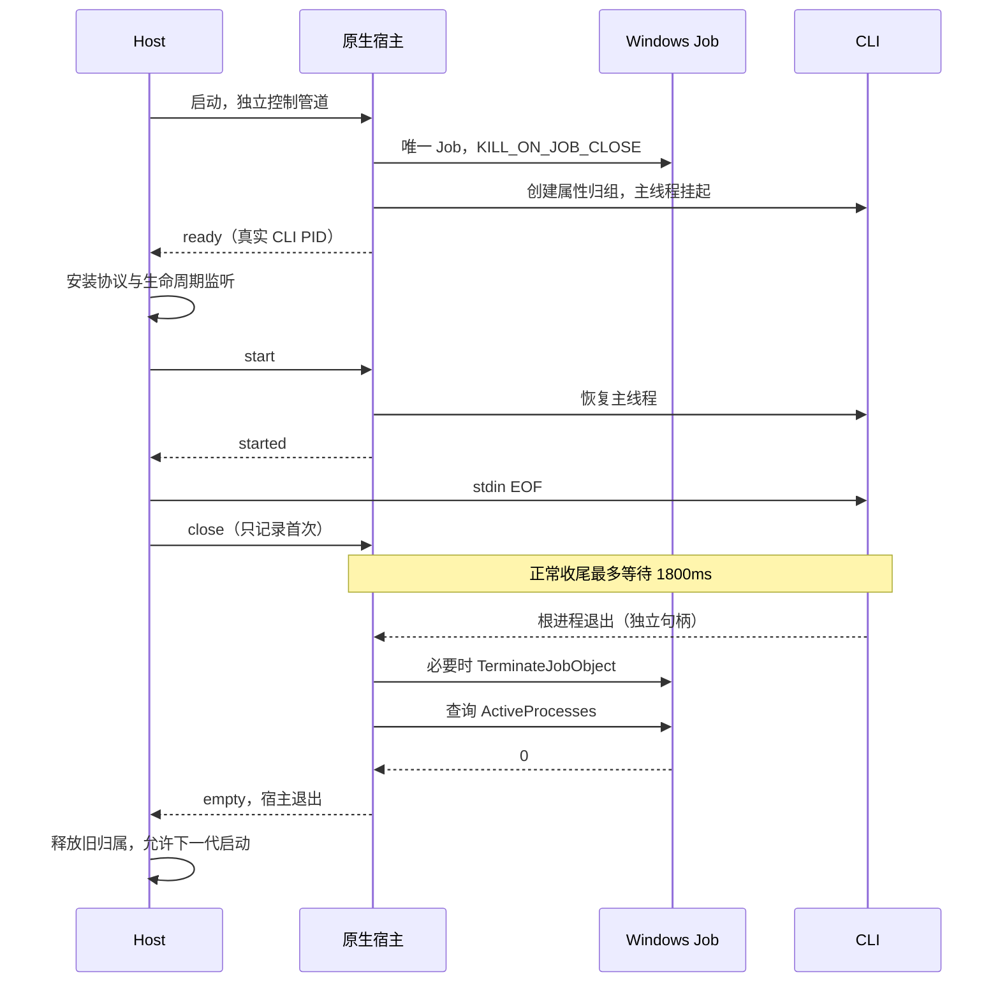

# Agent Shutdown Latency

## 目标与边界

正常关闭先让 stdio CLI 收到 EOF，完成其 1500ms 总退出预算内的协议、SQLite 与 session 收尾；无响应时回收整个受管进程组。协议失效、根进程退出和整组清空是三种事实，不能互相替代。

共享 CLI 与 workspace 归属规则见 [shared-task-cli](../shared-task-cli.md)。这里不改变 session 数据、App↔CLI 协议、desktop-continuous 或 mobile-replayable 的输入与恢复边界。

## Windows：创建时建立归属

Windows 10 / Server 2016 及以上使用原生 `zcode-runtime-host.exe`：创建独立、唯一命名的 Job，启用 `KILL_ON_JOB_CLOSE`；通过 `PROC_THREAD_ATTRIBUTE_JOB_LIST` 在创建 CLI 时归组，主线程保持挂起。Host 完成协议和生命周期监听后发出 start，原生宿主恢复主线程并确认 started。归组失败则拒绝启动，不回退到 PID/PPID/CIM 推断。



- CLI 标准输入、输出、错误原样传递；控制管道不混入业务协议。只有三条 stdio 句柄可继承，Job、控制连接和 Host 句柄不可继承。
- CLI PID 用于资源管理、网络捕获和生命周期事件；Node `ChildProcess` 的 PID/exit 属于原生宿主，两者明确分开。
- 正常收尾保留完整 1800ms，不先减去查询/强杀预留时间。重复 close 不延长宽限。根已退出时可立即清理残余成员。
- 正常路径仅在 Job 活动成员为零、且宿主退出后成功。原生宿主查询的是自己的 Job，不查询系统进程表，不调用 PowerShell/CIM/taskkill，不沿复用 PID 重新发现后代。
- Host 进程句柄结束或控制管道断开，原生宿主立即终止 Job；宿主被杀时最后一个 Job 句柄关闭，由内核终止成员。创建属性避免 create 与事后 assign 之间留下未托管的挂起 CLI。
- 宿主异常退出可能没有送达 empty。Host 必须先等旧宿主退出，再启动同一二进制的只读 `--check-empty <jobName>`：原 Job 不存在或活动成员为零才算清理完成。命名对象在最后一个句柄关闭且全部关联进程退出后才被内核销毁。访问失败或仍有成员时保留归属，后续主动请求重新核验。
- 超时不是清空证据。清理等待失败不破坏控制连接，不缓存永久失败 Promise，不允许启动新实例覆盖旧归属。当前在途清理共享一个 Promise；重试不得重新分配本轮截止时间。被动查询不启动清理。

## 退出预算与并发

Main 普通退出和更新安装共用 7.5s 强制结束 Host、9s 总等待上界；提前完成立即返回。Cron 与 Host 并发开始，更新安装仍保留自己的资源扫描与安装器交接。

Host 的本地 service 清理与 remote registry 清理并行开始。本地服务首先关闭 Agent admission 并启动 CLI 回收，避免被云内容、终端或远端连接清理耗尽正常 EOF 宽限。Agent 单轮清理及内部重试共用 3250ms 截止时间；service 阶段最多等待 3500ms。其他服务和远端连接仍由原 owner 负责。

stderr 保留至流关闭或根退出后的 250ms 有界 drain，并使用旧 runtime 身份报告诊断。stderr 故障不能单独关闭健康协议。

## macOS/Linux

继续使用 Host spawn 时建立的独立进程组与已发现成员快照。EOF 前保存快照，之后发送信号并核验已登记身份。PID 复用时禁止向新进程发信号。进程已退出时立即返回；失败保留 owned process，下一次主动请求重试。

本次撤销此前针对 Windows CIM/taskkill 的增量补丁，不扩展通用进程树工具的行为。其它仍使用这些工具的独立调用方不属于本次 CLI Job 托管边界。

## 构建与验收

- 原生源码、CMake 与进程验收位于 `scripts/windows-runtime-host/`；构建入口为 `scripts/build-windows-runtime-host.mjs`。
- Desktop dev/打包、Windows Web Server dev 和 Windows Source Server stage 均准备该组件。Windows 支持 MSVC x64/ARM64；交叉构建需要对应的 MinGW 工具链。产物检查 PE 架构，开发缓存校验源代码与二进制摘要。Desktop 发布沿用现有签名与签名一致性校验。
- 原生验收检查正常 1450ms 收尾、无响应树、根退出后代、控制断开、helper 被杀和挂起启动取消，分别持有根与后代句柄确认退出。Host 场景另检查失败后重试、共享并发、移动和被动查询。
- 容器内交叉编译、Wine、Linux Host 与桌面/手机回归分别记录。Wine 不代表 Windows 原生验证；Windows 实机、真实 nested Job/MCP/browser、签名安装包与 ARM64 运行按约定后补。
- 不迁移数据库。新机制在升级重启后的新 CLI 上建立，不尝试接管旧 App 留存的进程。

原生 Windows 的可重复验收入口（在仓库根目录执行）：

```powershell
cmake -S scripts/windows-runtime-host -B .tmp/runtime-host -A x64
cmake --build .tmp/runtime-host --config Release --target zcode-runtime-host zcode-runtime-host-acceptance
pnpm exec esbuild packages/services/src/windows-runtime-host/index.ts --bundle --platform=node --format=cjs --outfile=.tmp/runtime-host/Release/adapter.cjs
.tmp/runtime-host/Release/zcode-runtime-host-acceptance.exe .tmp/runtime-host/Release/zcode-runtime-host.exe
node scripts/windows-runtime-host/host-acceptance.cjs .tmp/runtime-host/Release
```

验收超时应保留日志，不能把进程仍在运行解释为已通过。容器执行需额外使用对应交叉编译器和 Wine；Node 20 的兼容执行仅用于 Wine，正式 App 仍使用仓库规定的 runtime。
