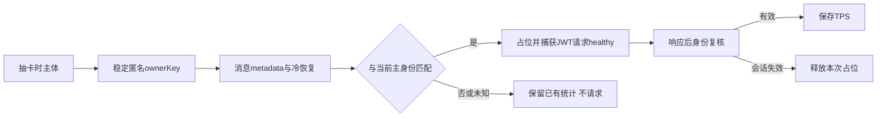

# Highspeed 加速卡功能规格

> 状态：MVP 开发中（2026-08-20）  
> 范围：发送抽卡、1 秒 fallback、冷却、固定模型、消息标识、分享与可扩展全局通知承载位。Highspeed 输入框包含激活动效；分享卡仍保持静态展示。

## 1. 产品语义

- 用户点击发送时，客户端先尝试为当前 Task 准备 Highspeed 卡。
- 定时任务/Automation 派发的输入轮不得进入 Highspeed admission：本轮存在
  `automationId` 时既不调用 draw，也不复用已有卡，直接按普通推理链路发送。
  该判断只看本轮归因，禁止用 Task 上持久化的 `cronAutomationId`，否则用户在同一
  会话中的后续手动输入会被误判为定时任务。
- 用户可在 Highspeed Turn 中通过 `CronCreate` 创建定时任务；创建时必须持久化会话常驻
  `modelSelection`，禁止把加速卡 Provider（`account:*-highspeed-card`）写入 Automation。定时任务
  后续触发仍按普通推理链路使用该原模型，不因创建动作发生在加速期间而失败或获得加速。
  Highspeed 本身不得向当前用户 Turn 的 `toolDisallowlist` 添加 `CronCreate`；反过来，实际
  Automation 执行轮的 `automationId` 是最终门禁，即使错误地同时收到 `modelExecution`，
  CLI 也必须忽略该单轮执行材料，并继续隐藏 Automation 写工具。
- 抽卡在 1 秒内返回且卡属于当前 Task 时，本轮使用卡绑定的 provider/model 和 Highspeed runtime endpoint。
- 1 秒仍未返回时，本轮正常发送；请求继续在后台完成，若随后抽中，下一次当前 Task 发送自动使用。
- `next_draw_at` 是服务端冷却权威时间；冷却期内不得重复抽卡。
- 一张卡只绑定一个 `task_id/provider/model`。Task B 观察到 Task A 的卡时正常推理且不提示。
- 卡有效且属于当前 Task 时，模型选择器锁定；过期后自动解锁。
- accelerated Turn 的 user input 保持普通消息样式，不展示 badge、底色、边框或其他装饰。
- accelerated output 复用现有“已工作 {duration}”控件，仅将时长状态文字按 Figma
  `6076:8300` 显示为紫色强调；不新增独立 output badge。

## 2. 后端契约

### 2.1 抽卡

```http
POST /api/v1/highspeed/draw
Authorization: Bearer <zcode JWT>
X-Bigmodel-Authorization: <当前 Coding Plan provider family 的业务 JWT>
Bigmodel-Target-Type: PERSONAL | TEAM
Bigmodel-Organization: <TEAM only>
Bigmodel-Project: <TEAM only>
Content-Type: application/json
```

```json
{
  "task_id": "task-abc123",
  "provider": "zai",
  "model": "glm-5"
}
```

```json
{
  "code": 0,
  "msg": "success",
  "data": {
    "card": {
      "card_id": "hsc_xxx",
      "task_id": "task-abc123",
      "provider": "zai",
      "model": "glm-5",
      "issued_at": 1786413600000,
      "expires_at": 1786414500000
    },
    "next_draw_at": 1786417200000
  }
}
```

未抽中、冷却或暂无容量时 `data.card = null`，但仍返回 `next_draw_at`。抽卡复用现有 Coding Plan 双 JWT 契约：`X-Bigmodel-Authorization` 直传与当前 Z.ai/BigModel provider family 匹配的业务 JWT，不套 `Bearer`；Team 的组织/项目身份只通过对应 header 传递。

### 2.2 加速推理

```http
POST /api/v1/highspeed/anthropic/v1/messages
Authorization: Bearer <zcode JWT>
X-Bigmodel-Authorization: Bearer <当前 Coding Plan provider family 的业务 JWT>
Bigmodel-Target-Type: PERSONAL | TEAM
Bigmodel-Organization: <TEAM only>
Bigmodel-Project: <TEAM only>
X-Highspeed-Card-ID: hsc_xxx
```

加速推理与抽卡走同一个 `/api/v1/highspeed/` 网关、同一套鉴权中间件，因此复用与 §2.1 抽卡
**完全一致的 Coding Plan 双 JWT 契约**（zcode JWT 标识会话身份，`X-Bigmodel-Authorization`
携带与当前 provider family 匹配的业务 JWT，Team 组织/项目通过对应 header 传递），并额外附带
`X-Highspeed-Card-ID` 标识本次执行的卡。回归约束：曾经只发 `Authorization` + `X-Highspeed-Card-ID`，
网关无法校验 Coding Plan 权益，返回 `401 auth_failed`。这套 Coding Plan 头与卡 ID 必须来自同一次
selected connection 解析，禁止跨 Family 拼接。

Body 为 Anthropic Messages，`model` 必须与卡绑定 model 一致。客户端把本轮 Selection 指向隐藏的
加速卡内建 Provider（`account:zai-highspeed-card` / `account:bigmodel-highspeed-card`，端点与模型
名单来自 Built-in Provider Config），上述动态鉴权随 `modelExecution.requestAuth` 下发；
`modelExecution.selectionScope = "execution"` 保证只作用于本轮，不修改 session 常驻 `modelSelection`。

加速端点的模型能力事实同样只来自 Built-in Provider Config，并与 Coding Plan 站点逐项对齐
（mid-conversation system、provider-native WebSearch、图片/视频输入）。加速只改变速度，
不得让同一会话的能力面随本轮是否加速而抖动。

Highspeed 与 Off-Peak Provider 是当前 Coding Plan 连接的派生执行入口，不拥有独立权益。它们的发布状态
必须继承所选母体 Provider 在同一轮 Account Provider 解析后的**最终权益结果**：母体本轮明确可用时发布，
明确不可用时下架；母体查询为 `unknown` 时，先按 Account Provider 的 last-known-good 规则解析母体，
再把最终结果投影给派生 Provider。禁止直接把原始 `unknown` 当成无权益，否则会出现母体仍可抽卡、派生
Provider 已从 Registry 下架的分裂状态。last-known-good 只在同一登录账号、同一 Team
`organization/project/product` 身份内有效；账号或 Team 身份变化后，母体和派生入口都必须 fail-closed，
不得复活旧权益。

```text
Coding Plan 原始查询            母体最终发布结果             派生执行入口
available                 -> available                 -> available
unavailable               -> unavailable               -> unavailable
unknown + 同身份旧权益     -> last-known-good available -> available
unknown + 身份已变化       -> fail-closed unavailable   -> unavailable
```

一次 Turn 可能因工具调用产生多次 Messages 请求。任一次 Highspeed 请求失败时——卡过期的
`HTTP 400 / provider_code=3402`、鉴权失败、限流、5xx、网络错误、超时、流中断等**任何失败**——Agent
必须保留已完成的工具结果和对话上下文，将该 Turn 剩余的模型请求切回发送前的原始 session 模型，
且不得把加速请求的失败作为整轮失败上抛。降级时发布结构化的 `TurnExecutionModelFallback` 事件，
Renderer 仅提示一次：卡过期提示“加速卡已到期，本轮后续内容将使用原模型继续生成”，其他失败提示
“加速服务暂不可用，本轮后续内容将使用原模型继续生成”。

该降级由 `modelExecution.selectionFallback` 声明式表达：
`{ providerId, rules: [{ reason, providerErrorCode? }], target? }`。规则按声明顺序匹配，首个命中的规则
决定退回原因；`providerErrorCode` 缺省表示该 provider 的任何失败。加速卡声明两条请求期规则：
`3402 → highspeed_card_expired`，其余 `→ highspeed_request_failed`。Core 只在失败来自本轮 execution
Selection 指向的 provider 时才降级（不按 provider id 前缀、模型名或错误文案硬编码），且只降一次。

同一声明还覆盖请求发出前的模型创建期。仅当本轮是 execution-scoped Selection、Selection provider
等于声明 provider，且创建错误严格为 `ProviderNotFound` 或 `ModelNotFound` 时，Core 才按相同候选顺序
创建退回模型并继续本轮，同时发布原因 `highspeed_selection_unavailable` 的
`TurnExecutionModelFallback`。普通会话 Selection、其他创建错误，以及退回目标自身创建失败均不得被吞掉；
所有候选均失败时按最后一个普通模型候选的真实创建错误结束本轮，并记录 `warn`，不得再把 Highspeed
Registry 错误展示给用户。创建期退回成功后必须清除本轮退回声明，普通模型后续失败不能二次退回。

任一已归因到 Highspeed 的创建期或请求期失败，都表示当前卡不应继续锁定 Composer。Renderer 观察到
`TurnExecutionModelFallback` 后，必须按事件所属输入的 `cardId` 调用 Highspeed Service 作废卡。若退回目标
也无法创建、未产生该事件，Core 在该 Turn 的 `TurnError` 里发布 `error.attribution.highspeedFallbackUnavailable=true`
（创建期与请求期的无处可退都发布），V4 投影到 `control.lastError.attribution`；Renderer 只在
`highspeedCardId` 等于当前卡且该字段为 true 时作废当前卡，不按错误码推断——请求期 3402/网络失败的 `code`
是 provider 错误码而非目录错误；上下文超窗、用户取消、本地 runtime 失败不参与退回，也不带该字段。Service
只在当前卡 ID 匹配时清卡，旧事件不得清除随后抽到的新卡，并保留 `nextDrawAt` 冷却事实，避免下一次发送立即
重新抽卡形成失败循环。模型锁定与加速视觉只从 Service 的当前卡状态派生，匹配卡作废后立即退出 Highspeed
状态并解锁。退回成功时不得显示错误 Banner，只提示一次已切回原模型；退回后的普通模型也失败时按其真实错误
结束本轮，但此时 Composer 已解锁，用户可以更换模型继续工作。

错误终态清卡必须使用执行事实中的卡归因。Highspeed 命令的 `intent.highspeed.cardId` 是本轮唯一卡身份；
CLI 在生成 `TurnError` 时把它写入 `error.attribution.highspeedCardId`，V4 再投影到
`control.lastError.attribution.highspeedCardId`。
Renderer 只在该值等于当前卡 ID 且 `highspeedFallbackUnavailable` 为 true 时作废卡，不再通过 `rows.window`
反查输入行。模型创建失败时也必须先发布 `TurnStarted` 并持久化已接纳的用户输入，再发布 `TurnError`；显式错误
归因仍用于作废准确的卡，不能以历史窗口是否包含该 userInput 作为关联依据。
`inputId` 仍是 TurnError 的通用输入锚点，但不承担 Highspeed 卡归因。没有 `highspeedCardId` 字段的旧 Agent
只能按 `provider_not_found` / `model_not_found` 目录错误码、并以发卡时间为下界保守清卡。

破坏性 `editUserQuery` / `retryTurn` 在 branch cut 与 workspace rewind 前必须完成一次模型准入检查；提交
branch cut 后不得再次用可变 Provider Registry 拒绝同一 replacement input。若 Registry 在预检后、Core
创建模型前变化，Core 可以以 `model_creation` 失败结束该轮，但必须先把 replacement input 提升为可恢复的
权威 user row。最终状态只能是“新输入 + 明确错误”，不得只留下历史截断或已回退的工作区。

创建失败轮不复制落库流程。Core 只记下原始创建错误，再走普通轮的同一条生命周期：`TurnStarted`、
`UserPromptSubmit` hook、附件解析和 user row 落库。错误终态只由主生命周期的同一个 catch 写入。
模型创建失败后不得初始化 Context 或运行 `SessionStart` hook：两者依赖可用模型且位于输入持久化之前，失败会覆盖
原始创建错误并再次丢失已接纳输入；`SessionStart` 也不得被失败轮消费，必须留给下一次可创建模型的 Turn。

```text
Core 创建模型失败 ──> 记下原始错误（不写终态）──> 跳过 Context 初始化与 SessionStart hook
  └─> TurnStarted ──> UserPromptSubmit hook ─┬─ 拦截 ──> completed(success, stopReason)，输入不落库（普通轮规则）
                                             └─ 放行 ──> 附件解析 + user row 落库 ──> 抛出原始错误
                                                                                       │
主生命周期 catch（唯一错误终态写入点）<─────────────────────────────────────────────────┘
  ├─ 普通失败（含落库失败）──> TurnError(model_creation, 原始创建错误)；落库错误只记 warn
  ├─ 用户 Stop ──> completed(cancelled)，与普通轮一致
  └─ 宿主 fault（经 abort signal 传入）──> TurnError(fault code)，与普通轮一致
```

该轮不进入 model step，所以拒绝 guide（`turn_not_steerable`），guide 改投普通 queue。该轮也不应用提交里的
模型选择、mode 和 plan，不计入 goal 目标轮次。`/compact` 不产生 user row：创建失败时直接发布
`TurnError(model_creation)`，不发布 `TurnStarted`。

新 Agent 对每个 `TurnError` 都发布三态归因：字符串表示本轮使用的卡，`null` 表示本轮没有使用 Highspeed，
字段缺失只表示旧 Agent。普通排队轮的目录错误因此是 `null`，不得清除持卡期间的无关卡；归因到旧卡的滞留
错误也不得清除当前卡。兼容旧 Agent：字段缺失时保留目录错误码与发卡时间下界的保守清卡行为；该路径下
普通轮目录错误仍可能误清卡，但只存在于新 App 连接旧 Agent 的过渡期。

退回目标按顺序解析：**先取声明的 `target`，再取本轮接纳前复制的会话常驻 `modelSelection`**。`target` 是发起方
抽卡时的提交选择（Composer 当前模型与思考档位），也就是本轮若不加速本会绑定为会话选择的那一份，加速卡
必须填写它；会话常驻选择只是兜底——接纳用户消息时绑定普通提交选择，正常情况下两者相同。候选目标不得是本轮
execution provider 本身；目标在 Registry 中不可解析时跳到下一候选。两者都无法解析时无处可退，本轮按真实
错误失败，不得掩埋根因，且 Core 必须记录一条带原因的 `warn`。Core 将会话候选保存为加速卡专用的 `highspeedFallbackSelection` 快照，后续用户输入更新 Session 不得改变旧轮的退回目标；不需要
overlay/模型还原接口；退回请求走用户自己的常规鉴权，不再携带本次执行的 `requestAuth`。

回归约束（退回目标必须随声明下发）：退回目标曾只依赖 runtime 会话常驻选择。桌面重启后冷恢复若落在
Provider Registry 刚就绪、账号权益尚未解析的窗口内，持久化的会话选择会因 provider 未发布而校验失败、
不绑定；随后若只发送加速轮（execution 作用域不绑定会话选择），runtime 就一直没有常驻选择，卡过期
（3402）时降级静默跳过，整轮按 `highspeed card is invalid` 失败并弹出错误横幅。发起方在抽卡时明确知道
原模型，所以目标由发起方声明，不再押注 runtime 状态。

ACK 准入约束：Highspeed execution Selection 可延迟到 Core 解析，以允许加速模型临时缺失时走创建期退回；
Bootstrap 在接受输入前必须确认 execution Selection 或声明的 `selectionFallback.target` 至少一个存在于当前 Worker
Provider Registry。execution Selection 可用时，不得仅因退回目标缺失而拒绝；两者都不可解析时，必须在 ACK 前以
`modelUnavailable` 拒绝，不得先接受输入再只发布 `TurnError(model_creation)`。Renderer 对本次 Highspeed 准入拒绝
必须作废匹配卡、退出加速状态并解锁模型选择器，同时让 Composer 恢复正文与附件，不显示 Turn Error 或通用发送
错误 Banner。ACK 表示输入已经被可靠接纳；UI watchdog 不能用于恢复尚未产生 `TurnStarted` / userInput 投影的输入。

`editUserQuery` / `retryTurn` 会持久化 active branch cut，`workspaceMode=rewind` 还会先修改工作区文件。它们必须基于
本次即将重发的 canonical intent 和 execution 材料，在 stop active turn、文件回退和 branch cut 之前执行同一份模型
准入检查。准入失败时不得改变活动历史或工作区。预检与实际重发必须复用同一套准入规则，不能让普通发送与编辑重发
分别判断“可用模型”。Highspeed `editUserQuery` 被接受后沿用 conversation protocol 的 accepted-input projection recovery：
若 branch cut 已可见而 replacement user row 静默，只恢复同一 owned subscription，不重放命令、不补造消息，也不恢复旧分支。

降级边界：

- **加速请求 0 次重试**：带 `selectionFallback` 的执行作用域模型句柄绑定 `single-attempt` 重试预算，
  适配层对 429/5xx/网络/超时等瞬态失败不再按默认 10 次退避重试，首次失败即交给 Core 退回；否则
  加速端点过载时用户要等数分钟才轮到降级。退回后的会话模型恢复默认预算。
- **声明式退回优先于同模型 stream recovery**：流中断且已有可见输出时直接退回原模型重新生成，不先在
  加速模型上重试；若失败虽命中退回声明但所有退回目标都不可解析，则直接按真实错误失败，同样不得回到加速
  模型做 stream recovery。`TurnExecutionModelFallback` 必须把被废弃的 text/reasoning 流标记为 `interrupted`，
  并将尚未定稿的 `inputStreaming` 工具行标记为 `cancelled`，避免原模型续流时把两次模型输出拼接或把废弃输出
  误标为完成。已经形成完整 `tool_call` 的 client-side 工具不能只做内存 `tool_abandoned`：切换模型前必须停止
  调度并收口 durable part；已完成结果按原结果提交，运行中的调用优先提交明确的 cancellation result，无法确认状态时提交 synthetic interrupted result，
  且 assistant tool call 与 tool result 必须成对进入 live/cold provider-visible history。退回模型只能基于该稳定
  anchor 继续，不能盲目重跑工具，持久化中也不得残留 `pending`/`running` part。即使所有退回目标都不可解析，
  已接受工具的 settlement 也必须先完成，再保留原 provider 错误终止本轮；“不再请求加速模型”不能同时跳过
  工具闭合，也不能在 settlement 后再次发布 `tool_abandoned` 覆盖终态。
- **工具 anchor 重置输出续写预算**：成功退回若确实提交了一个或多个工具结果，说明已经建立新的模型执行边界，
  必须像正常工具响应和同模型工具恢复一样清零 `outputTokenContinuationCount`；仅废弃 text/reasoning tail、没有
  完整工具调用的降级不得清零，避免纯文本失败绕过同一段输出的续写上限。
- **不降级的失败**：用户取消（整轮按取消收口）、上下文超窗（交给 reactive compact；退回同模型同窗口
  只会再超一次），以及事件持久化、投影等本地 runtime 失败。兜底规则的“任何失败”只表示已明确归因到本轮
  execution provider 的 provider/network 请求失败，不能把无归因的本地异常误判成加速端点故障。
- **轮内一次、失败即退卡**：降级后本轮剩余请求全部使用会话模型；退回后的会话模型若再失败，按其真实
  错误结束本轮。Highspeed 创建或请求失败一经归因，当前匹配卡立即作废并保留冷却，下一轮不得复用同一张卡；
  这样即使普通模型也失败，Composer 也已退出 Highspeed 状态，用户可以选择其他模型恢复工作。
- **冷恢复终态**：被退回的加速 attempt 必须持久化为统一的 stream-recovery discarded 边界，而不是普通
  `completed` assistant。若进程在退回模型产生最终 assistant 前退出，冷恢复将本 Turn 收口为 interrupted；若
  后续已有正常完成 assistant，则恢复为 success 且不产生错误 Banner。工具 anchor 仍按上一条成对恢复。
- **留痕**：降级时 CLI 记录一条带归因（providerId、modelId、statusCode、providerErrorCode、reason）的
  `warn`，鉴权类失败被降级掩盖时仍可从日志发现回归。
- **统计口径不变**：降级后的 Turn 仍按完整 Turn 统计 `outputTokens/durationMs` 并参与分享（§2.3）。
  首个加速请求就失败的 Turn 加速输出为 0，但 `highspeedMeta` 已随输入持久化，仍按加速轮展示与统计；
  这是已知取舍，若要排除需另行定义统计规则。

```text
execution Selection
        |
        +-- create ProviderNotFound / ModelNotFound
        |       +--> original session model created
        |       |       +--> emit selection_unavailable
        |       |       +--> invalidate matching card + unlock selector
        |       +--> no candidate created
        |               +--> fail with the ordinary model's real error
        |               +--> TurnError.attribution.highspeedFallbackUnavailable
        |               +--> invalidate matching card + unlock selector
        |
        +-- request failure --> preserve current Turn context/tools
                                +--> fallback target created
                                |       +--> notify Renderer once (card expired / request failed)
                                |       +--> invalidate matching card + unlock selector
                                |       +--> remaining requests use original session model
                                +--> no fallback target
                                        +--> fail with the original provider error (e.g. 3402)
                                        +--> TurnError.attribution.highspeedFallbackUnavailable
                                        +--> invalidate matching card + unlock selector
```

### 2.3 分享

- 分享卡片由客户端根据已持久化的卡级 Turn 指标生成，不再调用后端 share 接口，也不依赖 `share_id`、`share_url` 或远端分享响应。
- `token_usage`、`highspeed_tps`、`regular_tps` 等展示值继续从卡级本地聚合事实计算；卡级 healthy usage 仍通过 `/api/v1/highspeed/:card_id/healthy` 获取，用于计算高速 TPS。
- 复制图片和复制文本均使用客户端生成内容，分享通知只保存最新的本地展示快照，并按现有 24 小时可见性规则自动关闭。
- Highspeed 卡到达 `expires_at` 前只累计各 Turn 指标，不调用 share、不发布左下角分享卡。卡到期且该卡已启动的所有 Turn 都进入完成态后，按 `card_id` 聚合指标；仅当聚合数据完整且总体加速倍率严格大于 `1.2x` 时，才在当前 Renderer 运行周期内最多自动尝试发布一次左下角分享卡，未达标（≤`1.2x`）或无可信数据一律不发布（发布门禁见 §9 与 `highspeedTurnStore.listHighspeedCardAutoShareCandidates`）。
- 任一 Turn 发生加速请求失败降级（卡过期或其他失败，见 §2.2）后，仍按完整 Turn 统计 `outputTokens/durationMs`，并参与该卡的自动或手动分享；分享统计不区分降级前后的输出分段。
- 自动分享失败后不得因 snapshot、store version 或 React 重渲染立即重试，避免请求风暴和 429；历史 Turn 的手动分享入口继续可用。
- 历史 Turn 的分享按钮每次都从 transcript 持久化的 Highspeed 完成态 metadata 生成分享内容，不依赖 Renderer 内存记录；复制成功后与左下角分享卡共用成功 Toast“已复制分享内容”，不上传或构造远端分享链接，也不切换左下角当前分享卡。

### 2.4 失败诊断日志

- `draw`、卡级 healthy usage 以及 Highspeed 节省时间依赖的普通 TPS 健康检查，任一网络、HTTP、业务信封或响应解析失败都必须记录一条 `warn`。客户端生成分享内容的复制失败也必须记录对应的 UI 警告，不再记录不存在的 share API 请求。
- 日志至少包含操作名、脱敏 URL、HTTP status/statusText、耗时、错误信息，以及响应头中的 `x-request-id` / `x-trace-id` / `x-span-id`；响应 body 只保留受限的错误摘要。
- 日志禁止记录 `Authorization`、`X-Bigmodel-Authorization`、完整请求头、JWT、完整请求 body 或流式模型输出。请求上下文只记录可用于定位的非敏感摘要。
- Highspeed 推理继续走 Agent 的模型请求错误链路；Host 不为 streaming chunk 重复打日志，避免将失败诊断扩大成高频通信日志。

## 3. 发送时序

```text
User        Renderer coordinator       Highspeed service/API       Session command
 | click send        |                          |                         |
 |------------------>| prepare(task, model)     |                         |
 |                   |------------------------->| draw / reuse card       |
 |                   |                          |                         |
 |                   |<--- card <= 1s ----------|                         |
 |                   | sendText(modelSelection + modelExecution, card metadata) |
 |                   |--------------------------------------------------->|
 |                   |                          |                         |
 |                   |---- OR timeout at 1s ----|                         |
 |                   | sendText(normal fallback)|                         |
 |                   |--------------------------------------------------->|
 |                   |                          | draw continues          |
 |                   |                          |-- result cached --------|
 | next click        | consume cached card      |                         |
```

竞态规则：

1. 新建 Task 的首发先创建空 session，取得真实 `sessionId/task_id` 后再执行 draw，并用 `sendText` 提交首轮；不得走 `createSession(firstInput)` 绕过 Highspeed admission。
2. 已有未过期且属于当前 Task 的卡：不 draw，直接加速。
3. 已有未过期但属于其他 Task 的卡：不 draw、无提示、普通发送。
4. `now < next_draw_at`：不 draw、普通发送。
5. 同一用户同时只允许一个 in-flight draw；并发发送复用该 Promise。
6. 1 秒仅限制当前发送等待，不取消 draw。但 draw/healthy **请求本身必须有界**：transport 在
   `HIGHSPEED_REQUEST_TIMEOUT_MS`（默认 20s，明确大于 1s 等待预算，让慢但合法的 draw 仍能落地供下一轮）
   后 abort 并让 Promise reject，deadline 同时覆盖响应体读取；reject 触发 in-flight draw 的 `finally`
   释放，下一次发送即可重新 draw。代理/服务端接受连接后永不返回时，不得让「单 in-flight」退化为
   只能靠重启恢复的永久熔断。
7. 本轮携带 `automationId`：在读取卡、冷却和发起 draw 之前直接 fallback；不得改变
   当前卡、`next_draw_at` 或 in-flight draw 状态。Task 的 `cronAutomationId` 不参与判断。
8. 当前 Task 正在运行时，新的用户输入仍必须按既有 `queue` 语义准入，不得因为携带
   `modelSelection` / `modelExecution` 被拒绝。运行态必须以 Core `activeTurn` 为最终事实；即使 adapter
   controller 或投影路由尚未同步，只要 Core 仍有 active turn 就必须入队，禁止误走
   `startNow`。`QueueItem.modelSelection` 的唯一语义是发送前的普通提交 Selection，它与 mode、Plan
   一样可持久化、冷恢复并在撤回编辑时恢复到 Composer；不得写入 `account:*-highspeed-card` 这类
   单轮执行 Selection。`selectionFallback.target` 只有在 Provider Family 不是 Highspeed 时才可作为
   普通提交 Selection；所有队列写入路径必须共用同一个普通 Selection resolver。若 target 被旧版本或
   异常载荷污染为 Highspeed Provider，必须改用会话常驻的普通 Selection，禁止把内部 Provider 写入
   `QueueItem.modelSelection`。队列可持久化不含凭据的 Highspeed 卡元数据；加速 `modelSelection` 与
   `modelExecution` 必须作为同一个 execution bundle，仅按 `sourceCommandId` 驻留 CLI 进程内存，
   并在该输入提升为新 Turn 时才冻结进本轮执行上下文。入队准入只提交普通 Selection 与卡元数据，
   不携带 `modelExecution`。宿主不提供暂存能力时必须整体退回 QueueItem 自身的普通 Selection，
   不留半程加速。
9. Highspeed 队列项提升时必须再次校验 `expiresAt`：卡仍有效时，自动消费优先复用 CLI
   内存中暂存的 execution bundle；用户点击“立即发送”时，Renderer 必须以 QueueItem 自身的普通
   Selection 为准备输入，基于同一张当前有效卡重新准备 `modelSelection` + `modelExecution` 并随
   `sendQueuedNow` 补充提交，避免临时内存状态缺失导致有效卡被误降级；补供材料必须同卡
   （`cardId`/`taskId` 一致），跨卡一律忽略，避免换凭据。提升边界使用 bundle 中的加速 Selection，
   但 `selectionFallback.target` 必须固定为 QueueItem 的普通 Selection。卡已过期，或重新准备后
   execution bundle 仍不可用时，只移除该轮 Highspeed 标记，直接使用 QueueItem 已持久化的普通
   Selection；不得回看可能已被后续输入修改的 Session Selection。仅对旧版本已错误持久化
   `account:*-highspeed-card` 的 QueueItem 做迁移兼容，且只按 Provider Family 识别，不依赖是否带卡
   元数据（旧版本的污染重发可能产生不带卡元数据的此类项）：提升时改写为会话常驻 Selection；撤回
   编辑时不恢复该 Selection，Composer 保留当前选择；禁止把内部 Provider 暴露到错误面或 Composer。
   无论哪种情况，用户输入都不得丢失或阻断后续 FIFO。
10. 用户编辑最后一条真实输入并重发时，必须按一次新的主动发送处理：Renderer 在提交
    `editUserQuery` 前重新执行当前 Task 的 Highspeed prepare，并把本次得到的卡元数据与
    单轮 `modelSelection` + `modelExecution` 一起提交。CLI 侧只接受本会话（`taskId` 等于当前
    `sessionId`）、未过期、且 `modelSelection` 真的指向加速 Provider 的卡；不得复用被编辑历史轮中
    的旧卡凭据；当前卡已失效或 prepare fallback 时按普通模型重发，且不得保留旧 Highspeed 标记。
11. 只有 Coding Plan 用户可以调用 draw：发起新 draw 前必须确认当前存在可用的
    Coding Plan 连接（复用 off-peak 的 Coding Plan support 判定）。非 Coding Plan
    用户直接 fallback 普通发送，不发起 draw、不产生 warn 噪音，也不得改变当前卡、
    `next_draw_at` 或 in-flight draw 状态；判定过程异常时按不支持处理，避免用无效
    凭据打到 draw 接口。已有有效卡的复用（规则 2）不受该门禁影响。
12. 发送收口不等待装饰性数据。抽中后读取普通 Decode TPS（只决定节省时间展示，不决定鉴权、
    选型或推理正确性）最多等待 `min(300ms, 1s 发送预算剩余)`：超时或失败本轮不附加 `regularTps`、
    不展示该轮节省时间，`sendText` 立即提交；请求本身不取消，由 Service 层继续完成并缓存供后续
    轮次命中。`prepareHighspeedSendContext` 的总等待不得超过 1s 发送预算，禁止让 TPS 查询的
    15s 超时阻塞主业务命令提交。Service 侧 `prepareTurn` 的 1s 等待预算从进入 `prepareTurn` 起算，
    同一截止时间统一覆盖发起新 draw 前的门禁判定（规则 11/14）、draw 等待，以及抽中或复用卡后的
    加速鉴权解析，禁止任何一段 await 在预算外单独计时：门禁判定超出预算时本轮 fallback
    `unavailable` 普通发送、不发起 draw；加速鉴权解析超出预算时 fallback `draw-timeout` 普通发送，
    fallback 结果携带该卡，卡保留供下一轮使用。超时的判定与鉴权请求本身不取消，完成后由底层缓存
    预热下一轮；它们不改变卡、`next_draw_at` 或 in-flight draw 状态。
13. retry、edit 重发与 queue promotion 共用同一个 fallback resolver：重发/提升时若没有本轮有效的
    Highspeed execution（未重新抽到卡、卡已过期、宿主无法暂存凭据），而历史/队列 Selection 指向
    `account:*-highspeed-card`，必须显式改写为发送前的会话常驻 Selection；禁止只删 `modelExecution`
    却保留加速 Selection。加速 Selection 只有与同一轮 requestAuth 成对出现才有效，单独保留会让 Core 以
    ModelRequestAuthMissing 失败，还会被固定进新的 canonical intent，让后续普通发送继续携带无法使用的
    加速 Provider。该改写只作用于本轮 intent，不修改 session 常驻模型。
14. 只有会话模型属于所选 Coding Plan Provider 的模型目录时才允许发起新 draw：发起新 draw 前，
    Service 层用模型选择视图（`ModelSelectionView.providers[].models`，来源为 Built-in Provider
    Config）确认当前 `providerId/model` 组合真实存在。模型不在目录内（例如会话恢复出已下线模型、
    Registry 未就绪等陈旧组合），或目录判定未在发送预算内完成（例如 Provider Runtime 初始化阻塞，
    见规则 12）时直接 fallback 普通发送（reason `unavailable`），不发起 draw、
    不产生 warn 噪音，也不得改变当前卡、`next_draw_at` 或 in-flight draw 状态；判定过程异常时按
    不通过处理，避免用无效组合打到 draw 接口。已有有效卡的复用（规则 2）与在飞的 in-flight draw
    不受该门禁影响。Mock 场景放行以保持本地验证语义。
15. 用户主动提交（sendText，含新建会话与预热提升）的 Highspeed prepare 模型选择与本次提交的
    `modelSelection` 同源：优先取提交选择的 `providerId/modelId/reasoningLevel`，缺失字段再按
    会话投影 → 草稿 → 初始草稿逐字段回落。切换模型后的首次发送必须按新选择做 admission——新
    provider/model 不满足 draw 门禁（规则 11/14）时不发起 draw、本轮按提交选择普通发送，禁止沿用
    会话旧组合抽卡后把用户的提交选择覆盖成卡模型。历史 edit 重发没有普通提交选择时按会话常驻
    Selection prepare；队列手动提升必须显式传入 QueueItem 自身的普通 Selection，禁止回看可能已被
    后续 admission 改写的 Session Selection。

```text
running Highspeed turn
        |
        +-- next user prompt --> queue(card metadata + ordinary submission modelSelection)
        |                        + retainQueuedTurnExecution(
        |                            sourceCommandId,
        |                            highspeed modelSelection + modelExecution
        |                          )
        |                             |
        |                             +-- auto promote while valid --> freeze bundle into turn
        |                             |
        |                             +-- manual promote ----------> refresh from queued ordinary Selection
        |                             |
        |                             `-- expired/bundle missing --> use queued ordinary Selection
        |
        `-- edit queued prompt --> restore ordinary Selection to Composer
```

```text
edit accelerated user input
        |
        +-- prepare current task/card again
        |
        +-- valid card + runtime --> rewind + rerun with new Highspeed metadata
        |
        `-- unavailable ----------> rewind + rerun with ordinary session model
```

```text
send admission
  |-- automationId present --> normal send (no card reuse, no draw)
  `-- user turn -----------> existing Highspeed prepare/draw flow
```

## 4. 卡状态机

```text
                 draw miss / cooldown
        +--------------------------------+
        |                                v
  [idle] --draw--> [drawing] ---------> [cooldown]
                     | hit                  |
                     v                      | now >= next_draw_at
                  [active] -----------------+
                     |
                     | expires_at reached
                     v
                  [expired] ---> [idle/cooldown]

active + task mismatch => foreign-active（当前 Task 静默 fallback）
```

## 5. 消息元数据与统计

MVP 不新增 session 数据库物理列。`message.data` 中的用户消息 `metadata.highspeed`
持久化本轮使用的卡快照，结构固定为：

```json
{
  "schemaVersion": 1,
  "cardId": "hsc_xxx",
  "taskId": "task-abc123",
  "provider": "zai",
  "model": "glm-5",
  "issuedAt": 1786413600000,
  "expiresAt": 1786414500000,
  "fallbackAt": 1786414500123,
  "fallbackReason": "highspeed_card_expired"
}
```

该 metadata 只由已通过 Highspeed admission 的 `sendText` 写入，沿
`sendText.highspeedMeta -> TurnInputIntentMetadata.highspeed -> persistUserPrompt`
进入 SQLite；旧消息缺少该字段时按普通消息处理。Renderer 仍以
`sessionId + sourceCommandId` 记录运行中统计：

- `fallbackAt` 仅在 Turn 内发生加速请求失败降级时出现（`fallbackReason` 同时记录原因：
  `highspeed_card_expired` / `highspeed_request_failed` / `highspeed_selection_unavailable`，Renderer 据此选择提示文案，与 `fallbackAt`
  同一事件写入、同一规则持久化与恢复），用于跨桌面 continuous 与手机 replayable
  一致投影到期提示；它不改变该 Turn 的分享资格和完整统计口径。它是权威 metadata 字段：CLI 在终态
  耗时持久化时把 live 投影中已产生的 `fallbackAt` 一并写入 transcript，`HighspeedMetricsUpdated`
  与 Renderer `setHighspeedMetrics` 对 `highspeed` 只做字段级合并、只增不删，终态指标更新不得清除
  同一 Turn 已产生的 `fallbackAt`；cold hydration 原样恢复该字段，live 与 cold 投影结果一致。

- `cardId`
- `taskId`
- `provider/model`
- `expiresAt`
- `startedAt`
- 完成后的 `outputTokens/durationMs`

`outputTokens/durationMs` 等完成态统计仍只保存在当前 Renderer 内存中并限制数量；
分享统计继续通过 `sourceCommandId` join。历史消息的 Highspeed 展示身份则必须由 CLI 将
持久化的 `metadata.highspeed` 投影到对应 `UserInputRow.highspeed`，Renderer 不得仅依赖
进程内 `highspeedTurnStore` 判断紫色工时。这样卡过期、页面重载、session 冷恢复后，
accelerated output 仍保持紫色“已工作”标识；缺少 metadata 的旧消息按普通消息处理。
Highspeed 卡快照跟随 transcript 同时服务桌面 `continuous` 与手机 `replayable`，不新增
独立恢复消息、snapshot 或第二份队列。

### 5.1 派生会话的常驻 Selection

消息上记录的加速 Selection 是 `selectionScope=execution` 的单轮执行事实，只有与同一轮 requestAuth
成对出现才有效；加速轮从不调用 `setSessionModelSelection`，因此父会话常驻 Selection 在加速期间
始终等于用户的原模型。

由历史消息派生新会话的路径——stable fork（`forkAssistant`）、编辑前分叉、辅助对话——继承分叉点
消息选型前必须跳过加速 Selection，退回父会话常驻 Selection（与 §3 规则 13 同一口径）：

```text
boundary message selection
  |-- account:*-highspeed-card --> skip ----> parent session resident selection
  `-- ordinary selection ------------------> inherit（缺推理档位时回落常驻档位）
```

child 的 `SESSION_ENTRY_MODEL_SELECTION` entry、fork notice assistant 的 `providerId/modelId`
与宿主 `runtimeConfig.model` 必须来自同一结果；冷恢复投影
（`sessionModelSelectionOfHydratedMessage`）已有同样过滤，live 与 cold 派生结果一致。父会话也没有
常驻 Selection 时留空，禁止把加速 Provider 写进 child——否则用户看到「加速中的会话分叉后原模型
没带过来」（加速 Provider 是隐藏内置项，模型列表里不存在），child 首轮发送还会以
ModelRequestAuthMissing 失败。

恢复期同样按此口径自愈：`readSessionModelSelection` 读到指向加速 Provider 的常驻 entry 时直接丢弃，
会话回到「未绑定」而不是借默认模型补齐（恢复不等于开始执行），由用户重新选择一次模型。这样修复前
已经写坏的会话不会继续把隐藏身份投影成界面选中态与 contextWindow。

Renderer 侧的 workspace 级 Composer Recent（新任务草稿模型种子的第一优先级）遵循同一约束：加速轮
`sendText` payload 的 `modelSelection` 已被执行材料覆盖为加速 Provider，accepted 后 Recent 必须按
发送前 Composer 冻结的原始选择记录（调用方显式传入；缺省回落 payload 派生值），且 `captureComposerRecentSubmission` 对指向加速 Provider 的选择兜底跳过。读取侧 `readComposerRecent`
发现存量记录指向加速 Provider 时按叶子丢弃 `modelSelection`（保留 `mode`），新草稿回落默认选择——
否则加速会话点「新建任务」会出现模型选择器为空（隐藏身份在模型视图里解析为 provider-not-found）。

## 6. 全局通知承载位

```text
Domain Producer
  -> GlobalNoticeStore
  -> PresentationArbiter
  -> Desktop/Mobile Surface Adapter
  -> RendererRegistry(type + schemaVersion)
  -> constrained GlobalNoticeCard shell
```

通用 envelope：

- `noticeId`, `dedupeKey`
- `type`, `schemaVersion`
- `scope`, `priority`, `interruptPolicy`
- `createdAt`, `expiresAt`
- `payload`, `actions`
- `dismissPolicy`, `persistencePolicy`
- `source`, `revision`

Highspeed 映射：

```text
type = highspeed-share
scope = user
dedupeKey = highspeed-share:latest
persistencePolicy = latest-only
dismissPolicy = cooldown 24h
dismissKey = highspeed-share
priority = normal
```

历史开发版可能已将 `hsc_mock_*` 或 `mock.z.ai` 分享通知写入用户级持久化存储。正式链路读取该存储时必须自动丢弃这类遗留 mock 通知，不得在重启后继续展示或打开 mock 分享地址。真实 Highspeed 分享通知不受影响。

只持久化最新展示快照：`cardId/shareId/shareUrl/shareExpiresAt/dismissedUntilMs`。不新增分享历史表，不修改 session 表。用户主动点击 X 后 24 小时内全局不展示；若用户一直未点击 X，分享卡也必须在发布 24 小时后自动消失。通知展示截止时间取“分享链接过期时间”与“通知创建时间 + 24 小时”的较早值；页面持续打开时需在到点后主动刷新可见性，不能依赖重启或其他通知事件。到期后不自动弹，下一次加速完成后再展示。历史手动分享不解除静默、不替换左下卡。

通知持久化是展示增强、best-effort：内存态先更新，`localStorage` 写入失败（QuotaExceeded、存储被禁用）只记录受控 warn，订阅者照常收到更新，不得让 `publish`/`dismiss` 抛错——调用方已先 claim 自动分享再 publish，抛错会留下不可重试的 claim，用户看不到分享卡且当前 Renderer 生命周期内无法恢复。`localStorage` 本身不可访问（隐私模式、沙箱）时退回内存存储，通知在本次会话内仍可用。

## 7. Mock 方案

通过依赖注入的 transport/clock 提供确定性 fixture：

- `hit-fast`
- `miss`
- `hit-after-timeout`
- `existing-foreign-task-card`
- `expired-card`
- `share-success`
- `share-refresh`
- `share-expired`
- `hit-invalid-model`（创建期 fallback 专项）
- `hit-queue-edit`（Highspeed 队列编辑专项）

Mock 只替换 Highspeed draw/share transport，不修改 session deliveryKind，也不另起 Agent runtime/host。普通 Mock
抽中时仍返回 `accelerated` 业务状态，用于验证卡片消费、模型锁定、消息标识、统计和分享；但不得下发
Highspeed 的 `modelSelection` / `modelExecution`，消息流继续使用当前 session 的普通 provider/model 与原推理
接口，避免 Mock 卡请求真实 Highspeed 推理端点后无数据返回。仅有两个专项例外会下发真实 Highspeed
`modelSelection` / `modelExecution`：`hit-invalid-model` 的 Selection 指向目录外模型，用于验证创建期声明式
fallback；`hit-queue-edit` 使用目录内模型和可控慢流，用于验证队列只持久化普通 Selection，临时 Highspeed
execution 只在提升边界应用。两个例外都不改变其他 Mock 的边界。普通 Mock 的卡没有 execution
bundle：Task 运行中再次发送而入队的输入，提升时按 §3 规则 9 的“bundle 不可用”处理，移除 Highspeed
标记并使用 QueueItem 的普通 Selection。因此普通 Mock 的消息标识只覆盖直接开始的 Turn。

为缩短本地手工验证周期，Mock 时间窗口固定为：

- 成功 draw 与 miss 响应的 `next_draw_at = draw 完成时刻 + 2 分钟`。
- 非 `expired-card` 的抽中卡 `expires_at = draw 完成时刻 + 5 分钟`。
- `expired-card` 继续返回已过期时间，不受 5 分钟窗口影响。

```text
Mock draw/share  -> Highspeed 卡状态、标识、统计、分享
Mock send        -> 当前 session 普通 provider/model -> 原推理接口
Real send        -> Highspeed modelSelection+Execution -> Highspeed 推理接口
```

Desktop E2E 按 spec 文件在 Electron 启动前注入场景（wdio `beforeSession` 写入
`ZCODE_HIGHSPEED_MOCK_SCENARIO`，映射表见 `test/e2e/helpers/highspeed-mock-env.ts`）。Mock 场景在
Host 进程内固定，且 draw 后有 2 分钟冷却，因此一个 spec 文件只对应一个场景、只完成一次 draw；
新增场景必须新增 spec 文件并登记映射，未登记的 spec 不装配 Mock，避免普通会话意外抽到卡。表中用例共用
同一套准备流程（Coding Plan 凭据、Team scope、会话模型），`hit-fast` 用例同时是资格链路的
正向对照。模型请求保持 Team Coding Plan 内建的 HTTPS Endpoint，由 wdio 的 Coding Plan 数据面代理
回放：官方版本的请求安全校验按不可用降级处理，每轮按最后一条 user message 的标记取 case-local
fixture。不得把 Provider 改写成 HTTP Mock Endpoint——Team Coding Plan 强制官方版本的请求安全校验，且只接受
HTTPS，改写后每轮都会在 model creation 阶段失败：

| 用例      | spec 文件                                                             | 场景                | 断言                                                                                                                                                                                                                                                   |
| --------- | --------------------------------------------------------------------- | ------------------- | ------------------------------------------------------------------------------------------------------------------------------------------------------------------------------------------------------------------------------------------------------ |
| HS-E2E-01 | `conversation-session-highspeed-card.test.ts`                         | `hit-fast`          | 命中后输入框进入 Highspeed、完成态带 Highspeed 标识、按 `activation` 入场；切回 Task 按 `restore` 呈现（§9.2）                                                                                                                                         |
| HS-E2E-02 | `conversation-session-highspeed-card-draw-timeout.test.ts`            | `hit-after-timeout` | 首轮 draw 超出 1s 预算：本轮普通发送、不带 Highspeed 标识；迟到的卡保留，同 Task 下一轮直接加速并带 Highspeed 标识（§1、§3 规则 6）。不断言首轮期间输入框状态：草稿首发的 pane 可能在迟到卡落地后才绑定 session，经快照按 `restore` 呈现该卡属合法展示 |
| HS-E2E-03 | `conversation-session-highspeed-card-draw-miss.test.ts`               | `miss`              | 未抽中的首轮与冷却期内的下一轮都普通发送，输入框始终不进入 Highspeed、无 Highspeed 标识（§3 规则 4）                                                                                                                                                   |
| HS-E2E-04 | `conversation-session-highspeed-card-admission-retains-draft.test.ts` | `hit-invalid-model` | ACK 前因加速模型不可用而拒绝发送，保留并恢复输入正文；作废匹配卡、退出 Highspeed，并解锁模型选择器（§2.2）                                                                                                                                             |
| HS-E2E-05 | `conversation-session-highspeed-card-fallback-unlocks-model.test.ts`  | `hit-invalid-model` | 加速模型创建失败后自动退回普通模型并完成；作废匹配卡、退出 Highspeed、解锁模型选择器，只显示一次降级 Toast，不显示错误 Banner（§2.2）                                                                                                                  |
| HS-E2E-06 | `conversation-session-highspeed-queue-edit.test.ts`                   | `hit-queue-edit`    | Highspeed 运行中再次发送并入队；撤回编辑恢复普通 Coding Plan Selection，修改后重发仍入队；不得在 Composer、Session 或错误 Banner 中暴露 `account:*-highspeed-card`（§3 规则 8/9/15）                                                                   |

HS-E2E-04/05/06 当前位于 `manual-review/pending/`，尚未转正进入 CI；转正沿用 `e2e-case-lifecycle` 流程。
HS-E2E-06 转正前还要把 `hit-queue-edit` 的首轮慢流接到真实请求链路：该场景走 Highspeed execution
Selection，请求打到 Highspeed 推理接口而非 Team Coding Plan Endpoint，现有数据面代理只回放后者，且不支持
`chunks/offsetMs` 分块延迟；缺少该回放时用例无法证明“流式中入队 → 撤回 → 重发”。

## 8. 多端与恢复边界

- Desktop 保持 `desktop-continuous`，Highspeed 只作为 send admission 前置协调和单轮 `modelSelection` + `modelExecution`。
- 手机 Web 仍通过 shared-host attachment 使用 `web-remote-replayable`；不得在 Web 壳另起 runtime。
- 已配对手机仅在可信 attachment scope 为 `local` 时复用该 Local Host 的 Highspeed 服务；显式发布 `getSnapshot`、`prepareTurn`、`invalidateCard`、`getCurrentOwnerKey`、`healthy` 五个现有方法，不扩大全局手机频道白名单。`getCurrentOwnerKey` 只返回稳定匿名归属，共用的 SessionPane 依赖它为 `healthy` 提供 ownerKey；缺少它时手机端加速统计不会查询。`remote`、`source-settings` 和未知 scope 均不发布该频道；未配对连接仍由原配对鉴权拒绝。卡状态继续由同一个 Host 服务持有，手机不新建卡状态或 runtime。
- 手机在已有有效卡会话调档时，沿用完整模型配置命令和 ACK 门禁；下一次接纳的请求携带已确认档位。频道接入不改变命令接纳、执行中的模型对象或已接纳队列快照。
- 全局通知 UI 同时提供桌面侧栏 surface 与窄屏 surface；本期静态占位。
- 远程 workspace（SSH / WSL / Docker，含已识别的 Source Server 与 legacy mixed attachment）**不支持 Highspeed**，只在本地 workspace 生效（2026-10-21 产品决定）。Renderer 组装远程 workspace 服务时注入「远程不支持」的 `highspeedCardService`：`prepareTurn` 立即返回 `fallback/unavailable`，`getSnapshot` 无卡，`invalidateCard` 返回 `false`，`getCurrentOwnerKey` 返回 `null`，`healthy` 拒绝；不 draw、不展示输入框 Highspeed 状态、不调用本地或远端 Highspeed 服务。占位实现必须满足完整服务接口，使共用 SessionPane 在远程草稿、新建任务和恢复历史任务时正常初始化；无 Highspeed 归属不影响普通模型聊天。远端服务集合没有 `highspeed-card` 频道，曾让每次远程发送先等满 Host ChannelServer 的 1000ms 未知频道超时。Highspeed 用户级状态不得用 `workspacePath` 冒充身份 key。
- Highspeed 输入框的入场方式是 Renderer 本地展示状态：桌面 `desktop-continuous` 与手机 `web-remote-replayable` 各自只在本端发送路径 draw 新命中时播放激活动效；切换 Task、重载恢复或查看另一端抽中的卡都直接呈现稳定态（见 §9.2）。入场方式不经 session、协议或远控同步。
- Renderer 内存 store 从 transcript 水合按 `sourceCommandId` **幂等合并**：权威完成态字段（`outputTokens/durationMs/耗时拆分/highspeedTps/savedDurationMs`）覆盖运行期临时值，运行态 row 不得清空已完成字段；重复、迟到与部分 metadata 更新只产生必要的一次 store 通知，完全相同的再次水合不通知。手机 Web/远控 Renderer 先登记运行中 row、桌面端随后持久化完成态并投影到 transcript 时，再次水合必须吸收这些字段，卡级 TPS、节省时间与自动分享候选才能收口，且不得由远端自行重算与 CLI 权威指标相左。

## 9. 左下角分享卡视觉契约

Figma 节点：`6430-11379`（2026-08-31 换稿；旧稿 `6012:18468` 已废弃）。全局通知 surface 中的 Highspeed 分享卡按以下静态视觉实现：

- 卡片宽度撑满侧栏活动槽位，高度固定为 `96px`，与营销 Banner 对齐；外框不设最大宽度和额外 padding。侧栏缩放时只调整背景裁切，文字和按钮尺寸保持不变，窄屏不得溢出侧栏。
- 卡片使用 `12px` 圆角。浅色主题采用接近营销 Banner 的 `#FAFAFA` 底色及主题浅灰描边，SVG 只保留低透明度 Z 水印，不含银灰渐变和噪点；深色主题保留原合成 SVG 背景。
- 左上使用宽 `52px`、60% 不透明度的 `ZCodeWordmarkLogo` SVG 字标；模型行距顶部 `34px`，中部独立一行以 `text-ui-lg`（默认 16px）、600 字重突出完整模型名 `GLM-5.3-Highspeed`，名前放置 16px 的 Zap 闪电图标、间距 4px，图标使用同系主题紫色；文字使用 Highspeed 紫色系横向渐变：浅色主题 `#4830C8` → `#6041FF` → `#8955DB`，深色主题 `#9B85FF` → `#B09AFF` → `#CEACFF`，渐变按文字宽度铺开；不支持文字背景裁切时回退到主题文字色。下方以 `text-ui-base`（默认 14px）展示次级文案「分享你的加速时刻」（英文 `Share your speedup`）。右下保留 `View` 按钮，使用 `text-ui-base`（默认 14px）、24px 高度；次级文案为按钮预留空间，窄屏溢出省略。
- 右下 `View` 按钮带眼睛图标，点击打开分享弹窗（`HighspeedShareDialog`）展示加速统计。左下角分享卡只在卡级聚合数据完整且总体加速倍率严格大于 `1.2x` 时才发布；无数据或未达标（≤`1.2x`）不发布左下角卡（发布门禁与本按钮门禁同口径，见 `highspeedTurnStore.listHighspeedCardAutoShareCandidates`）。因此已发布的卡必然满足资格，`View` 按钮总会渲染。为保证这一点，通知 payload 必须携带与发布门禁**同精度**的指标事实：`durationMs`、`savedDurationMs`（毫秒、不取整）以及 `tokenUsage`；组件内仍以同一 `isHighspeedShareEligible` 对这些毫秒字段复检作为纵深防御，任何不可信或未达标数据都不得进入分享弹窗。**卡片渲染侧不得依据展示精度字段（秒级取整值）重新判定资格**：曾经 payload 只带 `ceil(duration)` / `round(saved)` 的秒级字段，渲染侧由秒重建倍率会在 `(1.2, ~1.25]` 边界带系统性低估（如 6100ms/1225ms 实际 7325/6100≈1.2008x → 重建 8/7≈1.14x），使已发布的卡隐藏 `View`。秒级展示值只能由毫秒字段在渲染时派生；仅 ≤24h 内遗留的秒级 payload 允许按 `×1000` 兜底读取。此处与组尾 footer（§10）有意不同：footer 未达标时仍展示、仅隐藏按钮，左下角分享卡未达标则整卡不发布。分享地址、share id 及对应 shareUrl 复制链路已从 Highspeed 分享中移除（见 `docs/highspeed-share-client-generated.md`）。
- 右上关闭按钮距顶部、右侧各 `10px`，桌面和触屏均常显；与营销 Banner 共用 `ghost` / `icon-xs` 圆形按钮及图标尺寸，默认无底色，hover 提高对比度，保留键盘焦点环。继续触发全局通知 24 小时静默规则。
- 本期只实现静态布局、hover/focus 等基础可用状态，不实现动效。
- 卡片在 Light/Dark/Zai 主题下分别使用浅色水印 SVG 与深色设计底图；外围布局仍使用现有 sidebar surface。

```text
card expires_at reached -------+
                               +--> aggregate card metrics --> GlobalNoticeStore latest-only snapshot
all accelerated Turns complete +
                                                                          |
                                                                          +--> View opens HighspeedShareDialog (copy image / copy text)
                                                                          +--> Close starts 24h display cooldown
```

### 9.1 Accelerated output 工时

Figma 节点：`6076:8300`。

- 文案继续复用 `chat.history.workedFor` / `chat.history.workingFor` 和既有时长格式化逻辑。
- Highspeed turn 的工时文字使用 `text-ui-base`、`font-medium`、`leading-5` 与
  `icon/purple`（`#9E77ED`）语义色。
- 普通 turn 的工时样式不变；input 消息不显示 Highspeed 视觉标记。
- 保留现有折叠、键盘焦点、箭头和响应式行为，不为 Highspeed 复制第二套 history 组件。

### 9.2 Highspeed 输入框

Figma 节点：`6076:8306`。

- 发送前的 Highspeed 结果由 UI 侧发送协调器统一拼装：同一次 `prepareTurn` 同时产出既有命令 payload 覆盖和 Renderer 统计所需的卡快照，普通发送路径不得分别调用或重新解释 admission 结果。协调器不承担最终执行准入；CLI 仍负责 active turn、queue、automation、runtime model 和卡有效性的权威校验。
- 继续复用现有 `ConversationComposer` / `ChatPromptEditor`，不新增输入、发送或模型状态。
- Highspeed 卡生效时，输入框使用 `16px` 圆角、Highspeed 紫色描边和克制的紫色外发光；背景继续使用主题 `input` surface，兼容亮色、暗色与手机 Web。
- Highspeed 卡生效期间隐藏输入框工具栏中的 context token usage 圈圈；卡到期或失效后随普通输入框状态恢复。该规则仅改变展示，不清空 usage 数据，也不影响桌面端与手机 Web 的 context usage 统计链路。
- 不额外展示 `Fast` 标签，避免改变输入正文起点。普通状态继续渲染可交互的 `ModelConfigSelect`；Highspeed 视觉交接完成后替换为独立的只读模型标识，不保留下拉菜单、切换快捷键或假的 disabled 交互。只读标识使用 `packages/ui/src/assets/highspeed/lightning.svg` 作为闪电图标并采用紫色强调，文案显示 draw 响应 `card.model` 并追加 `HighSpeed`；hover 模型时仅通过国际化 Tooltip 显示“原模型：{model}”，其中 `model` 取 Highspeed 生效前 session / draft config 的完整模型展示名。剩余时间按 Figma `6076:8334` 显示为固定宽度的 `HH:MM:SS` 控件，顺序固定为“模型 → 倒计时 → Think”；闹钟图标不执行摇晃动画，时间文案使用等宽数字和固定宽度，只渲染一层清晰文字且不添加外发光，避免秒数更新引起布局抖动。composer 小于 `xl` 容器断点时与 Think 同步折叠：模型只保留闪电图标，倒计时只保留时钟图标并隐藏 `HH:MM:SS`；hover 时钟显示实时剩余时间，避免工具栏控件重叠。
- 普通输入框样式不变；Highspeed 到期后随权威卡片状态自动恢复普通样式。
- Highspeed 到期或卡片不属于当前 Task 时，模型入口恢复显示 session / draft config 的模型；该显示切换不得回写 session 常驻模型。
- 卡生效后延迟 `500ms` 播放一次从输入框中心向四周扩散的低分辨率紫色像素材质；扩散尾段触发模型名向上翻页，随后以 Canvas 淡出和粒子淡入完成交接。稳定态持续显示紫色粒子、`#6041FF` 描边与四层紫色辉光，不改变输入框高度或业务 DOM 顺序。粒子辉光必须在离屏 Canvas 中一次预渲染并作为 sprite 复用，稳定态逐帧绘制禁止调用 `shadowBlur`，避免软件阴影栅格化长期占用 Renderer 主线程。
- 像素扩散的底色取 `--color-highspeed-composer-surface`（浅色 `#FFFFFF`、深色 `#151515`），紫色取 `--color-highspeed-accent`，浅色主题的扩散过程不得出现深色马赛克。回归约束：生产构建由 Lightning CSS 压缩颜色（如 `#ffffff` → `#fff`，也可能改写为颜色名），Canvas 读取 token 时必须先交给浏览器规范化再解析，不能手写只认 6 位 hex 的解析；token 缺失或无法解析时才使用深色兜底色。Canvas 对无法解析的值（如 `var()`，`CSS.supports` 却会接受）静默忽略并保留上一次的 `fillStyle`，判定是否解析成功不能只看单次赋值后的读数，否则会把默认黑色或上一个 token 的颜色当成结果。
- 激活过渡期不得闪现任何由 `currentColor` 派生的描边。回归约束：Tailwind v4 下输入壳未显式声明 `border-color` 时会兜底为 `currentColor`（深色主题前景近白色），激活瞬间 `border-width` 由 `0` 跳到 `1px` 会让 `border-color` 从该近白色过渡到 `transparent`，闪出一圈白边。必须把 `.chat-composer-input-surface` 的 `border-color` 锚定为 `transparent` 作为过渡起点，保证激活前后描边始终透明，仅在进入 stable 后由 `transparent` 平滑渐入紫色描边。
- 切换到 Highspeed 的一瞬间不得闪现方角。回归约束：内层输入壳激活时从 `rounded-2xl bg-input` 切换到 `!rounded-none !bg-transparent`，其中 `rounded-none` 瞬时生效而基类 `transition-colors` 会让背景 `bg-input → transparent` 渐变约 `150ms`；这一瞬内层壳是仍带背景色的方形，四角戳出输入壳圆角之外形成闪角，随背景淡出后消失。Highspeed 的内层壳覆盖类必须带 `!transition-none`，让背景瞬时切换、切换瞬间不露方角（Highspeed 下内层壳恒为透明无边框，无需颜色过渡）。
- 模型翻页使用 `400ms cubic-bezier(0.55, 0, 0.45, 1)` 的纵向位移、X 轴翻转与透明度过渡；完成并静置 `1500ms` 后播放一次紫色横向扫光。倒计时仅做一次轻微上移淡入，不参与每秒更新动画。
- 激活动效只属于本端发送路径的 draw 新命中：仅当 `prepareTurn` 返回 accelerated、且该 `cardId` 此前未在当前 SessionPane 呈现过时，才播放一次上述像素扩散、模型翻页、扫光、倒计时入场，以及描边与辉光渐变（入场方式 `activation`）。其余呈现一律为 `restore`，直接展示稳定态：不挂载扩散 Canvas，模型标识与倒计时立即静止出现，不扫光，描边与辉光无过渡，粒子直接从循环稳态绘制，而不是从空场逐个冒出。`restore` 覆盖以下验收场景：切回 Highspeed Task；同一 Task 内 composer 重挂载（如退出分享模式）；Renderer 重载后经 `getSnapshot` 恢复；同卡连续发送、切回后再发送等复用已呈现的卡；其他端（如手机 Web）或后台抽中、本端首次经恢复呈现的卡。回归约束：恢复链路与 draw 命中共用同一条卡片快照渲染路径，composer 又跨 Task 复用同一实例；若按“卡片出现”触发动效，切回时背景层会从 `diffusing` 重新挂载，已有输入壳上的 transition 也会重新触发，表现为动画重播。因此由 SessionPane 在发送路径登记一次性激活请求，composer 按 `cardId` 锁定入场方式后立即消费，之后的重挂载不再重播。发送起点在用户触发发送的同步阶段冻结（早于配置屏障、草稿模型就绪、Start 套餐推荐、空 session 创建等所有异步等待）：记录当时 pane 绑定的 Task 或草稿。prepare 结果返回时，仅当 pane 当前正显示该卡所属 Task，或发送起点是草稿且 pane 仍停留在同一个草稿（首发建出的 session 尚未绑定回 pane）时才呈现并按上文规则登记激活；否则返回的卡仍用于本轮发送，但不在当前 pane 呈现、不登记激活，切回所属 Task 时经快照按 `restore` 呈现。验收场景：A 发送后在结果返回前切到 B，B 的输入框不出现 A 的卡、不播放激活；A → B → A 且结果返回时已回到 A，属于本端发送路径的首次呈现，按 `activation` 播放；结果返回时仍停在 B，之后切回 A 按 `restore` 呈现。
- `prefers-reduced-motion: reduce` 时跳过像素扩散、翻页和扫光，直接呈现稳定材质；粒子停止在静态中段。以上状态只由当前 `HighspeedCardSnapshot` 与 Renderer 本地的一次性激活请求派生，不写入 session、队列、协议或分享统计，也不改变 draw、发送、fallback、过期和分享逻辑。

### 9.3 Accelerated output 来源 footer

Figma 节点：`6012:18573`。

- 同一张 Highspeed 卡可能覆盖连续多轮 accelerated turn；这些 turn 组成一个以 `cardId` 为身份的加速区间。只有卡片倒计时结束，并且当前最后一轮 output 进入终态后，才展示一次“以上由 Highspeed 生成”和“分享”按钮。终态包含正常完成、用户中断和异常失败；footer 不得因最后一轮不是成功态而消失。
- footer 按整张卡是否产生过 output 判定：只要该卡任一 accelerated turn 产生过 assistant text、reasoning、tool/subagent output 或持久化 `outputTokens > 0`，组尾终态就展示；仅当整张卡所有 accelerated turn 均无任何 output 时不展示。
- 同卡出现新的 accelerated turn 时，footer 从旧组尾移动到新的组尾；不同 `cardId` 各自保留一个 footer。普通 turn 与仍在生成中的组尾 turn 不展示。
- 卡片倒计时仍在进行时不展示 footer；到期边界由会话时间时钟触发重新渲染，不要求用户再发送一条消息。到期时钟基于 renderer `setTimeout`，窗口隐藏/被遮挡时页面冻结、定时器停摆属于平台限制。此处有三条互补的窗口唤醒补偿，均监听 `visibilitychange`（恢复可见）与窗口 `focus`，回到窗口时立即补偿、不依赖新消息或 snapshot 事件，且切到隐藏态不触发：其一，ConversationTimeline 的组尾 footer 显隐时钟（`liveNowMs`）在窗口恢复时追平当前时间，使已到期卡片的 footer 立即出现；其二，SessionPane 补偿触发一次到期聚合链路（卡级 TPS 采样 → 完成态持久化 → 分享入口可用），使查看/分享按钮的完成态数据可用；其三，SessionPane 的加速态清退时钟——`activeHighspeedCard` 的到期 `setTimeout` 停摆期间，唤醒后若按真实时钟已过期则立即清卡（输入框加速视觉、模型锁定一并退出），未过期则按剩余时长重挂 timer；timer 触发时同样按真实时钟判定，因单调时钟与墙钟偏差（或 NTP 回拨）提前触发、墙钟尚未到期时按剩余时长重挂，不得就此停止清退。回归约束：composer 倒计时是每秒读 `Date.now()` 的 interval、唤醒即自愈，清卡若不补偿会出现「倒计时已到 00:00:00 但输入框加速态不消失」的僵尸卡，只能等下一条消息的 prepareTurn 救活。聚合链路各入口（healthy 采样、指标持久化、自动分享）均有 claim/幂等保护，重复补偿无副作用。
- footer 使用贯穿内容宽度的弱分隔线，文案与按钮居中覆盖在线条之上；背景、边框、文字和 hover 全部使用主题语义 token，兼容亮色、暗色与手机 Web。
- 文案使用 `text-ui-base`；按钮复用紧凑 `Button` 与 external-link 图标，不复制新的分享交互。
- 分享按钮继续调用当前 Highspeed card 的 share 逻辑。当前 Renderer 有完成态 metrics 时按 `cardId` 聚合；冷恢复时同样聚合该卡全部 turn 的持久化完成态 metadata，不能只读取组尾 turn。缺少可信 metrics 或总体加速倍率不大于 `1.2x` 时仍展示 footer，但隐藏按钮，禁止构造不可信统计。
- footer 只修饰整张卡的 assistant output 区间，用户 input 继续保持普通消息样式。
- accelerated output 仍在生成时，该 turn 内“思考中…”、运行中工具、retry 等所有复用 `animated-gradient-text` 的渐变呼吸文案统一使用 `icon/purple` 语义色；普通 turn 与已结束的 accelerated turn 保持既有颜色。

### 9.4 Accelerated output 节省时间

Figma 节点：`6079:8738`。

- 每个 Highspeed output 的“已工作”右侧展示 `HighSpeed` tag；普通 output 不展示。“节省约 {duration}”只允许在该轮 output 进入终态且完成态 meta 持久化后展示，生成中禁止提前展示。
- 普通速度基线禁止使用固定常量。发送 accelerated turn 前通过轻量健康方法只请求 Coding Plan `/model-performance-day` 的 7 天数据，读取 `proMaxDecodeSpeed` 最新有效正数，并把该次采样值写入 Highspeed message meta；禁止为了 TPS 拉取 quota、activity、usage detail 或 30 天健康数据。
- 轻量健康方法在 Service 层按 provider、团队上下文与时区缓存 5 分钟，并合并相同 key 的并发请求；Renderer 不再维护第二份 TPS 缓存。该读取在发送路径上只允许 best-effort 等待 `min(300ms, 1s 发送预算剩余)`（见 §3 规则 12）：超时即本轮不写 `regularTps`、不展示节省时间，请求不取消、由 Service 缓存供下一轮直接命中。
- 卡有效期间由 CLI 在所属 `turnHeader` 累计 `outputTokens`，Renderer 仅在 Turn 完成时读取该权威值和实际工作时长，不提前展示节省时间。卡到期后调用一次 `/api/v1/highspeed/:card_id/healthy`，按 `highspeedTps = completion_tokens / duration_seconds` 得到卡级平均高速速度；若到期时最后一轮仍在生成，先保留本次采样，只有采样无有效正数或请求失败时才在最后一轮结束后补查一次。
- 每个完成 Turn 的节省时间优先按 CLI 持久化的真实耗时拆分计算：`modelSpeedup = highspeedTps / regularTps`，`savedDurationMs = max(0, round(toolDurationMs + otherDurationMs + modelDurationMs × modelSpeedup − (modelDurationMs + toolDurationMs + otherDurationMs)))`。口径含义：工具与其它等待不因模型换速而缩短，只有模型推理区间按倍率放大回普通口径。需要 `modelDurationMs` 与 `toolDurationMs` 同时有效才走该口径；`otherDurationMs` 缺省时按 `max(0, durationMs − modelDurationMs − toolDurationMs)` 推导。
- 混合 Turn 中只有实际由 `highspeed` provider 执行的模型请求耗时可进入 `modelDurationMs` 的 Highspeed 节省计算；卡过期后的普通 provider 请求、普通模型重试及其等待不得计入 Highspeed 模型耗时。`durationMs` 仍表示完整 Turn 的实际工作时长，工具与其它等待按原口径保留。
- 历史消息缺少真实拆分时回退 20/80 估算：`highspeedShare = 0.2 + 0.8 / modelSpeedup`（假设普通口径下工具与其它等待占 20%、模型推理占 80%），`savedDurationMs = max(0, round(durationMs / highspeedShare − durationMs))`。该估算只作为兜底，禁止在新链路依赖。
- 同卡 Turn 共用卡级 `highspeedTps`。`regularTps`、`outputTokens`、`durationMs`、`modelDurationMs/toolDurationMs/otherDurationMs` 真实耗时拆分、`highspeedTps`、`savedDurationMs` 作为同一份 Highspeed meta 的可选完成态事实持久化；`savedDurationMs` 必须与拆分字段同批计算写入，禁止拆分已持久化却仍按 20/80 估算落库。
- `outputTokens` 必须来自 CLI 权威 `turnHeader` 投影中的单 Turn 累计值：每次主链路 `ModelComplete` 将本次 output usage 累加到所属 Turn，subagent、sidecar 与其他 Turn 不得混入。Renderer 禁止通过观察瞬时 `running` 状态或相减会话级 cumulative usage 推导单 Turn token；desktop continuous 更新被合并、手机 replayable 首次恢复即为终态时仍必须得到相同结果。
- 事实字段（`outputTokens`、`durationMs`、真实耗时拆分）由 CLI `turnHeader` 权威提供；`savedDurationMs` 由首个完成持久化的 Renderer 按上述口径计算一次，经 `setHighspeedMetrics` 命令写入 transcript，CLI 持久化并发布同一条 user row 的动态事件。桌面 `desktop-continuous` 与手机 `web-remote-replayable` 的展示只消费同一投影事实，不独立重算；仅历史消息缺少持久化字段时才在聚合处兜底估算。
- 卡级 healthy 失败或返回零值时，最后一轮完成后最多补查一次；仍失败可复用该卡此前成功采样的卡级 TPS。没有任何有效正数或历史消息缺少完成态字段时不展示节省时间，禁止回退固定 TPS。
- 状态行使用 `icon/purple` 文本与 32% 弱分隔线；左侧工作时长保持 `text-ui-base`，右侧节省时间与 tag 使用 `text-ui-sm`。窄屏允许状态行换行，不能裁掉核心信息。

### 9.5 与领 token 营销 Banner 的共享槽位优先级

左下角侧栏底部只保留**一个活动展示槽位**，由 Highspeed 分享卡（全局通知 `highspeed-share`）与「领 token」营销 Banner（`resource_position === "banner"`，动作 `claim_zcode_plan`）共用。两者同时命中时**折叠为同一位置、领 token 优先覆盖在上**；只有领 token Banner 消失或被关闭后，同一位置才展示 Highspeed 分享卡。

- 优先级固定为 **领 token Banner > Highspeed 分享卡**。二者可见性仍分别由各自的 store 独占 own：营销 Banner 归 `marketingTouchController`，Highspeed 分享卡归 `browserGlobalNoticeStore`。槽位只做只读投影择一渲染，不复制第二份状态、不新增计时器。
- Banner「可见」判定复用营销侧唯一谓词 `isMarketingBannerRenderable`（`banner && resource_position === "banner" && (image || bannerHero)`），领取 `pending` 期间 Banner 仍在，Highspeed 继续让位。
- Banner 消失路径（`closeBanner()` 置空 / 服务端撤回 / pending 结束后无投放）使 `bannerVisible` 变 false，Highspeed 分享卡在**同一槽位**恢复显示，前提是它仍在 §6 的 24h 可见性窗口内且未处于 dismiss 冷却。
- 让位期间**不暂停** Highspeed 的 24h 计时：其有效期远长于 Banner 存活时间，Banner 关闭后 `getVisible()` 仍按 §6 过滤过期/冷却，不引入竞态；到期判定与刷新沿用 §6 与 `GlobalNoticeSurface` 现有逻辑。

```text
marketingTouchController.banner 可见? ─┐
                                       ├─▶ SidebarBottomActivity（只读仲裁）
browserGlobalNoticeStore.highspeed 可见?┘        │
                                                 ├─ Banner 可见 → 渲染领 token Banner（覆盖在上）
                                                 └─ 否则       → 渲染 Highspeed 分享卡
                                                            （统一槽位 = footer banner 槽）
```

## 10. 本期不做

- 移动粒子、待 UI 素材确认的动效，以及最终视觉稿之外的额外交互。
- 通知历史列表、未读数、批量已读、多卡轮播、服务端通用 Inbox。
- 分享历史表或 session 表字段。

## 历史卡统计的账号归属

新卡记录 `ownerKey=v1:<SHA-256(ZCode user ID)>`，随 highspeed metadata 持久化并冷恢复；它不含JWT、会话代次、family或团队信息，同主体重登仍可补查。Host healthy 接口要求卡归属，缺失/不匹配不发HTTP；读取同一身份/JWT快照发请求并在响应后复核，旧会话结果不发布。此key只作本地归属筛选，服务端JWT仍承担鉴权。

旧无owner卡及同cardId归属冲突的记录不再新查询，保留已有TPS/分享。UI只在匹配当前owner后占位，null结果释放本次占位且不消耗机会；实际失败沿用原预算。占位令牌防止旧Promise释放新占位，会话变化清理未完成查询预算并重新检查，不清已有TPS。

新CLI声明 `highspeedCardOwner` 能力；Host对旧CLI的sendText/sendQueuedNow/editUserQuery仅剥离新增ownerKey，不阻断消息或加速。新CLI保留ownerKey经过持久化、终态统计合并和transcript恢复；旧CLI保存的无owner卡按旧卡规则处理。


