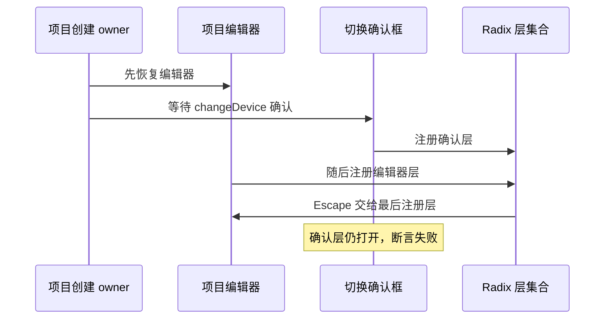
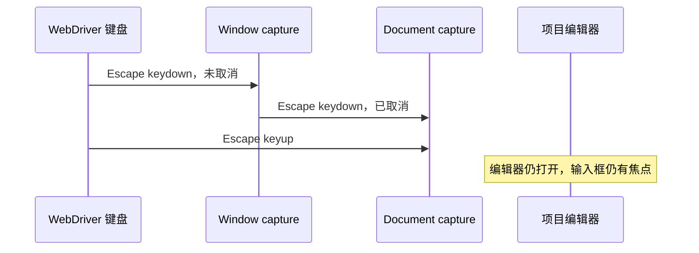

# 远程项目编辑器收到 Escape 后仍保持打开

Status: needs-triage

## 2026-11-11：核心路径取消 Escape 验收

项目设置往返用例只验证草稿、目录、设备和无隐式创建，不再要求 Escape。
向导与编辑器改用关闭/取消按钮。切换确认的原生指针点击在
`local-docker-20261111020715-98cd48` 中也被错误弹层阻挡，故该步骤明确限定为：
检查取消按钮可见且未禁用后，通过 DOM click 触发同一按钮回调，再验证完整业务状态。
本例不覆盖该确认框的键盘路由或指针命中，产品问题未修复。
调整后候选 `local-docker-20261111021015-02cf7c` 完整通过；独立键盘用例不变。

当前用例已转正：`conversation-session/projects/conversation-session-project-settings-return.test.ts`。隔离回放 `local-docker-20261111021455-36591e`、默认回放 `local-docker-20261111021619-02a0c2` 均通过。Issue 继续跟踪未修复的确认层输入问题；下方历史记录不改变当前用例合同。

## 历史记录：2026-11-10 键盘路径独立复跑通过

`conversation-session-remote-accessibility.test.ts` 在当前基线的单窗口、无诊断代码运行
`local-docker-20261110114708-6defec` 中完整通过，包括 Esc 关闭编辑器和后续侧栏、设置、重连步骤。
此前的只读探针运行 `local-docker-20261110114336-9bbef4` 也通过：按键前只有一个编辑器层，
Escape 由该层正常消费。两次运行之间没有修改产品代码。

该结果只说明当前键盘路径已可完成，不追认历史失败原因已修复；下方项目往返设置的确认层
问题仍存在，鼠标菜单导致焦点丢失的问题也在独立记录中保留。正式回放证据见覆盖矩阵。

## 历史记录：2026-11-10 项目往返确认层根因已确认

`conversation-session-project-settings-return.test.ts` 在当前基线再次失败：
`local-docker-20261110103210-8111c4`。两次保留原断言的运行时探针
`local-docker-20261110103426-81c2f4`、`local-docker-20261110103542-05c54c`
均复现；后者的 `escape-probe.json` 直接读取了 Radix 的实际层集合。

- `ProjectCreation` 的设备添加完成回调先执行 `setAddingDevice(false)`，随后等待原
  `changeDevice` 的目录切换确认。恢复编辑器与显示确认框进入同一轮 React 更新。
- 实际层注册顺序为「建立连接 → 切换设备？ → 创建项目」。视觉上的确认框仍在前面，
  但最后注册的项目编辑器拥有 Escape；焦点也落在该编辑器的名称输入框。
- 按键调用栈定位到 `@radix-ui/react-dismissable-layer` 的最高层关闭分支，
  没有命中全局快捷键拦截。Escape 关闭了项目编辑器，确认框及连接向导仍在。

候选修复仅调整原完成回调的顺序：等设备切换确认结算后再恢复编辑器，继续沿用同一份
项目草稿与原 `changeDevice`，不增加超时或第二份状态。该批次按当时要求没有修改产品，
候选当时保持 pending；此状态已被顶部转正记录取代。该根因只解释项目往返确认场景；下方独立的
`remote-accessibility` 编辑器关闭失败仍需单独取证，不能据此宣称同根因。

## 历史证据（2026-10-17）

`conversation-session-project-settings-return.test.ts` 在真实 SSH 连接成功后出现「切换设备？」
确认层，界面明确显示取消快捷键 `esc`。发送一次 Escape 并等待确认层消失仍失败；
现场同时保留 SSH 进度向导和设备切换确认层，项目编辑器尚未恢复。
证据：`r3-server-promotion-20261016-confirm-current-project-settings-return` 的 `failed-page.txt`、
`failed-project-settings-return.png` 和失败录像。此次已排除测试在异步取消完成前直接读取项目名：
失败点是确认层本身未关闭。与编辑器 Escape 是否同一根因仍待定位，不改成鼠标取消规避。

2026-10-17 转正回放发现。按用户要求只记录业务行为异常，保留失败断言，不改业务实现。

- 用例：`conversation-session-remote-accessibility.test.ts`。
- 复现：通过键盘建立 SSH 连接、选择目录并保存项目，打开项目的编辑菜单；切换中英文、深浅主题及 1400/900px 视口后，按一次 Escape。
- 实际：项目编辑器仍可见，输入框仍有焦点。键盘事件记录显示真实 `keydown/keyup` 均到达 window 和 document，键值为 `Escape`，Ctrl/Meta 均未按下；keydown 在 window capture 时未取消，到 document capture 时已被 `preventDefault`。因此不是测试没发送 Escape 或窗口失焦。
- 证据：`packages/desktop/.e2e-artifacts/r3-server-promotion-20261016-keyboard-events-remote-accessibility/project-editor-escape.json`，同批失败录像及布局截图；前一批 `r3-server-promotion-20261016-keyboard-remote-accessibility` 同样失败。
- 待定位边界：按键到达后，弹层关闭回调或事件拦截没有完成编辑器关闭；目前未确定具体拦截者，不能仅凭 `defaultPrevented` 归因于某个组件。
- 规格：[远程键盘与可访问性](../remote-connection-ux/14-visual-polish-and-accessibility.md)。不能改成点击取消来替代 Escape 验证。

验收：上述键盘流程中 Escape 关闭最上层项目编辑器，焦点按现有弹层契约返回入口；保留主题/语言/视口切换覆盖。真实远程已连通不等于后续键盘路径通过。

2026-10-20，staging `52cd1bc1d3` 的 `r3-server-pending-52cd-a-pending-accessibility`
再次在一次 Escape 后的关闭断言失败。`project-editor-escape.json` 显示操作前后窗口均有焦点，
名称输入框保持激活，没有残留菜单；window capture 收到未取消的 Escape，
document capture 收到的同一 keydown 已被取消。保留完整键盘传播记录和录像，
不把输入事件成功送达当成弹窗关闭成功。具体拦截者仍待定位。

同一基线的 `r3-server-pending-52cd-a-pending-projectreturn` 也停在设备切换确认的 Escape
关闭断言。`failed-page.txt` 明确保留“切换设备？”、“取消 esc”和“确认”控件，
底层 SSH 向导仍在；不是首次介绍页尚未确认。该场景仍单独保留证据，不推定与编辑器共用同一拦截者。
