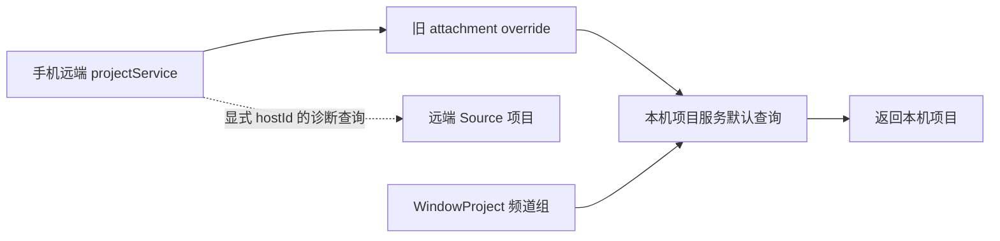

# 手机远端工作区的项目频道仍被替换为本机服务

Status: ready-for-human

## 2026-11-11：复现对象说明

准备本机项目 A、B，以及同一 SSH Source 的远端项目 C、D；仅把 C 添加到窗口。
手机侧栏显示 A/B/C、不显示 D 是正常行为。点击 C 的新建任务后，测试通过当前工作区的
`projectService.readProjects()` 读取 Source 目录：预期 C/D，实际 A/B/默认项目。
同一服务显式指定远端 hostId 后能读取 C/D，所以这不是侧栏可见性要求，也不是缺少远端数据。
该步骤是 E2E 的接口级检查，不能仅凭肉眼看侧栏复现；文件/会话提及等下游 UI 尚未逐项验证。

## 复现与证据

`conversation-session-web-remote-project-directory.test.ts` 在手机页面从本地项目切入真实
SSH 项目后，读取当前远端服务的 `projectService.readProjects()`。预期只返回该 Source
的项目，包括未添加到窗口侧栏的远端项目；实际返回本机项目，未包含预期远端 ID。

2026-11-10 的 `local-docker-20261110112023-af88b8` 首次复现。
随后停止其他 GUI 测试，以单窗口运行 `local-docker-20261110113745-3e7147` 再次复现。
后者的 `MRO02-directory.json` 中，`wide-source-projection` 记录：

- `plain` 是本机置顶项目、本机项目和默认项目的 ID，与 `wide-local` 的本机行一致。
- 同一个服务显式传入远端 `hostId` 后，`explicit` 返回已添加及隐藏的两个远端项目。
- 因此远端数据存在；问题不是 SSH 环境、数据未创建或并行窗口干扰。

## 原因与边界

`packages/desktop/src/host/index.ts` 为 `web-remote-replayable` 的 remote attachment
保留了旧逻辑：将 `IProjectService` 覆盖为 `activeServices` 的本机项目服务。
当前实现已经另外发布完整的 `WindowProject` 频道组，供侧栏使用；
`RemoteServicesAccessor` 和 `windowHostAttachmentRpcPolicy` 也明确约定原 project 频道保留
Source 语义。旧覆盖使这两个接口重新混在一起，默认查询落到了本机库。

修复应核对并移除与新窗口频道组重复的旧覆盖，保持 Source 项目语义与窗口侧栏语义分离。
用户本次要求暂不修改产品，尚未实施。保留原断言和 pending；临时诊断代码已撤除。
验收需重新完成宽窄屏切换、刷新、项目更新、隐藏项目隔离和返回本机的全部后续步骤。
