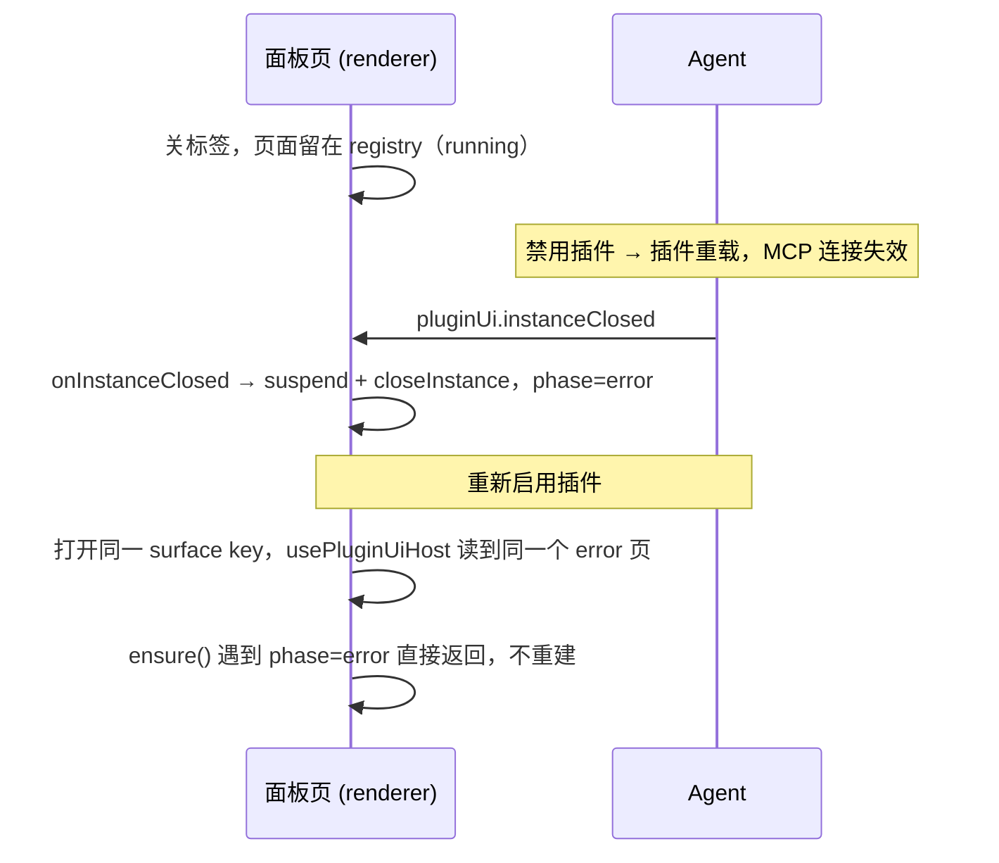

# 01 — 后台插件 UI 页被禁用撤销后，重新启用再打开仍停在错误态

Status: needs-triage

## 现象

1. 在会话里打开插件 UI 面板，再关掉标签。页面由窗口级 owner 留在后台，仍为 running。
2. 在插件管理里禁用这个插件（User 或当前项目都会出现）。
3. 重新启用插件，再从市场或插件管理打开同一个面板。

面板显示「MCP App connection is no longer available」和「重试」按钮，沙箱不握手。用户点「重试」后才恢复。

## 证据

- Agent：`apps/zcode-cli/packages/bootstrap/src/zcode-protocol/mcp-ui/protocol.ts` 的 `onMcpAppConnectionInvalidated` 关闭实例，并发出 `PluginUiInstanceClosed`。
- UI：`packages/ui/src/plugin-ui/adapters/pluginUiManagedPage.ts` 的 `onInstanceClosed` 把页面置为 `error`，页面仍在 registry 里；`ensure()` 遇到 `phase === "error"` 直接返回。`usePluginUiHost` 用同一个 surface key 取回这个页面。
- 运行时（PLM-UI-001 远端运行 `desktop-e2e-20261113093800335-p61934-02894b31e50a6f53`，临时取证日志已删除）：
  - 17:39:12：关闭标签后页面仍为 running。
  - 17:39:16：项目禁用后出现 `closeInstance`。
  - 17:39:32：重开时第一帧为 `lease:true, rows:6, presentation:true, phase:"error"`，之后 60 秒没有 `preparing`。
- 收窄 15d 之后通过的运行 `desktop-e2e-20261113100430717-p85049-e23b805eae0cb952`，15d 截图同样显示「MCP App connection is no longer available」和「Reload」。

## 影响

用户禁用插件后再启用，打开面板时会看到连接错误，必须手动点「重试」。不影响配置写入，也不影响冷启动打开。

## 处理方向（未定）

需要先决定实例撤销后页面的归属。有两个方向：

- 撤销时从 registry 移除页面，下次打开时重建。
- 保留错误页，但用户重新打开面板时自动重建。

决定之后先更新插件 UI 生命周期 spec，再改实现，并在 PLM-UI-001 的 15d 恢复沙箱握手断言。

## 来源

2026-11-13 修复插件市场开关作用域（`fix/plugin-market-toggle-user-scope`）时，新增的 PLM-UI-001 15d 步骤暴露了这个问题。发布基线已存在，不是该分支引入。该分支的 15d 只断言 User 写入和面板标签打开，不等沙箱握手。
