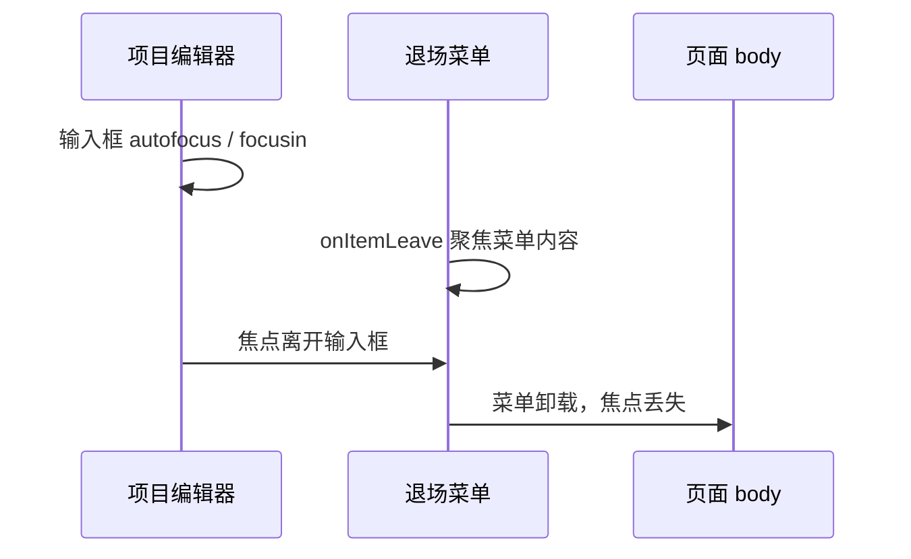

# 从项目菜单打开编辑器后焦点仍在页面 body

Status: wontfix

## 2026-11-11：界面组合用例改为手动聚焦

本项不再要求从菜单打开后自动聚焦。R3A-UI-03 在编辑器显示后真实点击名称输入框，
再验收可见焦点、布局、设备信息、离线入口与重连。候选
`local-docker-20261111020847-58c88d` 完整通过，两组语言/主题/视口均已到达。
本轮未修复菜单退场时的自动焦点行为；独立键盘可访问性用例的原要求不变。

当前用例已转正：`conversation-session/remote/navigation/conversation-session-r3-ui-pairwise.test.ts`。隔离回放 `local-docker-20261111022019-db3cab`、默认回放 `local-docker-20261111022129-c207f4` 均通过。菜单自动聚焦要求已取消，本票不实施产品修改；独立键盘合同不变。

## 历史记录：2026-11-10 单窗口确认焦点被退场菜单抢走

`local-docker-20261110112855-01362a` 再次复现。停止其他 GUI 测试后，
`local-docker-20261110114234-e7c551` 的 `ui-pairwise.json` 记录实际 `focus()` 调用栈和
`focusin` / `focusout` 事件；原来等待编辑器焦点的断言未修改，仍在 5 秒后失败。

事件顺序已确认：

1. 点击项目菜单的 Edit project，React 为 `project-name` 输入框执行 autofocus，且收到 `focusin`。
2. 仍在退场的 Radix Menu 收到 `onItemLeave`，调用 `contentRef.current.focus()`；
   source map 定位到 `@radix-ui/react-menu/dist/index.mjs:242`。
3. 输入框收到 `focusout`，菜单内容重新收到 `focusin`；菜单随后卸载，焦点落到 `BODY`。



这次排除了并行窗口干扰，也排除了“输入框从未 autofocus”。当时的修复建议是阻止关闭中的菜单在
编辑器打开后重新取得焦点；该批次不在测试里强制 focus 或延长等待，也未修改产品。
候选当时保持 pending，临时采集代码已撤除；此状态和自动聚焦要求已被顶部决策取代。此根因与“项目往返设置后错误的层注册顺序”分开记录。

业务基线 `d31e735905cf744e75a0a93548a80acabe871ae5`，测试补丁 08。
批次 `r3-server-20261011143037600-31012b` 的 `uipairwise` 在 132.2 秒失败。

## 历史运行证据

英文、深色、960×700 场景中，通过真实项目菜单点击 Edit project，编辑器和正确目录都已显示。
测试等待 5 秒，要求 activeElement 位于可见编辑器内；最终 `focusFailure={tag: "BODY", testId: null}`。
录像末帧显示编辑器输入框没有焦点环。这次没有手动 focus 输入框，也没有立即读取挂载首帧就失败。

```text
项目菜单 → Edit project → 编辑器显示
  → 等待可见焦点进入编辑器（5 秒）
  → activeElement 仍为 BODY
```

`ProjectEditor` 名称输入框声明 autoFocus，项目菜单通过 `onSelect` 打开编辑器。
需核对菜单退出时的焦点归还与 Dialog 焦点管理之间的顺序；当前证据尚未唯一定位到某个回调。
该历史批次未修改业务实现，也未在测试中强制 focus。后续中文/浅色、离线与重连矩阵未到达。

本项对应 [R3A-UI-03](../../testing/r3-remote-automation-case-matrix.md) 的焦点可用要求。
证据位于上述批次 `uipairwise` 的 `ui-pairwise.json`、失败录像和日志。

## 历史记录：2026-10-20 staging 复验

基线 `52cd1bc1d3`，批次 `r3-server-pending-52cd-b-pending-uipairwise` 再次复现。
首先修正旧 E2E 的原生设备 `title` 断言，按 RDUX-12 检查可见设备名和真实悬停详情；
完整设备名、远端路径与无操作按钮均通过，项目菜单也正常显示。
随后点击 Edit project，仍在 5 秒焦点断言失败，`ui-pairwise.json`
记录 `focusFailure={tag:"BODY",testId:null}`。没有强制 focus 或增加延时，
中文浅色及离线重连步骤仍未到达。
