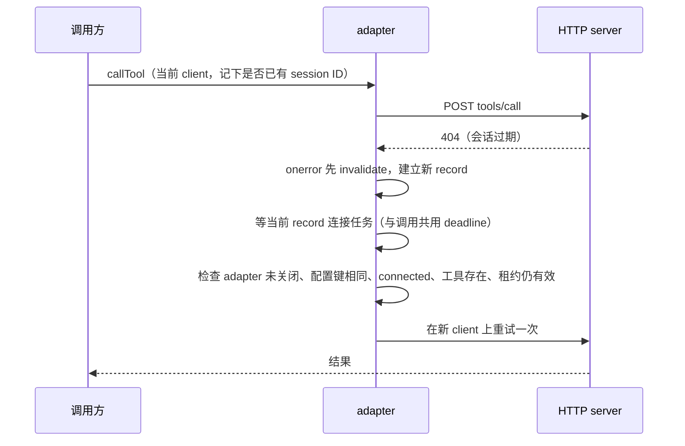

# MCP 动态目录与异步连接

## 合同

交互 session 在后台启动 MCP，首请求只读取已发布的内存快照。headless、automation 和闲时任务保留首发等待。连接就绪不会自行发起模型请求。ToolSearch 开启时，仍在连接的 server 写在公告里；ToolSearch 关闭时没有公告，由 `WaitForMcpServers` 工具和执行器等待告诉模型（见「请求与搜索」）。


## 配置

配置身份只有一个判定：`mcpConfigKey`（`@zcode/contracts`）对键排序并丢弃 undefined 字段后序列化。pool 的连接 key、adapter 的复用判断、MCP App 连接摘要、session 的配置变化判断都使用它；`{ timeoutMs: undefined }` 与 `{}` 是同一配置，不重建共享连接。

执行环境中的 CLI 监听用户与项目配置、插件安装记录 `installed_plugins.json`、官方插件 bundled 分片，以及 inline 插件（用户配置 `plugins.dirs`）的 manifest 与 MCP 声明文件。desktop 会话读磁盘配置；设置页和插件操作在别的 CLI 进程里执行，文件监听是唯一的跨进程传播途径。

只监听提交点，不监听缓存插件与官方插件的目录内容：

- 缓存插件目录只由安装、更新流程写入（`activateDirectoryAtomically`，权威状态为 `installed_plugins.json`），流程以写安装记录结束；卸载删除安装记录；启停写用户配置。官方插件目录在应用启动时释放，以写 bundled 分片结束。所以这些目录的每次有效变化都伴随一个已监听文件的变化，加载器随后全量重读即可读到新目录。
- 事务未提交时读到的插件目录为不稳定，加载器沿用上次稳定执行配置；提交时写安装记录触发下一次重读，结果收敛到新一代。
- inline 插件没有提交点，开发者直接编辑其文件，所以继续监听它的 manifest、MCP 声明文件和事务记录。
- 约束：以后新增写缓存插件或官方插件目录的流程，必须以写 `installed_plugins.json` 或 bundled 分片结束，否则已打开的会话看不到这次变化。直接手改缓存目录里的文件不会热生效。
- 监听数量与已安装插件数无关。修复前每个插件约占 3 个目录锚点（版本目录的父目录、插件根、manifest 目录），26 个插件约 84 个 watcher；新会话获取配置源时要串行等待这些 watcher 就绪，不同工作区的会话还各建一份。

监听规则：

- 锚点取文件所在的已存在目录。目录不存在时，只在包含该文件的已知根目录（工作目录、用户配置目录、插件存储根目录）之内向上找已存在的目录；根目录之外不监听，不会监听用户目录这类大目录。inline 插件根目录的父目录因事务记录文件（`.<name>.transaction.json`）进入监听，用于发现原子 rename；其他锚点不额外监听父目录。
- 文件事件只使配置失效，等 300 ms 无新事件后（尾部去抖，不设最长等待）串行 drain 重读完整配置；连续原子替换最终发布最后一次写入。原生事件缺少 filename 时按锚点失效。去抖只决定何时读取，不决定状态：每次都全量重读并按内容比较，去掉定时器最终状态不变。
- watcher 就绪后报错时立即调度一次 drain（不去抖），由 drain 重新绑定；绑定期间报错不主动调度，等下一次读盘时重新绑定。失败的绑定不视为已覆盖。不轮询配置。
- 同一锚点、同一身份的 watcher 失败两次（就绪前、就绪后都计数）即停止监听并记 warn，不再重绑；稳定后的文件事件清零，身份变化或条目重建后重新尝试，停止监听后新会话仍读到最新配置。规则见 [Skill 实时目录·监听范围](./skills-live-catalog.md#监听范围)。修复前就绪后报错的重绑没有上限，持续失败时 drain 不结束，新会话创建被拖住。
- 监听建立有 1 秒总超时：一次绑定里逐个锚点的 stat 和等 watcher 就绪或报错共用同一个截止时间，超时的锚点即断路、停止监听并记一条 warn（`MCP configuration watcher bind timed out`），不调度重绑；断路跟随条目，停止监听后新会话仍全量读到最新配置。超时只决定是否继续监听，不决定配置内容。规则见 [Skill 实时目录·监听范围](./skills-live-catalog.md#监听范围)。修复前网盘响应慢时 stat 挂住或 watcher 既不就绪也不报错，绑定没有上限，新会话一直等。
- 锚点、绑定、去抖、drain 与进程级 registry 是通用监听原语，[Skill 实时目录](./skills-live-catalog.md)复用同一套原语，各自有独立的条目和加载器。原语另支持目录条目（只看目录的直接子目录增删），MCP 不使用它；MCP 的监听集合、边界和行为不变。

同一 CLI 进程内，加载器输入相同的会话共用一个配置源（进程级 registry 由入口创建并注入，不是模块全局单例）：

- 共享 key 按值包含加载器的全部输入：配置文件路径、用户配置路径、回退路径、插件存储根目录、官方插件根目录（保持顺序）、显式 server map（用 `mcpConfigKey`）、工作目录、环境变量、默认启用的插件（转为有序数组）。key 含环境变量，只记录它的 hash。
- 每个会话持有一个 view：内建 server、computerUse、显式 enabled 和 broker 注入在 view 内计算；所有 view 共用同一份原始加载结果，官方 CUA server 的身份判定因此不变。view 只在自己的计算结果按内容变化时通知会话。一个 view 计算出错只跳过它自己，不影响其他 view；获取时计算出错则释放这次登记的引用。
- 获取 view 时先登记引用，再跳过去抖定时器立即读盘，直到没有待处理的读取，然后在同一个同步步骤里读快照并订阅。所以新会话一定看到最新磁盘状态。
- view 的关闭是幂等的释放；最后一个 view 释放时关闭 watcher 和定时器。首次加载失败只删除该条目，所有等待者收到同一个错误，下一次获取重新加载。进程退出清理时 registry 被强制关闭。没有注入 registry 的入口（TUI、headless）每个 app 各建一份私有配置源，规则相同。
- 模型请求的每个 step 只读会话内存里的快照，不做文件 IO。

首载与热更新调用同一个异步加载器，配置源的第一个快照就是首载结果。加载器规则：

- 单个 MCP server 的 warning 只跳过该项；文件读取、JSON 或整体 schema 错误才保留该来源上次有效结果。上次有效结果和稳定插件配置只在加载结果被采纳（成为当前快照，内容可以不变）时提交；drain 中途被新事件取代的读取不改变下一次的回退基础。
- 插件 manifest 按固定顺序取第一个存在的文件；该文件无效时跳过该插件，与启动时的插件发现规则相同。
- 插件安装目录和 `installed_plugins.json` 共用同一个原子事务判定：事务中可从 backup 识别已提交来源，但不发布 backup 执行路径；已有来源仅在事务未完成期间保留上次稳定执行配置。
- MCP 功能开启、插件启用且声明了 MCP server 时才创建 data 目录。可选 filesystem workspace 目录读取失败只跳过该目录并记 warn。
- 单个插件的变量展开或数据目录准备失败只移除该插件结果。启动时的插件加载器同样按插件隔离错误，一个坏插件不能使会话创建失败。
- 读配置文件（带上次有效结果回退）、按启动配置的规则解析与合并配置、插件候选与启用判定、只监听 inline 插件文件这几条规则抽成共享的配置与插件清单读取，Skill 实时目录用同一份规则决定插件启停与 skill 根目录。
- 加载 warn（配置读取失败、manifest 无效、插件 MCP 诊断与准备失败、filesystem 目录不可读）在结果被采纳时记录，只记上次采纳的结果里没有的条目；重复保存配置、warn 不变时不重复记录。
- 项目文件（用户配置以外的配置路径）与启动配置用同一份项目白名单解析（[项目配置信任边界](./security/deep-link-project-trust-boundary.md)）：只认扩展声明与启停，`features`、`plugins.enabled`、`plugins.suppressedBuiltins` 等运行参数不生效；运行参数的非法值不让同一文件里的 MCP 声明失效。之后与启动配置共用同一个整形规则：去掉 Hook 声明和 `plugins.dirs`，stdio 的相对 `cwd` 按项目根解析。项目配置不能引入插件根目录。
- 各配置文件整份按 scope 优先级合并（项目高于用户），与 `createConfig` 相同：一个文件没有声明的顶层字段不覆盖低优先级文件。例如用户配置关闭 `features.mcp`、项目配置只写了 `plugins.enabledPlugins` 时，MCP 仍是关闭的。嵌套对象的合并规则也与 `createConfig` 相同（见 [配置合并存量问题](./issues/config-merge-legacy/01-nested-fields-replaced-by-higher-layer.md)）。
- 某个配置文件没有 server 时，读取它登记的回退文件：`<工作目录>/.zcode/config.json` 回退到 `<工作目录>/.agents/mcp.json`，用户配置回退到 `~/.agents/mcp.json`。
- 每个 server 按所在文件标记来源：项目文件及其回退标为 `workspace`，用户配置及其回退标为 `user`。插件和内建 server 保留各自的来源，显式传入的 map 保留调用方的标记。工作区 guard 只按这个标记和自己的项目声明判定：标为 `workspace` 却没有对应项目声明的 server 一律拒绝，显示为未信任。例如项目里别的文件已声明 server 时，`.zcode/config.json` 为空而回退读出的 `.agents/mcp.json` 条目就属于这种情况。

未显式传入 server map 时读取执行环境的磁盘配置；显式传入的 map 保留原覆盖语义。除来源标记外，加载器首载结果与 `createConfig` + 插件 + 内建 server 的结果一致（一致性测试锁定）。

## 所有权

```text
session（owner）── 配置订阅 / reconcile ──► pool 租约 ──► adapter 连接记录
fork（owner）    ── 独立连接
subagent / workflow child ── 借用父端口（端口带借用标记，范围在创建时冻结）
```

所有权由端口本身决定：借用端口带不可伪造的标记，runtime 据此跳过配置订阅、缓存 publication 和生命周期调用，不另传所有权参数。借用端口只读冻结范围，不订阅配置，不能收敛或关闭父连接。

新 child 创建时，只等待自己需要的 server 中仍是 pending 的那些，最多 30 秒，server 失败时提前结束；不等待与自己无关的慢 server。"需要的 server"是 `mcpServers` 与 `tools` 里引用的 server（`mcp__x__y`、`mcp__x`、`mcp__x__*`）的并集，模型可见名按整段名称映射回配置名：不按子串匹配（`mcp__git__x` 不等 github），不区分大小写（与子 agent 的 MCP 能力校验相同）；`mcp__*` 和 `*` 不触发等待。借用范围仍只由 `mcpServers` 决定，在创建时冻结：等待结束后才连上的 server 不进入范围。不带 scope 的 workflow child 不等待 MCP，创建时仍是 pending 的 server 不进入它的借用范围。借用端口读路径保留来源一致性过滤：父连接已确认换源时，旧范围内的工具移出借用目录。

## 连接记录

```text
records[name]：每次连接新建 record；generation 只服务 MCP App 失效通知和迟到任务丢弃
  connecting ──（唯一提交方：startConnection 末尾）──► connected / failed / disabled / untrusted
     ▲  恢复（远程意外断连、内置 stdio 进程意外退出）：新 record 保留旧工具，最多 5 次，间隔 1/2/4/8 秒，不弹交互授权
     │                                    onerror 分类：
     └──── invalidate ◄──────────────────── ├ HTTP 会话过期 → invalidate
           其他 stdio：failed（unexpected_disconnect） ├ HTTP GET 打开事件流失败 → 只记日志
                                             ├ SSE 事件流错误 → invalidate
                                             └ 连续 3 次网络错误 → invalidate
```

- 连接阶段、有效目录和当前连接任务由同一 server 记录持有。就绪发布在 discovery 成功、生命周期处理器已安装、记录仍是当前记录后一次完成。失败只在连接任务末尾提交一次，订阅者只看到一次终态通知。
- 新连接同步登记 connecting 记录，再关闭旧记录对象；关闭任务和迟到结果只处理旧对象。每条新记录使 generation 加一，同一次恢复内的多次尝试共用这一代；记录失效（stdio 意外断连进入 failed、显式断开、adapter 关闭）也使 generation 加一。每次加一都通知 MCP App 连接失效。
- HTTP/SSE 意外断连后台最多尝试 5 次；pending 保留最后有效目录，耗尽才发布 failed 并清空目录。恢复期间遇到需要交互授权的错误，立即结束恢复，结果为 failed，`failureKind` 为 `oauth_authorization_failed`，对模型表现为 needs-auth。
- 运行时来源为 `builtin` 的 stdio server 进程意外退出或 ping 失败时，走同一后台恢复。来源 `builtin` 包括宿主注入的 `node_repl`，以及官方市场（`zcode-plugins-official`）插件声明的 MCP server；官方插件的 http server 走上面的 HTTP 恢复，不受下面的重启次数限制。恢复方式：保留目录，立即重启，最多 5 次。同一 server 10 分钟内最多自动重启 5 次，超过后不再自动重启，进入 failed（`unexpected_disconnect`）但保留目录：工具留在会话视图里，下一次执行准入（或 MCP App 打开）按普通连接重启一次，重连期间目录不变；这次重启失败时按普通失败清空目录。非恢复的连接（配置变化、显式重连、执行准入重连）重新开始计数。`node_repl` 不在设置页列出，用户无法手动触发重连。其他来源（用户、工作区、第三方插件）的 stdio server 意外退出仍直接进入 failed 并清空目录。
- 其他 stdio 断连或 ping 失败直接进入 failed（`unexpected_disconnect`），不后台自愈；目录清空，工具在下一次普通 step 离开会话视图。在这之前，本 step 的 registry 里仍有它的工具，模型调用时执行准入按普通连接重连一次（显式断开的 `disconnected` 记录同样处理），连上后正常执行，否则得到"已断开"文本。工具离开会话视图后，由配置变化（设置页开关）、显式重连（TUI `/mcp connect`、打开 MCP App）或新建的连接恢复；`isolation: "workspace"` 的共享连接在新会话里复用这条 failed 记录，不会因此重连。
- 保留最后有效目录的失败只有两种：授权失败（`oauth_authorization_failed`），以及来源 `builtin` 的 stdio server 超过自动重启上限后的意外断连（见上文 `builtin` 一条）。授权失败时工具仍在列表里，调用返回 needs-auth 文本，不产生撤销和恢复公告。下一次工具执行准入时按普通连接重连（MCP App 读取不触发）：先用最新凭据（其他进程，例如设置页，可能已完成授权）；仍需授权时再发起一轮交互授权。其他失败照常清空目录。会话启动时就没有连上过的 server 没有可保留的目录，只能显式重连。
- Streamable HTTP 的 onerror 按结构化错误分类：调用开始时已有 session ID 的 POST 404，或 400 正文表示会话不存在，视为会话过期；GET 打开事件流失败（任何状态码，含 404/405）只记 debug 日志，GET 断流由 SDK 自己重开，不重建 client。SSE 的 onerror 收到 `SseError`（事件流断开）即 invalidate，因为 SDK 不为 SSE 断流派发 onclose。fetch 层网络错误（结构化错误码）和事件流体错误连续 3 次视为服务端不可达，任何 HTTP 响应都把计数清零；计数在 fetch 包装层，HTTP 与 SSE 共用。
- 交互授权只在首次连接、显式重连（设置页校验）和工具执行时（调用遇到 401/insufficient_scope，或授权失败后的执行准入重连）允许。
- `tools/list_changed` 在 discovery 期间只标脏；ready 提交后续接同一刷新入口。刷新单飞、有限重试（最多 3 次，间隔 1、2 秒），失败保留旧列表和 dirty。读快照不触发 I/O；`listTools()` 只读当前快照。

显式校验（设置页刷新）由 adapter 决定：

- connected 时 ping。ping 失败与断连共用失效入口：HTTP/SSE 和未超重启上限的 `builtin` stdio 进入后台恢复，不弹交互授权，本次刷新只报告恢复记录的当前状态，不替换恢复，也不等它结束；其他 stdio 进入 failed 后，本次刷新按普通连接重连，允许交互授权。
- 记录不在 connected（failed、disconnected）时重新连接，允许交互授权。所以后台恢复因需要授权而结束（failed，`oauth_authorization_failed`）后，用户再刷新一次才发起交互授权。
- 连接中、disabled、untrusted 只返回当前状态。

pool 只管理租约并转发显式校验。

## 工具调用

模型工具调用不设连接栅栏，执行时晚绑定当前 client。调用前只检查：租约仍指向该连接、`mcpConfigKey` 未变、状态为 connected、工具名存在。权限或 hook 等待之后，handler 再按同样条件检查目标仍有效。

工作区信任 guard 串行执行配置变更，每次变更分两段：先做准入判定（读信任记录），再等待连接完成。工具调用、资源请求和 ping 只等正在进行的那次准入判定结束，再按当前准入结果执行：

- 不等其他 server 的连接。调用已连上的 A 不因 B 还在握手而等待。
- 不因排队中的配置变更失败。变更还没开始时，调用走当前连接；变更改了目标 server 的配置时，生效时关闭旧连接，在途调用按下面的连接关闭规则处理。排队变更不会启动未经准入的新配置进程。
- 准入判定期间（同一 server 的记录先置为待审核再放行）到达的调用等这段判定结束，不会读到中间状态。
- 整体 reconcile 先释放工作区 server，等其他 server 握手后再验一次准入并重新连接。这段时间内对工作区 server 的调用等它重新连接后执行，不落到已释放的连接上；用户和插件来源的 server 不受影响。



自动重试每次调用最多一次，只用于 Streamable HTTP，条件二选一：

1. 会话过期：调用开始时已有 session ID 的 POST 404；或 400 正文匹配 `Server not initialized`、`No valid session ID`、`Mcp-Session-Id header is required`（不区分大小写）。服务端只用文本表达会话失效，这两处文本判断是"不用错误文本做流程判断"规则的例外。
2. 连接关闭：本地 ConnectionClosed，或 JSON-RPC `-32000` 且消息含 `Connection closed`。

重复执行是已知后果：一次会话过期会关闭旧 client，同一 client 上所有在途调用都收到 ConnectionClosed，各自重试一次；长调用可能被执行两次。连续第 3 次网络失败同样会同步关闭旧 client：触发这次失败的调用和其他在途调用一起收到 ConnectionClosed，各重试一次。

不重试：服务端 JSON-RPC 错误（包括 `-32000 Not connected`）、响应丢失、HTTP 500、未分配 session ID 的 404、超时、SSE 和 stdio 的连接关闭。重连等待时间为 `min(重连等待上限, 调用剩余预算)`；等待期间配置被替换、本租约不再持有该 server 或 adapter 关闭，原错误直接返回；租约整体关闭（会话关闭）时，调用随 caller 一起取消。等到重连等待上限仍未连上时，同样返回原错误；只有调用自身的预算先到期时才报工具超时。

工具调用遇到 401/insufficient_scope 时，使用授权码 OAuth 的 HTTP/SSE server（包括只配了 URL、由服务端声明 OAuth 的 server）通过同一条重连路径执行交互授权（step-up 合并 scope），成功后重试一次；官方鉴权、`client_credentials` 和配了静态 Authorization 头的 server 不发起交互授权，按原错误返回。条件与建连时的交互授权相同。并发的 401 共享同一个连接任务。授权进入等用户状态（授权链接已发布）时，触发授权的调用立即结束，返回 needs-auth 文本，不等到超时；授权在后台继续，最多 5 分钟，用户可以在设置页打开同一个链接完成。caller 取消或超时只结束本次等待，不取消共享任务，也不产生未处理 rejection。

MCP App 调用保留连接栅栏：调用固定 App 打开时的连接身份和 generation，换代后拒绝，不自动重试，也不在调用中做授权恢复。

## 资源订阅

订阅意图的唯一来源是宿主上活着的 MCP App 实例；adapter 只记录"当前 client 上已确认的订阅"。连接换代时宿主关闭实例并按实例前缀退订；adapter 不在新连接上重放旧订阅。

```text
连接 G1 断开 → adapter 建连接 G2，generation +1
   ├─► onAppConnectionInvalidated(G1)
   │      └─ 宿主：关闭 G1 上的 App 实例 → 按实例前缀退订 → 桌面显示错误卡片
用户点"重试" → 宿主打开新实例
   ├─ 连接可用：在 G2 上 subscribe，确认状态归 G2
   └─ 连接不可用：先等已有连接任务（会话恢复早于握手完成时不误判失败）；
      仍不可用（如 stdio 崩溃后 failed）再重连一次并在预算内等待；之后还不可用才报 -32001
```

签发前后各读一次连接摘要：会话被关闭或替换、连接身份或 generation 变化时拒绝签发。
打开请求没有取消通道（协议参数不含 operationId），等待只受重连预算约束。

- 登记表按 subscriberKey 区分已成功登记和尚未完成的申请。取消或失败只撤销本次申请；重复或并发的同 key 申请不能删除其他申请及此前成功的登记；明确退订或 scope 清理使旧申请失效，迟到完成不得复活。
- 当前连接记录保存远端确认（已订阅、未订阅、未知）和每个 URI 的串行任务。服务端已明确回应的错误保持原确认状态；其他 RPC 失败后确认变为未知，下一次申请重新确认。只有真正发出退订请求后才记录退订完成。
- 租约记录经自己登记的 (uri, subscriberKey)。租约释放或切换到另一份连接时只退订这些键，不按会话前缀清理：同一会话重开时新旧租约可能短暂并存，新租约的订阅不能被旧租约带走。

## 状态分类与模型提醒

`classifyServer(config, name, row)` 是唯一的可用性判定，目录读取、状态事实、执行准入、报错文本和撤销原因都只读它：

| 结果             | 条件                                                                   | 模型可见                      |
| ---------------- | ---------------------------------------------------------------------- | ----------------------------- |
| `not_configured` | 配置中没有该 server                                                    | 撤销原因                      |
| `disabled`       | MCP 总开关、server 开关关闭或状态为 disabled                           | 撤销原因                      |
| `absent`         | 配置中有该 server，但没有连接记录（租约已释放或尚未启动）              | 不报告；调用报错按断开文案    |
| `pending`        | 状态为 connecting 且没有授权等待                                       | pending 段                    |
| `needs_auth`     | 有授权等待（authorization），或 failed 且 `oauth_authorization_failed` | needs-auth 段                 |
| `failed`         | failed、disconnected、untrusted、`official_origin_untrusted`           | failed 行（不撤销已交付定义） |
| `connected`      | connected                                                              | 工具目录                      |

状态事实为 `{ pending, needsAuth, failed }`：pending 按码元排序；needsAuth 按码元排序；failed 先列 ASCII 名称（彼此 localeCompare），非 ASCII 名称彼此按码元排序。来源索引和权限拒绝只在内存中计算撤销，不持久化。诊断在事实边界脱敏一次。

needs-auth 段放在失败段之前：

```text
The following MCP servers require authentication before their tools can be used:
<names>

The authorization cannot be completed from this conversation. If the user's request depends on one of these servers (even if they didn't name it explicitly), or they ask about it, tell them that it needs to be authorized — via the MCP server settings in ZCode — and that the capability is unavailable until they do. Otherwise carry on with the request and do not mention these servers. Do not ask the user for authorization codes, tokens, or callback URLs.
```

超过 30 个名称时用 `, ` 连接并追加 `…and N more`。ToolSearch 无匹配结果只附 pending 与 failed 事实。

公告规则：

- 只在请求的 ToolSearch 模式不是 off 且控制工具可用时生成公告；已生成的公告只在请求模式为 off 时从投影中隐藏。ToolSearch 暂时不可用期间的状态变化不生成公告，恢复后已发送字节不变。
- 名称未变但状态变化也产生公告；同状态去重。公告正文带当前 pending、needs-auth、failed 事实。
- compact 重建只比较工具名称：不写入 MCP 状态键，不计算撤销与恢复，不渲染状态段。compact 后下一次普通采集按保留历史中最后一次状态比较。
- 旧 `toolSearchAnnouncement` 严格 schema 仍只包含三个名称数组；MCP 状态保存在宽松 metadata 的 `toolSearchMcpDelta` 键，读取时丢弃未知字段。
- 只有工具名称有变化时才写 `toolSearchAnnouncement`。只有状态、撤销或恢复的公告不写这个键，只写 `toolSearchMcpDelta`。读取方按"两个键有其一"识别公告：off 模式隐藏、按模式重新渲染、空正文过滤、冷恢复和状态累积共用同一个判定。修复原因：旧版本按三个名称数组重新渲染正文，三个数组都为空时得到空正文，随后报错 `System reminder body cannot be empty`（v3.16.3 实测），降级后会话无法继续。不写这个键时，旧版本按普通合成文本恢复这条记录，不报错；代价是旧版本把正文当作不带 system-reminder 外包的 user 文本发送，off 模式下也不隐藏（v3.16.3 实测）。

执行时不可用分两条路径：

- 工具不在本 step 的 registry，名称为 `mcp__<server>__…`：
  - 最新视图里已有该工具（server 在本 step 之后连上）：立即按正常路径执行，权限和 Hook 照常。选择规则（allow/deny、官方 CUA、模型可见性）与下一个 step 注册时相同；本 step 的 registry 不变。
  - 所属 server 处于首次连接（connecting、还没有工具列表、不在授权中），且本会话没有为这一次连接等满过：等它离开连接状态，同一条 assistant 回复里的调用共用 10 秒预算；工具出现就执行。完整的 10 秒等待超时仍未出现（按等待结果判断，不按墙钟），记下这一次连接，之后不再为它等。恢复中的 server 保留工具列表，不走这条等待。
  - 其余情况或等待后仍没有该工具：`<tool_use_error>Error: No such tool available: <name><suffix></tool_use_error>`。主 agent 本次请求的工具里有 `WaitForMcpServers` 且 server 仍在连接时，后缀为 `. The MCP server '<server>' is still connecting. Call WaitForMcpServers to wait for it, then try again.`；否则只有本会话公告或交付过的 MCP 工具追加原因后缀，后缀按 `classifyServer` 结果选择固定文本。
- 工具已不在 registry、名称不是 MCP 工具：同上报错，不追加后缀。
- 工具仍在 registry，执行时连接不可用：按 `classifyServer` 结果返回一条固定文本。

## 历史定义与请求投影

Native 请求区分已交付定义和仍需重放的历史引用：

- deferred 工具：只记录被引用、并以 defer_loading 发送过的定义。
- 常驻 MCP 工具：首次出现时记录并冻结，之后发送记录中的定义。没有引用的 MCP 记录即常驻记录，记录顺序就是首次出现的顺序。
- 离开目录的常驻工具（含已撤销的）重新声明为非 deferred，定义与之前发送的字节相同；仍在 registry、只是本轮被过滤的工具除外。位置：按记录顺序放在前一个仍在请求中的常驻工具之后；前面没有时，放在第一个 MCP 工具之前；请求中没有 MCP 工具时放在末尾。离开时工具顺序会变化一次（缓存在这一次失效），之后保持不变。模型调用这些工具时得到"不存在"报错和所属 server 的原因。
- 撤销资格：被引用的 retained 名字，加上常驻记录中的名字。只有公告名称而未交付定义时，不生成"忽略先前定义"的撤销指令。
- 输入校验仍按 live 定义。模型看到的是冻结定义，执行时 live 定义可能更严格；不一致时由服务端或本地校验返回错误。
- compact 携带保留段引用对应的 deferred 记录，以及已离开、未被撤销的常驻记录（`not_configured` 照样携带）。仍在目录中的常驻记录不携带，compact 后首个请求按 live 定义重新记录。

请求准备是纯投影，同时返回本次定义交付增量。有效 assistant 或保留的 partial 提交时写入既有内部历史 metadata；估算、未发送及无有效响应的失败请求不提交。交付记录的 MCP 来源只写入 `serverName` 和 `toolName`。

持久化读取不使用 strict：交付记录、状态与撤销增量读取时丢弃未知字段；撤销原因接受任意字符串，未知原因按"已撤销"处理，compact 不携带。这样新版本增加字段或原因后，降级读取不会丢掉整条记录。写入方只写上述字段。冷恢复、rewind 与 fork 按当前历史分支重建，不新增数据库表。Local 保持既有 schema 展开及包装调用协议。

## 请求与搜索

单一 normalInputPreparationPending 控制新输入、guide 和完整工具批次后的准备：消费快照、生成工具集合、collect 附件。重试、模型降级、续写、reactive compact 保持原快照。

ToolSearch 即使只有 pending server 也可用。执行时读最新的作用域目录；关键词命中立即返回，包括 pending 中保留的工具。无匹配或 select 缺失项先刷新，相关 server 仍 pending 时最多等 5 秒再搜索；明确目标不等待无关 server。等待复用连接任务，不发起连接或授权，取消只结束本次等待。ToolSearch 仅把完整服务名或显式 `mcp__` 前缀视为点名。

缓存描述显式标记为仅供展示，按非只读、不可并发、可能破坏性调度；首次拿到 live 定义后再做参数和权限校验。已知 live 定义的真实收紧仍拒绝本批次调用。

### ToolSearch 关闭时：WaitForMcpServers

请求解析出的 ToolSearch 模式为 off 时没有公告，`WaitForMcpServers` 是仍在连接的唯一提示：

```text
本 step 状态事实有 pending，或本会话主 agent 请求已发送过它 ──► 加入工具列表（锁存，之后保持）
模型调用 WaitForMcpServers({servers?}) ──► 等目标离开连接状态（≤5 s）──► 分行报告状态
模型调用仍在首次连接的 server 的工具 ──► 执行器等 ≤10 s（见「执行时不可用」）
```

- 可见性：按本 step 的状态事实判定，重试和续写看到同一份列表。ToolSearch 可用（native、local）时不出现。锁存只在主 agent 的普通请求里设置，保存在内存，冷恢复不保留：恢复后没有 pending 时工具消失一次。子 agent 只按自己的 pending 判定。不带模型的工具名单（持久化记录、子 agent 继承）只在有 pending 或已锁存时包含它。没有 MCP 的会话永远不出现，tools 段字节不变。工具名单（allowlist）排除它时也不出现，执行报错的后缀不会指向它。
- 位置：进入按名字排序的工具名单。
- 定义（固定字节）。description：

  ```text
  Wait for MCP servers that are still connecting and whose tools are not
  yet in your tool list. Pass `servers` to wait for specific ones, or omit
  it to wait for all pending servers (once none is pending, a call without
  `servers` reports any server that failed to connect or is not configured).

  If the user's request needs tools from a still-connecting server, call this
  tool to wait for it. Once it connects, its tools will be added to your tool
  list and you can use them directly. Returns ready=true when servers are
  ready, ready=false if they failed to connect, need authentication, or are
  disabled.

  You do not need to ask the user for confirmation to use this tool.
  ```

  input schema：`{"$schema":"https://json-schema.org/draft/2020-12/schema","type":"object","properties":{"servers":{"description":"Server names to wait for (default: all pending)","type":"array","items":{"type":"string"}}},"additionalProperties":false}`。只读、不可并发（不在流式阶段执行）、无需审批、无副作用。

- 目标：传入 `servers` 时按配置名或模型可见名匹配；不传时有 pending 就取全部 pending，没有 pending 时取全部失败的 server。官方 Computer Use 的工具以 `mcp__computer-use__*` 提供，连接记录名带插件命名空间；名称匹配和执行器按工具名找 server 时，`computer-use` 也对应这个官方 server。
- 等待：目标中仍有 pending 时最多等 5 秒；server 离开连接状态或发布授权链接即结束，不发起连接或授权，取消只结束本次等待。
- 结果：按目标的当前分类分组，每组一行，空组省略：

  ```text
  ready: <true|false>
  Connected (their tools are now available — call them directly): <names>
  Failed to connect: <names>
  Still connecting (try again or proceed without): <names>
  Needs authentication (ask the user to authorize them in the ZCode MCP settings): <names>
  Disabled (ask the user to enable them in the ZCode MCP settings): <names>
  Unknown (no MCP server with this name is configured): <names>
  ```

  没有连接记录的已配置 server 归入 Failed。只有全部目标 connected 时 `ready: true`；否则作为错误结果（`is_error`）返回同样的文本。

## 缓存

协议入口（App 经 ZCode Protocol 启动的 CLI）在 MCP 功能开启时创建共享连接池，并默认开启 stdio 进程内缓存，命中后仍后台主动连接；TUI 和 headless 不使用这份缓存。缓存只补当前有效 pending 连接尚未知的目录；无连接记录、租约释放、最终失败和有效空列表不能回退到缓存。容量 32 条、TTL 30 分钟、单条 2 MiB、总量 16 MiB；远程不使用本地目录缓存。缓存不持有 client，不作为执行和权限事实。

## 验收与延期

先写失败测试再实现。核心回归：

- 连接：有状态 HTTP 对 GET 返回 404/405 仍能连上；同配置不同序列化只初始化一次；恢复期 401 不打开授权页面；每次失败只通知一次；stdio ping 失败进入 failed；来源 `builtin` 的 stdio 进程意外退出后保留目录并重启，5 次失败后进入 failed，10 分钟内第 6 次退出不再自动重启但保留目录，下一次执行重启；连续 3 次网络错误触发恢复，中间一次响应清零。
- 调用：会话 404 后透明成功；400 会话正文、ConnectionClosed、`-32000 Connection closed` 重试一次；长调用在途时另一个请求触发 404，长调用被执行两次；JSON-RPC 错误、响应丢失、500、无 session ID 的 404 不重试；等待期间换配置、释放租约、关闭 adapter 不重试；重连等待到上限返回原错误；并发 401 共享一次授权；授权链接发布后触发授权的调用立即返回 needs-auth；授权失败保留目录，下一次执行用最新凭据重连。
- App：换代后 App 调用被拒且不重试；stdio 崩溃后打开实例能重连。
- 订阅：服务端回应错误保持确认状态；租约释放只退订本租约登记的键；只在真正退订后记录完成。
- 模型可见文本：未注册与已注册两条报错路径、needs-auth 段、排序、去重、compact 后不重播状态。
- 交付：schema 变化前后常驻定义字节冻结；离开的常驻工具原位重新声明；compact 携带常驻记录。
- 配置：不在根目录之上建 watcher；缓存插件目录不进入监听，安装记录变化后读到新目录，inline 插件目录仍监听；watcher 出错后重新绑定；两个原子事务入口结论一致；首载一致性；一次写入只加载一次；同一 key 的会话共用 watcher；获取时读到最新磁盘状态；重复关闭只释放一次；项目配置里的 `features`、插件全局开关不生效，运行参数非法时同一文件的 server 仍加载；项目配置没声明的字段不覆盖用户配置。
- 子 agent：只写 `tools` 的子 agent 等待其引用的 pending server；`mcp__*` 不等待无关 server；名称精确映射。
- 连接中（ToolSearch 关闭）：有 pending 才出现 `WaitForMcpServers`，发送后锁存；定义字节与排序固定；结果分组文本与 `is_error`；未注册工具等首次连接、同一回复共用 10 秒、等满后不再为同一次连接等待、恢复中不等待；超时后缀指向 `WaitForMcpServers`；server 在 step 后连上时直接执行。
- 信任 guard：调用不等其他 server 的连接；排队的配置变更不使调用失败；准入判定期间到达的调用等判定结束；reconcile 期间对工作区 server 的调用等它重新连接。
- 降级：只有状态的公告不写 `toolSearchAnnouncement`；off 隐藏、重渲染、空正文过滤、冷恢复、状态去重对这类公告不变；v3.16.3 读到这类记录不报错。

MCPW01–10 使用真实受控 stdio/HTTP/SSE server，验证 Native/Local 最终 provider 内容、桌面/手机事件与插件 UI；保持 manual-review/pending，不自动转正。

延期：

- 30 秒墙钟超时（按进度重置的总预算）。
- 子 agent 继承主 agent 的 `WaitForMcpServers` 锁存。
- 常驻工具 latch 与 `tool_addition` 浮出；DeferredToolPlaceholder。
- 配置优先级与同名去重；缓存默认值调整；reload 时刷新其余插件组件（Hook、插件 Agent 定义）。插件 skill 已随实时目录生效，见 [Skill 实时目录](./skills-live-catalog.md)。
- 第三方 stdio 后台自愈（来源 `builtin` 的 stdio server 已自动重启）；Local 模式的历史字节。
- 会话启动时就没有连上过、因授权失败停在 needs-auth 的 server：没有可保留的目录，模型无法调用，只能显式重连。
- 不带 scope 的 workflow child 不等待 MCP。
- server instructions；通用 capability 框架或数据库表。
