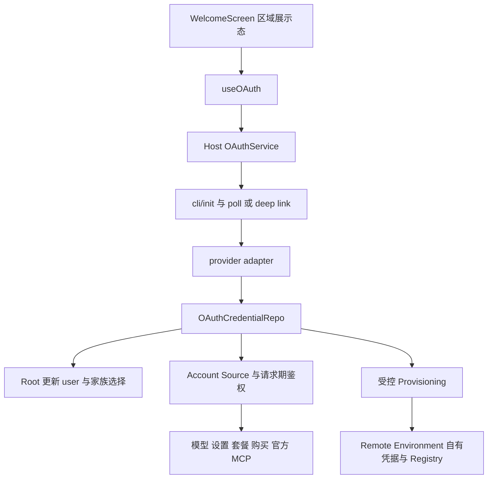
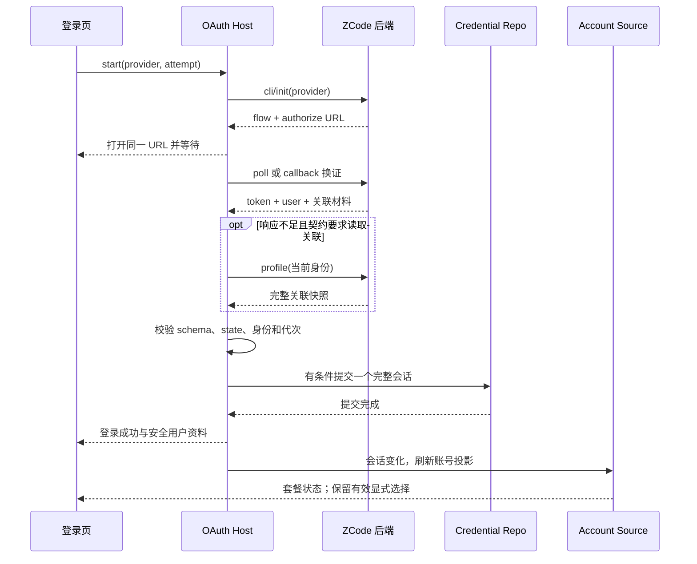

# ZCode 中国区登录与关联套餐接入计划

当前技术方案见[分区登录与账号关联技术方案](../zcode-login-rework.md)。本文件保留逐文件影响分析、候选验收场景与联调证据，作为实施附件。

状态：客户端实施与本地合成验收已落地；真实账号/上游接口及目标设备验收尚未闭环。用户已确认按现有OAuth实现、无升级弹窗、不强退、单按钮区域切换。早期分析和问题表作为历史保留，当前状态以文末“完整性核对”及后端确认补充为准。

**目标：** 保留单个授权按钮和国内／海外切换，国内走 `zai_cn`，海外走 `zai`；同手机号的原 BigModel 用户继续使用服务端返回的原 ZCode 业务身份，并能访问已关联套餐。

**架构：** 登录身份由 OAuth Host 管理；套餐凭据是该身份下的关联材料。Renderer 消费安全投影，Provider/请求服务按用途读取对应凭据，不再用登录渠道代替套餐归属。沿用现有 OAuth flow、状态代次、请求期 Project Token 与跨 Environment 同步边界。

**技术栈：** TypeScript、React、Host Service/RPC、加密 Credential Store、Provider Account Source、桌面 E2E。

## 1. 基线与结论来源

- 工作分支：`feature/login-single-entry`。
- 分析基线：`dade8cb7ea`，父提交 `1f6dc5b217` 为本次拉取的 `origin/staging`。
- 原登录页提交 `abed913327` 已完成 rebase；仅按 staging 规则去掉退役的两个 App 业务单测，原产品改动和桌面 E2E 保留。
- 本计划不代表实现完成，不创建新的产品行为，不包含推送或发布。

| 来源                                                                                                                                                                        | 已确认的信息                                                                                  | 使用边界                                                        |
| --------------------------------------------------------------------------------------------------------------------------------------------------------------------------- | --------------------------------------------------------------------------------------------- | --------------------------------------------------------------- |
| [登录产品需求](https://internal-docs.example.invalid/redacted)                                                                                                 | Z.ai 登录；国内外入口；身份与订阅解耦；关联 BigModel；Start Plan 独立                         | 其中一方登录等旧状态不能覆盖后续讨论                            |
| [10 月 27 日技术结论](https://applink.feishu.cn/client/thread/open?open_chat_id=oc_98e0ff89c4dc5713084e01906ddd4675&open_thread_id=omt_198595573ecedba3&thread_position=-1) | 加 `zai_cn`；关联 BigModel JWT/customer ID；客户端用关联材料访问 MaaS；处理无关联新用户       | 上游按手机号关联，客户端不自行匹配或合并账号                    |
| [10 月 28 日部署通知](https://applink.feishu.cn/client/chat/open?openChatId=oc_98e0ff89c4dc5713084e01906ddd4675&position=88)                                                | 测试环境已部署；同手机号关联；新增 `GET /api/v1/oauth/profile`，接受 ZCode 或 Z.ai 一方 token | 通知只展示 profile 的主要字段，不能据此推断 token/poll 完整响应 |
| [10 月 28 日接口说明](https://applink.feishu.cn/client/chat/open?openChatId=oc_98e0ff89c4dc5713084e01906ddd4675&position=89)                                                | 联调中接口可能调整                                                                            | 需要保存实际响应结构及 request ID 的脱敏证据                    |
| [MaaS Key 讨论](https://applink.feishu.cn/client/thread/open?open_chat_id=oc_0a7ae672b9641d413522b9e4b9c1b207&open_thread_id=omt_1984d0d9fdcf9b7f&thread_position=26)       | 返回全部 Key ID 和 name；删除的 Key 不返回；选择应稳定                                        | 不表示应恢复长期 API Key 作为模型请求凭据                       |
| [迁移技术草案](https://internal-docs.example.invalid/redacted)                                                                                                 | 区域配置独立，使用返回的业务 user ID，复用 CLI flow；旧客户端兼容                             | 批量预建、停止旧注册、建议接口不是本轮已执行事实                |
| 本次用户确认                                                                                                                                                                | 单个授权按钮＋区域切换；国内发送 `zai_cn`，海外发送 `zai`；重试保持区域                       | 不改成同时展示两个按钮                                          |

## 2. 本次到底改变什么

改动层级：`presentation`、`validation`、`commit-effect`、`persistence`、`recovery`。不是仅调整登录页。

### 2.1 已确认要做

1. 中国区 OAuth 全链路可识别，授权、回调、轮询、恢复使用同一区域配置。
2. 同一 ZCode 账号下读取关联的 Z.ai／BigModel 资料，缺失关联不冒充第二次登录。
3. 使用 `user.user_id` 作为 ZCode 业务身份，保留原会话、设备和业务数据归属。
4. 用关联 BigModel JWT/customer ID 请求相应套餐接口；不要求用户为了查询已关联权益再次登录 BigModel。
5. 模型设置可以表达登录账号拥有的关联套餐，而不是简单隐藏另一登录渠道对应的整个套餐家族。
6. 保留原有 Start Plan、手工 API Key、旧登录兼容、取消／失败重试和真实错误边界。
7. 本版不增加账号服务升级弹窗，不强制登出存量用户；自动在模型供应商处完成关联展示和可用性更新。

### 2.2 不能顺手扩大

- 不在客户端按手机号或邮箱合并账号，不生成“猜测的”ZCode user ID。
- 不执行服务端批量迁移、关停 BigModel 注册、生产发布或数据库改造。
- 不删除旧 `bigmodel` 协议支持；新版入口隐藏与旧版本协议兼容是两件事。
- 不把 `zai_cn` 直接定义为第三个完整模型家族，也不将其无条件映射到海外 `zai` 或 `bigmodel`。
- 不重写 Registry、任务存储、远控协议、请求期 PAT 体系。
- 不为本次新增或恢复 App 业务单测；保留 CLI 测试和 E2E 规则。

已有 [多个具体 Account Provider 草案](../working-memory/provider-refactor/steps/todo-101-concurrent-account-providers-draft.md) 明确处于延后状态：个人／Team A／Team B 同时执行、具体实例 ID、设置页纯浏览与选择器重构都不是本轮已获授权的改动。关联账号可见性不等于重新启动该草案；本轮优先保留单当前执行连接。若产品要求多套餐同时执行，须另行确认，不能混入登录接入。

## 3. 必须分清的身份与数据

| 概念                 | 来源／当前落点                                                | 目标用途                             | 禁止混用                             |
| -------------------- | ------------------------------------------------------------- | ------------------------------------ | ------------------------------------ |
| 登录区域             | 登录页选择 domestic/global                                    | 决定发起 `zai_cn`／`zai`             | 语言不是已经认证的区域证据           |
| OAuth provider       | flow/state 绑定及成功结果                                     | 选择协议配置、恢复和退出             | 不能只根据回调 URL 或按钮文案改写    |
| ZCode user ID        | 登录/profile 的 `user.user_id`                                | 会话、设备、权限等业务身份           | 不用上游 `sub`、customer ID 覆盖     |
| 上游 Z.ai user ID    | 返回的 `zai.user_id`                                          | 上游账号身份与关联校验               | 不当作 ZCode 业务 ID                 |
| BigModel customer ID | 返回的 `bigmodel.customer_id`                                 | BigModel 账号／套餐调用所需身份      | 不写成第二个已登录 ZCode 用户        |
| ZCode JWT            | 登录响应 `token`；现有 `zcodejwttoken`                        | ZCode API、Relay、官方能力的用户身份 | 不发给 BigModel 充当其登录 JWT       |
| Z.ai token           | 当前海外流程先取 OAuth token，再换业务 JWT                    | 仅访问明确匹配的区域和接口           | 中国区能否沿用转换必须实测           |
| BigModel JWT         | 返回的 `bigmodel.access_token`                                | 关联账号的 MaaS 请求                 | 不用残留的另一个用户 token 兜底      |
| 套餐家族／选择       | Account Source、`providerFamilyDomain`、connection selections | 指定使用哪个套餐及个人／团队范围     | 不等同于 OAuth 登录 provider         |
| Key ID／PAT          | 账号、组织、项目及用途下的请求期解析                          | Key ID 定位；短期 PAT 访问模型       | Key ID 不是 Secret，PAT 不是登录 JWT |

`OAuthTokenSet.accessToken` 当前是一个 provider 的单值。中国区登录后同时存在身份 JWT 与关联套餐 JWT，不能继续让所有消费者对这个单值作不同解释。应先定义内部凭据契约，再决定兼容存储键；不要让 UI 和各业务服务分别猜字段。

## 4. 实施前链路及缺口（历史基线）



| 当前代码事实                                                           | 新接入直接受到的影响                                           |
| ---------------------------------------------------------------------- | -------------------------------------------------------------- |
| `WelcomeScreen.resolveSingleLoginProvider()` 固定返回 `zai`            | 切国内只变语言，实际授权仍是海外                               |
| `runtimeConfig.ts` 与 `providers/index.ts` 仅注册两个 adapter          | 只添加字符串类型仍无法找到中国区 adapter                       |
| `useOAuth` 只为 `zai/bigmodel` 打开 polling 标志                       | 即使 init 成功，中国区也可能没有后续轮询                       |
| `OAuthService.startOAuthWithPolling()` 与 ready 解析写死两渠道         | 中国区会走错误分支，或把 ready 当作 BigModel 响应解析          |
| `ZaiProviderAdapter.providerId`、换证 body 固定 `zai`                  | 不能直接复用实例而不修改 provider 绑定                         |
| 当前 Z.ai 适配器要求 `data.zai.access_token` 并换业务 token            | 部署消息里的 profile 样例不足以证明中国区也满足该契约          |
| `persistOAuthSession()` 清除另一 provider，repo 特判两渠道共享 JWT     | 新登录可能清错关联材料；中国区可能漏存或漏清 ZCode JWT         |
| `node.ts` 按 family 读取对应 OAuth profile 和 token                    | 当前 `profile.id` 同时被当成套餐账号身份；关联账号需要明确解析 |
| Root 成功回调按 OAuth provider 改写家族域                              | 中国区目前映射 null；直接增加映射仍不能表达两个关联家族        |
| 购买鉴权判断要求 active provider 与套餐家族相同                        | 已有关联 JWT 也可能显示未登录，触发错误重登                    |
| 官方 MCP 拒绝非 `zai/bigmodel`，并要求登录渠道等于套餐家族             | 中国区登录或关联 BigModel 套餐会被本地提前拒绝                 |
| 401 分类只识别 active provider 的业务 origin/token                     | 中国区或关联套餐失效会漏处理；粗放扩充会错误退出全局身份       |
| Provisioning allowlist、Web provider 类型、CLI provider 类型固定两渠道 | 新数据可能不被同步、恢复、识别或正确清理                       |

## 5. UI 入口与状态归属

| 场景／入口                  | 共享实现与状态                                | 提交动作／权威                        | 默认与门禁                                  | 本次关注                                                       |
| --------------------------- | --------------------------------------------- | ------------------------------------- | ------------------------------------------- | -------------------------------------------------------------- |
| 冷启动与手动登录            | WelcomeScreen、useOAuth；区域是页面草稿       | Host startOAuthWithPolling            | 初始区域当前跟随语言，手选后保留            | 一按钮两真实渠道；等待时不得混用新区域与旧 flow                |
| 登录失败与取消              | pendingProvider、attempt ID、Root 完成信号    | cancelPending／重试原 provider        | 不用已有全局 user 完成另一个购买 attempt    | 中国区加入同一完成／取消语义                                   |
| 设置页 Connect／重新登录    | loginEntryRequest、useModelProviderNavigation | 打开统一登录入口                      | 既有目的、目标套餐、attempt ID              | 关联权益不能再按家族强制登录另一个身份                         |
| 模型设置套餐列表            | ProviderSettingsView、Account Source          | settings 连接选择                     | 账号事实与手选配置分开                      | 能展示关联的可用套餐，保留用户已有选择                         |
| 购买页、支付续接            | codingPlanPurchaseAuth、升级对话框            | 原购买动作＋认证恢复                  | 具体订单与 attempt 绑定                     | 关联 JWT 可用性、目标 origin、取消后不续单                     |
| 侧栏头像／升级／额度        | user 投影、usage entitlement cache            | 原套餐入口                            | 缓存不能跨账号／区域误复用                  | 身份一致，额度和升级归属正确                                   |
| 模型菜单与执行              | ModelSelectionView、Account Access            | 目标 Environment ModelFactory         | 当前连接、套餐与项目范围                    | 不靠显示了菜单证明鉴权能执行                                   |
| 手机 `/remote`、分享登录    | 独立 Web OAuth repo 与 state                  | Web 回调；业务由既有 owner 执行       | localStorage 与桌面 Credential Store 不混写 | 是否同步暴露中国区入口需确认；既有路径必须兼容                 |
| SSH／WSL／Docker            | Provisioning；远端独立 Credential Store       | 受信 Host → Target                    | 原 schema/capability 门禁                   | 新关联材料完整同步，原子应用；不从桌面直接注入 Registry        |
| 独立 CLI 登录／桌面内 Agent | CLI OAuth client 与共享凭据读取               | CLI credential adapter／Host 私有鉴权 | 二者职责不同                                | 桌面内 Agent 必须能使用新账号；独立 CLI 新入口作为独立范围确认 |

## 6. 按链路拆分的修改内容

### T01 定义契约与区域配置

文件：`packages/shared/src/oauth.ts`、`packages/shared/src/zcodeEndpoint.ts`、`packages/services/src/oauth/runtimeConfig.ts`、`packages/services/src/oauth/providers/index.ts`、`packages/services/src/oauth/providers/zaiProviderConfig.ts`。

- 为 `zai_cn` 定义稳定常量及“已支持的 ZCode 登录 provider”判断，避免继续散落二元比较。保留通用 OAuth 扩展类型，不让任意字符串自动得到 ZCode 凭据权限。
- 复用既有环境配置解析，明确每个区域的 authorize/token/profile/业务 origin、client ID、redirect URI。服务端 flow 返回 authorize URL 时原样打开，不自行拼另一区域参数。
- 增加中国区 adapter 装配或使现有 Z.ai adapter 接受显式 provider/config；不要复制整份 adapter。
- 共享层声明安全投影和运行时 schema；Secret 和后端默认配置留在服务层。
- OAuth 当前归属 legacy services 模块。若确需新增源文件，先按架构规则确定 managed 模块归属；不能为小型接入机械新建整套账号框架，也不能让新文件无归属。
- 验收：三种已知 provider 能正确装配；未知 provider 不被当作国内或 BigModel；测试配置不请求生产端点。

### T02 接通 init、poll、deep link 与页面

文件：`packages/ui/src/WelcomeScreen.tsx`、`packages/ui/src/hooks/useOAuth.ts`、`packages/services/src/oauth/oauthService.ts`、`packages/services/src/oauth/providers/zaiProviderAdapter.ts`；检查 `packages/desktop/src/main/desktopOAuthDeepLink.ts`、`packages/desktop/src/preload/oauthCallbackBridge.ts`。

- `resolveSingleLoginProvider` 接收区域，按区域找可用 provider；所选区域不可用时明确显示不可用状态，不静默转另一地区。
- 切换区域与语言仍沿用户确认的交互；发起时冻结 provider/attempt，失败重试从原 attempt 取 provider。取消后才能开始新的 flow，或明确取消旧 flow 后切换，具体等待态交互沿既有页面能力收敛。
- `useOAuth` 对中国区开启同一 polling；Host init/ready 解析增加中国区，按实际响应 schema 取数据。
- 两种完成路径进入同一个归一化与提交函数，继续保留 state 校验、init 代次、取消、重复 callback 防护。
- 检查 provider-specific 登录成功比较：套餐目标与登录 provider 不再必然相等，应以同一 attempt 的成功及目标关联可用性完成购买续接。
- 原 API Key 表单、窗口按钮、双主题、中英文和平台注入维持原契约。

### T03 统一解析登录响应与 profile

文件：`packages/services/src/oauth/oauthService.ts`、`packages/services/src/oauth/providers/zaiProviderAdapter.ts`、`packages/services/src/oauth/oauth.ts`、`packages/shared/src/oauth.ts`。

- 网络边界校验 `user`、`zai`、`bigmodel` 及可选字段；登录响应有 token，profile 无 token，不能共用“token 必须存在”的 schema。
- 对服务端返回的 `user.user_id` 作非空校验；缺失不能退成 `unknown` 后继续完成新登录。
- 将公共用户资料与 Host 私有关联凭据拆开。新增 profile 接口向 UI 返回状态／资料，不返回 JWT 原文或整个 raw response。
- 初次登录优先使用完整登录响应；缺少契约要求的关联快照时再查询 profile，避免重复并发请求和半完成状态。
- 冷启动保留现有本地快读，不默认增加一个阻塞全界面的网络前置；后续校验与显式刷新沿统一 owner 执行。
- 存量登录不因升级而被注销或被要求先重新授权。先核验旧凭据是否可读取新 profile，并用当前账号刷新关联；新接口不兼容或补关联失败不能直接当成旧登录已失效。确证原有认证失效时仍按现有过期流程处理。
- 模型设置手动刷新能更新关联资料；并发刷新合并，失败允许手动重试，不通过定时轮询补一致性。

### T04 凭据持久化与会话生命周期

文件：`packages/services/src/oauth/repo/oauthCredentialRepo.ts`、`packages/services/src/oauth/oauthService.ts`、`packages/services/src/credential/credentialService.ts`、`packages/services/src/oauth/oauthProviderLogout.ts`。

- 一个登录会话保存其 provider、业务 user ID、ZCode JWT 和关联材料。旧 `oauth:*` 键若继续保留，只能是统一 owner 维护的兼容投影，不能成为第二套可独立修改的登录事实。
- 不通过伪造一次 BigModel 登录来保存关联 JWT，也不把 BigModel customer ID 写成全局 user ID。
- `clearActiveSession`／`logoutAll`／损坏恢复须清除本会话所属的全部关联材料；不清无关手工 API Key、Bot、SSH 凭据。
- 登录快照必须有一致提交边界。当前 Host Credential Service 每个 save/delete 独立加锁，OAuth 队列仅串行本实例；它不能证明多个字段跨进程原子。
- 推荐扩展 Host 私有的有条件批量 mutation：同一文件锁内读、核验预期会话、替换本会话字段、一次写盘，成功后再通知。勿把任意批量凭据修改暴露到 Renderer RPC。
- 兼容旧格式只从明确 active provider 读取，不能扫描“哪个 token 非空”推断用户。存储键／schema 定稿前要评估旧应用与 CLI 共用文件的行为。
- 所有刷新提交检查发起时的会话身份／代次；退出、重登、换账号后拒绝旧结果。刷新读到确定无关联时删除旧关联；网络错误不冒充“无关联”。

### T05 套餐账号解析与请求凭据

文件：`packages/services/src/node.ts`、`packages/services/src/model-provider/accountProviderConnectionResolver.ts`、`accountProviderCredentialService.ts`、`accountProviderRequestAuthService.ts`、`accountProviderApiKeyResolver.ts`、`accountProjectTokenClient.ts`。

- 将 `loadAccountIdentity(family)` 与 `loadOAuthAccessToken(family)` 的二元键选择改为读取同一会话的套餐访问材料。
- ZCode user ID 用于业务账号；BigModel customer ID 用于关联套餐身份。对外接口实际需要哪一个字段，以请求契约为准，不全局替换 `accountIdentity`。
- 请求期快照需包含登录归属、目标平台/区域、关联身份和个人/团队 scope，IO 前后复核。缓存键增加哪些维度应由是否改变请求身份决定，不把 token 原文放日志或 UI cache key。
- 继续用 Key ID 定位 → PAT 签发。MaaS 返回的多个 ID 按稳定规则选择；不能每次取不稳定数组第一项，也不能把其当长期 Secret。
- 现有目标 Key 消失时按原 404/定位失效路径重查；不要主动删除用户 Key，不为每次刷新重复创建 Key。
- 一个人员账号可能有多个团队项目；`organizationId/projectId/productId` 始终来自所选套餐，不从另一家族或个人套餐兜底。

### T06 套餐查询、展示与选择

文件：`packages/shared/src/model-provider-family.ts`、`packages/ui/src/root/useRootOAuthEffects.ts`、`packages/ui/src/root/oauthProviderFamilySelectionRefresh.ts`、`packages/ui/src/settings/ModelProviderSection.tsx`、`packages/ui/src/settings/model-provider-section/useModelProviderNavigation.ts`、`useCodingPlanEntitlements.ts`；检查 `packages/ui/src/lib/usageEntitlementCache.ts`、`sidebarCodingPlanUpgrade.ts`。

- 当前 `providerFamilyDomain` 既影响展示，也影响请求时的 current 选择。不能为了显示两个套餐简单放开所有门禁，否则可能把另一家族标成当前执行账号。
- 区分“可展示／可连接的关联套餐”和“当前执行连接”。一个登录身份可看到多个关联套餐，但现有单当前执行选择语义可继续保留。
- 现有显式连接选择有效时保留；首次初始化才使用产品优先级。原需求的跨平台 `Z.ai > BigModel > Start Plan` 与现有家族内 `个人 > 团队 > Start` 是两个层级，需要在 spec 明确组合，不能隐式互相覆盖。
- “存在关联账号”“买了套餐”“可用额度”“服务调用失败”是四种不同事实；无关联、无订阅、限额、暂时失败分别展示。
- 关联已消失时重新判定本连接可用性；不要默默改写已有任务、模型选择或用户手工配置。主动改选的规则需产品确认。
- UI 只读 Account Source 的安全状态；不得为几个页面各加一份关联缓存或自行探测 JWT。

### T07 购买、升级、额度与官网跳转

文件：`packages/services/src/coding-plan-subscription/bigmodelCodingPlanSubscriptionProvider.ts`、`zaiCodingPlanSubscriptionProvider.ts`、`packages/ui/src/settings/model-provider-section/codingPlanPurchaseAuth.ts`、`codingPlanEmbeddedWebview.ts`、`packages/ui/src/settings/CodingPlanUpgradeDialog.tsx`、`packages/ui/src/CodingPlanUsageRemainingPanel.tsx`。

- 购买鉴权不能再要求 `activeProvider === family`；应询问本登录身份是否拥有目标套餐所需材料。
- 关联 BigModel 返回有效材料时沿用原订阅／团队／续费接口；缺失时按已确认产品行为显示，不能自动登录另一个账号。
- 官网目标与凭据来源一起解析。不得把中国区 JWT 发给海外端点，也不把 ZCode JWT 当 BigModel JWT。
- 已有可信内嵌页面的最小凭据传递继续受 origin、作用域和用户动作约束；不扩张为任意网页可读凭据。
- 支付后按原订单及登录 attempt 刷新，取消／替换后不能恢复旧订单流程；侧栏升级入口和额度取同一目标套餐。

### T08 401、过期、撤销和日志

文件：`packages/services/src/oauth/oauthUnauthorizedRequest.ts`、`packages/services/src/oauth/oauthService.ts`、`packages/services/src/providers/api/nodeApiClient.ts`、`packages/services/src/oauth/providers/zaiProviderAdapter.ts`。

- 扩展请求分类为“ZCode 身份凭据”“区域身份凭据”“关联套餐凭据”“PAT”，按请求 origin、提交时凭据及当前快照精确识别。
- ZCode 身份确认失效才走全局退出；关联 BigModel JWT 失效优先刷新／标记该关联。无权限、网络失败、空响应不能一律踢掉 ZCode 登录。
- 对旧请求的 401 在同一提交边界复核；旧 token 被新 token 替换后，不得删除新会话／新关联。
- 继续区分 PAT 一次恢复、业务 JWT 恢复和登录刷新；不增加无界重试，不重放已输出内容的模型流。
- 新响应含 `bigmodel` 后，现有 `sanitizeTokenPayloadForLog()` 的 `...data` 会保留未处理的新字段，存在把关联 JWT 写日志的风险。接入前改成允许字段摘要：provider、阶段、状态、是否存在关联、耗时、request ID，不打印响应原文。
- 登录、退出等低频事件用 info；重试／可恢复异常用 warn；高频轮询 debug。UI 用现有 logger。保留必要中文注释说明边界原因。

### T09 官方 MCP 与其他组合鉴权

文件：`packages/services/src/official-mcp/officialMcpCredentials.ts`、`packages/shared/src/official-mcp-auth.ts`；核对闲时、高速和请求安全校验调用方。

- 现有官方 MCP 用 `activeProvider === selected.plan.providerFamily` 防止跨账号拼接。新模式下不能只删除这个判断，必须用服务端给出的同一登录快照关联关系替代。
- ZCode JWT 与关联 MaaS JWT、团队范围必须来自同一会话和当前选择；前后快照检查仍保留。
- `zai_cn` 加入“有效登录身份”判断后，只有身份、无套餐时仍按原 planOptional 策略处理，不伪造套餐。
- 静态插件 header 禁止覆盖身份头的保护保持；不修改现有头名和跨语言协议。

### T10 远端 Environment 与手机

文件：`packages/shared/src/provider-provisioning.ts`、`packages/services/src/model-provider/providerProvisioningSource.ts`、`providerProvisioningTarget.ts`、`packages/desktop/src/host/remoteWorkspaceServiceCollection.ts`；核对 `packages/desktop/src/main/webRemoteControlManager.ts` 及登录事件接线。

- 新会话数据必须同时更新 Source allowlist、Target 校验、变更触发及一致性读取；只加 Source 键会让新登录在远端静默不完整。
- 若现有 v2 schema 不能安全表达新快照，应升级并明确新旧 Target 兼容门禁；不能假定 old Target 会懂新键，不能为兼容降级发送错误身份。
- 同步经过受信 Host → Target 的既有事务与重新加密，不复制本地密文。远端使用自己的 Registry/ModelFactory，桌面不注入当前模型快照。
- Relay 继续消费 ZCode 身份和登录事件；登录成功、换账号、退出时分别验证设备和连接行为。关联套餐刷新失败不应误撤销仍有效的手机身份。
- 手机 replayable 与桌面 continuous 不改；手机不能调用 Provisioning 写入口。

### T11 Web 与独立 CLI 的兼容范围

文件：`packages/web/src/auth/browserOAuthCredentialRepo.ts`、`zaiWebOAuthProvider.ts`、`webZaiOAuthConfig.ts`、`WebLoginPage.tsx`；`apps/zcode-cli/packages/adapters/src/auth/cli-oauth.ts`、`shared-credentials.ts` 及其调用方。

- Web 当前 provider union、state、token 解析、localStorage 恢复均只有两渠道；新增中国区入口须一起处理，不能只加按钮。
- Web `/remote` 与分享登录和桌面共用后端身份，但浏览器存储是独立边界；不能把桌面所有套餐 Secret 原样同步进浏览器。
- 桌面内 Agent 对新凭据的消费兼容属于主链；独立 CLI 是否新增中国区登录选项需确认。独立 CLI 可暂不增加入口，但不能因共享文件变更清错或错用已存在中国区会话。
- CLI 存储有自己的批量 mutation；与 Host 的字段／锁／删除守卫必须一致。旧 CLI 默认 `saveZaiLoginCredentials`／`clearZaiLoginCredentials` 不可被误用于中国区。
- 若修改 CLI，按其独立指令和测试执行；不以 App typecheck 替代 CLI 验证。

## 7. 核心事件顺序



网络等待放在提交锁外；提交时再检查预期身份。一个进程的代次检查不能代替跨进程文件锁内比较。

| 交错场景                                | 允许的结果                   | 禁止的结果               |
| --------------------------------------- | ---------------------------- | ------------------------ |
| 国内 init 未回包，用户取消后启动海外    | 仅新 attempt 能改变等待态    | 旧 init 覆盖新 provider  |
| poll 先完成，deep link 后到             | 只完成一次                   | 重复写盘、重复初始化套餐 |
| profile 请求中退出／换账号              | 丢弃旧结果                   | 旧关联 JWT 复活到新账号  |
| 同账号刷新与手动套餐切换并发            | 更新关联，保留新的手选意图   | 刷新回包重置到旧套餐     |
| 旧 BigModel JWT 请求 401、新 JWT 已写入 | 旧拒绝只影响旧材料           | 清掉新 JWT／全局身份     |
| 远端同步与本地新登录并发                | 发送同一会话的一致快照或重读 | 混合两代身份和关联材料   |

## 8. 错误与降级语义

| 事实                             | 登录           | 关联套餐            | 恢复原则                                           |
| -------------------------------- | -------------- | ------------------- | -------------------------------------------------- |
| profile 缺少 BigModel 块         | 保持成功       | 未关联或查询失败    | 保留同主体旧关联，不跨主体沿用                     |
| profile 网络／5xx 失败           | 不直接退出     | 状态未知            | 同账号有效旧快照能否暂用按契约；不得用于新账号     |
| profile 内容畸形／user ID 不匹配 | 新结果不提交   | 不发布              | 返回明确错误并保留原始类别，不自动合并             |
| 当前 ZCode 身份确认失效          | 按既有全局退出 | 清该会话关联        | 撤销手机身份；不清无关凭据                         |
| 关联 JWT 401                     | 未证明全局失效 | 定向刷新／不可用    | 后台按同一会话刷新；原请求不重放，下次操作读新材料 |
| PAT 被拒绝                       | 不直接退出     | 同 scope 请求期恢复 | 一次预算，已有输出不重放                           |
| Key 被用户删除                   | 保持登录       | 定位失效            | 重查合法 Key／按明确创建规则处理                   |
| 无订阅或无额度                   | 保持登录       | 无权益／额度不足    | 不当作鉴权失败                                     |
| 旧 Target 不支持新协议           | 本地不回滚登录 | 远端保持旧有效状态  | 明确升级／同步失败，不假报成功                     |

## 9. 实施前接口问题清单（历史记录）

| ID  | 问题                                                                                 | 需要的证据                                         | 决定什么                                  |
| --- | ------------------------------------------------------------------------------------ | -------------------------------------------------- | ----------------------------------------- |
| Q01 | 中国区 init、poll、token 的完整 envelope 与 provider 返回位置？                      | 测试环境脱敏响应，包含成功／pending／failed        | adapter 和运行时 schema                   |
| Q02 | 中国区 `zai.access_token` 是 OAuth、一方还是业务 JWT，是否仍要 `/api/auth/z/login`？ | 接口文档＋实际请求结果                             | 不能误套海外 token 转换                   |
| Q03 | 国内 authorize/profile/业务 origin、client/scope、回调白名单？                       | 后端配置或确认资料                                 | 区域配置与请求目的地                      |
| Q04 | profile 的关联字段缺失是否明确表示无关联？部分查询失败如何表示？                     | 无关联／上游异常各一份响应                         | 能否删除旧关联与错误展示                  |
| Q05 | BigModel JWT 有效期与刷新方式？customer ID 类型是否固定字符串？                      | 有效期、刷新、撤销契约                             | 缓存与恢复机制                            |
| Q06 | 中国区 Z.ai Coding Plan 的 API、项目、支付、模型目录与 JWT 要求？                    | 套餐查询到模型请求的实际契约                       | 是否复用现有家族、Provider ID、业务适配器 |
| Q07 | 关联 JWT 是否可用于官方 MCP 的双凭据校验？                                           | 同一 ZCode user + 关联 customer 的服务端确认／实测 | 替代当前家族相等守卫的依据                |
| Q08 | MaaS Key 列表字段、顺序、分页及全删后的行为？                                        | 多 Key／删除后的响应                               | 稳定选择规则与已有 PAT client 的兼容      |

以上为最初的问题分类；后续回复已确认既有接口可用性、缺块语义、CN业务及MCP接受条件。参见“21:05后端回复核对”和当前完整性表。真实过期/撤销及账号映射仍需实测，不从合成响应推导。

## 10. 产品边界确认演进

| ID  | 已知事实                                                                                    | 尚未明确的选择                                           | 影响                                                         |
| --- | ------------------------------------------------------------------------------------------- | -------------------------------------------------------- | ------------------------------------------------------------ |
| P01 | 已确认 Web/分享页同步新版 Z.ai 国内/海外入口，移除旧 BigModel 按钮；独立 CLI 新入口后续处理 | 核对网站登录入口的实际代码归属                           | 保留旧有效登录态；共享凭据兼容仍在本期                       |
| P02 | 已确认新用户沿用现有默认规则，不覆盖已有有效选择                                            | 核对既有默认规则在中国区关联投影后的适用性               | 不新增未经确认的套餐优先级                                   |
| P03 | 已确认自动关联、无升级弹窗、不强制登出；新用户可能没有 BigModel                             | 确定无关联时的供应商页面文案与可用操作仍需按接口能力确定 | 不以手工补关联或强制重登作为正常升级前置，不自行切换全局身份 |
| P04 | 已确认关联失效后提示重新选择，不自动切换其他套餐                                            | 已确认                                                   | 保留原选择意图，不由后台刷新改换执行目标                     |
| P05 | 已确认多个关联家族可展示，保留一个当前执行连接                                              | 已确认                                                   | 同步正式家族规范；不开放多账号或多实例并行执行               |

不弹窗、不强制登出、供应商处自动关联及已确认入口形态不再重复询问。P02、P04、P05 已获本轮用户确认；P01 的 Web/分享页方案已通过[确认消息上的 Yes 表情](https://applink.feishu.cn/client/chat/open?openChatId=oc_4a5a0bac5419fe5e083a18b88393ff10&position=2076)确认，表情操作人与本次产品回复人一致。独立 CLI 后续处理见[对应线程回复](https://applink.feishu.cn/client/thread/open?open_chat_id=oc_4a5a0bac5419fe5e083a18b88393ff10&open_thread_id=omt_1984532e810f9b4d&thread_position=0)。接口问题已有后续答复，见文末；用户后续禁止联系其他同事，之后只读已有消息。用户也已授权常规实施取舍，不再以早期问题重复询问。

## 11. 验收场景与当前证据

以下保留最初候选验收清单，不作为当前通过状态。A为当时的明确不变量，U为当时的待确认项。当前可证明的范围见文末完整性表和测试规格中的具体run；未获真实证据的行不能因实现存在就改为通过。

| Case | 前置与动作                                     | 必须观察的结果                                | 状态                    |
| ---- | ---------------------------------------------- | --------------------------------------------- | ----------------------- |
| CN01 | 默认国内，点击授权                             | init 精确发送 `zai_cn`；打开该 flow URL       | A，planned              |
| CN02 | 切海外后授权                                   | init 为 `zai`；无国内请求残留                 | A，planned              |
| CN03 | 所选渠道未启用                                 | 不自动切到另一地区；保留 API Key 能力         | A，planned              |
| CN04 | 授权失败后重试                                 | 保持原 provider；新 attempt；单次提示         | A，planned              |
| CN05 | 国内 init 延迟，取消后海外完成                 | 旧结果无写盘／UI／事件副作用                  | A，planned              |
| CN06 | poll 与 deep link 同时成功                     | 同一登录只提交／通知一次                      | A，已有对应 E2E 待扩展  |
| ID01 | 已有 BigModel 用户用同手机号国内登录           | 使用后端原 `user.user_id`；原业务数据归属不变 | A，需真实环境           |
| ID02 | 新国内用户无 BigModel                          | 登录成功；不造 BigModel 身份／权益            | A，需无关联 fixture     |
| ID03 | 全球与国内独立账号                             | 不因相同邮箱／手机号自行合并                  | A，planned              |
| ID04 | 重启应用，存在完整新会话                       | 本地恢复身份，后续资料校验不改业务 ID         | A，planned              |
| ID05 | 新响应缺 user ID／字段类型错                   | 不提交 unknown 用户和半份凭据                 | A，planned              |
| ST01 | profile 延迟时退出或切账号                     | 旧响应丢弃；新账号看不到旧套餐                | A，planned              |
| ST02 | 多窗口／CLI 与 Host 同写共享文件               | 不观察到跨账号混合快照，不丢无关凭据          | A，需有条件批量提交场景 |
| ST03 | 确定无关联／网络失败分别返回                   | 两种结果不混淆；旧关联清理按契约              | U：Q04                  |
| PL01 | 一个身份有多个合法套餐                         | 列表／当前选择／模型执行目标一致              | A＋U：P02/P04           |
| PL02 | 手选团队后后台刷新                             | 保留团队及项目；迟到刷新不重置选择            | A，planned              |
| PL03 | 关联 BigModel 购买、续费、额度查询             | 使用关联 JWT/customer；目标 URL 正确          | A，需真实环境           |
| PL04 | 无订阅、额度耗尽、接口失败                     | 三种状态不同，不全局登出                      | A，planned              |
| KY01 | 多 Key 返回顺序变动                            | 稳定选中同一 Key ID                           | U：Q08                  |
| KY02 | 当前 Key 删除／全删                            | 定向恢复或明确提示；不退回其他账号 Key        | A＋U：Q08               |
| AU01 | 关联 JWT 401、ZCode JWT 有效                   | 定向处理关联，不误退出                        | A＋U：Q05               |
| AU02 | 新登录后旧请求 401                             | 新会话及新 token 保留                         | A，已有 E2E 待扩展      |
| MC01 | 中国区身份＋合法 BigModel 套餐                 | 官方 MCP 同账号组合鉴权成功；不放宽无关身份   | U：Q07                  |
| MC02 | 同时更换身份或团队 scope                       | MCP 拒绝混合两代凭据                          | A，planned              |
| RM01 | 国内登录后手机扫码，随后退出／换账号           | 对应 ZCode 身份连接与撤销；无关联失败不误踢   | A，需桌面＋手机         |
| RM02 | 新登录同步到 SSH／WSL／Docker                  | 目标独立保存完整快照，后续模型鉴权正确        | A，需目标运行时         |
| RM03 | 新 Source 到旧 Target                          | 明确兼容失败或升级；Target 零部分写入         | A，planned              |
| WB01 | 新 Web provider 回调与多标签页 state           | 对应 provider/nonce 匹配；旧 storage 可读     | U：P01                  |
| CL01 | 桌面新会话供 Agent／独立 CLI 读取              | 区域与 Secret 语义正确，不清错共享键          | A；独立入口由 P01 决定  |
| LG01 | token 响应含多组关联凭据，成功与错误均记录日志 | 无 token、Cookie、授权码、原始敏感响应        | A，planned              |

不把所有操作系统、语言、主题、区域、异常作全排列。登录视觉在三平台和双主题检查；关键身份场景重点覆盖国内／海外、关联／无关联、旧／新格式及四类高风险交错。

复用并扩展：`packages/desktop/test/e2e/auth-config/login/oauth-completion-race.test.ts`、`oauth-credential-recovery.test.ts`、`oauth-login-failure-cancel.test.ts`、`jwt-401-auto-logout.test.ts`、`jwt-expiry-reauthentication.test.ts`、`subagent-coding-plan-login-catalog-stale.test.ts`、`provider-family-responsive.test.ts`。这些文件存在不代表已经覆盖 `zai_cn`。

新增交互候选放 `packages/desktop/test/e2e/manual-review/pending/`，先记录 case/fixture，按现有生命周期跑通后再申请转正。更新 `docs/testing/desktop-auth-config-e2e-cases.md`，明确旧业务单测已退役，不把旧运行结果当本次证据。

## 12. 建议实施顺序和停止条件

| 阶段              | 工作                                                      | 进入下一阶段的条件                                         |
| ----------------- | --------------------------------------------------------- | ---------------------------------------------------------- |
| 1 接口取证与 spec | Q01～Q05；确认主体字段、刷新、无关联；更新登录 spec／case | 字段与 token 用途有真实证据，P01～P05 有足够明确的本期范围 |
| 2 登录主链        | T01～T04；同一归一化、提交和恢复链路                      | 国内／海外真实登录、原 user ID、重启／取消／竞态完成验收   |
| 3 套餐与组合鉴权  | T05～T09；国内套餐能力依 Q06，MCP 依 Q07                  | 关联查询、稳定 Key、个人／团队请求、购买和 401 语义验证    |
| 4 多端兼容        | T10～T11；远端协议与 CLI/Web 适用项                       | 同步不半写；旧版本行为明确；手机/远端实际验证              |
| 5 交付            | 最终 diff、文档、必要检查、运行证据                       | 全部本期必要验收通过才提交；未验证项明确保留               |

先更新：`docs/zcode-login-rework.md`、`docs/ui/login-page.md`、`docs/oauth/desktop-oauth-polling.md`。涉及账号家族、PAT、远端、MCP 的契约改变时同步对应现有文档，不再新建互相重复的事实源。

代码验证（实施阶段执行，本次计划不宣称已运行）：

```sh
pnpm typecheck
pnpm lint
pnpm architecture:check --changed
pnpm --filter @zcode/desktop typecheck:e2e
```

按变更文件执行格式检查及实际 E2E；示例为现有竞态用例：

```sh
pnpm --filter @zcode/desktop test:e2e -- --spec ./test/e2e/auth-config/login/oauth-completion-race.test.ts
```

若修改 CLI，还执行：

```sh
pnpm --dir apps/zcode-cli typecheck
pnpm --dir apps/zcode-cli lint
pnpm --dir apps/zcode-cli --filter @zcode/adapters test --run tests/auth.test.ts
```

CLI 测试命令以实际修改包和其 package scripts 为准；bootstrap／consumer 被影响时追加对应测试。不得只跑上述单个文件就声称 CLI 全链路通过。

不要用生产身份写入测试数据。真实联调使用隔离测试账号和应用数据目录，日志／fixture 只留脱敏结构，测试地址与示例使用配置或 example 域名。

## 13. 架构范围与图谱回填

本次为 `impact-only` 分析。代码图工具当前不可用，以下路径由源码直接引用／调用核验，按主链一至两跳列出，不声称完成自动调用图审计。

| Seed                             | 直接路径                                    | 关系与级别                                     |
| -------------------------------- | ------------------------------------------- | ---------------------------------------------- |
| LoginPanel/useOAuth              | IOAuthService → OAuthService → adapter/repo | must-inspect：登录及唯一会话提交               |
| OAuthCredentialRepo              | node.ts 注入 → Account Source／PAT／套餐    | must-inspect：凭据用途与套餐身份               |
| useRootOAuthEffects              | 回调成功 → 家族选择／用户投影               | must-inspect：UI 自动选择与异步意图            |
| readCodingPlanPurchaseTokenState | 购买门禁 → 登录续接                         | must-inspect：旧渠道等于家族假设               |
| resolveOfficialMcpCredentials    | 身份 snapshot → 当前套餐 → 组合 JWT         | must-inspect：安全守卫必须改为可信关联         |
| createProviderProvisioningSource | allowlist → Target → Remote Store           | must-inspect：新凭据格式的跨版本消费           |
| Web OAuth／CLI OAuth             | 独立 storage／共享 credential adapter       | conditional：新入口范围；兼容回归必须检查      |
| Task/Session 持久化              | 消费 ZCode user ID                          | invariant-only：主体延续；无证据不改任务数据库 |

当前功能图只有通用 OAuth、pending callback、账号 Provider 与远端同步节点，未完整表达“一个登录主体拥有多个关联套餐”的边。建议在确认语义后补充 capability、关联凭据 owner、安全投影、MCP 与购买门禁的语义边。本次不改图谱，也不把静态可达的所有模块都列成必改代码。

## 14. 本次梳理的交付边界

前一轮 rebase 的 typecheck、lint 和架构结果只证明当时基线可检查，不证明新登录链路正确。后续已完成第 15 节的浏览器真实账号授权与 profile 请求；客户端实现、套餐业务调用及跨端场景仍未验收。

最重要的实施约束：一个业务身份、一处会话写入权威、关联材料不伪装登录、正确区域正确凭据、旧响应不覆盖新状态。先落实这五点，再落页面与套餐展示。

## 15. 测试环境实测 2026 年 10 月 28 日

### 15.1 操作与结果

用户在测试站手动登录，并手动完成 ZCode 授权页的条款确认和授权。以下为同一账号、同一次 `zai_cn` flow 的实际结果。敏感值仅在调试进程内存使用，未保存到本文、fixture 或本地 App 凭据库；不披露手机号、账号 ID 和 token 原文。

| 请求／操作                                             | 实测结果                                                                                           | 支持的结论                                                                         |
| ------------------------------------------------------ | -------------------------------------------------------------------------------------------------- | ---------------------------------------------------------------------------------- |
| 测试站自身 `GET /api/v1/auths/`                        | HTTP 200，返回当前账号与站内 session token                                                         | 测试站已登录，不等于已获得 ZCode 业务登录态                                        |
| 站内 session token → ZCode `GET /api/v1/oauth/profile` | HTTP 401，空响应；附加 `X-token-type: zai` 仍为 401                                                | 本次站内 session token 不能直接用于该接口，不能解释为未关联账号                    |
| `POST /api/v1/oauth/cli/init`，provider 为 `zai_cn`    | HTTP 200、code 0；返回 `authorize_url`、`expires_at`、`flow_id`、`poll_interval_sec`、`poll_token` | 初始化已支持中国区；本次 polling 间隔为 2 秒                                       |
| 服务端返回的授权路径                                   | 中国区测试站 `/auth/oauth/authorize`；redirect URI 路径为 `/api/v1/oauth/cli/callback/zai_cn`      | 不能将当前源码的 `/api/oauth/authorize` 直接照搬为中国区地址；应使用 init 返回 URL |
| 用户完成授权后的 callback                              | 显示“Authorization Successful / 授权成功”                                                          | 浏览器授权成功                                                                     |
| `GET /api/v1/oauth/cli/poll/{flow_id}`                 | HTTP 200、code 0、status 为 `ready`                                                                | 已取得包含关联材料的真实 ZCode 登录响应                                            |
| ready 的 `data.token` → `GET /api/v1/oauth/profile`    | HTTP 200、code 0                                                                                   | ZCode JWT 可用于新 profile 接口                                                    |
| ready 的 `data.zai.access_token` → 同一 profile 接口   | HTTP 401、空响应                                                                                   | 本次 OAuth access token 不能直接替代 ZCode JWT；不据此否定其他“一方 token”入口     |

请求定位信息（无凭据）：poll 为 `202610281035373b9777650ab441366b96`；成功 profile 为 `20261028103549878a176ae9eac9bc7624`；OAuth access token 的 401 为 `202610281035569c9140405a42bfb4e7da`。时间均以客户端当日时区理解；请求 ID 原样保留供服务端定位，不按其内部格式推断时间。

### 15.2 已核实的响应差异

下列是结构投影，字符串占位符不是真实凭据或个人信息。

```json
{
  "code": 0,
  "data": {
    "status": "ready",
    "token": "<ZCode JWT>",
    "user": {
      "user_id": "<ZCode user ID>",
      "name": "<display name>",
      "email": "<email>",
      "avatar": "<avatar>"
    },
    "zai": {
      "user_id": "<China Z.ai user ID>",
      "access_token": "<OAuth access token>"
    },
    "bigmodel": {
      "customer_id": "<BigModel customer ID>",
      "access_token": "<BigModel JWT>"
    }
  },
  "msg": "<message>",
  "logid": "<request ID>"
}
```

profile 使用同一 envelope，但 `data` 没有 `status` 和 `token`，其 `zai` **只有 `user_id`**，不含 `access_token`。`user` 和 `bigmodel` 字段结构与本次 ready 一致。

因此 T03/T04 必须分别处理：登录提交主凭据；profile 更新账号资料和关联 BigModel 材料。不能因为 profile 缺少 `zai.access_token`，就清除已保存的有效 OAuth access token；也不能将 profile 当作完整登录快照直接替换所有字段。

### 15.3 身份与 token 的实测边界

- 本样本有 BigModel 关联；ready 与 profile 的 ZCode user ID、Z.ai user ID、BigModel customer ID 分别一致。
- 本样本的 ZCode user ID 与 BigModel customer ID 相等；只证明该样本，不作为所有账号的客户端推导规则。
- ready 的 Z.ai user ID 与测试站当前账号 ID 一致；ready 的 OAuth access token 与站内 session token 不同。
- ready 的 Z.ai OAuth token 有 `iat`、`exp`，本次两者相差 3600 秒；到期时间为北京时间 2026-10-28 19:35:16。返回的 ready 未提供 refresh token 字段，后续刷新仍需核实协议。
- 本次 ZCode JWT 含 `iat`、`sub`、`user_id`、`token_version`，未观察到 `exp`；BigModel JWT 也未观察到 `exp`。缺 `exp` 不能推导为永久有效，撤销和刷新规则仍由服务端契约决定。
- 本次 profile 返回的 BigModel JWT 与 ready 相同，只证明该次查询，不能推导所有刷新均不轮换。

### 15.4 对计划的实际修订

1. Q01 已确认本次 `init → callback → poll ready → profile` 的成功响应样本；pending、failed、无关联和字段异常仍需补样本。
2. Q02 只确认三类凭据不同及本次 profile 的接受结果；中国区模型／套餐业务 token 的换取方式尚未验证，禁止直接使用海外转换端点作结论。
3. Q04、Q05、Q06、Q07、Q08 仍未闭环：未关联账号、上游异常、凭据刷新、国内套餐、官方 MCP 和 Key 业务行为不由这次 profile 成功证明。
4. T08 的日志风险已具备真实响应结构依据：ready 确实包含 `bigmodel.access_token`；旧 sanitizer 展开 `data` 的写法不能直接用于该响应。
5. 下一步先补 T03 的两类 DTO/schema 和凭据合并规则，再对接 App；本次浏览器成功不等于当前 App 分支已经支持 `zai_cn`。

## 16. 账号升级交互的产品确认

2026-10-28 18:42，[产品回复](https://applink.feishu.cn/client/chat/open?openChatId=oc_4a5a0bac5419fe5e083a18b88393ff10&position=2061)：“不需要弹出，自动在模型供应商处关联好”。18:44，[补充回复](https://applink.feishu.cn/client/chat/open?openChatId=oc_4a5a0bac5419fe5e083a18b88393ff10&position=2062)：“这版不强制登出”。

已排除“升级弹窗引导一次重新登录”的候选方案。本版要求：

- 无账号服务升级弹窗，不增加弹窗已读标记。
- 不因版本升级主动清掉有效登录态，也不将重新授权作为正常升级的前置步骤。
- 自动在模型供应商处关联现有账号可用的套餐；不把新关联解读为新登录主体或并行执行模式。
- 新用户主动登录仍使用已确认的单按钮＋国内／海外切换；用户主动退出与真实认证失效继续按既有语义处理。

新增接口问题 Q09：升级前的 ZCode JWT 是否支持新 profile；若不支持，服务端如何兼容自动补关联且保留现有登录？需要旧版真实凭据的请求结果及服务端契约。第 15 节只验证了新授权，不能作为旧登录兼容证据。

新增候选验收：

| Case | 前置与动作                                 | 必须观察的结果                                             | 状态                     |
| ---- | ------------------------------------------ | ---------------------------------------------------------- | ------------------------ |
| UP01 | 存量有效登录用户升级后启动并进入模型供应商 | 无升级弹窗、无强制退出／重新登录；自动刷新关联             | A，需 Q09 的存量接口证据 |
| UP02 | 存量用户后台补关联失败或延迟               | 保留原有效登录与已有可用连接；真实认证失效仍沿既有过期流程 | A，planned               |

## 当前实施记录（2026-10-28）

- `3f13a4374d`：已提交 Host/CLI 共享会话的原子读写、revision、取消与双路径完成保护。旧阶段三份桌面规格共五个场景通过。
- 国内/全球入口、`zai_cn` adapter、关联材料私有保存、CN profile 失败保护已实现；最新三份桌面规格共七个场景、CLI 36 项定向测试通过，详细证据见测试规格。
- 已接通关联主体绑定、核心个人/团队套餐凭据解析和请求前后 revision 保护；对应 10 个桌面场景通过。
- 旧账号 profile 安全补关联、无凭据的账号能力投影、关联套餐展示与显式连接选择已实现并通过 13 个桌面场景。新增企业查询全链路会话校验，保留旧选择并恢复退出后缺失的当前 family。
- 官方 MCP 公共身份头与额度查询已接入同一主体的关联套餐材料，6 个账号/Team 场景通过；最终读取检查 Registry 同步 revision，避免等待凭据期间漏掉套餐切换。
- 团队权益与额度重置已统一读取关联会话材料；个人关联、CN Team 和旧重置回归通过，静态请求保留原始 scope 重检查。
- 官网独立 worktree 已提交关联套餐材料及请求代次校验；网页登录入口方式和隔离 SSH 目标由用户暂缓，先做其他已确认内容。
- 闲时取号和加速改用同一关联材料快照，保留 PAT 与双 JWT 各自契约。加速卡和冷却绑定抽卡 scope；同账号同 JWT 重登、挂起抽卡期间重登均有真实 Host 回归场景。
- 远端 Source/Target 已增加 v3 会话组（国内、关联、revision）和整组 CAS 提交/回滚；目标每次实际提交与成功回滚生成新代次，同 syncId 零写入。隔离 Provider 运行时覆盖同步、重放、回滚、并发登录与旧输入兼容；SSH 实机验收仍待隔离环境。
- 购买与奖励嵌入页改为 Host 原子会话交接；国内只传主 JWT，不返回上游/关联私有 token。页面复核身份/revision/URL，旧快照拒绝后可重试；奖励桥接识别 CN。购买 3 项、奖励 4 项桌面验证通过，官网 cookie 隔离配套已本地提交。
- 待办仍包括：Web/官网登录入口、真实账号 MCP 工具调用、发布后官网整站联调与受影响端实机验收。
- 审查新发现：历史加速卡的 healthy/TPS 补查只有 cardId，没有持久化账号 owner；当前会用现登录 JWT 查询历史卡。该路径本批未修改。需先确定历史卡归属恢复方案，不能仅用内存 Map 拦截而破坏重启后的补查。
- 远端验证需要隔离 SSH 目标，目前没有本任务的主机/用户名配置，已向用户本人询问；未向其他同事询问。
- 后端 21:05 回复已确认缺块可表示查询失败、CN 走原 BigModel 业务与 Key 逻辑；不能因缺块清理关联。撤销/过期样本、旧真实凭据仍待实测。

## 21:05 后端回复核对（后续读取确认）

[后端原文](https://applink.feishu.cn/client/chat/open?openChatId=oc_0ecc69bfb844c018e4f84a8103fa3d41&position=3510) 明确：profile 只依赖 ZCode JWT，存量可访问；缺失 zai/bigmodel 块既可能未关联，也可能查询失败；CN 上游 token 当前无业务用途，关联 BigModel JWT 使用原业务接口；重复 profile 可刷新，官方 MCP 接受；Key 保持现有逻辑。

因此 Q02/Q06 不再要求实现独立 CN 套餐端点；Q04 确认不能由缺块推导解绑；Q05 的刷新方式、Q07 接口接受、Q09 存量兼容获得后端确认。撤销/实际过期样本与旧真实凭据仍需运行时验收，不把口头契约等同实测。现有实现继续正向补关联、缺块保留、不将 CN token 发往海外转换端点。

[后续说明](https://applink.feishu.cn/client/chat/open?openChatId=oc_0ecc69bfb844c018e4f84a8103fa3d41&position=3513) 倾向把 customer ID 单接口订阅/Key 查询分两步做；本轮保留既有查询与 Key ID→PAT 逻辑，不顺带重构套餐 API。本节只读取已有消息，没有发送或催问。

## 历史加速卡统计归属：已确认的兼容边界

当前历史卡只有 cardId，healthy 请求读取当前主 JWT，无法证明旧卡属于当前账号。最小候选：Host 根据权威 ZCode user ID 生成稳定、带版本的不可逆 ownerKey，新卡随现有 metadata 保存，经 CLI transcript 恢复；healthy 请求前后验证主身份并使用同一 JWT 快照。ownerKey 不含 token、session revision、套餐/团队，因此同账号重登仍可查自己的卡；不能由当前账号自动认领未知卡。

用户已确认：旧卡没有 ownerKey 时，不再发新的 healthy 查询，保留已有 TPS/分享统计；没有已存统计的旧卡不补查。协议还需处理旧 CLI 的 strict metadata schema：只有支持归属字段的 CLI 才下发新字段，不能让老 Agent 因新增字段拒绝消息。

## 完整性核对（按各项最新证据）

2026-10-29重新读取Git和本地报告；本表保留完整目标，不以已实现部分替代真实验收。

| 项目 | 当前证据 | 结论/剩余 |
| ---- | -------- | --------- |
| 分支/基线 | 主仓feature/login-single-entry，已rebase staging 1f6dc5b217；截至0ba81e16ef；官网1c49c49a | 本地提交已存在；未push/MR/部署 |
| T01/T02区域与flow | 7226beb6f7及OAuth竞态E2E；既有真实init/ready/profile样本；10月29日真实CN网页/桌面及退出重登 | CN真实授权通过；全球区新入口的真实授权仍待验证 |
| T03/T04主体/原子会话 | d651d23f37、b54f82425e；账号7例run `desktop-e2e-20261029022237630-p17063-3fc7a7522b909f64`；Global不同ID run `desktop-e2e-20261029022737928-p24649-a3a78f200321173f`；10月29日4条真实旧任务副本在CN登录下读取 | 本地历史正文读取通过；真实旧JWT→新CN服务端主体/资产归属映射仍未证明 |
| T05/T06套餐/选择 | 关联JWT→Key ID→PAT，scope/revision；账号7例含保留显式选择、补关联；10月29日真实关联账号查询、过期团队与刷新后保留选择 | 真实关联查询及过期提示通过；无有效测试套餐，模型调用待验收 |
| T07官网/嵌入页 | caf2011e96，官网1c49c49a；官网49项Node、18项浏览器、Node24.22.1构建；主仓436ccca76e补全球业务材料 | 本地验证完成；真实CORS、目录与支付整站未验收，禁止自行部署或付款 |
| T08拒绝恢复 | f9e48846eb；run `desktop-e2e-20261028135859983-p17763-2b5fdf1570ed49cf`报告6/6，含关联401/旧直接登录401 | 合成拒绝/时序通过；真实过期或撤销token待验收 |
| T09 MCP/Highspeed/OffPeak | ac88766320、c43b48625b、b1bbda591f；Highspeed run `desktop-e2e-20261028153100161-p90889-216600b57ab8c35f`报告2/2（旧CLI三入口及UI占位竞态） | 历史owner行为已确认并完成；真实MCP工具调用未证明 |
| T10远端/手机 | d01ebb5bc7、d8e9ca0be2、e5f2f58505；本地relay run `desktop-e2e-20261028140521667-p24525-f392f902ed90c4d1`报告3/3；390px run `desktop-e2e-20261028141013492-p26279-ad749d8626346fe2`报告1/1 | 仅本地合成账号/relay；无隔离SSH、实体手机或公网relay证据 |
| T11 Web/分享 | b54f82425e、436ccca76e；`.tmp/regional-login-e2e/results.json`重新读取22/22；官网`.tmp/regional-login/results.json`重新读取18/18；10月29日主仓Web真实CN授权及旧公开分享补验 | CN登录、缓存恢复和退出隔离通过；2个旧公开分享在当前页面读取通过，1个过期提示一致；私有归属与继续导入仍待验收，独立CLI新入口已排除 |
| 交付边界 | spec先行、独立只读评审、对应检查和本地commit | 没有把待审case转正为CI；完整goal未完成；不重复已通过测试 |

### 仍缺的外部输入与完成证据

1. 真实账号：CN网页、桌面登录及退出重登已由用户手动授权并验证，见下节。仍缺同环境有效旧主JWT/历史资产基线、有效测试套餐和真实MCP/关联JWT过期或撤销证据。团队套餐过期不能替代凭据过期测试。
2. 独立环境：隔离SSH主机、用户名、工作目录；本次检查相关E2E环境变量均未配置，仓库未发现定义这些值的`.env*`。不猜测目标，不使用其他同事环境。
3. 设备与整站：实体手机/公网relay、目标系统实机及真实CORS/支付链路仍缺证据；用户禁止部署，不能通过发布来完成这些验收。
4. 用户验收与CI准入：新增pending场景没有人工转正。用户验收前保留本地提交，完整任务不标记complete。

历史加速卡的候选实现可复用现有 runtimeCapabilities 做特性判断：旧 CLI 不认识 strict metadata 新字段时不能直接下发。用户已确认未知归属旧卡行为；新增 highspeedCardOwner 能力协商，新 CLI 保存 ownerKey，旧 CLI 发送前仅剥离 ownerKey。

## 22:33 用户决策

用户已接受历史无归属卡不新查统计、保留已存TPS/分享，并同意原网页+新授权标签+原页polling登录。剩余常规实现由Agent决策；禁止部署，保留本地提交等待用户验收。法律协议仍由用户亲自完成，不因其休息而代同意。

## 2026-10-29 真实账号本地验收

本次使用既有测试后端、用户亲自确认的测试账号，以及独立数据目录的当前分支桌面产物。法律协议全部由用户手动接受。未替换正式版、未部署、未付款、未联系其他同事。记录只保留状态与相等性断言，不保存账号标识或凭据原文。

| 验收项 | 实际结果 | 边界 |
| ------ | -------- | ---- |
| Web CN授权 | 原页通过轮询自动进入设备选择页；新开同源页面恢复登录 | 验证真实授权与设备列表读取；未建立在线远控连接 |
| profile与关联 | 主JWT请求profile为HTTP 200/code 0；主体与登录一致；返回BigModel关联材料 | 不代表全部业务接口或过期恢复通过 |
| 桌面CN授权 | 桌面与网页的ZCode主体相同，关联owner及BigModel账号也相同 | 使用隔离本地客户端 |
| BigModel旧业务接口 | 关联JWT请求getCustomerInfo为HTTP 200/code 200/success true；customerNumber与关联customerId一致 | 证明关联凭据可访问该业务接口，不是模型调用证据 |
| 套餐 | 个人显示未开通，Start Plan显示无可用体验套餐；团队查询HTTP 200/code 200，hasSubscription=true、status=EXPIRED、memberGrantStatus=UNASSIGNED | 客户端准确显示团队已过期，不能把有订阅记录当作有效权益 |
| 刷新与重启 | 套餐刷新后保留选中的团队；桌面进程重启恢复原账号 | 未将页面快捷键作为进程重启证据 |
| Web退出隔离 | Web回到登录页，会话记录清除且产生退出epoch；桌面账号、主JWT保持不变 | 未替代桌面退出撤销已连接远控的测试 |
| 桌面退出重登 | 退出清除主JWT、CN资料/凭据与BigModel关联；用户再次授权后回到原主体和原关联账号，生成新revision，正常进入工作区 | 未使用其他人的账号验证跨账号切换 |

仍未闭环：本机现有旧备份JWT请求测试profile返回401，且主体与本次测试授权不同，不能用它证明同环境存量服务端身份及资产归属迁移。随后使用旧本地数据副本补验历史读取，见下节；本地读取通过不代替服务端归属验证。有效测试套餐缺失，因此模型推理、MCP工具调用、Highspeed/OffPeak真实业务、凭据实际过期或撤销恢复仍待验证。

### 旧本地数据与既有分享补验

通过SQLite在线备份读取原Host/CLI库，在隔离副本中保留4条已完成任务，覆盖CLI 0.16.9与0.17.0格式、2条归档任务、普通问答与HTML产物。保持原任务ID和工作区身份，显式配置独立的Agent会话库及存储目录；没有复制旧账号凭据、启动旧自动化或向原库写入。

- 4条任务均可搜索并打开正文。归档状态沿用原记录，不因其未出现在默认列表而判为丢失。无可用模型时仍通过只读Agent加载历史，未发起模型推理。
- HTML产物最初因绝对路径仍指向原数据目录被隔离检查拒绝。复制同字节产物及该会话的文件产物目录后，只在副本中重定位1条最终展示引用，互动图恢复显示。此步骤是测试夹具路径适配，不是产品迁移逻辑变更，也未放宽路径检查。
- 旧任务可进入分享设置，显示原始标题和已完成轮次；随后关闭草稿。未勾选敏感信息确认，未生成新链接、上传或覆盖历史内容。
- 从本机浏览器历史定位3个既有会话分享。2个有效分享均为`public_importable`：当前分支页面可显示其正文、表格和附件；1个旧分享在原站与当前页面都显示过期。公开预览使用匿名GET，不携带测试账号JWT。
- 本地页面直连生产预览API因Origin被拒绝；补验使用仅转发预览GET、移除Origin/Cookie/Authorization的本地代理，返回真实服务端响应。该证据覆盖当前渲染与旧数据兼容，不证明生产跨域配置或账号授权。
- 其中1个DOCX附件GET返回HTTP 200，37139字节，大小及SHA-256均与分享描述一致，ZIP内容校验通过。浏览器新窗口下载未提供可用下载事件，因此不把自动化下载事件记为通过。
- HTML分享另抽查2条：1条可访问并正确渲染，1条返回404；未将404直接归因为登录、迁移或过期。
- 最终逐行比较原库与备份：4条Host任务、4条CLI会话、28条message、84条part及11条session_entry均未变化。只有隔离副本被应用运行与产物重定位修改。

此轮证明的是CN登录下的本地历史读取、旧公开分享展示及附件获取。没有验证私有分享owner权限、旧服务端账号归属、跨账号切换或“去ZCode继续”的导入/推理链路。没有部署。
