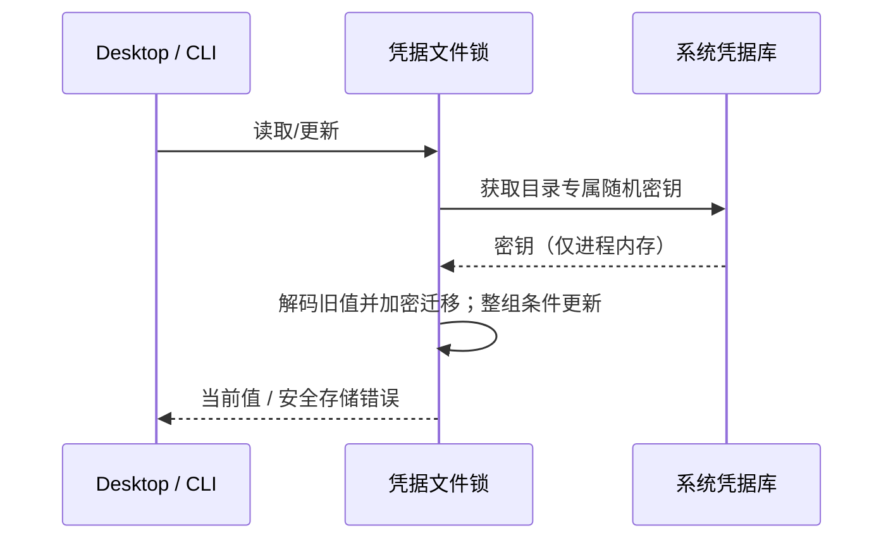

# 系统安全存储与凭据迁移

## 目标与范围

桌面端及共用同一凭据目录的 CLI 改用系统保护的随机加密密钥。覆盖
`credentials.json` 中的登录令牌、关联账号、手工保存的 API Key 与其他现有凭据。
保持账号切换、整组 CAS、跨进程文件锁和远端 Provisioning 契约。
本次不迁移网页 localStorage，不接管用户自行编辑的 MCP/环境变量配置，不部署。

## 存储合同

普通读取（Host `load`/`loadMany`、CLI `load`/`loadMany`/会话快照）不取得写锁，沿用[确认恢复合同](../ui/login-page.md#凭据容器损坏后的确认恢复)的读取前后代次校验。读到仍需迁移的旧格式值时，才进入带恢复代次屏障的写锁，重读并迁移一次；迁移写入与其他写入一样，代次变化即失败。所有写入、批量 CAS 与 `onDidMutate`（含 `recover`）都经同一屏障，旧请求不能回填恢复后的空库。

条件写入 `saveIfAbsent` 与条件删除 `deleteIfEquals` 同样使用当前文件的异步 cipher，并在凭据文件锁内读取和迁移。多个 Host 竞争匿名反馈凭据时只保留一个值；旧响应只允许删除自己用过且仍未变化的值。通知维持 `keys` 数组合同，不绕过 Main 的缓存失效链。

2026-11-02 staging 集成复核：旧方法未切换 cipher 时，真实服务运行时探针复现 `ReferenceError`；接入异步 cipher 后，8 个独立服务实例并发写入只得到一个值，旧明文保留并迁移，错误期望值不删除，匹配期望值才删除，变更通知均使用 `keys`。隔离目录与合成凭据证据在 `.e2e-artifacts/rebase-credential-runtime-20261102/`；不代表跨进程或原生系统库新增验收。 同次 CLI 凭据/访问生命周期/鉴权 57/57、相关工程 5/5、CLI 类型 34 任务和根/E2E 类型通过；根 lint 为 218 warnings、0 errors，架构检查通过。

### MR 评审修复边界

SSH/WSL 的按需进程和 R3 Core 不能依赖交互 shell 的 export。Server 入口共用一个
初始化 adapter：显式环境配置优先；否则在当前凭据目录已存在私有
`credential-secret` 文件时读取它（默认 `~/.zcode/v2/credential-secret`）。文件不存在
时，独立启动仍尝试系统库。Desktop 发起的远程启动先显式请求准备密钥（见下文）。无可用后端时，错误正文先说明远端文件名、
所属配置目录、32–4096 字节和重新连接操作，沿现有连接错误详情传递。
两条 Server 启动链使用同一 adapter；Desktop Main 不使用这个约定文件入口。

Desktop 的 R3 `serve --daemon --json --prepare-credentials`、安装/更新命令与兼容 stdio 入口显式请求
`prepareServerCredentialStorage`：只在没有显式密钥配置、没有约定密钥文件、没有 v2
密文时，为该远端数据根生成随机 32 字节密钥。准备过程按“凭据文件锁 → 密钥锁”的
统一顺序执行；完整写入 0600 临时文件后通过硬链接排他发布，已有文件绝不覆盖。
密钥由远端生成，内容不经过 Desktop、命令参数、环境变量或日志；仅保留在远端私有
文件。重复连接、并发启动、进程重启复用同一密钥。已有 v2 密文时不生成替代密钥，
系统库或原文件缺失仍按存储错误处理。独立 Server 和 Docker Web 启动保留显式配置规则。
更新命令必须在切换到新 Core 前准备，避免旧 daemon 尚在线时更新先于 ensureDaemon，
使候选 Core 因缺少密钥而启动失败；安装校验、运行任务保护和版本切换策略保持不变。

旧 v1 解码依次尝试原始显式密钥、trim 后密钥和历史默认派生密钥，以 GCM 认证成功
为准。因而旧默认密钥数据能在采用新随机文件后迁移，不需要退出或重新授权；这只是
v1 读取兼容，v2 永不尝试弱派生密钥。凭据迁移仍在已有文件锁内整组原子提交。

并发启动时，系统库已初始化但尚未写 v2 的窗口也需要固定来源。默认 cipher 在
keyring 锁内成功读取/创建系统密钥后，先原子写入私有 credential-source（仅保存 os），
再允许业务读写；远端准备在同一锁下检查该标记。已有 v2:os 数据也固定 OS 来源。
Server 与独立 CLI 复用同一默认解析器发现私有 credential-secret，不新增手工环境要求；
显式配置优先。不得将“本轮尚无 v2 数据”等同于“没有进程已经选定来源”。

### Server 更新与回滚

回滚不得把 v2 密文交给只能读取 v1 的旧 Core。新制品的 runtime/package.json 声明
zcodeCredentialFormat: 2；恢复旧 current 指针、应用旧制品、崩溃后恢复更新事务均检查
目标格式能力。已有 v2 而目标未声明支持时，保留 current、凭据和事务现场并报错，
不启动旧版、不把数据改回弱加密。不因更新失败清登录或重放 OAuth。

首次从旧 Supervisor 在线更新时，候选新 Core 由旧 owner 托管，若立刻迁移会先于
新回滚保护生效。新 Supervisor 在 fork Core 时显式传入内部环境标记
ZCODE_SERVER_CREDENTIAL_FORMAT=2；旧 owner 没有此标记时，候选
Core 暂时注入仅 v1 的兼容 cipher，不迁移且拒绝已有 v2，直到既有 handoff 重启为新
Supervisor 后再使用 v2。标记只属于进程装配，不是用户配置，不改变外部协议。
因此旧 owner 失败可安全回滚；新 owner 写入 v2 后只能回滚到支持 v2 的制品。
不依赖 update 事务文件是否仍存在来猜测 owner 能力，避免父进程退出或事务恢复与
候选 Core 初始化交错时误启用新格式。
兼容 cipher 也接受显式密钥文件和约定的私有 credential-secret；所有入口共享长度、
来源冲突和权限校验。旧 owner 阶段以认证已有 v1 的历史密钥继续写入，不能因发现
新随机文件就改变加密密钥；handoff 后才切换到随机密钥的 v2 格式。

本轮验证：55 项 CLI 凭据/登录回归、34 项打包检查通过。真实 Supervisor 配合合成
Core 子进程验证“写 v2 后失败拒绝不兼容回滚”“写 v2 后失败正常回滚到兼容版”及
“写 v1 后失败正常回滚”，三者原值均保留；另验证中断事务恢复同样拒绝不兼容版本。
真实编译后 Core 在旧 owner 环境能 ready，系统库被测试替身强制拒绝访问时仍不调用，
不会提前迁移 v2。R3/stdio 启动重启与独立 CLI 无环境配置冷读取、6 进程准备均通过。
这些是本地隔离与合成凭据证据，尚不代表真实 SSH/WSL/Linux 或完整旧发行包升级通过。

后续旧文件密钥补验：57 项凭据/登录回归通过，覆盖显式密钥文件、私有约定文件、
历史原字节密钥读写及随后 v2 迁移。真实编译 Core 在旧 owner 下读取文件加密的 v1
后 ready，未访问系统库、未提前写 v2；真实 Supervisor + 合成 Core 的文件密钥写入后
故障回滚也恢复成功，旧值仍可读。新随机文件与旧 fallback 并存时仍用历史密钥写 v1。
独立 CLI 的默认文件发现另以冷进程复验：两个显式密钥环境变量均为空，OS keyring 的
读写被测试替身设为失败，Server 写入的 v2 仍由 CLI 读回，OS 调用次数为零。该路径
在 createSystemCredentialCipher 的 keyring 锁内调用默认文件解析，不依赖 Server 缓存。

本轮自动准备验收：CLI 安全存储、访问生命周期和鉴权定向回归 52/52。新增断言覆盖
8 路并发准备、0600、旧默认 v1 身份及 revision 迁移、冷读取、原密钥/显式配置/v2 保留。
本地隔离进程通过真实 R3 transport → shell → 编译后 CLI → Supervisor/Core 启动与重启；
不设置密钥环境变量，旧身份仍可由新进程读取，密钥字节不变。兼容 stdio bundle 的
hello/ack、ready 和身份冷读取通过。更新入口在无效 archive 被拒前完成准备，身份保留；
6 个独立 Node 进程同时准备只留下同一完整密钥，没有临时文件。首次 R3 探针使用系统
长临时目录，触发 macOS socket 路径限制；改用短隔离目录后通过，不属于凭据故障。
根/CLI 类型、lint、架构和两个 Server 构建通过。未验证真实 SSH/WSL/Linux 容器、
完整在线版本切换或其他操作系统；不部署，也不操作真实账号与系统授权。

上一轮复评补验：约定文件、显式配置优先和非私有文件拒绝加入 CLI 回归，总计 50/50。
两个独立 Node 进程在没有密钥环境变量时读取同一约定文件并保持凭据；真实 Server
失败信息经过现有 R3 transport 和错误归一化后仍保留文件名和重连指引。
本地构建的 `zcode-server.cjs` 通过真实 hello/ack：显式缺失文件时退出并保留指引；
放置私有约定文件且不设置密钥环境变量时服务 ready。首轮探针误按 UTF-8 读取二进制
RPC 帧，修正探针为字节读取后通过，两轮测试进程及临时目录均已清理。
构建同时修复旧远端入口漏设 keyring external 的问题，避免展开各平台原生二进制；
远端构建和相关原生依赖/Docker 工程测试 6/6 通过。未在真实 SSH/WSL/Linux 容器执行。

- 独立 Server（未由 Desktop 请求准备密钥）在开放 HTTP/stdio 服务前初始化凭据后端。没有系统库时，管理员须显式
  提供 `ZCODE_CREDENTIAL_SECRET` 或 `ZCODE_CREDENTIAL_SECRET_FILE`；二者不可同时设置。
  文件是管理员管理的只读 secret，32–4096 字节，按原字节读取、不 trim，不自动生成或
  写入凭据目录。文件内容只留在 owner 内存，不注入子进程；子进程继承文件位置。
  Docker 启动脚本挂载该文件并传递文件位置；缺少配置时明确停止，不恢复弱密钥兜底。
- v1 读取兼容旧 Desktop 原字符串、旧 CLI trim 后的密钥及历史 fallback，包含首次
  采用随机文件的迁移。仅用 GCM 认证成功决定匹配，不改写 v2 语义或吞掉损坏记录。
- 凭据桥分别限制明文 UTF-8 字节与密文字符，密文上限包含 Base64 膨胀和格式开销。
  Main 必须校验输出，超限返回受控错误；接收端遇到可关联的非法回复必须拒绝对应
  Promise。失败也释放文件锁，不通过新增超时或重试掩盖协议错误。
- 回归覆盖：无系统库的 Server 配置与重启、Desktop/CLI 两种旧密钥、ASCII/多字节
  边界、大明文迁移、非法回复后的锁释放与后续读取。真实 Linux/Docker 另记运行证据。

修复验收：旧 Desktop/CLI 普通、首尾空白及全空白密钥迁移，受管文件初始化/重启，
ASCII/多字节 UTF-8 边界和凭据桥异常等 CLI 回归 48/48 通过。Docker 配置、stdio
脱敏工程回归 4/4 通过；另用独立 Node 进程先写入再冷启动读取受管密钥文件，值保持，
真实 `createServerHostServices` 在密钥文件缺失时于创建业务服务前拒绝启动。

真实 Main/Host 的 800,000 字符往返、超限拒绝后继续读写通过：
`desktop-e2e-20261029094653472-p31715-1d752244e7d33e0f`（1/1）。OAuth 取消、完成竞态、
区域切换、关联补齐及 Global 主体恢复回归通过：
`desktop-e2e-20261029094746951-p32839-f9a1b825dbb061ef`（7/7）。根类型、E2E 类型、
CLI 类型 34 项任务、根/CLI lint 与架构检查通过。新增断言仍为 pending。
本机没有 Docker 可执行文件，未验证真实 Linux 容器、Windows/Linux 系统库或部署；
未操作用户真实凭据、系统授权或正式应用。

- JSON 继续是凭据唯一容器，权限 0600；值使用 AES-256-GCM，随机 IV。
  格式为 `enc:v2:<os|env>:<key-fingerprint>:<iv>.<auth-tag>.<ciphertext>`。
- 默认密钥为随机 32 字节，保存在系统凭据库，文件仅保存密文与密钥指纹。
  macOS 使用 Keychain，Windows 使用 Credential Manager，Linux 明确指定
  Secret Service（GNOME Keyring/KWallet 等），不允许自动回退至易失内核 keyring。
  Desktop（全平台）在系统库不可用时，按下文“Desktop 私有文件密钥回退与自动重置”
  改用私有文件密钥；独立 CLI、Server 等其他进程不变。
- 同一规范化凭据路径对应一个系统凭据条目；开发、正式、测试目录相互隔离。
  创建密钥复用跨进程锁，首次并发启动不得产生互不兼容的密钥。
- 保留既有 `ZCODE_CREDENTIAL_SECRET`，作为明确配置的无桌面/受管环境密钥来源；
  不自动生成弱密钥、不把密钥写到普通配置/日志/环境变量。Desktop 请求的远端随机密钥
  仅保存在上述私有专用文件，不为子进程注入主密钥。
- 读取旧明文和 `enc:v1` 使用既有解码规则；正常读取时在文件锁内迁移可读旧记录。
  历史损坏条目原样保留给既有按用途恢复机制；不得因一个闲置旧字段阻断全部身份。
- 新密文带版本、来源和密钥指纹。系统库锁定、不可用、密钥丢失或指纹不匹配
  属于存储错误，不是登录过期；不生成替代密钥来解密。唯一例外是 Desktop Main 的
  自动重置：备份后清空凭据库并解除来源绑定，见下文。
- 同一进程中，同一规范化凭据路径的默认系统密钥加载由一个 Promise 负责；
  Desktop 的 Host 与内置 CLI 委托 Main，独立 CLI/服务器复用各自进程的结果。
  仅复用系统密钥，不缓存凭据文件或 OAuth 会话，跨进程整组更新仍实时读取。
  缓存的密钥属于加载时的恢复代次（`credentials.json.recovery-generation`）：命中缓存时
  代次已变化，就丢弃缓存并在 keyring 锁内重新加载。自动重置与损坏恢复都会推进代次，
  其他进程因此不会继续使用重置前的密钥。
- 系统库访问失败也保留在本次进程中，后续后台读取不再触发系统授权；用户解锁后
  重启应用/CLI 重试。独立程序的首次授权仍由系统管理，不修改 Keychain ACL。
  未取得 keyring 锁的失败（如另一进程等待系统授权超过锁等待上限）尚未访问系统库，
  不保留；下一次请求重新等待锁。Desktop 满足回退条件时不缓存失败，本次请求直接
  得到私有文件密钥；自动重置完成后清除该路径的失败缓存。
- 正常登出仍删除对应令牌，保留随机密钥供同一目录的后续登录使用。
- 旧版本不能读取新密文，升级不承诺降级或新旧版本同时写入安全；不能双写旧密文。



### Desktop 私有文件密钥回退与自动重置（2026-11-12，2026-11-16 扩展）

背景：

- 2026-11-12（Linux）：Secret Service 不是系统必备组件。没有 keyring 服务、D-Bus 不可达、
  keyring 未随登录解锁且用户取消解锁框时，Main 取不到系统密钥。失败缓存到进程退出，
  Host 全部凭据读写失败；界面只显示未登录或“登录失败，请重试”，重新登录、删除
  `credentials.json` 都不能恢复。
- 2026-11-16（全平台）：macOS、Windows 也有大量用户因系统钥匙串问题登录失败。例如
  Windows Credential Manager 已满时 `CredWrite` 返回 `ERROR_NOT_ENOUGH_MEMORY`；macOS
  升级后签名变化弹出授权框被拒绝、登录钥匙串被锁或与登录密码不同步。原回退只在 Linux
  开启，且只处理未绑定来源的目录；已绑定 `os` 的目录拿不到密钥时，旧密文只能用原密钥
  解开，用户手动删除凭据前一直无法登录。

开启范围：

- 只有 Desktop Main 开启，macOS、Windows、Linux 相同。开启必须早于本进程首次访问凭据；
  已有加载结果后再开启不生效，由调用方记录 warn，避免同一进程出现两种来源规则。
- Host、内置 CLI 经凭据桥委托 Main，跟随同一决策。独立 CLI、Server、Docker Web 与远端
  准备不开启，继续执行上文的显式配置规则。

```text
Main.getKey 失败（keyring 锁内）
  ├─ 目录未绑定来源 ─▶ 回退：排他发布 credential-secret ─▶ 本次返回文件密钥（不缓存失败）
  └─ 目录已绑定来源 ─▶ 失败缓存，本次请求报存储错误
        └─ stage 属于触发表 ─▶ Main 后台自动重置（凭据文件锁 → keyring 锁）
              复核 → 备份 → 推进恢复代次 → 写空库 → 解除绑定 → 清除失败缓存
              └─ 用户看到未登录 ─▶ 重新登录 ─▶ getKey 重新解析：系统库可用则重建系统密钥，
                                                      仍失败则走上面的回退
```

#### 未绑定目录：回退到私有文件

- 回退只在 keyring 锁内、访问系统库这一步失败时发生，并且同时满足：没有显式密钥
  配置，没有 `credential-source`，`credentials.json` 中没有任何 `enc:v2:` 密文，没有
  私有 `credential-secret`，当前请求允许创建密钥。即目录尚未绑定任何来源，没有数据依赖
  系统密钥。
- 回退复用远端准备的发布方式：在同一目录完整写入 0600 临时文件，硬链接排他发布为
  `credential-secret`，已有文件绝不覆盖。之后按既有发现规则读取该文件，
  写入 `enc:v2:env:`；旧 `enc:v1` 与明文仍按既有规则在文件锁内迁移，不需要重新授权。
- 之后任何进程（Desktop、独立 CLI）在 keyring 锁内先发现该文件，不再访问系统库，
  不再弹出解锁或授权框。来源只绑定一次：系统库以后恢复正常，也不迁回系统库。
- 一次失败就回退，不区分“用户取消授权”和“系统故障”：各平台错误码不统一，区分会
  脆弱且复杂。
- Main 发生回退时记录一条 warn，附带触发回退的诊断，不记录密钥、路径内容或原生错误正文。
  界面不提示。

#### 已绑定目录：自动重置

已绑定指 `credential-source` 为 `os`，或文件中已有 `enc:v2:` 密文。这类目录不能直接切换
来源：已有密文离开原密钥无法解开。Main 的默认密钥加载失败、失败已缓存且诊断 `stage`
属于下表时，Main 自动重置该目录，不等待用户确认，不提示用户。

| stage     | 含义                                                                              | 典型场景                                                                                                                                                         |
| --------- | --------------------------------------------------------------------------------- | ---------------------------------------------------------------------------------------------------------------------------------------------------------------- |
| `read`    | 已绑定 `os`，创建系统库条目对象或读条目报错                                       | macOS 授权框被拒绝、钥匙串被锁且取消解锁、登录钥匙串密码不同步；Windows 凭据服务异常；Linux 没有 D-Bus 或 Secret Service（原生模块已加载，创建条目对象时即失败） |
| `missing` | 已绑定 `os`，系统库中没有该条目                                                   | 重置了登录钥匙串、条目被清理、只拷贝 `~/.zcode` 到新电脑、用户目录路径变化（条目名由凭据文件绝对路径决定）                                                       |
| `invalid` | 条目内容不是合法的 32 字节密钥                                                    | 条目被其他程序覆盖或损坏                                                                                                                                         |
| `managed` | 私有 `credential-secret` 缺失（已有 `enc:v2:env:`）、权限过宽、大小不对或读取失败 | 文件被手动清理、同步工具只同步了 `credentials.json`、从备份恢复后权限变成 0644                                                                                   |

不触发，维持存储错误：

- `load`（原生 keyring 模块加载失败，仅指 import 失败）：打包回归会让同一版本的所有升级
  用户同时命中，自动重置会变成大面积数据丢失；重装即可恢复，数据未损坏。模块已加载、
  创建条目对象失败属于系统库不可用，归 `read`。
- `lock`：暂时性故障，未缓存，下一次请求重新等待锁。
- `config`：用户显式配置的密钥有误，应由用户修改配置。
- `file`、`source`：凭据文件或来源标记的 IO 错误，不是密钥问题，清空也无法写入。
- `create`、`verify`、`pin`、`fallback`：只出现在未绑定目录，走回退。

执行规则：

- Main 在后台执行，不在失败的请求里执行。请求可能来自正持有凭据文件锁的 Host，
  在 getKey 内取文件锁会互相等待。失败的请求照常返回存储错误；重置在锁持有者释放后
  进行。不加定时器或重试：重置失败只记录 warn，失败缓存保持，下次启动再尝试。
- 锁序与其他写入相同：凭据文件锁 → keyring 锁。两把锁内依次：
  1. 复核缓存中仍是触发本次重置的同一次失败；不是则放弃。多个请求共享同一次失败，
     因此只重置一次。
  2. 复核目录状态：`read`、`missing`、`invalid` 要求仍绑定 `os`；`managed` 时文件含
     `enc:v2:env:` 才清空库，没有 v2 数据（只有一个坏的私有文件）时只移走该文件，
     不清空。不满足则放弃。
  3. 需要清空时：把原 `credentials.json` 备份为独立文件并回读校验。每次重置都推进恢复
     代次，使所有跨进程旧读写与旧密钥缓存作废（凭据文件不存在、只解除绑定时也推进）；
     需要清空时再写入空库。
  4. 删除 `credential-source`；`managed` 时把坏的 `credential-secret` 改名为备份。否则下次
     getKey 仍先发现它，形成“清空 → 失败 → 再清空”的循环。
  5. 清除该路径的失败缓存。
  6. 记录一条 info：`stage`、`errorCode`、`osCode`、平台、备份路径、清空的条目数；
     不记录键名、值或密钥。
- 清除范围：`credentials.json` 中的全部条目，包括 ZCode 登录、模型供应商 API Key、
  MCP OAuth、Bot、远端连接密码与 Server token、relay 设备认证等。会话、项目、设置以及
  模型与 MCP 的配置本身不受影响。界面不提示，用户看到未登录后重新登录、重新配置。
- 备份永久保留，不自动清理。备份仍由旧密钥加密：钥匙串以后恢复，或我方代码变更导致
  条目名变化（全体用户命中 `missing`）时，后续版本仍可从备份恢复。系统库中的旧条目
  不删除。
- 重置后来源重新解析，不固定为文件：`missing` 场景下系统库若可用，会重新建立系统密钥。
- 重置后不会反复清空，除非新的密钥再次丢失（例如回退产生的 `credential-secret` 又被删除）。

#### 写入新的 os 密文前必须已固定 os

过期缓存会破坏上述“只清空一次”：同目录的独立 CLI 在重置前已从系统库取得密钥，并缓存
到进程退出；重置删除 `credential-source` 后，它仍可能写入 `enc:v2:os:`。按来源规则，文件
含 `enc:v2:os:` 时 getKey 优先使用系统库，Desktop 下次启动又会失败并再次清空。

规则：写入方在凭据文件锁内、写盘前检查。本次新产生的 `enc:v2:os:` 密文（磁盘上的当前
记录中没有该值）要求 `credential-source` 为 `os`；否则拒绝本次写入，返回存储错误，不写盘。
合法写入总是满足：getKey 成功取得系统密钥时，先在 keyring 锁内写 `credential-source`，
再返回密钥。重置推进了恢复代次，该进程下一次请求复核代次后按文件规则重新解析来源。

只检查标记还不够：`missing` 重置后重新登录会建立新系统密钥并再次固定 `os`，用旧密钥
产生的密文仍能通过标记检查，保存显示成功，冷启动后却无法解密（会覆盖刚保存的新登录）。
旧密文有两个来源，分别处理：

- 旧缓存：进程在重置后才发起请求，仍用缓存的旧密钥加密。命中缓存时的代次复核（见上文
  “同一进程中……”）让它换用当前密钥。
- 在途请求：加密在重置前完成，写盘在重置后。Desktop Host 与内置 CLI 经凭据桥由 Main 加密，
  再在自己的进程写盘，单看“加密时密钥是否最新”无法发现。规则：先加密后写盘的写请求
  （Host 凭据服务的 `save`、`updateMany`、`deleteUnreadable`，CLI 共享存储的 `updateMany`、
  `saveReplacing`）在加密前领取恢复代次，由凭据文件锁内的代次屏障一直保护到写盘；代次
  变化即以 `ZCODE_CREDENTIAL_STORE_CHANGED` 拒绝且不写盘，调用方按当前存储重试，重试时
  缓存复核换用当前密钥。已在登录等流程的代次作用域内时沿用外层代次。锁内加密（迁移、
  OAuth 会话修订号）无需提前领取：重置也要取同一把锁，二者不会交错。
  领取的代次作用域只覆盖加密与锁内写盘；提交后的变更通知在作用域外执行，监听启动的后台
  任务（如 CLI 账号刷新）按自己开始时的当前代次领取，不沿用这次写请求的代次。

依据：代次每次推进都是新的随机值，不会回到旧值。锁内代次仍等于请求开始时领取的值，说明
期间没有重置；加密时复核过的缓存密钥因此属于当前代次。规则只依赖磁盘上的代次文件，与加密
发生在哪个进程无关。代价：写请求跨越任何代次变化（包括损坏恢复）都会被拒绝一次，与恢复
使在途读写作废的既有语义一致。

```text
Host（写入方）           Main（加密方）                    重置
领取代次 g1 ──▶ encrypt ──▶ 缓存 K1(g1) 复核通过 ──▶ 返回 K1 密文
                                                  missing → 重置(g1→g2) → 登录建 K2(g2)
取文件锁 ──▶ 校验 g1 ≠ g2 ──▶ 存储已变化，不写盘 ──▶ 重试：领取 g2 → Main 复核丢弃 K1 → K2
```

- 磁盘上已有的值不检查：标记出现前的旧版本可能留下没有标记的 `enc:v2:os:`；其他写入方
  整组重写时不能因此失败。
- `enc:v2:env:` 不检查：同机 Server 配置显式密钥时，允许在已固定 `os` 的共享库中写入
  env 密文（见“同机共用数据根”）。
- Host 凭据服务与 CLI 共享凭据存储都执行来源标记检查，由共享模块统一实现。

#### 同机 Server 共用凭据库

| 重置时的状态                                                                                                                                                                                                          | 结果                                                                                                                                                                     |
| --------------------------------------------------------------------------------------------------------------------------------------------------------------------------------------------------------------------- | ------------------------------------------------------------------------------------------------------------------------------------------------------------------------ |
| 共享库已固定 `os`（`read`/`missing`/`invalid`），Server 无显式密钥                                                                                                                                                    | Server 已改用自有目录，且不回退；重置不影响 Server                                                                                                                       |
| 未绑定，Desktop 回退产生 `credential-secret`                                                                                                                                                                          | Server 下次准备时看到未固定 `os`，共用同一文件密钥                                                                                                                       |
| 共享库为 `env`，Server 共用中，`credential-secret` 缺失或损坏（`managed`）                                                                                                                                            | 已知限制：Desktop 重置并重新登录后可能固定为 `os`；运行中的 Server Core 启动时已选定共享库，读不了 `os`，直到下一次准备创建自有目录并重启 Core                           |
| Server 配置显式密钥并共用库：未绑定时写入 `enc:v2:env:` 且不发布 `credential-secret`（Desktop 命中 `managed`）；或已固定 `os` 且已有 `enc:v2:env:`（上文例外，Desktop 系统条目丢失时命中 `read`/`missing`/`invalid`） | 已知代价：重置清空整个共享库，包括 Server 用显式密钥可以正常读取的凭据；备份保留，不提供恢复入口。allowlist 凭据在下一次连接时由 Provider 下发重新写入，其余需要重新配置 |

第三种情况下 Server 在重置前本来就不可用，自动重置不会让它更糟。第四种情况下 Server
在重置前可用，重置会让它丢失凭据。原因：env 密文不记录属于哪把密钥，Desktop 无法区分
“依赖已丢失私有文件的数据”与“同机 Server 显式密钥写入的数据”。接受这个代价，换取
Desktop 自动恢复登录；修改前 Desktop 在这两种状态下一直无法登录。不额外增加 Desktop
到 Server 的通知链路。

#### 安全取舍与未覆盖

- 私有文件只限当前系统用户读取（Windows 依赖用户目录的 NTFS ACL，0600 不生效），与远端
  Server 的文件密钥相同。macOS Keychain 按应用授权，同一用户的其他程序默认读不到；改用
  文件后保护明显减弱。Windows Credential Manager（DPAPI）与 Linux Secret Service 对同一
  用户进程的保护差距较小。系统库正常的用户不受影响。
- 自动重置的代价：钥匙串只是暂时被锁或误点“拒绝”的用户，也会清空全部凭据；同机 Server
  用显式密钥共用凭据库时，其可读凭据也被清空（见上表第四种情况）。
- 已固定系统库且 keyring 每次开机都不自动解锁的 Linux 用户仍会看到解锁框，取消即触发
  自动重置；强制升级检查在主窗口创建前读取凭据，等待解锁框期间没有主窗口。

验证：CLI 凭据回归覆盖回退、旧 v1 迁移、显式配置优先、系统库正常不变、并发首次回退收敛为
同一密钥、未开启时 Server 规则不变；自动重置的各触发 stage、不触发 stage、并发失败只重置
一次、`managed` 移走私有文件后不循环、复核失败放弃、新 os 密文写入检查与旧值放行、
重置后旧进程换用新系统密钥与旧代次密文被拒绝、创建条目对象失败按 `read` 重置。
桌面 E2E（SCS-AR01）在 macOS 真实钥匙串上删除隔离条目，验证 `missing` 自动重置、重新保存与冷启动。
真实 Windows Credential Manager 故障、macOS 签名变化后的授权拒绝和 Linux 各故障形态
无法在本机复现，需在预览环境另行验收。

2026-11-16 验收（本地，未部署）：CLI 回退/重置/写入检查 21/21（实现前新增 9 条失败），凭据相关
7 个文件 118/118；MCP OAuth 跨进程 4/4、bootstrap 登录 24/24（首轮失败源于同步后未重建的
`@zcode/contracts`、adapters 产物，重建后通过）。SCS-AR01 macOS 1/1：
`desktop-e2e-20261116084638225-p37302-e602acf0986e28f3`，Main 日志记录 `stage: missing` 后 12ms
完成重置。现有真实钥匙串用例 `system-credential-storage`、`system-credential-data-root` 回归 2/2：
`desktop-e2e-20261116084952759-p55807-5b51c1e1228445da`。根/CLI 类型、lint 与架构检查通过。

### 密钥加载失败诊断（2026-11-13）

背景：3.18.2 的 Windows 用户反馈一直登录失败。日志只有统一的
“System credential storage is unavailable”。用户机器上 keyring 模块、读写和文件层都
正常，原因很可能是 Credential Manager 已满，`CredWrite` 返回
`ERROR_NOT_ENOUGH_MEMORY`。日志无法区分模块加载、系统库读、写、读回校验、来源标记与
文件读写，排查用了多轮用户侧探针。

规则：

- 默认密钥加载在每个失败点生成受控诊断，挂在 `CREDENTIAL_SECURE_STORAGE_UNAVAILABLE`
  错误的 `diagnostic` 字段：
  - `stage`：`config`、`source`、`file`、`managed`、`load`、`read`、`create`、
    `verify`、`missing`、`invalid`、`pin`、`fallback`、`lock` 之一，对应显式配置、
    来源标记、凭据文件、私有密钥文件、加载原生模块、读条目、写条目、写后读回、
    已绑定来源但条目缺失、条目格式、写来源标记、发布回退文件、取得 keyring 锁。
  - 未取得 keyring 锁的失败（如锁超时）保持原错误不变，调用方仍按锁超时错误码判断；
    只把 `stage: "lock"` 交给观察者。
  - `errorCode`：Node.js 错误码（如 `ENOENT`、`EPERM`），只取符合大写错误码格式的值。
  - `osCode`：系统错误号，只从 keyring 原生错误中 “Windows error code N”或
    “os error N”这类固定格式提取数字（如 Windows `8` = `ERROR_NOT_ENOUGH_MEMORY`）。
  - 诊断不含密钥、凭据值、路径或原生错误正文。
- 进程级观察入口 `observeCredentialKeyFailures(observer)` 在一次默认密钥加载失败时调用
  一次，与失败缓存同一时机。缓存命中的后续请求不再调用，日志不随请求量增长。显式
  KeyStore 注入不调用（测试与远端准备自行处理）。观察者异常不影响凭据结果。
- Desktop Main 在首次访问凭据前注册观察者，在所有平台记录一条 warn：
  `[credential] 系统凭据库密钥加载失败 {stage, errorCode, osCode}`。Host、内置 CLI 经
  凭据桥委托 Main，失败只在 Main 记录一次。
- Desktop 私有文件回退的 `onFallback` 同样收到触发回退的诊断，Main 的回退 warn 附带它。
- 凭据桥、RPC 与 Renderer 的错误码与文案不变；诊断不跨进程传输，不改协议。

```text
getKey（keyring 锁内）→ 某一步失败 → unavailable({stage, errorCode, osCode})
  → 失败缓存（进程内一次）→ 观察者 → Main warn 一行
  → 调用方仍收到 CREDENTIAL_SECURE_STORAGE_UNAVAILABLE（行为不变）
```

验证：CLI 凭据回归覆盖写入失败、读取失败、读回不一致、条目缺失、条目格式错误、
来源标记非法、凭据文件不可读、显式配置冲突各自的 stage，Windows 原生错误号提取（数字与
名称两种格式），失败只通知一次，观察者异常隔离，Linux 回退带原因，以及诊断不含密钥与
路径。锁超时需等待 8 秒，未加自动化用例，由代码结构保证。

### 数据存储路径切换（2026-11-12）

问题（ZCT-2120723935487688704，3.18.0 起）：系统条目按凭据文件的规范化路径区分。
设置页「数据存储路径」只复制 `.zcode/v2`，`credentials.json` 和 `credential-source`
到了新根，新路径却没有系统条目。新根启动后按“密钥丢失”处理：解不开原凭据；
来源已固定为 os，也不能生成新密钥。用户表现为掉登录，且在新根上无法重新登录。
托管密钥与路径无关，或随目录复制 `credential-secret`，不受影响。

同一问题的另一种形态：源目录已固定为 os（`credential-source` 存在且条目存在），
但 `credentials.json` 没有 os 密文。可达路径：只用过 API Key 等凭据、从未 OAuth 登录，
之后删光凭据（普通删除不写 revision）；独立 CLI `zcode auth login` 授权前的写入探针
建了密钥后中止；确认“恢复凭据存储”后文件变为 `{}`。复制把 `credential-source`
带到新根，新根没有条目，同样不能生成新密钥，重新登录失败。OAuth 登出会写入新的
session revision 密文，不属于这种形态。

合同：

- 切换数据根是凭据迁移的一部分。复制到目标的东西依赖哪把系统密钥，这把密钥就要
  登记到目标路径的系统条目：os 密文依赖生成它的密钥；`credential-source=os` 依赖
  目标路径存在条目，否则不能生成新密钥。登记在保存新路径之前完成。
- 顺序：Host 复制 `.zcode/v2` → Host 经私有父子通道请求 Main 登记，只传目标数据根
  → Main 按固定布局推导 `{目标根}/.zcode/v2/credentials.json`，用自己绑定目录的
  密钥登记 → 成功后 Host 才写 `setting.json.dataBaseDir`。登记失败则整个切换失败，
  路径不变，界面沿用“数据复制失败，路径未更改”。
- 只在有证据时处理，按目标文件判断：
  - 目标的 os 密文只有一个指纹，且该指纹也出现在源文件：目标条目必须是这把密钥。
  - 目标没有 os 密文，但目标和源的 `credential-source` 都是 os：目标条目只需存在且
    格式合法；任何一把都能供之后的首次写入使用。
  - 其他情况不访问系统库，也不加载本目录密钥：从未建过密钥（没有 `credential-source`）
    的目录、托管密钥、目标已有自有凭据被保留、源未固定 os 而目标自带标记。
    最后一种标记不是本次复制带来的，保持原行为。
- 先看目标条目。目标条目已满足上面的要求：直接成功，不写，也不加载本目录密钥。
- 否则加载本目录密钥：不可用时拒绝；来源不是 os，或与目标密文指纹不同时跳过。
  目标条目不存在时写入并回读校验；目标条目是另一把密钥时拒绝，不覆盖。
- 这是“Host 不能传任意目录”的唯一例外。Host 只能请求 Main 把 Main 当前的密钥写到
  目标数据根；不能读取密钥，也不能用目标目录加解密。通用加解密桥不变，
  App-managed CLI 不能触发登记。
- 原凭据目录、原系统条目和既有复制语义（只复制、不覆盖目标已有文件）不变。
- 已受影响的目录不会自动修复：先切回原路径，再切换到目标路径一次即可登记。
  切回时 Main 绑定的受影响目录没有条目，但原路径条目仍能解开原路径密文，
  按“先看目标条目”直接成功；不能因为本目录密钥缺失而拒绝。受影响目录直接切到
  没有条目的新目录时，没有可登记的密钥，仍然拒绝。

```text
设置页保存 → Host.updateDataBaseDir → 复制 .zcode/v2
  → Host ⇢ Main：CredentialKeyShareRequest{ requestId, targetBaseDir }
     Main：读源/目标的 os 指纹与 credential-source → 判定要求（指定密钥 / 任意条目 / 不处理）
           → 目标条目已满足则成功
           → 否则加载本目录密钥（不可用则拒绝）→ 目标 keyring 锁内 写入 / 跳过 / 拒绝
  ← 成功：写 setting.json → 重启后 Main 绑定新路径，条目已存在
  ← 失败：抛错，setting.json 不变
```

验证（2026-11-12，macOS arm64 本机）：

- CLI 回归 `apps/zcode-cli/packages/adapters/tests/credential-security.test.ts` 新增 6 项，先红后绿：
  登记后新根可读可写且重复登记不再写入；从未建过密钥、托管密钥、目标自有凭据三种情况
  不访问任何系统条目，且空目录之后仍能首次登录；目标已有另一把密钥时拒绝且不覆盖；
  目标写入失败时源目录仍可读写。
- 原生 pending E2E `system-credential-data-root.test.ts`（SCS-DR01）通过：
  `desktop-e2e-20261112045322400-p11467-319ab851ac3b0783`；运行日志显示
  `[credential-key-share] completed` 位于复制与“data directory copy done”之间。
  临时去掉登记调用的对照运行在“新根系统条目存在”断言失败：
  `desktop-e2e-20261112045639884-p32108-f3cce587acd337df`。两次运行的临时系统条目均已清理。
- 托管密钥下的设置页切换回归 CDD01 通过：`desktop-e2e-20261112045831459-p40802-32a82093e374b186`。
- 未验证：Windows Credential Manager 与 Linux Secret Service 原生实测、签名包。
- 评审修复（2026-11-12）：CLI 回归新增“已受影响的根切回原路径”，先红后绿：修复前
  `shareKeyWithCopiedCredentials` 先加载受影响根的密钥而拒绝；修复后先看目标条目，
  直接成功且不写入。补救用的原生 E2E 未新增，原有 SCS-DR01 未重跑。
- 评审修复（2026-11-12，只复制了 `credential-source`）：CLI 回归新增 4 项。“只复制标记时
  登记源密钥、新根可重新登录”和“源密钥不可用时拒绝”先红后绿；“目标已有条目时不加载
  源密钥”和“源从未建过密钥、目标自带标记时不访问任何系统条目”作为回归保护。真实
  `credentialService`、`copyDataDirectory` 与 CLI 共享凭据库的运行时场景（系统库为内存
  替身）：删光 API Key、CLI 登录探针后中止、恢复凭据存储后三条路径修复前新根登录报
  `CREDENTIAL_SECURE_STORAGE_UNAVAILABLE`，修复后可登录；有密文、OAuth 登出、从未建过
  密钥三种情况行为不变。托管密钥下的设置页切换 CDD01 复跑通过：
  `desktop-e2e-20261112053702150-p94034-3089b3f2426e722c`，日志有
  `[credential-key-share] completed`、没有 failed。原生系统库 E2E（SCS-DR01）未重跑，
  Windows/Linux 未实测。

### 同机共用数据根：Server 自有凭据库（2026-11-11）

来源：ZCT-2120452663971209216。Source Server 的数据根由 `~/.zcode/server` 推出为 HOME，
与同一台机器、同一用户的 Desktop 共用 `~/.zcode/v2/credentials.json`。Desktop 先把该库
固定为 OS 来源后，Server 进程拿不到 Desktop 的系统密钥：旧 owner 下的候选 Core 按兼容
规则拒绝已有 v2，在线更新失败并回滚；新 owner 下的 Core 只能从 SSH/后台进程访问
Desktop 创建的系统库条目，同样不可用。只放开候选 Core 也不行：handoff 失败后，回滚
保护看到共享库中的 v2，拒绝回到旧版本，daemon 停止（隔离探针已复现）。

- 冲突判定：共享目录的 `credential-source` 为 `os`，或共享文件含 `enc:v2:os:`。只在
  Desktop 发起的准备命令（`serve`/`update --prepare-credentials`）中判定；判定与原有
  密钥准备在同一组共享锁（凭据文件锁 → 密钥锁）内完成，Desktop 不能在中间固定来源。
- 例外：Server 配置了显式密钥（`ZCODE_CREDENTIAL_SECRET` / `ZCODE_CREDENTIAL_SECRET_FILE`），
  且共享文件已含 `enc:v2:env:` 时，保持共享库。显式密钥优先于 OS 标记，Server 能读这些条目，
  切到空库会让非 allowlist 凭据失效；共享库已有 v2 说明主机已运行 ≥3.18 的 owner，
  回滚保护不允许退回旧 owner，不存在旧候选 Core 拒绝 v2 的问题。
- 冲突时创建 Server 自有凭据目录 `<server-root>/credentials/`（0700），其中总有
  `credential-secret`（显式密钥主机也发布，显式密钥优先，去掉显式配置后也不会落到系统库）。
  之后 Server 只读写 `<server-root>/credentials/credentials.json`，不读、不写、不迁移、
  不删除共享库，也不访问系统库。不冲突时保持原行为。
- 目录与密钥原子发布：先在同级临时目录 `credentials.<pid>.<随机>.tmp` 中发布
  `credential-secret`，再 rename 为 `credentials/`。因此“目录存在”蕴含“密钥就绪”；
  准备中断只留下临时目录，Core 不读取它，下次准备重新判定。若先建目录再发布密钥，中断后
  由服务（`serve --daemon`，不带准备参数）拉起的 Core 会选中无密钥的自有库，在系统库可用时
  创建 OS 密钥并固定来源，之后的准备不再生成文件密钥。
- 判定结果以该目录是否存在为唯一事实，创建后不回退。Core 每次启动只读取该事实，不创建
  目录或密钥：目录存在时把文件路径写入进程环境 `ZCODE_CREDENTIALS_FILE`，否则清除该变量。
  只有 `ENOENT` 表示不存在；权限、I/O 错误或该路径不是目录时启动失败，不改选共享库。
  Core 内的凭据服务、Provisioning、兼容 cipher，以及 Core 拉起的 Agent，都按该变量解析
  凭据文件。该变量是进程装配，不是用户配置，Desktop 不设置。
- Desktop 不采用该变量：Desktop Main 在启动最早阶段删除从启动环境继承的
  `ZCODE_CREDENTIALS_FILE`。Main 的系统 cipher、Host 的凭据服务与 Provisioning、
  Desktop 拉起的 Agent 因此都只使用 Desktop 数据根下的 `credentials.json`。否则从设置了
  该变量的 shell 或 `launchctl` 环境启动的 Desktop 会整体改用外部指定的凭据库。
- 兼容 cipher 与回滚保护语义不变。旧 owner 下的候选 Core 运行在 Server 自有库上，该库
  没有 v2，候选可以 ready；handoff 后使用自有 `credential-secret` 写 `v2:env`。
  `assertCredentialCompatibility` 仍检查共享库：旧 release 只读共享库，已有 Desktop v2
  时继续拒绝回滚到不支持 v2 的版本。
- 首次隔离时 Server 自有库为空。allowlist 凭据在下一次连接时由 Provider 下发重新写入。
  隔离只发生在 Server 读不到共享库的主机：Desktop 的 `v2:os` 条目对 Server 不可读，
  显式密钥可读的 `v2:env` 主机按上方例外保持共享库；共享库字节保持不变。
- 不在范围内：不改变 Desktop 的密钥来源，不改变无冲突主机；兼容 stdio 入口没有 server
  root，继续使用共享库；≤3.18.0 的旧 Core 在升级前仍运行在共享库上，升级后结束。

```text
Desktop 准备命令（持共享凭据文件锁 → 密钥锁）
  ├─ 已固定 os（显式密钥且已有 v2:env 除外）
  │    ─▶ 临时目录内发布 credential-secret ─▶ rename 为 <server-root>/credentials/
  └─ 未固定 ───▶ 原逻辑：准备 ~/.zcode/v2/credential-secret
Core 启动（只读判定；非 ENOENT 错误或非目录直接失败）
  ├─ <server-root>/credentials/ 存在 ─▶ ZCODE_CREDENTIALS_FILE=<server-root>/credentials/credentials.json
  └─ 不存在 ─────────────────────────▶ 清除变量，使用 ~/.zcode/v2/credentials.json
       └─ Agent 子进程继承同一变量，与 Core 读写同一文件
```

验证（2026-11-11，本地未部署）：

- 真实发布包矩阵（darwin-arm64，隔离 HOME，fallback 启动，不注册 launchd）27/27 通过：
  干净 3.17.2 在线升级、共享库已固定 os 的 3.17.2 在线升级（原工单路径）、离线首装后启动、
  已有 3.18.0 文件密钥主机升级、restart 与重复准备保持同一判定、handoff 失败时回滚保护不变。
  Core 内的变量经 CDP 读取进程内值并核对 pid。对照组用同一断言跑未修复的 3.18.0：在线升级报
  `Server Core failed while applying update`，离线首装报 `Remote credential storage unavailable`。
- 本机 Docker Linux SSH：新增 pending
  `conversation-session-ssh-remote-shared-desktop-credentials` 通过
  （`local-docker-20261111153313-7c08ce`）：共享库字节不变，自有目录 700、密钥 600，
  Provisioning 以 `enc:v2:env:` 写入自有库；回复延迟窗口内 Agent（进程标题 `zcode-cli`）
  及其插件子进程的 `ZCODE_CREDENTIALS_FILE` 均指向自有文件。远端 Agent 在回合结束后退出，
  只能在运行窗口内观测。回归 `ssh-remote-provisioning-ready`（`local-docker-20261111153529-641953`）、
  `ssh-remote-server-fault`（`local-docker-20261111153738-5688d6`）、
  `remote-install-progress`（`local-docker-20261111154154-6f5298`）通过；
  `r3-install-faults` 需要双 SSH 目标，本机 runner 未提供，未执行。
- CLI 路径解析新增 5 条回归；adapters 凭据/MCP OAuth 177 项、bootstrap 调用方 48 项通过。
- 桌面本机路径（Main cipher 与 Host 凭据服务改用同一解析入口，未设置变量时路径不变）：
  `oauth-provisioning` 5/5、`oauth-credential-recovery` 3/3
  （`desktop-e2e-20261111154435847-p44762-3719331611725e70`）；pending `system-credential-storage`、
  `system-credential-owner` 2/2（`desktop-e2e-20261111154746936-p57806-da1856580749aa39`）。
- Desktop 忽略继承变量（2026-11-16）：按 Main 入口顺序执行早期 bootstrap 后读取解析结果。设置
  `ZCODE_CREDENTIALS_FILE=/tmp/server/credentials.json` 时，修复前解析为该路径，修复后变量已删除，
  解析为 `{HOME}/.zcode/v2/credentials.json`；未设置时结果不变。未启动完整 Desktop 检查 Host 进程环境。
- 未验证：真实 macOS 经 SSH 连接装有 Desktop 的 Mac、Windows 远端、systemd/launchd 服务模式。

评审修复验证（2026-11-16，本地未部署）：

- CLI adapters `server-credential-file.test.ts` 6 条：修复前 5 条失败。分别覆盖：发布失败后
  不暴露无密钥目录、Core 不访问系统库、重试后密钥稳定；显式密钥可读 v2:env 时保持共享库；
  非目录和 EACCES 时拒绝改选共享库。
- 本机 Docker 真实 Linux 发布包（aarch64）：默认固定 os 时自有目录 700、密钥 600，无临时
  目录残留；显式密钥且共享库含 v2:env 时不创建自有目录，ready；自有路径是普通文件时，
  准备命令与不带准备参数的 Core 都明确失败，不回退共享库；只剩中断留下的临时目录时，
  Core 不读取它，再次准备后 ready。
- 本机 Docker SSH E2E：pending `ssh-remote-shared-desktop-credentials`
  （`local-docker-20261116063201-6d3958`）；回归 `ssh-remote-p0`、`provisioning-ready`、
  `remote-install-progress`（`local-docker-20261116063625-2ae6b4`），`ssh-remote-server-fault`
  （`local-docker-20261116064630-92b77d`）、`r3-server-update`（`local-docker-20261116064922-74685a`）
  通过。后两条与其他 spec 共用一个容器时，前置条件被先前的 Server 破坏，单独运行通过。

## 实施与验证计划

1. 先添加 CLI 安全存储回归：真实文件迁移、并发创建、空值、缺密钥、库锁定、目录隔离，先确认旧实现不满足。
2. shared 增加单一异步凭据加密实现和系统库 adapter；App/CLI 使用相同格式。
3. CredentialService、Provisioning 与 CLI 读取/整组写入改为等待异步加密，并在同一文件锁内迁移。
4. 新增桌面 pending E2E：通过真实 Host 凭据 RPC 保存/读取、检查磁盘密文；重启后读取同值，覆盖现有登录恢复路径。
5. 原生依赖进入桌面/CLI/远端打包路径；核对目标平台包裁剪与加载。
6. 根类型、Lint、架构、CLI 类型/Lint与受影响测试；运行隔离 macOS 原生库及桌面回归。
   Windows/Linux 原生运行与无 Secret Service 场景分别记录，不以平台模拟替代实机。

## 验收状态

已实现本地版本，未部署、未推送。

- macOS 原生系统库读写与删除、打包目录原生模块加载通过。
- 原生 Host 迁移、独立进程读取与真实 Electron 重启 1/1 通过：
  `desktop-e2e-20261029082229674-p5468-afada8ac7e977ee8`。
- OAuth 竞态及 Provisioning 12/12 通过：
  `desktop-e2e-20261029081959986-p95164-d473e340bc3b83a9`。
- 凭据损坏、JWT/业务 401、项目位置缓存恢复 4/4 通过：
  `desktop-e2e-20261029082113273-p946-fb6379be8ec8c381`。
- 旧套餐 Key 损坏恢复、CN 关联套餐/MCP/加速凭据链路 2/2 通过：
  `desktop-e2e-20261029082735757-p17124-9955667d10e538b6`。
  夹具改为在旧进程树退出后写入下一组账号，避免与后台迁移或 profile 写回竞争。
- CLI 凭据 34 项、工程 55 项、CLI 构建契约 13 项及既有构建环境 20 项通过；
  根类型、CLI 类型 34 个任务、根/CLI Lint、架构与格式检查通过。
- Windows/Linux 原生运行、真实 SSH 环境尚未验收；macOS 完整签名包结果见下文。
  Linux GNU 目标库符号最高分别为 x64 GLIBC 2.15、arm64 GLIBC 2.17，
  此项是二进制依赖检查，不替代发行版实机验收。
- 新桌面用例仍为 pending，没有人工转正或 CI 准入。

测试隔离说明：macOS 临时 HOME 没有默认钥匙串，专项仅将该 HOME 的 Keychains
目录链接到当前用户系统目录，以测试随机命名的独立条目；不复制钥匙串、不改默认库。
条目由 Host 创建，SDK 在另一进程删除时报 owner-edit；专项改用系统工具按唯一
service/account 精确删除，原生读写和重启断言均已通过。普通合成 E2E 显式使用测试
管理密钥，不访问开发者钥匙串；原生专项保留真实后端。

### 真实本地旧格式登录补验（2026-10-29）

在实现提交 `65fe0ee1c2` 上，使用用户此前亲自授权且仍有效的本地 CN 账号。
只将其旧 `enc:v1` 登录条目复制至隔离目录，保持旧解密所需的系统用户环境，
并隔离应用名、设置、凭据、浏览器 profile、工作区与 CLI 数据库。
由当前真实 Host 自动迁移，没有重新授权或手工填充新的登录 Token。

- 迁移前：真实测试环境 profile 返回 HTTP 200 / code 0，主体与本地登录一致。
- 首次启动：登录条目全部转为 `enc:v2:os`，界面显示原账号；Host 返回
  `authenticated`，主体、主 JWT 及上游 Token 均保持相同，profile 查询仍成功。
- 完全退出旧进程并冷启动：使用相同隔离凭据目录，以不同 PID 恢复相同账号；
  重复身份、Token 和真实 profile 断言均通过，没有显示授权页。
- 原始凭据和设置文件逐字哈希未变；测试进程、隔离数据及对应系统密钥条目已清理。
  只保留不含 Token 原文的结果摘要与界面截图，证据目录为
  `packages/desktop/.e2e-artifacts/real-credential-migration-20261029/`。

边界：正式版当前凭据文件没有 OAuth 登录项；另一份历史 BigModel 备份在迁移前
请求原业务接口已返回业务码 401。因此本次证明有效的真实旧格式登录可以无重新授权
完成存储升级，不将失效备份或 CN 账号的结果扩大为旧 BigModel 服务端身份迁移证明。
仍未部署，也未验证 Windows/Linux 原生运行。

### 重复系统授权修复

原实现在每次 Provisioning 读取时重新建立 cipher，默认密钥缓存又局限于单个
cipher 实例；同一进程的多个服务会重复访问系统库。失败 Promise 被清空后，后台
下一次读取会再次请求，形成重复授权。只读诊断中，同一同步源读取 3 次产生 3 次
系统库调用，同一 cipher 拒绝后读取 3 次也产生 3 次调用。

修复沿用共享加密模块作为密钥访问 owner：按规范化路径合并默认系统库读取，
成功/失败均保持至进程退出；显式注入的 KeyStore 按适配器实例隔离。Provisioning
复用其已有 cipher，不增加跨进程主密钥传输、不添加 TTL 或自动授权重试。
验证必须覆盖多实例并发/串行读取、失败不重试、目录隔离、凭据变更仍可见，以及
真实 Host 的迁移、重启和登录恢复。系统首次授权与签名身份需另行验收，不把它们
表述成“所有进程永远只弹一次”。

桌面进程归属进一步收敛：Main 是系统密钥库唯一访问者，Window Host 经私有父子
MessagePort 请求加解密；App-managed CLI 的 MCP 凭据经已连接 stdio 反向请求 Host，
再复用相同 cipher。只传本次加解密输入/结果，不传系统主密钥，不经过 Renderer、
网络、环境变量或日志。Host 只可使用 Main 为它绑定的凭据目录，不能传任意目录；
唯一例外是切换数据存储路径时请求 Main 登记当前密钥，见[数据存储路径切换](#数据存储路径切换2026-11-12)。
Host 退出时拒绝未完成的等待；迟到响应不得复活已释放的桥。Standalone CLI 和独立
远端服务仍在各自进程访问系统库，沿用相同缓存和拒绝后停止重试规则。
内置 CLI 的 MCP OAuth 与 endpoint routing 共用委托 Store；不同凭据 owner 的 routing
缓存分区隔离。旧宿主不支持新私有请求时明确失败，不回退为 CLI 自行读取系统密钥库。

```text
App-managed CLI → 已连接 stdio → Window Host → 私有 MessagePort → Main → 系统密钥库
                                                    Main 内多个服务 ─┘
```

正常解锁且访问身份已受信任时不增加主动授权步骤；已有条目的授权不属于当前
签名、系统库锁定等系统约束不能绕过，不能承诺任何环境都绝对零提示。

本轮验收：

- 默认系统库多实例缓存、失败停止重试、桥释放/乱序回复等 CLI 凭据回归 41 项通过；
  routing 委托 Store 隔离等 4 项通过。
- 真实 Main/Host 并发读取仅由 Main 访问系统库一次：
  `desktop-e2e-20261029084759158-p91327-2f6c2ce829e8bb0d`。
- MCP OAuth、持久化及内置 CLI 工具回合的系统库 owner 断言通过：
  `desktop-e2e-20261029085309458-p10404-b802c5ceb4f40751`。
- 真实 macOS 系统库迁移、连续读取十次、进程重启通过：
  `desktop-e2e-20261029085116036-p3009-ac323f62eb79a35a`。
  原生测试在 Main 启动前准备隔离 HOME 的 Keychains 入口，使用 OS 用户目录而非
  已被测试重写的 HOME。先前两次失败属于此准备顺序/路径错误，不修改系统 ACL。
- OAuth 取消、迟到结果、主身份恢复等 7 项通过：
  `desktop-e2e-20261029085232246-p7698-3cff6e3e5f26541c`。
- 用户此前手动授权的本地 CN 账号再次完成真实系统库迁移和冷启动，均恢复原主体、
  不出现授权页，原会话 profile HTTP 200 / code 0；原始凭据/设置哈希不变，隔离数据
  和临时系统条目已清理。证据在 `.e2e-artifacts/real-credential-owner-20261029/`
  （相对 `packages/desktop`）。本轮不从 Renderer 导出私有凭据；逐字值保持由合成
  原生用例验证，真实账号仅断言身份恢复与原会话有效，未验证真实模型/套餐。
- 开发 stdio tap 对新加解密请求及对应回复隐藏完整载荷；工程回归先红后绿，确认
  抓包不含合成 secret，正常消息和传输字节不变。

新增候选未人工转正或进入 CI。Windows/Linux 原生未实测；macOS 签名包结果见下文，未部署。

### macOS 完整签名包验收（2026-10-29）

实现 `75443a6d2f` 已补做本机 macOS arm64 的完整包验收，结果通过。使用本地测试
版本 `3.16.120` → `3.16.121`，两包代码相同，版本和签名摘要不同；同一 Developer ID、
同一独立应用标识、同一 designated requirement。生产构建和正式签名参数保持，
应用、数据目录、更新下载缓存均独立，不替换用户已安装的应用。

| 场景                           | 实际结果                                                                            |
| ------------------------------ | ----------------------------------------------------------------------------------- |
| 已授权旧 `enc:v1` 账号首次启动 | 自动转为 `enc:v2:os`，恢复原主体，连续读取成功                                      |
| 完整退出后冷启动               | 原主体仍为 authenticated，重复读取和主凭据密文保持校验通过                          |
| 应用内下载并安装新签名包       | 原生 Squirrel/ShipIt 安装、自动启动成功；安装后 ASAR 与目标包一致，签名深度验证通过 |
| 自动启动后的原生界面           | 原账号及 ID 一致，没有进入授权页                                                    |
| 升级后再次冷启动               | 原主体 authenticated，系统库解密、连续读取及主凭据密文保持校验通过                  |

全程没有输入钥匙串密码、点击系统授权或重新发起 OAuth。原始凭据、设置及已安装
应用没有被写入；最终接续阶段再次核对这些文件哈希。临时系统密钥、运行数据、
测试安装副本、下载缓存和原生更新任务已清理，默认协议处理器保持原值。

证据根为 `packages/desktop/.e2e-artifacts/signed-credential-20261029/`：
`result.json`、`shipit.log`、`native-after-upgrade.txt`、
`signed-native-autorelaunch.png`、`signed-post-upgrade-cold-restart.png`。
这是脚本与原生界面联合验收，不是一次全自动 E2E：原生自动启动不保留 CDP 参数，
该阶段用原生界面核对，随后独立启动完成最后的读取断言。未增加产品行为或放宽权限。

排除的验收噪声：额外 profile 请求曾返回 HTTP 429 空响应，不能解释为凭据损坏；
异步 `waitForFunction` 的 Promise 曾让测试过早请求安装，被产品拒绝，改为在 Node
端等待真实更新状态。失败尝试独立保留，不计入上述通过结果。

边界：本次没有公证、互联网下载隔离标记/Gatekeeper、DMG 交互、Windows/Linux
原生验收，也未验证模型或套餐接口可用性。没有推送、发布或部署。
