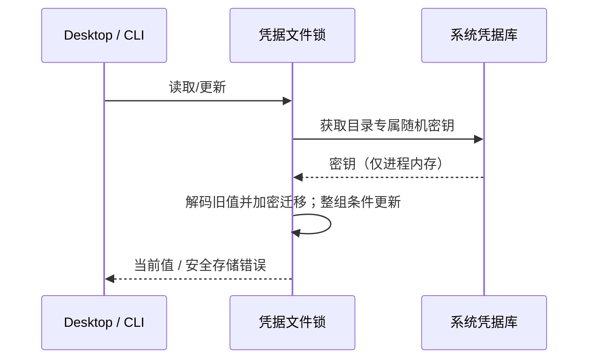

# 系统安全存储与凭据迁移

## 目标与范围

桌面端及共用同一凭据目录的 CLI 改用系统保护的随机加密密钥。覆盖
`credentials.json` 中的登录令牌、关联账号、手工保存的 API Key 与其他现有凭据。
保持账号切换、整组 CAS、跨进程文件锁和远端 Provisioning 契约。
本次不迁移网页 localStorage，不接管用户自行编辑的 MCP/环境变量配置，不部署。

## 存储合同

普通读取（Host `load`/`loadMany`、CLI `load`/`loadMany`/会话快照）不取得写锁，沿用[确认恢复合同](../ui/login-page.md#凭据容器损坏后的确认恢复)的读取前后代次校验。读到仍需迁移的旧格式值时，才进入带恢复代次屏障的写锁，重读并迁移一次；迁移写入与其他写入一样，代次变化即失败。所有写入、批量 CAS 与 `onDidMutate`（含 `recover`）都经同一屏障，旧请求不能回填恢复后的空库。

条件写入 `saveIfAbsent` 与条件删除 `deleteIfEquals` 同样使用当前文件的异步 cipher，并在凭据文件锁内读取和迁移。多个 Host 竞争匿名反馈凭据时只保留一个值；旧响应只允许删除自己用过且仍未变化的值。通知维持 `keys` 数组合同，不绕过 Main 的缓存失效链。

2026-11-02 staging 集成复核：旧方法未切换 cipher 时，真实服务运行时探针复现 `ReferenceError`；接入异步 cipher 后，8 个独立服务实例并发写入只得到一个值，旧明文保留并迁移，错误期望值不删除，匹配期望值才删除，变更通知均使用 `keys`。隔离目录与合成凭据证据在 `.e2e-artifacts/rebase-credential-runtime-20261102/`；不代表跨进程或原生系统库新增验收。 同次 CLI 凭据/访问生命周期/鉴权 57/57、相关工程 5/5、CLI 类型 34 任务和根/E2E 类型通过；根 lint 为 218 warnings、0 errors，架构检查通过。

### MR 评审修复边界

SSH/WSL 的按需进程和 R3 Core 不能依赖交互 shell 的 export。Server 入口共用一个
初始化 adapter：显式环境配置优先；否则在当前凭据目录已存在私有
`credential-secret` 文件时读取它（默认 `~/.zcode/v2/credential-secret`）。文件不存在
时，独立启动仍尝试系统库。Desktop 发起的远程启动先显式请求准备密钥（见下文）。无可用后端时，错误正文先说明远端文件名、
所属配置目录、32–4096 字节和重新连接操作，沿现有连接错误详情传递。
两条 Server 启动链使用同一 adapter；Desktop Main 不使用这个约定文件入口。

Desktop 的 R3 `serve --daemon --json --prepare-credentials`、安装/更新命令与兼容 stdio 入口显式请求
`prepareServerCredentialStorage`：只在没有显式密钥配置、没有约定密钥文件、没有 v2
密文时，为该远端数据根生成随机 32 字节密钥。准备过程按“凭据文件锁 → 密钥锁”的
统一顺序执行；完整写入 0600 临时文件后通过硬链接排他发布，已有文件绝不覆盖。
密钥由远端生成，内容不经过 Desktop、命令参数、环境变量或日志；仅保留在远端私有
文件。重复连接、并发启动、进程重启复用同一密钥。已有 v2 密文时不生成替代密钥，
系统库或原文件缺失仍按存储错误处理。独立 Server 和 Docker Web 启动保留显式配置规则。
更新命令必须在切换到新 Core 前准备，避免旧 daemon 尚在线时更新先于 ensureDaemon，
使候选 Core 因缺少密钥而启动失败；安装校验、运行任务保护和版本切换策略保持不变。

旧 v1 解码依次尝试原始显式密钥、trim 后密钥和历史默认派生密钥，以 GCM 认证成功
为准。因而旧默认密钥数据能在采用新随机文件后迁移，不需要退出或重新授权；这只是
v1 读取兼容，v2 永不尝试弱派生密钥。凭据迁移仍在已有文件锁内整组原子提交。

并发启动时，系统库已初始化但尚未写 v2 的窗口也需要固定来源。默认 cipher 在
keyring 锁内成功读取/创建系统密钥后，先原子写入私有 credential-source（仅保存 os），
再允许业务读写；远端准备在同一锁下检查该标记。已有 v2:os 数据也固定 OS 来源。
Server 与独立 CLI 复用同一默认解析器发现私有 credential-secret，不新增手工环境要求；
显式配置优先。不得将“本轮尚无 v2 数据”等同于“没有进程已经选定来源”。

### Server 更新与回滚

回滚不得把 v2 密文交给只能读取 v1 的旧 Core。新制品的 runtime/package.json 声明
zcodeCredentialFormat: 2；恢复旧 current 指针、应用旧制品、崩溃后恢复更新事务均检查
目标格式能力。已有 v2 而目标未声明支持时，保留 current、凭据和事务现场并报错，
不启动旧版、不把数据改回弱加密。不因更新失败清登录或重放 OAuth。

首次从旧 Supervisor 在线更新时，候选新 Core 由旧 owner 托管，若立刻迁移会先于
新回滚保护生效。新 Supervisor 在 fork Core 时显式传入内部环境标记
ZCODE_SERVER_CREDENTIAL_FORMAT=2；旧 owner 没有此标记时，候选
Core 暂时注入仅 v1 的兼容 cipher，不迁移且拒绝已有 v2，直到既有 handoff 重启为新
Supervisor 后再使用 v2。标记只属于进程装配，不是用户配置，不改变外部协议。
因此旧 owner 失败可安全回滚；新 owner 写入 v2 后只能回滚到支持 v2 的制品。
不依赖 update 事务文件是否仍存在来猜测 owner 能力，避免父进程退出或事务恢复与
候选 Core 初始化交错时误启用新格式。
兼容 cipher 也接受显式密钥文件和约定的私有 credential-secret；所有入口共享长度、
来源冲突和权限校验。旧 owner 阶段以认证已有 v1 的历史密钥继续写入，不能因发现
新随机文件就改变加密密钥；handoff 后才切换到随机密钥的 v2 格式。

本轮验证：55 项 CLI 凭据/登录回归、34 项打包检查通过。真实 Supervisor 配合合成
Core 子进程验证“写 v2 后失败拒绝不兼容回滚”“写 v2 后失败正常回滚到兼容版”及
“写 v1 后失败正常回滚”，三者原值均保留；另验证中断事务恢复同样拒绝不兼容版本。
真实编译后 Core 在旧 owner 环境能 ready，系统库被测试替身强制拒绝访问时仍不调用，
不会提前迁移 v2。R3/stdio 启动重启与独立 CLI 无环境配置冷读取、6 进程准备均通过。
这些是本地隔离与合成凭据证据，尚不代表真实 SSH/WSL/Linux 或完整旧发行包升级通过。

后续旧文件密钥补验：57 项凭据/登录回归通过，覆盖显式密钥文件、私有约定文件、
历史原字节密钥读写及随后 v2 迁移。真实编译 Core 在旧 owner 下读取文件加密的 v1
后 ready，未访问系统库、未提前写 v2；真实 Supervisor + 合成 Core 的文件密钥写入后
故障回滚也恢复成功，旧值仍可读。新随机文件与旧 fallback 并存时仍用历史密钥写 v1。
独立 CLI 的默认文件发现另以冷进程复验：两个显式密钥环境变量均为空，OS keyring 的
读写被测试替身设为失败，Server 写入的 v2 仍由 CLI 读回，OS 调用次数为零。该路径
在 createSystemCredentialCipher 的 keyring 锁内调用默认文件解析，不依赖 Server 缓存。

本轮自动准备验收：CLI 安全存储、访问生命周期和鉴权定向回归 52/52。新增断言覆盖
8 路并发准备、0600、旧默认 v1 身份及 revision 迁移、冷读取、原密钥/显式配置/v2 保留。
本地隔离进程通过真实 R3 transport → shell → 编译后 CLI → Supervisor/Core 启动与重启；
不设置密钥环境变量，旧身份仍可由新进程读取，密钥字节不变。兼容 stdio bundle 的
hello/ack、ready 和身份冷读取通过。更新入口在无效 archive 被拒前完成准备，身份保留；
6 个独立 Node 进程同时准备只留下同一完整密钥，没有临时文件。首次 R3 探针使用系统
长临时目录，触发 macOS socket 路径限制；改用短隔离目录后通过，不属于凭据故障。
根/CLI 类型、lint、架构和两个 Server 构建通过。未验证真实 SSH/WSL/Linux 容器、
完整在线版本切换或其他操作系统；不部署，也不操作真实账号与系统授权。

上一轮复评补验：约定文件、显式配置优先和非私有文件拒绝加入 CLI 回归，总计 50/50。
两个独立 Node 进程在没有密钥环境变量时读取同一约定文件并保持凭据；真实 Server
失败信息经过现有 R3 transport 和错误归一化后仍保留文件名和重连指引。
本地构建的 `zcode-server.cjs` 通过真实 hello/ack：显式缺失文件时退出并保留指引；
放置私有约定文件且不设置密钥环境变量时服务 ready。首轮探针误按 UTF-8 读取二进制
RPC 帧，修正探针为字节读取后通过，两轮测试进程及临时目录均已清理。
构建同时修复旧远端入口漏设 keyring external 的问题，避免展开各平台原生二进制；
远端构建和相关原生依赖/Docker 工程测试 6/6 通过。未在真实 SSH/WSL/Linux 容器执行。

- 独立 Server（未由 Desktop 请求准备密钥）在开放 HTTP/stdio 服务前初始化凭据后端。没有系统库时，管理员须显式
  提供 `ZCODE_CREDENTIAL_SECRET` 或 `ZCODE_CREDENTIAL_SECRET_FILE`；二者不可同时设置。
  文件是管理员管理的只读 secret，32–4096 字节，按原字节读取、不 trim，不自动生成或
  写入凭据目录。文件内容只留在 owner 内存，不注入子进程；子进程继承文件位置。
  Docker 启动脚本挂载该文件并传递文件位置；缺少配置时明确停止，不恢复弱密钥兜底。
- v1 读取兼容旧 Desktop 原字符串、旧 CLI trim 后的密钥及历史 fallback，包含首次
  采用随机文件的迁移。仅用 GCM 认证成功决定匹配，不改写 v2 语义或吞掉损坏记录。
- 凭据桥分别限制明文 UTF-8 字节与密文字符，密文上限包含 Base64 膨胀和格式开销。
  Main 必须校验输出，超限返回受控错误；接收端遇到可关联的非法回复必须拒绝对应
  Promise。失败也释放文件锁，不通过新增超时或重试掩盖协议错误。
- 回归覆盖：无系统库的 Server 配置与重启、Desktop/CLI 两种旧密钥、ASCII/多字节
  边界、大明文迁移、非法回复后的锁释放与后续读取。真实 Linux/Docker 另记运行证据。

修复验收：旧 Desktop/CLI 普通、首尾空白及全空白密钥迁移，受管文件初始化/重启，
ASCII/多字节 UTF-8 边界和凭据桥异常等 CLI 回归 48/48 通过。Docker 配置、stdio
脱敏工程回归 4/4 通过；另用独立 Node 进程先写入再冷启动读取受管密钥文件，值保持，
真实 `createServerHostServices` 在密钥文件缺失时于创建业务服务前拒绝启动。

真实 Main/Host 的 800,000 字符往返、超限拒绝后继续读写通过：
`desktop-e2e-20261029094653472-p31715-1d752244e7d33e0f`（1/1）。OAuth 取消、完成竞态、
区域切换、关联补齐及 Global 主体恢复回归通过：
`desktop-e2e-20261029094746951-p32839-f9a1b825dbb061ef`（7/7）。根类型、E2E 类型、
CLI 类型 34 项任务、根/CLI lint 与架构检查通过。新增断言仍为 pending。
本机没有 Docker 可执行文件，未验证真实 Linux 容器、Windows/Linux 系统库或部署；
未操作用户真实凭据、系统授权或正式应用。

- JSON 继续是凭据唯一容器，权限 0600；值使用 AES-256-GCM，随机 IV。
  格式为 `enc:v2:<os|env>:<key-fingerprint>:<iv>.<auth-tag>.<ciphertext>`。
- 默认密钥为随机 32 字节，保存在系统凭据库，文件仅保存密文与密钥指纹。
  macOS 使用 Keychain，Windows 使用 Credential Manager，Linux 明确指定
  Secret Service（GNOME Keyring/KWallet 等），不允许自动回退至易失内核 keyring。
- 同一规范化凭据路径对应一个系统凭据条目；开发、正式、测试目录相互隔离。
  创建密钥复用跨进程锁，首次并发启动不得产生互不兼容的密钥。
- 保留既有 `ZCODE_CREDENTIAL_SECRET`，作为明确配置的无桌面/受管环境密钥来源；
  不自动生成弱密钥、不把密钥写到普通配置/日志/环境变量。Desktop 请求的远端随机密钥
  仅保存在上述私有专用文件，不为子进程注入主密钥。
- 读取旧明文和 `enc:v1` 使用既有解码规则；正常读取时在文件锁内迁移可读旧记录。
  历史损坏条目原样保留给既有按用途恢复机制；不得因一个闲置旧字段阻断全部身份。
- 新密文带版本、来源和密钥指纹。系统库锁定、不可用、密钥丢失或指纹不匹配
  属于存储错误，不是登录过期；不清账号、不覆盖原文件、不生成替代密钥来解密。
- 同一进程中，同一规范化凭据路径的默认系统密钥加载由一个 Promise 负责；
  Desktop 的 Host 与内置 CLI 委托 Main，独立 CLI/服务器复用各自进程的结果。
  仅复用系统密钥，不缓存凭据文件或 OAuth 会话，跨进程整组更新仍实时读取。
- 系统库访问失败也保留在本次进程中，后续后台读取不再触发系统授权；用户解锁后
  重启应用/CLI 重试。独立程序的首次授权仍由系统管理，不修改 Keychain ACL。
  未取得 keyring 锁的失败（如另一进程等待系统授权超过锁等待上限）尚未访问系统库，
  不保留；下一次请求重新等待锁。
- 正常登出仍删除对应令牌，保留随机密钥供同一目录的后续登录使用。
- 旧版本不能读取新密文，升级不承诺降级或新旧版本同时写入安全；不能双写旧密文。



## 实施与验证计划

1. 先添加 CLI 安全存储回归：真实文件迁移、并发创建、空值、缺密钥、库锁定、目录隔离，先确认旧实现不满足。
2. shared 增加单一异步凭据加密实现和系统库 adapter；App/CLI 使用相同格式。
3. CredentialService、Provisioning 与 CLI 读取/整组写入改为等待异步加密，并在同一文件锁内迁移。
4. 新增桌面 pending E2E：通过真实 Host 凭据 RPC 保存/读取、检查磁盘密文；重启后读取同值，覆盖现有登录恢复路径。
5. 原生依赖进入桌面/CLI/远端打包路径；核对目标平台包裁剪与加载。
6. 根类型、Lint、架构、CLI 类型/Lint与受影响测试；运行隔离 macOS 原生库及桌面回归。
   Windows/Linux 原生运行与无 Secret Service 场景分别记录，不以平台模拟替代实机。

## 验收状态

已实现本地版本，未部署、未推送。

- macOS 原生系统库读写与删除、打包目录原生模块加载通过。
- 原生 Host 迁移、独立进程读取与真实 Electron 重启 1/1 通过：
  `desktop-e2e-20261029082229674-p5468-afada8ac7e977ee8`。
- OAuth 竞态及 Provisioning 12/12 通过：
  `desktop-e2e-20261029081959986-p95164-d473e340bc3b83a9`。
- 凭据损坏、JWT/业务 401、项目位置缓存恢复 4/4 通过：
  `desktop-e2e-20261029082113273-p946-fb6379be8ec8c381`。
- 旧套餐 Key 损坏恢复、CN 关联套餐/MCP/加速凭据链路 2/2 通过：
  `desktop-e2e-20261029082735757-p17124-9955667d10e538b6`。
  夹具改为在旧进程树退出后写入下一组账号，避免与后台迁移或 profile 写回竞争。
- CLI 凭据 34 项、工程 55 项、CLI 构建契约 13 项及既有构建环境 20 项通过；
  根类型、CLI 类型 34 个任务、根/CLI Lint、架构与格式检查通过。
- Windows/Linux 原生运行、真实 SSH 环境尚未验收；macOS 完整签名包结果见下文。
  Linux GNU 目标库符号最高分别为 x64 GLIBC 2.15、arm64 GLIBC 2.17，
  此项是二进制依赖检查，不替代发行版实机验收。
- 新桌面用例仍为 pending，没有人工转正或 CI 准入。

测试隔离说明：macOS 临时 HOME 没有默认钥匙串，专项仅将该 HOME 的 Keychains
目录链接到当前用户系统目录，以测试随机命名的独立条目；不复制钥匙串、不改默认库。
条目由 Host 创建，SDK 在另一进程删除时报 owner-edit；专项改用系统工具按唯一
service/account 精确删除，原生读写和重启断言均已通过。普通合成 E2E 显式使用测试
管理密钥，不访问开发者钥匙串；原生专项保留真实后端。

### 真实本地旧格式登录补验（2026-10-29）

在实现提交 `65fe0ee1c2` 上，使用用户此前亲自授权且仍有效的本地 CN 账号。
只将其旧 `enc:v1` 登录条目复制至隔离目录，保持旧解密所需的系统用户环境，
并隔离应用名、设置、凭据、浏览器 profile、工作区与 CLI 数据库。
由当前真实 Host 自动迁移，没有重新授权或手工填充新的登录 Token。

- 迁移前：真实测试环境 profile 返回 HTTP 200 / code 0，主体与本地登录一致。
- 首次启动：登录条目全部转为 `enc:v2:os`，界面显示原账号；Host 返回
  `authenticated`，主体、主 JWT 及上游 Token 均保持相同，profile 查询仍成功。
- 完全退出旧进程并冷启动：使用相同隔离凭据目录，以不同 PID 恢复相同账号；
  重复身份、Token 和真实 profile 断言均通过，没有显示授权页。
- 原始凭据和设置文件逐字哈希未变；测试进程、隔离数据及对应系统密钥条目已清理。
  只保留不含 Token 原文的结果摘要与界面截图，证据目录为
  `packages/desktop/.e2e-artifacts/real-credential-migration-20261029/`。

边界：正式版当前凭据文件没有 OAuth 登录项；另一份历史 BigModel 备份在迁移前
请求原业务接口已返回业务码 401。因此本次证明有效的真实旧格式登录可以无重新授权
完成存储升级，不将失效备份或 CN 账号的结果扩大为旧 BigModel 服务端身份迁移证明。
仍未部署，也未验证 Windows/Linux 原生运行。

### 重复系统授权修复

原实现在每次 Provisioning 读取时重新建立 cipher，默认密钥缓存又局限于单个
cipher 实例；同一进程的多个服务会重复访问系统库。失败 Promise 被清空后，后台
下一次读取会再次请求，形成重复授权。只读诊断中，同一同步源读取 3 次产生 3 次
系统库调用，同一 cipher 拒绝后读取 3 次也产生 3 次调用。

修复沿用共享加密模块作为密钥访问 owner：按规范化路径合并默认系统库读取，
成功/失败均保持至进程退出；显式注入的 KeyStore 按适配器实例隔离。Provisioning
复用其已有 cipher，不增加跨进程主密钥传输、不添加 TTL 或自动授权重试。
验证必须覆盖多实例并发/串行读取、失败不重试、目录隔离、凭据变更仍可见，以及
真实 Host 的迁移、重启和登录恢复。系统首次授权与签名身份需另行验收，不把它们
表述成“所有进程永远只弹一次”。

桌面进程归属进一步收敛：Main 是系统密钥库唯一访问者，Window Host 经私有父子
MessagePort 请求加解密；App-managed CLI 的 MCP 凭据经已连接 stdio 反向请求 Host，
再复用相同 cipher。只传本次加解密输入/结果，不传系统主密钥，不经过 Renderer、
网络、环境变量或日志。Host 只可使用 Main 为它绑定的凭据目录，不能传任意目录。
Host 退出时拒绝未完成的等待；迟到响应不得复活已释放的桥。Standalone CLI 和独立
远端服务仍在各自进程访问系统库，沿用相同缓存和拒绝后停止重试规则。
内置 CLI 的 MCP OAuth 与 endpoint routing 共用委托 Store；不同凭据 owner 的 routing
缓存分区隔离。旧宿主不支持新私有请求时明确失败，不回退为 CLI 自行读取系统密钥库。

```text
App-managed CLI → 已连接 stdio → Window Host → 私有 MessagePort → Main → 系统密钥库
                                                    Main 内多个服务 ─┘
```

正常解锁且访问身份已受信任时不增加主动授权步骤；已有条目的授权不属于当前
签名、系统库锁定等系统约束不能绕过，不能承诺任何环境都绝对零提示。

本轮验收：

- 默认系统库多实例缓存、失败停止重试、桥释放/乱序回复等 CLI 凭据回归 41 项通过；
  routing 委托 Store 隔离等 4 项通过。
- 真实 Main/Host 并发读取仅由 Main 访问系统库一次：
  `desktop-e2e-20261029084759158-p91327-2f6c2ce829e8bb0d`。
- MCP OAuth、持久化及内置 CLI 工具回合的系统库 owner 断言通过：
  `desktop-e2e-20261029085309458-p10404-b802c5ceb4f40751`。
- 真实 macOS 系统库迁移、连续读取十次、进程重启通过：
  `desktop-e2e-20261029085116036-p3009-ac323f62eb79a35a`。
  原生测试在 Main 启动前准备隔离 HOME 的 Keychains 入口，使用 OS 用户目录而非
  已被测试重写的 HOME。先前两次失败属于此准备顺序/路径错误，不修改系统 ACL。
- OAuth 取消、迟到结果、主身份恢复等 7 项通过：
  `desktop-e2e-20261029085232246-p7698-3cff6e3e5f26541c`。
- 用户此前手动授权的本地 CN 账号再次完成真实系统库迁移和冷启动，均恢复原主体、
  不出现授权页，原会话 profile HTTP 200 / code 0；原始凭据/设置哈希不变，隔离数据
  和临时系统条目已清理。证据在 `.e2e-artifacts/real-credential-owner-20261029/`
  （相对 `packages/desktop`）。本轮不从 Renderer 导出私有凭据；逐字值保持由合成
  原生用例验证，真实账号仅断言身份恢复与原会话有效，未验证真实模型/套餐。
- 开发 stdio tap 对新加解密请求及对应回复隐藏完整载荷；工程回归先红后绿，确认
  抓包不含合成 secret，正常消息和传输字节不变。

新增候选未人工转正或进入 CI。Windows/Linux 原生未实测；macOS 签名包结果见下文，未部署。

### macOS 完整签名包验收（2026-10-29）

实现 `75443a6d2f` 已补做本机 macOS arm64 的完整包验收，结果通过。使用本地测试
版本 `3.16.120` → `3.16.121`，两包代码相同，版本和签名摘要不同；同一 Developer ID、
同一独立应用标识、同一 designated requirement。生产构建和正式签名参数保持，
应用、数据目录、更新下载缓存均独立，不替换用户已安装的应用。

| 场景                           | 实际结果                                                                            |
| ------------------------------ | ----------------------------------------------------------------------------------- |
| 已授权旧 `enc:v1` 账号首次启动 | 自动转为 `enc:v2:os`，恢复原主体，连续读取成功                                      |
| 完整退出后冷启动               | 原主体仍为 authenticated，重复读取和主凭据密文保持校验通过                          |
| 应用内下载并安装新签名包       | 原生 Squirrel/ShipIt 安装、自动启动成功；安装后 ASAR 与目标包一致，签名深度验证通过 |
| 自动启动后的原生界面           | 原账号及 ID 一致，没有进入授权页                                                    |
| 升级后再次冷启动               | 原主体 authenticated，系统库解密、连续读取及主凭据密文保持校验通过                  |

全程没有输入钥匙串密码、点击系统授权或重新发起 OAuth。原始凭据、设置及已安装
应用没有被写入；最终接续阶段再次核对这些文件哈希。临时系统密钥、运行数据、
测试安装副本、下载缓存和原生更新任务已清理，默认协议处理器保持原值。

证据根为 `packages/desktop/.e2e-artifacts/signed-credential-20261029/`：
`result.json`、`shipit.log`、`native-after-upgrade.txt`、
`signed-native-autorelaunch.png`、`signed-post-upgrade-cold-restart.png`。
这是脚本与原生界面联合验收，不是一次全自动 E2E：原生自动启动不保留 CDP 参数，
该阶段用原生界面核对，随后独立启动完成最后的读取断言。未增加产品行为或放宽权限。

排除的验收噪声：额外 profile 请求曾返回 HTTP 429 空响应，不能解释为凭据损坏；
异步 `waitForFunction` 的 Promise 曾让测试过早请求安装，被产品拒绝，改为在 Node
端等待真实更新状态。失败尝试独立保留，不计入上述通过结果。

边界：本次没有公证、互联网下载隔离标记/Gatekeeper、DMG 交互、Windows/Linux
原生验收，也未验证模型或套餐接口可用性。没有推送、发布或部署。
