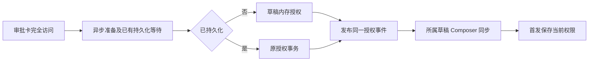
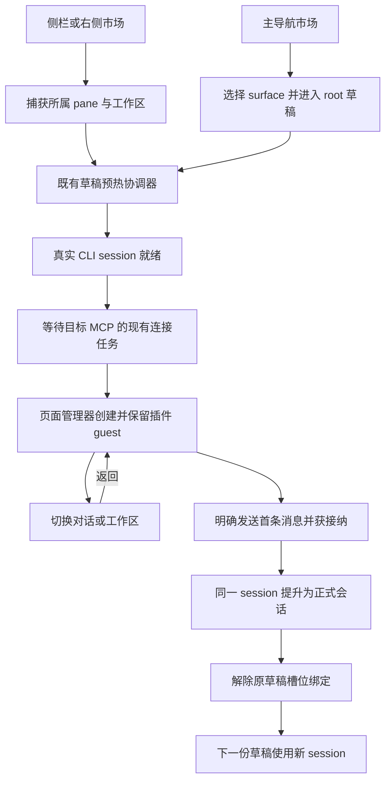

# 草稿会话中的 MCP UI App

状态：实现已提交，自动化验证通过；实现评审的 3 项 P2 已修复，专项回归及独立复审通过。方案在 2026-10-15 完成静态评审；实施基于 staging `a45957d5e10f5bc1fe008672ae3350e92cf331a6`，验证日期为 2026-10-17。

2026-10-19 集成验证：合并 staging `e43277b8de`，保留侧栏完整视图与首发结果恢复链路。类型、lint、架构检查及 14 文件 328 项定向测试通过；Electron 44.7.0 的 `PLM-UI-001` 完整回归通过。受影响测试因合并包含配置变更选中全套，按仓库规则跳过全量，未将跳过记为测试通过。

修复背景：真实 PDF 插件在草稿中点击审批卡「完全访问」失败。草稿尚无持久化 session 主记录，但授权路径直接提交 execution/receipt，触发 `session_entry.session_id` 外键错误；运行日志与真实 adapter 的隔离复现一致。相关授权代码在本次合并前后未变。现有 E2E 仅覆盖允许一次/拒绝，adapter 单测简化表未声明外键；本次补齐授权路径和对应回归；既有自动化通过不作为完全访问的历史验证。

## 草稿完全访问修复（2026-10-19）

审批卡「完全访问」复用 CLI runtime 的权限 owner。未持久化草稿只应用内存权限并发布原授权事件；正式会话继续原 execution/receipt 事务。首发按当前配置持久化同一个 session，不提前登记任务，不新增 receipt 补写队列或放宽外键。

授权完成异步准备后，先等待已经开始的 session 持久化，再判断落盘路径；没有在途持久化时，检查与草稿内存应用之间不插入异步等待。同一 interaction 的失败重试复用原事件，不能重抓队列或覆盖后来的权限选择。

草稿 Composer 只观察所属有效插件 session 的新授权，更新权限字段，保留正文、Plan 与模型。切换来源建立新的观察起点；首发提升不重放旧授权。用户后续显式选择继续优先。权限下拉框仍配置下一次 Submission，不改为即时修改插件 runtime。

真实 SQLite 外键、草稿授权/首发、持久化交错、事件发布失败重试和 UI 身份隔离均有回归。PLM-UI-001 覆盖完全访问、后续调用及首发权限并录屏。真实 PDF 复测确认授权前已有的审批保留原生命周期，后续调用使用新权限；工具用量写入告警不在本补丁范围。

2026-10-28 集成约束：同步 staging `4e42f061f2`，沿用统一 session 生命周期 owner、资源声明后台保留和已转正的 `plugins/plugin-management-ui-market.test.ts`。App 业务单测按仓库决定退役，历史数量不代表当前覆盖；现行验收使用 Electron E2E、浏览器场景和保留的 CLI 测试。

本轮验证：根与 CLI 类型/lint、架构和 E2E fixture 检查通过；CLI 138 项、共享审批浏览器 8 项、测试证据退役检查 6 项通过。Electron 44.7.0 run `desktop-e2e-20261028080939958-p772-17d40b5d35bfdf55` 完整通过（1/1），留存录屏与关键帧。首次运行在旧的平铺项目选择步骤失败，按运行截图改为进入本机项目子菜单后通过；权限/SQLite 夹具关闭无关 MCP 自动连接后，收尾无未处理错误。工程 affected 选中全套时按规则跳过，不计为测试通过。

2026-10-19 后续集成：同步 staging `52cd1bc1d3` 的 MCP display mode 握手约束与完全访问风险确认。页面创建同时保留握手前隐藏和草稿 retain；完全访问须先勾选风险确认，再走原草稿授权链。验证通过：根定向单测 106 项、CLI 定向单测 77 项、共享审批浏览器回归 8 项（390/1200px、深浅主题），根与 CLI 类型/lint、架构及 fixture 检查通过。PLM-UI-001 重建后一次通过并录屏，run `desktop-e2e-20261019141816996-p97481-20715c08f4641950`。affected 因上游配置变更选中全套，按规则跳过，未计为通过。保留其他用例的转正路径。

## v3.17.2 移植（2026-10-30）

以 `hotfix/v3.17.2` 的 `c3bb5e783a` 为基线，移植已合入 staging 的独立提交 `c87528891a`。只迁入本规格定义的草稿入口、保活、首发提升与完全访问修复；保留 hotfix 的首发结算幂等、导航代际保护和已有浏览器安全修复，不合入 staging 的其他功能。数据库、协议和插件生命周期约束不变。当前分支的验证结果单独记录，不复用历史运行作为通过证据。

本轮 macOS arm64 / Electron 44.7.0 的 `PLM-UI-001` 首次运行通过（1/1、0 skipped），run `desktop-e2e-20261030044614273-p5180-8d87823b0b07505c`；录屏和关键帧保存在 `packages/desktop/.e2e-artifacts/desktop-e2e-20261030044614273-p5180-8d87823b0b07505c`。覆盖首轮前打开、完全访问、零正式任务、完整视图与工作区切换、同 session/guest 首发以及两类过期打开取消。CLI 138 项和共享审批浏览器 8 项通过；根与 CLI 类型/lint、架构、E2E 类型及 fixture 检查通过。工程 affected 未选中测试，未作为运行通过项。Windows/Linux 实机、真实手机、真实模型 sampling、长时后台回收及历史组合失效验收缺口未补测。

## 目标与产品约束

用户在桌面本地工作区中，不发送第一条聊天消息，也能打开插件 MCP UI App，读取资源并调用工具。继续要求模型 Provider 已配置且就绪。普通插件操作不创建聊天回合，也不把草稿提前登记为正式任务。

| 入口或操作               | 目标行为                                                                                              |
| ------------------------ | ----------------------------------------------------------------------------------------------------- |
| 草稿侧栏启动页、加号菜单 | 在所属 pane 的草稿 session 中打开插件                                                                 |
| 会话右侧插件市场         | 使用所属 pane 的有效 session；允许草稿                                                                |
| 主导航插件市场           | 提供「打开 UI」，先选择 surface，再进入目标工作区的 root 草稿并打开；即使当前选中正式会话，也进入草稿 |
| 再次从主导航打开         | 复用已有 root 草稿、项目选择和未发送内容；不因重复点击创建另一份草稿                                  |
| 切换对话或工作区后返回   | 现有保留期限内复用原 session/guest；已回收页面按既有 widgetState 机制重建                             |
| 用户明确发送首条消息     | 沿用既有首发流程，把同一个 session 提升为正式会话                                                     |
| 插件明确请求发送消息     | 沿用现有手势、编辑确认和发送规则；可以构成首发                                                        |

桌面沿用单主 pane 与侧栏完整视图，右侧入口跟随所属 pane。打开请求发起时固定 workspace、pane 和草稿代际，异步完成后不能漂移到新焦点。主导航入口固定指向工作区 root 草稿。完整视图只改变布局，同一个 SessionPane、插件 guest 和未发送输入保持不变。

安装、启用、配置和权限保持现有语义。推荐区安装或启用成功只刷新状态，仍由用户点击「打开」。Web、手机和远程工作区继续使用现有不支持提示；本次不增加跨应用重启恢复。

## 状态与所有权

| 状态                             | 唯一所有者                          | 约束                                          |
| -------------------------------- | ----------------------------------- | --------------------------------------------- |
| session、MCP、工具权限及消息接纳 | CLI runtime 与现有 CommandInbox     | 打开 App 不发送占位消息，不建立第二套消息队列 |
| 草稿创建、代际、提升与释放       | 既有 DraftSessionPrewarmCoordinator | 页面保活只增加引用，不自行创建 session        |
| guest、实例、资源订阅和页面容量  | 既有窗口页面管理器                  | React 展示锚点卸载不销毁页面                  |
| 插件标签归属与展示               | pane 的有效插件 session 投影        | 不改变正式任务的 activeTaskId 语义            |

草稿中 `activeTaskId` 保持 `null`。有效插件 session 按「正式 session → 首发结果恢复中的 session → 当前草稿预热 binding」解析，沿用既有首发恢复流程；恢复期间不新建预热 session。投影不能形成另一份 session 生命周期状态。

页面遵守现有 [MCP 页面保留与后台执行](../plugin-ui-background-execution.md) 和 [插件 UI 合同](../../packages/ui/src/plugin-ui/CONTRACT.md)：资源声明 `backgroundRetention: true` 才申请后台保留；未声明页按隐藏五分钟和容量规则回收。每窗口超过四个声明页时，三十分钟未活跃且不忙的页面可回收。草稿 retain 只保留 session，不豁免 guest 的现有回收规则；页面被回收后按既有 widgetState 机制重建，不能承诺任意未保存内存无限保留。显式重载、任务删除、窗口关闭及来源/runtime 失效沿用现有释放路径，任务与页面准入仍为 30/64。

## 实施变更

### 1. 统一打开请求与插件归属

- 复用 workspace 的请求投递模式，在应用层承载一次打开请求。主导航市场卸载后，由目标 pane 接管请求；不让即将卸载的市场 hook 持有后续创建流程。
- 多 surface 在跳转前选择。进入 root 草稿时保留原 `draftProjectId` 和输入，避免调用新建流程意外递增失效版本。
- 给侧栏可见性 scope 增加独立的 `pluginUiSessionId`，仅供插件标签、启动入口和右侧市场使用。普通浏览器、终端等标签继续使用原 `ownerTaskId`。
- 请求只消费一次。打开期间保持原目标身份；来源被撤销、binding 换代或目标被丢弃后，迟到结果不得打开到新目标。导航到正式会话、首发提升和重新进入草稿时，在 workspace store 的同一次状态更新中取消旧请求。切换工作区或进入其他窗口标签时，由应用层在 tab 激活切换时同步撤销离开工作区的待处理请求；已打开页面继续保活。
- 空草稿维持原侧栏默认状态；显式打开插件时展示匹配标签，返回时能恢复保留的插件页面。页面仍保活时，隐藏锚点必须按现有规则同步解绑，不能遮挡其他会话。

### 2. 草稿保活与首发提升

- 复用现有 `acquire`、`waitForSession`、订阅 generation 和 `invalidationVersion` 校验，只增加页面持有的保活引用。保活引用不伪造展示订阅，也不参与订阅版本计算。
- 页面持有引用时，pane 卸载仅解除展示订阅，不删除草稿 session。真正销毁页面或 binding 失效时释放引用；显式重载期间连续持有引用，避免间隙误删。
- 首发获接纳后，提升操作必须原子标记 session 已正式化，并解除 coordinator 当前草稿 binding 和 root 槽位映射。不能等展示订阅卸载或页面引用归零后才解除。
- 提升保留原 session ID、guest、实例和插件上下文。下一次取得草稿必须创建新 session，不能再次返回已提升的 session。
- 没有展示订阅且没有页面引用时，沿用原预热回收规则。仅无消费者的预热配置变更可以延迟到返回时 reconcile；来源/runtime 真实失效仍立即按既有事件处理。

### 3. 草稿交互接线

- 审批/问答弹窗、PluginUiSessionProvider、附件上传和 Composer 插件上下文改用有效插件 session。插件可用状态单独检查该 session 的 lease、snapshot 身份和 runtime 就绪状态；不改变聊天时间线在草稿态隐藏历史消息的规则。
- 插件上下文按有效 session 隔离，返回草稿时保留，进入首次发送；新草稿不能继承旧上下文或附件。单个页面或 MCP 连接失效不清空待发送上下文；发送、任务删除或草稿 binding 失效才清理对应 session。
- 继续动态查询现有动作 scope。pane 不活跃时，依赖 Composer 的动作使用原不可用反馈，不能把后台插件消息发送到当前其他会话。
- 普通资源读取和工具调用不产生聊天回合。`ui/message`、sampling 和 follow-up 沿用已有能力、权限、手势与确认规则，不扩大插件权限。

### 4. 复用已有 MCP 等待与页面机制

最新基线已具备 `waitForAppConnection`、pool 转发和 `uiOpenInstance` 等待后的 session/连接代际校验。本次直接复用这些能力，保留相关回归测试，不再新增同类 MCP port 或 manager。

等待只针对目标 server 已有的连接任务，不触发重连，不等待其他 server。已有实例的同步校验仍立即拒绝失效身份。`mcpUiOpenInstance` 已在并发请求通道中，不需要修改传输队列。资源与 surface 校验沿用现有 bridge 和协议边界。

重复打开合并、页面准入、prepare 单飞、销毁后迟到 token 关闭和同 page 重载均复用现有实现。不得用新增 sleep、轮询或自动重试次数来掩盖身份同步问题。

### 5. 补齐删除与失效清理

V4 `deleteSession` 统一调用 `closeSessionRuntime`。生命周期 owner 先发布删除并摘除运行实例，阻止新命令进入半关闭 runtime；再取消 MCP UI 调用、清理实例与 App tool，等待 session 前缀退订后关闭 App。释放错误由同一 owner 汇总隔离，不在 bridge 重建第二条清理路径。

不能仅依赖最后一份 MCP 连接 lease 关闭时的间接失效：同一连接仍被其他 session 持有时，被删除草稿的 token、调用和资源订阅也必须撤销。迟到返回不能恢复旧实例，也不能自动重放结果未知的工具调用。

## 验收与交付顺序

| 场景                                       | 必须证明                                                           |
| ------------------------------------------ | ------------------------------------------------------------------ |
| 冷草稿从侧栏、右侧市场、主导航市场打开     | 真实插件成功读取资源和调用工具；零聊天回合、零正式任务             |
| 草稿工具需要审批                           | 通过和拒绝均正确回传；审批绑定原草稿                               |
| 编辑后切换对话/工作区、关闭可见标签再返回  | session ID、guest 身份和未保存内容不变                             |
| 主导航市场卸载、重复点击和多 surface       | 请求由目标 pane 消费一次，原输入与项目选择保留                     |
| 多 pane、打开中改变焦点或工作区            | 结果只作用原目标；不串页、不抢焦点                                 |
| 带上下文和附件首发                         | 同一 session 获接纳一次，页面不重载；随后新草稿取得新 session      |
| 慢 MCP、无关 MCP 卡住、连接失败            | 只等待目标连接；成功无需手工刷新；失败保留原错误与重载入口         |
| 草稿删除、runtime/来源换代、重载和迟到响应 | 旧实例与调用失效；共享连接中其他 session 保持可用                  |
| 容量不足                                   | 沿用页面回收与准入预算，不由草稿侧强行淘汰活跃或忙碌页面           |
| 兼容性                                     | 中英文、深浅主题与桌面平台行为一致；Web/手机/remote 不创建本地沙箱 |

先同步规格和失败测试，再实施代码。保留草稿预热、市场卸载/切换及推荐入口的现有测试，新增 coordinator 保活/提升、共享连接删除清理的单测及覆盖入口和真实 guest 的桌面 E2E。运行根目录必要检查、受影响单测及 CLI 对应检查；E2E 按仓库 case/spec 工作流维护。通过必要验证后本地提交，不自动推送或创建 MR。

实施时更新 [市场交互规格](./plugin-market-interactions-scope.md) 中「主导航不提供打开 UI」「草稿无入口」的旧规则，并同步插件 UI/CLI 合同与 E2E。本文是该扩展的统一规格，实施结束后更新本文状态与验证证据，不另建重复总结。

## 评审与验证边界

- 2026-10-15 静态方案评审经过两轮收敛，最终为 Ready。重点补齐了提升后解除草稿绑定、删除时清理实例，以及独立插件归属。
- 2026-10-16 文档核对确认目标 MCP 等待已由基线提供，实施范围改为复用；草稿订阅已有 generation 防护，也应保留。
- 既有 39 项相关单测通过是前一基线的旧行为证据，不是本方案验收结果。方案阶段尚未实现功能，也未运行新行为 E2E；后续实施证据见下文。完整桌面 main sandbox 与真实模型 sampling 的未验证边界继续保留。

## 实施与验证记录

- 草稿协调器增加页面保活引用；提升立即解除草稿槽位，页面继续持有原 session。pane 注册只投影有效绑定，插件入口不改变 `activeTaskId` 的产品含义。
- 主导航请求保存在既有 workspace store，由根 pane 就绪后消费。Composer 插件上下文按有效 session 保存在窗口内，首发后清空；权限和附件复用原命令入口。
- V4 删除先取消 UI 工具调用、撤销实例和 App tool，再关闭 App；共享 MCP 连接中的其他 session 保持可用。
- 根 typecheck、lint 和 architecture 检查通过。受影响单测为 324 文件、4118 项；CLI 冷恢复与 MCP readiness 回归 62 项通过，CLI typecheck 与 lint 通过。E2E 类型检查和 fixture 静态检查通过。
- macOS Electron `PLM-UI-001` 通过，run `desktop-e2e-20261016160029489-p71731-393c1051e3804bad`：首轮前主导航及侧栏市场打开、真实 MCP 工具允许/拒绝、零聊天行、上下文与输入保留、关闭标签重开、跨工作区返回、首发沿用同一 guest，以及原有项目启停/继承/卸载回归。用例保留 pending，尚未人工转正。
- Windows/Linux 实机、跨重启状态恢复、真实模型 sampling 未在本轮实测；跨重启恢复不属于本次范围。

## 实现评审（2026-10-17）

Fable 对 `254113a332` 完成独立只读评审，核心链路符合方案；无 P1，提出 3 项 P2。以下 3 项已获确认并修复；专项回归通过，独立复审确认全部关闭。

| 优先级 | 发现                                                                                 | 修复范围                                                                             |
| ------ | ------------------------------------------------------------------------------------ | ------------------------------------------------------------------------------------ |
| P2     | V4 删除没有等待 session 级资源退订，按实例异步退订可能与共享 pool lease 释放竞争。   | 复用旧 close 路径，在 App 关闭前等待资源退订；增加多 server 顺序和共享连接隔离回归。 |
| P2     | 单个 MCP server 失效时，页面回调按 session 清空全部待发送插件上下文。                | 保留仍有效的待发送上下文，只在发送、session 删除或草稿绑定失效等对应边界清理。       |
| P2     | 主导航请求只校验配置失效版本；离开草稿或首发提升后，旧请求可能留到下一份同项目草稿。 | 将请求取消绑定到原草稿的导航和提升边界，覆盖慢预热、离开和首发竞态。                 |

专项回归先在旧代码失败，再在修复后通过：V4 集成测试以两阶段退订 Promise 确认 App 关闭等待；页面测试确认单个来源/runtime 失效保留两个插件的待发送内容；store 测试覆盖导航、提升、草稿重入和配置失效。真实 Electron 用受控 RPC 暂停预热，验证主导航打开后切正式会话或其他工作区取消请求，返回同项目草稿不再打开旧插件。另有 4 项 P3 建议：接住失效 retain 的构造异常、只读工作区打开的反馈、主导航重置分屏的产品选择、无页面正式会话的上下文回收。分屏行为先保留为产品决策项，不据评审自行改变交互。

### P2 修复验证

- 根 typecheck、lint、architecture 检查通过；以 `85b4830c84` 为基线的受影响单测为 179 文件、2307 项。CLI typecheck、lint 与冷恢复/MCP readiness 62 项通过；双页面上下文专项回归 3 项通过。
- macOS Electron `PLM-UI-001` run `desktop-e2e-20261017020217277-p10138-e212efe6fd1c84c2` 通过，包含切历史会话、切其他工作区两条旧请求取消分支，以及原功能完整回归。E2E 类型与 fixture 检查通过；用例继续 pending。
- 首次运行停在测试对旧 `draftRuntime` 字段的错误等待；改用有效插件 session 驱动的启动页推荐区后重跑通过，产品代码未因此改动。
- 远端新鲜度检查受本机 Git 凭据读取失败阻塞；修复限定于已评审基线，没有更新或合并分支。Windows/Linux 实机、真实模型 sampling 未补测。

- 跨工作区取消专项先在 run `desktop-e2e-20261017020044103-p3035-611908664f249406` 复现：旧请求仍非空。应用层订阅既有 tab store 的导航提交后，最终 run 两个导航分支均通过；订阅清理只退订，不用卸载时序或超时取消请求。

### P2 复审结论

2026-10-17，Fable 对 `85b4830c84..b63354119e` 完成独立只读复审，确认 3 项 P2 全部关闭，未发现新的 P2 或确定性 bug。删除等待、上下文保留，以及导航/提升/跨工作区取消均符合本规格；未增加超时、代次或执行队列。

保留以下非阻断边界，不据此扩大本轮修复：

- 单页面草稿在页面失效、释放保活引用后再被回收，可能留下该死亡 session ID 的待发送上下文。该内容只驻留内存、不可见，归入既有 P3 上下文回收项。
- V4 删除在等待资源退订后才解除 App 事件订阅，等待期间仍可向 gateway 投递事件；旧 close 路径更早解除事件订阅。尚未发现功能影响，作为静态时序风险记录。
- CLI 回归通过真实 gateway 与 facade spy 证明等待顺序，未执行真实 pool/adapter 的多 server 退订；页面回归未覆盖上述单页面孤儿路径。Electron 用例仍为 pending，未作为 CI 门禁。Windows/Linux 实机和真实模型 sampling 的未验证边界不变。

### 完全访问修复验证

- 失败测试先复现真实 SQLite 外键错误和持久化在途时提前提交；修复后 CLI 定向测试 35 项通过（含桌面 continuous 与手机 replayable 授权投影恢复），根受影响测试 29 文件 376 项通过。
- 根及 CLI 类型检查、lint 和架构门禁通过；保留原有告警。授权入口登记到现有 cli-session-execution 模块，仍由 Core runtime 持有权限。
- Electron 44.7.0 的 PLM-UI-001 run `desktop-e2e-20261019103901369-p31239-d00a1707b0be388d` 通过并录屏：完全访问后工具返回、Composer 同步、session/entry 行数为零；再次调用免审批，跨工作区返回及首发保持权限，同一 session/guest 被提升。用例保持 pending。
- 首次 E2E 启动因 fixture 路径错误退出；第二次完成交互断言，但本机编码器动态库缺失导致录屏失败。使用现有独立编码器重跑通过。真实 PDF 复测：选取示例文档后，在 check_document 审批选择完全访问，授权成功；后续连续轮询按 yolo 放行，无授权 gateway 错误，session、session_entry、message 行数仍为零。授权前积累的审批仍逐项处理或按既有超时取消，不批量放行。

- 独立复审完成，无阻断项；复审者额外运行 CLI 15 项及 UI 草稿授权 1 项通过。非阻断边界：草稿投影重建失败路径与持久化 Promise 拒绝路径尚未直接注入测试；E2E 审批双击存在静态推断的 stale 风险；跨包模块登记保留原 Core 实现归属。Windows/Linux 实机和手机实机未测，手机仅验证 replayable 投影。
