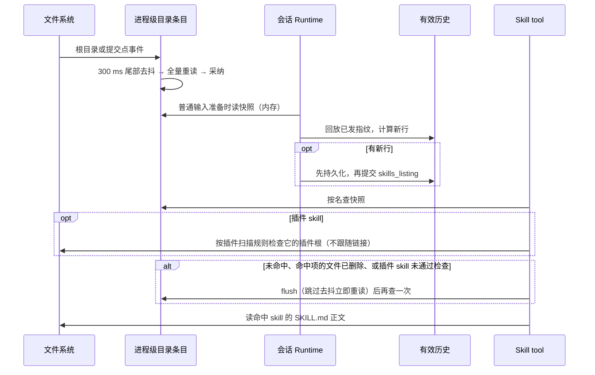

# Skill 实时目录

## 合同

打开的会话跟随 skill 目录的变化：新建、删除、改名的 skill，插件启用、停用、安装、卸载，以及设置页禁用 skill，都在下一次普通模型请求生效，不需要新会话。

- 唯一事实是 CLI 进程内的 skill 目录快照（`SkillLoadOutcome`）。列表公告、`Skill` tool、会话的 skill 引用目录都读同一份快照。
- 文件监听只更新快照。模型请求的每个 step 只读内存，不扫描目录、不读 SKILL.md。
- 模型可见的列表只追加增量：新增或内容变化的 skill 追加一行，删除不发通知。发出的列表不改写，prompt 前缀保持字节稳定。

## 唯一事实与时序

- 快照来自进程级 registry。加载器输入相同的会话共用一个条目：home、工作目录、附加目录、配置文件路径、用户配置路径、插件存储根目录、官方插件根目录、默认启用的插件、内置 skill 根目录、固定禁用路径（动态工作流关闭时的内置 skill）、被排除的插件（没有内联视图宿主时的 visualize）。
- 获取 view 时先登记引用，再立即读盘直到没有待处理的读取，所以新会话看到最新磁盘状态。最后一个 view 释放时关闭 watcher。协议入口创建并注入 registry；TUI、headless 每个 app 各建一份私有 registry，规则相同。
- 读取时机：会话首次初始化 context 时，以及每次普通输入准备（用户输入、工具批次完成、文本引导）时，从 view 读快照。重试、模型降级、stop hook 续跑不读。
- 加载失败时保留上次采纳的快照并记 warn。单个根目录扫描失败只记诊断，不影响其他根目录。

## 监听范围

监听数量和 skill 数、插件数无关。规则与 MCP 配置源相同（见 [MCP 动态目录](./mcp-async-tool-catalog-cache.md#配置)）：chokidar depth 0，每个锚点一个 watcher，同一路径在进程内共用一个系统句柄。

| 对象                                                 | 是否监听            | 说明                                                                     |
| ---------------------------------------------------- | ------------------- | ------------------------------------------------------------------------ |
| 用户、项目、附加目录、`skills.roots` 的 skill 根目录 | 是，目录条目        | 只看直接子目录的新增、删除、改名和新建链接。点目录与 `node_modules` 不算 |
| 根目录下的 `SKILL.md`（单 skill 根）                 | 是                  | 以文件身份监听，存在或缺失都登记                                         |
| 只有目录、还没有 `SKILL.md` 的子目录                 | 否                  | 例如分类目录；之后写入的 `SKILL.md` 等下一次全量重读                     |
| 已有 skill 的 `SKILL.md`                             | 否                  | 原地修改 name 或 description，等下一次全量重读生效                       |
| 用户与项目配置文件                                   | 是，与 MCP 同一路径 | 插件启停、`skills` 禁用开关                                              |
| `installed_plugins.json`、官方插件 bundled 分片      | 是，与 MCP 同一路径 | 安装、更新、卸载的提交点                                                 |
| 插件目录与插件内 skill 目录                          | 否                  | 插件内容只由安装流程写入；手改不会热生效                                 |
| 内置 skill 目录                                      | 否                  | 随 CLI 版本固定                                                          |

- 目录条目的锚点是目录本身。目录不存在时，只在已知边界之内向上找已存在的目录：用户根以 `~/.zcode`、`~/.agents` 为边界，项目根以 worktree 根（没有 git 时为工作目录）为边界，附加目录和 `skills.roots` 以自身为边界。边界之外不监听，不会监听用户目录这类大目录。
- 直接子文件不登记就不开句柄，所以 `.DS_Store`、`README.md` 这类文件不占句柄。原生事件不带文件类型：点文件的事件按名字过滤，不触发重读；`README.md` 这类普通文件的事件触发一次全量重读，结果不变。
- 新绑定的 watcher 就绪后再读一次，消除"读取与绑定之间"的写入窗口。不轮询，不用超时决定状态；唯一例外是下面的绑定超时断路，它只决定是否继续监听，配置内容仍由全量读盘决定。
- 监听失败上限（MCP 配置源同样适用）：同一锚点、同一身份（`dev:ino`、覆盖的文件、目录列表）的 watcher 失败两次就停止监听，记一条 warn（`<label> watcher stopped after repeated failures`，带锚点路径和错误）。
  - 就绪前、就绪后的报错都计数。第一次就绪后报错立即重绑一次；第一次就绪前报错不主动调度，等下一次读盘时重绑。
  - 清零：watcher 经历过一次读盘提交（稳定）之后收到有效文件事件，才清掉这个锚点的失败记录。所以稳定后偶发一次报错能恢复；就绪后、首次读盘提交前先发事件再报错的目录不会因清零重新形成循环。
  - 已知缺口：如果 watcher 每次都先撑过一次读盘提交、再发事件、再报错，按上面的规则每次都算恢复，后台会持续重绑并每次记一条 `watcher failed` warn。flush 和新会话创建不受影响（每轮 drain 都会结束），但会多读盘、多写日志。目前没有证据表明真实环境存在这种时序。
  - 重试：目录被重建（inode 变化）、覆盖的文件或目录列表变化，身份不同，重新从第 1 次计数。失败记录跟随条目；最后一个 view 释放、条目关闭后丢弃，下次新建条目重新尝试。
  - 停止监听后，已打开的会话不再实时跟随这个目录；新会话获取 view 或复用条目时仍全量重读，读到最新配置。
  - 原因：3.19.0 中 watcher 就绪后报错会立即重绑，新 watcher 又报错时无上限循环（例如部分 Windows 网络共享路径反复报 `UNKNOWN: unknown error, watch`）。flush 等不到 drain 结束，新会话创建被拖住，直到 Host 等待草稿会话超时。
- 绑定超时断路（MCP 配置源同样适用）：一次绑定共用 1 秒总截止时间（`WATCH_BIND_TIMEOUT_MS`），从绑定开始计时，逐个锚点的 stat 和等 watcher 就绪或报错都只等剩余时间。所以一次绑定最多多等约 1 秒，不随锚点数量累加。
  - stat 超时：这个锚点以超时标记停止监听，之后的绑定不再 stat 它。超时只是不再等，已发出的 stat 无法取消，迟到的结果被丢弃。
  - 一次绑定内同一锚点只 stat 一次，共用它的多个目标复用这个结果（例如项目级配置文件通常都锚在 workspace 上）。所以同一锚点在一轮里只有一个结果：慢但没超时的锚点照常建 watcher；超时的锚点只记一条 warn，超时标记不会被同一轮的身份覆盖。修复前逐个目标 stat，慢盘上同一锚点先拿到身份、后面又超时，超时标记被身份覆盖，之后每次绑定都再 stat、再等满截止时间。
  - watcher 在截止时间前既没就绪也没报错：关闭这个 watcher，按当前身份停止监听；与失败上限一样，身份变化后再尝试一次。
  - 截止时间过后，本轮还没处理的锚点不再等：已经在监听的锚点保留原 watcher、不断路，下一轮照常 stat；还没监听、也还没 stat 的以超时标记断路；已 stat、还没建 watcher 的按当前身份断路，不再建 watcher。修复前已在监听的锚点也随之断路，一个目录的 stat 挂住会连带关掉排在它后面、正常工作的监听。
  - 每个断路的锚点记一条 warn（`<label> watcher bind timed out`，带锚点路径和本次绑定已用的毫秒数）。断路不调度重绑、不算绑定变化，也不会被文件事件清零。
  - 断路状态跟随条目，与失败上限相同：条目关闭后丢弃，下次新建条目重新尝试。停止监听后 flush 仍全量重读，新会话读到最新配置。
  - 原因：网盘响应慢时，stat 挂住或 watcher 既不就绪也不报错，绑定没有上限。新会话创建要等 Skill 目录与 MCP 配置源的条目创建或 flush 完成，会一直等下去。超时只作用于监听建立，是负责人决定的断路器，不决定配置内容。
- 已知缺口：
  - 原地修改已有 skill 的 name 或 description，要等下一次全量重读：根目录有增删、插件或配置变化、同一 workspace 的新会话获取 view、或 `Skill` tool 未命中触发的 flush。正文总是最新，因为 `Skill` tool 调用时才读正文。
  - `SKILL.md` 在它的目录出现 300 ms 之后才写入时，这个 skill 也等下一次全量重读才进入列表。目录里的写入不产生事件，所以只有 `SKILL.md` 在目录出现后 300 ms 内写入才不受影响（例如 `mkdir -p` 后立即写文件）；`cp -r`、`git clone` 一个大目录可能超过这个窗口。按名调用时 `Skill` tool 未命中会立即重读，所以它仍能加载，加载后的下一步追加到列表。不给这类目录挂监听：分类目录永远没有 `SKILL.md`，监听会一直保留，数量随目录数增长。
  - 只删除 skill 目录里的 `SKILL.md`、目录还在时，没有事件，快照里仍有这个 skill，直到下一次全量重读；按名调用时读正文失败，会立即重读一次，然后返回找不到（模型收到 `<tool_use_error>Unknown skill: <name></tool_use_error>`）。
  - 边界目录本身不存在时（例如没有 `~/.agents`），首次创建它不会被发现，等下一次全量重读。
  - Windows、Linux 的原生事件差异只影响重读次数，不影响结果：每次都全量重读并按内容比较。

## 模型可见列表

列表 source 仍是 `skills_listing`，头部、单行格式、250 字符描述截断与现有格式相同。

- 每一行算一个指纹（整行文本的短 sha256，按完整格式计算，不受预算降级影响）。
- 从有效历史回放 `skills_listing` 条目 metadata 里的 `skillsListingDelta.fingerprints`，得到已发集合。
- 当前目录按显示名排序，指纹不在已发集合里的行进入本次公告。没有新行时不追加。
- 删除的 skill 不发通知；模型调用它时 `Skill` tool 返回 `Unknown skill: <name>`（端口抛 `SkillNotFoundError`，
  message 仍是 `Skill not found: <name>`；目录里有编辑距离不超过 2 的名称时加 `. Did you mean <other>?`，
  规则见 `apps/zcode-cli/docs/design/v2/tool/00-tool-change-chain.md`「工具错误的包装与文字」）。删除后用相同内容恢复，不重发。
- 内容变化（描述、`when_to_use`、别名、路径、限定名）产生新指纹，在同一头部下重发这一行。
- 本次公告超过 `skills.metadataBudget` 时，本次所有行降级为名称加路径，与现有规则相同。
- 工具表里没有 `Skill` 时不发列表，主会话和 subagent 规则相同。改动前 subagent 不检查工具表，总带列表；现在 `tools` 里没有 `Skill` 的自定义 subagent 收不到列表（Explore 带 `Skill`，不受影响）。
- 列表只由这个收集器渲染。改动前 ContextBuilder 也渲染一份完整列表，runtime 公告时取它的文字；现在 ContextBuilder 和 subagent 的 ContextBuilder 都不再渲染列表，只按会话开始时的目录决定 system prompt 里的 skill 引导语。
- 新会话第一次的列表与改动前逐字节一致（主会话；subagent 见上一条）。

## 持久化、恢复与 compact

- metadata 为 `{ source: "skills_listing", skillsListingDelta: { names, fingerprints } }`，两个数组等长，在持久化恢复与 MessageHistory 写入边界校验并复制。`skillsListingDelta` 是松散 key，不新增顶层 source，不改 `SYNTHETIC_USER_MESSAGE_SOURCES`。
- 写入沿用运行时提醒记录：先持久化，成功后才提交到历史；失败不计入已发集合。
- 冷恢复、fork、rewind 从有效分支恢复 metadata，不再按当前目录原位改写已恢复的列表，所以不再损失一次 prompt cache。
- 没有 `skillsListingDelta` 的旧记录不计入已发集合：旧会话升级后的下一次请求追加一次完整列表。
- compact 用同一收集器，以保留段为历史：保留段为空时补完整列表，部分保留时只补缺失的行，放在 agent listing 之后。
- 降级：旧版本冷恢复时把每条 `skills_listing` 原位改写成它自己的完整列表，会出现多份完整列表。只增加 token，不会读取失败。

## Skill tool

- 名称解析只查会话快照（按 `name` 或 `qualifiedName`），不再按当前工作目录重扫磁盘。
- 未命中、或命中项的 `SKILL.md` 已不存在时 flush 一次再查：模型刚写入或刚删除的 skill 可能还在去抖窗口内，flush 立即全量重读，结果确定，不靠等待。仍未命中时端口抛 `SkillNotFoundError`（模型收到 `Unknown skill: <name>`），不返回原始的文件错误。
- 调用被取消时（例如用户停止）在 flush 前后检查：已取消就不开始重读；重读中途取消时，工具执行器立即结束这次调用，后台的重读继续完成并更新快照。
- 命中后只读该 `SKILL.md` 的正文，截断上限不变。
- 插件 skill 读正文前，对它所在的插件根重跑一次插件扫描规则：根、skill 目录、`SKILL.md` 都不能是链接（Windows junction 也算链接）。命中项不在扫描结果里时按未命中处理，flush 一次后端口抛 `SkillNotFoundError`（模型收到 `Unknown skill: <name>`）。原因：插件目录不在监听范围，快照建立后文件被换成指向插件外的链接时没有事件，只按快照路径读取会把插件外的文件交给模型；改动前每次调用都全量扫描，由同一条规则拒绝。检查与读取之间仍有毫秒级窗口，与改动前相同。规则只检查这三级；根以上的目录（插件安装目录、manifest 嵌套根的中间目录）不检查，也与改动前相同。用户、项目 skill 不做这项检查，继续跟随链接。
- 行为变化：Bash `cd` 到子目录后，子目录 `.zcode/skills` 里的 skill 不再能加载（以前能加载但不在列表里）。目录始终按会话工作目录解析。

## 其他入口

- subagent 子会话的列表在启动时从实时快照取一次（经父端口过滤），运行期间不变。subagent 的 `Skill` tool 按调用时的实时快照过滤允许范围，未命中时不 flush：去抖窗口内刚写入的 skill 在 subagent 里报找不到，等下一个 subagent。运行期间新增的 skill 不在 subagent 的列表里，但按名可以加载；运行期间删除的 skill 报找不到。找不到（含 `skills` 白名单之外的名称）与主会话同一文字：过滤后的端口抛 `SkillNotFoundError`，模型收到 `Unknown skill: <name>`，`Did you mean` 只从过滤后的目录里选（2026-11-14，原来是不带标签的 `Skill is not allowed for subagent`）。
- system prompt 里的 `/<skill-name>` 引导语仍在会话开始时决定（开始时有 skill 才出现）。
- 会话的 skill 引用目录（`skills/referenceCatalog` 带 sessionId）读实时快照；草稿请求仍按工作区重新扫描。
- 插件引用 reminder 仍用创建时冻结的插件引用目录，与实时 skill 取交集，所以已停用插件的 skill 不再出现在 reminder 里。
- 上下文用量的 skill 明细列出实时目录；"skills"分类的 token 数按已经公告的列表文字计算。两者可能不同：明细里会有还没公告的新 skill，已删除的 skill 只出现在已公告的文字里。
- 不在范围：workflow child 的 skill 端口（保持创建时冻结）、TUI `/skill` 列表、设置页的 Host 扫描器、conditional skill 与嵌套目录发现、插件 Hook 与插件 Agent 的热更新。

## 验收

| 覆盖位置                  | 负责的断言                                                                                                                                                                                                                                                                                                                                                                                                                                                                                                                                |
| ------------------------- | ----------------------------------------------------------------------------------------------------------------------------------------------------------------------------------------------------------------------------------------------------------------------------------------------------------------------------------------------------------------------------------------------------------------------------------------------------------------------------------------------------------------------------------------- |
| adapters watch 原语       | 新建子目录触发重读；已有 skill 目录内写入不触发；登记的缺失文件挂在已存在的父目录上，文件出现后撤销；根目录不存在时挂到边界内祖先、边界外不监听；点目录不触发；普通文件不占句柄；每个存在的根目录 1 个系统句柄；MCP 配置源测试不改且通过                                                                                                                                                                                                                                                                                                  |
| adapters watch 失败上限   | 监听反复报错时最多建 2 个 watcher 后停止并记 warn；条目创建与 flush 能返回且读到最新内容；稳定后偶发一次报错能恢复；目录重建或条目重建后重新监听；watcher 永不就绪或 stat 挂住时条目创建在截止时间内返回、记 `watcher bind timed out` warn、之后 flush 不再建 watcher 且读到最新内容；多个锚点同时挂住时总等待不超过一个截止时间；多个文件共用一个锚点时每次绑定只 stat 一次，慢但没超时的锚点照常监听，先成功后挂住的锚点只记 1 条 warn、之后 flush 不再 stat 也不再等待；一个锚点的 stat 挂住时，被截止时间跳过的已监听锚点保留 watcher |
| adapters skill 目录加载器 | 配置启停插件后插件 skill 出现或消失；用户与项目配置的禁用开关同时生效；安装记录提交后读到新插件；插件名跨重读复用、插件改名后跟随；监听集合不含已有 `SKILL.md`、没有 `SKILL.md` 的子目录、插件目录与内置目录；项目配置不能加 `skills.roots`；同 key 会话共用条目                                                                                                                                                                                                                                                                          |
| adapters catalog 端口     | 按名查快照；未命中 flush 后命中；命中项文件已删除时 flush 后报 `Skill not found`；插件 skill 的 `SKILL.md`、skill 目录或根目录在快照后换成链接时报 `Skill not found`，用户级链接 skill 仍可加载；取消时不 flush；仍未命中报 `Skill not found`；正文截断不变                                                                                                                                                                                                                                                                               |
| core listing              | 首次逐字节一致；工具表没有 `Skill` 时不发；新增只发新行；变化重发；删除无输出；同内容恢复无输出；预算降级不导致重发；compact 补全与部分补齐；旧记录追加一次；metadata 非法不计入；持久化失败不提交                                                                                                                                                                                                                                                                                                                                        |
| core runtime              | 普通输入准备时读快照、重试不读；冷恢复不改写已恢复列表；live 与 cold 等价                                                                                                                                                                                                                                                                                                                                                                                                                                                                 |
| Desktop E2E               | `conversation-session-plugin-skill-live-catalog`（已转正）：第 1 轮后新建 workspace skill，第 2 轮请求只追加这一行；工作区配置停用插件后它的 skill 返回 not found                                                                                                                                                                                                                                                                                                                                                                         |
