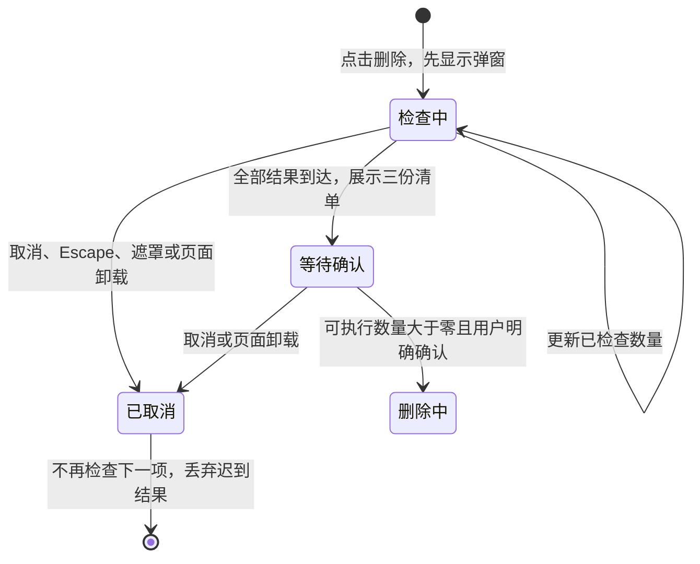
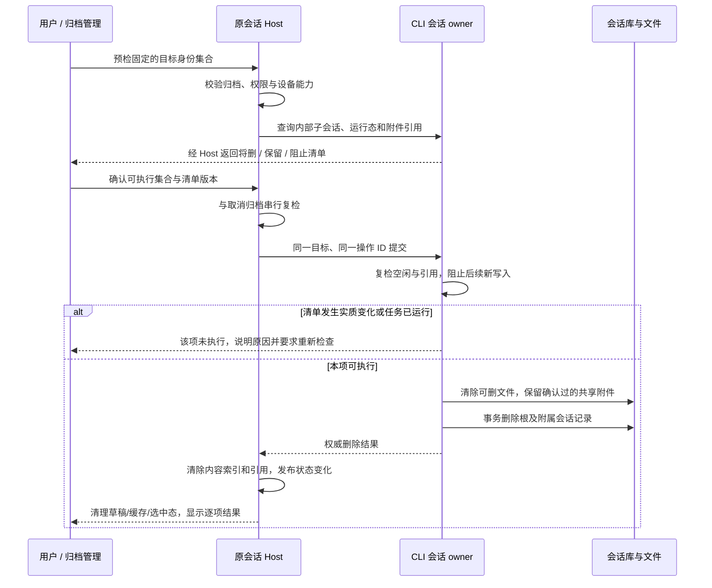

# 设置：归档管理

用户要求：设置 → 数据与统计 → 归档管理。布局参考截图“已归档的聊天”：标题/全部删除、搜索、排序方式与项目筛选、项目分组标题/数量/更多、卡片内任务标题/时间/删除/取消归档。项目候选与分组必须使用虚拟项目，而非 cwd。

## 行为与边界

- 页面名与顶部页面标题均为“归档管理”，位于自动归档设置之前；列表标题为“已归档的会话”。只显示 Host readTree 的 archived 行；CLI 删除镜像排除已删除任务，不能从 sessions-index 补行。
- 自动归档设置统一放在“归档管理”顶部、已归档聊天列表之前：“自动归档旧会话”和“归档保留时长”保持同一设置卡片，常规页移除这两项。沿用现有设置键和 3/7/14/30 天选项。2026-10-19 起默认关闭、保留 30 天；已有天数不覆盖。关闭时也允许选择并保存时长，关闭期间只保存配置、不执行归档；开启后按已保存时长执行。开启时修改时长沿用设置变更补扫，已归档会话不会因时长变化自动恢复。2026-10-14 起，旧配置的开启状态一次性归位为关闭，保留天数，用户重新开启后才执行；迁移合同见 virtual-project-design 的“自动归档修复后的重新开启”。中英文、明暗和窄屏布局沿用公共设置行。
- 页内固定文案统一使用“会话”，覆盖自动归档标签/说明、列表标题、搜索、数量、加载/空态/失败提示和删除确认；英文对应统一为 session。用户自定义会话标题与项目名称原样展示。标题复用 SettingsPage 公共页头与 archives.nav，列表仍使用 archives.title；仅展示调整，不改状态 owner、命令、持久化或失败语义，无迁移。
- 默认更新时间/所有项目，搜索标题（不区分大小写）；用户明确中间下拉是“排序方式”，只提供更新时间、创建时间，均倒序。搜索与项目筛选取交集。
- 筛选区复用公共 Select：触发框仅显示当前选项与下拉箭头；“排序方式”标签放在排序框外左侧，不显示排序或项目装饰图标。外部排序标签关联 Select，保留键盘操作与可访问名称；窄屏换行、中英文和明暗主题保持可用。只调整展示，筛选状态继续由 ArchiveManagementContent 持有，不新增组件或状态同步路径。
- 分组和选择以 Host + projectId 为 key；同目录多项目、同名不同 Host 不合并。显示项目名字，远端附 Host 名。无 projectId 显示“未归类”；已删除容器保留名字及“已移除”标识，不恢复项目或改变 session cwd。候选来自同一树，包含仍有归档的已删除容器和未归类。
- 时间显示当前排序选用的 CLI updatedAt/createdAt，降序稳定排序，标题单行省略、完整 title 可读；组内首屏 50 条，显示更多增加 50。数量与批量操作使用全部匹配项，不限渲染页。
- 所有归档分组（含未归类、已移除项目）默认收起，在名称右侧显示折叠箭头；名称与箭头共用可键盘操作的展开按钮，数量和更多菜单独立保留。复用公共 Collapsible，聊天卡片、行按钮及“显示更多”只在展开时构造/挂载，收起立即卸载。每个 Host+projectId 对应的 ArchiveGroupCard 独立持有本页 open，仍在结果中的分组在排序/筛选时保留状态；新出现或重新进入页面的分组默认收起，搜索不自动展开。已加载条数沿用本页组内 limit；数量、搜索结果和批量操作不依赖折叠或 DOM 是否挂载，不新增持久化偏好。
- 每行取消归档/删除；组更多菜单提供该组取消归档/删除；右上全部删除作用于当前搜索/筛选结果。删除均需确认，明确数量和操作不可从 UI 撤销；不更改 CLI 既有软删除语义。确认期间固定候选身份，不能把后来新增的匹配项纳入。
- 同一页同一时刻仅一个操作批次，按钮禁用。逐项发既有命令，成功才清理对应 UI 状态，最终刷新；部分失败报告成功/失败数量，失败项仍在权威树中，不能吞错、回滚成功项或伪造全成功。取消确认不发命令。过期/已取消归档/已删除目标不再纳入执行。
- 本地与在线远端共用页面，离线不伪造会话缓存，不为只读拉起 Agent；离线项目可被识别但无可操作的离线索引。加载/空态/无搜索结果/读取失败分别呈现，失败可重试。异步刷新复用原请求序号，不新增同步定时器。
- DESIGN.md 的语义颜色、text-ui 字号和组件复用；明暗、键盘操作、中英文、窄屏可用，窄屏筛选换行。手机沿用已有 Host attachment，不能为归档页创建 runtime。

## 归档与定时任务联动

会话新进入归档状态时，暂停原 Source、完整工作区身份下直接绑定该会话的全部启用定时任务。手动、批量、后台自动归档和现有工具、远控入口行为一致；保持现有归档准入与候选范围，不追溯历史已归档会话。

取消归档不恢复定时任务。用户可以在会话仍已归档时手动开启定时任务；重复归档请求、后台扫描或应用重启不再次暂停它。已认领、已排队和正在执行的轮次仍可执行；暂停仅阻止后续认领。

关联范围、提交边界、状态流转和验收清单统一见[会话归档时暂停绑定任务](../../automation-edit-status.md#会话归档时暂停绑定任务)。本节不改变下文已有的会话删除规则，也不新增通知或管理界面。

## 架构决策

归档 UI 属于现有 managed project-sidebar/ui 模块，经 index 公开 ArchiveManagement；设置导航只注册入口。ProjectDirectoryProvider 提升到 RootWorkspaceContent，侧栏、composer、settings 同源；嵌套 Provider 复用已有 owner，独立壳层仍能使用，不能多次执行 useProjectTree。Host 管 projects/roots/archived；CLI 管存在性/标题/时间。UI 仅搜索、筛选、折叠、分页、确认快照与在途批次。

```text
Host readTree -> 单一 ProjectDirectoryProvider -> sidebar / composer / archive settings
用户筛选 -> 纯派生分组（Host+projectId；任务地址仍 workspaceKey+taskId）
确认固定候选 -> 既有 Controller.mutateTask / TaskService
             -> Host archive=false 或 CLI delete -> 索引事件 -> 同一树刷新
桌面：continuous 原链路；手机：shared-host + replayable 原链路
```

任务操作地址/路由复用一个模块内 mutation adapter，侧栏和归档页共用；remoteSessionId 从现有注册表解析，sourceServerId 从统一 identity parser 取得，不按路径猜远端。无新协议、schema、migration、持久化缓存或 accepted queue。

自动归档卡片由 SettingsPage 在 archives 分区组合，设置值及回调继续由 SettingsPage 持有，SettingsService 仍是持久化权威；project-sidebar 的查询/列表组件不接管设置状态。保存成功后才更新页面，失败沿用原设置操作反馈。Host 扫描调度、远端配置作用域、桌面 continuous 和手机 shared-host/replayable 边界不变；手机不新增设置入口。

```text
归档管理设置卡片 → SettingsPage 原回调 → SettingService.update
                                      ├→ 原 Host 扫描调度：关闭则退出，开启则按已存天数扫描
                                      └→ 保存成功 → SettingsPage 更新展示值
```

## 影响分析与测试决策

| 项目              | 结论                                                                                                                                                                            |
| ----------------- | ------------------------------------------------------------------------------------------------------------------------------------------------------------------------------- |
| 层级/模式         | presentation、option-source、validation、commit-effect；planning→implementation                                                                                                 |
| 必查入口          | SettingsPage/navigation/config；RootWorkspaceContent/WorkspaceShellLayout；ProjectDirectoryProvider；任务 archive/delete 命令                                                   |
| 同源/差异         | 三处目录同源；归档页只取 archived，包含已删容器；侧栏不显示归档，composer 不显示已删容器                                                                                        |
| UI Surface Matrix | 设置筛选：页面草稿→tree 纯投影；行/组/全部动作：确认与在途→既有命令→Host/CLI；侧栏：同一事件刷新，导航不变                                                                      |
| Owner/落点        | 查询与偏好由 Provider；归档由 Host tasks-index；删除由 CLI mutateSessionFacts→镜像；无新落点                                                                                    |
| 不变量            | workspaceIdentity 隔离、Host+projectId 分组、旧 cwd 不变、不改时间/标题、不写对方库、continuous/replayable 分离                                                                 |
| Codegraph         | explore SettingsPage/createSettingsPageConfig/useProjectTree/mutateTask，计划深度 2；两次返回 no such table: unresolved_refs，索引不可用，改用限定源码/rg。未声称图调用分析成功 |
| 图谱漂移          | 旧 surface.project-task-list 仍指向已删除 grouped/workspace 节点，作为历史漂移记录；本次只登记新归档入口与现有权威端口                                                          |
| 关系分级          | must-inspect：设置入口/共享树/命令；should-inspect：侧栏/composer；invariant-only：两库与 stream；evidence-only：fixture                                                        |
| 不展开            | provider/工具/消息流/队列不改变归档管理；不做全笛卡尔积，也不新增 runtime 请求                                                                                                  |
| 可选澄清          | 用户明确中间下拉是排序方式，仅更新时间/创建时间；全部删除采用当前过滤结果范围，确认框清晰显示数量                                                                               |

| Case  | 设置→动作→断言                                                                                                         | 状态/证据                                          |
| ----- | ---------------------------------------------------------------------------------------------------------------------- | -------------------------------------------------- |
| ARM01 | 设置数据与统计入口，多个虚拟项目共享 cwd、长标题、未归类、已删除项目→搜索/时间排序/项目筛选→分组/数量/候选只用虚拟项目 | accepted；unit + pending E2E                       |
| ARM02 | 归档行→取消归档→索引 archived=false、页面消失、侧栏重现；删除取消不变，确认后 CLI time_deleted 与镜像删除，刷新不复活  | accepted；unit + pending E2E                       |
| ARM03 | 搜索/项目过滤后→组/全部批量动作→只处理确认时匹配项；重复点击只执行一次、失败项保留并报告，组外不动                     | accepted；unit + pending E2E                       |
| ARM04 | 同 projectId/任务 ID/真实路径不同 Host→路由→完整 identity/source/attachment 保留；本地与远端隔离                       | accepted；unit；真实远端/手机 GUI 待验             |
| ARM05 | 长标题、50+列表、中英文、390px、明暗→搜索/更多/按钮/滚动可用                                                           | accepted；unit + E2E 共享 renderer，不冒充手机配对 |
| ARM06 | 默认全部收起→鼠标/键盘展开与收起→只挂载展开组；折叠组数量和批量动作仍完整有效                                          | accepted；unit + pending E2E                       |
| ARM07 | 常规页无自动归档项→归档管理默认关闭/30 天→关闭时切换并保存时长、刷新恢复→开启后使用已存时长；关闭后仍可修改                           | accepted；pending E2E；复用 ARM05 布局覆盖          |

E2E 放 manual-review/pending，fixture 在隔离 HOME/工作区创建；只用历史数据无需模型，provider policy=none。功能与批量语义按用户请求及既有命令约束确定；未改流协议，formal-proof 消息状态组合剪枝。不晋升 formal/Docker，等待人工 review。

### 2026-10-19：默认 30 天，关闭时可预设时长

默认设置、SettingsPage 初始值/缺省值及 Host 扫描缺省值统一为 30 天，不迁移已有天数。移除时长下拉框与开关的禁用绑定；继续通过原 SettingService 保存，关闭时扫描退出，开启后读取已存值，不新增状态或同步路径。

先运行新增默认值断言，旧实现的 schema 与设置服务均返回 7 天；旧桌面构建的 ARM07 在“关闭时下拉框可用”断言失败。修改后运行 `desktop-e2e-20261019062710421-p61805-cfee647173bf3a00`，ARM07、ARM08、ARM01/05/06 共 3/3 通过：默认关闭/30 天、关闭时改 7 天并刷新、开启保留 7 天、开启时改 14 天、再次关闭后改 30 天、已有归档不恢复；中英文 × 明暗 × 1200/390px 布局验证通过并检查截图。用例保持 pending，窄屏不等同真实手机/远端 Host 验证。旧构建的额外 ARM02/ARM03 取消归档用例已失败，本次没有修改这些动作，不将其计入通过范围。

验证：root/E2E typecheck、fixture check、格式检查、架构检查（0 违规）通过；lint 0 errors / 188 warnings。从任务起点运行受影响单测，选中 1432/2496 文件，首次 16152 项通过、2 项失败、6 项跳过；失败均在 subagentsService 测试，分别为 afterEach 清理超时和随后临时文件 ENOENT，该文件完整复跑 29/29 通过。没有修改失败用例或放宽超时，也没有将首次整批运行记为全通过。

## 验证结果

验证：相关单测 12 文件 / 67 项通过；最终 Electron `desktop-e2e-20260911073549408-p8673-2d528e9e7a8486a5` 3/3 通过，包含真实创建/更新时间反向排序、虚拟项目筛选、取消归档回写、删除确认取消、CLI time_deleted 与 Host cli_deleted、重新打开后的持久化结果、搜索范围批量删除、分组取消归档，以及 1200/390px 明暗截图和溢出检查。root typecheck、E2E typecheck、fixture check、lint（48 个既有 warnings / 0 errors）与架构门禁（baseline 0 / new 0）通过。真实手机配对/远端 Host/Windows/Linux 未运行，不能以窄屏截图替代。

语义图新增归档 surface、共享目录 owner 和任务 mutation adapter 关系；YAML 无重复 ID，新 seeds 文件/符号存在。四条悬空引用与 HEAD 完全相同，本次无新增；codegraph 扫描仍因索引错误不可用，未将静态检查写成图调用分析成功。

### 2026-09-15：简化筛选控件

两个下拉原本已复用公共 Select，本次仅调整 project-sidebar/ui 的组合布局（展示代码净增 12 行），将图标及排序标签移出触发框。筛选状态、命令和桌面 continuous / 手机 replayable 链路不变。

旧实现的真实 Electron 运行被新增“排序框仅显示当前值”断言拦截；修改后 `desktop-e2e-20260915045116820-p26982-f2a50b4911fb90b8` 3/3 通过，包含键盘排序、项目筛选、归档/删除回归，以及中英文 × 明暗 × 1200/390px 的 8 张截图和框外标签/图标位置断言。相关单测 2 文件 / 8 项、root typecheck、E2E typecheck、fixture check、lint（48 个既有 warnings / 0 errors）通过。

本次相对 HEAD 的架构检查 0 违规；默认相对 origin/staging 的检查仍报分支已有 `packages/ui/src/root/resolveConversationWorkspaceTarget.ts` 未登记 managed 模块，与开工基线一致。真实手机配对、远端 Host、Windows/Linux 未运行；窄屏证据仅来自共享 renderer。

### 2026-09-15：去除装饰图标与展开卡顿定位

按用户后续要求移除排序标签前和项目选择器前的图标，保留排序文字与公共 Select 的下拉箭头。同步更新 E2E，筛选栏只保留搜索图标和两个箭头。展示代码净减少 4 行；没有修改公共 Select 或列表渲染策略。

真实开发窗口（CDP 9229）的性能录制复现卡顿：42 个归档项目组累计挂载 1,142 行、约 1.7 万 DOM 节点。`ArchiveGroupCard` 的 50 条限制只作用于每个项目，`ArchiveManagementContent` 仍一次渲染全部分组，因此不限制整页规模。Radix Select 展开时注入滚动锁样式，并修改 body 的 `pointer-events`；时间线显示大范围 `UpdateLayoutTree` 样式重算，调用栈落在 Select 定位与滚动位置读取。去掉图标后仍可稳定复现。

不开 CPU profiler 的三次重复测量（pointerdown → 下一帧）：

| 当前筛选 | 挂载归档行 | 排序菜单（2 个选项） | 项目菜单（43 个选项） | 样式重算耗时 |
| -------- | ---------: | -------------------: | --------------------: | -----------: |
| 所有项目 |      1,142 |            406–416ms |             461–487ms |    384–405ms |
| 单个项目 |         18 |              59–62ms |             106–107ms |      47–52ms |

对照保持同样的菜单选项，仅通过现有项目筛选减少列表节点；测量后已恢复所有项目。主要瓶颈是列表规模放大了全局样式变更的成本。后续应评估整页虚拟滚动，限制实际挂载的屏幕外条目；本轮只完成图标修改和原因定位，没有擅自更改渲染策略。这些数字来自当前开发构建，不代表生产包或其他设备基准。

```text
点击 Select → 滚动锁 / 外部点击锁 → 大量归档 DOM 样式重算 → 测量菜单位置 → 首帧显示
```

验证：Electron `desktop-e2e-20260915045706636-p29422-d491265af9e775d1` 3/3、相关单测 8/8、typecheck、E2E typecheck、fixture check、lint（48 个既有 warnings / 0 errors）、相对 HEAD 架构检查通过。既有分支架构登记问题及真实手机/Windows/Linux 未验证边界与上一轮相同。

### 2026-09-15：归档分组默认折叠

按用户裁决，采用默认折叠、展开时挂载的方案。ArchiveGroupCard 复用公共 Collapsible，名称右侧的箭头表达状态，open 只由该分组实例持有；聊天卡片及行元素在 open 分支内构造，收起立即卸载。标题、数量和更多菜单保持可用，组内分页保持本页进度。展示实现净增 27 行，无新持久化、协议、运行态或远端链路。

```text
进入归档页 → 所有组 open=false → 仅挂载组标题/数量/更多
点击名称或箭头 → 当前组 open=true → 挂载该组分页聊天
再次点击 → 当前组 open=false → 卸载该组聊天
批量命令 → 原始匹配数据 → 既有 Host/CLI 命令（不依赖挂载状态）
```

在同一真实开发窗口、同样 42 个项目组下复测三次，默认挂载归档行由 1,142 降到 0，菜单展开期间 DOM 约 2,800–2,900。排序 Select 从 406–416ms 降到 66–74ms，项目 Select 从 461–487ms 降到 90–124ms；样式重算降到 58–64ms。手动展开组后仍按需挂载该组，结果仅代表本次开发窗口测量。

验证：先写的默认不挂载单测在旧实现返回 50 行时失败；修改后相关单测 8/8、Electron `desktop-e2e-20260915060232956-p48402-9950aaaf3bc92911` 3/3 通过。覆盖独立展开、键盘收起后无行 DOM、更多菜单不展开、过滤后新组默认收起/保留组状态、折叠组批量删除及取消归档真实落库，以及中英文 × 明暗 × 1200/390px × 收起/展开共 16 张截图。截图与逐组点击等待真实动画完成，不靠固定延时。root/E2E typecheck、fixture check、lint（48 个既有 warnings / 0 errors）通过；相对 HEAD 架构 0 违规。默认分支比较仍有既有 unmanaged-file 问题，真实手机配对、远端 Host、Windows/Linux 未实测。

### 2026-09-15：自动归档设置迁入归档管理

从 GeneralSectionContent 移出整组设置，在 SettingsPage 的 archives 分区顶部组合 TaskAutoArchiveSettings 与原 ArchiveManagement。卡片无内部状态，读取与保存仍走 SettingsPage 的既有设置回调；复用公共设置行的窄屏堆叠布局与原中英文文案，补齐控件可访问名称。仅 ui 模块展示变更，产品代码净增 22 行，未改 project-sidebar 合同、Host 调度、持久化键或协议。

先添加 ARM07 后运行旧实现，因“常规”仍出现自动归档文案而失败。修改后 Electron `desktop-e2e-20260915071025117-p90265-99d42137cf736fb1` 4/4 通过：常规移除、归档页顶部展示、开启/14 天保存并刷新恢复、关闭禁用且保留时长，以及既有归档列表操作和中英文/明暗/1200/390px 布局。原自动归档扫描用例同步入口后，Electron `desktop-e2e-20260915071146456-p91125-9eaca16185a5fcc7` 通过，验证旧任务归档、置顶保护与近期任务保留。

相关单测 4 文件/34 项、root typecheck、desktop typecheck:e2e、两份 fixture check、lint（48 个既有 warnings/0 errors）通过；HEAD 增量架构 0 违规。默认全分支检查仍被开工前既有 `packages/ui/src/root/resolveConversationWorkspaceTarget.ts` unmanaged-new-file 阻挡。真实手机 shared-host、远端 Host 和 Windows/Linux GUI 未实测；窄屏仅代表共享 renderer 布局。用例保持 pending。

### 2026-09-15：归档页标题与会话称呼

恢复公共设置页头，使用“归档管理”，列表保留独立的“已归档的会话”标题。原实现专门隐藏 archives 页头，配置又将页面标题映射为列表标题，自动归档卡片迁入后顶部没有页面标题。移除这两个特例，复用公共页头；归档专属中英文文案统一为会话/session，用户内容不替换。ARM08 覆盖标题在自动归档设置上方、固定文案和删除确认；复用 ARM05 的中英文、明暗及 1200/390px 布局验证。

验证：开发窗口 CDP 9229 确认页头恢复与中文文案。Electron `desktop-e2e-20260915-122925-103` 5/5 通过，覆盖页头位置、搜索/数量/无结果/删除确认、设置落盘和既有归档操作，以及中英文 × 明暗 × 1200/390px × 折叠/展开共 16 张截图；自动归档扫描 AMT02 在 `desktop-e2e-20260915-123058-715` 1/1 通过。相关单测 3 文件/21 项、root/E2E typecheck、两份 fixture check、lint（47 warnings/0 errors）通过；HEAD 增量架构 0 违规。产品变更限于 ui 展示层的 4 个文件，净增 0 行；状态 owner、事件顺序、桌面 continuous 与手机 replayable 边界均保持原合同。默认全分支架构仍有开工前的 resolveConversationWorkspaceTarget.ts 未受管文件问题；真实手机 shared-host、远端 Host、Windows/Linux 未实测。用例保持 pending。


## 2026-11-04：归档会话永久删除

本节替代前文归档管理中单条、分组和当前筛选结果的软删除语义。实现采用预检、二次确认和
物理清理。取消归档、普通会话删除、项目管理和分享管理保持既有语义。验证范围见文末。

### 需求与澄清记录

| 决策 | 已确认行为 | 来源 |
| --- | --- | --- |
| PD-D1 | 归档管理现有“删除”统一改为“永久删除”，实际清除会话数据，不另留一个软删除入口 | 用户确认 |
| PD-D2 | 保留用户主动创建的独立分叉；确认框明确提醒它们仍有自己的对话内容 | 用户确认 |
| PD-D3 | 根或附属会话仍有工作执行时阻止该项删除，用户先停止任务；不自动停止或杀进程 | 用户确认 |
| PD-D4 | 其他对话仍引用的附件可以保留，提前逐项提示；不能因此保留整条原对话，不要求用户解除引用 | 用户纠正 |
| PD-D5 | 已发布分享独立管理，本操作不调用分享查询、停用或删除接口 | 用户最终裁决，覆盖先前联动提议 |
| PD-D6 | 二次确认列出能删除、会保留、无法删除的内容；异常逐项列原因，用户据此确认实际范围 | 用户确认 |

### 数据范围与承诺

“永久删除”指物理清除当前 ZCode 会话存储中的记录及本次可删除的专属文件，不提供撤销或回收站。
它不是仅写 `time_deleted`。不承诺磁盘取证级擦除；不借本功能扩展成全设备隐私擦除、备份管理或分享管理。

| 对象 | 处理 | 边界 |
| --- | --- | --- |
| 目标根会话 | 删除 | 标题、消息正文、工具记录、会话内编辑/回退分支、输入历史、队列、todo、usage、会话/workflow 存储等按实际归属清理 |
| 附属会话 | 随根删除 | 复用 owned tree：侧边问答、subagent、workflow 子会话及 session_task_link；不沿所有 parent_id 无差别递归 |
| 用户主动创建的独立分叉 | 保留 | 不因 parent_id 指向目标就级联删除；它自身保存的复制内容仍存在 |
| 无外部引用的会话附件和工具产物 | 删除 | 只处理 CLI 管理的会话存储范围，不按消息里的任意文件路径执行删除 |
| 仍被保留会话引用的附件/产物 | 保留所需文件及读取所必需的索引 | 清单列文件名、保留原因、引用数量；可访问时列引用会话。原会话正文仍删除，不保留整条 session 充当附件 owner |
| CLI 会话专属执行文件和 model-io | 删除 | 复用 cli/{exec,agents,sessions}/<sid>、debug/rollout 下该会话 model-io 文件的受控清理范围 |
| Host 任务索引与客户端缓存 | 清除目标内容及引用 | 包含 title、searchable_text、meta_json、分组成员、选中态、草稿、历史与预览缓存；不能只隐藏列表 |
| 项目、工作区文件、Git/worktree、目录级检查点和记忆 | 保留 | 会话删除不推导目录所有权；归档专用协议不接收 directories |
| 已发布分享 | 保留 | 固定说明“已发布的分享不会删除，分享链接继续有效”；不查询分享数量，不建立云端删除依赖 |
| 导出副本、备份与混合应用日志 | 不联动 | 固定范围说明；不扫描用户文件，不改历史迁移备份。人工恢复整库备份可能带回内容，因此不得宣称所有渠道均不可恢复 |
| 防重复执行所需删除凭据 | 可保留最小元数据 | 仅身份、操作 ID、阶段/版本等；不得保留标题、正文、附件内容或原始快照。由 CLI session_purge 与 Host task_purge 保存 |

保留附件属于用户明确确认的例外。成功结果须写“会话已永久删除，保留 X 个仍被引用的附件”，
不能写“所有相关数据已清空”。数据库删除行不代表数据库文件立即缩小，不新增逐会话 VACUUM，
也不把数据库逻辑大小计为本次释放磁盘空间。

历史上已软删除、当前归档页不可见的会话不自动纳入，不在升级时批量清理。

### 二次确认弹窗

复用公共确认弹窗与 DESIGN.md 的 destructive 按钮、语义颜色、字号、键盘和响应式规则。
不新增整页数据管理界面；普通单项路径保持简短，有例外时展示详细清单。

1. 点击单项、组或全部入口，冻结当前匹配的完整身份集合。组折叠、分页不限制集合；搜索后按钮
   使用“永久删除筛选结果…”，无搜索时使用“永久删除全部归档会话…”。弹窗显示具体范围和数量。
2. 先打开二次确认弹窗，再在弹窗内查询实际 owner 的删除预检。检查期间显示已完成/总数，永久删除按钮禁用，取消保持可用；不能把未读取、失败或离线当成空记录或零引用。
3. 弹窗分三部分。所有异常默认可见，长清单独立滚动；正常大量项目可折叠，但总数和异常不能藏在折叠内。

| 区域 | 展示内容 | 用户含义 |
| --- | --- | --- |
| 将永久删除 | 可执行的根会话及所属项目/设备、附属会话数量；消息/内部历史、可删除附件和专属文件类别 | 确认仅授权这份固定集合 |
| 将保留 | 独立分叉；逐个被引用附件的名称和原因；工作区文件/目录级数据、分享、导出和备份的固定范围说明 | 可继续，但这些内容明确不会删除 |
| 本次无法删除 | 会话标题、项目/设备、原因：运行中、离线、无权限、旧版本不支持、已取消归档、清单检查失败等 | 该项不进入执行集合；不提供“忽略保护强制删除” |

按钮文案为“永久删除 N 个会话”，N 只统计可执行的根会话，不把内部子会话或阻止项混入数量。
N=0 时禁止确认。部分可执行时明确写“另有 M 个会话本次不处理”。默认焦点在取消，Enter 不应
因弹窗打开而误提交。使用现有二次确认，不增加输入口令或多层连续确认。

示意（数字与文件名仅为示例）：

```text
永久删除 3 个归档会话？
这些会话将从当前 ZCode 存储中永久删除，无法撤销。

将永久删除
  3 个会话的消息、内部历史及 2 个附属会话
  8 个不再被引用的附件、会话专属执行记录

将保留
  diagram.png — 仍被“方案分叉”引用
  1 个独立分叉 — 分叉内已复制的内容继续保留
  工作区文件、目录级记忆与检查点
  已发布的分享 — 分享链接继续有效
  导出副本、备份与应用日志 — 不在本次清理范围

本次无法删除
  “构建验证” / 示例项目 — 附属任务仍在运行，请先停止
  “远端调研” / 示例设备 — 设备离线

[取消]                         [永久删除 3 个会话]
```

成功、保留、跳过、未完成的结果按项报告。不存在失败项也提示实际保留的共享附件数量。
失败详情留在归档管理内供重试，不能只有瞬时 toast。页面关闭不撤销已被权威端接受的删除。

#### 2026-11-06：预检在弹窗内进行

现场日志证明逐项预检持续数分钟，CPU 采样落在 CLI 的同步 SQLite 引用扫描；原实现等整批预检完成才打开确认框，页面只禁用入口，用户看不到进度也无法取消。单条、组与筛选全量必须共用以下时序：



确认弹窗 store 拥有本次检查的取消信号与展示生命周期；归档 hook 拥有固定目标及预检结果。弹窗提交 DOM 后才启动检查，不用固定延时。取消立即释放页面操作状态，不等待已发出的只读 RPC 返回；结果更新只对同一仍打开的请求生效，不能覆盖后开的弹窗或触发删除。组件卸载取消未确认请求；已经确认并接受的删除仍按既有合同完成。

取消的当前边界：停止后续会话预检，丢弃在途结果；现有单次 CLI 同步 SQLite 扫描没有取消协议，已发出的一次仍会完成，不宣称关闭弹窗就立即停止该扫描。检查失败逐项列入无法删除；完成前不得确认部分结果。性能问题与确认安全分开验收，弹窗响应不代表全库扫描已优化。

回归使用受控预检停点，验证 DOM 已显示、确认禁用、取消即时生效、下一项未发出、迟到结果不污染重新打开的弹窗，并覆盖桌面与手机路径；不得用固定睡眠代替停点。

### 权威、时序与并发设计

| 状态 | 唯一 owner | 其他层职责 |
| --- | --- | --- |
| 归档标记、项目/Host 归属 | Host task/project 存储 | UI 显示；执行时 Host 复检并与取消归档串行化 |
| 会话存在性、内部会话树、正文、文件删除结果 | CLI 会话存储及现有 session-data 执行面 | Host 发命令、镜像结果，禁止直接写 CLI 库 |
| 会话执行/写入准入 | CLI runtime、请求计数与 SQLite runtime presence | 预检后的执行仍须重新验证，不以本进程未加载等同全局空闲 |
| 筛选、确认清单、当前操作展示 | 归档 UI | 临时草稿；不维护第二份权威删除队列 |
| 分享与目录级数据 | 各自原 owner | 本操作不调用其删除接口 |



执行规则：

- 身份使用 Host/source + workspaceKey + sessionId，携带当前可信 attachment/remoteSessionId；
  workspacePath 只作执行路径。禁止同路径跨 Host 回退，预检与执行不能换设备。
- 预检是说明材料，不是执行授权的替代。Host 在提交处再次确认仍归档；CLI 在同一会话写入准入边界
  复检整个 owned tree 无执行、待交互和可启动工作。先关准入再释放空闲驻留，避免 await 文件 IO 时新命令进入。
- 持有暂停队列或活跃 goal 的具体停止后状态，须依照现有 Stop 合同判断；不能仅看顶层 phase。
  若仍可能自动启动则阻止删除并明确原因，不能使用延时等待或从 UI 猜空闲。
- 冻结的是用户目标与例外范围。确认后新增归档不加入；已取消归档跳过。新增引用、子会话或 owner
  变化导致清单与确认不一致时，该项不开始破坏性动作，标记“需要重新检查”；其它独立项可继续。
- 多个目标逐项执行：每一项把树外仍存在的会话（包括同批其他根）视为引用方，保守保留附件。
  前一项删除改变后一项的引用清单时，后一项要求重新确认；不能假设同批所有项都一定删除。
- 项目删除现有“被引用则整树保留”的默认合同不变。归档永久删除新增明确的保留引用附件策略，
  复用文件端口、owned tree、SQL 级联及投影清理，不另建第二套文件路径规则。
- 仅保护引用需要的文件与必要读取元数据；按附件 URI/文件关联识别，不能仅检查 fork.parent_id。
  覆盖保留会话中的历史分支、输入/队列和工作流引用。扫描失败则本项不删，不靠猜测引用为零。
- 删除原 session 后，保留的附件 URI 必须继续可读，权限仍由读取会话的可信上下文校验；不能为了
  可读性保留原会话正文或允许按任意路径读取。无关文件继续清除。
- 本期不增加后台附件 GC、复制迁移、分享联动或备份重写。因共享而保留的文件允许继续占用空间，
  最后引用消失后的自动回收属于独立后续需求；确认框和结果须如实说明。
- 按原 source 分批、有界逐项执行，不将数千条消息/附件正文装入内存，不为预览每个条目启动模型。
  每项完成发布权威变化并刷新所属 source，UI 批次结束再统一刷新；不启动会话 runtime 或模型。

### 失败、重试和恢复

```text
未开始 ──复检拒绝──> 未删除（数据原样）
   │ 接受并封住写入
   v
删除中 ──文件/数据库/Host 清理故障──> 清理未完成（禁止恢复成可执行会话）
   │                                  │ 同一操作继续清理
   └──────────────重试收敛────────────┘
   v
已删除（可附“保留共享附件”的结果）
```

- 文件系统和 SQLite 不能组成一个原子事务。现有文件清理可能先删一部分文件再失败，不能将
  所有 failed 结果都描述为“数据原样保留”。未开始与部分完成必须区分。
- 一项失败不回滚其他成功项；部分删除不得提供恢复按钮。最小重试记录只保存完成清理所需身份，
  不备份一份正文来做“可撤销删除”。CLI session_purge 与 Host task_purge 持久化最小凭据，故障注入验证了续删路径。
- 超时/回包丢失表示结果未知，先按操作 ID 查询或幂等重试。不能把 RPC 异常当成“远端没执行”，
  也不能盲目重新选择目标、把列表先隐藏后报成功。
- 硬删除后，迟到的 snapshot、索引事件、create/upsert 和旧命令重放不能重建同一 session。
  需要最小删除凭据时由 CLI 持有事实，Host 只持镜像；不能为防复活保留带正文的软删除行。
- 只有会话库、可删文件、Host 内容索引均完成相应清理才显示成功；客户端读到权威已删除结果后
  清除该 scope 的缓存，当前打开会话退出到空态。Controller 清理监听注册/重同步及 source 刷新从 Host
  最小凭据补发幂等清理信号，清除离线期间遗留的草稿；不能只依赖实时通知。
- 设备在提交前离线：不执行、不排离线待删队列。权威端已接受后断线：恢复既有操作结果，
  不等同于创建新的离线删除意图。未支持该能力的远端明确显示“不支持”，绝不退化为软删除。

### Impact Brief

| 项目 | 结论 |
| --- | --- |
| Feature / mode | 归档会话永久删除 / implementation；范围与例外按已确认产品决策执行 |
| Change layers | presentation、validation、commit-effect、persistence、recovery |
| 主域 | 会话存在性、附件存储、列表/缓存、运行态与身份隔离 |
| 范围外 | 分享删除、项目/目录级清理、全盘扫描、历史软删除迁移、后台 GC、取证级擦除 |

#### UI Surface Matrix

| 入口 | 共享实现 / 展示 owner | 默认及候选 | 校验与 commit | 权威与隔离 |
| --- | --- | --- | --- | --- |
| 归档单条 | ArchiveManagement / useArchiveManagement | 当前一条归档根 | 预检、确认、永久删除 task service | 原 Host + CLI，完整 task address |
| 归档分组 | 同上 | 当前筛选内该组全部匹配项，含未挂载行 | 同一编排，固定 ID 集合 | Host+projectId 分组不改变 session cwd |
| 归档全部/筛选结果 | 同上 | 当前筛选的完整匹配集合 | 同一编排，逐项结果 | 多 source 分开路由，部分失败不造全成功 |
| 已有手机归档入口/观察端 | 复用服务合同及原 attachment | 保持已有入口范围，不新建设置入口 | 同一 guard，能力不足显示原因 | web-remote-replayable；不拉独立 runtime |
| 侧栏、搜索、当前对话 | 既有投影和 removeTaskState | 仅消费权威结果 | 清缓存/关闭已删会话 | desktop-continuous 与 mobile replayable 分离 |

共享的是目标解析、预检、删除与结果，不是项目删除范围或普通 deleteSession 的软删除语义。
新操作应有明确的永久删除 contract，内部复用现有 session-data 清理；不能全局替换 deleteSession。

#### 关系、证据与图谱

| 等级 | 关系 | 当前证据/差距 |
| --- | --- | --- |
| must-inspect | 归档动作 → task-mutation → task service → task facts | 独立 preview/execute 协议；Host 事务复检归档，CLI 准入后封住写入 |
| must-inspect | CLI session-data → sessions repository → session-data-files | 归档保留引用文件，删除原树；旧项目清理仍可保留整树 |
| must-inspect | runtime owner → 删除准入 → SQL/文件写者 | 本进程请求/初始化/运行态检查 + SQLite 进程驻留登记；多连接与迟到写入回归 |
| must-inspect | CLI 删除 → Host 索引 → 客户端草稿/缓存 | task 行含 searchable_text/meta_json，必须清除内容，不能仅置 deleted |
| should-inspect | fork、工作流、输入队列 → artifact URI | 逐行扫描消息、part、输入/历史、revert 和工作流 journal；只保留被引用的受控文件 |
| conditional | online remote → 原 source 上的同一能力 | 原 source 的现有客户端执行；离线或不支持显示阻止，不回退本机 |
| invariant-only | 分享、项目、worktree、目录记忆 | 不产生删除副作用 |
| evidence-only | ARM02/03、TSL39、PJM07、CLI session-data tests | 现有软删除/项目删除证据不能视为新功能覆盖 |

源码 seeds：`useArchiveManagement`、`mutateProjectTask`、`createZCodeTaskServiceAdapter`、
`purgeSessionDataWith`、`listOwnedSessionTrees`、`listArtifactReferrers`、`purgeSessions`、
`createNodeSessionDataFiles`、`ProjectRepository.purgeTasks`、`removeTaskState`。
codegraph 已尝试；本次独立工作区无索引，未创建索引。以定向源码核对主要链路两层，存储 owner
延伸一层；未声称完成 codegraph impact 分析。

Graph drift：历史 delete-all 文档/图仍描述更早的“只删除列表成员”，实施前归档已走 CLI 软删除；
TSL39 后续回放描述已更新。此处登记差异，不根据旧图改变当前行为。Graph delta：登记已确认的
永久删除 capability、归档入口和专用 CLI 执行面；现有普通删除边保留。

### 用例规划与实施顺序

维度：单条/分组/筛选全量，空闲/运行/暂停但仍有工作，独立 fork/附属会话，独占/共享附件，
本地/在线远端/离线，desktop continuous/mobile replayable，执行前变化/部分失败/回包丢失/冷启。
不展开模型/provider 全排列；清理不发模型请求。明暗、中英文、宽/窄屏做代表布局验证。

accepted case 为 APD01–APD12，定义见 [case catalog](../../conversation-session-case-catalog.md#归档永久删除apd)。
覆盖状态见 [coverage matrix](../../testing/conversation-session-e2e-coverage-matrix.md#归档永久删除apd)。
各用例按实际运行证据标记覆盖，未运行的远端、平台和故障组合不计为通过。

剪枝：运行中强删、离线排队删、自动删除 fork、分享联动、项目文件清理、升级清历史、自动附件 GC
均不进入实现。正常内容清理覆盖不按每种 provider 重复；故障和跨 owner 的组合单独覆盖。

实施顺序：

1. 先维护 ARM02/03、TSL39 的永久删除断言，并为 APD 建隔离 E2E 夹具；保留普通软删除测试。
2. CLI 先写引用保留、拒绝运行中、并发准入和中途失败的回归测试，再扩展现有清理执行面。
   若需 schema，遵守加法迁移、touchedTables/哈希和降级规则；先验证旧写者能否绕过删除保护。
3. 经已有 task service/Controller 接入预检和执行，限定归档 scope；再实现三清单确认及逐项结果。
4. 验收数据库/文件/索引实际消失、分叉附件可读、失败可继续清理、跨端与重启不复活，随后本地 commit。

E2E 交接：使用隔离 HOME、真实 SQLite、共享/独占附件和非目标对照文件。普通场景不请求模型；
运行中场景用可控 provider/工具屏障，竞态用显式停点，不用固定 sleep。覆盖 macOS/Windows/Linux
文件句柄差异及真实远端/手机；窄屏截图不能替代手机。先按 e2e-case-lifecycle 进入人工审核，
不自动转正或扩大 Docker suite。不新增 App 业务单测。

未决工程项：多进程的排他写入边界、保留附件的全部引用来源、远端能力最小契约、最小持久重试凭据。
这些须通过实现前的源码和故障验证收敛，不是新的产品功能；若需要改变进程架构或数据格式兼容
承诺，提交具体方案再讨论。

### 本轮规划验证

- 基线 `20f5ac3c74cad9f8488e5b36d08690e71aec2704`，独立工作区 freshness 通过。
- 定向读取现有归档软删除、项目物理删除、SQL 级联、文件路径、附件引用、Host 索引和草稿清理实现。
- 在临时目录执行当前 `createNodeSessionDataFiles`：6 个专属文件共 42 字节，删除后为 0；重复删除
  返回 0；符号链接指向的外部对照文件保留；非法会话 ID 被拒绝。临时目录已清理。
- 这只证明现有文件 adapter 的上述行为，不代表新功能、数据库清理、故障恢复或跨平台 E2E 通过。
- 上述记录属于规划阶段；实施和验证结论见下一节。

### 实现细节与验证边界

- CLI migration 0025 添加最小删除凭据与进程驻留登记；Host migration 0007 添加任务删除凭据。旧会话不批量迁移或删除。
- CLI 准入检查 owned tree、活动输入/目标、runtime 和外部引用，数据库触发器阻止重新创建、派生与迟到内容写入。文件删除失败时不回滚成可运行会话。
- 引用扫描有界逐行读取；独立分叉和共享文件保留，URI 文件解析不依赖原 session 正文。文件操作不跟随符号链接。
- 客户端清理包括 V4/旧输入草稿、任务选中与导航、投影及侧面板。Controller 以原 source 身份补发删除凭据，不重放通知或重新创建 runtime。
- 对当前版本登记的跨进程 runtime 保守阻止删除；未升级的外部进程不具备新登记能力，未声称已覆盖所有历史版本混用。
- 运行证据与未验证组合统一维护在 [覆盖矩阵](../../testing/conversation-session-e2e-coverage-matrix.md#归档永久删除apd)，本地实现不代表 Windows/Linux、真实远端或手机硬件已验收。

实现验收：ARM 7/7（含手机配对及重新加载清草稿）、TSL39 批量删除 1/1；CLI 相关回归 87 项、受影响工程测试 20 项、架构工程测试 61 项通过。类型、lint、schema、架构、fixture、coverage audit 与改动格式检查通过。详细 artifact、已覆盖断言和未测组合见覆盖矩阵。
