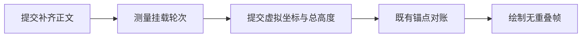

# Chat Virtual Scroll

> **V4 当前事实**：滚动视口、虚拟化、底部跟随与 renderer-local 滚动记忆由
> `packages/ui/src/v4/ConversationTimeline.tsx` 持有；消息事实仍来自
> `packages/shared/src/zcode-protocol-v4/` 与 `apps/zcode-cli/packages/bootstrap/src/zcode-protocol-v4/`。

## 目标

长对话只渲染当前视口附近的消息轮次，降低 renderer 在长会话中的 DOM 数量和 React 更新成本。

## 渲染策略

- `ConversationTimeline` 以 `ConversationTurnRenderUnit` 为虚拟滚动单位，而不是单条 projection row。
- 每个虚拟 row 对应一轮 user + assistant/tool 输出，避免 retry、fork、文件变更摘要和当前轮 loading 被拆散。
- 使用项目已有的 `@tanstack/react-virtual`，动态高度通过 `measureElement` 回写。
- 对话搜索先按 projection rows 建索引，再通过 virtualizer 定位并在已挂载 DOM 中高亮。

## resize 中的底部跟随

`ConversationTimeline` 是唯一滚动 owner，沿用 `followingRef` 和已有用户意图裁决。用户上滚立即解除跟随；滚回底部或点击回底恢复跟随；搜索、轮次定位、会话滚动记忆及历史前插继续保持原契约，不提供强制吸底开关。

- 跟随状态下，视口或内容列宽度变化引起的重排采用绘制前批处理：读取行高 → 更新 virtualizer 缓存 → 同步提交 React 占位高度和位置 → 再确认跟随权 → 吸底。不等待宽度稳定计时器，不将旧占位高度下的中间落点留到下一帧。
- 库的 observer 可能已更新缓存但仍排队等待 React 提交，因此批处理必须明确触发布局提交；不能依赖无差量的重复测量触发 render。同步提交仅在 ResizeObserver 回调内执行，批处理期间其他内容 effect 不抢先吸底。
- 离底时保持原宽度变化保护：resize 期间暂停逐行滚动补偿，不强制吸底；稳定后恢复正常测高补偿。本文不新增按句子保持屏幕坐标的阅读锚定。
- 每次批处理前后检查最新用户意图，resize 中上滚、搜索或会话切换不能被后续测高抢回滚动权。观察器监听视口和内容列，在同步提交前暂时取消内容列及父消息层蒙层的尺寸观察，下一帧恢复订阅，避免自身高度写入触发循环通知，同时持续覆盖 CSS 宽度过渡；测高与吸底本身不延后，不重复订阅虚拟行。消息内容变高继续走原有测高与内容提交逻辑。批处理只测已挂载行，不轮询或全量渲染历史。
- 桌面和手机 Web 共用此逻辑；空草稿保留顶部安全布局，不修改消息协议及 continuous/replayable 边界。

```text
尺寸变化 → ConversationTimeline 检查跟随权
  跟随 → 批量测高 → 同步提交布局 → 再检查跟随权 → 吸底
  离底 → 原有宽度变化与阅读位置保护
用户上滚 / 搜索定位 → 解除跟随（优先于布局回调）
回到底部 → 恢复跟随
```

验收：连续缩窄/放大时跟随落点与列表占位高度正确；resize 中上滚后保持离底；点击回底可重新跟随。原会话记忆、搜索定位和历史前插回归通过。运行时记录绘制前实际行底部与占位高度误差、离底距离，并检查可见画面，允许 1px 亚像素取整误差；不得以停止拖动后的落点代替过程验证。

浏览器回归：`node --test packages/ui/test/browser/manual-review/pending/conversation-timeline-resize.test.mjs`。覆盖真实 timeline、消息组件和虚拟列表的桌面/手机紧凑布局、深浅主题、内容列独立宽度过渡；数据为确定性 fixture，手机远控传输不属于该测试覆盖范围。桌面实际会话继续由 `conversation-session-v4-scroll.test.ts` 覆盖流式输出与滚动记忆。

## 编辑重发的显示交接

编辑最后一条用户输入会先提交 branch cut，再发布 replacement input。两者跨帧时，
不能把“旧轮已移除、新轮尚未到达”的中间空态交给 Timeline，造成先收缩再撑开。

- 发起编辑的 renderer 在既有 per-session projection store 登记命令时，暂存当前 rows
  引用作为只读显示。权威 snapshot、seq、revision、queue 和控制状态继续正常推进；
  暂存内容不参与命令 target、持久化、恢复或队列裁决。
- 以同一 commandId 的 real-user row 或 queue item 为交接信号，在同一次 store 通知中
  释放暂存 rows。ACK accepted/duplicate 只表示接纳，不能提前结束显示交接。
- 编辑在底部 composer 编辑态中进行（[Composer 编辑态](composer-edit-mode.md)）。accepted 后
  composer 保持提交态，直到新 row 到达再退出编辑态；失败、拒绝和文件冲突仍保留可重试的编辑内容。失败 ACK、明确的新 runtime 错误、epoch/runtime 换代和
  store 关闭必须释放暂存显示；不使用定时器、动画时长或猜测网络速度来交接。
- 每个 store 最多保留一份显示引用。会话和 workspace 使用已有 store/lease 隔离，
  切到其他会话不带入旧显示。桌面和手机发起编辑共用该逻辑，continuous/replayable
  协议与其他客户端接收远端编辑的行为不变。普通 send/retry 不启用此编辑过渡。
- 过渡期间不从被冻结的显示窗口发起历史分页；新投影到达后恢复原分页与滚动规则。

```text
编辑提交 → store 保存当前显示 rows
权威帧：branch cut → snapshot 照常推进 → matching sourceCommandId
显示层：旧 rows ─────────────────────→ 新 rows（一次替换）
失败 / epoch 变化 / runtime 释放 ─────→ 释放旧显示，使用当前权威 rows
```

验收 D20：真实编辑按钮、发送按钮、projection store 和 Timeline，分步释放 cut 与新输入；
在两步之间逐帧检查旧轮仍在、composer 保持提交态、列表高度/scrollTop 不回落；新输入到达后原子替换。
覆盖单轮/多轮、桌面/手机布局、深浅主题、ACK 先后顺序、拒绝、queue 投影、
错误与代际隔离。受控帧只用于测试，不引入产品延时。浏览器入口：
`node --test packages/ui/test/browser/manual-review/pending/edit-query-presentation.test.mjs`。

## 滚动边界

- 旧的 `useChatAutoFollow` 多 flag 自动吸底状态机已删除；当前只保留一个小的 bottom-lock 状态和普通手动滚动容器。
- `ConversationTimeline` 使用一个小的 bottom-lock 状态：没有滚动记忆的新会话默认启用，消息追加、markdown/tool 详情撑高和 ResizeObserver 变化会继续写入最新底部 `scrollTop`。
- 右下角“滚动到底部”按钮只由当前滚动条位置控制：滚动容器不在底部时显示，到达底部时隐藏；用户手动滚回底部附近或点击按钮滚到底部都会重新启用 bottom-lock，避免生成中内容继续变高时错过锁底。消息不使用渐隐遮罩；普通会话底部 16px 留白位于滚动视口之外，由 timeline 根容器的 padding 提供。
- 当消息内容短到没有纵向滚动条时，视口没有可保留的历史阅读位置，ChatView 会把它视为 bottom-lock 可开启状态；这样后续流式内容撑出滚动条时仍能继续吸底。
- 正常对话态下，composer 通过 `bottomDock` 渲染在 timeline 的同一个滚动视口内，并使用 `sticky bottom-0` 吸附；“回到底部”按钮锚定在 dock 上方。
- 会话切换优先读取 renderer-local 的滚动记忆。记忆键由 `workspaceIdentity?.trim() || workspacePath`、`paneId` 与 session/task scope 组成；同一 renderer 的不同 pane 不共享阅读位置，不同桌面窗口或手机 Web renderer 也不共享内存。
- 若记忆保存时处于 bottom-lock，切回时滚动到**当前**最新底部并继续启用 bottom-lock；否则恢复保存的像素 `scrollTop`，按当前内容高度夹紧到合法范围并保持离底。如果没有记忆，则打开时定位底部并启用 bottom-lock。
- 恢复先在 layout 阶段写入一次，下一 animation frame 在 virtualizer 首轮测高后再校正一次；若用户已经滚动，第二次校正必须让出写入权。
- 搜索结果、高亮查找、fork 来源和 turn navigator 跳转都属于定位型滚动，定位后保持离底；该位置可被后续 task 切换记忆。
- 补全旧历史后继续按新增高度恢复滚动位置，避免视口跳到历史顶部。
- 对话内容宽度连续变化时，动态行会因文字换行分批重新测高。离底阅读状态必须保持当前 `scrollTop`，禁止 virtualizer 按每条视口上方行逐次补偿而造成上下抖动；吸底状态采用上面的同步测高批处理，每次视口 resize 都按已提交的新高度吸底。宽度稳定后恢复普通动态测高补偿，新消息与流式内容的正常 bottom-lock 不受影响。
- bottom-lock 不写入 localStorage、relay、main process、host process 或 task runtime；滚动记忆只在当前 renderer 生命周期存在，并由 200 项 LRU 回收。

## 历史详情懒渲染

- `AssistantMessage` 的历史区只在展开时调用 `renderHistoryParts`，默认闭合时只保留摘要行。
- `ToolLayout` 支持 `renderContent`，工具详情只在展开或强制展开时构造，避免闭合工具提前挂载大量 markdown、diff 和子工具 DOM。
- 历史区和工具区的展开状态按 message/tool key 保存在 renderer 内存中，虚拟滚动导致组件卸载再挂载时不会丢失用户刚展开的细节。
- 流式输出、被中断和 settling 状态仍会强制展开历史区，保证正在发生的内容不会被隐藏；流式结束后自动回到摘要态。

## 渲染缓存与 memo 边界

- 已完成 markdown 消息固定走 `Streamdown` static 模式；只有真实流式动画进入 streaming/block 路径，避免虚拟滚动和历史懒渲染反复重挂载完成态消息时触发 Streamdown 内部更新循环。
- `DiffViewer`、edit inline diff、`ToolLayout`、`ToolCallBlock`、`AssistantMessage`、`ChatMessage` 和 turn group 边界使用 `memo`，减少历史消息在父组件更新时的重复 commit。
- turn group 内传给单条消息的 retry、文件切换、feedback、fork 回调通过 `useCallback` 稳定，避免 memo 被 map 里的 inline function 抵消。
- diff 只稳定 options 和 viewer 输入，不缓存实际 DOM；主题、字号、换行和行号设置变化时仍会正常重渲染。

## 每帧派生成本

流式 delta 通常只改变最后一轮，但 `rows` 每帧都是新引用。虚拟化只限制 DOM 数量；renderer 在 React commit 之前仍要从完整 `rows` 派生 render unit 等数据。如果每个消费方都靠逐行比较来确认“历史没变”，每帧成本就会随历史长度线性增长。宽屏问题目录会补齐完整历史（见 `docs/ui/conversation-turn-navigator.md`），这在宽屏下尤其明显。目标是流式帧的派生成本与历史长度无关。

### 冻结历史 + 尾轮分区

```text
delta 帧 → store apply → rows.window（唯一事实源，不变）
                │
                └─ advanceConversationRowsPartition：按 delta 判断，O(delta + 尾轮)
                     只改尾轮 → 沿用上一份 history 数组（引用不变）
                     其他情况 → 不登记；首次读取时整窗重建，O(N)
                ▼
getConversationRowsPartition(rows) = { history, tail }
                ▼
消费方：历史结果按 history 引用缓存，每帧只算 tail，再 O(1) 合并
```

- 分区是 `rows` 的纯派生缓存，用 `WeakMap` 以 window 数组身份为键。它不是第二份状态：`history` 与 `tail` 拼接后逐项等于 `rows`，读取方拿到的永远是与当前 `rows` 对应的分区，不需要层层透传，也不存在两份数据错配。
- 分区类型 `ConversationRowsPartition` 定义在 `@zcode/shared/zcode-protocol-v4`，与 `ConversationRow` 放在同一文件。它只是行数组的视图类型，不上 wire，没有运行时 schema。构造和缓存（`getConversationRowsPartition`、`memoizeByRows`）留在 renderer 的 `conversationProjectionStore`。所有消费方都从 shared 引用这个类型；插件 UI 的 domain 层因此只依赖协议类型，不依赖 v4 store。
- `tail` 是 window 的后缀，包含最后一行所在轮的全部行，可能包含多轮，与 `history` 的轮次不相交。整窗重建时，若尾段某一轮在更早位置也出现过，起点前移到那里；快路径沿用上一份 history 时，尾段可能留着已完成的轮（见下面的尾轮内截断）。消费方不能假设 `tail` 只有一轮；按轮分组的派生可以分段计算再拼接。
- 只改尾轮的判定：`row.delta` / `row.upserted` 的 rowId ≥ 尾轮首行 rowId（窗口按 rowId 升序）；`row.appended` 的轮次已在尾轮中；`row.removed` 的起点在尾轮首行之后。新轮开始、旧行更新、前插、rewind 和 snapshot 帧都会让历史变化，此时整窗重建一次。
- 成本边界：常数只针对流式帧，而且与历史轮数无关，不是与最后一轮的大小无关。尾轮的切片、分组和派生每帧都要算，所以单轮里有上千个工具调用时，每帧成本随这一轮增长。改到历史行的事件每次多付一帧 O(N)。这类事件都是一次性的：新轮开始（上一轮的行级 actions 交给新轮）、后台结果改写原工具行、subagent 启停、点赞与 rewind。轮开始/结束和 compact 开始/结束翻转的 fork / 文件撤销 session 锁走 `availability`，不改历史行（见 [02-projection](../v4-refactor/02-projection.md)「会话锁与行级资格」）。CLI 的流式 `row.delta` 只指向当前轮的行，后台任务进度走 `state.updated`，所以都走快路径。
- 尾轮内部截断（`row.removed` 起点在尾轮首行之后）时，沿用的分区可能不是规范分区：尾段里留着已完成的轮。轮次仍不相交，输出值不变，只是每帧多算这些轮，直到下一次整窗重建。

### 消费方合并规则

- render unit：历史段 unit 按 history 引用缓存。只有历史中存在无 header 的轮次、仍在运行的轮次或可固定的插件卡片时，缓存键才额外包含 session phase、时钟或插件固定裁决。尾轮每帧 materialize。合并时有三条跨轮规则：尾轮 unit 被过滤掉时，历史末项按最后一轮重新归一化，结果按 session phase 缓存，history 引用保持不变；highspeed footer 只在“含卡片的历史 unit + 尾轮 unit”这个子序列上收口，结果与全量收口相同；最终 unit 仍按引用复用。
- 最后一轮始终作为普通文档流的 live tail 渲染，运行、停止、完成和失败不会改变其父容器；只有新一轮出现时，旧轮才进入虚拟历史。运行时虚拟列表直接使用历史 unit 数组，引用在流式帧之间不变。
- 插件卡片派生只依赖插件 UI 行和轮次顺序：历史不变、尾轮的轮次序列和插件 UI 行引用都不变时，复用上一份结果。
- 问题目录和对话查找：历史段的条目与命中按 history 引用缓存。尾轮的目录条目每帧重建；查找命中与修改前一样，只缓存不在运行的 unit。未查找时返回固定的空索引并清空命中缓存，不留着上一次查询的 unit。目录条目的值只在尾轮预览变化时更新，预览最多 220 字，超过后不再变化。目录成员（realUser query rowId）同样按分区收集：历史段引用不变且尾轮成员不变时返回同一个集合对象，问题目录的锚点登记按这个对象身份失效。
- bot 话题准备消息：没有准备中的材料时结果必为空，直接跳过；有材料时仍按整窗计算，只发生在话题准备期间。材料挂在历史末项上时（尾轮为空），同一份材料复用同一个 history 数组。
- 按行扫描的派生用 `memoizeByRows(fn)` 按行数组缓存：分别对 `partition.history` 与 `partition.tail` 调用，history 在流式帧之间引用不变，所以只在历史变化时重算。它只收拢 WeakMap 的读取、计算、写入样板；两段结果怎么合并（求或、取最新、排序后二分、建索引）由各消费方自己写。当前用户：插件引用判定、workflow 联接行、MCP 不可用提示（每个工具只取最新一条）、highspeed 到期边界（升序后二分）、highspeed 统计索引（按 sourceCommandId 取首次出现）。它只用于去重，不能阻止新增的派生直接遍历 `rows.window` 而退回 O(N)；新增每帧执行的派生时，需要在评审中检查这一点。
- 只取决于单行内容的判定按行对象缓存，例如 `selectWorkflowJoinRows` 的工作流工具名识别：尾段每帧重算时不必对未变的工具行重复做正则归一。协议行不可变，内容变化一定产生新对象，所以缓存不需要失效逻辑。
- SessionPane 的最新完成轮用 `findLast`，只扫描尾部。发送渲染通知在没有待渲染发送时跳过；pending command 对账在本会话没有待对账条目、也没有结算监听时跳过。两者在跳过时本来就不会产生任何效果。结算监听是全局的，可能一直存在到权威结算（结果未知的提交不会产生结算通知）；有监听时所有会话照常整窗扫描，与修改前相同。
- store 共享 delta 行时从窗口尾部扫描一次，找齐全部 delta 目标即停止。`applyConversationDelta` 处理 `row.upserted` / `row.delta` 时同样从尾部查找。apply 对每条 delta 复制一次 window；CLI 已在 flush 时合并相邻同行 delta，流式帧通常只复制一次。window 复制是协议 snapshot 表示带来的线性成本，留到后续再处理。

### 回归验证

可重复的性能验收入口是 PERF04（`packages/desktop/test/e2e/conversation-session/presentation/manual-review/pending/conversation-session-streaming-history-performance.test.ts`，覆盖记录见 coverage matrix「PERF04 长历史流式渲染」）。它经 Host 导入服务建立 1000 回合 / 3000 行历史，回放 thinking 与正文流式输出，断言完成态正文逐字一致、帧间隔 P95 低于预算，并输出帧间隔、长任务和 renderer CPU profile。

```bash
ZCODE_E2E_MANUAL_REVIEW=1 pnpm --filter @zcode/desktop exec wdio run wdio.conf.ts \
  --spec ./test/e2e/conversation-session/presentation/manual-review/pending/conversation-session-streaming-history-performance.test.ts
```

读数口径：帧间隔 P95 反映画面是否掉帧，60Hz 显示器的理想值约 16.7ms；机器越快、历史越短，这个值越早贴近理想值，看不出派生成本的差别。派生成本看同一次运行的 CPU profile 里 renderer 非空闲时间。

2026-10-29 同机（macOS arm64，Scan 关闭）对比，修改前为 HEAD `ec67ad4f58`：

| 指标                                | 修改前           | 修改后           |
| ----------------------------------- | ---------------- | ---------------- |
| 帧间隔 P95                          | 18.3ms           | 17.5ms           |
| 长任务                              | 2 个（60、57ms） | 2 个（69、69ms） |
| renderer 非空闲时间（约 8.8s 采样） | 1649ms（18.5%）  | 1083ms（12.3%）  |

两次都满帧；差别体现在 renderer CPU 少约三分之一。两个长任务出现在发送初期，在修改前就存在。数值只代表这台机器上的同机回放，不代表用户机器。

分区实现剩下的线性部分：apply 复制 window，以及与最后一轮大小成正比的尾轮派生。

浏览器验收夹具 `packages/ui/test/browser/manual-review/pending/message-render-isolation.fixture.tsx` 与 `render-boundaries.fixture.tsx` 直接使用分区 API：前者把 selector 结果拼平后与 `buildConversationTurnRenderUnits` 做值对照，后者驱动问题目录与查找。

## 远控边界

本改动只影响 UI 层渲染，不改变 ZCode task 消息流、snapshot、queue 或恢复语义：

- 桌面端 `desktop-continuous` 仍保持 direct continuous 主链路。
- 手机远控 `web-remote-replayable` 仍通过 replayable snapshot/gap 恢复边界展示消息。
- 远控全量历史仍由显式加载控制，不因虚拟滚动重新触发隐式全量快照传输。

## 部分轮次补齐的绘制一致性（SSV03）

冷切换可能先显示末尾 60 行，再补齐历史；首轮保持同一 turnId，但正文会显著增高。补齐正文与该轮测高、后续轮位置、列表总高度必须在同一次绘制前收口，不能等待下一帧 ResizeObserver 才更新坐标。只测量当前挂载的虚拟单元，沿用已有 virtualizer 与高度缓存；不重建 turn key、不增加延时或第二份布局状态。前插批次只由既有 prepend 锚点补偿一次，逐行测高不得再叠加滚动补偿。既有离底阅读锚点、用户滚动优先和跟随状态不变。



## 分组身份连续性（SSV05）

冷恢复按 60 行补齐同一长轮次时，同一已挂载 turn 内的历史分组与消息节点必须保留身份，不能因窗口首行变化而重新挂载、重播淡入。流式追加也必须保留已有分组；不能把 key 从首行简单改成末行，让每次追加重新挂载。

独立用户/助手行沿用行身份。工作段中的连续历史/工作组，以及其内部的统一连续摘要组，分别由所属列表组件维护身份：只保留上一版投影的行到 key 对应关系，通过同类分组的共有行复用身份，新组分配唯一 key。不能直接用 response ID，也不能使用会随追加改变的右侧边界。此状态只用于 React 协调，不保存第二份消息数据，不使用 effect、计时器或 render 中修改 ref 来同步；随列表卸载释放。拆分时按显示顺序仅第一个共有子组继承原 key，合并时继承第一个共有组的 key，其他组按新身份处理。原有展开/收起动画保持启用。

```text
冷快照 / history prepend / streaming append
  → 既有 rows 投影 → 同一 segment 按共有行延续分组身份
  → 保留分组与消息 DOM → 更新内容与既有测高
```

验收：共享 Timeline 浏览器 E2E 覆盖桌面/手机、深浅主题、段尾历史、最终正文边界、CUA 分隔与流式追加，断言已有消息 DOM 和展开区节点不变、补页不重播淡入。另用本机隔离的真实长会话及三个子 Agent 冷恢复顺序验证，录屏与原始数据保留在本地诊断产物，不进入仓库。

合入统一连续摘要后，旧 CUA 虚拟分组及其展开记忆已随上游移除；不恢复旧分组。CR-01 继续覆盖同 response 的 CUA 与未归类工具交错、普通历史后追加 CUA 摘要组、前插新组与组内行、之后继续流式追加。按现行摘要分组规则断言兄弟 key 无重复告警，原组 DOM、各自展开状态及动画不变，新组不继承其他组的展开状态。

## Stop 终态的轮次身份（SSV06）

Stop 只更新权威投影中的执行状态，不能把当前轮从普通文档流搬到另一个父容器。此前仅在
`isRunning` 时保留 live tail，停止后整轮迁入虚拟历史，React 会卸载并重建该轮；已有
过程内容的淡入动画重新从透明开始，导致整片闪空。

- 最后一轮无论运行、停止、正常完成或失败，都沿用相同 turn key、父容器和组件实例。
  空列表不渲染尾轮；新一轮出现时仅新的最后一轮常驻，旧轮继续使用虚拟化与测高缓存。
- Timeline 从现有 rows/render units 直接派生最后一轮，不复制消息、不增加停止态缓存、
  计时器或延迟搬迁。状态、操作权限和过程区展开规则仍由原投影决定；正常完成的折叠动画保留。
- 原有 live tail 测高、底部跟随、离底阅读、搜索定位和会话滚动记忆继续适用。
  桌面与手机共享此 UI 规则，Host/CLI owner、continuous/replayable 协议不变。

```text
权威 running → completedInterrupted / completedSuccess / failed
UI 同一末轮、同一父容器、同一组件实例 → 更新状态和原有收纳
新一轮到达 → 旧轮进入虚拟历史；只有新的末轮常驻
```

验收：真实 Stop 命令的 Electron E2E 断言轮次 DOM 身份不变；共享 Timeline 浏览器回归
覆盖桌面/手机、深浅主题、跟随/离底，逐帧断言停止后已有过程消息和工具 DOM 保留、
无淡入重播及透明帧、旧轮保持身份；正常完成/失败、下一轮交接与空列表同时回归。
