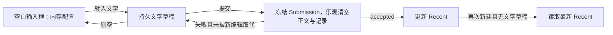
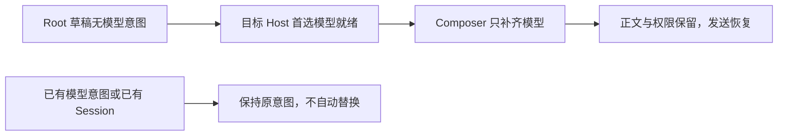

# Composer 仅持久化文字草稿

> 2026-10-16 当前实现：新建草稿与 Recent 按项目/未归类任务归属，未发送任务复用执行目录；详见 [统一生命周期](project-task-draft-lifecycle.md)。下文 2026-10-14 的 workspace Root/Recent 与手机暂缓条款记录原实现，当前行为以新规格及其验证记录为准；正式 Session 恢复与非空文字规则继续适用。

## 规则与范围

2026-10-14：用户确认“没有输入文字就不算草稿，不做持久化”。本文替代 Todo71 中空正文保留配置的规则。
正文以 `text.trim().length > 0` 判定；键入、粘贴和模板预填等价，空格、换行、空 editor JSON、仅改模型/权限不构成可持久化草稿。引用 chip 的显示正文沿用编辑器现有文本序列化，不新增附件序列化。

有文字时保存正文、编辑器状态、权限、Plan、完整 ModelSelection；删空时删除记录。发送沿用既有乐观清空：先冻结 Submission，再清空正文和记录；失败且未被后续编辑取代时恢复，接纳后更新 Recent。读取旧版本空草稿时只过滤，显式写入时清理，不让旧配置继续阻挡默认值。
当前输入框的配置仍由 `useDraftConfigControl` 的内存态唯一持有；不因不写盘而在普通 render、目录刷新或 Snapshot 到达时回退。重新进入空白新建页使用当前 workspace Recent，已有 Session 始终从当前 Snapshot 恢复权限与 Plan，有文字草稿时只恢复其中的正文与模型。显式 New Task 即使复用当前 pane，也开启新的空白编辑生命周期；有文字的草稿继续恢复。

## 首个 Provider 就绪后的模型补选

2026-10-16：新建 Root 草稿在空 Provider 配置下可能已初始化权限并输入正文。若它没有任何
`modelSelection` 原意图，目标 Host 的首个合法 `preferredSelection` 到达后，现有 Composer
owner 自动补选该完整模型。补选只写模型，保留正文、编辑器状态、权限和 Plan；不更新 Recent，
不发送模型请求，也不启动第二个 Agent。不新增同步定时器或第二份状态。

已有选择（包括失效模型或失效 reasoning）不补选；已有 Session 和分享导入不应用此 Root
规则。后续目录变化不得覆盖已补选或用户显式选择的模型。仍按 workspace identity 隔离，
桌面与手机使用同一 Hook，不改变 continuous/replayable 的传输边界。

验证：I23/I24 桌面 E2E 覆盖空配置、历史读取、保存首个 Provider、原文保留、发送恢复和唯一
Agent；Hook 单测覆盖本地/远端 identity、权限/Plan 保留、已选/失效选择与既有 Session 排除。

## 状态归属与影响面

| 场景 / 入口                  | 唯一 owner / 提交路径                                   | 持久化与初始化                                                     | 影响级别       |
| ---------------------------- | ------------------------------------------------------- | ------------------------------------------------------------------ | -------------- |
| 新建 / 当前 Session 输入框   | useDraftConfigControl → Submission → CLI admission      | composerDraftStore 只保存文字；Recent 仅 accepted 更新             | must-inspect   |
| New Task / 项目与分组菜单    | workspace UI store 的 draftProjectId / draftTaskGroupId | 当前创建意图留内存；有文字时随草稿保存，手机冷恢复只读取有文字草稿 | must-inspect   |
| 分享首次导入                 | 导航参数 → Composer owner                               | 一次初始化配置仅内存；不伪造磁盘草稿、不修改 Recent                | must-inspect   |
| 离线页与刷新                 | composerDraftStore 的只读结果                           | 只恢复有文字草稿，不新增离线队列                                   | should-inspect |
| 自动化、子智能体、已接受队列 | 原有 record / CLI owner                                 | 不消费 Composer 草稿、不更改冻结的 Submission                      | invariant-only |

共享行为是草稿读写与有效模型解析；新建读 Recent，已有 Session 读自身 Snapshot，两者不统一为全局配置。权限/Plan 恢复以当前 Session Snapshot 为准；历史授权只用于本次打开周期内识别新变化，不存入草稿。
工作区隔离始终使用 `workspaceIdentity?.trim() || workspacePath`；桌面 continuous 与手机 replayable 的传输、shared-host、owner/lease 和队列协议不变。没有新增 Host/Agent 状态或同步定时器。

Recent 的作用域不变：同一项目/工作区内新建继承最近已接纳配置；当前全局未分类新建会分配新的工作目录，不自动复制另一个工作区的 Recent。桌面回归显式从同一项目入口创建，避免把工作区切换误判为空草稿恢复。

## 实施顺序

1. 更新 spec、catalog、coverage；先写存储与 Hook 回归并观察旧实现失败。
2. 将项目/分组当前创建意图收口到现有 workspace UI store，迁移原来从空草稿读它们的调用方；首次分享导入改为临时交接。
3. 存储入口统一过滤空正文并清理旧记录；Hook 在 New Task 生命周期边界重新初始化空输入框，保持当前编辑与迟到 ACK 的 scope 防护。
4. 更新已有空草稿测试，并扩展桌面 pending E2E；运行必要门禁后提交。

## 用例与剪枝

| ID   | 前置与操作                                                              | 断言                                                                    | 层次 / 状态                                     |
| ---- | ----------------------------------------------------------------------- | ----------------------------------------------------------------------- | ----------------------------------------------- |
| TD01 | 全新输入框只选 yolo + A，然后切走/刷新                                  | 内存当前选择可用；localStorage 无草稿，重开按默认来源初始化             | storage + Hook / accepted                       |
| TD02 | 首发 yolo + A；打开一次空白页；回原 Session 改 build + B 并提交；再新建 | Recent 为 build + B；新页同值、无空白持久记录；真实按钮和模型切换       | Desktop E2E / accepted pending                  |
| TD03 | 输入文字并改权限模型，切 Session 后返回/刷新                            | 恢复文字及模型，已有 Session 权限/Plan 采用当前快照；不改 Recent        | Hook + Desktop E2E / accepted pending           |
| TD04 | 文字删空或只剩空格后重新新建                                            | 旧持久记录删除，新页按最新 Recent；同 pane 的重复 New Task 不保留空配置 | storage + Hook + Desktop E2E / accepted pending |
| TD05 | 发送成功、失败、ACK 迟到且用户已输入下一条                              | 成功只清原提交；失败保留正文配置；旧 ACK 不覆盖新 scope/新文字          | existing submission tests + Hook / accepted     |
| TD06 | 存量空记录与同路径不同远端的有文字记录                                  | 仅清空记录；远端身份隔离、有文字坏模型保留待修正                        | storage / accepted                              |
| TD07 | 未输入时选择项目/分组，随后输入并首发                                   | 空页面不写盘，首发仍进入所选项目/分组；有文字可冷恢复                   | store + navigation tests / accepted             |
| TD08 | 首次分享导入、View 延迟、已有 Session reused                            | 导航初始化不写空草稿，导入仍遵循新建初始化；用户改选优先，reused 不重置 | Hook / accepted                                 |

纯样式、主题和国际化没有变化，沿用共享控件，不枚举全套外观叉乘。模型使用同 provider 两个合法模型作为代表；权限使用 yolo/build。队列 admission 与执行配置保持冻结，只验证发送草稿边界，不扩展队列功能。附件目前没有跨重启草稿持久化，不增加此能力。

## 扫描证据与后续验证

codegraph 工具不可用；使用精确调用方检索追踪 storage → Hook → SessionPane/Root 及一跳项目菜单和分享入口，未声称完成 codegraph 扫描。功能图原有 conversation-model-control 缺少 text-only persistence 与新建生命周期关系，本次补充语义节点。没有待用户裁决的产品边界；空白不持久化已获确认。

验证记录（2026-10-14，基线 `7d60f53393`）：

- 先运行 TD01/02/04/06 存储和 Hook 回归观察失败，修改后通过；最终 `pnpm test:unit:affected` 为 301 文件、3,885 用例全部通过。含失败恢复、迟到 ACK、新任务配置继承、分享导入和手机项目初始化。
- `pnpm typecheck`、`pnpm lint`、`pnpm architecture:check --changed`、case-local fixture 检查通过；Lint 为 0 errors（仓库既有 210 warnings）。功能图新增节点/边和源码种子检查无新增问题，图中既有 4 条悬空边未扩展处理；codegraph 未执行。
- Linux Electron + Xvfb，回放 `common.json` 与本用例 fixture。`desktop-e2e-20261014-093656-755`：TD01/03/04 独立用例通过（空白不保存、正文/权限刷新恢复、空格删空、同项目重复新建）；截图与 JSON 为该 run 下 `conversation-session-composer-recent-mode/00-text-only-draft.*`。
- 完整 I74/I75 + TD02 发送链路未通过：首条输入即报“草稿会话已切换，请重新发送”，尚未到 A→B 切换断言。将全部修改的产品源码临时还原到基线并重新构建，对照 run `desktop-e2e-20261014-093347-523` 同样在首发报错；Agent 日志同时记录预热 session 的 `loadPersistedEvents / Session not found`。产品源码随后完整恢复。本次不修改预热/Host/CLI 生命周期，TD02 的 Hook 回归通过不能替代这项 E2E。
- 手机只完成共享逻辑与导航单测，未做手机实机、macOS、Windows GUI 验证。E2E 保持 pending，不自动晋级 formal/CI；完整发送流程需在基线预热问题修复后补跑。

MR 集成补充：同步最新 staging 的远程目录确认流程后，普通项目入口与远程目录确认统一通过 `createProjectTask` 读取 workspace UI store 的 `draftTaskGroupId`。空白输入框选择分组也必须能随远程目录确认传递；已有任务仍不继承新建草稿分组。

同步基线 `f67f7570ba` 后复验：项目菜单 38 用例通过；受影响单测 304 文件 / 3,948 用例通过；typecheck、lint（0 errors、210 既有 warnings）、architecture 通过。重新构建的 Linux Electron run `desktop-e2e-20261014-111418-638` 仅选择 TD01/03/04，1/1 通过。完整发送用例本轮未重跑，仍保留上述未通过记录。

## Review 后的简化规则（2026-10-14）

用户确认：已有 Session 的文字草稿重新打开时，恢复正文和模型选择，权限与 Plan 使用该 Session 最新 Snapshot。当前打开期间的菜单选择仍归 Composer；普通快照不能覆盖，真实新授权/Plan 工具变化按最新 Snapshot 更新对应字段。首次匹配快照只建立当前状态和观察基线，不重放其中的历史授权。Snapshot 暂时缺席不重置观察基线；切换 scope/卸载才结束。

删除持久草稿的 lastPermissionGrantId、lastPlanTransitionId 和 initializeFromNewTask；旧字段读取时忽略。新建 Root 的文字草稿仍恢复其完整选择（尚无真实 Session）。首次导入由导航 owner 显式交付新建初始化配置；既有 Session/reused 不走导入初始化。首发绑定真实 Session 是同一 Composer 编辑周期的迁移，保留发送期间的新输入；离开后再打开才应用 Session 恢复规则。

首发不再使用全局 seed Map：当前 pane 只允许同 workspaceKey、同 draft generation 的已接受结果迁移；New Task、切页、卸载使旧回调失效。分享导入初始化附着于已有 workspace 导航动作，接收后清除，切任务/新建时废弃；不保存成空草稿。提交配置仍在发送时冻结，不因后续编辑变化。

读取草稿只解析/过滤，不写 localStorage；旧空记录在显式写入时清理。无文字不保存，新建使用 workspace Recent，Recent 在提交被接纳时更新；审批框完全访问另以实际授权回执仅更新本端同项目权限，见[权限审批规格](../permission-project-approval.md)。

本轮明确不修改手机项目/导航恢复；共享 Composer 逻辑仍同时用于 desktop continuous 和 mobile replayable，不改变 Host、CLI、queue 或传输恢复语义。实现计划见 [状态简化规划](../plans/composer-state-simplification.md)。

新增回归 CS01–08、CS10：历史授权/Plan 不重放；有文字恢复最新权限与 Plan；live 新变化只更新对应字段；重复/迟到投影不覆盖编辑；首发迁移保留新输入且旧回调不清新页；导入初始化随导航消费/失效；render 读取零写入。CS09 手机项目恢复由用户明确排除。

验证（2026-10-14）：新增回归先在旧实现失败；最终受影响单测 305 文件 / 3,956 用例通过。Hook/storage 定向 50 用例通过。浏览器 `share-import-selection.test.mjs` 14 组通过（导入 10 组，Session 恢复 4 组；390/1200px、中文浅色/英文深色），使用真实 Hook 与工具栏、受控 Snapshot，覆盖切回/刷新、历史记录不重放、live 授权/Plan 与重复投影。该浏览器夹具不代表真实 CLI 或手机 remote 链路。

Linux Electron 重建后 run `desktop-e2e-20261014-120739-442`，TD01/03/04 1/1 通过：空白不保存、文字刷新恢复、删空后 New Task 取默认。`pnpm typecheck`、`pnpm lint`（0 errors，210 既有 warnings）、`pnpm architecture:check --changed` 通过。完整 A→B 发送 E2E 仍保留此前基线预热阻塞，本轮未重跑；手机项目代码未进一步修改，手机实机、macOS/Windows GUI 未验证。用例仍在 manual-review/pending。
