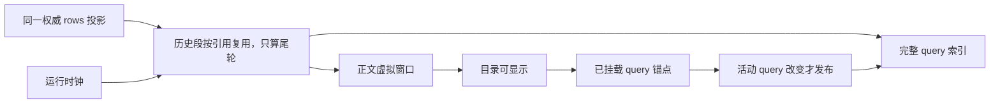

# Conversation Query Navigator

V4 conversation query navigator 是聊天时间线左侧的紧凑跳转 rail。它不是按
真实消息高度映射的 scroll minimap，而是按用户可见 query 顺序均匀堆叠的小横条入口。目录必须覆盖
当前有效分支里的全部用户 query：首帧继续使用有界 tail snapshot，宽屏存在更早 rows 时通过既有
`rows/range` 只读分页补齐完整 rows，再从 renderer projection 派生目录。它不新增第二份 session
事实、replayable queue、relay 或 main process 状态。

```text
CLI full projection
  -> bounded v4 snapshot.rows tail
  -> navigator-visible renderer
       -> rows/range(200 rows/page) until firstRowId
       -> epoch/cursor validation
       -> one projection merge
  -> buildConversationTurnRenderUnits(full rows)
  -> ConversationTimeline virtualizer
       |-> message column
       |-> left compact query rail virtualizer
             one item: one UserInputRow(origin=realUser)
             hover/focus: that user query + owning turn assistant excerpt
             click: mount unitIndex -> align exact rowId
```

## 变更边界与确认记录

| 决策 | 产品语义 |
| --- | --- |
| 导航粒度 | 每条 timeline 可见的 `UserInputRow(origin=realUser)` 独立建项；普通 query 与 accepted steer/guide 等价 |
| 同一 product turn | 初始 query、guide 1、guide 2 可以共享 `turnId` / `unitIndex`，但必须拥有不同 `rowId`、导航项和落点 |
| Tooltip | 第一段显示该条 user query；第二段沿用所属 product turn 的 assistant text 摘要或运行中/空结果 fallback；不拼接 tool、reasoning、subagent 或 marker 正文 |
| Queue 边界 | 仍在 pending queue 的输入没有 timeline row/anchor，不进入导航；消费并投影为可见 real user row 后才进入 |
| 完整目录 | 2026-07-24 用户确认：目录不能只覆盖当前 tail window；必须补齐当前有效分支的全部 rows，直到 `window[0].rowId === firstRowId` |
| 虚拟化 | 完整目录只挂载 rail viewport 与 overscan 内的按钮；`data-item-count` 表示全量 query 数，DOM button 数不再等于目录总数 |
| 多端边界 | desktop continuous 与 web remote replayable 共用既有 `rows/range` 只读 query；不增加跨端 FIFO、snapshot 字段或恢复状态；`conversation < 864px` 时不发请求，宽屏 tail 不足两个 query 时向前探测 |
| Composer 命中 | rail 位于 sticky composer 的左侧透明留白时仍必须 hover/click；composer dock 透明外壳不得截获事件，实际 composer 内容保持可交互 |

## Scope

- navigator 不通过 JavaScript 测量 pane 与主输入列的几何距离；宽窄 pane、分屏和手机
  `/remote` 的最终显隐与占位由 CSS container query 负责。renderer 只观察具名 conversation
  容器是否达到同一个 `864px` 数据加载阈值，避免不可见 rail 触发高成本完整历史补拉。
- 仅当存在 2 个及以上可导航 query 且具名 `conversation` 容器宽度达到 `864px` 时显示；低于 `864px` 时由 CSS 隐藏。复用同一阈值资格暂停目录计算，不维护逐像素宽度状态。
- 每根横条表示一条可见 `UserInputRow(origin=realUser)`；同一
  `ConversationTurnRenderUnit` 内的多个 steer/guide query 分别建项。
- marker-only 的 `timelineOnly` unit v1 不进入 minimap，避免 compact/fork/goal boundary
  被误读成用户和助手的一轮对话。
- navigator 达到 `864px` 且 snapshot 仍有更早 rows 时，在后台探测完整有效分支；完整历史达到 2 条可导航 query 才一次性合并并显示目录，只有一条时扫描到起点但不常驻探测 rows。补齐期间目录标记
  `aria-busy=true`；成功后必须显示全量 query，失败时保留当前窗口并等待新的 cursor/显式重试机会，
  不进入 conversation error 状态。

## Data Boundary

Navigator 仍只消费 `buildConversationTurnRenderUnits(rows)`，但目录会先让同一个
`ConversationProjectionStore` 通过既有 `rows/range` 补齐 rows：

- `visibleUserInputs` 中 `origin=realUser` 的每一行提供一个导航项和问题摘要。
- `assistantTextRows` 沿用旧逻辑提供所属 product turn 的助手回复摘要；同一 turn
  内的多个 query item 可以共享这段 assistant 摘要。
- `rowId` 是 query 的精确 DOM 锚点；`unitIndex` 只负责先挂载所属虚拟 turn。
- `isRunning` 只强调 running unit 的最后一条 real user query。
- tool、reasoning、subagent、compact marker 的正文不进入 hover 摘要。
- 全量补拉使用 `rowsRangeMaxLimit` 分页，在全部请求成功后一次性前插，避免每页触发一次
  `buildConversationTurnRenderUnits` 和 virtualizer 重建。
- 补拉期间若 `logEpoch` 变化、首行 cursor 被 snapshot/resync 改写，整批结果丢弃，禁止复活旧分支 rows。
- 完整目录探测返回 `hydrated / not-enough-queries / retryable-failure / stale` 判别结果；
  `hydrated` 与 `not-enough-queries` 按 `sessionId + logEpoch` 记为终态，普通 `loadOlder`
  改变 renderer 首行不得触发重复扫描。暂时失败最多按 `250ms / 1000ms` 退避重试两次；
  stale 不写完成标记，等待新 snapshot/epoch 重新触发。

```text
desktop-continuous stream
  -> tail projection
  -> rows/range full hydration
  -> navigator items

web-remote-replayable restore
  -> tail projection
  -> same rows/range full hydration when wide navigator is visible
  -> navigator items
```

两条链路共享同一个 CLI projection 与只读 query。navigator 不持久化独立目录，不把全量 rows
塞回 wire snapshot，也不会恢复或拼接 minimap 自己的历史。

## Interaction

- Hover 或键盘 focus 横条时显示 `HoverCard`：第一段是该条用户 query，第二段是
  所属 product turn 的 assistant text 前几段；没有终态正文时显示运行中/空结果文案。
- 点击时若 row 已挂载，直接按 `rowId` 对齐；未挂载则先调用
  `virtualizer.scrollToIndex(unitIndex, { align: "start" })`，再在后续 animation frame
  按 `rowId` 精确对齐，不回退到同 turn 的第一条 query。
- 若用户开启 `prefers-reduced-motion: reduce`，点击使用 instant/auto 滚动；否则使用 smooth。
- 当前 viewport 顶部附近正在显示的 real user row 推导为 active query。默认状态下 active 只通过
  color/opacity 表达，不改变横条宽度或高度。
- 横条位置不使用 `getOffsetForIndex()` 或真实滚动比例，只用 virtualizer 可见窗口判断 active。
- hover/focus 时，该横条临时接管视觉焦点并呈现“山峰”效果：中心横条最长最亮，邻近
  1-2 根只按距离递减变长，不做阶梯式颜色渐变。mouseleave/blur 后山峰消失，只保留
  scroll active 的颜色状态。
- rail 使用固定行高虚拟滚动，只渲染可视项与少量 overscan；timeline active query 变化时，
  rail 用 public virtualizer API 把对应目录项滚入自身 viewport。
- 只动画 transform、opacity、color 或 height，并支持 `motion-reduce:transition-none`。

### 横条入场（2026-11-02）

- 首次显示、历史目录补齐或新 query 导致横条挂载时，横条从左侧 `6px` 淡入到原位，
  时长 `180ms`、ease-out；同批横条同时入场，不按目录序号叠加延迟。
- 入场只作用于横条的独立展示层。按钮的 hit area、纵向定位、正文布局保持不动；
  内层横条继续独立处理 active 色彩和 hover/focus 山峰缩放。
- 已挂载横条的摘要、running、active、hover 更新不重播入场。虚拟列表新挂载的可视条目
  沿用同一短入场，不为动画保存第二份目录或逐 query 的持久标记。
- `prefers-reduced-motion: reduce` 下直接显示最终状态。深浅主题沿用原语义色；
  手机窄屏沿用原隐藏条件。分页、目录提交和跳转时序不变。

```text
同一投影中的 query → 虚拟条目挂载 → 展示层左移 6px / opacity 0
                                    → 180ms 后原位 / opacity 1
按钮 hit area / 纵向定位 ─────────────→ 始终保持原位
```

## Layout

- rail 固定在 timeline viewport 内左侧，使用紧凑等距纵向 stack；条间距不随消息高度变化。
- rail 在 `conversation < 864px` 时使用 `visibility + opacity + translateX` 隐藏，达到 `864px` 后淡入并滑回原位；过渡必须支持 `prefers-reduced-motion`。隐藏时 Markdown 表格不得继续预留 rail 的 `48px` 左侧占位。
- rail 的完整交互区宽度保持 `48px`；React 不测量主输入列和 timeline 的几何距离，也不通过
  `ResizeObserver` 决定 rail 外壳挂载；ResizeObserver 只提供完整历史补拉与目录观察的容器资格，不参与布局。
- rail 的 stack 在所属 `ConversationTimeline` 容器内垂直居中。分屏时每个 pane 使用自己的
  timeline 容器中线，不按整个 app/window 高度定位。
- 相邻按钮 hit area 必须连续贴合，不使用 CSS `gap` 留空隙，避免鼠标纵向滑动经过空白区域时
  hover 状态断开。
- sticky composer dock 的全宽透明外壳使用 `pointer-events:none`，只在实际内容列恢复
  `pointer-events:auto`；rail 即使延伸到 composer 的纵向区间也必须保持 hover、focus 和 click。
- 右侧状态面板 inline 展开不改变 rail 的左侧贴边位置。rail 不参与正文列宽度和消息高度计算。
- 不使用 raw color；横条和 hover card 使用语义 token，例如 `bg-popover`、
  `text-popover-foreground`、`border-popover-border`、`foreground-subtle/subtlest`。

## Testing

### 性能边界（2026-10-29）

完整 query 目录、逐 query 的 guide 锚点、摘要、键盘/hover、搜索与滚动记忆保持原合同。
本次先收紧既有 renderer 的计算与观察边界，不修改 rows/range、有效分支或跨端交付协议。

- 轮次缓存命中时直接复用同一对象；行引用比较不得为每轮创建 Map。没有实际变化的
  work segment 不重新分配。流式帧的派生按 rows 的「历史 + 尾轮」分区计算，只分组和
  materialize 尾轮（见 `docs/ui/chat-virtual-scroll.md`「每帧派生成本」）；历史状态和到期 footer 仍正确更新。
- 目录成员（realUser query rowId）按同一分区收集，成员不变时保持同一个集合对象；
  已挂载 query 锚点的登记以这个对象身份和虚拟窗口失效，流式 token 不触发重新登记。
- 当前 query 的几何观察只对有显示资格的目录生效。隐藏、分享选择和不足两个 query 时
  停止目录专属扫描；恢复显示后立即以当前正文位置追平，不回放隐藏期间的逐像素变化。
- 正文滚动只发布活动 query 的语义变化。目录的 unit 索引查找不能在每次 scroll 时重建
  全目录 Map；同 turn 多 query 与没有 user query 的 marker/background turn 仍按原规则定位。
- 减少滚动 DOM 查询和临时数组；正文 resize、展开工具、流式高度变化、prepend 和虚拟行
  重挂载后必须重新读取真实锚点，不能以固定延时或过期坐标换取性能。
- 空搜索不维护逐轮命中缓存、不重复发布空结果；重新输入 query 后仍索引完整已加载历史。
  没有准备中消息时，不扫描历史构造已接收消息集合。
- 遮罩优化必须保留离底淡出、贴底完整正文、浮窗模式、composer hit-test 和两个主题。
  只接受具有同场景 trace 与视觉证据的绘制改动，不把关闭遮罩作为修复。



TN10 验证上述计算/观察边界及必要更新；TN01–09、RRI01–05、SRM10 和完整 Electron 的
turn-navigator/scroll 保留功能回归。耗时用 production React 的独立 Electron profile 与同一
合成数据做前后对照；不把机器耗时阈值作为正确性断言，也不把 macOS 结果表述为 Windows 验证。

本地验收（macOS 15.7.7 / M1 Max / Electron 44.7.0，production React）：5000 轮、65000 行，
每轮 10 条工具记录和 12 段回答，尾轮连续 120 次逐帧更新；派生函数另取 25 次样本。
前后均使用同一数据与采样方式，完整历史、目录和遮罩保持开启。

| 指标                                      |           修改前 |          修改后 |
| ----------------------------------------- | ---------------: | --------------: |
| 轮次派生平均耗时                          |         27.05 ms |         3.80 ms |
| 流式更新帧间隔平均值 / P95                | 35.84 / 38.50 ms | 8.66 / 11.90 ms |
| 120 帧中的 Minor GC 次数                  |              187 |              22 |
| 同 query 连续 16 次小幅滚动的目录渲染次数 |               16 |               0 |
| 窄屏同场景 query 几何读取                 |          112–128 |               0 |

原始 trace、CPU profile、场景脚本与源码指纹保留于本地验收产物
`packages/desktop/.e2e-artifacts/conversation-navigator-performance/profile/`；这些是合成 renderer
场景的数据，不代表真实 Windows 设备、远控网络、冷恢复总耗时或所有超长单轮场景。

覆盖项登记在 `docs/conversation-session-case-catalog.md` 的 `TN` 分组和
`docs/testing/conversation-session-e2e-coverage-matrix.md`。浏览器验收覆盖逐 query item 派生、同 turn
多 query 的 active row 推导、全量分页单次合并和 hover-only 山峰视觉等级；E2E 覆盖宽 pane
显示、窗口收窄后的窄 pane 隐藏与恢复、紧凑左贴连续 hit area、composer 纵向覆盖区命中、
query + assistant tooltip、目录虚拟化和点击精确跳转。

## Impact Brief 与剪枝

| 字段 | 结论 |
| --- | --- |
| 改动层级 | `presentation + recovery(read-only pagination)` |
| UI surface | `ConversationTimeline -> ConversationTurnNavigator` |
| 展示 owner | renderer `ConversationProjectionStore` 与 React virtualizer |
| 权威 owner | CLI `ProductProjection`；目录不成为新事实源 |
| commit/effect | 无写 command；只调用现有 `v4/conversation/rowsRange` |
| 必查下游 | scroll prepend 锚定、conversation find、active query、sticky composer 命中、宽窄 pane gate |
| 隔离不变量 | 不扩大 wire snapshot；不修改 queue/owner/lease；不混淆 continuous/replayable；窄 pane 零请求；tail 的局部 query 数不作为完整分支计数 |

剪枝结论：completed 大会话作为全量与虚拟化代表；running 只增加 epoch/cursor 并发 guard，不与
model/provider、queue、goal、compact、theme、locale 做笛卡尔积。desktop wide 代表 pointer hit-test；
普通 Web 与手机共用 DOM/CSS，手机窄屏由 hydration eligibility gate 剪枝。remote 只验证复用既有 `rows/range` 和
epoch 边界，不复制一套目录业务状态。
