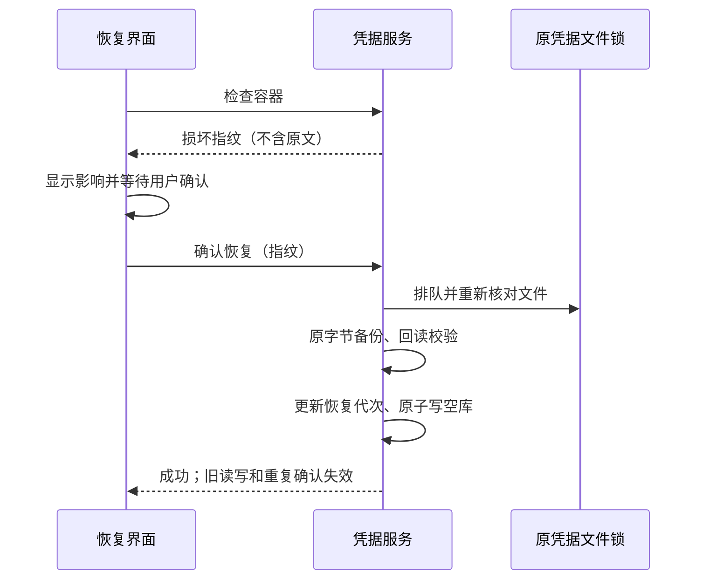

# Login Page

## 凭据容器损坏后的确认恢复

Host 确认 `credentials.json` 整体 JSON、UTF-8 或顶层 string record 无效时，启动页提供“恢复凭据存储”入口。正常库、缺失文件、单条密文解密错误、权限和普通 IO 错误不进入此流程。提示明确说明 OAuth、手填 API Key、Bot、MCP、远控等凭据需要重新配置。打开入口不修改原文件；确认框取消仍保留原始字节。

确认提交由 `ICredentialService` 唯一处理：在原有跨进程文件锁内，重新读取并核对用户看到的损坏指纹，确认仍损坏，备份原始字节并回读核验完整性，确定性备份已存在但字节不同时，保留旧备份并另建独立备份，回读核验后才继续；随后推进恢复代次并原子写入空库。备份/代次/写入失败不得删除原件。指纹改变或库已有效时拒绝旧确认，重新检查状态；重复点击不得再次清空已恢复或新保存的库。

`credentials.json.recovery-generation` 只保存随机恢复代次，不保存凭据。普通读取不取得写锁，在 IO 前后核对代次；写入在请求进入时读取代次，取得同一文件锁后再核对。恢复推进代次后、空库替换前，原件仍是已经确认损坏的内容，读取必须严格解析并拒绝，不能当作有效登录。所有写入继续在同一文件锁内执行。旧请求失败，不得返回旧登录态或把旧值写入新空库。正常并发保存沿用原有锁内合并语义。恢复代次先于空库替换持久化；替换失败时可以重新检查并确认，但旧请求仍作废。

API Key 登录也在入口捕获凭据恢复代次，凭据保存与默认配置最终提交均沿用该代次；等待配置锁期间发生恢复时，旧登录失败，默认配置保持原样。`saveIfAbsent` 和 `deleteIfEquals` 与普通写入一样，在调用进入时捕获代次、取得凭据锁后复核；恢复期间排队的旧条件写入/删除必须失败，恢复后新发起的条件操作保持原有比较和合并语义。跨文件提交继续遵守配置锁 → 凭据锁的单一顺序。

OAuth pending 尝试保留启动时的凭据代次。网络响应、回调及完成时的所有仓储读写继续受这个代次约束，不能在另一 Host 完成恢复后为旧登录重新领取写入资格。缓存恢复、会话校验、刷新与退出也保留各自请求开始时的代次；嵌套操作沿用外层代次。

恢复完成后显示已保存备份及“重新加载”按钮，用同一页面重新加载恢复原有登录流程；不自动登录、不自动填回备份、不触发更新安装。界面共用主题、国际化和响应式组件。此恢复入口只允许本机 Desktop。手机的 Credential RPC 只保留普通 load/save/delete，拒绝 inspectStore/recoverStore，UI 不显示恢复入口或本机备份路径。手机/shared-host 在凭据不可读时不能建立可信的工作区连接，应先在电脑端恢复并重新登录，再连接手机；不得绕过配对鉴权暴露重置入口，也不另建手机凭据库或 runtime。

启动阶段如果没有恢复到 OAuth 用户，且没有可用模型供应商配置，Root 会展示 `WelcomeScreen`。

所有应用内登录入口都收敛到 `WelcomeScreen`，并复用 `LoginPanel` 的 OAuth 和 API Key 流程，避免手动登录、启动引导、模型供应商连接出现多套状态机：

登录渠道元数据与当前账号状态分别处理错误。`getProviders()` 成功后，即使 `getActiveProvider()` 因凭据 JSON 损坏、解密或存储读取失败而拒绝，也保留已取得的渠道，将 hook 的当前账号投影设为空并结束加载；不能据此宣称登录成功、写入凭据或重建凭据库。渠道读取本身失败时仍清空渠道。刷新以最新请求代次为准，迟到的成功、失败与结束事件，以及已卸载 hook 的请求，都不能覆盖当前界面状态。

- 启动自动引导：`WelcomeScreen`，由 provider 可用性守卫打开
- 手动登录入口：`WelcomeScreen`，从设置页或 workspace shell 的登录操作打开
- 模型供应商连接：`loginEntryRequest` 会打开 `WelcomeScreen` 并自动启动指定 provider 的 OAuth
- 登录内容容器：页面保留 `ThemeHeroVisual` 背景；登录卡片使用 `bg-background` + `shadow-md`，保留圆角、去掉边框
- 登录操作区：「浏览器授权登录」和「使用 API key」按钮与登录内容同宽（满宽），垂直排列；品牌标识到标题 16px、标题到副标题 4px、副标题到操作区 28px
- 登录标题使用 `text-ui-xl`，跟随统一界面字号。
- 卡片与底部协议参与同一纵向布局；空间充足时卡片居中、协议靠底，空间不足时内容区允许纵向滚动，卡片、全部表单操作和协议不得重叠或裁切。原生拖拽区和桌面窗控始终留在滚动区之外。
- 页面底部居中显示协议行和版权行：协议行文案跟随界面语言，用户协议链接打开 `https://zcode.z.ai/terms`，隐私政策链接打开 `https://zcode.z.ai/privacy`，均通过 `IPlatformService.openExternal()` 交给系统浏览器

完成 OAuth 回调、保存 API Key 或点击 API Key 表单底部的“跳过”后，登录页关闭并回到正常 Root 路由。

OAuth 等待态在拿到授权 URL 后，在等待提示下显示“浏览器没打开？复制登录链接”。复制按钮只把当前这次登录尝试的 `authorizeUrl` 写入剪贴板；成功后提示“复制成功，请到浏览器中粘贴并打开”，失败提示重试。取消、失败、成功或重新发起登录时清除旧 URL，不能复制已结束尝试的链接。该入口复用标准剪贴板 API，不改变 OAuth 回调、轮询或浏览器唤起流程。

OAuth 开始、轮询或回调失败时，错误文案通过全局 toast 提示；登录卡片只保留“重新登录 / 取消”操作，不再渲染 warning 提示条，避免错误文案占用卡片布局。

用户点击“跳过”或从其它入口进入没有可用模型的空草稿首页时，首页必须展示已有的 `modelConfigMissing` 错误横幅，提供升级和模型配置入口。该横幅只投影本地 provider readiness，不触发 Agent 启动、deferred draft session 创建、联网探测或预热失败重试；保存合法 provider/model 并完成草稿模型水合后自动清除。

空草稿同时展示 workspace / Git context header 时，错误横幅必须作为独立 surface 位于输入卡外壳上方，不能嵌入包裹 context header 与编辑器的圆角卡片；横幅与输入卡之间固定保留 `mb-6`（24px）间距。视觉顺序固定为“错误横幅 → 独立间距 → 选择工作区 / Git 分支 → 输入框”。桌面端和手机 Web 端使用同一 DOM 顺序与容器层级；响应式布局只能改变换行和密度，不能把错误横幅移动到工作区入口下方或重新并入输入卡外壳。

API Key 登录表单在输入框为空时于右侧展示 `Get API Key` 外链入口；用户已经输入或回填 API Key 后隐藏该入口，避免链接占用密钥编辑空间。链接目标跟随当前选择的 provider：

- Z.ai：`https://z.ai/manage-apikey/apikey-list`
- BigModel：`https://bigmodel.cn/apikey/platform`

首次进入 API Key 登录表单时，provider 默认值只根据当前 App 已解析的 `locale` 决定：简体中文（`zh-CN`）默认选择 BigModel，英文（`en-US`）默认选择 Z.ai。`locale` 已包含“跟随系统”语言偏好的解析结果，因此表单不再单独读取系统语言或 provider 历史配置。该规则只负责表单初始化；用户手动切换 provider 后，不得因语言广播覆盖当前选择。

外链必须通过 `IPlatformService.openExternal()` 打开，保持桌面端 shell 和 Web 端 `window.open` 行为一致。输入框仍保留密码类型和回车提交能力，链接按钮只负责跳转获取密钥，不参与保存流程。

API Key 登录表单的取消按钮底部展示“跳过”链接按钮。跳过只写入当前选择 provider 对应的 `providerFamilyDomain`、`providerFamilyDomainUpdatedAt` 和 `providerFamilyDomainMigrated`，用于确认 Z.ai / BigModel 运行域；它不保存 API Key、不触发 API Key 登录成功事件，也不修改 `modelProviderFamilyModes`。

启动自动引导完成后有一个新用户直达路径：如果当前没有已打开 workspace，Root 使用 Main 注入的 conversation descriptor，必要时通过 `fileService.ensureConversationWorkspace()` 幂等确保 `<dataBaseDir>/.zcode/workspace/default` 存在。该 workspace 提供真实 cwd，但 UI 保持“未选择项目”，用户无需经过项目选择页即可直接对话。若用户跳过登录且仍没有可用模型，该草稿首页按上一条规则显示 `modelConfigMissing` 横幅。

手动登录和模型供应商连接完成后只关闭 `WelcomeScreen` 并回到原界面，不会创建默认 workspace。

整库检查与恢复只允许本机 Desktop 的 local MessagePort attachment，不能从任何网络 RPC 调用。ServiceCollection 发布凭据频道时默认拒绝 inspectStore/recoverStore，只有 Host 为本机桌面显式给出 local-desktop 恢复策略才保留这两个方法。Web Server、Source Server Core 的 `/ws`、`/ws/host`、兼容远端 stdio，以及手机和远端/source-settings attachment 均只保留普通 load/save/delete；拒绝恢复时返回 `feature_disabled`，不返回损坏指纹或备份路径、不改变原文件或恢复代次。普通客户端自行领到 host capability、伪造模式或重放票据都不能获得恢复权限。连接的 continuous/replayable 模式仍按原合同工作，不能作为整库恢复的授权依据；本次不新增远端恢复功能或独立身份体系。

| 发布入口                           | 连接 / 身份                               | 整库检查与恢复               | 既有普通读写 |
| ---------------------------------- | ----------------------------------------- | ---------------------------- | ------------ |
| Window Host MessagePort            | 本机 Desktop + local scope                | 显式允许，仍须确认指纹和备份 | 保留         |
| Window Host attachment             | 手机、remote、source-settings、未知 scope | 拒绝                         | 保留         |
| Web Server / Source Core           | 普通 `/ws`，含模式伪造                    | 拒绝                         | 保留         |
| Web Server / Source Core           | `/ws/host`，含自领有效票据                | 拒绝                         | 保留         |
| 兼容 Server stdio / R3 proxy-stdio | SSH 或其他远端通道                        | 拒绝                         | 保留         |
| 其他 ServiceCollection 发布入口    | 未显式授予本机恢复策略                    | 默认拒绝                     | 保留         |

票据签发、过期和一次性消费沿用现有连接合同，本次不把票据当作数据恢复授权。Main 为手机 attachment 固定注入 replayable 模式；本机恢复策略不从客户端 RPC 参数读取。Source settings 只代理远端服务，不能借本机进程重新获得远端恢复权限。

纯归因回调与完整登录提交共用 pending flow 捕获的凭据恢复代次。整库确认恢复后，旧 flow 的仅归因回调必须拒绝，不得向新空库写入 `oauth:login_attribution`；保留既有 phase 失败回退，新 flow 仍可保存归因。此为迟到写入隔离，不改变归因字段、登录状态或网络恢复权限。

## 登录页布局回归

`auth-config/login/manual-review/pending/login-page-layout.test.ts` 覆盖 Zai Light / Zai Dark、中文 / 英文、1280×800 桌面、390×680 窄屏和 640×400 短窗口，逐项进入默认登录与展开 API Key 状态。断言卡片无边框且有阴影、标题与操作区间距为 28px、控件不横向溢出、卡片与协议不重叠，滚动后底部协议可见；保留截图供人工验收。窄屏是同一 renderer 的尺寸仿真，不等同于实体手机或 Web 端验收。新用例保持 pending，不自动转正。
