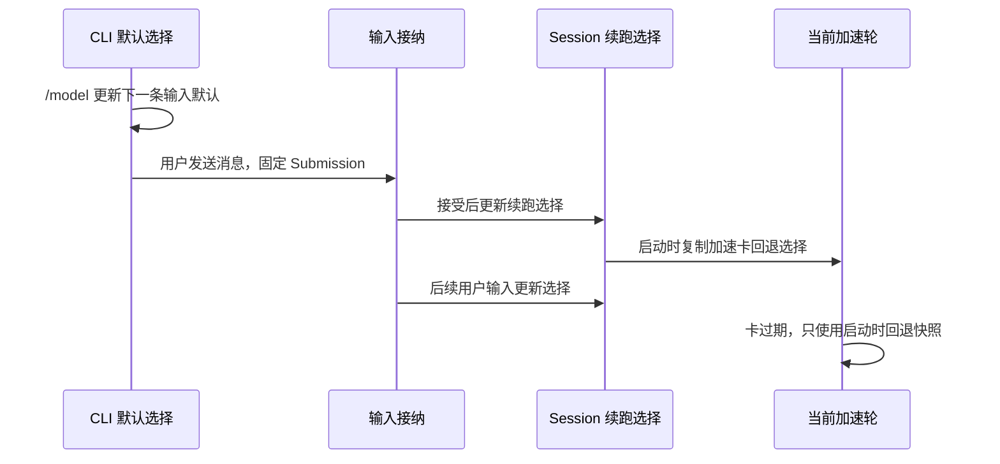

# 模型选择状态

> **已实现：** [闲时后台生命周期计划](../../../../off-peak-task/background-lifecycle-plan.md) 拆出每会话 `cliDefaultSelection`，保留 Runtime Session Selection 负责续跑，复用现有存储且不做配置/数据库迁移。验证范围与 review 修复记录见该计划。

ModelSelection 是可以持久化和传输的模型意图：

```ts
interface ModelSelection {
  providerId: ProviderId;
  modelId: ModelId;
  options?: {
    reasoningLevel?: string;
  };
}
```

它保存模型身份和已经选定的 reasoning 档位。用于执行的 Selection 必须携带合法 `reasoningLevel`；持久意图可以暂时不完整，不能因此禁止打开会话。
`maxOutputTokens` 是单次请求执行参数，不进入 Selection。Endpoint、凭据、Properties、Option Specs 和
Adapter 由执行时的 Registry 与 ModelFactory 提供。

```text
产品 Draft / Config / Record
        |
        | modelSelection?：是否指定模型
        v
ModelSelection
|- providerId + modelId：明确身份
`- options：已经选定的具体值
        |
        | + 当前 Registry 校验与请求绑定值
        v
ModelFactory
        |
        v
Active Model.options：本次生命周期的完整执行事实
```

正式持久化不保存 `options: {}` 或 option 叶子的 `null`。更新 API 可以暂时用 `null` 表达“清除显式覆盖”，
但 repository 必须将其归一化为删除对应叶子；最后一个叶子被删除后连同空 `options` 一起省略。

## Composer 与 Draft

Composer Selection 表示用户正在编辑的下一次提交。Draft 保存 Composer 尚未提交的内容：

```text
Draft
├─ prompt
├─ attachments
├─ mode
└─ ModelSelection
```

Composer 存活期间以内存状态为准。文本、附件、mode 或模型选择变化后，持久 Draft 跟随更新；附件仍由
内存持有，不在本轮跨重启序列化。Submission 被接受后只清理已经提交的内容，保留当前 mode 和
ModelSelection。App 重启或 Session 恢复时，Draft 重新初始化 Composer。

Registry 更新使未提交草稿的 Selection 失效时，按失效层级处理**临时有效结果**，不清除持久原意图；留空本身不弹错误提示：

- 普通 Provider 或 Model 失效：保持模型控件为空，等待用户重选；不自动替换为其他 Provider 或默认模型；普通账号套餐按下节统一对应当前连接；
- Provider/Model 仍有效但 Reasoning 缺失或失效：保留 Provider/Model，只清空 `reasoningLevel`，要求用户
  重新选择档位，不得自动替换成最高、最低或默认值。

全新草稿从未存在历史 Selection 时正常初始化，不显示失效通知。失效原因是根据当前 Ready
`ModelSelectionView` 计算的瞬时状态，不单独持久化为另一份模型事实。

## 当前有效选择（Todo 87，已实现）

```text
原持久意图 / 用户最新编辑
        + 目标 Host 当前已应用的 Registry 与 Account State
        -> getView({ selection })
        -> 候选 View + 本次输入的 effectiveSelection / selectionIssue
             | 只展示、编辑文本             | 权威接纳 / 显式保存
             v                            v
          原选择不变                 按各领域既有边界采用有效值
```

不带参数的 `getView()` 仍返回共享候选和 preferredSelection；带参数的读取只为该次输入计算结果，
不把消费者的选择放进共享事件或 Host 全局缓存。传入 null 表示明确没有选择，不采用 preferredSelection。

统一纯解析先识别原选择是否为正式普通账号 Provider：是则在同一快照中找唯一 `current=true`
的普通账号 Provider；否则保持原 Provider（包含 Off-Peak）。身份分类由服务装配层复用现有正式 ID
定义注入，Provider 纯模块不另抄一份 ID 表、不导入整个 shared barrel 或按字符串猜身份。
目标缺失/多个 current 时返回不完整，不随意选首项。再精确匹配 modelId 和原 reasoningLevel：
缺模型则结果为空，缺档位则只清有效结果的档位，不补最高值。普通可选菜单仍过滤 hidden，
Off-Peak 的原身份有效性检查使用同一 Registry 内部事实，不把隐藏模型塞进普通菜单。

Todo95C 关闭档位改名是失效档位的有限例外：原值仍合法时保留；否则只有明确命中已改名 Built-in 来源且目标支持 `disabled` 时，才在临时有效结果中将旧 `off/nothink` 对应过去。Node Host/Worker 复用同一来源判定，API 原生 `none` 和自定义值不全局替换。Personal 推理值域/Map 或固定配置不套用内置旧名推断。最终 Registry/ModelFactory 仍精确校验，不在执行层迁移。

读取/配置刷新不写文件。文本和附件的自动保存仍保存原选择；用户主动清空则是新的空意图。
提交被接纳后采用本次有效值时，必须检查原意图和 scope 没有被后续编辑替换。已固定的 Submission、
run、Active Model 和历史记录不重新对应账号。定时任务长期配置只在编辑保存时改变，本次 run
在目标 Host 首次派发前固定；Off-Peak 不跨账号换 Provider 或 Ticket，只保护读取不破坏原意图。

接口读取失败与正常不完整结果分开：公共 hook 继续订阅，首次临时读取失败允许有限、可取消重试，
不重试不完整选择或派发；耗尽后显式 reload。没有目标、远端未连接不回退本地。没有发送前配置同步屏障。

## 手动压缩的模型选择（2026-10-20）

手动 `/compact` 与上下文面板的压缩动作使用提交时 Composer 的 ModelSelection。
命令携带 provider/model 及稀疏 options；不携带 mode、Plan 或执行凭据。
CLI 接收时固定为 canonical intent，立即执行、FIFO 排队、恢复及提升均沿用该快照。
旧客户端缺少选择时，CLI 在接收边界固定当前 Session Selection。
已开始的请求不受后续菜单编辑影响；Session 续跑选择沿用现有 admissionSeq 防倒写规则。
摘要请求的 reasoning/output 策略继续由 compact 实现决定；自动 compact 使用触发轮的 Active Model。
验收与实施边界见 [compact 裁决](../../../../testing/conversation-session-compact-decision-worksheet.md)。

## App Recent

App Recent 保存 App 在某个 Workspace 中最近一次成功提交的 ModelSelection：

```text
App Recent
├─ scope = App × workspaceKey
├─ App 启动时从持久化载体加载到内存
├─ App 运行期间由内存值初始化新 Session
└─ Submission 被 App 接收后同时更新内存与持久化值
```

其中 `workspaceKey = workspaceIdentity?.trim() || workspacePath`。本轮不新增 `environmentId`。远程 Workspace
必须提供 `workspaceIdentity`；`workspacePath` 只作为本地兼容 fallback 和文件/命令执行路径。

菜单切换尚未产生 Submission 时不更新 Recent。Goal 自动续轮、Background 唤醒、闲时任务和 Subagent 也不更新 Recent。Prompt CLI 与 TUI 不读写 App Recent。

## Session Selection

创建或打开 Session 不要求已经绑定模型。V4 创建记录后由原生命令处理显式 Selection，不为初始化
生成随后丢弃的旧协议 snapshot。旧 snapshot 的模型字段契约不因 V4 放宽；真正启动请求时仍校验
Selection，不能为创建成功而自动选择其他模型或档位。

Session Selection 保存 Session 后续执行延续使用的 ModelSelection。普通用户消息在 CLI 串行 admission 接受时更新；已排队消息执行时使用自己的 Submission 快照，不覆盖较新输入确定的续跑选择。闲时任务在自己的生命周期中维护临时续跑选择，用户输入接管后采用用户提交的选择。验证记录见闲时后台生命周期计划。

已有 App 会话的显式选模（含切 Provider 自动选模）立即通过 `switchModelConfig` 保存完整
Selection，成功后飞书等同会话入口的新输入使用它。新建未绑定草稿仍延后到首发。配置更新不
替换正在执行的 Active Model，不改写已接纳队列的 Submission；旧队列消费不得覆盖较新配置。
详见[Composer 交互合同](../../../../composer-model-thinking.md#已有会话选模立即生效)。

### CLI 默认与加速卡回退

`cliDefaultSelection` 由 Bootstrap 按会话维护，只给没有显式选择的 CLI/TUI 用户输入补齐模型。新会话从 `~/.zcode/v2/provider_config.json` 的 `config.defaultModelSelection` 初始化，恢复会话复用已有普通用户选择；不会在每次请求时重读全局默认。`/model`、`/effort` 修改并保存这个默认值，消息尚未接受时不改 Session 续跑选择。App 继续维护 Composer 草稿，不新增第二份 CLI 默认状态。

`highspeedFallbackSelection` 仅指**加速卡过期的回退选择**：在加速轮启动、任何异步初始化之前，从当时的普通 Session 选择复制并冻结。错误处理只读这份快照，不能读取后来被新消息更新的 Session。回退保留本轮历史，移除加速卡请求鉴权；没有普通选择时保留真实卡过期错误。它不是闲时换票或通用错误回退。



这些职责拆分复用现有 Provider Config 与 Session entry，不增加配置迁移或数据库迁移。

Provider Config 更新不会重写 Session Selection。下一次执行以这份 Selection 查询最新 Registry，并创建新的 Model。Session 中只保存 Selection，因此 API Key、Endpoint 或模型配置更新可以在新 Model 创建时生效。

旧 Session 如果没有保存 Selection，由单向迁移恢复；运行 Reader 不回读旧字段，不扩展正常初始化优先级。

## 离线迁移（Todo 96）

迁移只解码已发布旧格式与静态 Provider 身份，不读取当前登录、连接、权益、Registry 或模型名单。
旧 `builtin:bigmodel-coding-plan` / `builtin:zai-coding-plan` 固定迁为同域 Individual ID；它是确定的意图落点，不说明历史套餐，更不切换当前连接。

```text
旧字段 -> 纯格式/静态身份迁移 -> 正式原意图
                                  |
                     getView({ selection })
                                  |
                         临时 effectiveSelection
                                  |
                     原接纳/派发边界 -> 最终 Model 校验
```

当前字段存在（含清空或损坏）时，不用旧字段修复。普通未知型号/Provider 保留明确身份，暂时不可用不阻止迁移。
Session 恢复返回原选择，不先按 Registry 丢弃；真正 Runtime 绑定仍只允许合法完整选择。未绑定会话的 Composer 改选/清空仅改草稿；已有会话选模由配置命令确认 Session Selection，Recent 仍按发送接纳边界更新，失败和刷新不写空。
闲时任务的身份/Ticket 迁移仍排除。用户目录 Subagent Markdown 的原地迁移由 Todo97 定义；其他来源不自动写入。

## Configured Default

Configured Default 是目标 Workspace 所属 Host 提供的新 Session 初始偏好。它保存 ModelSelection，不保存
Provider、Endpoint、凭据或模型能力，因此与 Provider Config 使用独立的版本化文档：

```json
{
  "schemaVersion": 1,
  "configuredDefault": {
    "providerId": "deepseek",
    "modelId": "deepseek-v4-pro",
    "options": {
      "reasoningLevel": "high"
    }
  }
}
```

本地 Node Workspace 的缺省物理位置是 `.zcode/v2/model-selection.json`。Host、Prompt CLI 与 TUI 可以共享
这份 Workspace 偏好；App Recent 仍是 App 专属状态，不写入这里。

旧 CLI 用户文件中的 `model` 字段只在新文档不存在时单向迁入 `configuredDefault`。旧文件中的 Provider 定义由 Personal Provider Config 迁移处理，两者不会重新合成一份旧 Runtime Model Config。

目标 Host 在生成同一份 `ModelSelectionView` 时解析 Configured Default 与 Fallback，并返回
`preferredSelection`。仍可选择的 Configured Default 优先；Provider 或模型已经消失时进入 Fallback Policy。
当前 Fallback Policy 取 Model Selection Facade 有序 View 中第一个用户可见模型，后续可以由 ZCode Built-in
推荐策略替换。hidden Provider 不参与 Fallback。Fallback 只初始化本次 Composer/Session，不自动覆写持久
Configured Default。

Entry 不再调用第二个 `resolveInitialSelection()` RPC。它从同一次 View 读取候选、Option Specs 和 Host
`preferredSelection`，再按本地状态决定最终 Composer 初值：

```text
Target Host ModelSelectionView
|- providers / models / optionSpecs
`- preferredSelection = Configured Default 或 Fallback
                 |
                 v
Entry 初始化 Composer
已有 Composer / Draft
  > 当前 View 中仍可选的 workspace App Recent
  > Host preferredSelection
```

长驻 Entry 在创建每个新 Session 时重新读取 Configured Default。文件或其他持久载体的更新只影响以后创建的 Session；已经开始的 CLI/TUI 会话由 cliDefaultSelection 补齐缺省请求；后台续跑由 Session Selection 决定。

恢复已有 Session 时不读取 Configured Default。持久 Session Selection 即使暂时不可用也保持原意，由界面提示或执行时报告不可绑定；系统不会静默换成当前第一个模型。

## Active Model

Active Model 是运行对象，不进入 Session 持久化。Loop 启动时由 Registry 根据 Selection 创建；ModelFactory
只校验并冻结已经选定的 reasoning，不再从 Option Spec 推导请求执行值。Agent/调用方必须为每次请求明确
决定 `maxOutputTokens`；选择模型的 `spec.max` 本身也是合法的显式决策。普通配置变化不修改已经创建的 Model。Guide
可以在当前 Loop 的明确 Step 边界创建并切换新的 Active Model。

模型调用的 Usage、Trace、Token 和错误归因来自 Active Model。Provider 返回的模型名称可以作为路由诊断信息，但不替代本地 Model identity。

执行历史如果需要证明当时实际使用的 option，应记录 Active Model 或 execution facts，不能在以后根据当前
Option Spec 重新推断。

## 产品配置中的 Selection

Automation、Repo Wiki、Bot、Off-Peak 和 Subagent 等产品保留自己的 Draft、Config、Record、保存事件与
执行时机，只统一其中引用模型的值类型：

```text
各产品自己的 Draft / Config / Record
                 |
                 | 可选地包含 modelSelection
                 v
          Target Worker ModelFactory
```

外层 `modelSelection` 缺失表示该产品没有固定模型，具体继承来源和解析时机由产品契约决定；产品一旦写入
Selection，就写入当时选定的具体模型和 reasoning level。两者不能合并，也不能使用 `model: "inherit"`
等伪模型 ID 表达继承。

Subagent 没有显式 override 时继承 Parent Active Model；已经保存的 Off-Peak execution selection 在派发时
使用自身身份。Automation 创建时把当前 Host preferred 或用户显式选择解析成具体 Selection 并保存，不保留
虚拟的“继承/默认模型”表单状态。

## Renderer 异步读取状态

目标 Host 的 `ModelSelectionView` 是完整候选事实，但 Renderer 读取它是异步过程。交互入口必须先处理
读取生命周期，不能用 `null` 同时表达加载、远程等待、目标缺失和错误：

```ts
type ModelSelectionState =
  | { status: "loading" }
  | { status: "ready"; view: ModelSelectionView }
  | { status: "unavailable"; reason: "remote-waiting" | "missing-target" }
  | { status: "error"; error: Error };
```

```text
明确 Workspace Target
        |
        +-- 缺失 ----------------> unavailable/missing-target
        +-- Remote 尚未连接 ------> unavailable/remote-waiting
        `-- 目标 Host Service
                 |
                 +-- 初次读取 ----> loading
                 +-- 首次失败 ----> error + reload
                 `-- 成功 --------> ready(ModelSelectionView)
```

- 候选投影 helper 只接受 Ready View，不把非 Ready 状态转换成空候选。
- Service/Target 切换的同一次 render 立即按新 owner 显示 loading，旧 Host 的迟到 Promise 或事件不能覆盖新 owner。
- 同一 owner 的 revision 单调递增；先到达的新事件不能被随后返回的旧 `getView()` 覆盖。
- 已取得 Ready View 后的后台读取失败保留 Last Known Good；首次失败进入 error 并提供显式 reload。
- Remote waiting 不回退 Base/Local Host。桌面 continuous 与手机 replayable 只共享目标 Host 的选择事实，本节不改变任务消息恢复语义。
- Composer、Automation、Subagent、Repo Wiki 与 Root 启动门禁保留各自 Draft 和提交语义，只统一候选读取生命周期。

## 初始化规则

App 新 Session：

```text
Draft
  >
当前 View 中仍可选的 workspace App Recent
  >
Host preferredSelection
```

TUI 新 Session：

```text
TUI Draft
  >
Host/domain preferredSelection
```

App 和 TUI 恢复已有 Session：

```text
Draft
  >
Session Selection
```

Prompt CLI 新 Session：

```text
显式 --model provider/model + --reasoning
  >
domain preferredSelection
```

Prompt CLI 恢复已有 Session：

```text
显式 --model / --reasoning
  >
cliDefaultSelection（从持久普通用户选择初始化）
```

Configured Default 属于目标 Workspace 的 Host/domain 配置。Host `preferredSelection` 已经原子包含
Configured Default 与 Fallback Policy 的解析结果；Renderer 不重复这套算法。

真正新建默认选择时，选择边界可按默认补全规则使用有序 `reasoningLevel.values` 的最后一项。
用户在菜单主动选择新模型只确定模型身份，Reasoning 留空等待显式选择；这不是默认补全入口。
已有 Session/Composer 的模型缺失或失效时留空；模型有效而 Reasoning 缺失/失效时只清空档位，
不补最高/最低、不切 preferred、不弹留空提示，补全前不能提交。旧结构仅在迁移边界按明确事实转换，
不从旧字段修补当前选择。辅助低成本调用在调用点显式选择 `values[0]`；ModelFactory 只校验和冻结，不补默认值。

## 写入事件

| 状态                  | 写入事件                                 | 持久化范围                  |
| --------------------- | ---------------------------------------- | --------------------------- |
| Draft Selection       | Composer 编辑                            | Entry Draft                 |
| App Recent            | App 接受用户 Submission                  | App × workspaceKey          |
| Session Selection     | 普通 Submission 被接纳；闲时执行临时设值 | Session（仅持久化普通选择） |
| CLI Default Selection | CLI/TUI 的 /model、/effort；会话初始化   | 复用已有普通用户选择存储    |
| Active Model          | Loop 启动，或 Guide 在 Step 边界切换     | 当前 Agent Loop，不持久化   |

这些状态共享 ModelSelection 语义，但不共享写入时机。一个状态变化后，可以按明确事件更新另一个状态；任何状态都不通过观察其他状态的当前值来猜测自己应该保存什么。

闲时任务临时更新内存 Session Selection，供所属后台恢复/唤起读取；不写 App Recent、Configured Default、CLI Default 或持久用户选择。整项完成且未被用户接管时恢复原普通选择；用户输入被接纳后以用户选择为准，旧闲时收口不再覆盖。
