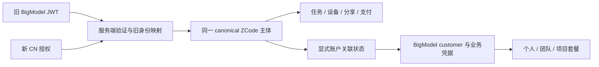
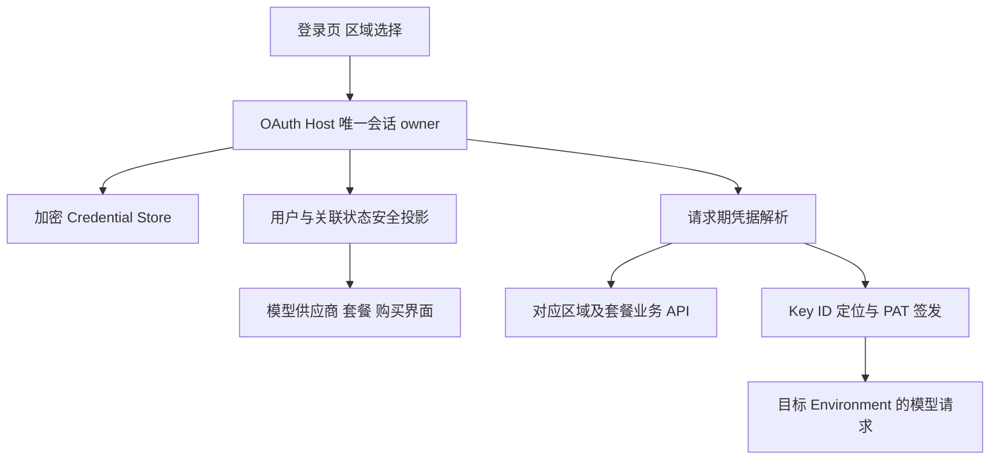
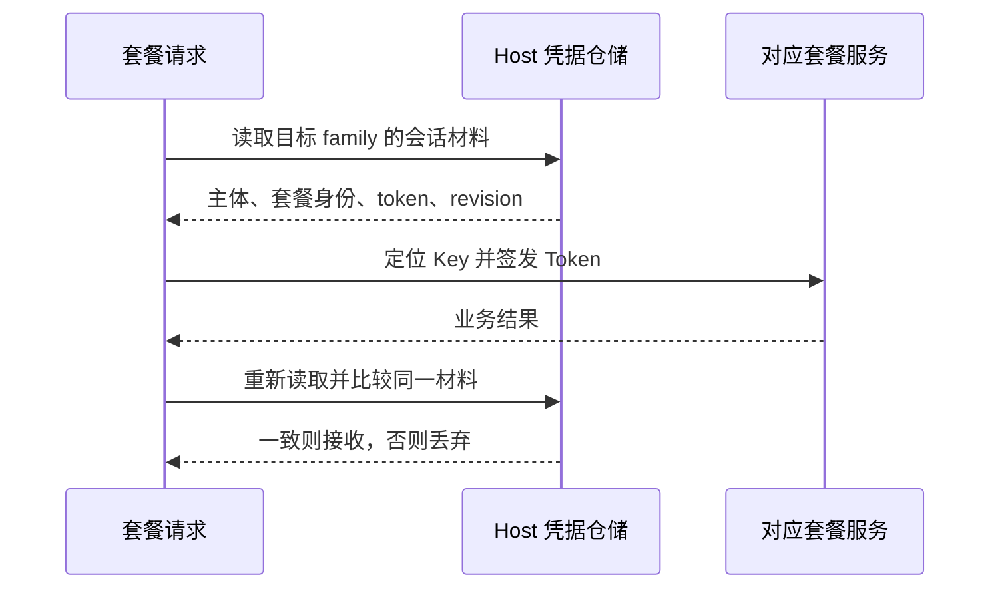
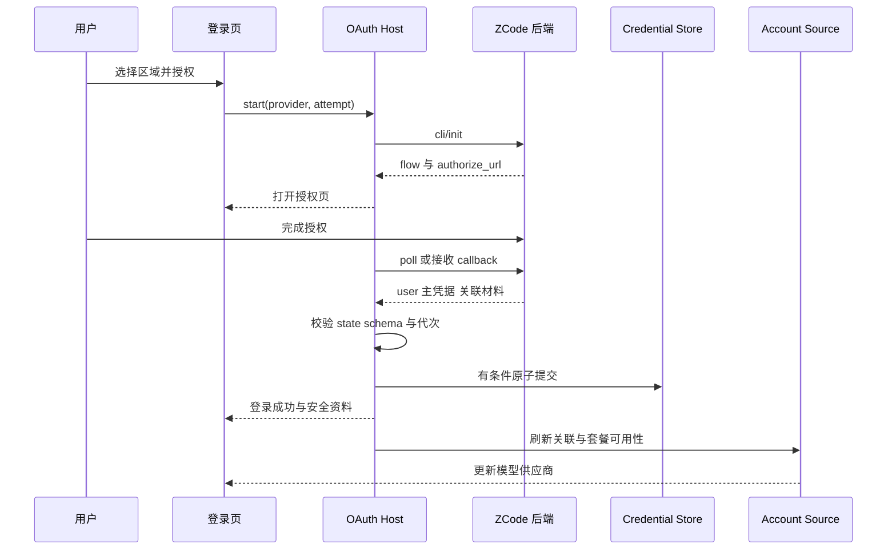
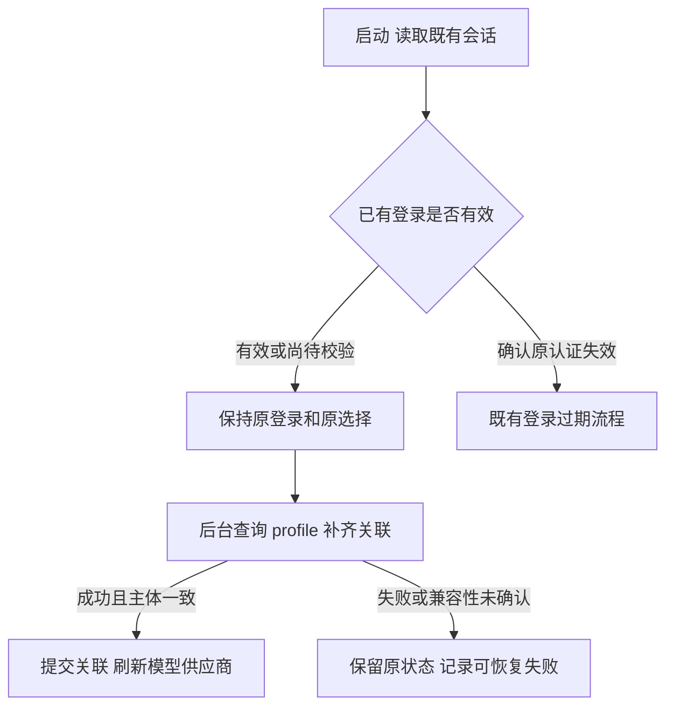
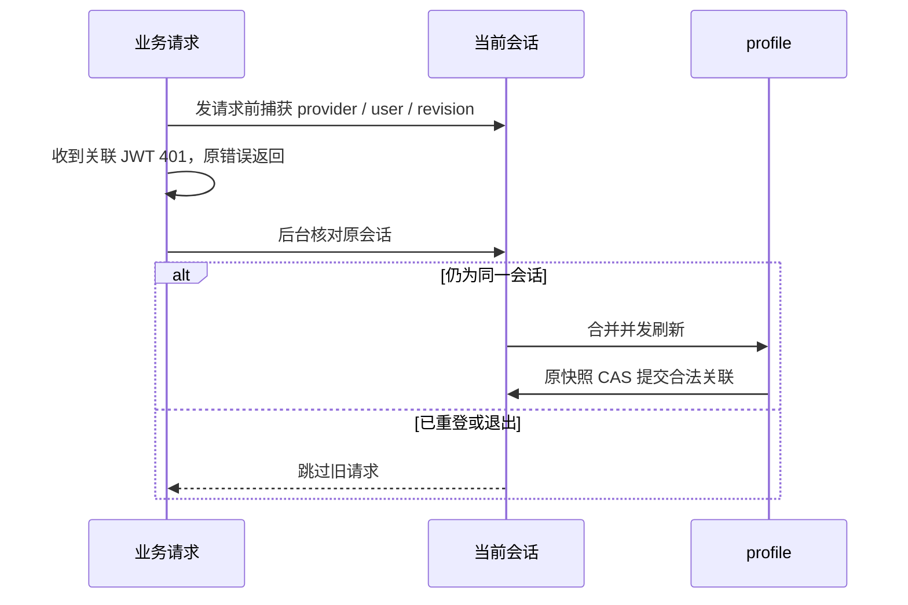
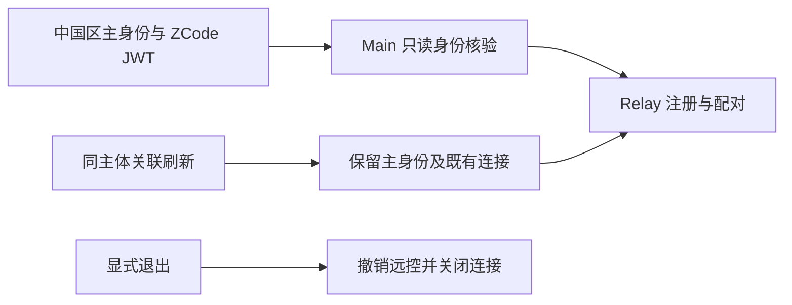
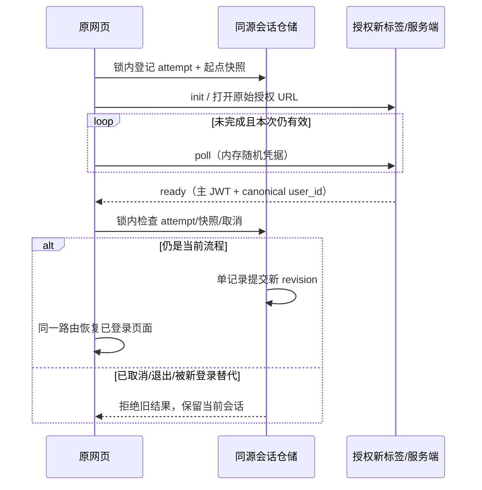

# ZCode 分区登录与账号关联技术方案

状态：实施中。已完成共享会话原子提交、桌面国内／全球分流、中国区关联材料保存及恢复保护。核心套餐凭据、旧账号补关联、套餐界面及官方 MCP 公共身份头已接通；购买/奖励嵌入页与远端原子同步已实现；Web/官网区域入口已完成本地实现与合成浏览器验收；真实整站与远端实机验收尚未完成；额度重置与团队权益已改为关联会话材料。

更新日期：2026-10-29。

## 迁移设计复核（2026-10-29）

本节是用户要求的接口设计复核，区分已证实源码风险与尚未证实的服务端行为；前述本地用例不能证明真实历史账号迁移成功。用户已确认没有后端仓库权限，本轮按已有 OAuth 接口交付。以下接口升级仅为后续建议，不是当前实施前置。Web 新入口沿用现有 init/poll，先验证本节边界。

只读检查了可访问的旧服务仓库默认分支：`OAuthService.GrantJWT` 按上游 `UserInfo.UserID` 查找/创建 ZCode用户，`User.CustomerID()` 在旧 BigModel 下回退到该UserID。旧模型曾使两种ID相同，这解释了客户端历史耦合；它不能证明新增CN入口也会延续同一ID。该旧分支未包含CN callback或新profile路由，因此不能将其当作本次测试环境后端真相。

### 不能把 BigModel 重命名为 zai_cn

`bigmodel` 在旧代码中同时承担登录渠道、套餐供应方与 customer 身份；`zai_cn` 只是中国区登录方式。替换字符串不能完成账号迁移。必须分开以下事实：

| 事实              | 唯一权威                        | 迁移不变量                                                                                      |
| ----------------- | ------------------------------- | ----------------------------------------------------------------------------------------------- |
| ZCode 资产主体    | 服务端验证后的 ZCode user ID    | 旧 JWT 与新 CN 登录对应同一人时，任务、设备、分享、支付资产延续同一主体；不由客户端按手机号合并 |
| 登录方式          | 本次认证流程                    | 可从旧 BigModel 变成 CN，不应因此改变资产主体                                                   |
| BigModel 业务账号 | BigModel customer ID            | 只用于其套餐/组织/项目，不写入 ZCode 主体 ID                                                    |
| 套餐授权材料      | 指定 audience、账号及范围的凭据 | 主 JWT、BigModel JWT、模型 PAT 不互换；失效边界独立                                             |

已复现并修正的客户端问题：`BigModelOAuthProviderAdapter.fetchUserInfo` 返回 `id=customerNumber`；旧 `refreshLegacyBigModelCachedProfile` 和显式 `restoreSession` 曾把整份业务 profile 保存。新 `refreshAccountProfile` 又要求 `user.user_id === profile.id`。不同ID的真实Host回归确认这种覆盖会发生；修复后两个恢复入口只合并展示字段，保留主ID。CN直接退出也已修复AccountSource刷新遗漏。账号场景7/7通过，证据见[身份回归](testing/desktop-auth-config-e2e-cases.md#区域迁移的主身份与退出投影auth-subject)。这不等于真实旧账号映射已被服务端证明。

### 建议收紧现有 API，而非再增加客户端推断

1. **统一主身份。** `ready` 与 `profile` 返回相同的 canonical ZCode 主体。服务端保证旧 JWT 与新 CN 登录的映射、历史资产访问及手机号规范化；若有旧 ID 别名，由服务端授权层解析，不让客户端迁移数据库或按 customer ID 猜测。无法证明映射时显式失败，不创建一个看似同名的新用户。
2. **关联结果必须完备且可判定。** 为每个账户域返回显式状态 `linked / unlinked / temporarily_unavailable`。`linked` 返回账号标识及凭据状态，`unlinked` 是明确解除关联的证据，临时失败保留最近可信值。省略字段仅表示不支持该契约，不能同时承担后三种含义。
3. **业务凭据明确 audience。** 把 ZCode 会话与业务访问材料拆成独立字段，并声明范围、有效期及刷新办法。上游 CN token 无当前用途时不应成为客户端维持 ZCode 登录的必填项；业务 token 无效只使该业务能力需要刷新，不能强退主登录。先保留原业务接口，不为此次迁移泛化成新凭据框架。
4. **区分终端与完成方式。** 扩展现有 init 的 client/completion 契约，让服务端明确返回 browser redirect 或 polling 的完成方式和合法回调；桌面/浏览器不分别猜、改写授权 URL。现有 CLI polling 可作兼容传输，但不能把合成浏览器测试当作服务端已承诺支持。
5. **Web 优先评估同源会话。** 若后端支持浏览器 HttpOnly 会话与会话查询/退出接口，Web 可免去保存主 JWT和跨标签提交锁；桌面与原生内嵌交接继续用主 JWT。该方案需要明确 CSRF、Cookie范围及原生/浏览器身份隔离，不能仅在前端改 Cookie 当作完成。本轮采用 localStorage 单记录与 Web Locks 原子提交，保留后续切换服务端会话的边界。

上述是建议新增或收紧的契约，不代表服务端已经实现。当前工作区没有该 OAuth 后端的实现源码，不能把前端 fixture 更新称为接口上线；也不会为此联系其他同事。

#### v2 响应草案

不重命名已有 v1 字段；用明确版本返回新结构，旧客户端继续使用 v1。下面是契约草案，待后端实现和联调，示例值不是实际账号或凭据：

```json
{
  "schema_version": 2,
  "subject": { "id": "zcode-subject" },
  "login": { "method": "zai", "region": "cn" },
  "associations_revision": "opaque-revision",
  "associations": {
    "bigmodel": {
      "state": "linked",
      "account_id": "business-account",
      "credential": {
        "audience": "bigmodel",
        "state": "ready",
        "access_token": "<business-token>",
        "expires_at": null
      }
    }
  }
}
```

- 桌面 ready 另带 `session.access_token`；profile 不返回或替换主会话 token。Web 会话查询不返回 token。未知失效时间用明确 `null`，仍受服务端撤销约束，不解释为永久有效。
- `unlinked` 不返回账号或凭据；`temporarily_unavailable` 返回可诊断错误码，不伪造空关联。关联事实与 `credential.state=refresh_required` 分离，凭据过期不意味着解绑。
- 主会话失效用 `SESSION_REVOKED`；业务凭据失效用 `UPSTREAM_AUTH_EXPIRED`；暂时查不到关联用 `ASSOCIATION_UNAVAILABLE`；无权限用 `INSUFFICIENT_PERMISSION`。客户端不得只看到某个上游 401 就注销主会话。
- `associations_revision` 描述服务端关联快照；本地 session revision 只保护本地并发，两者不互相代替。后端授权仍是最终权限判断，客户端缓存不授予权限。

#### Web 完成方式草案

在现有 init 上增加 `client_type=web` 和服务端允许的 return target，返回 `completion.type=poll` 或 `redirect`。原页面+新标签的产品交互保留。推荐 Web flow 绑定浏览器会话版本，由服务端在完成时比较版本并原子建立会话；旧 flow 不能覆盖已完成的新登录或撤销后的会话。轮询只告诉原页完成状态，原页重读同源会话，无需持久化 polling bearer 或在各标签间复制 JWT。

浏览器使用 HttpOnly、Secure、同源受限 Cookie；创建/退出使用 POST 与同源 CSRF 校验。桌面和原生内嵌页继续显式 bearer。后端必须明确定义：显式 bearer 存在时只校验它，失败不能退回浏览器 Cookie，以免浏览器 A 账号覆盖桌面注入的 B 账号。

旧 callback 兼容也要绑定发起时会话版本，不能到 callback 时才读取当前版本作为预期值。旧客户端尚未发起版本字段时，由后端 flow/session 关联判定；不能用“支持旧回调”作为忽略新会话覆盖保护的理由。



### 迁移验收矩阵

| 场景                                         | 必须证明                                     | 当前证据边界                                 |
| -------------------------------------------- | -------------------------------------------- | -------------------------------------------- |
| 旧 BM 资料刷新，customer ID 与 ZCode ID 不同 | 只变展示字段，不改变主身份或历史资产可见性   | 源码存在整 profile 覆盖风险，需专门回归      |
| 旧 BM 用户主动改用 CN 登录                   | 服务端延续主体与资产，账号关联不是创建新主体 | 新 CN 样本无法证明旧账号映射                 |
| 安装升级、旧 JWT 仍有效                      | 不退出；新 profile 可按旧 JWT 返回规范主身份 | 后端文字确认；缺真实旧凭据联调               |
| 关联查询临时失败 / 明确解绑                  | 前者保留可信关联，后者清理该业务材料         | 当前缺字段契约只能保留，不能证明解绑正确     |
| 主 JWT 有效、BM JWT 过期                     | 只刷新 BM 访问材料；不强退、不重放付款       | 本地明确401有回归；缺真实过期/撤销证据       |
| BM账号或团队项目变化                         | 原账号/项目缓存、PAT、权益、加速卡不串用     | 本地 revision/scope 场景已覆盖，真实业务待验 |
| 新账号登录时旧 profile/授权回包              | 旧结果不能写回或恢复旧主体                   | 本地 Host/CAS 与页面竞态有证据               |
| 浏览器、手机、官网与内嵌页                   | 各自会话/凭据边界明确，购买和分享归同一主体  | 现有合成浏览器/relay只证明客户端行为         |

### 消费链路复核

旧 Global Z.ai 的显式恢复已用不同ID夹具复现同类覆盖，修复后与BigModel共用只合并展示字段的边界；冷启动缓存与显式恢复均保留ZCode主ID。兑换阶段已要求服务端user_id，不能用上游sub/id补成主ID。此结果不证明真实历史账号的服务端映射。

| 消费方                 | 本次迁移风险                                        | 收口方式                                                                |
| ---------------------- | --------------------------------------------------- | ----------------------------------------------------------------------- |
| 缓存资料与显式恢复     | BigModel业务userinfo将customer ID当成主ID保存       | 只允许合并展示资料；两个恢复入口均验证主ID不变                          |
| Provider/套餐列表      | CN直接退出漏发AccountSource刷新，旧权益投影继续显示 | 退出后的刷新不依赖旧渠道分支；请求期仍读取当前凭据                      |
| 个人/团队PAT与Key定位  | 账号ID、项目ID或会话代次混用导致复用错误材料        | 分别绑定账户域/账号/项目/会话；现有运行时回归继续保留                   |
| 设备、分享、奖励、埋点 | 历史主ID与新canonical ID不同导致资产看似丢失        | 后端显式延续或授权解析旧ID；不由客户端猜迁移                            |
| Highspeed历史统计      | 更换主ID后同人也被判成另一owner                     | 先保证canonical稳定；缺owner不新查、旧TPS保留；不能靠改hash掩盖身份变化 |
| 远端与桌面内CLI        | 旧协议不认字段、部分同步、回滚复用旧revision        | 已有能力协商和整组事务；只有后端确认的身份可以同步                      |
| 官网购买与原生内嵌     | 浏览器Cookie身份与App显式JWT身份冲突                | 明确入口身份优先级；显式JWT失败不回退另一身份                           |

上表中的Provider投影残留不等于仍可越权请求；请求期材料解析和后端权限校验是独立边界。主ID保护修复也不等于旧账号的canonical映射已经由真实后端证明。

## 1. 目标与已确认边界

ZCode 保留一个浏览器授权按钮，通过国内／海外切换分别选择 `zai_cn`／`zai`。登录后使用 ZCode 服务端确认的账号关联，自动在模型供应商处提供对应的 Z.ai 与 BigModel 套餐能力。

本版**不弹账号服务升级窗口、不强制登出、不要求存量用户先重新授权才能继续使用原有功能**。关联信息补齐失败与登录身份失效必须分开处理。

已确认的边界：

1. 登录页维持单按钮和区域切换；重试沿用失败 attempt 的区域。
2. 登录主体只有一个。BigModel 关联凭据不代表第二次 App 登录。
3. ZCode 业务身份只使用服务端返回的 `user.user_id`；不从手机号、邮箱、Z.ai ID 或 BigModel customer ID 推导。
4. 自动关联在模型供应商处生效；不新增升级弹窗及“已读升级提示”持久化标记。
5. 保留旧 `bigmodel` 登录协议的兼容；新版登录页不因此重新增加 BigModel 按钮。
6. 关联多个套餐不等于多账号在线，也不等于允许多个具体套餐并行执行。当前执行连接与已有用户选择的行为继续遵守现行契约。

依据：[产品需求](https://internal-docs.example.invalid/redacted)、[账号关联技术结论](https://applink.feishu.cn/client/thread/open?open_chat_id=oc_98e0ff89c4dc5713084e01906ddd4675&open_thread_id=omt_198595573ecedba3&thread_position=-1)、[不弹窗的产品回复](https://applink.feishu.cn/client/chat/open?openChatId=oc_4a5a0bac5419fe5e083a18b88393ff10&position=2061)、[不强制登出的补充](https://applink.feishu.cn/client/chat/open?openChatId=oc_4a5a0bac5419fe5e083a18b88393ff10&position=2062)。

## 2. 本期范围

| 范围       | 内容                                                                                             |
| ---------- | ------------------------------------------------------------------------------------------------ |
| 主链路     | 分区 OAuth、登录与 profile 响应解析、会话保存与恢复、关联账号查询、模型供应商投影、套餐凭据解析  |
| 必须兼容   | 旧登录态、API Key、Start Plan、个人／团队套餐、支付续接、官方 MCP、桌面内 Agent、远端凭据同步    |
| 同期接入   | Web 远控／分享登录使用新版 Z.ai 国内／海外入口，移除旧 BigModel 登录按钮并保留有效登录态         |
| 兼容检查   | 桌面内 Agent 与共享凭据消费；独立 CLI 的新登录入口后续处理，不在本期新增对外入口                 |
| 不在本期内 | 客户端按手机号合并账号、服务端批量迁移、关停旧注册、任务数据库迁移、多套餐实例并行执行、自动发布 |

服务端负责验证上游身份、关联账号、延续业务 user ID。客户端只消费可信结果，不创建另一套账号映射表。

## 3. 接入前的缺口

| 当前实现                                                     | 新需求下的问题                                   |
| ------------------------------------------------------------ | ------------------------------------------------ |
| `WelcomeScreen` 的区域切换只改语言，授权固定 `zai`           | 国内选择没有进入中国区授权                       |
| adapter 注册、polling 开关及 ready 解析仅识别 `zai/bigmodel` | 只增加一个 provider 常量仍会漏轮询或解析错误     |
| 登录保存时清除另一 provider                                  | 不能同时表达一个主体的关联套餐凭据               |
| 套餐身份和请求 token 按旧 OAuth 键读取                       | 登录渠道与实际套餐账号被绑定在一起               |
| 购买门禁、官方 MCP 要求登录渠道等于套餐家族                  | 有合法关联也可能被误判未登录或拒绝请求           |
| 新旧响应沿用同一套 token 假设                                | profile 不带 Z.ai access token，直接替换会丢凭据 |
| 接入前 token 日志对 `data` 使用对象展开                      | 已先改为固定摘要，新增关联字段不得自动进入日志   |

详细代码定位与逐文件任务见[接入计划](plans/2026-10-28-zai-cn-login-integration-plan.md)。上述问题来自接入前源码检查；当前已实现和验证的部分见第 5.3、5.4 节，其余仍在实施。

## 4. 身份和凭据契约

| 字段／概念              | 职责                                                          | 禁止用途                                       |
| ----------------------- | ------------------------------------------------------------- | ---------------------------------------------- |
| `loginProvider`         | 已完成认证的登录渠道：`zai`、`zai_cn` 或兼容旧渠道 `bigmodel` | 不直接决定全部套餐可见性                       |
| `user.user_id`          | ZCode 会话、设备、权限和资产归属                              | 不替换为上游 ID                                |
| `zai.user_id`           | Z.ai 上游账号身份                                             | 不当作 ZCode 业务 user ID                      |
| `bigmodel.customer_id`  | 已关联 BigModel 的账号标识                                    | 不据此创建第二个 ZCode 登录主体                |
| 登录响应 `token`        | ZCode JWT，访问 ZCode 业务 API                                | 不作为 MaaS 登录 JWT 或模型 PAT                |
| `zai.access_token`      | 所选区域返回的 OAuth access token                             | 不直接当作 ZCode JWT；不默认适用于海外业务端点 |
| `bigmodel.access_token` | 关联 BigModel JWT，用于其业务请求                             | 不直接作为模型推理 PAT                         |
| Key ID／PAT             | 在明确的套餐、组织、项目和用途下定位及签发短期模型凭据        | 不替代登录身份，不跨账号／项目复用             |

本次样本的 `user.user_id` 与 `bigmodel.customer_id` 相等，只能说明该样本。客户端始终按字段各自的契约取值，不把这种相等写成规则。

### 4.1 OAuth 初始化

继续复用现有接口：

```http
POST /api/v1/oauth/cli/init
Authorization: Bearer <poll_token>
Content-Type: application/json
```

```json
{ "provider": "zai_cn" }
```

全球区发送 `zai`，旧客户端可以继续发送 `bigmodel`。初始化返回 `authorize_url`、`flow_id`、`poll_interval_sec`、`expires_at`；本次服务端还返回 `poll_token`。轮询令牌是 flow 凭据，不是登录后的账号 token，不写入 App Credential Store。

中国区客户端打开服务端给出的完整 `authorize_url`，不自行修改 provider、state、client ID 或回调地址。本次中国区授权路径为 `/auth/oauth/authorize`，回调路径为 `/api/v1/oauth/cli/callback/zai_cn`；这与源码中全球区的默认授权路径不同。旧 `zai/bigmodel` 已有的桌面回调地址改写先保持兼容，移除该行为须另有回跳验证。测试与生产各自解析配置，不将测试地址写死在业务组件中。

### 4.2 登录完成响应

通过 `GET /api/v1/oauth/cli/poll/{flow_id}` 获得 `ready`。下面是成功样本的脱敏结构，不表示所有账号都有 BigModel 关联：

```json
{
  "code": 0,
  "data": {
    "status": "ready",
    "token": "<ZCode JWT>",
    "user": {
      "user_id": "<ZCode user ID>",
      "name": "<display name>",
      "email": "<email>",
      "avatar": "<avatar>"
    },
    "zai": {
      "user_id": "<Z.ai user ID>",
      "access_token": "<OAuth access token>"
    },
    "bigmodel": {
      "customer_id": "<BigModel customer ID>",
      "access_token": "<BigModel JWT>"
    }
  },
  "msg": "<message>",
  "logid": "<request ID>"
}
```

`user.user_id` 和本次登录所需主凭据必须通过运行时 schema 校验。关联块出现时必须完整合法；缺失关联与上游查询失败的区别仍需服务端明确。不得把缺失 user ID 归一化成 `unknown` 后完成登录。

### 4.3 profile 响应与合并规则

```http
GET /api/v1/oauth/profile
Authorization: Bearer <ZCode JWT>
```

profile 使用同一 envelope，`data` 中包含 `user`、`zai` 和存在时的 `bigmodel`。与 ready 的区别：

| 字段                                     | ready                    | profile    |
| ---------------------------------------- | ------------------------ | ---------- |
| `data.status`                            | `ready`                  | 不返回     |
| `data.token`                             | 返回                     | 不返回     |
| `data.user`                              | 返回                     | 返回       |
| `data.zai.user_id`                       | 返回                     | 返回       |
| `data.zai.access_token`                  | 返回                     | 不返回     |
| `data.bigmodel.customer_id/access_token` | 有关联时返回，本次已观测 | 本次已观测 |

合并规则：

- 登录 ready 创建新的完整会话，不继承另一个用户遗留的关联材料。
- profile 只允许更新发起请求时的同一会话；业务 user ID 不一致时拒绝提交，不能当作自动切账号。
- profile 没有 `token`、`zai.access_token` 不代表删除它们，必须保留已保存的对应主凭据。
- 成功且明确“未关联”的完整结果才能清除旧关联。缺失字段含义尚未明确时，不能将网络失败或部分结果解释为解除关联。
- profile 失败只结束本次补关联，不改写为未登录、不覆盖原有效会话。

不将含 Secret 的原始 profile 或 token response 传到 Renderer。UI 仅接收用户资料、关联是否存在、刷新状态及可用性；请求凭据由 Host 私有服务按用途提供。

## 5. 状态所有权与持久化



### 5.1 内部会话模型

建议由一个 Host 私有快照表达以下事实：

- 会话 revision、login provider、ZCode user、ZCode JWT；
- 所属区域的 Z.ai user ID、OAuth token 及可解析有效期；
- 关联 BigModel customer ID、业务 JWT；
- 关联刷新结果及最近成功快照的归属。

这是内部模型建议，不是新增后端 DTO。物理键名和旧格式兼容尚需实施时定稿。若保留旧 `oauth:*` 键，它们只能由同一 owner 作为兼容投影维护，其他模块不能分别修改。

### 5.2 原子提交

当前 Host 的 `save/delete` 单次操作有文件锁，但连续多次操作不是一笔事务。登录身份与关联材料必须在同一提交边界更新：

1. 锁外取得并校验网络结果。
2. 锁内读取当前会话，检查预期 revision／主体仍匹配。
3. 一次写入本会话的主凭据及关联字段；保留无关凭据。
4. 写入成功后发布一次会话／关联变化事件。

可在现有 Local Credential Service 提供窄范围、Host 私有的条件批量更新能力。不向 Renderer 开放任意批量 Secret 写入接口，也不新增第二份账号数据库。

读取侧同样必须取得一次完整会话快照，不能用多次单键读取拼出不同提交的身份、token 与关联材料。条件写入比较的是锁内当前主体和 revision；跨进程写入方也必须遵守这一契约。旧 CLI 的逐键写入兼容策略未验证前，不宣称跨进程迁移已安全完成。

同账号重登、退出、换人登录、损坏恢复均使用该提交边界。读取只读数据不得为了“修复”而隐式写回默认配置。

### 5.3 先行实施：既有会话的原子存储

在接入新关联字段前，先将既有登录提交收敛到 Host 私有存储端口：`loadMany(keys)`
从一次文件读取返回指定键；`updateMany(changes, expected, assertCurrent)` 在同一文件锁内
读取、比较预期值、应用写入或删除并完成一次原子替换。比较失败时返回未提交，不回滚覆盖
其他写入者的新状态。网络和常规写入的加密准备不占用文件锁；代次检查在锁内提交前再次执行。
系统安全存储的首次旧值迁移在同一锁内完成，迁移不改变身份或 revision。

登录提交同时包含当前 provider、用户资料、业务 token、refresh token、共享 ZCode JWT
及旧 provider 键的删除。取消、晚到登录结果不能产生半份会话。现有凭据键保持兼容，
不在本阶段引入第二份账号数据库或迁移旧用户身份。

这些批量方法不能只靠 TypeScript 接口隐藏：RPC 按运行时对象方法分发。
Host 保留私有对象，对 Renderer 注册仅含 `load/save/delete` 的显式 facade。
CLI 继续使用已有同文件锁的批量存储路径。系统安全存储阶段改用 `enc:v2` 值，
旧值迁移、系统库失败边界及 Linux 要求见[凭据加密规格](plans/2026-10-29-system-credential-storage.md)。

身份快照只采用当前登录渠道、共享 JWT 和 `oauth:session_revision`。首次迁移可以重加密
其他可读旧值，但不采用其账号身份；闲置渠道的旧坏密文
不构成当前身份失效证据。新登录会整组替换旧渠道字段；当前 Host/CLI 的每次 OAuth
提交推进 revision，以区分账号及 token 值完全相同的重新登录。旧二进制不参与此协议，
不能将旧格式可读表述为任意旧二进制并发写入安全。

网络等待不占会话队列。提交、取消、新 flow 登记按同一队列顺序落定：取消先处理时
丢弃迟到的成功和失败；提交先处理时先完成该事务，后来的取消不回滚已提交登录。
主动退出遇到条件冲突明确报错；后台过期清理遇到旧快照则静默丢弃该候选。
同一 flow 用集合跟踪所有在途完成候选。任一失败先等待其他在途候选，避免后到的轮询失败
提前清理先到但仍可能成功的兑换；等待不占会话队列，也不互等错误处理 Promise。

polling flow 的期限取服务端 `expires_at` 与本地五分钟中的较早者。到期是终态，不论 Host
定时器先清除 flow，还是轮询先看到过期，下一次 `pollPendingOAuth` 都抛出过期错误，
登录页停止轮询并显示可重试的失败态，区域保持不变。定时器清除 flow 时记下其发起代次；
新登录或取消推进代次后，旧过期事实失效，不能结束新 flow。

验收先扩展 AUTH-07：监视隔离凭据文件的原子替换，任何观测到的新登录凭据都必须
同时具备 active provider、用户资料、业务 token 和共享 JWT；原取消与重复回调断言保持。

### 5.4 分区接入的存储约束

`zai_cn` 是独立登录渠道，不是第三种模型供应商家族。中国区使用服务端 init 返回的完整授权 URL；其 `zai.access_token` 保存在 `oauth:zai_cn:access_token`，禁止送往全球区业务换证接口。中国区个人业务端点尚无契约证据，本阶段只接已明确的身份授权和 BigModel 关联材料。

关联 BigModel 使用 Host 私有加密键 `oauth:linked_bigmodel`，内容包含绑定的 ZCode `userId`、`customerId` 和 `accessToken`。新登录在同一事务中写入当前响应的关联或移除旧关联，退出也一并清除。不得复用 `oauth:bigmodel:*` 伪造第二个登录。

profile 请求显式声明 `authFailurePolicy: caller-handled`，由当前会话校验结果自行处理失败；不修改全局业务请求的 401 规则。中国区缓存恢复只按 ZCode JWT 判定主体过期，短期上游 OAuth 到期不清除主登录。关联密文损坏只清除关联键，不能删除有效主体。

区域入口验收：国内发送 `zai_cn`、全球发送 `zai`，中国区 URL 不做回调重写，等待期间的取消保持原流程。完成响应中的关联必须完整合法；新登录缺失 `user.user_id` 必须拒绝。测试使用与 ZCode user ID 不相等的 BigModel customer ID，验证字段不混用。

### 5.5 套餐凭据解析（核心链路已实现）

Host 从同一原子快照生成套餐访问材料：`loginProvider`、ZCode user ID、会话 revision、目标 family、套餐账号 ID、业务 token 和共享 JWT。主登录为全球 Z.ai 时继续提供其原业务凭据；主登录为旧 BigModel 时继续提供其原凭据；Z.ai 登录的关联 BigModel 只在绑定 user ID 与当前主体一致时可用。中国区的上游 OAuth token 不投影成全球 Z.ai 套餐凭据。

个人与团队套餐必须先匹配调用方请求的账号 ID，再进行 Key ID 定位和短期 Token 签发。网络返回后重新比较同一材料，包括 revision；登录切换或同值重登都丢弃旧结果。整轮 Account Source 刷新在最终 settings 读取后再次核对 revision，旧团队组织补全也核对完整材料，避免较晚的文件读取留下窗口。Start Plan 只在该 family 确有账号材料时消费共享 JWT。解析不改变当前执行连接、不代替用户选择，也不伪造第二个登录 provider。



## 6. 新登录与存量升级流程

### 6.1 新登录



poll 与 deep link 共用完成函数，同一 flow 最多提交一次。切换区域、取消或新登录使旧 attempt 失效；旧结果不能覆盖新等待态或已完成登录。

### 6.2 存量用户升级



不使用升级弹窗，不主动登出。用户当前可用功能不等待新关联接口成功。原登录真正失效、用户主动退出仍沿用已有规则，不能将“不强制登出”解释为接受无效凭据。

**上线前置：旧版真实 ZCode JWT 必须验证新 profile 的兼容。** 已观测的新授权成功不证明旧凭据也能补关联。如果服务端不支持，优先补服务端兼容，不能以强制重登替代已确认产品要求。

## 7. 模型供应商与套餐请求

### 7.1 关联可见性与当前执行连接

Account Source 根据当前主体的关联信息投影可用套餐；设置页不再单凭 OAuth provider 判断所有套餐归属。

需分开两件事：

- **可见／可连接：** 同一主体经服务端确认可访问的关联套餐。
- **当前执行连接：** 用户已选择的家族、个人或具体团队项目。

自动补关联不改写有效的显式选择，不重定向正在运行的任务，不将查看另一个套餐当作更换执行账号。当前家族互斥规范需要同步调整展示规则，但不能直接删除所有 current 门禁。

本轮已确认：保留一个当前执行连接；新用户沿用现有默认规则；当前关联失效时提示用户重新选择，不自动切换到其他套餐。原选择意图与关联可用性分别保留，不能用后台刷新替用户做新的执行选择。

实现约束：

- `getAccountAvailability()` 只返回同一快照的登录 provider、业务 user ID、revision 和可访问的 family，不返回 token。
- `refreshAccountProfile()` 用当前 ZCode JWT 查询 profile；只将服务端确认且主体相同的正向关联合入当前会话。缺失块含义未确定时保留已有材料。网络/401/格式错误不退出。
- 启动先完成缓存登录恢复，再在后台补关联；显式刷新可重试，重复请求按会话合并。补关联不能抢占正在进行的新登录，退出/换人后丢弃旧响应。
- 设置页展示当前 family 和已关联 family。点击左侧只浏览；连接方式选择才提交当前执行 family。已有选择在重登/补关联后保留，首次无选择才沿现有规则初始化。
- 关联套餐的 Connect 使用同一登录身份与其业务材料；显式退出作用于当前主登录，不创建或退出虚构的第二个登录。购买嵌入页的凭据交接另按 T07 验收。
- 退出后仅缺当前 family、已有该 family 选择时，重登以设置 CAS 恢复可用 family，不覆盖个人/团队选择。
- 企业 pricing、组织查询、Key 查询/创建固定使用同一会话材料；每次网络请求前后和最终返回前检查 revision，换号后不继续拼接结果或创建 Key。

完整的多个 Account Provider 实例并行执行仍按[既有延后草案](working-memory/provider-refactor/steps/todo-101-concurrent-account-providers-draft.md)处理，本期不启动该改造。

### 7.2 请求材料

| 用途                            | 解析规则                                                              |
| ------------------------------- | --------------------------------------------------------------------- |
| ZCode API／Relay 身份           | 当前 ZCode JWT 与业务 user ID                                         |
| BigModel 套餐、额度、订阅、项目 | 当前会话确认的 BigModel JWT／customer ID；按各接口字段要求提供        |
| 个人／团队模型调用              | 在相应账号、组织、项目、用途下解析 Key ID，再签发 PAT                 |
| Start Plan                      | 保持现有 ZCode 身份和独立套餐契约                                     |
| 官方 MCP／插件                  | ZCode JWT＋同一会话确认的套餐 JWT＋当前团队范围                       |
| 闲时任务／加速模式              | 同一主会话与所选套餐；闲时保持 PAT 通道，加速使用该快照中的业务 JWT   |
| 额度重置状态／操作              | 同一会话的 ZCode JWT 与对应家族 JWT；复核当前连接，不从两个独立键拼接 |

请求前后校验同一会话及目标套餐 scope。不能用残留凭据、另一家族 token 或个人套餐兜底团队请求。多个 Key 的选择必须稳定；Key 被删除时按既有定位恢复路径处理，不每次创建新 Key。

官方 MCP 当前的“登录渠道必须等于套餐家族”检查应替换为可信关联检查，而非直接移除。保留前后快照校验及保留 header 防覆盖规则。

闲时和加速凭据解析遵守同一归属规则：解析所选连接 → 捕获关联会话材料 → 签发所选范围 PAT → 复核材料、连接与同步 Registry revision → 返回一份私有快照。加速请求直接取该快照中的业务 JWT，不再另读 `oauth:<family>:access_token`。主登录为中国区时，所选关联 BigModel 个人/团队仍按原支持矩阵工作；不改变取号、抽卡或推理协议。

加速卡由 Host 的 HighspeedCardService 维护，并私有绑定抽卡时的账号 scope（含会话 revision、套餐家族、组织与项目）。抽卡请求使用同一次捕获的材料；响应回来和卡复用前均复核归属。期间切换账号、重登或切换团队时，丢弃旧卡及其冷却状态，本次退回普通发送。绑定不进入 RPC 卡片或持久化数据。

### 7.3 区域隔离

中国区和全球区分别维护授权与业务目的地。`zai_cn` 不能直接套用海外 `/api/auth/z/login` 或海外套餐端点，除非其契约与实测已确认支持。刷新凭据只发往原受信区域；测试账号不用于生产请求。

## 8. 异常与并发

| 情况                               | 处理                                               |
| ---------------------------------- | -------------------------------------------------- |
| profile 网络错误、5xx、超时        | 补关联失败，保留原有效登录；不当作无关联或全局失效 |
| profile user ID 不一致、结构不合法 | 不提交，不自动合并或切账号                         |
| 确认无关联                         | 仅处理该主体的关联材料；不复制其他用户的凭据       |
| 关联 BigModel JWT 被拒绝           | 定向刷新关联／标记不可用；不直接清除 ZCode 身份    |
| 当前 ZCode 身份确认失效            | 既有过期处理，清理该会话及其派生凭据               |
| 旧请求 401 晚于新登录              | 比较原请求凭据与当前 revision；不能清新会话        |
| profile 回包晚于手动套餐选择       | 只更新关联；保留新的选择意图                       |
| 退出发生在资料查询中               | 使查询代次失效；晚到结果不能复活登录               |
| 官方 MCP 解析中发生换账号／换团队  | 丢弃整轮组合材料，不能拼接两代凭据                 |
| 新 profile 不兼容旧登录            | 保留原状态并报告兼容问题；不能自动强制重登         |

补关联请求必须有明确用途与失败归属，不能让通用 401 hook 在缺少认证失效证据时先清理整个会话。具体 API 错误码和旧凭据行为未确认前，不将任意空 401 绑定为新全局退出条件。

当前 `NodeApiClient` 的 401 处理会按请求是否携带当前 ZCode JWT 识别全局鉴权失效。因此不能直接用默认错误分类接入后台 profile 查询；应先给该请求标明补关联用途，保持正常业务请求原有的失效处理，并用运行时断言验证 profile 401 不清理有效会话。

## 9. 多端边界

- **桌面：** OAuth 与关联材料由本地 Host 管理。Main 负责窗口、路由和协调，不保存另一份账号真相。
- **远端 Environment：** 沿现有 Provider Provisioning 同步正式凭据；Source 白名单、Target schema、触发器和条件提交一起更新。目标端重新加密，使用自己的 Registry 与 ModelFactory。
- **旧 Target：** 不支持新快照时在任何写入前明确拒绝或走已确认兼容路径，不部分覆盖，不假报成功。
- **手机远控：** 继续使用 ZCode 身份；关联补齐失败不主动撤销有效连接。`desktop-continuous` 与 `web-remote-replayable` 的投递规则不变。
- **Web：** `/remote` 和分享登录有独立 state／storage。本期同步接入新版 Z.ai 国内／海外入口，移除旧 BigModel 按钮、保留有效登录态；不能把桌面完整 Secret 快照复制到浏览器。截图中的网站入口如由其他仓库维护，需要与对应维护方同步契约，不在本仓猜测实现。
- **CLI：** 桌面内 Agent 的新凭据消费兼容必须验证。独立 CLI 的新登录入口后续处理，本期不新增对外入口；共享文件的读写与清理不得破坏新会话。

## 10. 日志与运行证据

只记录 provider、阶段、结果、是否有关联、耗时和 request ID，不记录 token、授权码、完整用户资料或 Cookie。本分支已先将 Z.ai adapter 对 `data` 的展开式脱敏改为固定字段摘要；后续关联接入不得恢复原始响应输出。安全回归与原登录竞态 E2E 已通过，见[AUTH-07 补充](testing/desktop-auth-config-e2e-cases.md#auth-07-补充关联凭据日志隔离)。

2026-10-28 已使用测试账号完成以下验证：

| 请求                                                      | 结果                                                       |
| --------------------------------------------------------- | ---------------------------------------------------------- |
| 中国区站内账号接口                                        | 200，确认已有站内登录                                      |
| `cli/init(provider=zai_cn)`                               | 200／code 0                                                |
| 中国区授权与回调                                          | 授权成功                                                   |
| `cli/poll`                                                | 200／code 0／ready                                         |
| 使用新 ZCode JWT 查询 profile                             | 200／code 0，返回 Z.ai 与 BigModel 关联                    |
| 站内 session token 或 OAuth access token 直接查询 profile | 本次均为 401；站内 token 附加 `X-token-type: zai` 仍为 401 |

同一样本中，ready 与 profile 的三组身份一致；profile 不返回 ZCode token 或 Z.ai access token。OAuth access token 有效期为 3600 秒，ready 未返回 refresh token。ZCode JWT 与 BigModel JWT 未观察到 `exp`，不能推断为永久有效。

该验证不覆盖旧凭据、无关联账号、真实套餐请求、刷新或多端。原始 request ID 与更完整的脱敏结构见[接入计划的实测记录](plans/2026-10-28-zai-cn-login-integration-plan.md#15-测试环境实测-2026-年-10-月-28-日)。

## 11. 实施顺序与验收

| 阶段       | 交付                                                      | 必要验证                                             |
| ---------- | --------------------------------------------------------- | ---------------------------------------------------- |
| 契约确定   | ready/profile 分开 schema、旧凭据兼容、缺失关联与刷新语义 | 成功／无关联／错误样本；旧 JWT 查询 profile          |
| 登录主链   | 中国区配置、统一完成函数、条件原子会话提交                | 区域正确；取消、重复回调、换账号与冷启动             |
| 关联接入   | Account Source、套餐材料、购买与官方 MCP                  | 无关联不报登录失败；不串账号／项目；不打印凭据       |
| 存量与多端 | 后台补齐、供应商更新、Remote/Web/CLI 适用项               | 无弹窗、不强退、原功能保持、同步完整与旧 Target 拒绝 |

优先复用现有 OAuth 竞态、凭据恢复、过期、Provider 响应式与购买 E2E。新增场景先维护 case/fixture，再改代码。接口成功不能代替 UI 或跨端验收；App 业务单测已退役，不恢复旧单测。

实施交付需完成适用的 typecheck、lint、architecture、格式检查及桌面／手机／远端 E2E；涉及 CLI 时执行独立测试。具体文件、命令和候选断言见[接入计划](plans/2026-10-28-zai-cn-login-integration-plan.md)。

## 12. 契约结论与待闭环验收

后续确认和实现已替代最初的接口前置问题。当前按已有OAuth接口交付，不等待后端仓库或新Web会话API。接口说明、客户端合成验收、真实账号运行结果分别记录。

| 项目                   | 当前结论                                                      | 尚缺的证明                                      |
| ---------------------- | ------------------------------------------------------------- | ----------------------------------------------- |
| 旧ZCode JWT查询profile | 后端确认支持；客户端保持旧登录、后台正向补关联                | 真实旧JWT与新CN登录的主身份/历史资产连续性      |
| profile缺关联块        | 可能未关联，也可能查询失败；保留同主体已有材料                | 真实无关联/上游失败样本                         |
| 关联JWT刷新与拒绝      | 现有profile可刷新；明确401触发定向后台刷新，不重放请求        | 真实过期/撤销token验证                          |
| CN业务凭据             | CN上游token无当前业务用途；使用关联BigModel既有接口/Key       | 真实套餐请求及模型执行                          |
| 官方MCP                | 后端确认接受关联组合；客户端头/材料绑定已验证                 | 真实MCP工具调用                                 |
| Web与官网              | 现有init/poll；单记录、起点CAS和revision；本地22+18浏览器场景 | 手动法律授权后的实际CORS/上游流程；禁止自行部署 |
| Remote与设备           | v3原子同步、本地relay和390px浏览器路径已验证                  | 隔离SSH、实体手机、公网relay及目标系统实机      |

以上未取得的真实证据仍是整体完成的缺口；不得以本地成功或口头接口确认代替。详细提交和证据见[接入计划的当前完整性核对](plans/2026-10-28-zai-cn-login-integration-plan.md#完整性核对按各项最新证据)。

### 官方 MCP 关联会话约束

官方 MCP 调用与额度查询共用 Host 凭据解析。主登录渠道可以为 `zai_cn`，付费材料按当前执行连接的 family 从同一会话读取；不得要求登录渠道等于套餐 family。仅身份请求保留主登录标识，不添加虚构套餐。读取 Registry、当前 Account Access 与凭据后复核主体、revision、材料和选择；异步读取前后同步检查 Host Registry revision，换号或重选时拒绝旧组合。对外仍只发送既有 ZCode/套餐/团队身份头，不发送中国区上游 OAuth token 或长期 API Key。

### 远端 OAuth 会话同步补充

远端执行镜像沿用 [Provider Provisioning](remote/provider-provisioning.md) 的唯一 Source/Target 与 Main lane。v3 将国内字段、关联块和 revision 纳入现有会话组；旧 Target 零写入拒绝。目标只以整组批量 CAS 提交和回滚，不把多个单键保存当作原子登录。v1/v2 兼容输入不继承目标旧关联。具体边界与验收以该文档为准。

### 购买页与奖励页的凭据交接

嵌入网页通过 OAuth Host 的一次性会话快照取得主身份、会话 revision、ZCode JWT 和（仅旧 Z.ai/BigModel 登录）当前渠道 OAuth token；不通过多次通用 credential.load 拼接。中国区 OAuth token 和关联 BigModel 私有 token 不返回给 Renderer。国内用户的购买页只得到 ZCode JWT，由官网 profile 按当前主会话补关联；奖励页按原接口直接使用主 JWT。

购买目标 family 与登录渠道分开：URL 仍表示待购买套餐，注入的 active provider 表示真实登录渠道。两类网页在切换会话、重登、关闭和离开受信 URL 时清除旧材料；注入前复核主体/revision，并在脚本执行处校验页面 URL。奖励 bridge 识别 zai_cn，购买页仍只提供已存在的 zai/BigModel 套餐入口。

### 后端确认补充

[21:05 后端回复](https://applink.feishu.cn/client/chat/open?openChatId=oc_0ecc69bfb844c018e4f84a8103fa3d41&position=3510) 确认存量 ZCode JWT 可访问 profile，缺块可能是未关联或查询失败，重复 profile 可刷新，官方 MCP 接受关联 JWT。国内使用关联 BigModel JWT 和既有业务/Key 逻辑，不使用 CN 上游 token 换取海外业务凭据。新 customer ID 聚合查询作为后续独立优化，本轮不引入。以上是接口契约确认，仍与真实账号运行时验收分别记录。

### 关联业务 JWT 的拒绝恢复

对直接发往受信 BigModel 业务路径、且 Authorization 精确等于当前关联 JWT 的请求，确认 HTTP 401 或数字 code=401 时，在后台触发一次合并的 profile 刷新。刷新必须带发起时的 provider/user/revision 预期；提交仍由原会话快照 CAS 保护。原业务错误照常返回，不等待 profile 完成、不自动重放请求（包括支付）。下次用户操作读取新材料。

只覆盖关联材料（登录渠道与 BigModel 家族不同）；主 JWT 与旧直接登录仍走原失效路径。PAT、普通403、错误 origin、已经被替换的关联 token、caller-handled 请求不触发此恢复。双 JWT 的附加头和绕开 NodeApiClient 的通道不由这个观察器推断失效来源。



本地验收：`account-key-usage-scene.test.ts` 的 ASSOC-401 覆盖普通403不刷新、同 token 新 revision 拒绝旧401（等待后台完成屏障）、并发401合并、原请求不重放、新请求用新关联材料、JSON401刷新期间退出不复活。与原有账号4例、BigModel直接登录401例组合，6例通过；制品 `desktop-e2e-20261028135859983-p17763-2b5fdf1570ed49cf`。仅合成 HTTP 和真实本地 Host，不代表真实过期 token 或手机/SSH 实机已验收。

### 中国区身份的手机远控鉴权

Main 的遥测/远控只读鉴权读取器必须接受 `zai_cn`，使用当前 ZCode 主 JWT 和主 user ID，不使用上游 OAuth 或关联 BigModel JWT。读取期间仍复核 provider 与 user ID；不得借遥测读取清理凭据。中国区账号应能注册设备并建立 relay 配对；仅刷新关联材料不撤销已配对连接，显式退出仍关闭连接。此项不改变网页登录授权页方案。

验收扩展现有 `web-remote-control-session-events.test.ts`：隔离中国区主登录→真实 Main 远控启动→本地 relay WebSocket 配对→实际 profile 更新关联→原设备与连接保持→实际 OAuth 退出→连接关闭。它验证 Main/Host/relay 边界，不代表实体手机页面或公网 relay 已验证。



2026-10-28 本地验收：旧实现的中国区远控保持 `auth-required`，修复读取器后完成真实 Main 注册和 WebSocket 配对。`web-remote-control-session-events.test.ts` 共3例通过，制品 `desktop-e2e-20261028140521667-p24525-f392f902ed90c4d1`，包含原有设备保存失败、退出后设置失败两例。关联刷新只改变 revision 与关联材料，原设备SID和已配对socket保持；退出后socket关闭。使用本地fake relay，不代表手机浏览器或真实relay完成。

### 手机 Web 与中国区桌面身份的兼容验收

已存在的浏览器登录和中国区桌面主登录，只要 ZCode user ID 相同，就按现有 relay 配对合同连接；不要求 OAuth 渠道名称相同。浏览器使用自己的主 JWT，不复制桌面上游/关联 token。候选 `web-remote-control-regional-login.test.ts` 用390px触屏页面核对真实 Web→relay→Main→Host 连接，关联刷新后可继续读取工作区，桌面退出后配对失效。

2026-10-28 验证通过：`desktop-e2e-20261028141013492-p26279-ad749d8626346fe2`。浏览器使用独立合成JWT，reload后收到新socket的成功bootstrap，包含实际Host工作区；页面截图显示项目列表，退出后显示桌面端已离线。手机缓存未包含CN上游或关联token。范围为桌面本地服务+390px Chromium触屏模拟+本地relay，不含新区域网页登录入口、公网或实体手机。

### Web 远控与分享页区域授权

已实现一个授权按钮、国内/海外切换、原页面保留、新标签页授权、原页面完成登录。存量有效登录不强退。用户确认无后端仓库权限后，本轮采用既有init/poll；不新增或假定同源Web会话API。此前的HttpOnly会话及v2接口草案仅保留为后续建议。

主仓远控/分享的22项本地浏览器验收、官网18项浏览器验收已通过，包括区域、尺寸、主题及相应并发边界。2026-10-29补充真实测试账号的CN网页/桌面授权、重启恢复、退出隔离和退出重登；主体及关联账号保持一致。关联JWT访问BigModel账号接口成功，过期团队权益与客户端提示一致。另用真实本地副本读取4条旧任务，包含归档与旧版格式；2个旧公开分享在当前页面展示，1个旧链接正确显示过期，1个DOCX附件大小及摘要校验一致。完整记录见[集成计划的真实账号验收](plans/2026-10-28-zai-cn-login-integration-plan.md#2026-10-29-真实账号本地验收)。仍不能据此认定服务端存量归属、私有分享权限/继续导入、有效套餐推理/MCP、全球区真实授权、生产CORS、支付或全平台已经验收。

### 现有 OAuth 下的浏览器会话提交（2026-10-29）

- Web 的 CN/Global 登录复用现有 `/api/v1/oauth/cli/init` 与 `/poll/{flowId}`；服务端授权 URL 原样打开，原页保留，轮询串行。单记录保存主 JWT、服务端 `user.user_id`、展示信息、登录渠道与随机 revision。全球区还保存本次响应的全球业务 token，供同源官网查询全球套餐；CN不保存其上游token，关联BigModel token不在浏览器持久化。
- 新旧授权共用 `zcode-browser-oauth` 锁和唯一 attempt。发起时记录当前会话快照；回调/ready 提交前检查 attempt、快照、取消状态。缺少起点快照的旧 pending 不完成，已有有效登录不受影响。
- 退出使 attempt 与 epoch 失效。同源其他标签的新登录/退出使旧在途结果失效；JWT 相同但 revision 不同也属于新会话。设备查询、令牌请求和已配对连接均按此边界收敛。
- 缺少 Web Locks 时保留历史登录读取与退出能力，但不降级为不安全的新登录提交。


